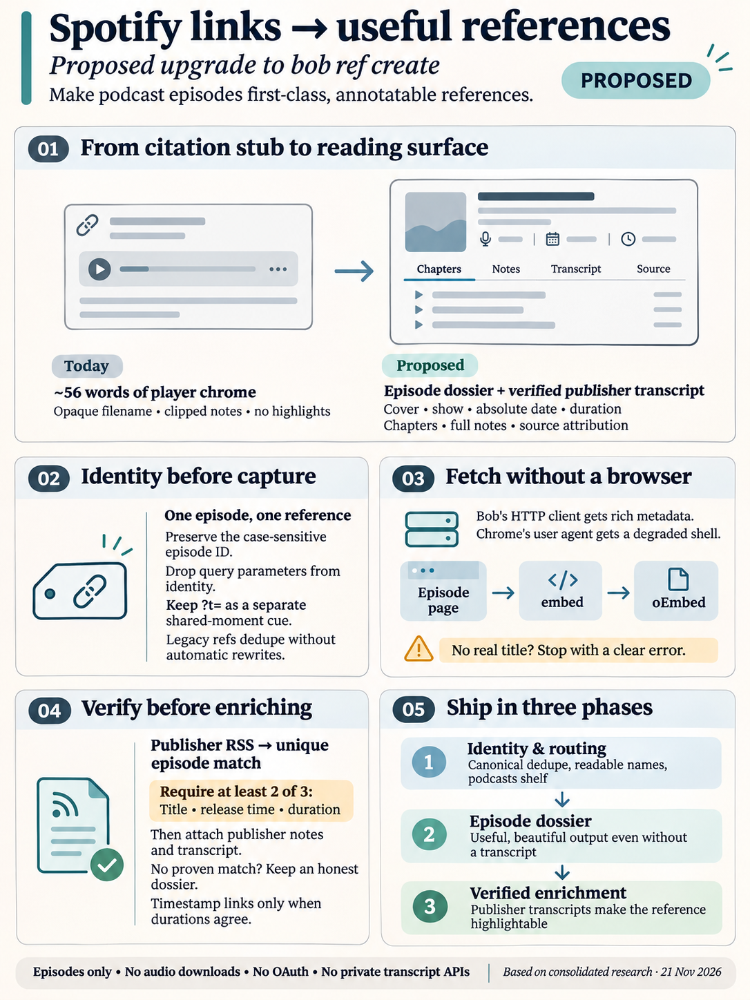
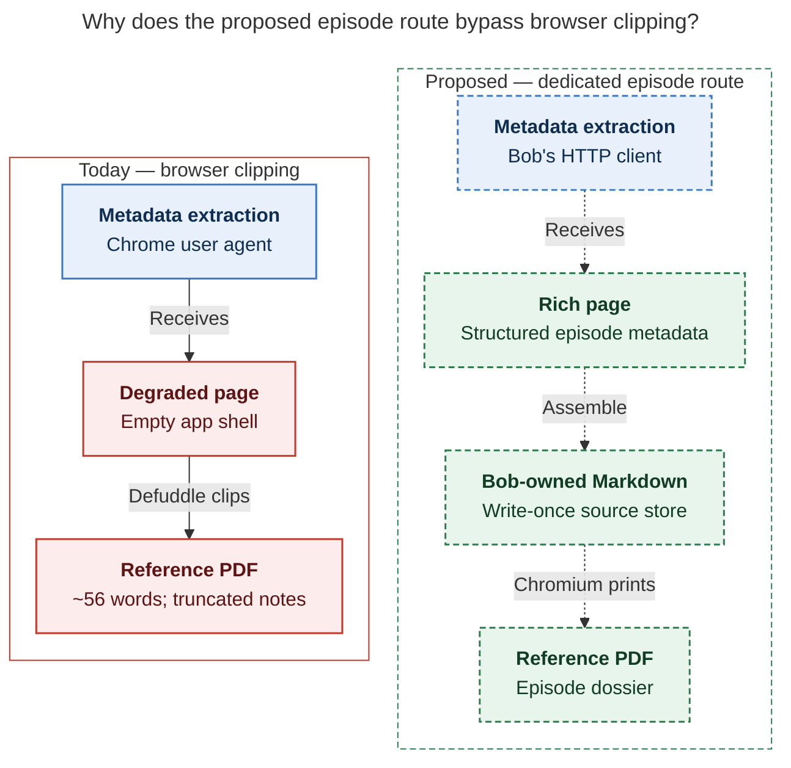
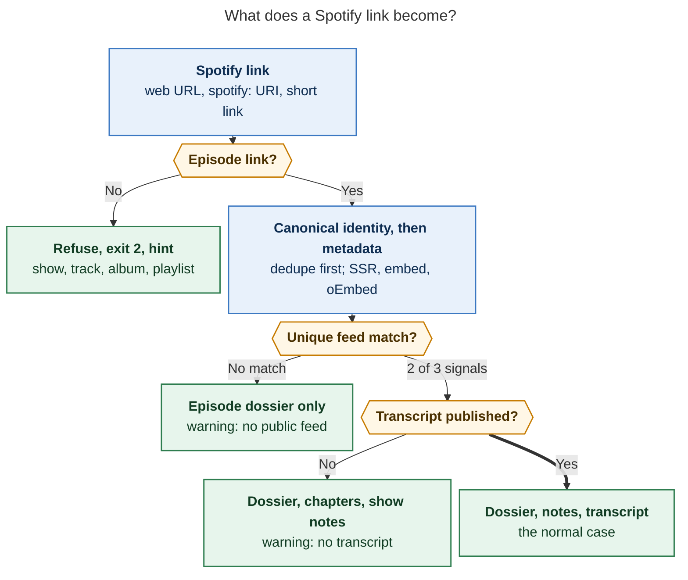
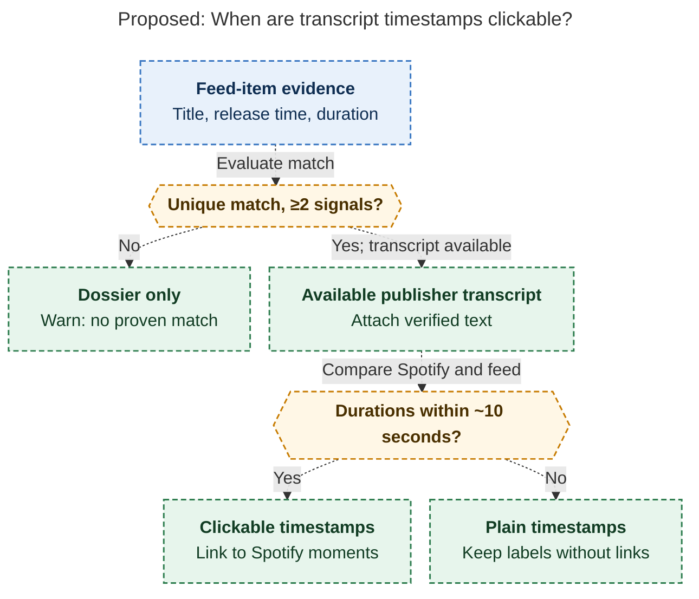

# Smarter `bob ref create` for Spotify URLs — consolidated research

> **Research query:** How should `bob ref create` become much smarter about Spotify
> URLs — fixing the issues in today's Spotify refs (such as
> `~/bob/ref/blogs/4ugvfwty2i8hgagsvt7pjc.md`, its ref task, and its PDF) and making
> only justified, objective improvements, in a design that is intuitive, reliable, and
> beautiful? Is this a good idea, would a different approach be better, and which
> requirement adjustments are justified, ending with a recommended solution?

## Bottom line

[All five researchers](#sources-and-provenance) agree the feature is worth building —
and all five agree the request needs one reframing: **this is not "scrape Spotify
better"; it is "make a podcast episode a first-class, annotatable reference, with
Spotify as its most common front door."** Build a dedicated episode route modeled on
the existing arXiv family (`arxiv.rs`): parse identity first, canonicalize before any
network, fetch metadata over plain HTTP with no browser and no OAuth, generate Markdown
into the write-once source store, and print with Bob's existing reader template.

Ship in three phases:

1. **[Identity and routing fixes](#phase-1---identity-and-routing)** (small,
   independently shippable): a `SpotifyResource` parser, canonical
   `https://open.spotify.com/episode/<id>` dedupe that retroactively fixes
   [the two legacy refs](#the-two-legacy-refs), title-derived stems,
   `ref_type: podcasts`, refusal of non-episode links and `-L`, plus three general bugs
   the audit exposed.
2. **[The episode dossier PDF](#phase-2---the-episode-dossier-pdf)** (the visible
   upgrade): a browserless metadata fetch (server-rendered page → embed → oEmbed
   fallback ladder) rendered as a beautiful 1–2 page episode card with cover art,
   show/host byline, absolute date, duration, clickable chapters, full show notes, and
   a Listen-on-Spotify link.
3. **[Verified publisher-transcript enrichment](#phase-3---verified-publisher-transcript-enrichment)**
   (the annotation payoff): match the show's public RSS feed through the keyless iTunes
   Search API, and attach the publisher's own `<podcast:transcript>` and chapters only
   when the match is proven. Both shows Bryan has actually saved publish full VTT
   transcripts, which would turn [today's 56-word stubs](#what-a-spotify-ref-is-today)
   into ~18,000-word searchable, highlightable documents.

[Never download episode audio, never use Spotify OAuth or private transcript
APIs](#what-is-off-the-table), and never let an unparsed Spotify URL fall through to the
article engine again.

## What a Spotify ref is today

*Consensus, verified.*

The vault has two Spotify refs, both episodes of *The Pragmatic Engineer*, both created
via share-to-Keep → `bob gkeep pull`: `ref/blogs/4ugvfwty2i8hgagsvt7pjc.md` (Harjot
Gill) and `ref/blogs/5ygcxo9nxh38ns7ghtbddm.md` (Satya Nadella). Both reading tasks are
closed; both have **zero highlights** — there is nothing in the PDFs worth marking,
even though Bryan already cites the Nadella episode from a zettel
(`sase_blog_zettel/microsoft_ceo_thinks_model_agnostic_architecture_is_good.md`). The
refs work as citation anchors and fail as annotation surfaces. That is the product gap.

Every report independently confirmed the same defect ledger:

| # | Defect | Mechanism (bob-cli `270b5b23`) |
|---|---|---|
| 1 | Duplicate refs on re-share: a different `si=` share token, or none, fails `bob ref find` and plans a `_2` copy (reproduced by cdx and cld) | `si`/`sci` are not in `TRACKING_PARAMS` (`clip_url.rs:15` lists only `fbclid`, `gclid`, `mc_cid`, `mc_eid`, `ref_src` + `utm_*`), so share tokens stay in the dedupe key |
| 2 | Opaque 22-char base62 ID becomes the filename, note ID, `^ref-` block ID, and wikilinks | `stem_from_url` (`clip_url.rs:324`) prefers the URL slug; `is_opaque_segment` (`clip_url.rs:403`) only rejects hex IDs/UUIDs, and Spotify IDs are base62 |
| 3 | PDF body is player chrome: ~56 words, description cut mid-word ("Built for th"), "See all episodes", duplicated title, giant cover | The browser clip path gets Spotify's empty SPA shell (see [the user-agent split](#spotify-serves-full-metadata-to-plain-http-clients)) and Defuddle extracts the visible pre-fold fragment |
| 4 | The bad extraction files silently | `fidelity_verdict` (`web_clip_adapter.py`) only refuses when `kept < 300` **and** `page >= 400` words; the collapsed page is thin on both sides |
| 5 | No `author`, no `published`; the PDF freezes a relative date ("Wednesday") | Chrome-UA page carries no JSON-LD/meta; `readJsonLd` also only recognizes `Article`-family types, not `PodcastEpisode` |
| 6 | Wrong shelf: `ref_type: blogs` | `DEFAULT_ARTICLE_REF_TYPE` (`create.rs:50`) and `INGEST_ARTICLE_REF_TYPE` (`ingest.rs:37`) hardcode `blogs` |
| 7 | Tracking in provenance: stored `source_url` keeps `si`/`sci`; the PDF masthead prints the post-redirect URL with `nd=1&dlsi=…` | The adapter prints `final_url`, not the cleaned URL — a general bug affecting any redirecting site (cld) |
| 8 | `source_markdown` is null, so `bob ref links` is broken | **General bug:** the ingest path never persists the write-once source store — `persist_article_store` is called only from `clip.rs:810` (direct CLI); `ingest.rs` passes `expected_source_pointer: None` (verified at `ingest.rs:811`). gem found only 1 of 28 `ref/blogs/` notes has a source store |

## Facts established, and swarm conflicts resolved

### Spotify serves full metadata to plain HTTP clients

*Conflict resolved.*

The reports disagreed sharply here: cld claimed the plain episode page is "a JavaScript
shell: no `og:` tags, no JSON-LD, no description," while gem, grk, mus, and cdx all
reported rich server-rendered content. **The lead re-probed on 2026-11-21 and gem's
user-agent split is correct:**

| Client UA against `open.spotify.com/episode/4UgVFWty2I8hGAgSvT7pjC` | Size | JSON-LD | `initialState` | `music:*` meta |
|---|---:|:---:|:---:|:---:|
| `bob-cli/1.0` (matches `fetch.rs:286`'s own UA) | 228 KB | 1 | present | present |
| Desktop Chrome 130 UA (what Playwright sends) | 169 KB | 0 | absent | absent |

The full page (plain-client UA) carries a base64 `initialState` entity with the exact
title, a 4,210-char `htmlDescription` (all links and 16 chapter timestamps), plain
description, show name, publisher (*Gergely Orosz*), `releaseDate.isoString`
(`2026-11-18T18:08:00Z`), duration (5,197,032 ms), language, media types, cover art at
64/300/640 px, and the show URI — plus JSON-LD `PodcastEpisode` and `music:*` meta
tags. **Today's broken capture is largely self-inflicted: the headless browser's
Chrome UA triggers the degraded shell.** Bob's own curl-based `fetch.rs` gets
everything, browserless, in one request. [The capture-path
diagram](#figure-capture-paths) contrasts today's Chrome-UA clip with the proposed path:
Bob's HTTP client fetches episode metadata into Bob-owned Markdown, which Chromium still
prints as the dossier PDF.

_Browserless metadata fetch avoids Chrome's degraded shell; Bob-owned Markdown still prints through Chromium into the episode dossier PDF._

The resulting metadata ladder (merged from gem's tiers, grk's fetch order, and cld's
fallbacks):

- **Tier 1:** episode page via `fetch.rs` → `initialState`, then JSON-LD, then
  `og:`/`music:` meta. Undocumented page representation — parse defensively, validate
  against the exact entity ID, pin today's shape in fixtures.
- **Tier 2:** `open.spotify.com/embed/episode/<id>` `__NEXT_DATA__` (title, show, ISO
  date, duration ms, art), then documented
  [oEmbed](https://developer.spotify.com/documentation/embeds/reference/oembed)
  (title + 300 px thumbnail only — verified thin by four reports).
- **Fail closed** if no tier yields a real title: typed error with a hint, never a
  silent 56-word stub. Missing art/duration/publisher is graceful degradation; a
  missing title is not.

Parser gotchas the probes surfaced: track pages emit a JSON-LD **array**; `og:type`
lies (`music.song` for episodes); descriptions contain U+2060 word joiners that must be
stripped; the oEmbed thumbnail host varies (`image-cdn-fa.spotifycdn.com`, not always
`i.scdn.co`).

### Spotify IDs are case-sensitive

*Conflict resolved.*

Lead-verified: the exact-case episode URL returns 200; the lowercased ID returns 404.
So **the canonical URL and dedupe key must preserve ID case** (gem, cdx). grk's
"lowercase the ID for dedupe" is rejected — a lowercase Bob filename is fine, but it
can never reconstruct the Spotify ID, and lowercased keys could collide two distinct
episodes.

### The open podcast ecosystem supplies the annotation body

cld (8 episodes) and gem (9 shows) ran overlapping keyless probes:
show name → iTunes Search API (`media=podcast`) → `feedUrl` → RSS `<item>`. Merged
results: every real show's public feed was findable; items matched the Spotify episode
on title + release time + duration in all but one case; roughly half of the probed tech
shows publish Podcasting 2.0 `<podcast:transcript>` files — **including both shows
Bryan has actually saved** (Pragmatic Engineer VTT: 18,736 words, 1,750 cues, diarized;
Nadella episode: 11,540 words, in which gem found 9 exact passages matching Bryan's
zettel claim). Instructive edge cases: Joe Rogan's RSS duration differs from Spotify's
by ~359 s (dynamic ad insertion → timestamps drift), and one Lex Fridman iTunes
candidate's feed 404'd (try several candidates). Industry-wide transcript adoption is
low (~5 % per one vendor figure), so the no-transcript path must look good.

The feed's show notes alone beat today's capture: the Pragmatic Engineer RSS item
carries ~4.5 KB of show-notes HTML against the 56 words captured today.

### What is off the table

*Unanimous.*

- **Spotify Web API:** since the February 2026 changes, dev-mode apps require a
  Premium-owned app, a 5-user allowlist, and OAuth; no transcript field anyway. All
  five reports reject it for v1.
- **Spotify's in-app transcripts:** session-gated private API; terms and fragility.
- **Audio download:** feeds carry 64–91 MB MP3 enclosures; the vault tracks `*.mp3` in
  Git with GitHub's 100 MB limit already bitten; Spotify's own streams are DRM
  (`MP4_128_CBCS`). Link to Spotify, never mirror audio. The 30 s `og:audio` preview
  must never be filed as companion audio.
- **`-L/--listen` on an episode:** refuse with a teaching error — the target already
  *is* audio; `--audio FILE` remains the explicit escape hatch.
- **Excluding `spotify.com` like YouTube:** rejected — episodes have a real reading
  surface, and exclusion would silently drop Bryan's documented share-to-Keep habit.

### The terms-of-service question

*cdx's concern, resolved.*

cdx flagged a tension between Spotify's Developer Terms (limits on indefinite
storage/caching of Spotify content) and Bob's permanent write-once source store. Two
things narrow it: those terms govern the **developer platform** (Web API, SDKs), which
this design deliberately does not use; and the durable *body* content in the
recommended design preferentially comes from the **publisher's own public RSS feed**
(notes, transcript) rather than Spotify. What Bob keeps from Spotify pages — title,
date, duration, show name, description, one cover image — is the same personal-vault
web clipping Bob already performs on every article. Follow the
[branding guidelines](https://developer.spotify.com/documentation/design) in the PDF:
unmodified artwork, no overlays or recoloring, "Content from Spotify"-style attribution
with a real link back. Record which source each retained artifact came from
(`metadata: spotify page` vs `body: publisher feed`), which also satisfies cdx's
provenance requirement.

## Critique: is this a good idea?

**Yes.** Vault evidence shows the habit is real and valuable (closed reading tasks,
zettel citations, a documented mobile share-to-Keep flow with `?t=` timestamps in
`podcasts.md`). The current output betrays that habit with a false-success artifact.
And the fix is cheap relative to its value because the codebase already contains the
exact precedent (`arxiv.rs`: third-party site, stable ID, public metadata, Bob-owned
print) and the hard reliability work (guarded fetcher, scratch rendering, source store,
dedupe, locked intake) is already done — a separate Spotify importer would bypass it.

### Adjusted requirements

Changes to the implied request, each justified:

1. **Scope to podcast episodes.** Shows, tracks, albums, playlists, artists,
   audiobooks refuse with typed, actionable hints (exit 2). A show is an ongoing feed,
   not a finite reading assignment — and Bryan already tracks shows in the
   `podcasts.md` album; a show URL's hint points there. (All five reports; mus's
   minimal show card is dropped in favor of refuse-and-hint, which mus offered as an
   acceptable v1.)
2. **Never fall through to the article engine.** Any `open.spotify.com` /
   `spotify.link` / `spotify:` input that doesn't parse as a supported entity fails
   closed. The article route printing a player page is the root failure; `-H/--html`
   on a Spotify URL is refused rather than silently re-opening it (grk, gem; this
   narrows `-H`'s current "force article" contract for Spotify hosts only — called
   out, since it is a deliberate contract change).
3. **Honest success labeling.** The run and PDF say what was captured — full dossier +
   transcript, dossier + notes, or card only — with exactly one warning per
   degradation. Never imply audio or transcript retention that didn't happen (cdx).
4. **Enrichment only on proof.** Show notes/transcripts attach only when the feed item
   match is unique and agrees on ≥ 2 of {normalized title, release time within 36 h,
   duration within max(5 s, 2 %)}. A wrong transcript in a citation-grade library is
   worse than none (cld, gem).
5. **Correct speakers over clever speakers.** Diarized `SPEAKER_00/01` labels become
   Host/Guest only on a strong question-rate signal, otherwise neutral "Speaker 1/2";
   names only when the VTT carries real voice tags. Never guessed (cld, gem).
6. **No new CLI flags in Phases 1–2.** The route does the right thing by default; help
   gains one Targets bullet. Any Phase 3 transcript knob (config key
   `highlights.spotify.transcript: auto|off`, possibly `-R`) goes through the
   `cli_rules` review when it ships.
7. **Existing refs are preserved by default.** Identity matching makes them dedupe
   immediately; repair is explicit (`-f overwrite`, `bob ref rename`), never a side
   effect (cdx, grk; decisions `reference-renames-keep-identity`,
   `reference-ids-follow-file-stems`).

## Recommended solution

*Every Spotify episode link files a reference; show notes and the transcript attach
only on a proven public-feed match, each lesser outcome says why in one warning, and
non-episode links refuse with a hint.* (Rendered 864.7 × 1056 px, fit 75.5 %, Mermaid
CLI 12.0.0; carried over from cld's figure with the verified metadata ladder folded
in.)

### Phase 1 - identity and routing

*Small; ship first.*

New module `src/native/highlights_ref/spotify.rs`, mirrored on `arxiv.rs`:

- **Grammar:** hosts `open.spotify.com` (optional `/intl-xx/`, `/embed/`),
  `play.spotify.com`; URIs `spotify:<kind>:<id>`; short links `spotify.link` /
  `spotify.app.link` / `spoti.fi` resolved through the guarded `fetch.rs` redirect
  hops and re-parsed. ID = case-sensitive `[0-9A-Za-z]{22}`. Exact hosts only — never
  `*.spotify.com` (`engineering.atspotify.com` blog posts stay articles); reject
  lookalike hosts and junk paths.
- **Canonical identity:** `https://open.spotify.com/episode/<id>` with the ID's case
  preserved and **every** query parameter dropped from identity. `dedupe_key_for`
  returns it, and recorded sources recompute keys from stored `source_url` at read
  time — so **both legacy refs dedupe retroactively with no migration**. `?t=<sec>` is
  kept as a separate shared-moment cue (per Bryan's documented Keep habit), never
  identity. Do not grow the global `TRACKING_PARAMS` list — canonicalize inside the
  family only.
- **Routing:** parse **before** `fetch_and_route`, in both `create.rs` and
  `ingest.rs` (gkeep pull + capture ref jobs), plus a `RouteHint::Spotify` arm in
  `url_routing` so capture and Mac preview share one parse (Mac stays a thin client
  per `mac-capture-is-a-thin-client`). Non-episode kinds and unparsed Spotify paths
  refuse; collections refuse Spotify members; `-L` refuses with the `--audio FILE`
  hint.
- **Filing:** default `ref_type: podcasts` (`validate_ref_type` already accepts any
  single directory name; `-t` still overrides). Stem = `-N`, else title stem
  (`software_factories_and_code_reviews_with_harjot_gill`), else
  `spotify_episode_<id>` — never the raw base62 ID.
- **General bug fixes exposed by the audit** (worth shipping regardless):
  1. `is_opaque_segment` also rejects long mixed-case base62-like slugs, protecting
     future opaque-ID hosts;
  2. the ingest path persists the write-once source store (`persist_article_store`),
     fixing `bob ref links` for **all** Keep-ingested articles (verified: only 1 of 28
     blog refs has a store today);
  3. the PDF masthead prints the cleaned recorded URL, not the post-redirect
     `final_url`.

### Phase 2 - the episode dossier PDF

Fetch the [metadata ladder](#spotify-serves-full-metadata-to-plain-http-clients),
assemble Bob-owned Markdown, save it to the write-once store
(`reference-sources-are-preserved-write-once` — this also makes `bob ref links` list
the show-note deep-dive links), and print with the existing Chromium reader template
(Source Serif 4 / Inter / JetBrains Mono). Skip `fidelity_verdict`; success is "a real
title and an honest document kind." Layout, in order (synthesized from cld's rendered
43-page mock, gem's page spec, and cdx's restraint rules):

1. **Masthead:** modest square cover (~1.2–1.5 in from the 640 px source, unmodified,
   hairline border — never the current half-page image) beside a kicker
   (`PODCAST · THE PRAGMATIC ENGINEER`), the title once, byline
   (`The Pragmatic Engineer · hosted by Gergely Orosz`), and one meta line with the
   **absolute** date and **duration** (`Nov 18, 2026 · 1 h 26 min`) — duration, not a
   word count. A restrained `▶ Listen on Spotify` link pill (Bob palette, not Spotify
   green; no co-branding skin from `visualIdentity`), an optional
   `⏱ Shared at 20:35 ↗` pill when `?t=` was captured, and the clean canonical URL.
2. **Chapters:** two-column table from `podcast:chapters` JSON when available, else
   timestamp lines parsed from the notes; each a real link to `…/episode/<id>?t=<sec>`
   (`?t=` is observed to work but undocumented — fall back to plain timestamps if it
   ever proves unreliable, and never link drifted timestamps,
   [Phase 3](#phase-3---verified-publisher-transcript-enrichment)).
3. **Show notes:** full, sanitized (nh3; strip U+2060; links kept), sponsors demoted
   to a quiet card below the overview rather than deleted. Natural second page allowed;
   never force one page.
4. **Attribution/provenance footer:** content source (`publisher notes` vs `Spotify
   page`), "Content from Spotify" link-back, capture date labeled separately from the
   publication date.

Frontmatter: `author` = **show name** (what Bryan cites, what every ref surface
displays; host/publisher live in the PDF byline — no new marker keys, keeping
`MARKER_EXTRA_ORDER` and sync contracts untouched; gem's `"Show (Publisher)"` variant
is the fallback if Bryan prefers it), `published` = release date, `source_url` =
canonical URL. Implement **overwrite and reread parity** (as `overwrite_arxiv` does) so
`-f` works and legacy refs can be upgraded in place. Add one Targets bullet to
`create.rs` help and `docs/highlights-create.md` (the implementer reads the
`cli_rules` and `docs` memory strands first).

Cross-repo polish when `podcasts` ships (gem's audit — small and enumerable):
`bob-mac-capture` RefsCore kind/caption/ranking/tint + thumbnail slot for the new
kind; `bob-plugins` `READING_BOARD_KIND_MAP` entry (🎙️); vault `refs.base` category
branch.

### Phase 3 - verified publisher-transcript enrichment

iTunes Search (exact show-name candidates, try up to 3; size-capped, SSRF-guarded feed
fetch via `fetch.rs`; a real XML parser such as `quick-xml`, no external entities) →
unique item match on ≥ 2 of 3 signals → transcript preference
JSON > VTT > SRT > HTML > text → sanity-check the last cue against episode duration →
coalesce same-speaker cues into ~95–130-word paragraphs with margin timestamps,
chapter headings at the nearest paragraph boundary (±30 s), PDF outline bookmarks, and
an honest provenance line ("Publisher transcript from the show's RSS feed · roles
inferred, names not guessed"). **DAI drift guard:** if Spotify and RSS durations agree
within ~10 s, chapter/transcript timestamps become clickable `?t=` links; beyond that,
plain labeled timestamps only. Strictly fail-open with one warning per step-down; a
bounded time budget so enrichment can never hang a capture. Cap pathological
transcripts (~120 k words). cld's full-scale mock proves the output shape: 43 pages /
538 KB for a 1 h 27 m episode, page 1 still a self-sufficient card. [The enrichment-gate
diagram](#figure-enrichment-gates) traces two separate gates: a unique feed-item match
on at least two signals lets the publisher transcript attach, and Spotify–RSS duration
agreement decides clickable versus plain timestamps.

_For an available publisher transcript, a proven match permits attachment; a separate duration check decides whether timestamps are clickable._

This phase is where cdx's caution lands correctly: these are the **publisher's own
openly syndicated files**, not Spotify's private transcripts, and the per-episode
verification gate plus provenance line answer the wrong-transcript and
mismatched-identity risks.

**Later, only if wanted:** Apple Podcasts front door (exact `episodeGuid` match —
nearly free), local Whisper transcription as an opt-in background job (never storing
the MP3), show-record linking for `^auto-spotify-record-notes` (the card already
stores the show URI as the join key), `bob ref rename -t` cross-type moves, and a
decision record: *"podcast episodes are keyed by platform ID, enriched only from an
evidence-matched public feed, and never store audio."*

### Testing (condensed union of the reports' gates)

- **Grammar table:** every entity kind; `intl-xx`; `/embed/`; URIs; share junk; `?t=`;
  trailing slash; lookalike/subdomain hosts; short links; case preservation.
- **Dedupe:** legacy `si`/`sci` notes match clean queries; two same-title episodes
  with different IDs stay distinct; concurrent jobs dedupe under lock.
- **Resolver fixtures** (served through the existing curl-fake seam, pinning today's
  `initialState`/embed/oEmbed shapes): schema drift falls down the ladder; iTunes 0/1/2
  candidates and a 404 feed; duration-mismatch (Joe Rogan) and duplicate-title replays;
  garbage transcripts dropped with a warning.
- **Rendering:** `mutool` text assertions — title once, absolute date, duration
  present, no "See all episodes", no mid-sentence truncation; transcript starts a new
  page; links real. A manual live smoke check and a visual pass on the rendered PDF.
- **CLI:** dry-run golden block; refusal messages for each kind, `-L`, collections;
  ingest parity producing `podcasts/<title_stem>`; overwrite/reread.

### The two legacy refs

Phase 1 makes them dedupe correctly with no file changes. Optional explicit upgrade
once Phase 2 lands, preserving completed tasks, block IDs, and inbound links
(`reference-renames-keep-identity`): `bob ref rename` onto title stems (updates IDs
and wikilinks), then `bob ref create <url> -f overwrite` to swap in the new PDF. Both
have zero highlights, so leaving them alone is also fine; neither report recommends
any automatic rewrite. They stay under `blogs/` unless a cross-type rename ships.

## Where the swarm disagreed, and what this report chose

| Question | Positions | Resolution |
|---|---|---|
| Does the plain episode page carry metadata? | cld: no (JS shell); gem/grk/mus/cdx: yes | **Yes — lead-verified UA split.** Browser UAs get the shell; plain clients get full SSR. Tier 1 = page fetch with bob's own UA |
| Dedupe key case | grk: lowercase; gem/cdx: preserve | **Preserve** — lead-verified: lowercased ID 404s |
| `ref_type` | cld/grk/gem/cdx: `podcasts`; mus: keep `blogs` | **`podcasts`** — free-form directory, right medium, small enumerated cross-repo cost |
| Transcripts in scope? | cld/gem: yes, verified + fail-open; grk/mus: defer; cdx: publisher-source route only | **Yes, as [Phase 3](#phase-3---verified-publisher-transcript-enrichment)** — it is the entire annotation payoff (0 highlights today; both saved shows publish VTT), gated exactly as cdx requires: publisher files, proven match, honest provenance |
| Show URLs | mus: minimal card; others: refuse + hint | **Refuse with a hint** to the `podcasts.md` album — shows are the album's grain |
| `author` field | cld/grk: show name; gem: "Show (Publisher)" | **Show name**, host in the PDF byline; no marker-contract change |
| Spotify-terms risk | cdx: blocking question; others: branding compliance only | **Not blocking** ([the terms-of-service question](#the-terms-of-service-question)): no developer-platform use; durable body prefers publisher feed; branding rules followed; provenance recorded |

## Open questions for Bryan

1. **Upgrade [the two legacy refs](#the-two-legacy-refs)** (rename + overwrite) once
   Phase 2 lands, or leave them? (Cheap either way; nothing is lost by waiting.)
2. **`author` display:** plain show name, or gem's `"The Pragmatic Engineer (Gergely
   Orosz)"` parenthetical?
3. **Phase 3 knob:** config-only (`highlights.spotify.transcript: auto|off`), or also
   a `-R/--transcript auto|off|require` flag? (Recommendation: config-only until a
   real need appears.)

## Sources and provenance

*Lead consolidation of five independent reports (cdx, cld, grk, mus, gem) plus the
lead's own verification probes · 2026-11-21 · bob-cli `270b5b23` · Bob vault as of
2026-11-21. Sibling reports: [cdx](spotify_episode_capture_route__cdx.md),
[cld](spotify_episode_capture_route__cld.md),
[grk](spotify_episode_capture_route__grk.md),
[mus](spotify_episode_capture_route__mus.md),
[gem](spotify_episode_capture_route__gem.md).*

- The five sibling reports in this directory (each with its own full source list);
  cld's rendered PDF mock and probe scripts in `cld_media/`; grk's routing figures
  (`spotify-url-routing.*`, `episode-card-sources.*`).
- Lead verification probes, 2026-11-21: UA-split and case-sensitivity curls against
  `open.spotify.com/episode/4UgVFWty2I8hGAgSvT7pjC`; bob-cli code checks at
  `270b5b23` (`clip_url.rs:15,324,403`, `fetch.rs:286`, `clip.rs:810`,
  `ingest.rs:811`, `collection_name.rs:562`).
- Key external references: Spotify
  [oEmbed](https://developer.spotify.com/documentation/embeds/reference/oembed),
  [Get Episode](https://developer.spotify.com/documentation/web-api/reference/get-an-episode),
  [February 2026 Web API migration guide](https://developer.spotify.com/documentation/web-api/tutorials/february-2026-migration-guide),
  [Developer Policy](https://developer.spotify.com/policy),
  [Developer Terms](https://developer.spotify.com/terms),
  [branding guidelines](https://developer.spotify.com/documentation/design),
  [URIs and IDs](https://developer.spotify.com/documentation/web-api/concepts/spotify-uris-ids);
  iTunes Search API; Podcasting 2.0 `<podcast:transcript>`/`<podcast:chapters>`.
- Decisions honored: `references-are-ingested-at-birth`,
  `reference-ids-follow-file-stems`, `reference-sources-are-preserved-write-once`,
  `reference-renames-keep-identity`, `mac-capture-is-a-thin-client`,
  `code-copy-reads-render-time-catalog`.
