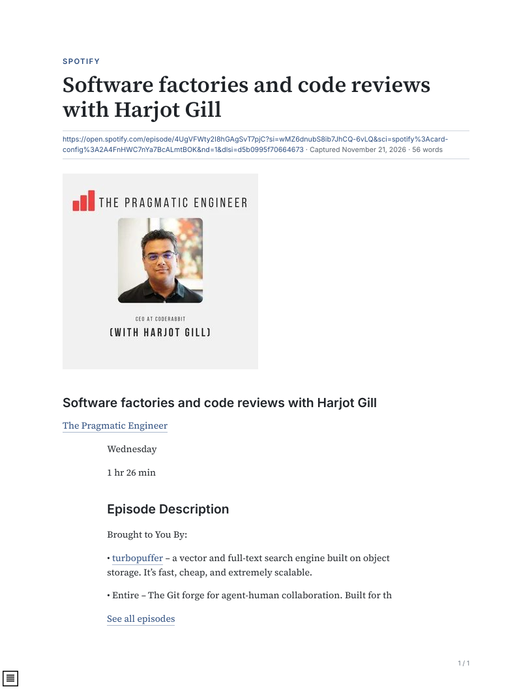
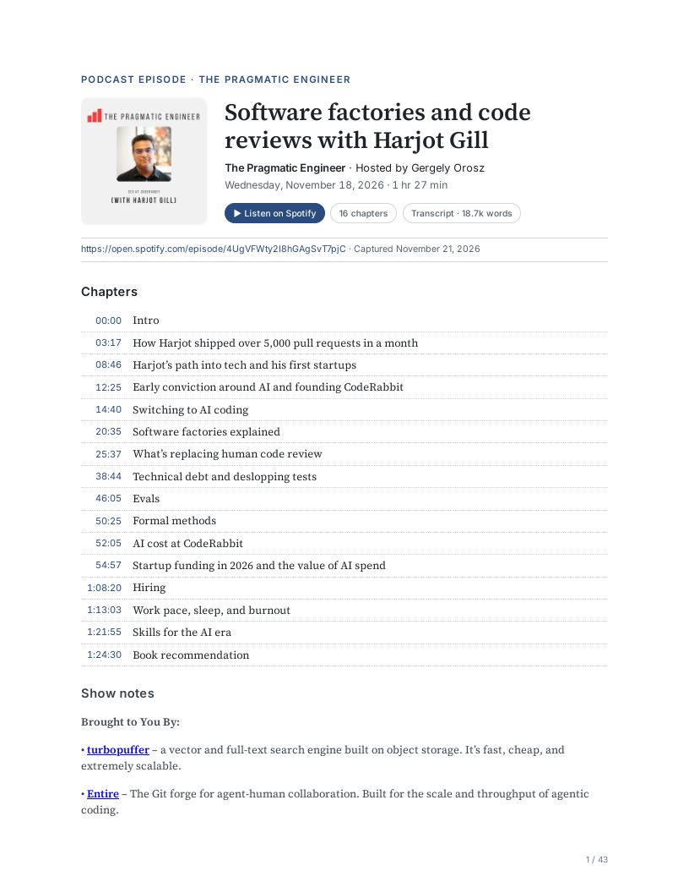
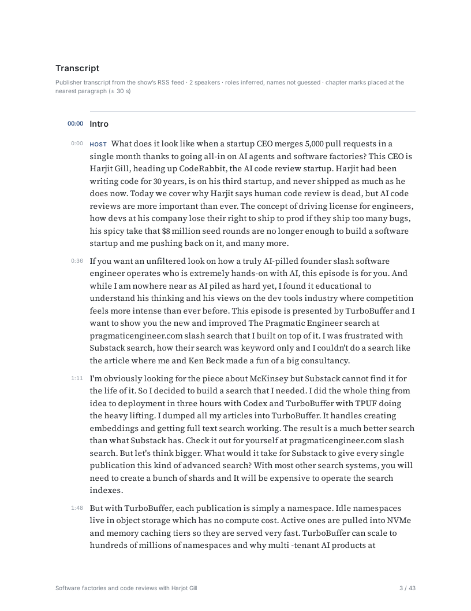
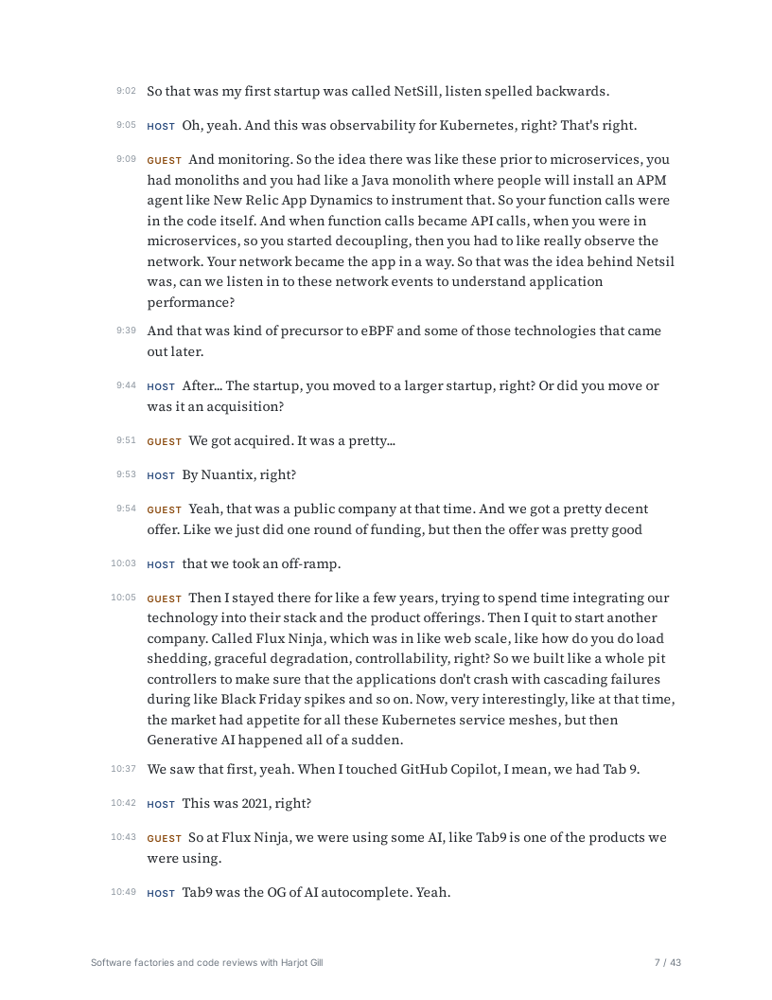
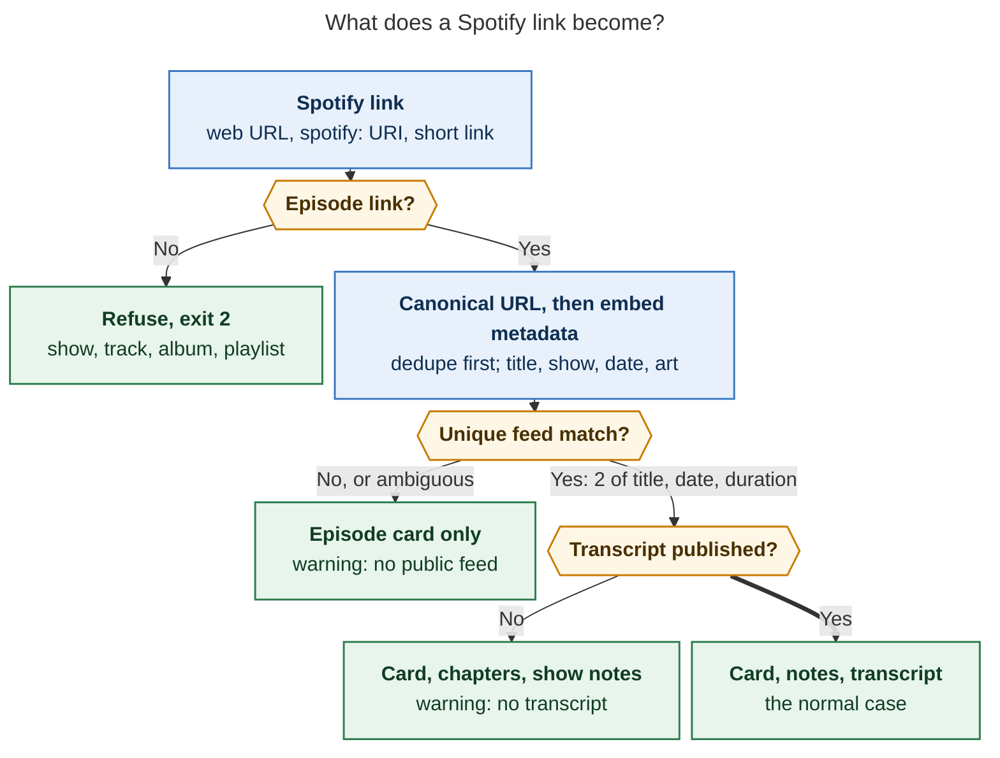

# Spotify links into podcast-episode references: design research and recommendation

*Researcher: cld · 2026-11-21 · bob-cli `270b5b23` · Bob vault as of 2026-11-21*

## TL;DR

Today a Spotify link is handled as if it were a blog post. `bob ref create` sends
`open.spotify.com` through the generic web-article engine, which prints Spotify's
JavaScript player page. The result is a one-page stub. It has 56 extracted words, a
description cut off mid-word ("Built for th"), a relative date ("Wednesday"), leftover
UI text ("See all episodes"), a filename made from Spotify's id
(`4ugvfwty2i8hgagsvt7pjc`), the wrong shelf (`blogs`), and tracking parameters in
`source_url`. Because Spotify adds a fresh `si=` value to every share link, the same
episode shared twice files as two separate references (reproduced below).

The fix is not better scraping of Spotify. Spotify is only the front door. The content
lives in the open podcast ecosystem: the show's public RSS feed carries the full show
notes, chapter timestamps, and often a publisher-provided transcript (the
`podcast:transcript` tag). I probed 8 real episodes:

- All 8 found their public feed through Apple's keyless iTunes Search API.
- 7 of 8 matched the Spotify episode on all three checks (title, release date,
  duration).
- 4 of 8 publish a full transcript, including both Spotify episodes already in the
  vault.

**Recommendation:** add a **podcast-episode route** to `bob ref create`, with Spotify
as its first front door.

- **Identity is fixed syntactically, before any fetch.** The canonical URL is
  `https://open.spotify.com/episode/<id>`, and every spelling of the link dedupes to
  it, including legacy refs.
- **Filing:** ref type `podcasts`, a filename from the episode title, `author` = show
  name, and an absolute `published` date.
- **Metadata** comes from Spotify's public embed page.
- **Enrichment** comes from the show's RSS feed, but only when the match is unique and
  agrees on at least 2 of title, date, and duration. A wrong transcript is worse than
  none.
- **The PDF** is laid out from that data with Bob's reader typography:
  - page 1: an episode card (art, title, show, host, date, duration, a Listen on Spotify
    button);
  - chapters and full show notes;
  - from page 3, the transcript, with timestamps in the left margin and Host/Guest
    labels.

  A mock built from the real episode is shown in [Section 6](#6-the-pdf-design).
- **Fallbacks** step down to show notes only, then the episode card only, with a
  warning each time. The route never fails just because no transcript exists.
- **No audio is ever downloaded.** The vault tracks `*.mp3` in Git, and a 3-hour
  episode would go over GitHub's 100 MB limit. `-L` is refused for episodes.
- **The same code path serves all three ways a link arrives:** `bob ref create`,
  `bob gkeep pull` (how both existing Spotify refs were made), and `bob capture` ref
  jobs.

---

## 1. What a Spotify ref looks like today

The vault has two Spotify refs. Both came from the phone: share to Google Keep, then
`bob gkeep pull` (`f81275eaa`, `65ac26938`). Both are episodes of *The Pragmatic
Engineer*.

| Ref | Title | Status | Highlights |
|---|---|---|---|
| `ref/blogs/4ugvfwty2i8hgagsvt7pjc` | Software factories and code reviews with Harjot Gill | task `[x]` same day | 0 |
| `ref/blogs/5ygcxo9nxh38ns7ghtbddm` | Software engineering after code becomes cheap with Satya Nadella | `read`, task `[x]` same day | 0 |

How the refs actually get used: Bryan shares an episode he has just listened to, closes
the reading task the same day, and cites the ref from zettel notes
(`sase_blog_zettel/microsoft_ceo_thinks_model_agnostic_architecture_is_good.md`: "See the
[[sase_blog#^ref-5ygcxo9nxh38ns7ghtbddm]] podcast!"). So the ref already works as a
**citation anchor**. It fails as an **annotation surface**: there is nothing in the PDF
worth highlighting, which is why both have 0 highlights.



*Today's Spotify ref is a stub printed from the player page. It has a truncated
description, a relative date, duplicated title text, UI leftovers, and the post-redirect
tracking URL in its header.*

## 2. Issues found (each with evidence)

| # | Issue | Evidence | Why it matters |
|---|---|---|---|
| 1 | **Duplicate refs on re-share.** `si` (a per-share id) and `sci` are not in `TRACKING_PARAMS`, so they stay in the dedupe key. | `bob ref find` with a different `si`, or with no query string, returns **NOT FOUND**. `bob ref create …?si=AnotherShare123 -d` plans `4ugvfwty2i8hgagsvt7pjc_2` (a second copy). | The library's identity guarantee breaks for every Spotify link. |
| 2 | **Tracking parameters are kept.** `source_url` stores `si`/`sci`, and the PDF header prints the post-redirect URL with Spotify's added `nd=1&dlsi=…`. The adapter prints `final_url`, not the cleaned URL (`web_clip_adapter.py:2107`). | Ref frontmatter and page-1 text. | Privacy: `si` ties the link to the sharer. It is also noise, and two different URLs get recorded for one reference. The header bug affects **every** article whose redirects add parameters, not just Spotify. |
| 3 | **Wrong ref type** (`blogs`). | `DEFAULT_ARTICLE_REF_TYPE = "blogs"` (`create.rs:50`), `INGEST_ARTICLE_REF_TYPE` (`ingest.rs:37`). | Podcasts get mixed into the blog shelf in `lib/`, `ref/`, and Highlights. Ref types are free-form directory names, so adding `podcasts` costs no schema change. |
| 4 | **Meaningless filename and id.** The stem is the lowercased 22-character base62 Spotify id. | `stem_from_url` only treats hex ids and UUIDs as opaque (`clip_url.rs:403`). | Ids follow stems (decision `reference-ids-follow-file-stems`), so the id is unreadable in `bob ref find`, block ids, and paths. Lowercasing a case-sensitive id also throws information away. |
| 5 | **Missing or wrong metadata.** No `author` or `published`. The PDF shows "Wednesday" (a relative date frozen into an archival document) and "56 words" instead of a duration. | Frontmatter and PDF text. | The ref cannot be cited properly and the date is wrong after a week. |
| 6 | **Truncated description and UI leftovers.** "Built for th", "See all episodes", "Episode Description", a duplicated title H2. The second ref spills one bullet ("• Linear –") onto a second page. | `mutool draw -F txt` on both PDFs. | Spotify's anonymous web page truncates show notes. No extractor can recover text that isn't served. |
| 7 | **Bad extraction is filed silently.** The engine itself says `fidelity: warn (56/207 words)` and "extraction kept 56 of 207 page words (under 40%)", yet files the PDF. In the gkeep path nobody sees the warning. | Dry run above. | General article-engine issue; noted, out of scope here. |
| 8 | **Nothing to annotate.** No transcript, no chapters. | Both refs have 0 highlights. | This is the main product failure. |

A side note, not specific to Spotify and not verified as a bug: after the reading task
moved from `gkeep_inbox.md` to `sase.md`, `4ugvfwty2i8hgagsvt7pjc.md` still says
`parent: "[[gkeep_inbox]]"`, while its sibling ref's parent was updated after its move.
This may simply be waiting for the Mac's scan.

## 3. What Spotify and the podcast ecosystem actually expose

### Spotify surfaces (probed from apollo, no authentication)

| Surface | What it gives | Assessment |
|---|---|---|
| `open.spotify.com/episode/<id>` (plain HTTP) | A JavaScript shell: no `og:` tags, no JSON-LD, no description. | Useless without a browser. With a browser it shows a **truncated** description; that is what happened today. |
| `open.spotify.com/oembed?url=…` | Title and a 300 px thumbnail. | Documented and stable, but thin. Good as a **fallback** for the title. |
| `open.spotify.com/embed/episode/<id>` → `__NEXT_DATA__` JSON | Title, **show name** (`subtitle`), **exact release instant** (`releaseDate.isoString`), **duration in ms**, show URI, episode and show art at 64/300/640 px, explicit flag, `hasVideo`. The audio is `MP4_128_CBCS` (DRM-protected). | The best keyless metadata source. It is undocumented, so parse it defensively and fall back to the `<title>` tag ("Episode – Show \| Spotify") and then oEmbed. |
| Spotify Web API `GET /episodes/{id}` | The full `html_description`. | Still available in Development Mode after the February 2026 changes, but those changes require a **Premium-owned app**, at most 5 allowlisted users, and OAuth. bob has no Spotify app, and `sase spotify` is not installed on apollo. **Not worth it for v1.** |
| Spotify's in-app transcripts | Machine transcripts. | No public API. Getting them would mean user-token scraping of a private API. **Rejected** (terms-of-service and fragility). |

### The public podcast feed (keyless)

Path: Spotify show name → iTunes Search API (`media=podcast`) → `feedUrl` → RSS
`<item>`. For the Harjot Gill episode the RSS item carries:

- the full show notes HTML (4,567 characters, against 56 extracted words today), with
  links and a 16-entry timestamp list;
- `itunes:duration` 5197 s, matching Spotify's 5,197,032 ms;
- `pubDate` 18:08:52 GMT, matching Spotify's 18:08:00Z;
- a public MP3 enclosure (90 MB);
- **`<podcast:transcript type="text/vtt">`**: 1,750 cues, 2 diarized speakers, **18,736
  words**.

### Probe across 8 episodes

The probe script is `cld_media/resolver_probe.py`. It requires an exact show-name match
on iTunes, then an item that agrees with Spotify on at least 2 of: normalized title,
release time within 36 h, duration within 2%.

| Show (latest or vault episode) | Feed found | Match signals | Publisher transcript | Chapter times in notes |
|---|---|---|---|---|
| The Pragmatic Engineer (Harjot Gill) | Substack | title, date, duration | **VTT** | yes (16) |
| The Pragmatic Engineer (Satya Nadella) | Substack | title, date, duration | **VTT** | yes |
| Dwarkesh Podcast | Substack | title, date, duration | **VTT** | yes |
| Latent Space | Substack | title, date, duration | **VTT** | no |
| Lex Fridman Podcast | yes (1 of 2 iTunes candidates returned 404) | title, date, duration | none | yes |
| Acquired | Transistor | title, date, duration | none | yes |
| Huberman Lab | yes | title, date, duration | none | yes |
| The Joe Rogan Experience | Megaphone (5.5 MB feed) | title, date — **duration off by 359 s** | none | no |

What this shows:

- Feed matching is reliable for real shows. Joe Rogan is the instructive edge case: the
  durations differ by about 6 minutes, presumably because of dynamic ad insertion. So
  (a) require **2 of 3** signals, not all 3, and (b) say clearly that transcript
  timestamps are the **publisher's**, and Spotify playback can drift by the ad length.
- A transcript exists for half of the sample, including **all of the shows Bryan has
  actually saved**. Industry-wide adoption of the tag is lower: one vendor analysis puts
  it near 5% of episodes. So the no-transcript path must look good too.
- The Lex Fridman row shows why the resolver must try more than one iTunes candidate:
  one candidate's feed returned 404.

### Transcript shape (Harjot Gill episode)

- 207 speaker turns; median 47 words, 90th percentile 207, maximum 750. Split long turns
  at sentence ends into paragraphs of about 95 words, giving 303 paragraphs.
- Speaker labels are diarization ids (`SPEAKER_00`, `SPEAKER_01`), not names. One
  speaker ends **42 of 104** turns with "?" (40%); the other ends **9 of 103** (9%). That
  is a strong, cheap signal for a **Host/Guest** role. Names are not safe to guess: cold
  opens often start with the guest, and the speech recognition itself misspells the guest
  as "Harjit".
- The show-notes chapter times are approximate. The nearest speaker-turn start is 25 s
  before to 20 s after the listed time, and 20:35 has no turn start within 45 s. Chapter
  headings should therefore go at a **paragraph boundary** near the time, never
  mid-sentence, and keep the publisher's printed timestamp.
- The diarization makes mistakes (for example, a guest's sentence ending is labelled
  HOST at 10:03 in the mock), so the transcript must be labelled as the publisher's.

## 4. Is this a good idea? Critique and requirement adjustments

**Yes, with a different framing.** "Make Spotify refs smarter" reads as "scrape Spotify
better", and that is a dead end. Anonymous Spotify pages are JavaScript-rendered and
truncated, the API is gated, and transcripts are private. The goal that survives
scrutiny is: **a podcast episode should become a first-class, annotatable reference,
and Spotify is just the most common way it arrives.** Seen that way, the design falls
out of what the open ecosystem offers.

Adjustments I recommend:

1. **Reframe the scope (adjustment).** Build a *podcast-episode route* with source
   adapters, and ship Spotify first. Apple Podcasts links would be nearly free later:
   `itunes.apple.com/lookup?id=<show>&entity=podcastEpisode` returns `episodeGuid`,
   which gives an exact RSS match (verified for the Harjot episode, guid
   `substack:post:225268679`). They are not required for v1.
2. **Correctness beats completeness (new requirement).** Never attach show notes or a
   transcript unless the feed match is unique and agrees on at least 2 of 3 signals.
   Otherwise fall back and warn. A wrong transcript in a citation-grade library is the
   worst possible outcome.
3. **Never store episode audio (new requirement).** `lib/*.mp3` is tracked in Git
   (`!*.mp3`). The Harjot episode is 90 MB, and a 3.5-hour Lex Fridman episode would
   exceed GitHub's 100 MB file limit; the vault's `.gitignore` already records
   over-limit PDFs GitHub rejected. Spotify's own audio is DRM-protected anyway. `-L`
   (text-to-speech narration) on an episode should refuse with exit 2 and a clear
   message, because narrating a podcast's transcript back as speech is never what the
   user means. `--audio PATH` stays available as the generic explicit escape hatch.
4. **Roles, not names (adjustment).** Label speakers Host/Guest only when the
   question-signal is strong. Otherwise use "Speaker 1/2/…". Use names only when the VTT
   voice tags already carry human names. No `--speakers` flag in v1.
5. **Refuse non-episode Spotify links (new requirement).** Shows, tracks, albums,
   playlists, artists, audiobooks, and chapters are not single listenable references.
   Exit 2 with a hint; in the gkeep and ref-job paths the existing fallback inbox task
   applies.
6. **No new flags in v1 (constraint).** The route should simply do the right thing. Help
   and docs gain one line in the Targets section. `-H/--html` remains the escape hatch
   back to the article engine.
7. **Defer (explicitly out of v1):**
   - local Whisper transcription for feeds without transcripts (heavy: 90-plus MB
     downloads, long runs on CPU, belongs in background jobs);
   - Spotify Web API enrichment for exclusives;
   - `?t=` deep links into Spotify (the parameter is observed in practice but not
     documented by Spotify);
   - mapping highlights back to timestamps.

## 5. Options considered

| Option | What it is | Verdict |
|---|---|---|
| A. Patch the article route | Strip `si`, set type `podcasts`, use a title stem, add a Defuddle Spotify extractor. | Fixes identity bugs 1–5, but the PDF stays a stub with nothing to annotate, because the page itself is truncated. **Do the identity parts as Phase 1 regardless.** |
| B. Episode card only | Embed metadata plus oEmbed, a beautiful one-page card. | Reliable and quick, but no annotation value. **Kept as the last fallback.** |
| C. Card + RSS enrichment + publisher transcript | The route described here. | **Recommended.** Uses only keyless, documented-or-stable public data, and degrades gracefully. |
| D. C + local speech recognition (Whisper) | Download the enclosure and transcribe. | Real value for shows without transcripts, but heavy and slow, and the MP3 must never land in `lib/`. **Phase 3, opt-in, as a ref job.** |
| E. Spotify Web API | `html_description` with an app token. | Premium-gated developer app, OAuth secrets in bob, and still no transcript. **Rejected for v1.** |
| F. Spotify in-app transcripts | Private API with the user's token. | Terms-of-service and fragility risk. **Rejected.** |
| G. Metadata-only ref with no PDF | Skip the PDF entirely. | Breaks the PDF-backed pipeline (marker, intake, sync, Highlights). **Rejected.** |

## 6. The PDF design



*Page 1 is a complete episode card. A reader who never opens the transcript still gets
the show, host, absolute date, duration, a one-tap Listen link, linked chapters, and the
full show notes.*





*The transcript keeps a calm reading measure. Timestamps sit in a muted left margin, and
speaker roles appear as small caps only when the speaker changes (Host in Bob link-blue,
Guest in umber).*

The mock was built from the real feed, VTT, and embed data, using the bundled
`reader.css`, Source Serif 4, and Inter, and printed with the same headless Chromium
family the adapter uses. It runs **43 pages / 538 KB** for 1 h 27 min. The sources are
`cld_media/mock_build.py` and `cld_media/mock_podcast.css`.

Design rules, each tied to a reason:

- **Kicker "PODCAST EPISODE · SHOW".** Says at a glance what kind of reference this is
  and from where. It replaces "SPOTIFY", which names the app rather than the work.
- **Cover art from the 640 px source, printed at 1.55 in** (about 413 dpi) with rounded
  corners. Today it is the 300 px image at full column width.
- **Title, then "Show · Hosted by …", then an absolute date and duration.** Fixes
  issue 5. The duration replaces the meaningless word count.
- **Pills: ▶ Listen on Spotify · N chapters · Transcript · 18.7k words.** One tap returns
  to the audio, and the reader sees up front what the document contains.
- **Provenance line shows the canonical URL only.** Fixes issue 2.
- **Chapters:** linked to anchors in the transcript, with tabular-figure timestamps in
  the accent color. The show notes' own "Timestamps" block is removed because it would
  be an exact duplicate (nothing is lost). Prefer the structured `podcast:chapters` JSON
  when a feed has it; otherwise parse `MM:SS Title`, `(MM:SS)`, and `[H:MM:SS]` lines.
- **Show notes:** full and sanitized (links kept), so `bob ref links` can list the
  sponsor and deep-dive URLs.
- **The transcript starts on a new page,** with one honest provenance line: "Publisher
  transcript from the show's RSS feed · 2 speakers · roles inferred, names not guessed ·
  chapter marks placed at the nearest paragraph (± 30 s)".
- **Paragraphs of about 95 words, split at sentence ends.** Long monologues become
  readable, each paragraph gets its own timestamp, and highlights stay paragraph-sized.
  A highlight that spans two paragraphs will pick up the margin timestamp text, which is
  harmless and arguably useful as a citation.
- **Chapter headings:** Inter 10.5 pt with a hairline rule above, the publisher's
  timestamp in the margin, and `break-after: avoid`.
- **Footer:** short title plus page n/N, as in the existing reader template.
- **Cover-tinted colors: deliberately not used.** The embed's `visualIdentity` palette
  is tempting, but its contrast is unvalidated (this episode's is grey #535353). The
  restrained Bob palette keeps every reference recognizably Bob's.

Mock polish still to do: style show-notes links with the reader's `a` rules (the mock
shows browser-default bold links), and consider 10.25 pt transcript text to save about
15% of the page count.

## 7. Resolution algorithm and data model



*Every Spotify episode link files a reference. Show notes and the transcript are added
only on a proven feed match, and each lesser outcome says why in a warning.*

### Identity (syntactic, before any network)

- **Recognize exact hosts only:** `open.spotify.com` (with an optional
  `/intl-xx/` prefix and optional `/embed/`) and `spotify:<kind>:<id>` URIs. The path
  grammar is `/(episode|show|track|album|playlist|artist|audiobook|chapter)/<22 base62>`.
  Short links (`spotify.link`, `spotify.app.link`) take **one** guarded redirect
  resolution and then re-enter this grammar. Do *not* match `*.spotify.com`:
  `newsroom.spotify.com` and `engineering.atspotify.com` articles (the latter already
  appears in bob's own help example) must stay on the article route.
- **Canonical `source_url`:** `https://open.spotify.com/episode/<id>`. On Spotify hosts
  the path alone identifies the content, so drop **every** query parameter instead of
  growing a tracking list. Read `t` (seconds) only as an optional "shared at" hint,
  never as identity.
- **Dedupe key:** that same canonical URL, returned from `dedupe_key_for` (just as arXiv
  maps every spelling to `abs/<id>`). Recorded sources recompute their key from the
  stored `source_url` at read time (`sources.rs`). **This retroactively fixes dedupe for
  the two legacy refs.** After the change, re-sharing either episode refuses with
  `already captured` and the usual `-f` hints.

### Metadata, in order of preference

1. Embed `__NEXT_DATA__` entity: `title`, `subtitle` (show), `releaseDate.isoString`,
   `duration`, art. Fallback 1: the embed `<title>`, split as "Episode – Show".
   Fallback 2: oEmbed `title` + `thumbnail_url`.
2. **Feed resolution:**
   - Search iTunes with `term=<show>&media=podcast&entity=podcast`.
   - Keep candidates whose normalized `collectionName` equals the show and that have a
     `feedUrl`; try up to 3.
   - Fetch each feed through the guarded curl fetcher. It refuses private hosts on every
     redirect hop. Use a size cap (the Joe Rogan feed is 5.5 MB) and a timeout.
3. **Item match:** score each `<item>`:
   - title equal after normalization;
   - `pubDate` within 36 h of Spotify's release time;
   - duration within max(5 s, 2%).

   Accept only if exactly one item reaches ≥ 2 signals. Ties, or a title-only match
   (for example "Best of" re-releases), go to the fallback.
4. **Transcript preference:**
   - `application/json` (Podcasting 2.0 JSON, which has speakers), then `text/vtt`,
     then `application/x-subrip` (SRT), then `text/html`, then `text/plain`.
   - Use VTT `<v Name>` tags verbatim when they hold real names (not `SPEAKER_\d+`).
   - Discard a transcript that fails to parse or whose last cue ends far from the
     episode duration (a sanity check against attaching the wrong file), and warn.
5. **Chapters:** `podcast:chapters` JSON if present; otherwise timestamp lines in the
   show notes. Place each chapter at the paragraph whose start is nearest within ±30 s,
   else at the next paragraph start.

### Reference fields

| Field | Value | Note |
|---|---|---|
| `ref_type` | `podcasts` | `-t` still overrides. |
| stem / `id` | `title_stem(title)` → `software_factories_and_code_reviews_with_harjot_gill` | `-N` overrides. This matches existing blog stems (`solving_code_review_at_anthropic`). |
| `title` | Spotify episode title, verbatim | `-T` overrides. |
| `author` | **Show name** | **Judgment call, called out.** It is what Spotify displays as the creator, what Bryan cites ("the … podcast"), and it needs no new marker key (`MARKER_EXTRA_ORDER` is fixed). The host goes in the PDF byline. Alternative: host name in `author`, show in a new key, at the cost of a marker and sync contract change. `-A` overrides. |
| `published` | Release date in the configured timezone | `-p` overrides. |
| `source_url` | Canonical episode URL | |
| source store | Render-input Markdown (show notes + transcript) | Per decision `reference-sources-are-preserved-write-once`; gives `bob ref links` the show-note links. |

### CLI experience (dry run shown; a real run prints the same block plus the usual `created:` lines)

```text
$ bob ref create 'https://open.spotify.com/episode/4UgVFWty2I8hGAgSvT7pjC?si=…' -P sase -d
[dry-run] ok would create podcast-episode PDF
source_url: https://open.spotify.com/episode/4UgVFWty2I8hGAgSvT7pjC  (dropped: si, sci)
episode:    Software factories and code reviews with Harjot Gill
show:       The Pragmatic Engineer · hosted by Gergely Orosz
released:   Wednesday, November 18, 2026 · 1 hr 27 min
feed:       api.substack.com/feed/podcast/458709.rss (matched: title, date, duration)
transcript: publisher text/vtt · 18,736 words · 2 speakers (host, guest)
chapters:   16 from show notes
pdf:        ~/bob/xlib/podcasts/software_factories_and_code_reviews_with_harjot_gill.pdf
writes: none
```

Degraded runs add exactly one warning each, for example:
`warning: no public feed matched this episode (Spotify exclusive?); the PDF has the episode card only`
or `warning: The Pragmatic Engineer publishes no transcript for this episode; the PDF has chapters and show notes`.

## 8. Architecture

The work splits along the lines the codebase already uses.

- **Rust (new `podcast.rs` + `spotify.rs`, modelled on `arxiv.rs`).** URL grammar,
  canonicalization, the dedupe key, route selection, ref type, stem planning,
  stamping, install, CLI output, and the **resolver** (embed / iTunes / RSS / transcript
  fetch through `fetch.rs`, plus matching and parsing).
  - *Reason:* the matcher is where correctness lives, and Rust gives typed,
    fixture-tested code. The arXiv precedent already puts structured metadata fetching
    in Rust.
  - *Reason:* `fetch.rs` is curl-based with SSRF guards on every redirect hop, and works
    on hosts with no browser, so `-d` previews run everywhere.
  - *Cost:* RSS needs a real XML parser. Add `quick-xml`, which does not expand external
    entities; do not extend `arxiv.rs`'s regex tag scraping.
- **Adapter (Python).** Gets a small additive protocol-v1 op that typesets a
  caller-built `article.json`, plus a `podcast` layout section in the template.
  - *Reason:* the reader template (fonts, image localization, print pipeline, Markdown
    export) is the "beautiful" part and already lives there. CSS is far better than the
    xelatex path at margin timestamps and run-in labels.
  - *Constraint:* the op must still run its HTML through the `nh3` sanitizer. Show notes
    are untrusted HTML.
- **Both entry points get the route.** `create.rs` (printing) and `ingest.rs` (typed,
  used by `bob gkeep pull` and `bob capture` ref jobs) each have their own arXiv route
  today. Add a thin podcast wrapper to each, calling the shared resolver and planner, so
  the Keep path that produced both real Spotify refs benefits immediately. Add
  `INGEST_PODCAST_REF_TYPE = "podcasts"`.
- **Recapture parity.** Implement overwrite and reread for the podcast route, as
  `overwrite_arxiv` does. Without that, `-f` breaks, and legacy refs cannot be upgraded
  in place.
- **Several-URL calls.** The rule "several URLs must all be web article URLs" now
  correctly refuses Spotify episodes mixed into a collection.

### Tests (reliability gates)

- **URL grammar table:** episode variants (with and without `intl-xx`, `embed`, a URI,
  a trailing slash, mixed-case host, query junk); every non-episode kind; look-alike
  hosts (`open.spotify.com.evil.example`, `newsroom.spotify.com`).
- **Dedupe:** a legacy recorded `source_url` with `si`/`sci` produces the canonical key;
  `bob ref find` resolves all spellings.
- **Resolver fixtures** (served through `BOB_HIGHLIGHTS_CURL` fakes):
  - an embed page whose schema changed (falls back to `<title>`, then oEmbed);
  - iTunes returning 0, 1, or 2 exact show matches, and a candidate whose feed returns
    404;
  - RSS with a duplicate-title replay, the Joe Rogan-style duration mismatch, and a
    missing `pubDate` timezone (my probe hit exactly this).
- **Transcript parsers:** VTT with and without voice tags, SRT, JSON, HTML; a garbage
  transcript is dropped with a warning; the duration sanity check.
- **Rendering:** adapter self-test with a fixture `article.json`; `mutool` text
  assertions:
  - page 1 contains the title, show, absolute date, and duration;
  - the text contains no weekday-only date and no "See all episodes";
  - the transcript heading starts a page.
- **CLI snapshots:** the dry-run block above, and `ingest_url` parity (gkeep) producing
  `podcasts/<title_stem>`.

## 9. Legacy refs

After Phase 1, both legacy refs dedupe correctly and nothing else is needed. If Bryan
wants them upgraded once Phase 2 lands:

1. `bob ref create <url> -f overwrite` swaps in the new PDF in place, keeping the note,
   task, and id.
2. `bob ref rename <id> <title_stem>` fixes the stem and id.

They would stay under `blogs/`, because there is no retype command and overwrite refuses
a differing `-t`. Both have 0 highlights and closed tasks, so leaving them alone is also
fine.

## 10. Risks and mitigations

| Risk | Mitigation |
|---|---|
| The embed `__NEXT_DATA__` schema changes (undocumented). | A three-layer fallback (JSON → `<title>` → oEmbed), plus a fixture test that pins today's shape. Failure degrades to the card, never to a crash. |
| Wrong feed or episode attached. | Unique match with ≥ 2 of 3 signals, a transcript duration sanity check, and match evidence printed in every run. |
| Transcript timestamps drift from Spotify playback because of ads. | Say "publisher transcript" in the PDF. The Joe Rogan case (359 s) is the documented example. |
| Speaker roles are mislabelled. | Roles only when the signal is strong (≥ 10 questions and ≥ 3× the other speaker's rate); otherwise neutral labels. Names never guessed. |
| Third-party URLs from iTunes or RSS are a server-side request forgery vector. | All fetches go through `fetch.rs`'s guarded hops; size caps; no XML external entities. |
| Long episodes make long PDFs. | About 0.5 pages per minute of talk. 3.5 h gives about 100 pages and about 1.3 MB, well under the 95 MB cap. Page 1 stays a self-sufficient card. |
| Spotify exclusives have no feed. | Card-only fallback with a clear warning. Web API enrichment is a later option if exclusives turn out to matter. |
| A `podcasts` ref type surprises downstream clients. | Ref types are free-form `lib/<type>/` directories according to the sync docs. Still check whether the bob-plugins Ref panel or Bob Mac Capture's Refs panel special-case type names. |

---

## Recommended solution

**Ship in two phases. Treat Spotify as the front door to a podcast-episode route, and
keep every fact on the page provable.**

**Phase 1: identity fixes (small, independent; ship first).**

1. Add Spotify recognition with exact hosts, `intl-xx`, `embed`, URIs, and short links.
   The canonical `source_url` is `https://open.spotify.com/episode/<id>`, and
   `dedupe_key_for` returns it. This fixes duplicate refs on re-share, retroactively for
   legacy refs too.
2. Episodes default to ref type `podcasts` in both `create` and `ingest`. Stems come from
   the title, never from the base62 id.
3. Non-episode Spotify links refuse with exit 2 and a hint. `-L` on an episode refuses.
4. General fix: the adapter's masthead prints the cleaned URL bob records, not the
   post-redirect `final_url`.

**Phase 2: the podcast-episode route (the real upgrade).**

5. Rust resolver: embed metadata, then iTunes Search, then RSS. Accept only a unique
   item match on ≥ 2 of title, date (36 h), and duration (2%). Pick the transcript
   format JSON > VTT > SRT > HTML > text, and get chapters from `podcast:chapters` or
   the show-note timestamps. Every step degrades to the next fallback with one warning
   and never fails the capture.
6. Fields: `author` = show, `published` = release date, source-store Markdown for
   `bob ref links`. No new marker keys, no new CLI flags.
7. Add an adapter op that typesets a caller-built `article.json` with the podcast layout
   from [Section 6](#6-the-pdf-design):
   - page 1: card with art, title, show and host, absolute date and duration, a Listen
     on Spotify pill, chapters, and de-duplicated show notes;
   - then the transcript: ~95-word paragraphs, margin timestamps, Host/Guest small caps
     only when the signal is strong, chapter headings at paragraph boundaries, and an
     honest provenance line.
8. Wire the route into `create.rs` and `ingest.rs` (gkeep pull and ref jobs), with
   overwrite and reread parity. Add one Targets line in help and in
   `docs/highlights-create.md`. Cover it with the fixture tests in [Section 8](#tests-reliability-gates).

**Later, and only if wanted:** Apple Podcasts links (exact match via `episodeGuid`);
local speech-to-text transcription as a background ref job for feeds without
transcripts (never storing the MP3); Spotify `?t=` "shared at" marks; a decision record
stating the policy "podcast episodes are keyed by platform id, enriched only from an
evidence-matched public feed, and never store audio".

This replaces a scraped 56-word stub with a reference worth opening. With publisher
transcripts, the normal case for every show Bryan has saved so far, it becomes a full,
chaptered transcript he can highlight and cite.

---

### Sources

- Spotify, [February 2026 Web API Dev Mode migration guide](https://developer.spotify.com/documentation/web-api/tutorials/february-2026-migration-guide) and [changelog](https://developer.spotify.com/documentation/web-api/references/changes/february-2026): `GET /episodes/{id}` and `GET /shows/{id}` remain; batch endpoints removed; Premium-owned apps, 5-user allowlist; Extended Quota Mode unaffected.
- Spotify developer blog, [Update on developer access and platform security (2026-02-06)](https://developer.spotify.com/blog/2026-02-06-update-on-developer-access-and-platform-security).
- Castro, [transcript tag release](https://castro.fm/blog/transcript-tag-release), and Podcast Movement, ['Publisher-supplied' RSS transcripts gaining ground](https://podcastmovement.com/podmov/publisher-supplied-rss-podcast-transcripts-gaining-ground/amp): `podcast:transcript` support across hosts and apps.
- Voxbooster, [podcast transcript and chapter marker adoption statistics 2026](https://voxbooster.com/blog/podcast-transcript-chapter-marker-adoption-statistics-2026/): about 4.84% of episodes carry transcripts (a vendor figure; treat with caution).
- Engadget, [Spotify lets you share a specific timestamp from a podcast](https://www.engadget.com/spotify-podcasts-timestamp-sharing-142008057.html); Spotify Community, [timestamp sharing works only on mobile](https://community.spotify.com/t5/iOS-iPhone-iPad/Cannot-share-from-timestamp-with-audio-podcasts/m-p/6952948/highlight/true): `?t=` is observed in practice but not documented.
- Primary probes (2026-11-21, from apollo): `open.spotify.com/oembed`, `open.spotify.com/embed/episode/<id>`, `itunes.apple.com/search` and `/lookup`, the Pragmatic Engineer RSS feed and VTT transcript, and the feeds for the 8 episodes in [Section 3](#3-what-spotify-and-the-podcast-ecosystem-actually-expose). Scripts are in `cld_media/`.
- bob-cli code: `src/native/highlights_ref/{clip_url,arxiv,create,ingest,fetch,stamp,sources}.rs`, `scripts/web_clip/{web_clip_adapter,web_clip_render}.py`, `scripts/web_clip/template/reader.css`. Vault: the two Spotify refs, their PDFs, and commits `f81275eaa`, `87444cbdd`, `65ac26938`.
- Decisions: `reference-ids-follow-file-stems`, `reference-sources-are-preserved-write-once`, `references-are-ingested-at-birth`.
