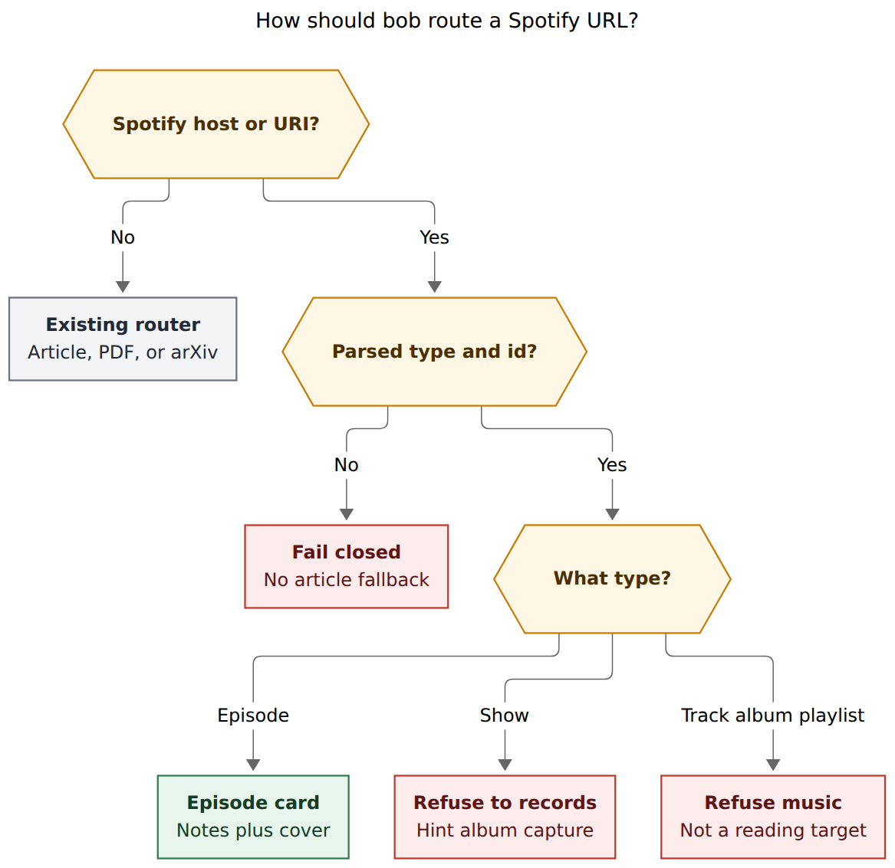
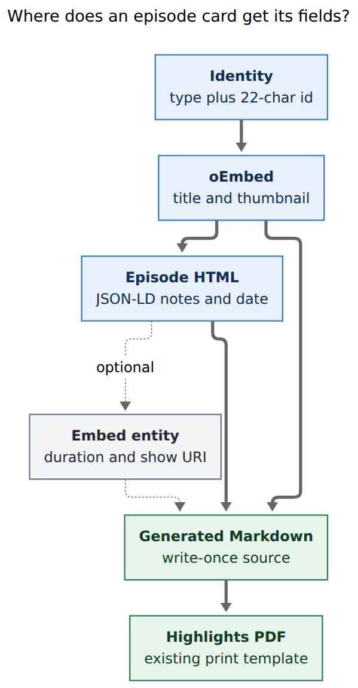

# Make `bob ref create` a first-class Spotify episode family

- **Researcher:** grk
- **Date:** 2026-11-21
- **Question:** How should `bob ref create` handle Spotify URLs so the result is intuitive, reliable, and beautiful? Is “make it smarter” a good idea, and what should change in the requirements?

## Headline

**Yes — build a Spotify family the way arXiv already works. Do not try to make the web-article engine understand a player.**

Today `bob ref create` on an `open.spotify.com/episode/…` URL is a false success. Title extraction works. Everything else is the SPA chrome: a one- or two-page Bob-typeset print of the player, ~50 words, tracking still on `source_url`, the 22-character episode id as the stem, `ref_type: blogs`, empty Highlights, no write-once source. The two live examples in the vault are exactly that.

The right product is an episode *reading card*: uncropped cover, show as byline, date, duration, the full public show notes (including the timestamp TOC), a canonical Play link, and “Content from Spotify”. Chrome is used only to print Bob-owned HTML, the same print template articles already use. Metadata comes from public HTTP (oEmbed + JSON-LD, optional embed entity). No Playwright against the player, no Spotify OAuth, no audio download, no auto-linking of album records.

## Bottom line

- **The request is right on the merits.** A Spotify episode is a reading object with a stable id, a title, a show, a date, and thousands of characters of public notes. Filing it as a Highlights reference is the correct habit.
- **The literal approach — “smarter article clipping” — will keep shipping player chrome.** Defuddle cannot recover a document that is not in the DOM as an article. Fidelity `thin` does not fire, because the live page is also thin.
- **Copy the arXiv shape.** Parse identity first, canonicalize, fetch metadata over plain HTTP, generate Markdown, print with the existing Chromium template, default a dedicated `ref_type`. Fail closed on an unparsed Spotify host. Teaching-refuse shows and music.
- **v1 is episodes only.** Shows belong to the `podcasts/` album (`^auto-spotify-record-notes`). Tracks, albums, and playlists are not reading targets.
- **Identity is `type + id`.** Strip `si` / `sci` / `nd` / `dlsi` / `utm_*` / `pt` / `context` in the Spotify family only. Keep `t` as a cue line. Matching must parse existing stored URLs, because the two live refs still carry share tokens.
- **Do not add Spotify to capture’s exclude list.** YouTube is excluded because it has no reading surface. Episode show notes *are* a reading surface. Capture should route Spotify URLs into this family.
- **Do not depend on the Web API, `sase spotify`, Whisper, or RSS ripping.** Get Episode is OAuth-gated (`user-read-playback-position`). Developer Policy forbids stream ripping and standalone preview clips. Public oEmbed + JSON-LD already beat the current PDF.

## Critique of the plan

The product intent is right. Several unspoken readings of “smarter about Spotify URLs” would ship the wrong thing.

### 1. Smarter Defuddle, headed retry, or a saved `--html` dump

The current PDFs already went through the *Bob* print template (Inter + Source Serif 4, HeadlessChrome/Skia, masthead word count). The article engine did its job on the wrong document. The extracted “article” is the player: title, show name, weekday, duration, a truncated “Brought to You By”, “See all episodes”.

Fidelity refuses only when `kept_words < 300` **and** `page_words >= 400` (`scripts/web_clip/web_clip_adapter.py`, `fidelity_verdict`). A Spotify episode SPA is thin on both sides, so the capture reports success at 56 and 50 words.

A headed retry, a cookie jar, or `-H saved.html` would still print player chrome. The document we want is in JSON-LD and the embed entity, not in the visible article body.

**Adjustment ⚠️:** treat every Spotify host/URI as out of the article engine, including the miss path. An unparsed `open.spotify.com` URL fails closed. It never falls through to Defuddle.

### 2. Screenshot or print the live player

That would preserve the Spotify UI, including tracking URLs, “See all episodes”, and a truncated blurb. It would also fight the print template (Bob owns typesetting) and the Highlights loop (highlights need selectable reading text). A screenshot is a poster, not a reference.

**Adjustment ⚠️:** generate a reading card in Bob’s type, with the uncropped cover as an image. The PDF should look like a well-made liner-note page, not like a captured tab.

### 3. Spotify Web API as the metadata source

[Get an Episode](https://developer.spotify.com/documentation/web-api/reference/get-an-episode) requires user OAuth with `user-read-playback-position`. There is no public client-credentials episode endpoint that returns show notes. The API also has no transcript field. Wiring `sase spotify` (a different SASE project’s library CLI) into bob-cli would add a secret, a token refresh, a host that can fail offline, and a product dependency Bob’s Highlights pipeline does not need.

Public sources already return more than the current PDF:

| Field | oEmbed | Episode HTML JSON-LD / OG | Embed `__NEXT_DATA__` entity |
| --- | --- | --- | --- |
| Title | yes | yes | yes |
| Show name | no | OG description `The Pragmatic Engineer · Episode` | `subtitle` |
| Date | no | `datePublished: 2026-11-18` | `releaseDate` ISO |
| Duration | no | no | `duration: 5197032` ms (1h 26m) |
| Show notes | no | 2 686 characters, including timestamp TOC | no |
| Cover | 300×300 thumbnail | OG 640×640 (`ba8a`) | related *show* art, not episode art |
| Canonical URL | iframe only | `<link rel="canonical">` with no query | `uri` |
| Show URI | no | no | `spotify:show:2Bho9xCbOQMWMJ7UKmqCzD` |

Measured 2026-11-21 against `https://open.spotify.com/episode/4UgVFWty2I8hGAgSvT7pjC`.

**Adjustment ⚠️:** v1 uses public HTTP only. OAuth / Web API is a later option if public HTML ever stops carrying JSON-LD.

### 4. Auto-download audio, Whisper a transcript, or attach the 30 s preview

Companion audio today is a local `mp3` / `m4a` / `ogg` / `opus` beside the PDF, or `-L` TTS via `highlights.listen_command` (`sase listen render`). The embed entity exposes `audioPreview.url` on `p.scdn.co`. Spotify Developer Policy forbids stream ripping, forbids offering preview clips as a standalone product, and limits local caching of sound recordings. A 30-second preview is also a bad listening episode.

Internal Spotify transcripts are session-gated. They are not in the public Web API. RSS-plus-Whisper is a third-party copy of the audio.

**Adjustment ⚠️:** v1 downloads no audio. `-L` refuses with a teaching error (“this target is already audio; pass `--audio FILE` if you have a local copy”). `--audio` still binds a file Bryan already has. Transcripts are a later, separately justified family.

### 5. Exclude Spotify the way capture excludes YouTube

`DEFAULT_EXCLUDE_HOSTS` is `google.com`, `googleplex.com`, `youtube.com`, `youtu.be`, `github.com`, `x.com`, `twitter.com` (`src/native/url_routing/policy.rs`). Spotify is absent, so a URL-only capture of an episode *already* routes into `bob ref create` and produces the same false-success PDF. Adding `open.spotify.com` to that list would hide the leak by dropping the link on the floor.

YouTube is excluded because the page is a player with no reading document. A Spotify *episode* has a public JSON-LD `PodcastEpisode` description that is a real reading document (for the Harjot Gill episode, 2.7 kB of notes plus a timestamp TOC). That is why the family exists.

**Adjustment ⚠️:** keep Spotify off the exclude list. Teach `RouteHint::Spotify` so capture, gkeep, and create share one parse.

### 6. Fold show URLs into the same Highlights ref

The vault already has a `podcasts` album of *show* records (`podcasts.md`, `bob records show podcast`) with status, category, and URL. A sibling task, `^auto-spotify-record-notes` in `bob.md`, is about linking Spotify URLs onto those records. Mixing grains would put a show in `ref/podcasts/` and an episode in `podcasts/`, or worse, one Highlights PDF per show with no episode body.

The album note itself says episode references live in `[[podcast_ref]]`. The two live examples ignored that and landed in `ref/blogs/` because that is the article default.

**Adjustment ⚠️:** a show URL refuses with a hint toward album capture / `bob records`. v1 does not create or rewrite album records. The episode card *stores* the show name and show URI in generated Markdown so the later linker has a key.

### 7. Expand the global tracking-parameter list

`TRACKING_PARAMS` is `fbclid`, `gclid`, `mc_cid`, `mc_eid`, `ref_src`, plus any `utm_*` (`clip_url.rs`). Spotify share links add `si`, `sci`, `nd`, `dlsi`, `pt`, `context`. Putting those names on the global list would silently rewrite every stored URL that happens to use them, including non-Spotify sites.

**Adjustment ⚠️:** canonicalize inside the Spotify family. The global article cleaner stays as it is.

### 8. Auto-recapture or auto-rename the two live refs

`reference-ids-follow-file-stems` and `reference-renames-keep-identity` already describe how a later rename keeps identity. Quietly rewriting `ref/blogs/4ugvfwty2i8hgagsvt7pjc` on the next create would surprise the reading task `^ref-4ugvfwty2i8hgagsvt7pjc` and any wikilinks.

**Adjustment ⚠️:** v1 must *match* those refs by parsed `episode + id` so a second create does not duplicate. Recapture in place (`-f overwrite`) and a later `bob ref rename` onto a title stem are explicit follow-ups, not part of the parser ship.

## Adjusted requirements

Marked ⚠️ where this report changes the implied request.

1. **Spotify URLs are a create family, like arXiv.** ⚠️ They are not a special case of the web-article engine.
2. **v1 accepts episode identities only.** Show / track / album / playlist / audiobook / artist refuse with a typed hint. ⚠️
3. **Parse every public spelling** of an episode: `https://open.spotify.com/episode/{id}`, `intl-xx/` prefix, `/embed/`, trailing slash, `spotify:episode:{id}`, `https://spotify.link/…` after redirect. Query and fragment are not identity.
4. **Stored `source_url` is the canonical play URL with no query.** Dedupe key is `type + id` (recommend `https://open.spotify.com/episode/{id}` lowercase id, or `spotify:episode:{id}` — pick one and test both against existing notes).
5. **Lookup parses existing `source_url` values**, so today’s `?si=…&sci=…` notes match. ⚠️ This is a ship blocker, not a polish item.
6. **Default `ref_type` is `podcasts`.** Files land at `ref/podcasts/<stem>.md` and `lib/podcasts/<stem>.pdf`. That tree is distinct from the album at `podcasts/<show>.md`. `validate_ref_type` already allows any single directory name. ⚠️
7. **Stem follows arXiv:** `-N`, else `short_title_stem(title)`, else `spotify_episode_<id>`. Article order (`stem_from_url` before title) is what produced `4ugvfwty2i8hgagsvt7pjc`: `is_hex_id_word` only skips hex, and Spotify ids are base62. ⚠️
8. **Card body is generated Markdown** saved to the write-once source store (`reference-sources-are-preserved-write-once`). `bob ref code` / `bob ref links` then work like other Markdown-born refs. Neither live example has a `.bob/ref-sources/` entry today.
9. **Print with the existing Chromium template.** No new PDF engine. Cover is the OG 640×640 image, original pixels, no crop, no overlay (Spotify Branding Guidelines).
10. **Fail closed** if oEmbed cannot return a title. JSON-LD, embed entity, and cover each degrade independently. An unparsed Spotify host never becomes an article.
11. **Capture and gkeep route into this family.** Mac Capture stays a thin client (`decisions:mac-capture-is-a-thin-client`): bob reports `route_hint: spotify`, Swift does not parse Spotify grammar.
12. **Collections refuse any Spotify member.** Several-URL create is “all web article URLs” today (`collection.rs`). Mixing an episode into a blog packet is not a reading unit.
13. **No audio download, no `-L`.** `--audio FILE` remains. ⚠️
14. **No album writes, no auto wikilink onto a show record.** Store show URI for the sibling task. ⚠️
15. **Ingest at birth** stays the same as other create routes (`decisions:references-are-ingested-at-birth`).
16. **Do not vendor a Spotify logo binary in v1.** ⚠️ Text “Content from Spotify” plus the canonical Play URL satisfies the link-back rule for a personal vault PDF. Official marks are a later branding decision if Bryan wants the card to carry the glyph.

## What the current capture actually produces

Vault examples, both `ref_type: blogs`, both created by the article engine:

| | Harjot Gill | Satya Nadella |
| --- | --- | --- |
| Note | `ref/blogs/4ugvfwty2i8hgagsvt7pjc.md` | `ref/blogs/5ygcxo9nxh38ns7ghtbddm.md` |
| Status | `read`, captured 2026-11-21 | `read`, captured 2026-11-17 |
| `source_url` | keeps `si` and `sci` | keeps `si` |
| PDF | `lib/blogs/4ugvfwty2i8hgagsvt7pjc.pdf`, 1 page, 44 kB | `lib/blogs/5ygcxo9nxh38ns7ghtbddm.pdf`, 2 pages |
| Creator | HeadlessChrome/158, Skia | HeadlessChrome/157, Skia |
| Masthead words | **56** | **50** |
| Body | player chrome + truncated sponsors | same |
| Highlights | empty | empty |
| `source_markdown` | missing | missing |
| Source store | no `.bob/ref-sources/` row | none |
| Stem | lowercase episode id | lowercase episode id |
| Parent | `[[sase]]` | `[[sase_blog]]` |

`pdftotext` of the Harjot PDF (via `mutool draw -F text`):

```
SPOTIFY
Software factories and code reviews with Harjot Gill
https://open.spotify.com/episode/4UgVFWty2I8hGAgSvT7pjC?si=…&sci=…&nd=1&dlsi=…
Captured November 21, 2026 · 56 words
The Pragmatic Engineer
Wednesday
1 hr 26 min
Episode Description
Brought to You By: • turbopuffer … • Entire …
See all episodes
```

The same URL’s JSON-LD `description` is 2 686 characters: sponsors, the actual conversation abstract, a timestamp TOC from `00:00 Intro` through `1:24:30 Book recommendation`, and related deep-dive links. That text is the Highlights body we should have printed.

Share-token leak, independently of clipping: `validate_and_clean` keeps `si`/`sci`, then `stem_from_url` prefers the last path segment. Because `4UgVFWty2I8hGAgSvT7pjC` is not hex-only, `is_opaque_segment` lets it through, `snake_case` lowercases it, and `title_stem` never runs (`clip.rs` stem order: `-N`, URL slug, title). Two share links of the same episode currently **do not dedupe**.

`spotify:` URIs are rejected up front (`validate_and_clean` and `classify_token` require `http`/`https`). The vault already contains `spotify:` URIs in older notes.

## Recommended design

### Routing



**Caption:** A Spotify host or URI is parsed for type and id. Episodes become a metadata card. Shows hint at album capture. Music refuses. An unparsed Spotify path fails closed; every other URL keeps the existing article / PDF / arXiv router.

Rendered size: 777.4 × 756 px; fit scale: 84.0%. Mermaid CLI 12.0.0.

Parse *before* `fetch_and_route`. Today `fetch_and_route` (`target.rs`) classifies 2xx HTML as `CreateSource::WebArticle`. Spotify HTML is 2xx HTML, so the article engine is the inevitable destination unless identity wins first — the same hook arXiv already uses in `intent.rs` / `ingest.rs`.

Defense in depth: if the host is `open.spotify.com`, `spotify.link`, or the scheme is `spotify`, and `SpotifyResource::parse` returns `None`, exit 2 with a teaching error. Do not call the clip adapter.

### Episode card data flow



**Caption:** Identity is local (redirect-resolve only for `spotify.link`). oEmbed is required for title. Episode HTML supplies JSON-LD notes and `datePublished`. The embed entity is optional duration and show URI. Generated Markdown is the write-once source; Chromium prints it with the existing template.

Rendered size: 398.3 × 766 px; fit scale: 100.0%.

Fetch order, all through the existing `fetch_url` helper (20–30 s budgets, like the arXiv API), **no Playwright until print**:

1. Parse. Network only to follow `spotify.link` / `spotify.app.link` redirects.
2. `GET https://open.spotify.com/oembed?url=<canonical>` — title, 300 px thumbnail, iframe (documented, CORS-enabled, no auth).
3. `GET` the canonical episode HTML — `<link rel="canonical">`, JSON-LD `PodcastEpisode`, OG title / description / image / url.
4. Optional `GET` `https://open.spotify.com/embed/episode/{id}` and read `__NEXT_DATA__…entity` for `duration`, `subtitle`, `relatedEntityUri`. Degrade on failure; the Harjot embed is 11 656 bytes and already contains those fields.
5. `GET` cover bytes. Prefer OG `ab6765630000ba8a…` (640×640) over the oEmbed `05f1f` 300×300. Do not use `relatedEntityCoverArt` (that is the *show* square).
6. Assemble Markdown (below). Save to the write-once store.
7. Print with the existing web-article Chromium template (`web_clip_render.py` masthead + body). Skip `fidelity_verdict`; success is “oEmbed title present”, not “kept 300 words from a 400-word page”.

If step 3 fails, the card is still title + cover + Play. If step 5 fails, the card is still typeset notes. Only a missing title fails the create.

### What the card looks like

Reuse Bob’s print face. Do not skin the page in Spotify’s `visualIdentity` greys (that reads as co-branding). Layout, top to bottom:

1. **Cover** — original square, modest max-width (~240–280 CSS px), `border-radius` only if we later vendor Spotify’s own radius rule; v1 can leave the square sharp in Bob’s template. No text, play triangle, or logo on the pixels.
2. **Title** as H1 (`Software factories and code reviews with Harjot Gill`).
3. **Byline** — show name as author (`The Pragmatic Engineer`).
4. **Meta row** — `2026-11-18 · 1h 26m · Episode`. If the input URL had `t`, add `Start at 12:34` (the Keep-share habit in `podcasts.md` already relies on timestamped links).
5. **Attribution** — `Content from Spotify` plus the canonical Play URL as a real link. That is the link-back Spotify Policy requires for metadata and cover art.
6. **Notes** — JSON-LD description, with the `Listen to this episode from … on Spotify.` prefix stripped when present. Preserve the timestamp TOC as a list so Highlights can mark chapters.
7. **Related** — show URI as plain text (`spotify:show:2Bho9xCbOQMWMJ7UKmqCzD`) for the later album linker.

Masthead `source_url` is the canonical URL. Word count will then reflect the notes (thousands of characters), which is the honest reading size.

Parent and `-P` stay caller-supplied. Do not default parent to `podcast_ref`; that hub is a catalog note, and the two live examples already chose `sase` / `sase_blog`.

### Identity grammar

Recommend one parser, `SpotifyResource`, mirrored on `ArxivPaper`:

```text
scheme: https | http | spotify
https hosts: open.spotify.com, play.spotify.com, spotify.link, spotify.app.link
https path:  [/intl-<lang>] [/embed] / <type> / <id> [ / … ]
spotify URI: spotify:<type>:<id>
type:        episode | show | track | album | playlist | artist | audiobook | …
id:          [0-9A-Za-z]{22}
```

- Canonical play URL: `https://open.spotify.com/{type}/{id}` (preserve id case from the path, or always store the mixed-case form from the canonical link — the HTML canonical for the example is `…/episode/4UgVFWty2I8hGAgSvT7pjC`).
- Dedupe: lowercase `type` + lowercase `id`. Compare that pair, not the string-equal cleaned URL.
- Drop from identity: `si`, `sci`, `nd`, `dlsi`, `pt`, `context`, `utm_*`, `fbclid`, fragment.
- Keep as cue only: `t` (seconds or `m:ss`).
- `spotify.link` : follow redirects with `fetch_url`, then parse the final `open.spotify.com` URL. oEmbed’s own docs say short links support oEmbed; identity should still land on the long URL so vault notes stay stable if the short code expires.

Accept `spotify:` in `looks_like_url` / create target dispatch / `classify_token`. Map it to the https canonical before any `http`-only helper sees it.

### Capture, Mac, collections, listen

- `RouteHint` grows a `Spotify` arm. `classify_token` uses `SpotifyResource::parse` the way it already uses `ArxivPaper::parse` for the dedupe key.
- Mac Capture renders whatever kind bob already reports. No Spotify grammar in Swift.
- A mixed draft that includes a Spotify URL among article URLs fails at the collection gate with “Spotify episodes cannot join a web-article collection; capture the episode on its own”.
- `-L` on a Spotify target exits 2: the object is already audio. Hint names `--audio FILE`.
- `--html` on a Spotify URL is ignored or refused: saved player HTML is the failure mode we are leaving.

### Help and docs

`create.rs` `after_help` and `docs/highlights-create.md` need one new target bullet:

```text
Spotify episode URL or spotify:episode: URI
  -> metadata card (default ref type podcasts)
```

Add a single example. The current collection example `-N spotify_bg_agents` is `engineering.atspotify.com` blog posts; leave it, it is unrelated.

CLI rules: no new flag required for v1. If a `--spotify-show` escape is ever needed, that is a different command (records), not a create flag.

## Implementation sketch

New module `src/native/highlights_ref/spotify.rs`, parallel to `arxiv.rs`:

- `SpotifyResource { kind: SpotifyKind, id: String, cue: Option<Duration> }`
- `parse(&str) -> Option<Self>`
- `canonical_url(&self) -> String`
- `dedupe_key(&self) -> String` (kind + lowercase id)
- `fn identity_from_recorded_url(raw: &str) -> Option<Self>` used by recapture / `already captured` so `?si=` notes match
- `fetch_card(resource, scratch, progress) -> Result<SpotifyCard>`
- `SpotifyCard { title, show, published, duration, description, cover_path, show_uri, canonical }`
- `render_markdown(card) -> String` then the existing Markdown-to-PDF print path

Dispatch:

- `CreateSource::SpotifyEpisode { resource }`
- `IngestRoute::Spotify`
- `intent.rs` `RouteHint::Spotify`
- `ingest.rs` and `create.rs` grow a `create_spotify_route` next to `create_article_route` / `plan_arxiv`
- Default ref type `podcasts` when the source is this family (same place articles default `blogs` and arXiv defaults `papers`)

Tests, all local fixtures, no live Spotify in CI:

- parse matrix: canonical, intl, embed, trailing slash, URI, share query, `t=`, short-link *after* a recorded final URL
- `si`/`sci` recorded URL matches the clean identity
- show / track / playlist / artist / audiobook refuse messages
- unparsed `open.spotify.com/unknown/…` fails closed
- stem = `short_title_stem(title)` with id fallback
- collection member refuses
- `-L` refuses; `--audio` still plans
- `classify_token("spotify:episode:…")` is some `RouteHint::Spotify`
- oEmbed-only fixture still prints a title card; JSON-LD fixture includes the timestamp list

Fixture the Harjot oEmbed JSON, JSON-LD blob, and embed entity captured on 2026-11-21 (this report’s measurements) so a markup change at Spotify becomes a diff, not a silent empty card.

## Migration of the two live refs

On ship:

1. Dedupe/lookup uses parsed identity, so `bob ref create https://open.spotify.com/episode/4UgVFWty2I8hGAgSvT7pjC` reports *already captured* against the `si=` note.
2. Leave the ugly stems in place.
3. Optional follow-up, explicit: `bob ref create <url> -f overwrite` to replace the player PDF in place (keeps `id`, task, wikilinks), then later `bob ref rename` onto `software_factories_and_code_reviews` (or whatever `short_title_stem` yields). Overwrite requires intake enabled, matching `BOB_DIR`, and a filed match — already the article contract.

Do not walk the vault rewriting `source_url` in show records or `podcast_ref.md`. Those are not Highlights refs.

## Sibling task split

| Task | Grain | This family |
| --- | --- | --- |
| `^smarter-spotify-refs` (inspirer) | Episode → Highlights PDF + `ref/` note + `^ref` task | **this design** |
| `^auto-spotify-record-notes` | Show URL → `podcasts/<show>` album record | out of scope; card only *stores* `show_uri` |

A future linker can match `relatedEntityUri` against album `url:` fields. Building that linker inside create would surprise the records schema and this research’s “beautiful episode card” brief.

## Open questions for Bryan

1. **Recapture now or later?** Matching without overwrite already stops duplicates. Replacing the two player PDFs is a one-line `-f overwrite` once the family ships.
2. **Official Spotify mark?** v1 text attribution is enough for a personal vault. Vendoring the logo SVG from the brand kit is a separate docs/assets decision.
3. **Audiobooks?** Embed entities carry `isAudiobook`. v1 refuses the `audiobook` type. Promote later if Bryan actually files them.
4. **Default parent?** I would keep `-P` as it is. Defaulting to `podcast_ref` would hide episodes from the project they were captured for (`sase`, `sase_blog`).

## Would I take a different approach?

I would still do this family. The alternatives that look simpler fail a reliability or beauty test:

- **Patch tracking params and stem rules only.** The PDF would still be 50 words of chrome. Dedupe would improve; the reading object would not.
- **Exclude the host.** Capture would stop lying, and the share-to-Keep habit in `podcasts.md` would start dropping on the floor.
- **OAuth + Web API.** More moving parts, still no transcript, still need a print template for notes that JSON-LD already has.
- **Play the embed iframe inside the PDF.** PDFs do not host Spotify’s iframe reliably; Highlights cannot mark an iframe; it also is not Bob’s type.

The arXiv analogy is the load-bearing one: a third-party site with a stable id, a public metadata document, and a Bob-owned print. Spotify episodes fit that pattern once we stop pretending they are blogs.

## Sources

### Vault (read-only)

- `ref/blogs/4ugvfwty2i8hgagsvt7pjc.md` and `lib/blogs/4ugvfwty2i8hgagsvt7pjc.pdf`
- `ref/blogs/5ygcxo9nxh38ns7ghtbddm.md` and `lib/blogs/5ygcxo9nxh38ns7ghtbddm.pdf`
- `podcasts.md` (album schema; Keep-share timestamp note)
- `bob.md` tasks `^smarter-spotify-refs`, `^auto-spotify-record-notes`

### bob-cli

- `src/native/highlights_ref/clip_url.rs` — tracking list, `stem_from_url`, `is_opaque_segment`
- `src/native/highlights_ref/collection_name.rs` — `is_hex_id_word` (hex, length ≥ 6)
- `src/native/highlights_ref/clip.rs` — stem order `-N` / URL / title
- `src/native/highlights_ref/arxiv.rs`, `pdf_target.rs` `plan_arxiv` — family to copy
- `src/native/highlights_ref/target.rs` `fetch_and_route` — HTML ⇒ article
- `src/native/highlights_ref/stamp.rs` `validate_ref_type`
- `src/native/highlights_ref/ingest.rs` `IngestRoute` { Article, Pdf, Arxiv }
- `src/native/url_routing/policy.rs` `DEFAULT_EXCLUDE_HOSTS`
- `src/native/url_routing/intent.rs` `RouteHint` { Arxiv, Pdf, Article }
- `src/native/highlights_ref/collection.rs` — several targets must all be web articles
- `scripts/web_clip/web_clip_adapter.py` `fidelity_verdict`
- `docs/highlights-create.md`

### Decisions

- `references-are-ingested-at-birth`
- `reference-ids-follow-file-stems`
- `reference-sources-are-preserved-write-once`
- `reference-renames-keep-identity`
- `mac-capture-is-a-thin-client`

### Prior research (independent, this checkout)

- `202610/url_capture_ref_intake_routing/` — capture already routes bare URLs into create
- `202610/web_url_reference_pdf_capture/` — article engine never prints the live page
- `202610/highlights_listen_intake/` — `-L` is TTS of the reading object

### Spotify, fetched 2026-11-21

- oEmbed: `GET https://open.spotify.com/oembed?url=https://open.spotify.com/episode/4UgVFWty2I8hGAgSvT7pjC` → title, 300×300 thumbnail, iframe; no description
- Episode HTML canonical `https://open.spotify.com/episode/4UgVFWty2I8hGAgSvT7pjC`; JSON-LD `@type: PodcastEpisode`, `datePublished: 2026-11-18`, description length 2686; OG image 640×640
- Embed entity `duration: 5197032`, `subtitle: The Pragmatic Engineer`, `relatedEntityUri: spotify:show:2Bho9xCbOQMWMJ7UKmqCzD`, `audioPreview` on `p.scdn.co`
- [oEmbed tutorial](https://developer.spotify.com/documentation/embeds/tutorials/using-the-oembed-api) and [oEmbed reference](https://developer.spotify.com/documentation/embeds/reference/oembed)
- [Get Episode](https://developer.spotify.com/documentation/web-api/reference/get-an-episode) (OAuth `user-read-playback-position`)
- [Developer Policy](https://developer.spotify.com/policy/) §II.4 attribution and link-back; § stream-ripping / preview-clip rules
- [Branding Guidelines](https://developer.spotify.com/branding-guidelines/) — original artwork, no crop, no overlay; metadata with Spotify attribution
- [Developer Terms](https://developer.spotify.com/terms) §IV restrictions, local caching of sound recordings
