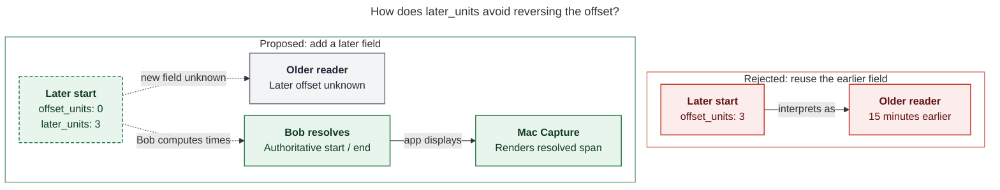

# Diagram proposals: `+N` later offsets in Pomodoro start timing

Proposals for the swarm linker, not a report. Each diagram restates only what the source
report says.

```yaml
source: research:202611/start_timing_later_offset/start_timing_later_offset__final.md
producer: research.5x.image
check: "mmdc 12.0.0 with the PDF-mirroring config rendered 1 of 1 Mermaid diagrams"
```

## later-offset-compatibility

```yaml
anchor: |-
  A separate `later_units` keeps every existing reader correct: an older reader
question: |-
  How does later_units prevent older readers from reversing the start offset?
illustrates: |-
  A separate later_units keeps offset_units meaning earlier, while bob's resolved start/end stays authoritative for Mac Capture.
caption: "The additive later_units preserves earlier units; older readers miss the new offset while Mac Capture displays Bob's resolved span."
review: "836.094x565 px, fit 78.1%; question, visual, and source checks passed; 0 revisions; independent branches show interpretation and display"
```


