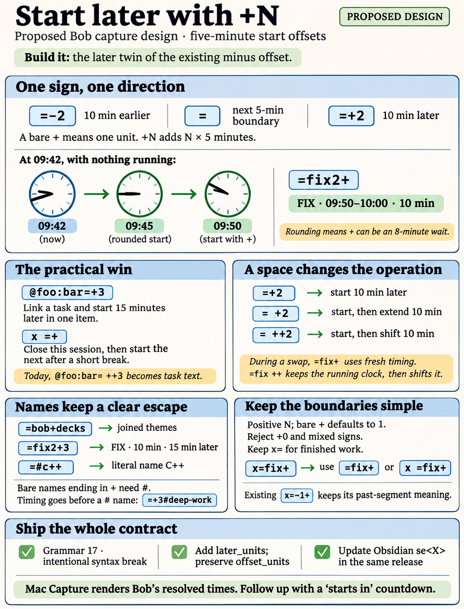
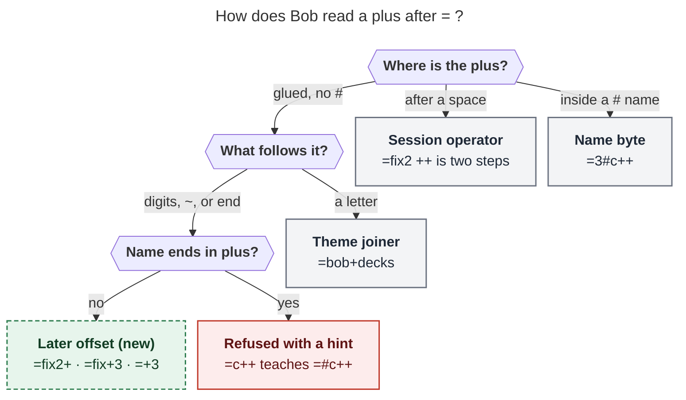
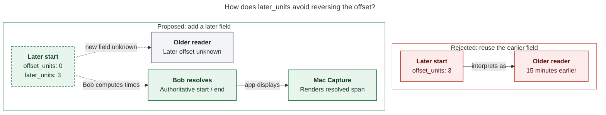

# `+N` later offsets in Pomodoro start timing: consolidated design

> **Research query:** How should Bob support a trailing `+<N>` on the `<X>` of the
> `=<X>`, `@file:id=<X>`, and (if appropriate) `x=<X>` capture syntaxes, adding N
> five-minute units to the Pomodoro's start (N a positive integer defaulting to 1, so
> `=fix2+` ≡ `=fix2 ++` and `@foo:bar=+3` ≡ `@foo:bar= ++3`) in a way that is intuitive,
> reliable, and beautiful? Is the plan a good idea, which requirement adjustments are
> justified, and what solution is recommended?



## Bottom line

**Build it.** Treat `+N` as the *later* twin of the `-N` lookback that `<X>` already
has. In other words, the start offset gets a sign. Do not treat it as a `++` shift glued
onto the token. The whole feature then fits in one sentence:

> Inside `<X>`, `-` starts earlier and `+` starts later. A sign with no number means
> five minutes.

- `=fix2+` starts FIX for 10 minutes, five minutes later. `@foo:bar=+3` links the task
  and starts it 15 minutes later. Both write exactly the span you expected.
- **[One lexing rule](#reading-a-plus-after-the-equals-sign) settles `+` inside names.**
  A glued `+` followed by a letter joins theme components (`=bob+decks`). A glued `+`
  followed by digits, `~`, or the end of the token starts the later offset. Bare names
  already cannot end in a digit. Now they also cannot end in `+`, and `#` spells those
  names (`=#c++`). No name in the vault is affected.
- **`x=` [stays out](#past-records-stay-out).** It records finished work, it already
  rejects offsets, and inside it `+` already means a segment's far edge (`~n+`).
- **Ship as [capture grammar 17](#contracts)**, with a `feat(capture)!:` commit. Add one
  JSON field, `later_units`. Teach the Obsidian `se<X>` snippet `+` in the same release
  train.

Eight adjustments to the request are called out in
[Requirement adjustments](#requirement-adjustments). The full recommendation is at the
[end](#recommended-solution).

---

## Is this a good idea

**Yes. It finishes a half-built grammar at low cost.**

- **Symmetry.** Bob can already say "I started 10 minutes ago" (`=-2`) but not "I'll
  start in 10 minutes". The sign you type is the direction the start moves.
- **A real gap.** As
  [the link-start finding](#link-starts-cannot-chain-a-shift-onto-the-same-line) shows,
  `@foo:bar=+3` will be the only one-item way to link a task and start it later.
- **The Pomodoro break idiom.** `x =+` reads as "close this one, take roughly a
  five-minute break, then start the next." It chains with no new code. Of all the
  forms, the default of N = 1 matches the technique's own rhythm most directly.
- **The spacing mnemonic stays principled.** The docs already teach that a glued sign
  means *when* and a spaced sign is a *second gesture*. The plus forms line up with the
  existing minus forms:

  | Glued: one start | Spaced: start, then a second operation |
  | --- | --- |
  | `=-2`: start 10 min earlier | `= -2`: start, then shorten by 10 min |
  | `=+2`: start 10 min later (**new**) | `= +2`: start, then extend by 10 min |
  | `=fix2+`: FIX starts 5 min later (**new**) | `=fix2 ++`: start, then shift later |

- **Low risk.** Future starts, wrap-around past midnight, closing a session before it
  starts, and overflow errors all exist already. The change mostly touches about four
  lexer helpers. The precedent commit `79709fed` reclaimed name bytes for timing across
  22 files, and this change is smaller.

**Costs to accept knowingly:**

- **An intentional grammar break** for a narrow class of tokens nobody uses: bare names
  ending in `+` or `+digits`.
- **A misleading status line during the lead time** (follow-up in
  [Risks and follow-ups](#risks-and-follow-ups)).
- **A second repository**, because of the Obsidian `se<X>` parity.

The use frequency is moderate: "start at :15 after coffee" is occasional, not hourly.
The feature earns its place because it is cheap, it makes the grammar more regular, and
it closes the gap for link starts.

---

## Requirement adjustments

**Request.** Allow `+<N>` at the end of `<X>` in `=<X>`, `@file:id=<X>`, and possibly
`x=<X>`. It should add N five-minute units to the Pomodoro's start, with N defaulting
to 1. So `=fix2+` ≡ `=fix2 ++` and `@foo:bar=+3` ≡ `@foo:bar= ++3`.

Each item below changes or tightens the request.

1. **Leave `x=` out.** It records the past, it already refuses offsets, and `+` already
   means the `~n+` edge there. `x=…+` forms get a teaching error that points at `=fix+`
   (start later) or `x =fix+` (close now, start later).
2. **The equivalence holds wherever `<X>` already carries timing, not in every case.**
   `=fix2+` ≡ `=fix2 ++` and `=+3` ≡ `= ++3` hold for fresh starts, restarts, and link
   starts. Wherever an *empty* `<X>` would keep or follow an existing clock (a swap's
   kept span, or a MEET calendar run), `+N` means written timing instead, exactly as
   `-N` already does. Unnamed starts choose their target with the later start, again
   like `-N`.
3. **`@foo:bar= ++3` is not a working spelling today.** It creates a task titled `++3`.
   `@foo:bar=+3` delivers what that spelling was meant to do. I also recommend refusing
   link items whose only body is session operators, with a hint
   ([Refusals that teach the fix](#refusals-that-teach-the-fix)); this part is
   separable.
4. **N is a positive integer.** `+0` is an error. A bare `+` means 1, and leading zeros
   are fine (`+03`). The existing `-0` keeps working; do not retire it in this change.
5. **One sign per `<X>`.** `=3-1+2` is refused. It is not netted out.
6. **A bare name cannot end in `+` or `+digits`.** `=c++`, `=fix++`, and `=bugs+2`
   change meaning or become errors. `#` keeps literal names (`=#c++`, `=3#c++`).
7. **Leading placement is accepted too.** `=+2fix`, `=3+1fix`, and `=3+1#deep-work`
   work, mirroring `=-2bugs`. Hash names *require* leading timing, because timing after a
   `#` literal is already a retired spelling. For bare names the canonical position is
   trailing (`=fix2+1`); docs, completion, and fit drafts emit that form.
8. **Change Obsidian `se<X>` in the same release train**, so "`<X>` is exactly
   `se<X>`" stays true.

---

## Sources and method

**Lead researcher's consolidated report** · 2026-11-07

**Inputs.** Five independent reports in this directory:
[cdx](start_timing_later_offset__cdx.md), [cld](start_timing_later_offset__cld.md),
[grk](start_timing_later_offset__grk.md), [mus](start_timing_later_offset__mus.md), and
[gem](start_timing_later_offset__gem.md). I re-checked their disputed claims against
bob-cli `b73ac383` (capture grammar 16), bob-plugins `2563c78`, bob-mac-capture `c2b7db2`,
and a read-only survey of the Bob vault's ledger names.

---

## What the system does today

All five reports agree on these facts, and I re-verified the cited code.

### Start timing is a duration plus a backward-only offset

`<X>` is duration plus a backward-only offset. `<X> := [0-9]*(-[0-9]*)?` is lexed by
`start_timing_len` (`src/native/capture_language/item.rs:3882`) and parsed by
`parse_pomodoro_start_suffix` (`tokens.rs:1609`). The start time is
`start = ceil((now − 5·offset)/5)·5` and `end = start + 5·duration`, computed in
`start_block_minute` (`capture/meet_event_run.rs:200`).
`PomodoroStartSpec.offset_units` is an unsigned `u64` meaning *earlier*
(`model.rs:451`). The docs promise that "`<X>` is exactly the suffix of the Obsidian
bob-ledger-tools `se<X>` snippet" (`docs/capture.md:1648`). Its regex,
`^se(\d*)(?:-(\d*))?$` (`bob-ledger-tools/src/010-load-and-constants.js:289`), also
only knows `-`.

Every offset is a multiple of five minutes, so `ceil((now ± 5N)/5)·5 = ceil(now/5)·5 ±
5N`. A start computed with a later offset therefore lands on exactly the span that
"start, then `++N`" produces. cld and grk confirmed this with dry runs, and cdx did so
in fixtures (`=fix2 ++` at 09:42 → 09:50–10:00).

### A plus is a name byte but a trailing plus carries no meaning

`+` is a name byte, but a trailing `+` carries no meaning.
`is_pomodoro_selector_byte` admits `+` (`tokens.rs:576`).
`bare_start_name_len` (`bare_name.rs:36`) takes the longest run of selector bytes other
than `-`, then peels trailing digits off as timing. The result today:

| Draft | Today's reading |
| --- | --- |
| `=fix2+` | name **`FIX2+`**, 25 min (the user's own example already means something else) |
| `=fix+`, `=c++` | names `FIX+`, `C++`, 25 min |
| `=fix+3`, `=bugs+2` | names `FIX+`, `BUGS+`, with *duration* 3 or 2 |
| `=bob+decks2` | merged name `BOB+DECKS`, 10 min |
| `=+`, `=+3` | prose: a task titled `=+3` |
| `=3+`, `=3+2`, `@foo:bar=+3` | `invalid_pomodoro_start` (free to repurpose) |
| `x=fix2+` | past record named `FIX2+` |
| `x=3+`, `x=+` | `invalid_pomodoro_past` |

**New finding (lead).** The theme model already throws away a trailing `+`. A
Pomodoro theme is one `+`-separated component of the name
(`decisions:pomodoro-theme-is-one-component`). `split_components`
(`src/native/plan_budget/mod.rs:827`) drops empty components. So `C++` and `FIX+` are
already the themes `C` and `FIX`, and `BUGS+2` is the themes `BUGS` and `2`. Taking the
trailing `+` / `+digits` back for timing removes no meaning the rest of Bob preserves.

**Vault survey.** I ran this independently, and it agrees with cld's survey. The
`20xx/` daily notes contain 158 files with timed ledger rows and 74 distinct names. Nine
of those names contain `+`, and every one has the `A + B` letter-led shape (`BUILD +
FIX`, `PLAN + FINAL + ARTIFACTS`). None ends in `+` or `+digits`, and nothing anywhere
mentions `C++`. One name ends in a digit (`SASE V18`); it already needs the `#`
spelling.

**Documentation drift.** cdx, cld, grk, and mus all found it. `docs/capture.md:398`
and `:5640` say `=bugs+2` starts a Pomodoro named `BUGS+2`. Since `79709fed`
(2026-11-06, "glue start and past timing to Pomodoro names") the lexer actually reads
name `BUGS+` with duration 2. Those rows are wrong today, whatever happens to this
feature.

### Empty timing keeps a clock while non-empty timing is fresh

An empty `<X>` keeps a clock; a non-empty `<X>` is fresh timing. This is published
contract. "While another session runs, a different named target swaps in (an empty
timing keeps the running ledger)" (`docs/capture.md:148`). Or: "keeping its clock with
an empty `<X>` or using fresh timing when `<X>` is given" (`:3535`). Likewise, MEET
calendar spans apply only when `spec.raw.is_empty()` (`meet_event_run.rs:691`). So
`=fix-` and `=fix --` already disagree during a swap. At 09:42 with BUILD running
09:00–09:50, cdx's fixtures gave:

| Draft | Result |
| --- | --- |
| `=fix ++` | FIX takes BUILD's 09:00–09:50 span, which is then shifted → **09:05–09:55** |
| `=5fix ++` | fresh 09:45–10:10, then shifted → **09:50–10:15** |
| `=fix-` | fresh timing → **09:40–10:05** |

Unnamed starts choose their target with the *offset* start: `unnamed_start_target_with`
(`meet_event_run.rs:307`) looks for a MEET overlapping `[S, S+5)`. A signed offset
therefore also moves which meeting an unnamed start joins.

### Link starts cannot chain a shift onto the same line

All five reports independently confirmed this. `@foo:bar= ++3` is **not** link + shift.
It parses as `pomodoro_task` with body `++3`: it creates a new task titled `++3`, or
fails when `^bar` already exists. Only a two-item draft works (`@foo:bar=`, a blank
line, `++3`). This is the strongest functional reason for the feature: at present there
is no one-item way to link a task and start it later.

### Sessions that start in the future already exist

`=` rounds up (at :02 it writes :05), and MEET starts can begin in the future. Two
existing behaviors become more visible with `+N`:

- **The status line counts down to the end, not the start.** `bob pomodoro` prints
  `[<Nm]` until the end (`src/native/pomodoro.rs:412`). A session at 10:00–10:25 viewed
  at 09:42 shows `[<44m]`.
- **Closing before the start records zero minutes.** `x` on a session that has not
  started closes it at its own start with 0 minutes
  (`capture_pomodoro_close/ledger.rs:218`).

### Past records have their own language

`x=` has its own language. `x=E[s][!][=X]` records past work that ends at the next
five-minute boundary or is placed by `~` segments. Past offsets were retired
deliberately: `x=3-1` teaches `x=3~1`. Inside `x=`, `+` already means "end edge"
(`x=~1+`). The past lexer reuses `bare_start_name_len` (`past.rs:231`), so any change to
the bare-name rule reaches `x=fix+` unless it is handled explicitly.

### Downstream consumers

- **Mac Capture.** It decodes `offset_units` (`CaptureModels.swift:1533`) and stores it
  (`CapturePomodoroStartPresentation.swift:147`), but **never renders it**. It shows
  bob's resolved `start`/`end` and spans. Its grammar gate requires revision ≥ 15
  (`CaptureGrammarGate.swift`).
- **Event-conflict fit drafts.** `start_fit_token` (`capture/event_conflict.rs:227`)
  writes `={units}-{offset_units}` and assumes the offset means earlier. A later start
  would silently be suggested as an earlier one unless this is updated.
- **The human parse line.** It reads `=3 (15m, offset 0u)` (`capture_parse.rs:3148`).
  Once two directions exist, "offset 2u" is ambiguous.
- **Same-line chains.** They recognize starts through `session_equals_token`
  (`item.rs:3935`), so `x =fix+` and `=fix+ +2` chain with no extra work.

---

## Recommended design

### Grammar and clock

```text
<X>       ::= [duration] [offset]
duration  ::= [0-9]+                 omitted → 5 units (25 min)
offset    ::= "-" [0-9]*             earlier; omitted digits → 1
            | "+" [0-9]*             later;   omitted digits → 1, zero refused
start = ceil((nowMinutes − 5·earlier + 5·later) / 5) · 5      end = start + 5·duration
```

The parser guarantees that at most one of `earlier` and `later` is nonzero. Reuse
`start_block_minute` with checked addition; do not add a second rounding path. The
display wraps modulo 24 hours, as it does today. The existing "start suffix is too
large" error covers overflow.

Worked examples at `BOB_NOW` 09:42 (unshifted start 09:45), with nothing running:

| Draft | Reading | Writes | Same as |
| --- | --- | --- | --- |
| `=` | next, 25 min | 0945–1010 | — |
| `=+` | next, 25 min, later 1 | 0950–1015 | `= ++` |
| `=+3` | next, 25 min, later 3 | 1000–1025 | `= ++3` |
| `=3+` | next, 15 min, later 1 | 0950–1005 | `=3 ++` |
| `=fix2+` | FIX, 10 min, later 1 | 0950–1000 | `=fix2 ++` |
| `=fix2+3` | FIX, 10 min, later 3 | 1000–1010 | `=fix2 ++3` |
| `=bugs+2` | BUGS, 25 min, later 2 | 0955–1020 | `=bugs ++2` |
| `=fix2+~1` | FIX, 10 min, later 1, without queued link 1 | 0950–1000 | — |
| `@foo:bar=+3` | link, then start 25 min, later 3 | 1000–1025 | the two-item `@foo:bar=` / `++3` |
| `@foo:bar=fix2+` | link under FIX, 10 min, later 1 | 0950–1000 | — |
| `=fix-` | FIX, 25 min, earlier 1 | 0940–1005 | unchanged |

### Reading a plus after the equals sign

**Reader question:** When is a `+` the new later offset, and when is it something else?

**Caption:** A spaced `+` is a separate operator and a `+` inside a `#` name is a name
byte. A glued `+` before a letter joins themes. A glued `+` before digits, `~`, or the
token's end is the later offset, unless the name left in front of it still ends in `+`.
That case is refused with a `#` hint.

Rendered: [plus-reading.svg](plus-reading.svg) (686 × 736 px; fit scale 95.1%, Mermaid
CLI 12.0.0 with the PDF-mirroring config).



**How the lexer applies the rule.** These are the steps in `bare_start_name_len`,
`can_spell_bare`, and `trailing_glued_timing`:

1. Take the run of selector bytes, excluding `-`, as today.
2. If the run's **last** `+` is followed only by digits, or by nothing, cut the name
   just before that `+`.
3. Strip trailing digits as duration, as today.
4. If what remains still ends in `+` (`c+`, `fix+`), it is not a bare name. Refuse it
   with a hint.
5. `can_spell_bare` also rejects names that end in `+`. That makes `=#c++` a legal
   literal, where today the `#` would be "redundant".

The decision is purely lexical. Never choose between "name" and "offset" by checking
whether a matching session exists; cdx is right that a draft must not change meaning
when the vault changes.

| Token | Name | Duration | Later |
| --- | --- | --- | --- |
| `=fix2+` | FIX | 2 | 1 |
| `=fix+3` | FIX | 5 | 3 |
| `=bob+decks` | BOB+DECKS | 5 | — (unchanged) |
| `=bob+decks2+3` | BOB+DECKS | 2 | 3 |
| `=fix+read2` | FIX+READ | 2 | — (unchanged) |
| `=bob+2fa` | BOB+2FA | 5 | — (unchanged: the last `+` is followed by a letter) |
| `=b2b+2` | B2B | 5 | 2 |
| `=+fix`, `=3+1fix` | FIX | 5 / 3 | 1 / 1 |
| `=3+1#deep-work` | DEEP-WORK | 3 | 1 |
| `=#c++`, `=3#c++` | C++ | 5 / 3 | — (newly legal; today `=#c++` is a "redundant `#`" error) |
| `=c++`, `=fix++` | — | — | refused with a hint |
| `@sase:deep-fix#c++`, `@sase:deep-fix#bugs+` | C++ / BUGS+ | — | — (unchanged: after `#`) |

These stay exactly as they are today: mid-body `C++` and `Plan =+3` (prose), `= +2`
(start, then extend), `=+ foo` (prose, like `=- foo`), and `x=2~1+`. A token with
timing on both sides of a name (`=+fix2`) keeps the existing "one timing" refusal.

### Behavior in every start context

| Context | Behavior with `+N` |
| --- | --- |
| Fresh start (`=+3`, `=fix2+`) | Starts the selected entry at the later span. **Same as `… ++N`** |
| Restart (`=+` or `=capture+` while CAPTURE runs) | Fresh timing from the later start, with the existing override warning. **Same as `= ++`** |
| Swap (`=fix+` while BUILD runs) | Fresh timing (09:50–10:15 in [the swap example](#empty-timing-keeps-a-clock-while-non-empty-timing-is-fresh)), **not** BUILD's kept span shifted. Mirrors `=fix-`. `=fix ++` stays the keep-and-shift spelling |
| Link start (`@r:id=+N`, `^r:id=+N`, `@r:id#name=+N`) | Same guards as today: link starts never override a running session ("finish the current Pomodoro first"), and they take no drop list |
| MEET with a calendar run | Only an empty `<X>` follows the calendar span. `=meet+` is written timing, like `=meet-` |
| Unnamed start near a meeting | Target chosen by `[S, S+5)` with S the later start, so `=+2` at 09:52 joins a 10:00 MEET (with written timing) |
| Event warnings and fit drafts | Checked against the final span. Fit drafts keep the sign (`=fix2+1`) |
| Chains | `x =+`, `x =fix+`, and `=fix+ +2` run left to right as today |
| Midnight | `=+3` at 23:55 writes `0010–0035` into today's note, as `= ++3` and `=` at 23:58 already do. No new guard |
| Undo | `--N` shifts back. `x0` resets a session that has no notes to a placeholder |

### Refusals that teach the fix

| Typed | Message (in the existing retired-form voice) |
| --- | --- |
| `=+0`, `=fix2+0` | "`+0` moves nothing: drop it (`=fix2`), or write `=fix2+` to start 5 minutes later" |
| `=3-1+2`, `=+1-2` | "One offset per start: `-` for earlier or `+` for later (`=3-1` or `=3+2`)" |
| `=fix++`, `=fix2++` | "`=fix++` takes one `+`: `=fix+2` starts 10 minutes later; `=fix ++` starts, then shifts" |
| `=c++`, `@r:id=c++` | "`C++` ends in `+`, which a bare name reads as timing: write `=#c++` (or `=+#c++` to start it 5 minutes later)" |
| `x=fix+`, `x=3+`, `x=+` | "`x=` records finished work and cannot start later: `=fix+` starts FIX 5 minutes from now, `x =fix+` closes first, and `~` places past work" |
| `@foo:bar= ++3` (separable) | "`++3` after a link start would become task text: write `@foo:bar=+3`, or put `++3` on its own item" |
| `=#"DEEP WORK"+3` | The existing "timing after a literal is retired" error, rewritten to `=+3#"DEEP WORK"` |
| The general shape error | It lists the new shapes: empty, digits, `-`/`+` with optional digits, or digits then a sign (`=`, `=3`, `=-2`, `=+2`, `=3+1`) |

### Contracts

- **Model.** `PomodoroStartSpec` and `PomodoroStartSummary` gain `later_units: u64`,
  serialized only when it is nonzero. `offset_units` keeps its meaning, now documented
  as "earlier units". `raw` keeps the typed sign. For example:
  `{"raw":"2+","duration_units":2,"offset_units":0,"later_units":1}`.
  `schema_version` stays 1.
- **Human line.** It shows the typed sign: `=fix2+ (10m, offset +1u)`,
  `=-2 (25m, offset -2u)`, `=3 (15m, offset 0u)`.
- **Revision.** Move `GRAMMAR_REVISION` from 16 to 17 (`capture_language/mod.rs:48`),
  or to the next free revision when this lands, and update the `capture-parse` and
  `capture-complete` help text that names it.
- **Release.** Commit as `feat(capture)!:`, since accepted text changes meaning. Under
  `decisions:bob-cli-releases-ride-a-daily-train`, do not touch `Cargo.toml` or
  `CHANGELOG.md`.
- **Decision record.** After you accept the design, record it ("Start timing is
  signed; a glued `+` before digits or the end is timing; `x=` takes no offset") via
  `/sase_memory_write`. The rule crosses the name lexer, `se<X>` parity, and Mac spans.

### Past records stay out

`x=` stays out. `x=` means "records what already happened". A later start pushes a
record into the future, and at that point it is a start, not a record. Every plausible
intent already has a spelling:

- `=fix3-2` ("I've been at it 10 minutes and want 15 in total")
- `x =fix+` ("close now, start FIX in 5")
- `x=fix~` ("place past work")

`+` already means the far edge in `~n+`. Backward offsets were removed from `x=` on
purpose, and a forward one would reopen that decision. The only change on the `x=`
side is the deliberate teaching error from
[Refusals that teach the fix](#refusals-that-teach-the-fix), because the past lexer
shares the bare-name helper.

### Obsidian snippet parity in bob-plugins

Obsidian `se<X>` parity (bob-plugins):

- **Regexes.** Change `TRIGGER_RE`'s `se\d*(?:-\d*)?` to `se\d*(?:[-+]\d*)?`, and
  `LEDGER_TRIGGER_RE` to `^se(\d*)(?:([-+])(\d*))?$`
  (`plugins/bob-ledger-tools/src/010-load-and-constants.js:288-289`).
- **Sign handling.** Pass the sign through `parseTrigger` and into `computeRange`
  (`030-snippets.js`), using the same `+` arithmetic. Also carry it into the plugin's
  MEET fit token.
- **Shared vectors.** Add `se+`, `se+3`, `se3+`, and `se3+2` to the shared clock
  vectors, and extend the harness so `=+N` tokens map to `se+N`.
- **Deploy.** Run `bob plugins sync`.

If the plugin cannot land in the same train, rewrite the parity sentence in
`docs/capture.md:1648` rather than leave it false.

### Bob Mac Capture

**No grammar or parser work is needed.** Mac Capture is a thin client
(`decisions:mac-capture-is-a-thin-client`): it renders the spans and resolved
`start`/`end` that bob returns, and its revision ≥ 15 gate accepts 17.

**Optional work:**

- Decode `later_units` into the model and add one fixture, so the field is pinned for
  later presentation work.
- Verify new bob with the old app, and old bob with the new app.

Mac-target changes need the exact-SHA macOS CI run to pass.

### Optional presentation polish

The preview is what makes the punctuation readable. Bob's human start summary could
say `FIX 09:50–10:00 · 10 min · starts in 8m`. Say "starts in 8m", not "in five
minutes": rounding means the real wait at 09:42 is 8 minutes. Bob computes that
string, so the Mac app never has to.

**Spans for `=fix2+`.** The start sigil, name, and timing get spans
`pomodoro_start [0,1)`, `pomodoro_name [1,4)`, and `pomodoro_start [4,6)`. No new span
kind is needed.

**Completion keeps the timing.** Accepting FIX at `=fi|2+` yields `=fix2+`. Accepting
DEEP WORK at `=de|3+1` yields `=3+1#deep-work`.

**Mid-typing flicker.** While you type `=bob+d…`, the token briefly reads as "BOB, 5
minutes later". That is the same one-keystroke flicker that `=fix2` → `=fix2a` already
shows.

---

## Where the reports disagreed and the calls I made

| Question | cdx | cld | grk | mus | gem | **Decision** |
| --- | --- | --- | --- | --- | --- | --- |
| What does `+N` mean? | Resolve the start, *then* shift that session | Signed offset in `<X>` | Signed offset | Signed offset | Signed offset | **Signed offset** |
| Which trailing `+` is timing? | Lone `+` at the end, not part of `++` | Followed by digits or end | Only right after a duration digit | Never after a bare name (leading position only) | Followed by digits, `~`, or end | **Followed by digits, `~`, or end. Names ending in `+` need `#`** |
| Swap or MEET with an empty duration (`=fix+`) | Keep the running span, then shift it | Fresh timing | Fresh | Fresh | Fresh | **Fresh, exactly like `=fix-`** |
| `+0` | Error | Allowed (mirrors `-0`) | Error | Error | Error | **Error** |
| Both `-` and `+` (`=3-1+2`) | Allowed, and the two net out | Error | Error | Error | Error | **Error** |
| Leading `+` (`=+2fix`, `=3+1#deep-work`) | Rejected (put the plus after the name) | Accepted; trailing is canonical | Accepted | Leading only | Accepted | **Accepted; trailing is canonical for bare names** |
| JSON | `shift_later_units` | `offset_direction` | `later_units` | `offset_direction` | `offset_direction` | **`later_units`, omitted when zero** |
| Obsidian `se<X>` | Separate decision | Same train | Same train | Coordinate | Coordinate | **Same train** |
| `x=fix+` | Keep the name `FIX+` | Teaching error | Keep the name | Keep the name | (`x=+` error) | **Teaching error** |
| `@r:id= ++N` body | Explains it, no change | Refuse with a hint | Explains it | Explains it | Explains it | **Refuse with a hint (separable)** |

**Why a signed offset, not "start, then shift" (against cdx).** cdx's model makes
`=fix+` ≡ `=fix ++` true in every context, and it argues this well. But it contradicts
a rule that is already published: an empty `<X>` keeps or follows a clock, and a
non-empty `<X>` is fresh timing
([Empty timing keeps a clock](#empty-timing-keeps-a-clock-while-non-empty-timing-is-fresh)).
Under cdx's model, `=fix-` would mean "fresh, 5 minutes earlier" while `=fix+` meant
"keep BUILD's 09:00 span, then push it later". Those are two different concepts behind
one pair of signs. They also behave differently in the scenario that matters. When you
swap away from a session that started 40 minutes ago, "start FIX in five minutes"
(09:50–10:15) is almost always the intent. "Pretend FIX began at 09:05" (09:05–09:55)
is a correction, and `=fix ++` already expresses it. The signed offset also needs no
post-resolution second planner step: one write, one override warning, one result. The
user's own example `=fix2+` carries a duration, so it is fresh timing under both models
and the equivalence holds.

**Why the lexing rule is "digits, `~`, or end" (against grk, mus, cdx).**

- **grk's "only right after a digit"** keeps `=fix+` as the name `FIX+` and
  `=fix+3` as "`FIX+` for 15 minutes". That breaks the user's grammar, under which `X =
  +` and `X = +3` are valid suffixes. It also breaks the teachable rule "append `+` to
  start later".
- **mus's leading-only rule** keeps `=fix2+` as the name `FIX2+`, which contradicts the
  user's first example.
- **cdx's "lone plus"** protects `=c++` but makes `=fix2++` a name, `FIX2++`, and
  needs a second sentence to explain.
- **Digits-or-end** is one sentence. It mirrors the existing rule "a bare name cannot
  end in a digit", and
  [the name-byte findings](#a-plus-is-a-name-byte-but-a-trailing-plus-carries-no-meaning)
  show it costs nothing real: trailing `+` is already discarded by `split_components`,
  and the vault has no such names. Its only casualty, `=c++`, becomes a teaching error
  that points at `=#c++` instead of being silently reinterpreted.

**Why `later_units` (against cld, gem, mus).** Pairing a direction with a magnitude
matches the house style of `pomodoro_shift`. But reusing `offset_units` for later
starts means an older reader would see `offset_units: 3` and assume 15 minutes
*earlier*. A separate `later_units` keeps every existing reader correct: an older reader
just doesn't know about the later offset, and bob's resolved `start`/`end` stays
authoritative. Today the stakes are low, since Mac Capture never renders the field.
Still, an additive field is the choice that cannot mislead.
[The later-offset compatibility diagram](#figure-later-offset-compatibility) contrasts
reusing `offset_units` with adding `later_units`, tracing what an older reader concludes
and how Mac Capture shows bob's resolved span.

<div id="figure-later-offset-compatibility">



_The additive later_units preserves earlier units; older readers miss the new offset while Mac Capture displays Bob's resolved span._

</div>

**Why `x=fix+` becomes an error.** The past lexer shares `bare_start_name_len`.
Keeping `x=fix+` as a name would mean the same five bytes `fix2+` read as timing after
`=` and as a name after `x=`. One reading per byte sequence is easier to learn. The
error can also teach the forms the user probably meant
([Refusals that teach the fix](#refusals-that-teach-the-fix)).

---

## Implementation map and tests

| Surface | Change |
| --- | --- |
| `item.rs::start_timing_len` | Accept `-` **or** `+` after the duration digits, never both |
| `tokens.rs::parse_pomodoro_start_suffix` | Produce `later_units`; refuse `+0` and two signs; new shape error |
| `bare_name.rs::bare_start_name_len`, `can_spell_bare`, `trailing_glued_timing` | The digits-or-end peel; names ending in `+` are not bare |
| `past.rs` | Teaching error for `x=` later forms |
| `meet_event_run.rs::start_block_minute` | `+ 5·later` with checked arithmetic. MEET calendar rule unchanged (empty `raw` only) |
| `event_conflict.rs::start_fit_token` | Keep the sign; emit trailing timing for bare names |
| `model.rs`, `batch.rs` (`PomodoroStartSummary`), `capture_parse.rs` | `later_units`; signed human line |
| `markers.rs` | Shape error text |
| Link-item body check (separable) | Refuse operator-only bodies after `@r:id=` |
| `capture_language/mod.rs` | `GRAMMAR_REVISION` → 17 |
| `docs/capture.md`, `docs/reference/capture-syntax.md`, CLI help, `docs/reference/cli/*` | `se<X>` table, grammar-at-a-glance rows, the swap table at `:4162` (add `=+2`, `=bugs+`, `=capture+` rows), rows `:398`/`:5640`, the `x=` section, and the fit-draft list. Read `sase/memory/docs.md` and `cli_rules.md` first |
| bob-plugins `bob-ledger-tools` | [Obsidian snippet parity](#obsidian-snippet-parity-in-bob-plugins) |

**Tests.** Pick the strongest from each report:

1. **Lexer and editor agreement.** Cover every row of
   [today's readings](#a-plus-is-a-name-byte-but-a-trailing-plus-carries-no-meaning)
   and [the token table](#reading-a-plus-after-the-equals-sign) with its new expected
   reading, including byte spans. Assert that preserved forms are unchanged (from cdx
   and grk).
2. **Differential execution** (cdx's best idea). For each base start B whose `<X>` is
   non-empty, run `B+N` and `B ++N` at the same `BOB_NOW` from the same fixture, and
   compare **final note bytes** rather than response envelopes. Run the same comparison
   for `@foo:bar=+3` against the two-item draft. Assert the documented divergences
   explicitly: swap with empty duration, MEET calendar, MEET selection.
3. **Completion round trips.** Bare, digit-ending, hyphenated, multi-word, and
   plus-bearing names. Check that the sign and any drop list are kept, with the caret
   inside the name, on the `+`, and inside the digits.
4. **Refusals** from [Refusals that teach the fix](#refusals-that-teach-the-fix).
5. **Clock cases.** 09:42, an exact boundary with nonzero seconds, 23:55, and overflow.
6. **Fit drafts.** They keep `+`.
7. **Transactions.** A failing later item leaves every touched file unchanged.
8. **Obsidian vectors.** They match bob byte for byte.

---

## Risks and follow-ups

- **Intentional behavior changes.**
  - `=fix+`, `=fix2+`, `=bugs+2`, `=c++`, and the same forms after `@r:id=` change
    meaning or become errors.
  - `=+…` stops being prose.
  - `x=fix+` becomes a teaching error.

  The vault survey shows no affected names, and the `!` marker makes the break visible.
- **The `=bugs+2` documentation drift
  ([name-byte findings](#a-plus-is-a-name-byte-but-a-trailing-plus-carries-no-meaning)).**
  If you decline the feature, still fix those two rows: they describe behavior the lexer
  stopped having on 2026-11-06.
- **Follow-up: show "starts in" during the lead time.** Today `bob pomodoro`, tmux, and
  the Mac menu-bar indicator count down to the *end* (`[<44m]`). With `x =+` as a break
  idiom, the five-minute break shows the wrong countdown. A `[in 8m] FIX` state
  would fix that. The gap already exists for `=` at :02 and for future MEETs, so file it
  as its own task; it is not on the critical path.
- **No cap on N.** `=+24` (two hours later) is legal. The live preview shows the
  resulting time, and explicit input should not draw a warning. This is a capture
  convenience, not a scheduler.

---

## Alternatives considered

| Alternative | Verdict |
| --- | --- |
| Keep teaching `=fix2 ++` | Does nothing for link starts ([the link-start finding](#link-starts-cannot-chain-a-shift-onto-the-same-line)), and `<X>` stays one-sided |
| A suffix that resolves the start, then shifts it (cdx) | Contradicts the empty/non-empty timing contract. `=fix+` and `=fix-` would mean different kinds of thing |
| Gluing `++` (`=fix2++`) | Collides with `C++`, copies an operator into timing, and is longer |
| Leading-only `+` (mus) | Contradicts `=fix2+`, the user's own example |
| A `+` counts as timing only right after a duration digit (grk) | `=fix+` would stay the name `FIX+`, breaking "append `+` to start later" |
| A signed `offset_units` | Older readers would see a later start as an earlier one |
| A new sigil (`>`, `^`, `&`, `*`) | Every candidate is taken, and none says "later" as clearly as `+` |
| Absolute clocks (`=@0950`) or a `--later` flag | Heavier; `cli_rules.md` forbids subcommands under `bob capture` |
| `x=…+N` | [Past records stay out](#past-records-stay-out) |

---

## Recommended solution

**Extend `<X>` from `[D][-[N]]` to `[D][±[N]]`.** A sign with no digits means one
five-minute unit; `+0` and two signs are refused.

1. **[Clock](#grammar-and-clock).** `start = ceil((now − 5·earlier + 5·later)/5)·5`.
   That is the same span `=<X> ++N` writes whenever `<X>` already carries timing.
2. **[Name lexing](#reading-a-plus-after-the-equals-sign).** A glued `+` before a letter
   joins themes. A glued `+` before digits, `~`, or the end of the token is the later
   offset. Bare names cannot end in `+` (just as they cannot end in a digit), and `#`
   spells them (`=#c++`). Trailing position is canonical for bare names (`=fix2+`);
   leading is accepted, and required before `#`.
3. **[Contexts](#behavior-in-every-start-context).** Fresh starts, restarts, and link
   starts are byte-for-byte the start-then-shift result. Swaps and named MEETs treat a
   non-empty `<X>` as fresh timing, exactly like `-`. Unnamed starts choose their target
   by the later start. `@foo:bar=+3` becomes the one-item "link and start later".
4. **[`x=`](#past-records-stay-out).** Unchanged. Its later-shaped forms get a teaching
   error that points at `=fix+` and `x =fix+`.
5. **[Contracts](#contracts).** An additive `later_units` (with `offset_units`
   unchanged), a signed human line, grammar 17, and a `feat(capture)!:` commit. Fit
   drafts keep the sign.
6. **[Ecosystem](#obsidian-snippet-parity-in-bob-plugins).** Teach Obsidian `se<X>` `+`
   in the same release train. Mac Capture needs no grammar work.
7. **Alongside.**
   - Correct the stale `=bugs+2` documentation rows.
   - Refuse operator-only link bodies such as `@foo:bar= ++3`, with a hint.
   - Record the decision after acceptance.
   - File the "starts in Nm" status display as a follow-up.

The result is one sentence to learn: *`-` starts earlier, `+` starts later, a lone sign
is five minutes, and a space makes it a second step.* It handles the link case that
cannot be expressed today, and it costs nothing real in existing names.
