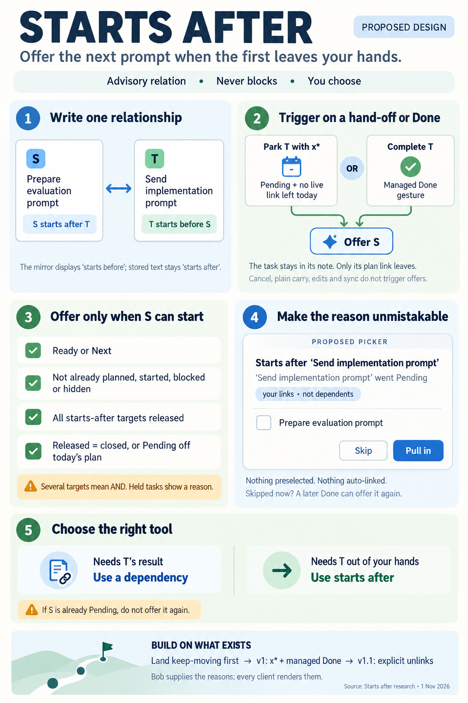
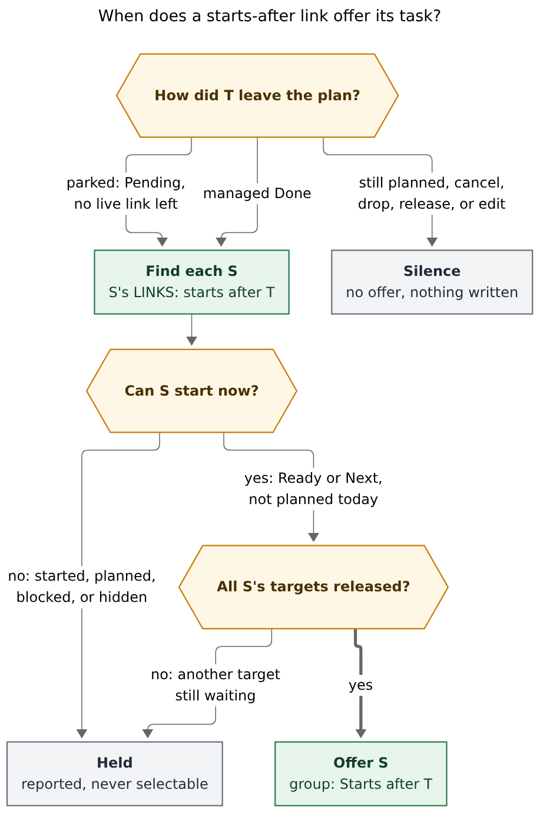
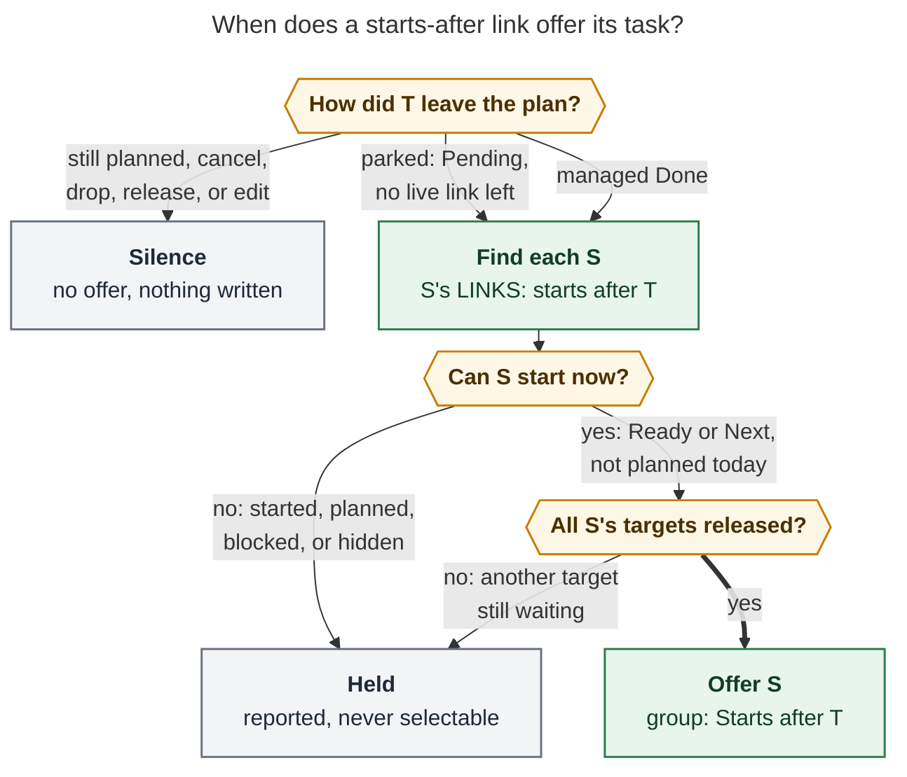

# "Starts after": a relation that offers the next prompt when the first one leaves your hands

> **Research query:** What is the best way to implement a new "starts after" relation label, rendered as "starts before" in the mirrored LINKED FROM bullet, that triggers a successor prompt for a task when another task is marked wip/pending and moved out of the daily file (an operation believed unique to `x*` capture) or is closed, while making very clear why this successor prompt fired and keeping the design intuitive, reliable, and beautiful? Is this plan a good idea, would a different approach be better, which requirement adjustments are justified (called out clearly), and what is the recommended solution?



## Bottom line

**Build it.** All five researchers agree, and so do I. The need is real. Today Bob can
only say "S must wait until T is finished" (a dependency). It cannot say "think about
S once T is out of my hands." For agent work, the gap between those moments can last
days. Bob already has every piece except the trigger: relations, display-only inverse
labels, and a mature successor-offer picker.

Build it as **an advisory relation label that offers its task through the existing
successor picker**. It never blocks anything:

> **`S starts after T`**, stored on S's 🪢 LINKS line, means: when T is **parked off
> today's plan** (it is Pending and no live Task Link to it remains today) or **done**,
> offer S in its own picker group, titled **Starts after “T”**, with the 🪢 glyph and a
> caption that names the event. T's LINKED FROM line *renders* `starts before`.

Five requirement adjustments matter most (all are listed in
[Requirement adjustments](#requirement-adjustments)):

1. **The trigger is "T left today's plan as Pending," not "the `x*` syntax."** The task
   never moves out of the daily file. Only its Task Link stops being carried forward,
   and `x*` is not the only gesture that does that. Ship `x*` first, and define the
   contract so the Obsidian unlink and the capture `+id!` unlink fit later.
2. **`starts before` is a display inverse, never stored text.** Bob's mirror stores
   `[[S]] (starts after)` on T. Storing `(starts before)` would state the opposite
   order.
3. **Pending (`[/]`) sources are never offered.** The relation is about *starting* S.
   Once S has started, the edge has done its job. This also stops S from being offered
   again after you have already dispatched it.
4. **Several `starts after` targets combine as AND.** S is offered only when every
   target is released. Otherwise it is held, and the reason is reported.
5. **bob writes the "why".** Bob emits each offer group's title, caption, and glyph in
   JSON. The Mac renders those strings and no longer hard-codes each new group.

**Sequencing:** land the in-flight keep-moving epic (`bob-cli-fb`) first. It edits the
same planner, output, net-pass, and Mac Pull-In files, and it sets the copy patterns
this feature should follow (see [Rollout and coordination](#rollout-and-coordination)).

## What Bob does today

*Verified.* Each row was checked against source. Where a researcher's claim was wrong
or out of date, the notes say so.

- **A relation is stored once, on the source's LINKS line, as `<label> <link>`. The target's LINKED FROM mirror is `<link> (<label>)` and keeps the *source's* label. Reconcile owns the mirror, and nothing reads it back as input.**
  - *Evidence:* `docs/task-relations.md` §1, §3, §6
  - *Notes:* gem's examples put the label after the link on LINKS and store `(starts before)` in the mirror. Both are wrong. gem's planner sketch also reads LINKED FROM as input, which §1 forbids.
- **Relations are inert. The only exceptions are commit-time *cancel labels* (§17) and *complete labels* (§18). Both fire once, on the *source*, at commit. They are configured as `relations.cancel_labels` / `complete_labels` (bob default `[]`; chezmoi enables them), behind one policy, `RelationsConfig::close_effect(key)`. A label carries at most one effect.**
  - *Evidence:* `task-relations.md` §2, CL2, CP2; `src/native/config/relations.rs`
  - *Notes:* "Starts after" is a new kind of effect: a *standing* edge that is read later, when something happens to the *target*.
- **Inverse phrases are display-only. Four named pairs exist, plus a `‹participle› by` rule. `starts after` matches neither, so today it would fall back to `(chip) · starts after → this`.**
  - *Evidence:* `src/native/task_relations/inverse.rs`; `task-relations.md` §10
  - *Notes:* There are **three** twins to update: Rust, ledger-tools `145a-relation-inverse-phrase.js`, and nav `303a-relation-inverse-phrase.js`.
- **Successor offers come only from managed Done gestures. `x*` parks are explicitly excluded (§12.1, SL21, KM20). Groups are `hand_off`, `project`, `project_finished`, and `keep_moving`. One picker per gesture, nothing preselected, picks link the task, raise it to Next, and stamp it fresh. Unpicked rows are not written.**
  - *Evidence:* `task-dependencies.md` §12, §12.15; `OfferGroup` in `task_complete/successors.rs`; `decisions:unblocked-tasks-are-offered`
  - *Notes:* The close planner builds predecessors only from rows this close moved open → Done (`pomodoro_close.rs` `plan_close_successors`). Parks never reach it.
- **`x*` *parks*: the session records normal work (🍅, Work Log, `[/]`), and the link is *not carried* into the next placeholder. "Parking is a close outcome, not a new task status." The forms are `x*`, `x*N`, `x1*`, `x*!M`, and `=x*…` link suffixes.**
  - *Evidence:* `docs/capture.md` close grammar and outcomes table
  - *Notes:* The task stays in its own note. Only its live Task Link goes away.
- ***Other gestures also take a Pending task off today's plan.* Capture `@route+id!` on a linked task removes every open-Pomodoro link and leaves the status unchanged. Obsidian Ctrl+Shift+Enter, or deleting a Task Link to an In Progress task, does the same and opens an optional `Unlink task` Work Log prompt.**
  - *Evidence:* `capture.md` toggle table; bob-plugins `docs/block-id-prompt.md`
  - *Notes:* The claim that this is unique to `x*` is only half true. `x*` is the only one that also *records a work session*.
- **Keep-moving, the precedent for "offers that are not dependents," offers Pending, Next, and Ready residents. It folds blocked, scheduled, and hidden residents into a count line, and is gated on *both* `plan.link_unblocked` and `plan.keep_moving` (K8). Its copy always leads with *why*, says "not dependents," and never uses 🔓.**
  - *Evidence:* `task-dependencies.md` §12.8, §12.15
  - *Notes:* Its Rust phase (`bob-cli-fb.2`) and Mac phase (`bob-cli-fb.5`) are **still in progress**.
- **Bob Mac Capture's Pull-In card switches on `hand_off`, `project`, and `project_finished`. Any other group shows *its raw key as the title* and a *`lock.open` ("unblocked") glyph*.**
  - *Evidence:* `CapturePullInChoice.swift:171-183`, `CapturePullInChoiceView.swift:527-538`
  - *Notes:* cld called this a keep-moving bug. On master it is really a gap in a rollout still in progress (fb.5). The structural problem is real, though: every new group needs Swift changes.
- **Obsidian nav's successor model keeps an allow-list (`hand_off`, `project`, `project_finished`, `keep_moving`) and drops any other group.**
  - *Evidence:* `206a-successor-picker-model.js:256`
  - *Notes:* A new group needs `api.successors` v3.
- **`api.relationIndex` v2 (ledger-tools) publishes live forward and reverse relation maps and overlays unsaved editor text. nav-hotkeys uses it; *task-status-cycler does not*.**
  - *Evidence:* `task-relations.md` §11; grep of bob-plugins
  - *Notes:* The Obsidian Done path needs a new cycler → ledger-tools dependency.
- **The Rust relation-label scan cache stores only label spellings and counts. It has a *60 s snapshot TTL*. §12.7 already rejected a persistent validated cache because its stat walk (32–55 ms) costs as much as a prefiltered snapshot read.**
  - *Evidence:* `relation_labels/scan.rs:34-35`; `task-dependencies.md` §12.7
  - *Notes:* This rules out cld's "scan cache v3 with edges" lookup (see [Where the researchers disagreed](#where-the-researchers-disagreed)).
- **The vault has 11 relation labels and 58 links. No `starts after` exists yet. *Labels with effects are the ones that get used:* `implemented by` (completes the source) has 25 links and `superseded by` (cancels it) has 13.**
  - *Evidence:* `bob relations list -a`, run read-only
  - *Notes:* Turning the label on needs no migration.
- **The workflow already exists by hand. `bob.md` `^bulk-sub-bullet-capture` carries an *unlabelled* `🪢 LINKS: [[#^task-bulk-actions]]` with Work Log `apollo agent (waiting on another epic)`.**
  - *Evidence:* `~/bob/bob.md:60-63`, read-only
  - *Notes:* Confirms cld's vault evidence.

## Critique of the plan

Is this a good idea? **Yes.** The feature fixes a real mismatch, and nearly all of the
cost is reuse.

- **A dependency misrepresents this.** Depends-On would make S Blocked until T is
  *done*, which for agent work can be days. Blocked tasks keep no Task Links
  (`decisions:projects-block-from-prj-line`), so S would disappear from the lanes it
  should sit in. It would also never fire on a park, the moment that matters.
- **It fits Bob's own definition of a successor**: "a task positioned to take its
  predecessor's place in today's Pomodoro plan when the predecessor leaves it." Parking is
  leaving the plan without finishing. The concept stretches without breaking.
- **The machinery already exists.** Keys, numbering, `-p/--pull-in`, picks, minting,
  freshness stamps, anchors, type routing, the batch net pass, the Mac choice step,
  and Alt+N undo all exist. Keep-moving has just shown how to add a group whose rows
  are *not dependents* and say so.
- **Behavioral labels are the ones you actually use** (25 and 13 links, against 1–11
  for inert labels). A label that *does something* is likely to raise relation usage,
  which is otherwise low.

### Risks and containment

Risks, and how the design contains them:

- **Erodes "relations are inert": this is the third exception, and the first to re-read an edge after it was written:** One crisp boundary in a decision record: successor labels never block, never write at link time, and never change a status except through an explicit pick. They only add rows to a picker.
- **`x*` only approximates "I sent the prompt." cld found `split-merge-capture` parked twice, once as "apollo stash" and once as "apollo agent.":** An offer costs one Esc and writes nothing. The Done event is the safety net.
- **Prompt fatigue: a fifth group and another "why":** One glyph, bob-authored copy, and nothing ever preselected. Groups appear only for edges you authored.
- **"Starts after" sounds like enforcement:** The authoring strip says "never blocks." Lead the docs with this rule of thumb: **needs T's result → `&` depends on; needs T out of your hands → `starts after`.**
- **Slower `x*`:** Zero-I/O gates first. A prefiltered scan runs only when an edge could exist. Measure it (see [Engines lookup and performance](#engines-lookup-and-performance)).

### Alternatives considered

All of these were rejected as the primary design:

- **A start-to-start dependency type (soft Depends-On):** Makes S Blocked, so it loses its links and `[unblocked::]` gets stamped. Touches hooks, the walk, the dashboard, and project blocking. Contradicts "relations never block."
- **Plan S now in a later `()` placeholder:** Works only when the order is known today. Fails when T spans several sessions or days.
- **Explicit milestone tasks ("Send A" → dependency → "Prepare B"):** Exact and gated, but one extra task per dispatch. Keep this as the advice for genuinely gated work.
- **Auto-link S into T's vacated slot:** Violates `decisions:unblocked-tasks-are-offered`: even one candidate needs an explicit pick.
- **A new sigil (`>id`), a `[startsAfter::]` field, or a `#after` tag:** Sigils are scarce (`decisions:capture-sigils-say-where-what-how`), and fields or tags would duplicate the relation system. `~…|starts after` with Tab completion is enough.
- **Generic watcher on transitions into `[/]`:** Fires during ongoing work, misses parks of tasks already Pending, reacts to edits and sync, and needs stored "already offered" state (the rejected "tray").
- **Overload `follow-up of`:** It is already used as narrative history. Parking T should not start every follow-up.
- **SASE-side agent chaining:** Orders *agents*, not *your attention*. It complements this feature but solves a different problem.

## Requirement adjustments

Each adjustment is called out with what you asked, what it is adjusted to, and why.

- **A1**
  - *You asked:* Trigger when T is "marked wip/pending and moved out of the daily file," which you believed was unique to `x*`
  - *Adjusted to:* Trigger on a **hand-off event**: an explicit gesture leaves T `[/]` with **no live Task Link left in today's open Pomodoros**, where T had one before. **v1 wires the `x*` family** (every effective parked outcome, after clock and selection rules). **v1.1** wires capture `@route+id!` and Obsidian Ctrl+Shift+Enter or link deletion on a `[/]` task.
  - *Why:* The task never moves; only its link stops being carried. Two other gestures produce the same state. Defining the contract by event keeps behavior consistent across surfaces. "No live link left" avoids firing while T is still queued later today.
- **A2**
  - *You asked:* Render `starts before` in the mirrored LINKED FROM bullet
  - *Adjusted to:* **Display inverse.** Add one named pair, `starts after → starts before`, to all three twins. The stored mirror stays `[[S]] (starts after)`. Chips, the Linked-from stage, and `bob relations list ⇄` then render `starts before`.
  - *Why:* The mirror grammar reads "S ‹label› this," so storing `(starts before)` would state the reverse order. It would also break reconcile byte identity and rename.
- **A3**
  - *You asked:* "Also when closed"
  - *Adjusted to:* **Managed Done only** (every §12.1 gesture, in both engines). **Cancel never offers**, but a cancelled target does count as *released* for A5.
  - *Why:* Matches every other successor group. Abandoned work should not push the next prompt.
- **A4**
  - *You asked:* (unstated) S is already started
  - *Adjusted to:* **Offer only Ready `[ ]` or Next `[*]` sources.** A Pending `[/]` S is held as `already_started`.
  - *Why:* The edge is about starting S. Without this rule, an S you picked and then dispatched would be offered again when T completes. This deliberately differs from keep-moving, which offers Pending residents.
- **A5**
  - *You asked:* (unstated) S starts after T1 *and* T2
  - *Adjusted to:* **AND.** S is offered only when every successor-label target is **released**: closed (Done or Cancelled), or `[/]` with no live link today. Otherwise S is held as `waits_for`.
  - *Why:* "S starts after T1" and "S starts after T2" read as both, which is how dependencies combine. Released is computed from current state, so no event journal is needed.
- **A6**
  - *You asked:* (unstated) T parked again later
  - *Adjusted to:* **Stateless:** every qualifying gesture re-evaluates. If you skip S at the park, the Done offers it again. Nothing is stored.
  - *Why:* Matches "computed at the gesture, never stored" and the rejected "tray." A4 already prevents the noisy case.
- **A7**
  - *You asked:* (unstated) Authoring an edge to a T that is already released
  - *Adjusted to:* **Never fire on authoring.** Show an amber caveat: `“T” already went Pending — “S” will be offered when it is done` (or, if T is closed, `nothing left to wait for`).
  - *Why:* Otherwise the edge silently does nothing. Writing a relation must not replay history.
- **A8**
  - *You asked:* "A special label"
  - *Adjusted to:* **A config list**, `relations.successor_labels` (bob default `[]`; chezmoi `[starts after]`). It is parsed like CL2/CP2, and one label carries one effect. The inverse pair is built in either way.
  - *Why:* One policy layer (`label_effect(key)`), the zero-use catalog overlay, "hide is not disable," and an empty-list kill switch all come for free.
- **A9**
  - *You asked:* (unstated) Someone types `starts before`
  - *Adjusted to:* **Inert, with a muted flip hint:** `“starts before” never offers anything · to start “S” after this task, use ~~ (⇧L) with “starts after”`. `bob relations rename --reverse` can fix strays.
  - *Why:* One stored direction means one fact and a one-sided lookup, and it follows the CL6/CP6 inverse-hint precedent. Authoring from T already works through `~~` and ⇧L.
- **A10**
  - *You asked:* "Very clear why"
  - *Adjusted to:* **bob authors each group's copy** (`title`, `why`, `tag`, `glyph`) in `pull_in.groups[]`, **for every group**. The Mac renders bob's strings, and the cycler shares the same copy table through vectors.
  - *Why:* Follows `decisions:mac-capture-is-a-thin-client`. Ends per-group Swift switches, which currently fall back to the raw key with a "lock.open" glyph.
- **A11**
  - *You asked:* (unstated) S cannot be offered
  - *Adjusted to:* **Held sources are reported, never selectable.** If the gesture already has a picker, they appear as one muted fold line. Otherwise they appear in the CLI output, the JSON, and a single muted notice: `🪢 “S” starts after “T” · still blocked (waits on 1)`. An already-planned S stays silent.
  - *Why:* You authored the edge yourself, so total silence would look like a bug. A picker containing only unselectable rows would be friction.

## Where the researchers disagreed

For each disputed question: the positions, the call, and the reason for it.

- **Config list or built-in key?**
  - *Positions:* Config list: cld, grk. Built-in exact key: mus, cdx, gem.
  - *Call:* **Config list** (A8)
  - *Reason:* Reuses the existing parser, overlay, conflict rule, and kill switch. The cost is one YAML key. mus worried about vocabulary drift, which the chezmoi default and one-effect rule contain.
- **Is a stored `starts before` on T also a trigger?**
  - *Positions:* Yes: grk, gem. No, use an inverse hint: cld, cdx.
  - *Call:* **No** (A9)
  - *Reason:* Two spellings of one fact invite duplicate edges and a two-sided lookup. Authoring from T is already possible.
- **Several targets**
  - *Positions:* OR, per edge: cdx, mus, and grk implicitly. AND: cld, gem.
  - *Call:* **AND, via the stateless Released predicate** (A5)
  - *Reason:* Matches the English and dependency semantics. cdx's objection was that AND needs a durable record, but Released is read from current state.
- **Require "no live link left" for park?**
  - *Positions:* Yes: cld, grk. Fire regardless: cdx.
  - *Call:* **Yes** (A1)
  - *Reason:* If T is still planned later today, it has not been handed off. Firing would interrupt the session that is about to dispatch it.
- **Offer Pending S?**
  - *Positions:* Yes: cdx, grk, gem. Held: cld.
  - *Call:* **Held** (A4)
  - *Reason:* Prevents re-offering a dispatched S.
- **Kill switch**
  - *Positions:* `plan.link_unblocked` + list: cld, mus, cdx. List only: grk.
  - *Call:* **Both**
  - *Reason:* Keep-moving's K8 precedent: `link_unblocked` already means "offer successors at all" (§12.8). The list is the feature switch.
- **Dedup priority**
  - *Positions:* `hand_off > starts-after > project > …`: cdx, cld, gem, mus. Starts-after last: grk.
  - *Call:* **`hand_off > relation > project > project_finished > keep_moving`**
  - *Reason:* An authored task-to-task edge is more specific than a note-level reason. A real dependency hand-off still wins, and the row keeps the relation as a second reason.
- **Glyph and title**
  - *Positions:* 🪢 "Starts after “T”": cld. ⏵ "Start next": grk. ⏭ (reused): mus. 🚀: gem. "What comes next?": cdx.
  - *Call:* **🪢 + `Starts after “T”`**
  - *Reason:* 🪢 already means "your relation" everywhere in Bob, and §12.6 asks for existing glyphs only. The title is the label you typed, read back to you, which is the clearest possible "why." ⏭ belongs to keep-moving, and ⏵ and 🚀 would be new glyphs.
- **Rust lookup**
  - *Positions:* Scan cache v3 with edges: cld. Prefiltered snapshot: grk, cdx, mus.
  - *Call:* **Batch-scoped prefiltered snapshot**
  - *Reason:* §12.7 measured a validated cache as costing the same as a prefiltered read. The 60 s TTL is unsafe for execution.
- **When the Obsidian unlink hand-off lands**
  - *Positions:* v1.1: cld, grk. Not considered: mus, cdx, gem.
  - *Call:* **v1.1, with `@route+id!` in the same phase**
  - *Reason:* Neither unlink path plans successors today. Both need new entry points; `x*` does not.

## Recommended design

### Storage and display

```markdown
- [ ] #task Prepare evaluation prompt ^evaluate
	- 🪢 **LINKS:** starts after [[agents#^implement]]

- [/] #task Send implementation prompt ^implement
	- 🪢 **LINKED FROM:** [[agents#^evaluate]] (starts after)
```

```text
chips on S:  🪢 LINKS        starts after → [/] Send implementation prompt
chips on T:  🪢 LINKED FROM  starts before  [ ] Prepare evaluation prompt
```

T's mini status checkbox on S's chip already shows you when T has gone Pending. No new
chip work is needed.

### Config

```yaml
relations:
  cancel_labels: [duplicate of, superseded by]
  complete_labels: [implemented by, verified by]
  # Linking S with one of these labels to T offers S as a successor when T is
  # parked off today's plan or done. Never blocks. Empty offers nothing.
  successor_labels:
    - starts after
```

- Matching uses `relation_label_key`. Invalid entries warn and are skipped. A parse
  problem never becomes a `ConfigError`.
- The policy becomes `RelationsConfig::label_effect(key) -> Option<LabelEffect>`, with
  `enum LabelEffect { Cancel, Complete, Successor }`. A key listed in two lists has no
  effect and warns once. JS gets one loader.
- The configured label appears in suggestions even with zero uses. Hiding it removes
  it from suggestions only (`decisions:relation-label-hide-is-suggestions-only`).
- Kill switch: an empty list, **or** `plan.link_unblocked: false`.

### When it fires



*Only a park that leaves T off today's plan, or a managed Done of T, looks for T's
starts-after sources. Each source is offered only if it has not started, is not
planned or blocked, and every one of its starts-after targets is released. Every other
source is held and reported, and every other gesture stays silent.* (Rendered with
Mermaid CLI 12.0.0 under the PDF-mirroring config: 611 × 920 px, 97 % fit.)

<details><summary>Mermaid source</summary>



</details>

Each gesture on T, the event it raises, and the phase that wires it:

- **Capture close with an effective *parked* outcome (`x*`, `x*N`, `x1*`, `x*!M`, `=x*…`), where T then has no live link today. This includes a T that was already `[/]`.**
  - *Event:* `pending`
  - *Phase:* v1
- **Every §12.1 managed Done: `!note:id`; `x` with embeds; `x!`, `x!M`; complete-label commits; Ctrl+Enter (all forms); Alt+] into Done; the walk's PRE/POST Ctrl+Enter**
  - *Event:* `done`
  - *Phase:* v1 (Rust and cycler)
- **Capture `@route+id!` unlinking a `[/]` T; Obsidian Ctrl+Shift+Enter or Task Link deletion on a `[/]` T, after the `Unlink task` prompt settles**
  - *Event:* `pending`
  - *Phase:* v1.1
- ***Never:* park while T keeps another live link today; plain `x` or `=x` carry; `x~` drop; Alt+N release; cancel (any form); reopen; lane toggles not into Done; raw checkbox; reconcile or hooks; hand or agent edits; adding, relabelling, or renaming a relation (these only arm future events); vault sync**
  - *Event:* —
  - *Phase:* —

### Who is offered

```text
E(g)      = {(T, done) : T ∈ C(g)}                      — §12.2's C, managed Done only
          ∪ {(T, pending) : g parks/unlinks T, T live-linked on BASELINE,
                            T is [/] after g, no live link to T after g}
EDGES(T)  = {S : an accepted LINKS entry on S resolves to T and its key ∈ successor_labels}
            — staged batch text overlays disk; LINKED FROM is never read
RELEASED(X) ⇔ X is Done or Cancelled, or X is [/] with no live link today (post-gesture text)

FOR EACH S reached from some T ∈ E(g), first match wins:
  1. S closed, non-task, in done/ or the previous daily note   → skip (no report)
  2. S ∈ C(g), handed off by g, or live-linked on BASELINE     → held already_planned (silent)
  3. S is [/]                                                  → held already_started
  4. S [?], own open prerequisite, future scheduled, project-blocked
                                                               → held blocked{waits_on|scheduled|project}
  5. S has whole-token #hide                                   → held hidden
  6. some other successor-label target T′ of S is not RELEASED → held waits_for{T′…}
  7. otherwise (S is [ ] Ready or [*] Next)                    → OFFER, group relation
DEDUP   one row per S; priority hand_off > relation > project > project_finished > keep_moving;
        the surviving row keeps every reason
GROUPS  one relation group per triggering T (earliest anchor first); an S reached from several
        T in one gesture sits under the first, with row suffix `after “T1” and “T2”`
```

If S also *depends on* T, a park leaves S Blocked (rule 4). A Done unblocks S, and S
appears once, in `hand_off`, carrying the relation as a second reason.

### Picks with placement and undo

- **Pick**: identical to a picked `hand_off` (`' '` → `'*'`, `'*'` stays). Mint a
  missing ID, stamp `[fresh:: today]`, and insert the plain Task Link. **Unpicked:**
  nothing is written. There is no recovery, no `[unblocked::]`, and no tickler,
  because S was never blocked.
- **Destination** follows the §12.3 anchors over the triggering T:
  - a park uses the **closing** anchor (the continuation, else the next open
    same-name entry, else a new `- [ ] () — NAME` placeholder), so S takes T's place
    in the next session;
  - `!` and Ctrl+Enter use the **slot** after T's struck bullet;
  - an unplanned T uses the implicit destination;
  - D7 type routing then applies;
  - a placeholder is never created only to *show* an offer.
- **Revalidate at apply**: the edge still exists, S is still eligible, and T's event
  still holds. Otherwise refuse that row (SO30 style). Never substitute another row or
  reason.
- **Batches**: an edge added earlier in the same draft is visible (staged overlay).
  One added *after* the park never fires retroactively and warns
  `relation_cue_already_released`. A later item that links, closes, drops, or blocks S
  removes the row (SL20 net pass).
- **Undo**: Alt+N on the picked link.

### Copy and visual system

Making the "why" unmistakable. Every surface uses one glyph (🪢 · SF `link` · the nav
relation-stage icon), the neutral accent, and lane names instead of symbols. No new
colours are added, and meaning is never carried by colour alone. ‹T› and ‹S› are cleaned
task text truncated to 48 characters with `…`.

The copy for each element:

- **Group title:** `Starts after “‹T›”`: the configured label in sentence case, followed by ‹T›
- **Why caption:** `🪢 “‹T›” went Pending · you linked these to start after it` / `🪢 “‹T›” is done · you linked these to start after it`
- **Contrast tag:** `your links · not dependents`
- **Held fold line (in an open picker):** `held · “‹S2›” waits for “‹T2›” · 1 blocked`
- **Held notice (no picker):** `🪢 “‹S›” starts after “‹T›” · still blocked (waits on 1)` (muted, once)
- **Picker title, only relation groups:** `Starts after “‹T›”` / `Starts after 2 tasks` (mixed pickers keep their existing title)
- **Notice, one pick:** `🪢 Next in ‹DEST›: ‹S› · starts after “‹T›”`
- **Notice, several picks:** `🪢 2 linked → ‹DEST› · start after “‹T›”`
- **CLI group header:** `Starts after “‹T›” · it went Pending (your 🪢 links, not dependents)`
- **CLI linked suffix:** `· starts after “‹T›”`
- **Authoring strip (relation card, nav stage):** `🪢 Offers “‹S›” when “‹T›” is parked or done · never blocks`
- **Authoring caveat (amber, A7):** `“‹T›” already went Pending — “‹S›” will be offered when it is done` / `“‹T›” is already done — nothing left to wait for`
- **Inverse hint (muted, A9):** `“starts before” never offers anything · to start “‹S›” after this task, use ~~ with “starts after”` (nav: `⇧L`)
- **`bob relations list` row:** `starts after   N links   🪢 offers source   ⇄ starts before`

**`bob capture 'x*' --dry-run`:**

```text
would close BUILD 1145-1220 (35m)
  [*] → [/] Send implementation prompt  agents.md ^implement · Parked · not carried +1 Work Log
  Starts after “Send implementation prompt” · it went Pending (your 🪢 links, not dependents)
  offer 1  [ ] Prepare evaluation prompt  agents.md ^evaluate → BUILD
  -p 1 · -p all
```

**Bob Mac Capture Pull-In card** (every string comes from bob):

```text
 🔗 Starts after “Send implementation prompt”              your links · not dependents
    “Send implementation prompt” went Pending · you linked these to start after it
    ☐ 1  Prepare evaluation prompt                         Ready   → BUILD
    held · “Write rollout notes” waits for “Ship schema change”
  ⇧↩ none                                                         ↩ pull in 1
```

**Obsidian picker** (nav `api.successors` v3, Done path):

```text
┌──────────────────────────────────────────────────────────────────────┐
│ 🪢  Starts after “Send implementation prompt”                         │
│ [ Filter tasks, notes, and groups                                  ]  │
│ ┃ Starts after “Send implementation prompt”  your links · not dependents │
│ ┃ 🪢 “Send implementation prompt” is done · you linked these to start after it │
│ ┃ □ Prepare evaluation prompt                                         │
│ ┃   agents · Ready · → BUILD                                          │
│  Tab toggle and move · ↵ pull in · Esc none                           │
└──────────────────────────────────────────────────────────────────────┘
```

**Authoring** needs no new grammar:

- capture: `Prepare evaluation prompt ~agents:implement|starts after`;
- from T in Obsidian: ⇧L → pick S → `starts after`;
- from S: `l` → pick T → `starts after`.

A brand-new task may be the source. Closing labels refuse that, but a successor label
has no effect at link time. Tab completion finds the configured label at zero uses.

### Engines lookup and performance

- **Rust (capture).**
  - **Gates, cheapest first, zero I/O:** the label list is non-empty, then
    `plan.link_unblocked`, then E(g) is non-empty and some T in it has a block ID.
  - **Snapshot:** only then build one batch-scoped *relation-sources snapshot*, copying
    the dependents-snapshot pattern (§12.7 layer 2). Do parallel byte reads,
    prefiltered on `**LINKS` **and** `#^<id>` for some event T, then parse with the
    shared LINKS parser and resolve with the existing target rules. Staged files
    overlay disk. Share the byte pass with the dependents snapshot when both run.
  - **Never** use the label catalog cache (60 s TTL) or LINKED FROM as authority, and
    do not build a persistent index (§12.7 already priced its stat walk at the same
    cost).
  - **Released checks** read only the T′ notes involved.
  - **Wiring:** add a parked-event input beside the completed set in
    `plan_close_successors`. A parked task must **never** be added to C, because that
    would unblock finish dependents and could trigger project-finished logic. Bypass
    the "completed nothing stages nothing" early return only when the gates pass.
  - **Cost:** expect about 30 ms extra on an enabled `x*` where some T has a block ID.
    That can exceed §12.7's 40 ms `x` dry-run target. Measure it on apollo against a
    vault **copy**, and record the trade-off in the decision record.
- **JS (cycler, Done path).** Use `api.relationIndex.incoming(path, blockId)`, filtered
  by label key, then re-read S from the staged text. This adds a new
  cycler → ledger-tools dependency. If `ready()` is false, offer nothing and report it.
- **Uncertainty is visible, never silent.** An incomplete scan or unavailable index
  must not block the close. It reports `relation_check: "unavailable"` and one muted
  line, `Couldn't check starts-after links`. A requested pick whose basis cannot be
  re-verified fails rather than being swapped.
- **One pure planner per engine** (Rust `task_relations::successor`, wired next to
  keep-moving in `plan_successors`, plus the JS twin). It is pinned by shared vectors
  in `tests/fixtures/relation_successor/vectors.json`, which bob-plugins copies byte
  for byte.

### Contracts

All additive; every `schema_version` stays 1, no `!`.

- **`pomodoro_close` / `task_complete`**:
  - `relation_successors[]` uses the exact `unblocked[]` row shape with
    `trigger: "relation"`, `offer.group: "relation"`, and `unblocked_by` = the
    triggering Ts (keep-moving parity), plus
    `relation: {label, key, event: "pending"|"done", after: [{note_path, block_id, text}]}`.
  - Rows never appear in `unblocked[]`.
  - `relation_held[]` carries `{…, reason: already_planned|already_started|blocked|hidden|waits_for, waits_on?, scheduled?, project?, waits_for?}`.
  - Add `relation_check`.
- **`pull_in`**:
  - `offer_count` and `picked_count` include relation offers, and so does the
    `pull_in_choice_required` refusal.
  - **Every** `groups[]` entry gains bob-authored
    `copy: {title, why?, tag?, glyph: "unblocked"|"project"|"project_finished"|"keep_moving"|"relation"}`.
- **Ledger**: block-diff `reason: "relation"`; `TaskBlockRole::RelationSuccessor`.
- **Authoring**:
  - `capture-complete` `relation_label` rows gain `offers_source` and `configured`;
  - the relation verdict gains `{target: {…, released}, verdict: "offers"|"already_released", message}`;
  - `capture-parse` label spans gain `offers_source`;
  - `bob relations list` gains the effect column and a `· N offer` header count.
- **Obsidian**: `api.successors` v3 adds the `relation` group. Older nav drops it, and
  the close still succeeds.

### Acceptance vectors worth pinning

- **SA1. S Ready, `S starts after T`; `x*` parks T; T has no other live link**
  - *Outcome:* group `Starts after “T”`, `event: pending`, offer S at the closing anchor
- **SA2. Same, but T is also linked in a later open placeholder**
  - *Outcome:* silence
- **SA3. Same, with T already `[/]` before the park**
  - *Outcome:* offered (the park is the event, not a status change)
- **SA4. `!note:t` / Ctrl+Enter / `x!` completes T**
  - *Outcome:* offer S, `event: done`, slot after T's bullet
- **SA5. Cancel T; `x~` drop; Alt+N release; plain `x` carry; raw checkbox; reconcile**
  - *Outcome:* silence
- **SA6. S is `[/]`**
  - *Outcome:* held `already_started`; skipping at the park and later completing T still never offers S
- **SA7. S `[?]`, scheduled tomorrow, or project-blocked**
  - *Outcome:* held `blocked` with its reason; muted notice only
- **SA8. S also starts after T2, which is Ready**
  - *Outcome:* held `waits_for T2`; parking T2 later offers S, row `after “T” and “T2”`
- **SA9. S is also a Depends-On dependent of T; T done**
  - *Outcome:* one row in `hand_off`, with the relation as a second reason
- **SA10. Skip at park, then complete T later**
  - *Outcome:* offered again (stateless)
- **SA11. Bulk draft: item 1 `B ~a|starts after`, item 2 `x*` parks a**
  - *Outcome:* offer B (staged edge)
- **SA12. Bulk draft: item 1 `x*` parks a, item 2 adds the edge**
  - *Outcome:* no offer; warning `relation_cue_already_released`
- **SA13. Label typed `starts before`**
  - *Outcome:* inert, plus a flip hint
- **SA14. Key in both `successor_labels` and `complete_labels`**
  - *Outcome:* no effect, one warning
- **SA15. `successor_labels: []` or `plan.link_unblocked: false`**
  - *Outcome:* `x*` byte-identical to today; no scan
- **SA16. Edge added in Obsidian 5 s before `x*`**
  - *Outcome:* found (fresh scan, no TTL)
- **SA17. Neither task has `[id::]`; mirrors disabled**
  - *Outcome:* still found; no synthetic dependency fields written
- **SA18. Mixed `x*!2`: completes A, parks T**
  - *Outcome:* one picker: A's hand-offs plus T's relation group
- **SA19. Picked S became Blocked or its edge was removed before apply**
  - *Outcome:* that row is refused; nothing substituted
- **SA20. `-p none` / Esc**
  - *Outcome:* nothing written, no IDs minted

## Rollout and coordination

The phases, in order, with their scope and size:

0. **Phase 0**
   - *Scope:* **Wait for `bob-cli-fb` (keep-moving) to land.** Its open phases (`fb.2` Rust, `fb.5` Mac) edit `pomodoro_close.rs`, `successors.rs`, `output.rs`, `pull_in.rs`, `keep_moving_net.rs`, and `CapturePullInChoice*.swift`.
   - *Size:* —
1. **Phase 1 contract**
   - *Scope:* `task-relations.md`: amend §2 (third exception) and §10 (pair); add §20 "Successor labels" (SU rules). `task-dependencies.md`: amend §12.1 and SL21/KM20; add the §12.2 relation dedup/order; add a new §12.18 with SA vectors. Link the `capture.md` parking paragraph. Add the decision record and glossary updates (see [Memory and decision follow-ups](#memory-and-decision-follow-ups)).
   - *Size:* M
2. **Phase 2 rust-core**
   - *Scope:* `LabelEffect` config, the inverse pair, the relation-sources snapshot, the pure planner and Released predicate
   - *Size:* M
3. **Phase 3 rust-capture**
   - *Scope:* Parked events from close outcomes; Done events; JSON and human output; **bob-authored `copy` for all groups**; authoring strip, caveat, and hint; `relations list`
   - *Size:* L
4. **Phase 4 chezmoi**
   - *Scope:* `relations.successor_labels: [starts after]`, enabled only after phase 3 is green
   - *Size:* XS
5. **Phase 5 mac**
   - *Scope:* Render `copy` generically (which also future-proofs every later group), the relation section, held fold line, notice, and block-diff badge. Build on macOS CI.
   - *Size:* M
6. **Phase 6 plugins**
   - *Scope:* Inverse pair in `145a` and `303a`; cycler Done path via `relationIndex`; nav `api.successors` v3 group and authoring strip. Deploy with `bob plugins sync`.
   - *Size:* M
7. **Phase 7 v1.1**
   - *Scope:* `pending` events from capture `@route+id!` and Obsidian Ctrl+Shift+Enter / link deletion on `[/]`
   - *Size:* S–M

**Cut line.** Phases 1–6 deliver everything you asked for: `x*` plus "also when
closed," on every surface. Phase 7 brings unlinks to parity.

Follow the release train (`decisions:bob-cli-releases-ride-a-daily-train`): no edits to
the `Cargo.toml` version or `CHANGELOG.md`.

## Memory and decision follow-ups

For the implementation, not this report. These go through `/sase_memory_write` during
phase 1:

- **New decision record**, `decisions:successor-labels-offer-on-hand-off`:
  - **claim:** [the recommended design](#recommended-design) in brief;
  - **why:** the alternatives in [Alternatives considered](#alternatives-considered);
  - **cost:** the first relation re-read after it is written, a fifth group, and the
    `x*` scan;
  - **reopens when:** repeat offers become noise, S keeps starting before T is handed
    off, or the inverse spelling should author edges.
- **Glossary**: Task Relation (third exception: a standing offer); Task Successor (a
  predecessor can leave the plan by being handed off); Successor Offer (the relation
  group).

## Open questions for Bryan

None of these block the work. Each has a recommended default.

1. **Several targets:** AND (recommended) or OR?
2. **Pending sources:** held (recommended), or offered like keep-moving?
3. **Unlink hand-offs** (`@route+id!`, Obsidian Ctrl+Shift+Enter on `[/]`): ship in
   v1.1 (recommended), or never?
4. **Config list or hard-coded key:** config list (recommended)?

## Recommended solution

Add **successor labels**: a config list, `relations.successor_labels`, that chezmoi
enables for `starts after`. An edge **`S starts after T`** offers S through the
existing successor picker when T is **handed off**, meaning an explicit gesture leaves
T Pending with no live link today (`x*` in v1, unlinks in v1.1), or when T is
**done** through any managed Done gesture.

- **Reasons:** offers appear in their own group, titled **Starts after “T”**, with the
  🪢 glyph, a caption naming the event (*went Pending* / *is done*), and the tag
  *your links · not dependents*. bob writes this copy once for every client.
- **Choice:** nothing is preselected, nothing is auto-linked, and picks are written
  exactly like hand-offs. A skipped S is offered again at the next qualifying gesture.
- **Eligibility:** only Ready or Next sources whose starts-after targets are *all*
  released are offered. Every other source is held and reported with its reason.
- **What never fires:** cancel, drop, release, plain carries, reconcile, and edits stay
  silent. A relation never blocks.
- **Mirror:** render **`starts before`** as a display-only inverse on T's LINKED FROM
  line and leave the stored bytes alone.
- **Timing:** build it right after keep-moving lands, on the same planner and copy
  patterns.

The workflow then reads as one sentence on each surface:

- **when you write the follow-up:** `🪢 Offers “Prepare evaluation prompt” when “Send
  implementation prompt” is parked or done · never blocks`;
- **on the agent task:** `starts before  Prepare evaluation prompt`;
- **at `x*`:** `Starts after “Send implementation prompt” · it went Pending`;
- **if you skip it and close T later:** `… · is done`.

## Inputs and sources

*Consolidated report · lead researcher · 2026-11-01*

*Inputs: five independent reports (`__cdx`, `__cld`, `__grk`, `__mus`, `__gem`, in this
directory) plus my own source checks of bob-cli `8347a46d`, bob-plugins `7dbbb6d`, Bob
Mac Capture `01c753b`, the live label catalog, the `bob.md` vault note, and the
accepted decision records. Nothing was changed in code, config, the vault, or memory.*

*Sources (all read-only, 2026-11-01).*

- *bob-cli `8347a46d`: `docs/task-relations.md` §§1–3, 6, 10–11, 17–18; `docs/task-dependencies.md` §§12–12.8 and §12.15; `docs/capture.md` (close grammar, outcomes, parking, the `@route+id!` toggle); `src/native/task_relations/inverse.rs`; `src/native/config/relations.rs`; `src/native/task_complete/successors.rs`; `src/native/capture/pomodoro_close.rs`; `src/native/relation_labels/scan.rs`; commit `8347a46d`.*
- *Beads: `bob-cli-fb`, `bob-cli-fb.5`.*
- *bob-plugins `7dbbb6d`: `docs/block-id-prompt.md`; `bob-navigation-hotkeys/src/206a-successor-picker-model.js`; `bob-ledger-tools/src/145a-relation-inverse-phrase.js`; `bob-navigation-hotkeys/src/303a-relation-inverse-phrase.js`.*
- *Bob Mac Capture `01c753b`: `CapturePullInChoice.swift`; `CapturePullInChoiceView.swift`.*
- *Memory: `decisions:unblocked-tasks-are-offered`, `decisions:mac-capture-is-a-thin-client`, `decisions:relation-label-hide-is-suggestions-only`; `glossary:successor-offer`, `glossary:task-successor`, `glossary:task-relation`.*
- *Vault: `bob relations list -a`; `~/bob/bob.md`.*
- *Researcher reports: `__cdx`, `__cld`, `__grk`, `__mus`, `__gem` in this directory.*
