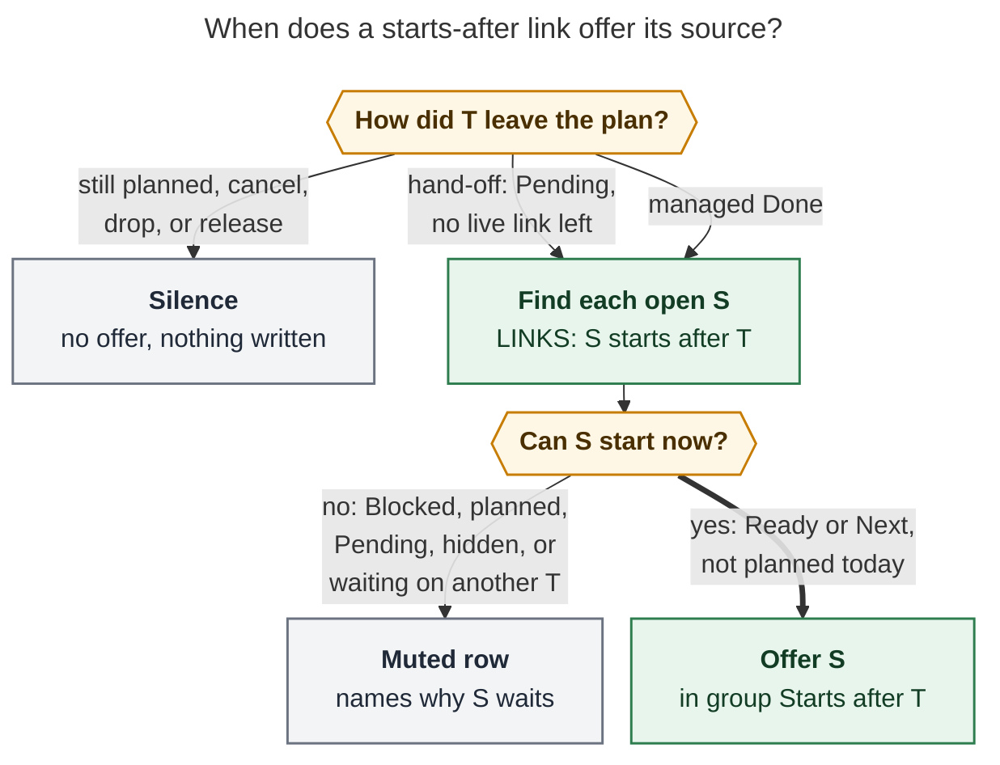

# "Starts after": a relation label that offers its task when the target is handed off or done

*Researcher: cld · 2026-11-01 · bob-cli, bob-plugins, Bob Mac Capture, vault*

## Bottom line

**Build it. It is a good idea.** It gives relations their first real payoff, and it
reuses almost everything Bob already ships. But build it as **a third kind of
special relation label**, defined by **what happens to the target**, not by `x*`
syntax:

> **`S starts after T`** means: when T is **handed off** (it goes Pending and leaves
> today's plan) or is **done**, offer S in the successor picker, under its own group
> titled **Starts after “T”**, with a 🪢 glyph and a caption that says why.

Nothing is blocked, nothing is auto-linked, and nothing is written unless you pick a
row. S stays workable the whole time.

I recommend ten changes to the requirements (§4). The three that matter most:

1. **`x*` is not the only way a task gets handed off.** Obsidian's Ctrl+Shift+Enter on
   an In Progress Task Link does the same thing, and so does capture's
   `@route+id!` on an In Progress task. So define the trigger as an *event* (the
   task is now Pending and has no live link left today). Then wire that event to an
   explicit list of gestures. `x*` comes first.
2. **"starts before" should be a display inverse, not stored text.** Under Bob's
   mirror grammar, `[[S]] (label)` on T's LINKED FROM line reads "S ‹label› this".
   Storing `[[S]] (starts before)` would state the **opposite** order. Add the named
   pair `starts after → starts before`. Chips, the Linked-from stage, the Task Card,
   and `bob relations list` then all *render* "starts before", and the stored bytes
   stay correct.
3. **The "why" has to come from bob, not from each client.** The Mac Pull-In card
   already has no case for the shipped `keep_moving` group. It shows the raw string
   `keep_moving` with a 🔓 "unblocked" glyph. A new group would be mislabeled the
   same way. bob should author each group's title, caption, and glyph token in JSON,
   and every client should render them.

---

## 1. The request, restated

- A new relation label, **`starts after`**, authored on the later task (S) and
  pointing at the earlier one (T).
- T's mirrored LINKED FROM bullet shows it as **`starts before`**.
- When T is marked WIP/Pending and leaves the daily plan (today: `x*`), Bob offers S
  as a successor. When T is closed, Bob also offers S, the way normal successors work.
- The prompt must say clearly **why** it appeared, because Bob now has several kinds
  of successor.
- It should be intuitive, reliable, and beautiful.

The underlying need: **order your own attention across agent prompts.** You often want
to think through and send prompt B only after you have sent prompt A.

## 2. What Bob does today (grounding)

### 2.1 Relations are inert, with two commit-time exceptions

`docs/task-relations.md` §2 says a relation never blocks, promotes, or consumes
anything. It also never counts as *"a successor anchor, or a successor offer"*. The
two carve-outs are **cancel labels** (§17) and **complete labels** (§18). Both:

- are config lists (`relations.cancel_labels`, `relations.complete_labels`; built-in
  default `[]`; chezmoi enables `duplicate of`, `superseded by`, `implemented by`,
  and `verified by`);
- fire **once, at the commit of the relation gesture**, on the **source**;
- share one policy layer (`RelationsConfig::close_effect(key) -> Option<CloseEffect>`),
  one verdict function per engine, shared vectors, and a calm indication system
  (⊘ / ✓ plus words, never color alone).

"Starts after" is different in kind. It never fires when the link is written. It fires
**later**, on a **lifecycle event of the target**, and its effect is to **offer the
source**. This would be the first relation with a *standing* meaning: something reads
the LINKS edge again at gesture time. That is the real design cost, and the decision
record (§6) has to own it.

### 2.2 Successor offers are mature, and parks are explicitly excluded

`docs/task-dependencies.md` §12 defines one offer set per gesture, with nothing
preselected, no cap, and only picked rows linked, raised to Next, and stamped fresh.
Today's groups:

| Group | Trigger | Why it appears | Glyph today |
| --- | --- | --- | --- |
| `hand_off` | `dependency` | closing T fully unblocked a dependent | 🔓 |
| `project` | `dependency` / `project_created` | T recovered a project; or capture just created the note | folder |
| `project_finished` | `project_empty` | T was the project's last open task | ✓ |
| `keep_moving` | `last_planned` | T was a leaf project's last planned task today ("not dependents") | ⏭ |

§12.1 says it **never** offers on `x*` parks, and SL21 and KM20 pin that. So this
feature is a deliberate new trigger, not a gap being filled.

### 2.3 What `x*` actually does

A parked link (`docs/capture.md`, close outcomes table) gets the same 🍅 history and
Work Log effects as normal work, and its task becomes `[/]` In Progress, shown as the
**Pending** lane. The link is **not carried** into the next placeholder. *"Parking is a
close outcome, not a new task status."* So "moved out of the daily file" means T has no
live link left in today's open Pomodoros. Its history stays in the closed entry.

### 2.4 `x*` is not the only hand-off

| Gesture | Result | Source |
| --- | --- | --- |
| capture `x*`, `x*P`, `x1*`, `x*!M`, and the link forms `@route:id=x*…` / `^route:id=x*…` | `[/]`, link not carried | `docs/capture.md` |
| Obsidian **Ctrl+Shift+Enter** on an In Progress task's link | link removed from today's open Pomodoros; *"Unlink task"* Work summary prompt; task **stays `[/]`** | bob-plugins `docs/block-id-prompt.md` |
| capture `@route+id!` on a linked In Progress task | unlink, *"lane unchanged"* | `docs/capture.md` |
| Alt+N release | Pending → **Ready**, links removed | not a hand-off: you are giving the work back |
| `x~K` drop | link removed, *"never started"* | not a hand-off |
| Alt+[ / Alt+] on a Task Link | Next ↔ In Progress, **stays linked** | not a hand-off yet |

### 2.5 Inverse labels are display-only today

`task_relations::label::inverse_phrase` (Rust) and `145a-relation-inverse-phrase.js`
(ledger-tools) hold four named pairs (`duplicate of → duplicated by`, …) plus a
`‹participle› by` rule. They are matched case-insensitively and **never stored**.
LINKED FROM chips render `‹inverse› (chip)`. Without an inverse they fall back to
`(chip) · ‹label› → this`.

### 2.6 How the clients handle new offer groups

- **Bob Mac Capture** (`CapturePullInChoice.swift`, `CapturePullInChoiceView.swift`)
  switches only on `hand_off`, `project`, and `project_finished`. Any other group,
  including the shipped `keep_moving`, gets **its raw string as the title** and the
  **`lock.open` glyph**. Its trigger is printed as `trigger: last_planned`. Decoding
  never breaks, but the "why" is wrong.
- **Obsidian nav** (`206a-successor-picker-model.js`) keeps an allow-list
  (`hand_off`, `project`, `project_finished`, `keep_moving`) and **silently drops**
  unknown groups. A new group needs `api.successors` v3 and a cycler feature check.

### 2.7 Evidence from your vault (read-only, today)

- **Today's ledger** has 14 closed sessions. Most BUILD entries log `🍅 [[bob#^…]]`
  with the child `apollo agent` / `athena agent`. These are the `x*` hand-offs this
  feature targets.
- **24 open `[/]` tasks** in 8 notes. Most were created and handed off today.
- **The pattern already exists by hand.** `bulk-sub-bullet-capture` carries an
  *unlabelled* `🪢 LINKS: [[#^task-bulk-actions]]`. Its Work Log reads *"apollo agent
  (waiting on another epic)"*. It was sent at 13:00, after `task-bulk-actions` went
  out at 11:45. That is a "starts after" edge waiting for a label.
- **The other flavor is a dependency.** `successor-deps` is Blocked `[?]` on
  `next-task-in-prj-successors` (Pending, "apollo agent"). `off-tag` is Blocked on
  `untracked-poms`. Those genuinely need T's *result*.
- **Relation usage is low:** 11 labels and 57 links (`bob relations list -a`). The
  vault has 6,827 notes, and only 22 contain a LINKS line. The undirected-relations
  epic (`bob-cli-am`) was cancelled for *"too little value … low usage of task
  relations"*. Keep this feature lean.

This gives the cleanest rule of thumb, and the docs should lead with it:

> **Needs T's result → `&` depends on.** S stays Blocked until T is done.
> **Needs T out of your hands → `starts after`.** S is offered when T is handed off
> (or done), and is never blocked.

## 3. Critique: is this a good idea?

**Yes.** Here is why, and what to watch.

**Why it is right:**

- **The intent is sequencing, not constraint.** A dependency is wrong for this. It
  would block S until T is *done*, which can be days after T was sent. Blocked tasks
  also keep no Task Links (`decisions:projects-block-from-prj-line`). A relation is
  the right weight: explicit, visible on both tasks, and non-blocking.
- **It fits Bob's definition of a successor.** The glossary defines a Task Successor
  as *"a task positioned to take its predecessor's place in today's Pomodoro plan
  when the predecessor leaves it"*. A hand-off is exactly the predecessor leaving the
  plan, just not by finishing. This feature generalizes successors from *leaves by
  finishing* to *leaves by finishing or handing off*. The concept doesn't bend.
- **Most of the cost is reuse.** The picker, keys, numbering, `-p/--pull-in`, picks,
  minting, freshness stamps, anchors, type routing, net-pass dedup, the Mac choice
  step, and Alt+N undo all exist.

**What to watch:**

1. **Erosion of "relations are inert".** This is the third carve-out, and the first
   that reads an edge *after* it was written. Mitigation: a crisp boundary in the
   decision record. Successor labels never block, never write at link commit, and
   never change any status except through an explicit pick. They only add rows to a
   picker that a gesture would open anyway, or open one where none existed before.
2. **Group proliferation.** Five offer groups is a lot of "why". The copy system in
   §5.7 and bob-authored group copy (A10) are what make this manageable.
3. **`x*` only approximates "I sent the prompt".** Your ledger shows
   `split-merge-capture` parked twice: first as "apollo stash", then as "apollo
   agent". The first park would offer S early. That is acceptable: an offer costs one
   Esc and writes nothing. It is also the reason to fire on *every* hand-off (A5).
4. **Low relation usage.** This feature could *raise* relation usage, but only if
   authoring is quick. The relation card already overlays configured labels with zero
   uses, so `~bob:prompt-a|st⇥` is enough. No new sigil is needed.
5. **A new Mac friction point.** An `x*` with a live cue now opens the choice step
   (Return, pick, Return; ⇧↩ submits with none). That only happens when you have
   authored a cue, so it is opt-in per edge.

**Would I take a different approach?** I considered these and rejected them:

| Alternative | Verdict |
| --- | --- |
| **Plan S now** in a later `()` placeholder (no feature) | Works only when the order is known today. Fails when T spans several sessions or days. |
| **Soft dependency** (a Depends-On entry that releases on Pending) | Makes S Blocked, so it disappears from lanes, can't be linked, and is stamped `[unblocked::]`. Huge blast radius (hooks, JS, dash, walk). Contradicts "relations never block". |
| **New managed line** on T (`⏭ THEN: [[S]]`) | Duplicates LINKS/LINKED FROM, which can already be authored from either end (`l` / `⇧L`, `~` / `~~`). |
| **New capture sigil** (e.g. `>note:id`) | Sigils are scarce (`decisions:capture-sigils-say-where-what-how`). `~…\|starts after` with Tab completion is enough. |
| **Auto-link S into T's vacated slot** | Violates `decisions:unblocked-tasks-are-offered` (never auto-link; one explicit choice). |
| **Fire only on the first transition into `[/]`** | Needs stored "already offered" state (the rejected "tray"). Your stash-then-agent pattern also shows the first park can be premature. |
| **SASE-side agent chaining** | Solves *agent* ordering ("waiting on another epic"), not *your attention*. Complementary and out of scope. |

## 4. Requirement adjustments (called out)

| # | Your requirement | Adjusted | Why |
| --- | --- | --- | --- |
| **A1** | Trigger on `x*` ("unique to `x*`") | Trigger on a **hand-off event**: after an explicit hand-off gesture, T is `[/]` and has **no live link left** in today's open Pomodoros. Gestures: `x*` family (phase 1), capture `@route+id!` on `[/]` (phase 1), Obsidian Ctrl+Shift+Enter on `[/]` (later phase). | `x*` is not unique (§2.4). Defining it by event keeps behavior the same whichever surface you use. Requiring "no live link left" avoids firing when T is still planned later today. |
| **A2** | Render "starts before" in the LINKED FROM bullet | **Display inverse.** Add the named pair `starts after → starts before` in Rust and JS. Stored text stays `[[S]] (starts after)`. | Mirror grammar `[[S]] (label)` reads "S ‹label› this", so a stored `(starts before)` would say the wrong thing. It would also break reconcile's byte identity (LR11) and rename (LR7). |
| **A3** | (unstated) Cancel of T | **Cancel never offers**, as everywhere else. A cancelled T *does* count as released when checking S's other targets (A4). | Keeps the §12.1 rule. S was never blocked, so nothing is lost. |
| **A4** | (unstated) S starts after T1 *and* T2 | **All targets must be released.** S is offered only when every starts-after target is handed off or closed. Otherwise S shows as a muted row: `also starts after “T2” · Next`. | "S starts after T1" plus "S starts after T2" reads as both. This matches how dependencies combine. |
| **A5** | (unstated) T parked again later | **Every hand-off re-evaluates** (no stored offer state). S is offered again only if it is still open, unplanned, and not started. | Stateless, like every other offer ("computed when the gesture runs and never stored"). |
| **A6** | (unstated) S can't be offered | Show **muted rows that say why**: already in today's plan, already Pending, Blocked (waits on N / until date / by project), hidden, waits for another target. Closed S stays silent. | You authored this edge yourself. Silence would read as "it didn't work". The sets are tiny (usually one row). |
| **A7** | (unstated) Linking to a T that already left | **Warn while authoring**, never fire: `“T” already went Pending · “S” can start now`. | Otherwise the cue silently never fires. Nothing happens when a link is written, unlike closing labels. |
| **A8** | A special label | A **config list** `relations.successor_labels` (built-in `[]`; chezmoi `[starts after]`), parsed like CL2/CP2, with **one effect per label**. | Same shape as the cancel/complete precedent, and one policy parser. The inverse pair is built in regardless. |
| **A9** | (unstated) Typed `starts before` | **No effect, plus a muted flip hint:** `“starts before” never offers anything · to start “S” after this task, use ⇧L with “starts after”`. | Same as CL6/CP6 inverse hints. Keeps one stored spelling and a one-sided index lookup. |
| **A10** | "Very clear why" | **bob authors each group's copy** (`title`, `why`, `tag`, `glyph`) in `pull_in.groups[]` **for every group**. Clients render it. | Fixes the Mac `keep_moving` mislabel too. Follows `decisions:mac-capture-is-a-thin-client` ("render bob's message, don't compute"). |

## 5. Recommended design

### 5.1 Vocabulary

- **Successor label**: a relation label listed in `relations.successor_labels`.
  "S ‹label› T" makes S a successor of T. It is not a closing label.
- **Hand-off**: an explicit gesture after which T is `[/]` Pending and has no live
  link in today's open Pomodoros, when it had one before the gesture. The user-facing
  phrase is **"went Pending"**.
- **Released (T)**, read after the gesture: T is closed (Done or Cancelled), or T is
  `[/]` with no live link in today's open Pomodoros.
- **Relation offer**: a successor offer in the new group `relation`, with
  `trigger: "relation"` and `relation.event: "pending" | "done"`.

### 5.2 The rule



*Only a hand-off or a managed Done of T looks for its starts-after sources. Each open
source is either offered or shown as a muted row that says why. Closed sources and
every other gesture stay silent.*

```text
E(g)      = { (T, "done")    : T ∈ C(g) }                              — §12.2's C, managed Done only
          ∪ { (T, "pending") : g is a hand-off gesture on T,
                               T was live-linked on the baseline,
                               T is [/] after g, T has no live link after g }
BASELINE  = today's day text before g strikes/moves/drops, after any explicit link step  (§12.2)
EDGES(T)  = { (S, label) : an accepted LINKS entry on S resolves to T,
                           relation_label_key(label) ∈ successor_labels }  — staged overlay wins
FOR EACH S with an edge to some T ∈ E(g), first match wins:
  1. S closed, non-task, in done/ or the previous daily note   → skip (no row)
  2. S ∈ C(g), handed off by g, or live-linked on BASELINE     → muted already_planned
  3. S [?], own open prerequisite, future scheduled, or project-blocked
                                                               → muted blocked{waits_on|scheduled|project}
  4. S has whole-token #hide                                   → muted hidden
  5. S is [/]                                                  → muted already_started
  6. some other successor-label target T' of S is not Released → muted waits_for{T'…}
  7. otherwise (S is [ ] Ready or [*] Next)                    → OFFER, group relation
DEDUP     : one row per S; priority hand_off > relation > project > project_finished > keep_moving
GROUPING  : one relation group per triggering T (earliest anchor first); an S triggered by
            several Ts in one gesture sits under the first, and its row lists the rest
```

### 5.3 Triggers

| Gesture | Event | Engine | Phase |
| --- | --- | --- | --- |
| capture `x*` family, including `=x*` link forms (parked rows only) | `pending` | bob-cli close planner | v1 |
| capture `@route+id!` unlinking a `[/]` task | `pending` | bob-cli task toggle | v1 |
| every §12.1 managed Done row: `!note:id`, `x` with embeds, `x!`, `x!M`, complete-label commits, Ctrl+Enter, Alt+] into Done, the walk's PRE/POST Ctrl+Enter | `done` | bob-cli; cycler `finalizeClosedTasks` | v1 |
| Obsidian Ctrl+Shift+Enter unlinking a `[/]` task (after the Work summary prompt settles) | `pending` | block-id-prompt → cycler/nav | v1.1 |
| **Never:** cancel, reopen, Alt+N release, `x~K` drop, plain `x` carry, Alt+[/Alt+] lane toggles, raw checkbox clicks, reconcile/hooks, hand edits, agent edits, `bob relations rename` (with or without `--reverse`), vault sync | — | — | — |

### 5.4 Destination and picks

- **Anchors** follow §12.3 over the triggering Ts. Closes use the **closing** anchor:
  the continuation, else the next open same-name entry (on your ledger, the trailing
  `- [ ] () — BUILD`), else a new `- [ ] () — NAME` placeholder. `!` and Ctrl+Enter
  use the **slot** right after T's struck bullet. Ctrl+Shift+Enter uses the
  **vacated slot**, so S literally takes T's place. An unplanned T on Done uses the
  implicit destination. Then D7 type routing (`route_successor_offers`) applies as
  for every offer.
- **Picks** are exactly a picked `hand_off`: `' '` → `'*'`; `'*'` stays; mint a
  missing ID; stamp `[fresh:: today]` (clearing `[unblocked::]` and `[keeps::]`);
  insert the plain Task Link. **Unpicked:** nothing is written. There is no recovery,
  because S was never blocked.
- **Undo:** Alt+N releases a pick. The same-day Obsidian reopen take-back of the
  predecessor applies to Done-triggered picks, as for other groups.

### 5.5 Copy and visual system: the "why"

Every successor group leads with its reason and uses its own glyph. The new row is in
bold:

| Group | Glyph (emoji · Mac SF · Obsidian) | Title | Why caption | Tag |
| --- | --- | --- | --- | --- |
| `hand_off` | 🔓 · `lock.open.fill` | `Hand-offs` | none today (bob-authored copy could add `✓ ‹T› unblocked these`) | — |
| `project` | folder | `Project ‹N›` | — | — |
| `project_finished` | ✓ · `checkmark.circle` | `Project finished` | `project has no open tasks` | — |
| `keep_moving` | ⏭ · `forward.end.fill` · `skip-forward` | `Keep ‹N› moving` | `✓ ‹T› was the last ‹N› task planned today` | `ready in ‹N› · not dependents` |
| **`relation`** | **🪢 · `link` · the nav relation-stage icon** | **`Starts after “‹T›”`** | **`🪢 “‹T›” went Pending · you set these to start after it`** (done: **`… is done · …`**) | **`your links · not dependents`** |

🪢 already means "relation" everywhere in Bob, and `link` is already the Mac's relation
symbol, so the glyph explains itself. The title is the label read aloud, with S
implied. The title is built from the configured label (`‹Label› “‹T›”`), so any
successor label you add reads naturally. Color follows the existing rules: neutral
accent, lane pills from `--task-status-*`, no new hex values, and meaning never carried
by color alone. Rows show lane names, never raw status symbols.

| Element | Copy |
| --- | --- |
| Muted rows | `already in today's plan` · `already Pending` · `🔒 waits on 1 more` · `🔒 until Nov 3` · `🔒 blocked by project` · `hidden` · `also starts after “‹T2›” · Next` |
| Row suffix when several Ts | `after “‹T1›” and “‹T2›”` |
| Picker title, only relation groups | `Starts after “‹T›”` / `Starts after 2 tasks` |
| Notice, one pick | `🪢 Next in BUILD: ‹S› · starts after “‹T›”` |
| Notice, several picks | `🪢 2 linked → BUILD · start after “‹T›”` |
| Notice, mixed with other groups | the existing forms; relation picks count as linked |
| CLI group header | `Starts after “‹T›” · it went Pending (your 🪢 links, not dependents)` |
| CLI linked suffix | `· starts after “‹T›”` |
| Block-diff badge (Mac) | `link` with `.help("Starts after ‹T›")` |
| Label row effect (card, stage, zsh, `relations list`) | `🪢 cues source` / `N links · cues source` |
| Live sentence while authoring | `🪢 {S} — starts after → {T} · offered when “{T}” goes Pending or is done` |
| Authoring caveat, amber (A7) | `“{T}” already went Pending · “{S}” can start now` / `“{T}” is already done · …` |
| Inverse hint, muted (A9) | `“starts before” never offers anything · to start “{S}” after this task, use ⇧L with “starts after”` (capture: `~~`) |

### 5.6 Mocks

**`bob capture 'x*'` (dry run):**

```text
would close BUILD 1145-1220 (35m)
  [*] → [/] Add support for sub-bullets under `@file+id`…  bob.md ^task-bulk-actions · Parked · not carried +1 Work Log
  Starts after “Add support for sub-bullets under `@file+id`…” · it went Pending (your 🪢 links, not dependents)
  offer 1  [ ] Add support for bulk capture using `@file`…  bob.md ^bulk-sub-bullet-capture → BUILD
  -p 1,2 · -p all
```

**Bob Mac Capture Pull-In card** (copy comes from bob):

```text
 🔗 Starts after                                                     (capsule)
 “Add support for sub-bullets…” went Pending · you set these to start after it
 🔗 Starts after “Add support for sub-bullets…”            your links · not dependents
   ☐ 1  Add support for bulk capture using @file…     Ready   → BUILD
```

**Obsidian picker** (nav `api.successors` v3):

```text
┌──────────────────────────────────────────────────────────────────────┐
│ 🪢  Starts after “Add support for sub-bullets…”                       │
│ [ Filter tasks, notes, and groups                                  ]  │
│ ┃ Starts after “Add support for sub-bullets…”  your links · not dependents │
│ ┃ 🪢 “Add support for sub-bullets…” went Pending · you set these to start after it │
│ ┃ □ Add support for bulk capture using @file…                         │
│ ┃   bob · Ready · → BUILD                                             │
│ ┃   Write the bulk-capture docs                                       │
│ ┃   bob · also starts after “Ship bulk parser” · Next                 │
│  plan 6/10 → 7/10                                                     │
│  Tab toggle and move · ↵ pull in · Esc none                           │
└──────────────────────────────────────────────────────────────────────┘
```

**T's LINKED FROM line**, raw and rendered:

```text
raw:      - 🪢 **LINKED FROM:** [[#^bulk-sub-bullet-capture]] (starts after)
rendered:   🪢 LINKED FROM   starts before  [ ] Add support for bulk capture…
```

**S's LINKS chip.** T's mini status checkbox already tells you when T has gone Pending:

```text
rendered:   🪢 LINKS   starts after → [/] Add support for sub-bullets…
```

### 5.7 Authoring

No new grammar. Four paths cover both directions:

- New prompt after the current one: `Draft prompt B ~bob:prompt-a|starts after`. Here
  the **new task is the source**, which is fine. Closing labels refuse this
  (`new_task`), but a successor label has no commit-time effect.
- Existing B: `@bob+prompt-b ~bob:prompt-a|"starts after"`.
- From T in Obsidian: Ctrl+Shift+P → **⇧L** (Linked from) → pick S → ⇧↵ →
  `starts after`.
- From S in Obsidian: **l** (Links to) → pick T → label.

The configured label appears in suggestions even with zero uses (the CL2/CP2 overlay).
Hiding it removes it from suggestions, never its effect.

### 5.8 Contracts (all additive; every `schema_version` stays 1)

- **Config:** `relations.successor_labels`, parsed exactly like CL2/CP2. The policy
  becomes `RelationsConfig::label_effect(key) -> Option<LabelEffect>`, where
  `enum LabelEffect { Cancel, Complete, Successor }`. A key in two lists has no effect
  and warns once. JS gets one loader, `loadRelationsLabelEffects()`.
- **`capture` / `--dry-run`:** `pomodoro_close.relation_successors[]`,
  `task_complete.relation_successors[]` (nested in `relation_completes[]` too), and
  the `@route+id!` toggle result's `relation_successors[]`. Rows use the exact
  `unblocked[]` shape with `trigger: "relation"`, `offer.group: "relation"`,
  `unblocked_by` = the triggering Ts, and an additive
  `relation: {label, key, event: "pending"|"done", after: [{note_path, block_id, text, status_name}]}`.
  Muted rows go in `relation_held[]`:
  `{note_path, block_id, line, text, status_name, label, reason: "already_planned"|"blocked"|"hidden"|"already_started"|"waits_for", waits_on?, scheduled?, project?, waits_for?}`.
- **`pull_in`:** `offer_count` and `picked_count` include relation offers, and the
  `pull_in_choice_required` refusal lists them. `groups[]` gains one entry per
  relation group, **and every group entry gains bob-authored**
  `copy: {title, why?, tag?, glyph: "unblocked"|"project"|"project_finished"|"keep_moving"|"relation"}`.
  Groups that have no fold counts today still appear when they carry `copy`.
- **Ledger:** `pomodoro_blocks[].lines[].reason: "relation"`;
  `TaskBlockRole::RelationSuccessor` (`"relation_successor"`).
- **Authoring:** `capture-complete` `relation_label` rows gain `cues_source: true`
  (plus the shared `configured` overlay), and the response gains
  `relation_successor: {target: {path, block_id, text, status_name, released}, verdict: "cues"|"already_released", message}`.
  `capture-parse` label spans gain `cues_source`. `relation_updates[]` rows gain
  `cue: "waits"|"already_released"`, and `warnings[]` gains
  `relation_cue_already_released`. `bob relations list` rows gain `cues_source`, and
  the header gains `· N cue`.

### 5.9 Engines and performance

- **Rust lookup.** Bob needs a reverse edge lookup: who has a successor-label edge to
  T? Today the relation-label scan cache (`relation_labels/scan.rs`, `CACHE_VERSION 2`)
  stores only label spellings and counts. Bump it to v3 and also store each note's
  accepted labelled edges `(source line, source block id, target link, label key)`.
  Two rules for this caller:
  - Always **fingerprint-validate**; **never** take the 60-second TTL shortcut. An
    edge added in Obsidian seconds before an `x*` must not be missed.
  - Never read LINKED FROM as input; §1 forbids it.
- **Gates, cheapest first:**
  - S0: labels are configured and `plan.link_unblocked` is on (no I/O).
  - S1: some event task has a block ID (no I/O).
  - S2: T has no live link on the held post-gesture day text.
  - S3: the validated edge lookup.
  - S4: read S's notes (staged overlay first) and any T′ notes for the A4 check.
- **Cost.** S0 or S1 failing adds **zero** I/O, so every close keeps today's cost
  when no successor labels are configured. Once `starts after` is configured, S1
  almost always passes on an `x*`, because Task Links require block IDs. The S3 stat
  walk over about 6.8k notes is the §12.7 "validated cache … 32–55 ms" cost. So
  measure on apollo against a temporary vault copy. Accept that a gated `x*` dry run
  may exceed §12.7's 40 ms target, and record that trade-off in the decision record.
- **JS lookup.** ledger-tools `api.relationIndex.incoming(path, blockId)` is live and
  overlays unsaved buffers, so the lookup needs zero vault reads. If
  `relationIndex.ready()` is false, offer nothing; a missed offer is the safe failure.
- **One planner per engine.** Rust: a pure `task_relations::successor` planner wired
  next to `keep_moving` in `task_complete::successors::plan_successors`, plus a
  hand-off entry from the close planner and the task toggle. JS: the cycler adds the
  group inside `finalizeClosedTasks`, and block-id-prompt hands an unlink of a `[/]`
  task to a new cycler entry point. Shared vectors live in
  `tests/fixtures/relation_successor/vectors.json`, sections `key`, `config`,
  `released`, `rule`, and `offer`. bob-plugins copies the file byte for byte.

### 5.10 Representative vectors (SA)

| # | Situation | Outcome |
| --- | --- | --- |
| SA1 | S Ready, S starts after T; `x*` parks T; T has no other live link | relation group "Starts after “T”", `event: pending`, offer S, closing anchor |
| SA2 | same, but T is also linked in a later open placeholder | silence (T is still planned) |
| SA3 | `!note:t` closes T | offer S, `event: done`, slot after T's struck bullet |
| SA4 | T cancelled | silence (A3) |
| SA5 | S was parked by the same `x*` | muted `already_planned` |
| SA6 | S `[?]` (open prerequisite) / `scheduled` tomorrow / project-blocked | muted `blocked` with reason |
| SA7 | S `[/]` | muted `already_started` |
| SA8 | S also starts after T2, which is Ready | muted `waits_for` T2 |
| SA9 | T2 later parked | S offered under "Starts after “T2”", row `after “T1” and “T2”` |
| SA10 | S is also a dependent of T (Done) | one row, in `hand_off` |
| SA11 | S Done or Cancelled | no row |
| SA12 | `x~K` drops T, `[/]` T unlinked | silence (a drop is not a hand-off) |
| SA13 | Alt+N releases T | silence |
| SA14 | `x*` parks T and S starts after T; draft item 2 links S | the net pass drops the row |
| SA15 | draft: item 1 `B ~a\|starts after`, item 2 `x*` parks a | offer B (staged edge) |
| SA16 | draft: item 1 `x*` parks a, item 2 `B ~a\|starts after` | no offer; item 2 warns `relation_cue_already_released` |
| SA17 | `successor_labels: []` or `plan.link_unblocked: false` | no group, no array |
| SA18 | label typed `starts before` | inert relation; muted flip hint |
| SA19 | label key in both `successor_labels` and `complete_labels` | no effect; one warning |
| SA20 | `x*` parks T twice on two days, S still Ready and unplanned | offered both times (A5) |
| SA21 | edge added in Obsidian 5 s before `x*` | found (validated lookup, no TTL) |
| SA22 | `-p none` / Esc | nothing written, no IDs minted |
| SA23 | Obsidian Ctrl+Shift+Enter on a `[/]` T, after the Work summary prompt | picker; a pick lands in T's vacated slot (v1.1) |
| SA24 | `@route+id!` unlinks a `[*]` T | silence (T is not Pending) |

## 6. Decision record (draft for `decisions:`)

> **Successor Labels Offer Their Source When The Target Is Handed Off Or Done**
> (`successor-labels-offer-on-hand-off`)
>
> **Applies to.** bob-cli, bob-plugins, Bob Mac Capture, vault.
>
> **Claim.** A relation label listed in `relations.successor_labels` (chezmoi:
> `starts after`) makes its source S a successor offer of its target T. The offer
> appears when an explicit hand-off gesture leaves T Pending with no live link today
> (`x*` parks, capture `@route+id!`, and later Obsidian Ctrl+Shift+Enter on `[/]`),
> or when a managed Done gesture closes T. The rows sit in a `relation` group titled
> by the label, with a 🪢 glyph and a bob-authored why caption. S is offered only
> when every successor-label target of S is released. Otherwise it shows as a muted
> row that names the reason. Successor labels never block, never act when the link
> is written, and never change a status except through an explicit pick. Cancel,
> release, drop, reconcile, and edits never offer. LINKED FROM renders the display
> inverse `starts before`; stored bytes keep the source label.
>
> **Why.** Agent-prompt work needs *attention* sequencing, which a dependency cannot
> express without blocking S until T is done. Rejected: a soft dependency, a new
> managed line, a new capture sigil, auto-linking into T's slot, first-transition-only
> firing, and storing the inverse label.
>
> **Cost.** It is the first relation that is read after it is written. It adds a fifth
> offer group. A gated `x*` pays a validated relation-index walk. It needs Mac and nav
> rendering, or bob-authored copy, so the why is never mislabeled.
>
> **Reopens when.** Offers on repeated hand-offs become noise (then add a
> transition-only gate); S keeps getting started before T is handed off (then add a
> display-only "waits for T" hint on lanes, before considering any soft block); or the
> inverse spelling should also author the edge.

Memory and doc updates that go with it. Each goes through `/sase_memory_write` or a
docs PR, not this report:

- glossary **Task Relation**: a third exception;
- glossary **Task Successor**: a predecessor can leave the plan by handing off;
- glossary **Successor Offer**: the `relation` group;
- `docs/task-relations.md`: a new §20 "Successor labels" (SU1–SU8, mirroring CL/CP),
  plus amended §2, §8, §13.2, and §14;
- `docs/task-dependencies.md`: §12.1 (new trigger rows; the "never on `x*` parks"
  exclusion gains "except relation offers"), a new §12.18, and the SL21/KM20 wording.

## 7. Rollout

| Phase | Scope | Size |
| --- | --- | --- |
| 1 contract | docs §20 + §12.18, the decision record, glossary, vectors | M |
| 2 rust-core | config `LabelEffect`, the inverse pair, scan cache v3 edges, the pure planner and verdicts | M |
| 3 rust-capture | `x*` and `=x*`, `@route+id!`, Done events; JSON and human output; **bob-authored group copy for all groups**; authoring cues; `relations list` | L |
| 4 chezmoi | `relations.successor_labels: [starts after]` | XS |
| 5 mac | render group `copy` generically (this also fixes `keep_moving`), the relation card `cues` capsule, the block-diff badge | M |
| 6 plugins-done | JS inverse pair, nav `api.successors` v3 `relation` group and the stage cue, cycler Done group via `relationIndex` | M |
| 7 plugins-park (v1.1) | block-id-prompt Ctrl+Shift+Enter hand-off on `[/]` | S–M |

**Cut line:** phases 1–6 deliver the request, including "also when closed" in
Obsidian. Phase 7 makes Obsidian hand-offs match. Ship it if you ever hand off from
Obsidian rather than with `x*`.

**Coordinate first.** Your in-flight task `next-task-in-prj-successors` ("prompt for
project successors whenever last task link for project is closed") is Pending with an
apollo agent. It edits the same code (`capture/pomodoro_close.rs` successor planning)
and may touch the same §12.1 "never on `x*`" exclusion. If it extends keep-moving to
parks, both features should share one hand-off event set.

`bob-cli-releases-ride-a-daily-train` applies: no phase edits `Cargo.toml`'s version
or `CHANGELOG.md`, and everything here is additive JSON, so no `!` is needed.

## 8. Risks

| Risk | Mitigation |
| --- | --- |
| A missed edge feels unreliable | Validated lookup (no TTL), staged overlay, muted rows instead of silence (A6), authoring caveat (A7) |
| Older or partial clients mislabel the why | bob-authored `copy`, nav v3 feature check, the Mac's generic render path |
| `x*` latency | Zero-I/O gates; measure; record the accepted cost |
| Confusion with dependencies | Lead the docs with "result → `&`; out of your hands → starts after" |
| Repeated-offer noise | Stateless by design; reopen condition in the decision record |
| Asymmetric spelling (`starts before` typed) | Flip hint; `bob relations rename … --reverse` can normalize strays |

## 9. Recommended solution

Ship **successor labels**: a config list (`relations.successor_labels`, enabled for
`starts after`) whose edge `S starts after T` offers S when T is **handed off**
(explicit gesture, T now Pending, no live link left today) or **done** by a managed
Done gesture. Run it entirely through the existing successor-offer machinery, as a
new `relation` group:

- titled **Starts after “T”**, with 🪢, the caption *"T went Pending / is done · you
  set these to start after it"*, and the tag *"your links · not dependents"*;
- nothing preselected, nothing auto-linked, picks written exactly like `hand_off`;
- S offered only when it is Ready or Next, unplanned, and all its starts-after
  targets are released; otherwise a muted row says why;
- cancel, release, drop, reconcile, and edits never fire.

Render `starts before` as a **display inverse** on T's LINKED FROM line, and leave the
stored bytes alone. Make **bob author every offer group's copy** so the "why" is
identical on CLI, Mac, and Obsidian. That also fixes `keep_moving`'s current Mac
mislabel. Start with `x*` and `@route+id!` hand-offs plus every Done surface. Add
Obsidian's Ctrl+Shift+Enter hand-off as a small follow-up.

---

*Sources: bob-cli `docs/task-relations.md` §§1–19, `docs/task-dependencies.md`
§§12–12.17, `docs/capture.md` (close grammar and outcomes), `docs/task-types.md`
(routing); `src/native/task_relations/inverse.rs`, `src/native/relation_labels/scan.rs`,
`src/native/task_complete/successors.rs`, `src/native/capture/pomodoro_close.rs`,
`src/native/capture/pull_in.rs`, `src/native/capture/output.rs`; bob-plugins
`docs/block-id-prompt.md`, `plugins/bob-navigation-hotkeys/src/206a-successor-picker-model.js`,
`plugins/bob-ledger-tools/src/145a-relation-inverse-phrase.js`; Bob Mac Capture
`Sources/BobMacCapture/CapturePullInChoice.swift`,
`CapturePullInChoiceView.swift`; decisions `unblocked-tasks-are-offered`,
`task-lanes-are-sticky`, `mac-capture-is-a-thin-client`,
`relation-label-hide-is-suggestions-only`, `capture-star-blocks-existing-tasks`;
epic `bob-cli-am` (cancelled); read-only vault reads on 2026-11-01 (`bob relations
list -a`, today's daily note, `bob.md`, `~/.config/bob/config.yml`).*
