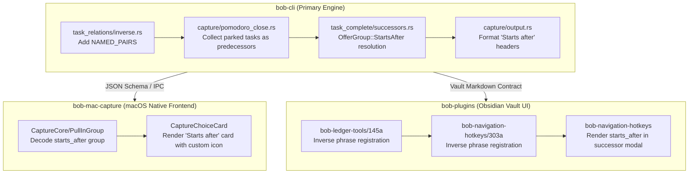

# Architectural Design & Research: The "starts after" / "starts before" Relation Label & Successor Trigger

> **Author:** Researcher `gem` (5-Researcher Swarm)  
> **Date:** November 2026  
> **Status:** Proposal & Design Specification  
> **Target Repositories:** `bob-cli`, `bob-plugins`, `bob-mac-capture`

---

## 1. Executive Summary

This research investigates the addition of a specialized relation label, **`starts after`** (with its display-only inverse **`starts before`** on mirrored bullets), designed to bridge a crucial operational gap in modern, human-in-the-loop agentic workflows: **Start-to-Start (SS) sequencing of asynchronous tasks**.

### The Core Problem
In GTD and traditional project management, dependencies are overwhelmingly **Finish-to-Start (FS)**: Task $B$ cannot begin until Task $A$ is marked Done ($[x]$). In Bob, this is implemented via managed `- Depends-On: [[...]]` lines.

However, when Bryan works with autonomous agents (such as SASE agents), the nature of human labor changes:
1. **Front-Loaded Human Labor:** Bryan must craft, contextualize, and dispatch the prompt for Task $A$.
2. **Asynchronous Background Execution:** Once dispatched, Task $A$ is handed to the agent. Bryan marks Task $A$ as In Progress / Pending ($[/]$) and parks it using Bob's `x*` capture syntax, which removes it from the active daily Pomodoro ledger.
3. **Sequential Staging:** Bryan frequently has a follow-up task (Task $B$—e.g., preparing the next prompt, reviewing a complementary facet, or launching Agent $B$) that he wants to focus on **only after** Task $A$ has been launched, but **long before** Task $A$ finishes execution.

Currently, Bob's successor engine (`docs/task-dependencies.md` §12) only triggers when a task transitions to **Done** ($[x]$). Furthermore, rule **SL21** explicitly stipulates that `x*` parks *never offer and never link successors*. Consequently, there is no mechanism to automatically surface Task $B$ upon dispatching Task $A$.

### High-Level Recommendation
1. **Adopt `starts after` as an Advisory Relation Label (Soft Start-to-Start):** Author `- 🪢 **LINKS:** [[Task A#^id]] (starts after)` on Task $B$, mirroring automatically as `- 🪢 **LINKED FROM:** [[Task B#^id]] (starts before)` on Task $A$.
2. **Do Not Overload `task-status-hooks` with Hard Blocking:** Task $B$ should remain in its normal status (Ready $[ ]$ or Next $[*]$) rather than being forced into Blocked ($[?]$). It behaves like Bob's existing `keep_moving` offers—an advisory, high-priority workflow handoff rather than a graph-locked constraint.
3. **Extend Capture Pomodoro Close to Trigger on Parking (`x*`) and Completion (`x!`):** Modify `pomodoro_close.rs` and `task_complete/successors.rs` to inspect the relation graph of parked tasks ($*$) and closed tasks ($!$), harvesting open tasks that declare `starts after` the acted-upon task.
4. **Introduce a Distinct Successor Group (`starts_after`):** To maintain absolute clarity amidst Bob's existing successor types (`hand_off`, `project`, `project_finished`, `keep_moving`), present these offers under an explicit header:  
   `🚀 Starts after “<Task A>”`  
   Annotating the trigger reason clearly (e.g., `started · parked in-progress` vs. `completed · [x!] close`).

---

## 2. Critique of the Plan

### 2.1 Is this a good idea?
**Yes, with one essential architectural clarification.**

The user's intuition solves an authentic friction point in modern agent orchestration. When delegating work to agents, the critical human milestone is **dispatch**, not resolution. Forcing Bryan to remember to manually navigate to Task $B$ after parking Task $A$ incurs cognitive overhead and breaks flow.

However, from an architectural perspective, the proposal touches upon a delicate boundary in Bob's system architecture:

```
┌─────────────────────────────────────────────────────────────────────────────┐
│                       BOB TASK GRAPH ARCHITECTURE                           │
├──────────────────────────────────────┬──────────────────────────────────────┤
│    DEPENDENCY GRAPH (Execution)      │      RELATION GRAPH (Context)        │
├──────────────────────────────────────┼──────────────────────────────────────┤
│ • Managed line: `- Depends-On:`      │ • Managed line: `- 🪢 **LINKS:**`     │
│ • Generated mirror: `- 🧱 BLOCKS:`   │ • Generated mirror: `**LINKED FROM:**│
│ • Semantics: Hard blocking ([?])     │ • Semantics: Informational & inert   │
│ • Authority: `task-status-hooks`     │ • Authority: `reconcile_relation`    │
│ • Trigger: Only on Done ([x])        │ • Policy: "Relations never block,    │
│ • Structure: Raw wikilinks (no text) │   promote, consume, or schedule"     │
└──────────────────────────────────────┴──────────────────────────────────────┘
```

In `docs/task-relations.md` lines 11–14, Bob establishes a core invariant:
> *"Live chips render both ends correctly, and **relations never block, promote, consume, schedule, stamp, or route anything**. The exceptions are the commit-time cancel of §17 and the commit-time complete of §18."*

By proposing that `starts after` triggers a successor prompt, the user is introducing an **active execution behavior** into relations.

### 2.2 Should we take a different approach? (Hard Dependency vs. Advisory Relation)

We must evaluate whether `starts after` belongs in the **Dependency Graph** or the **Relation Graph**:

| Evaluation Criterion | Approach A: True Start-to-Start Dependency (`Depends-On`) | Approach B: Advisory Relation Trigger (`LINKS: (starts after)`) |
| :--- | :--- | :--- |
| **Syntax** | Requires altering `Depends-On` line grammar (e.g. `[[Task A]] (start)`) or adding a new managed child line `- Starts-After:`. | Reuses established, rich relation syntax: `~Task A\|starts after` in capture, `l` in Task Card. |
| **Task State** | Forces Task $B$ into Blocked ($[?]$) until Task $A$ reaches $[/]$ or $[x]$. | Task $B$ remains Ready ($[ ]$) or Next ($[*]$). It can still be reviewed, scheduled, or manually pulled. |
| **Blast Radius** | **Extremely High:** Touches `task-status-hooks`, cyclic dependency algorithms, transitive reductions, and project blocking inheritance (`#prj_is_blocked`). | **Low to Moderate:** Confined to the successor planner (`task_complete/successors.rs`) and inverse label tables. |
| **Reversibility** | Complex: If Task $A$ is dropped or unlinked, what happens to Task $B$'s $[?]$ status? Sticky lane rules ($[/]$ is sticky) create severe edge cases. | Simple: If Bryan skips the successor offer, Task $B$ simply remains Ready in its home note. |
| **Alignment with GTD** | Rigid. Prevents Bryan from starting Task $B$ early even if circumstances change. | Fluid. Proactively offers Task $B$ at the right moment without locking it down. |

#### Verdict on Alternative Approaches:
**Approach B (Advisory Relation Trigger) is superior.**
Bob already has precedent for non-blocking successor offers: **`keep_moving`**. In `keep_moving` (`docs/task-dependencies.md` §12.15), tasks offered to Bryan are *already open and unblocked*; Bob merely identifies them as contextually relevant next actions because an adjacent task was acted upon.

Treating `starts after` as an **advisory sequencing relation** provides 100% of the workflow benefit Bryan needs without corrupting the mathematical guarantees of the acyclic dependency graph.

### 2.3 Adjustments to Requirements

To ensure bulletproof reliability and avoid user surprises, we recommend four specific adjustments:

1. **Clarify Status Invariance:** The `starts after` relation will **not** turn Task $B$ into $[?]$ (Blocked). Task $B$ stays in its native state ($[ ]$ Ready or $[*]$ Next). If Task $B$ is separately blocked by open prerequisites on its own `Depends-On` line, it will be folded into `still_blocked` and not offered into the Pomodoro.
2. **Broaden Park Recognition Beyond Bare `x*`:** While bare `x*` is the primary capture gesture, explicit indexed parking—such as `x*2`, `x1*2`, `x0*`, or `x*!3`—must also trigger `starts after` for whichever tasks were actually parked.
3. **Idempotent Single-Offer Guard:** If Task $A$ is worked across multiple Pomodoros and parked with `x*` repeatedly, Task $B$ must **not** be re-offered if Task $B$ is already planned in today's daily file or has already been completed.
4. **All-Predecessors Check for Multi-Link Scenarios:** If Task $B$ declares `starts after` for *both* Task $A$ and Task $C$, Task $B$ should only trigger when **both** predecessors have reached at least In Progress ($[/]$) or Done ($[x]$).

---

## 3. Detailed Workflow Mechanics

### 3.1 The Agent Staging Lifecycle
To understand the timing of the trigger, consider Bryan's typical session:

```mermaid
sequenceDiagram
    autonumber
    actor Bryan
    participant Capture as Bob Capture / Mac Capture
    participant Day as Daily File (20261101.md)
    participant NoteA as Project Note A (Task A)
    participant NoteB as Project Note B (Task B)

    NoteOver Bryan, NoteB: Initial State: Task B links to Task A with (starts after)
    Bryan->>Capture: bob capture 'x*' (or x*1)
    activate Capture
    Capture->>Day: Close running Pomodoro; do NOT carry parked Task A
    Capture->>NoteA: Update Task A status to [/] (In Progress); write Work Log
    NoteOver Capture: Scan Task A's relations for (starts before) / (starts after)
    Capture->>NoteB: Identify Task B as an open, unblocked successor
    Capture-->>Bryan: Surface Successor Choice Card:<br/>"🚀 Starts after 'Task A' (parked in-progress)"
    deactivate Capture
    Bryan->>Capture: Accept Task B (Enter / Space)
    activate Capture
    Capture->>Day: Place Task B into new Pomodoro placeholder (or implicit destination)
    Capture->>NoteB: Promote Task B to [*] Next with [fresh:: today]
    deactivate Capture
    NoteOver Bryan, Day: Bryan immediately begins thinking through Task B's prompt!
```

### 3.2 Capture Syntax & Parking Variations
In Bob's capture grammar (`docs/capture.md` §27), parking is indicated by the `*` outcome specifier:
- `x*`: Wildcard park. Parks all worked Task Links in the closed Pomodoro.
- `x*2`: Explicit park. Works on and parks Task 2; other unlisted links follow default ledger rules.
- `x1*2,3`: Continues Task 1 into the next session; parks Tasks 2 and 3.
- `x*!2`: Completes Task 2 ($[x]$); parks all remaining links ($[/]$).

**Rule:** Every task in the Pomodoro close lineup whose resolved `outcome == "parked"` OR `outcome == "complete"` qualifies as an active predecessor for `starts after` evaluation. Tasks whose outcome is `in_progress` (carried forward into the next Pomodoro via plain `x` or explicit `x1`) do **not** trigger `starts after`, because Bryan is still personally engaged with them in the immediate next session.

---

## 4. Grammar, Vocabulary & Inverses

### 4.1 Stored vs. Mirrored Representations
Following `docs/task-relations.md` §3 and §10:

```markdown
<!-- On Task B (Source note: projects/agent-ops.md) -->
- [ ] #task Prepare follow-up prompt for Agent Beta ^prompt-beta
  - 🪢 **LINKS:** [[agent-alpha#^prompt-alpha]] (starts after)

<!-- On Task A (Target note: projects/agent-alpha.md) -->
- [/] #task Launch research swarm Agent Alpha ^prompt-alpha
  - 🪢 **LINKED FROM:** [[agent-ops#^prompt-beta]] (starts before)
```

### 4.2 Reverse Authoring Symmetry
Because users may author relations from either perspective (from Task $B$ looking back, or from Task $A$ planning forward), Bob's parser and inverse engine must support both forms with total symmetry:

| Authored on S | Stored on S (`LINKS`) | Mirrored on T (`LINKED FROM`) | Successor Trigger Behavior |
| :--- | :--- | :--- | :--- |
| `Task B` links to `Task A` with `starts after` | `[[Task A]] (starts after)` | `[[Task B]] (starts before)` | When Task $A$ parks or closes, Task $B$ is offered. |
| `Task A` links to `Task B` with `starts before` | `[[Task B]] (starts before)` | `[[Task A]] (starts after)` | When Task $A$ parks or closes, Task $B$ is offered. |

### 4.3 Table Registration (`NAMED_PAIRS`)
In `src/native/task_relations/inverse.rs`, `NAMED_PAIRS` is a compile-time slice searched via `binary_search_by_key`. Entries must remain strictly lexicographically sorted:

```rust
// src/native/task_relations/inverse.rs
pub(crate) const NAMED_PAIRS: &[(&str, &str)] = &[
    ("duplicate of", "duplicated by"),
    ("follow-up of", "followed up by"),
    ("merged into", "merged from"),
    ("split from", "split into"),
    ("starts after", "starts before"),
    ("starts before", "starts after"),
];
```

Identical updates must be applied to JavaScript twins:
- `sase/repos/linked/bob-plugins/plugins/bob-ledger-tools/src/145a-relation-inverse-phrase.js`
- `sase/repos/linked/bob-plugins/plugins/bob-navigation-hotkeys/src/303a-relation-inverse-phrase.js`

```javascript
const RELATION_INVERSE_NAMED_PAIRS = Object.freeze({
  "duplicate of": "duplicated by",
  "follow-up of": "followed up by",
  "merged into": "merged from",
  "split from": "split into",
  "starts after": "starts before",
  "starts before": "starts after",
});
```

---

## 5. Successor Taxonomy & Visual Presentation

A core mandate from the user is:
> *"Make sure it is very clear why this successor prompt is being triggered since we have various types of successors now. Make sure you design this feature so it is intuitive, reliable, and (last but not least) beautiful!"*

### 5.1 Successor Group Taxonomy
Bob currently distinguishes four offer groups (`task_complete/successors.rs:80`):
1. `hand_off`: Standard dependency unblocked because its predecessor was marked Done ($[x]$).
2. `project`: Project resident tasks unblocked when a project `^prj` line unblocks.
3. `project_finished`: Pull-in of the `^prj` line when the final open task in a project closes.
4. `keep_moving`: Serendipitous pull-in of open tasks residing in the same leaf note.

We introduce the fifth formal group: **`starts_after`** (internal enum: `OfferGroup::StartsAfter`).

### 5.2 Precedence in the Selection Hierarchy
In `docs/task-dependencies.md` §12.2 (ORDER & DEDUP), conflicting offers for the same task resolve via strict priority:
$$\text{hand\_off} > \mathbf{starts\_after} > \text{project} > \text{project\_finished} > \text{keep\_moving}$$

**Rationale:**
- An explicit unblocked prerequisite (`hand_off`) represents a hard blocker that has cleared; it retains top priority.
- `starts_after` represents an intentional, task-to-task relation authored specifically by Bryan; it easily outranks note-level proximity (`keep_moving`) and generic project unblocking (`project`).

### 5.3 CLI Human Output Design
When running `bob capture 'x*'` or `bob capture 'x!'` from the terminal, the human output must clearly convey the distinction between park-triggered and close-triggered successors:

```text
╭─ Close Pomodoro ─────────────────────────────────────────────────────────────╮
│ (1400-1425) SASE Dispatch                                                    │
│   1 [/] Brief research swarm Agent Alpha · Parked · not carried              │
│                                                                              │
│ 🚀 Starts after “Brief research swarm Agent Alpha” (parked in-progress)      │
│   [1] [*] Draft follow-up prompt for Agent Beta   projects/agent-ops.md:14   │
│                                                                              │
│ Pull in 1 successor offer? [1/all/none]: 1                                   │
╰──────────────────────────────────────────────────────────────────────────────╯
```

If triggered by task closure (`x!`):
```text
│ 🚀 Starts after “Brief research swarm Agent Alpha” (completed)               │
│   [1] [*] Draft follow-up prompt for Agent Beta   projects/agent-ops.md:14   │
```

### 5.4 Bob Mac Capture Presentation
In Bob Mac Capture (`CaptureProjectNotePresentation.swift` / `CaptureTaskCompletePresentation.swift`), the modal Pull-In choice card renders with bespoke typography and iconography:

```
┌─────────────────────────────────────────────────────────────────────────────┐
│ 🚀 Starts after “Brief research swarm Agent Alpha”                          │
│    Task was marked in-progress & parked                                    │
├─────────────────────────────────────────────────────────────────────────────┤
│ [✓]  Draft follow-up prompt for Agent Beta             projects/agent-ops   │
│      ↳ Ready in backlog · Links: starts after                               │
├─────────────────────────────────────────────────────────────────────────────┤
│ [Space] Toggle   [⌘A] Select All   [⇧↩] Skip   [Esc] Cancel   [↩] Confirm   │
└─────────────────────────────────────────────────────────────────────────────┘
```
- **Icon:** `play.circle.fill` or `bolt.horizontal.fill` (tinted in theme blue or cyan) to denote that the predecessor has *started*, distinguishing it from the green `checkmark.circle` of `hand_off`.
- **Subtitle:** Contextual explanation: `"Task was marked in-progress & parked"` or `"Task was completed"`.

### 5.5 Obsidian Modal Presentation
In `bob-navigation-hotkeys` (`api.successors.pick`):
- Group header: `🚀 Starts after “<Predecessor Title>”`
- Subheader pill: `starts-after` in small-caps muted pill styling, echoing Bob's relation chip aesthetic.

---

## 6. Implementation Architecture

### 6.1 Multi-Repository Change Matrix



### 6.2 Step-by-Step Code Changes

#### Step 1: Inverse Phrases (`bob-cli`)
Edit `src/native/task_relations/inverse.rs`:
- Insert `("starts after", "starts before")` and `("starts before", "starts after")` into `NAMED_PAIRS`.
- Add test coverage in `src/native/task_relations/tests.rs` verifying bidirectional inverse translation.

#### Step 2: Inverse Phrases (`bob-plugins`)
Edit:
- `plugins/bob-ledger-tools/src/145a-relation-inverse-phrase.js`
- `plugins/bob-navigation-hotkeys/src/303a-relation-inverse-phrase.js`
Insert `"starts after": "starts before"` and `"starts before": "starts after"` into `RELATION_INVERSE_NAMED_PAIRS`.

#### Step 3: Successor Planning in Pomodoro Close (`bob-cli`)
In `src/native/capture/pomodoro_close.rs`:
Currently, `plan_pomodoro_close_successors` only collects tasks where:
```rust
if task.status_symbol != Some('x') || !task.status_changed {
    continue;
}
```
**Change:** Expand this inspection. Categorize tasks into:
1. `closed_predecessors`: Tasks moving open $\to$ Done ($[x]$).
2. `parked_predecessors`: Tasks whose `outcome == "parked"`.

Both sets are passed into `plan_successors` with appropriate trigger tags (`TriggerKind::Close` vs `TriggerKind::Park`).

#### Step 4: Relation Resolution Pass in `task_complete/successors.rs`
In `src/native/task_complete/successors.rs`:
1. Add `OfferGroup::StartsAfter` to the `OfferGroup` enum.
2. In `plan_successors_inner`:
   - For each predecessor $P$ (whether parked or closed):
     - Read $P$'s parsed task lines.
     - Inspect $P$'s `LINKED FROM` line for entries with label `starts before`.
     - Also inspect $P$'s `LINKS` line for entries with label `starts before` (reverse authoring).
     - Furthermore, query the staged overlay / relations snapshot for any open tasks $S$ whose `LINKS` line targets $P$ with `starts after`.
3. Filter candidates:
   - Must be open ($[ ]$, $[*]$, or $[/]$).
   - Must not already have a live link under today's Pomodoro ledger (`already_planned`).
   - Must not be blocked by open prerequisites on its own `Depends-On` line.
   - If $S$ links to multiple tasks with `starts after`, verify that all targets are at least In Progress ($[/]$) or Done ($[x]$).
4. Build `OfferDraft` with `group = OfferGroup::StartsAfter`, pointing to the closing entry's continuation or implicit destination.

#### Step 5: Output & CLI Presentation
In `src/native/capture/output.rs`:
Update `successor_offer_header`:
```rust
OfferGroup::StartsAfter => {
    let pred_name = offer.predecessor_text.as_deref().unwrap_or("task");
    let reason = if offer.predecessor_parked {
        "parked in-progress"
    } else {
        "completed"
    };
    format!("Starts after “{pred_name}” ({reason})")
}
```

---

## 7. Edge Cases & Safety Guardrails

| Hazard | Scenario | Mitigation / Rule |
| :--- | :--- | :--- |
| **Repeated Parking Pestering** | Task $A$ is parked with `x*` at 10:00 AM, triggering an offer for Task $B$. Bryan skips Task $B$. At 11:30 AM, Task $A$ is worked again and parked with `x*` again. | **Net-Once Per Session:** If Task $B$ was already offered in today's ledger and recorded as `not_selected`, subsequent park operations on the same day can either suppress re-offering or allow re-offering only if Task $B$ remains unworked. Recommendation: Allow re-offering if still in backlog, but suppress if Task $B$ was already linked today. |
| **Already Planned** | Task $B$ has already been manually pulled into today's ledger under a planned Pomodoro. | **Standard Exclusion:** Task $B$ matches `already_planned` and is suppressed from the offer list. |
| **Direct Prerequisite Conflict** | Task $B$ has `starts after [[Task A]]` on `LINKS:`, but ALSO has `[[Task A]]` on `- Depends-On:`. | **Depends-On Dominance:** If Task $A$ is only parked ($[/]$), Task $B$ is still hard-blocked by `Depends-On`. The hard blocker wins: Task $B$ remains $[?]$ and is reported as `still_blocked`. |
| **Cyclic Relations** | Task $A$ has `starts after [[Task B]]` and Task $B$ has `starts after [[Task A]]`. | **Cycle Breaker:** Because `starts after` does not derive graph rank in `task-status-hooks`, cycles do not cause infinite loops. However, when evaluating multi-predecessors, cycle detection skips circular references. |
| **Deleted Target** | Task $A$ is parked, but Task $B$ was deleted or moved to `done/`. | Target resolution safely ignores missing blocks or archived notes. |

---

## 8. Summary of Recommended Decisions

1. **Relation Label Name:** Use exact string `"starts after"` (lowercase, collapsed whitespace).
2. **Inverse Mirror Label:** Use exact string `"starts before"` on `LINKED FROM`.
3. **Trigger Invariants:** Trigger successor offers whenever a target task is:
   - Parked via capture (`x*`, `x*<P>`, `x1*2`, etc.) and moved out of the active daily Pomodoro ledger.
   - Completed/closed via capture (`x!`, `!`, `x*!2`, etc.).
4. **Non-Blocking Semantics:** Do not modify `task-status-hooks` to derive $[?]$ Blocked. Keep `starts after` as an advisory workflow accelerator.
5. **Taxonomy Placement:** Assign `OfferGroup::StartsAfter` priority immediately below `hand_off` and above `project` / `keep_moving`.
6. **Unified Experience:** Mirror implementation across `bob-cli` (engine & CLI), `bob-mac-capture` (Pull-In choice card), and `bob-plugins` (Obsidian successor picker).
