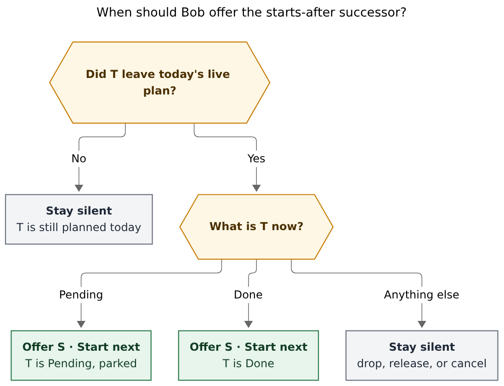
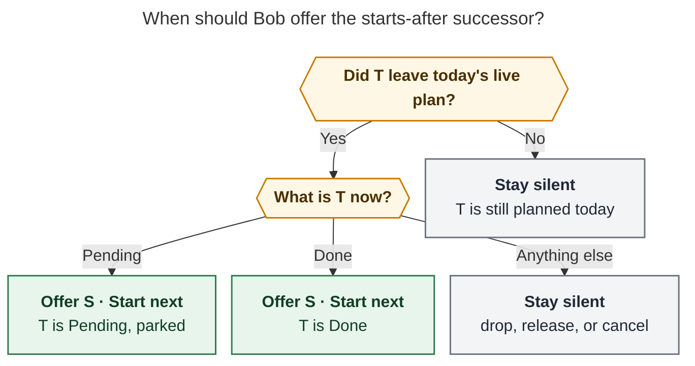
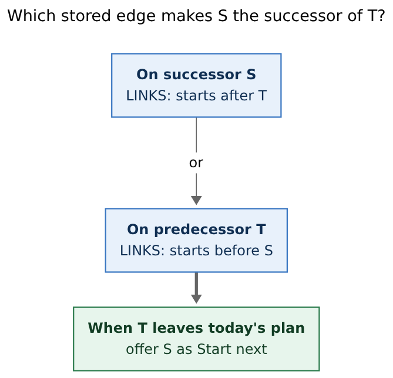
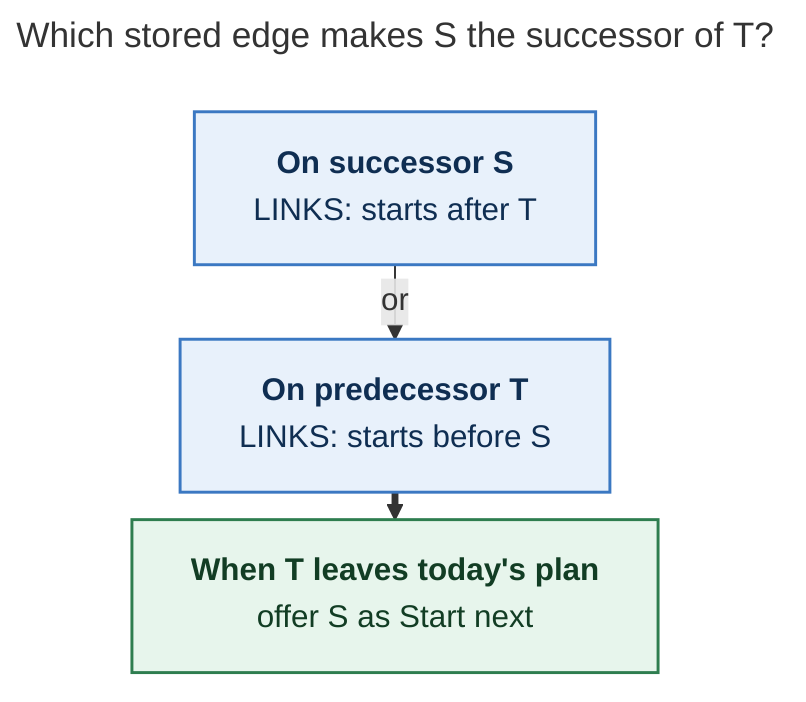

# Starts-after: a Start-next successor, not a second dependency

> **Research query.** Add a special `starts after` relation label, mirrored
> as `starts before` on LINKED FROM, that offers a successor when the
> predecessor is parked as Pending via `x*` (agent dispatch) and also when
> that predecessor is closed. Make the prompt obviously different from the
> other successor kinds. Lead the design, critique the plan, call out
> justified requirement adjustments, and recommend a solution that is
> intuitive, reliable, and beautiful.

**Researcher.** `grk` (independent swarm report).
**Date.** 2026-11-01.
**Scope.** Research only. No bob-cli, plugin, chezmoi, vault, or memory
files were changed. This file is the deliverable.

**Prior research consulted (unrelated earlier swarms, not this one).**
`research:202610/cancel_labels_for_task_relations/`,
`research:202610/successor_pull_in_offers/`,
`research:202610/unblocked_successor_links_on_close/`,
`research:202610/task_relation_links/`,
`research:202610/undirected_task_relations/`,
`research:202610/relation_card_label_vocabulary/`.

**Primary evidence in this repo.**
`docs/task-relations.md` §§2, 10, 17–18;
`docs/task-dependencies.md` §12 (especially §12.1 SL21, §12.3, §12.15);
`docs/capture.md` parking outcomes;
`src/native/capture/pomodoro_close.rs` predecessor set C;
`src/native/task_complete/successors.rs` `OfferGroup`;
`src/native/task_relations/inverse.rs` `NAMED_PAIRS`;
`src/native/config/relations.rs`;
`src/native/capture/dependencies.rs` `DependentsSnapshot`;
decisions `unblocked-tasks-are-offered`, `task-lanes-are-sticky`,
`mac-capture-is-a-thin-client`.

---

## Bottom line

**Build it. Keep the relation inert as storage, and compute a new
successor-offer group when the predecessor leaves today's live plan as
Pending or Done.**

The need is real and a dependency cannot express it. A Depends-On edge
blocks S until T is Done. Agent work on T can sit in Pending for days.
The next prompt should become available as soon as T has *started and
left today's plan* — the `x*` park — and still be offered if T is closed
outright. That is a start-to-start (plus finish-to-start safety net),
not a finish-to-start block.

Do **not** couple the trigger to the `x*` lexeme. Parking is one close
outcome that starts T as `[/]` and does not carry its Task Link.
`x*` is the usual way to get that outcome, not the only future one, and
"moved out of the daily file" is the wrong picture: the task lives in
its area or project note; only the Pomodoro Task Link leaves the live
plan.

Do **not** fold these rows into `hand_off`. Hand-offs are unblocked
dependents (🔓). Keep-moving rows already taught the picker how to say
*why this is not a dependent* (⏭). Start-next rows need the same
treatment with their own glyph, caption, and trigger field.

The beautiful object is the picker that names the predecessor's
departure, not the stored label:

```text
┌──────────────────────────────────────────────────────────────────────┐
│ ⏵  Start next                                                         │
│ [ Filter tasks, notes, and groups                                  ]  │
│ ┃ Start next                     starts after · not a dependent       │
│ ┃ ‹Dispatch the agent› left today's plan as Pending                   │
│ ┃ □ Write the retry prompt                                            │
│ ┃   sase · Ready · → FIX                                              │
│  Tab toggle · ↵ pull in · ⇧↩ none · Esc back to the draft             │
└──────────────────────────────────────────────────────────────────────┘
```

On a close of the same predecessor the caption switches to
`‹Dispatch the agent› is Done`. Same group, same glyph, different why.

---

## 1. Is this a good idea?

**Yes, with a sharper trigger than "the `x*` syntax" and a sharper
prompt than "another successor."**

### 1.1 Why yes

Bryan's stated workflow is:

1. T is work already handed to an agent (or about to be).
2. S is the next prompt, worth thinking through only after T has been
   sent.
3. `x*` parks T: started `[/]`, worked in the closed session, not
   carried into the next one.
4. He wants the successor prompt for S at that moment, and also if he
   closes T with `x!` / Ctrl+Enter instead.

That is sequencing of *starts*, with Done as a fallback. Today's tools
each miss it:

| Tool | What it would do to S | Why it fails this workflow |
| --- | --- | --- |
| Depends-On `&` / `*` | Block S until T is Done | Agent Pending can last days; S would hide in Blocked |
| Ordinary relation (`follow-up of`, unlabelled) | History only | No offer, ever (`docs/task-relations.md` §2) |
| Complete label | Completes the *source* at commit | Wrong task, wrong time |
| Keep-moving | Offers ready residents of a leaf project on last-planned close | Unrelated to T, never on park (SL21) |
| Hand-off | Offers direct dependents on Done | Never on park; S is not a dependent |

A labelled relation already has the right shape: directed, optional,
mirrored, inert, authored from capture `~` / `~~` and the Task Card.
Successor offers already have the right verb: explicit pick, never
auto-link (`decisions:unblocked-tasks-are-offered`). The missing piece
is a *delayed* offer keyed off T's park or close, with copy that cannot
be mistaken for an unblock.

The live vault already treats some labels as more than prose
(cancel labels, complete labels). Those fire at relation *commit* on
the source. This fires later, on a managed gesture against the
*predecessor*. Same family, different tense.

### 1.2 Why the original sketch is slightly wrong

Three phrases in the request should not become the contract.

**"`x*` capture syntax."** Parking is a close *outcome*
(`docs/capture.md`: parked links get the same In Progress and Work Log
effects as a keep, with `carried: false`). `x*`, `x*1`, `x1*`, and
`x*!2` all produce parked rows. The planner currently builds
predecessor set C only from tasks this close moved open → Done:

```text
// src/native/capture/pomodoro_close.rs
// C: embedded roots plus closed subtasks this close moved open →
// Done. Plain `x` keeps, parks, defers, and drops never land here.
```

SL21 then says `x*` park never offers, never links. That exclusion is
correct for *dependency* successors. It is the bug for this feature.
The contract to write is "this close parked T, and T has no remaining
live Task Link today," not "the draft token was `x*`."

**"Moved out of the daily file."** T does not live in the daily file.
A Task Link under an open Pomodoro *is* today's live plan
(`glossary:task-link`, `decisions:today-is-read-from-the-ledger`).
Park suppresses carry of that link. T's note is untouched except for
the `[/]` start and optional Work Log. Speak of leaving the live plan.

**"A special new label" as a one-off in code.** Cancel and complete
effects are chezmoi-configured lists with bob default `[]`, overlay
rows, hide-is-not-disable, and "one effect per label." A third hardcoded
English string would fight that. The inverse pair can be first-class
display; the *offer* should still be config-gated.

### 1.3 Would I take a different approach?

I would not.

Rejected alternatives:

- **A start-to-start dependency type.** New Depends-On grammar, a
  "blocked until started" overlay, hooks changes, and a collision with
  "Blocked tasks keep no Task Links." Far heavier than an offer.
- **Overload `follow-up of`.** Already a named inverse
  (`followed up by`), used as narrative history. Parking T should not
  start every follow-up.
- **Auto-link S.** Violates `unblocked-tasks-are-offered`. Even one
  candidate needs an explicit pick.
- **A `[startsAfter::]` field or `#after` tag.** Duplicates the
  relation system (chips, catalog, inverse, capture `~`).
- **Capture-only syntax (`x* then S`).** Does not persist the intent
  across the morning the prompts were written.
- **Tickle S automatically when T parks.** A relation must not write
  `[unblocked::]` or stamp freshness. Unpicked S stays as it was; the
  Done safety net re-offers it.

The right object is: store an inert labelled edge; compute a
`starts_after` successor offer when T leaves the live plan as Pending
or Done; pick with the existing Pull-In / `--pull-in` machinery.

---

## 2. Justified requirement adjustments

These change the request. Each is intentional.

1. **Trigger on the plan-leaving event, not on the `x*` token.**
   v1 fires when a managed gesture leaves T with **no remaining live
   Task Link today** and T is **Pending** (park) or **Done** (managed
   close). `x*` is the common park path, not the definition.
2. **Recognize both stored directions.** `S —starts after→ T` and
   `T —starts before→ S` name the same start order. Either form offers
   S when T leaves the plan. Authoring from the agent task with ⇧L, or
   from the follow-up with `~`, both work.
3. **Do not block S.** A starts-after edge never flips a checkbox to
   `[?]`, never writes Depends-On, never consumes a Task Link. If S
   also has real open prerequisites, it is not selectable (Blocked
   tasks still keep no live links).
4. **Do not offer on drop, release, cancel, reopen, raw checkbox,
   reconcile, or start-while-still-planned.** `x~` never starts T.
   Alt+N lowers Pending to Ready. Cancel never offers successors
   today (SL21 / §12.1) and should not start the next agent prompt
   because the first one was abandoned. `=x` / a keep (`x1`) starts T
   *and* leaves it planned: too early.
5. **Dedicated offer group `starts_after`, UI title `Start next`.**
   Never mix into `hand_off`. Never use 🔓 or the word "unblocked" on
   these rows. Caption always names *why*.
6. **Config-gated effect, first-class inverse.** Chezmoi enables
   `relations.starts_after_labels: [starts after]`. Bob default `[]`,
   matching cancel/complete. The named inverse pair
   `starts after` ↔ `starts before` is always on for display.
7. **Lookup authored LINKS, never LINKED FROM as authority.**
   `docs/task-relations.md` §1: reconcile owns the mirror; nothing
   reads it back as input. Candidate discovery may *hint* from the
   live relation index or the mirror, then verify against LINKS.
8. **Picked S lands on the continuation, not under the closed
   parked bullet.** Closing anchors from §12.3: created continuation,
   else same-name open entry after the closed one, else a new
   placeholder. That is the "next session is the next prompt" moment.
9. **Amend SL21 rather than pretend park still never offers.**
   Park still never offers dependency, project, or keep-moving rows.
   It may offer `starts_after` rows.
10. **`plan.link_unblocked: false` does not disable Start next.**
    These are not unblocked dependents. Empty
    `starts_after_labels` is the kill switch. Keep-moving's dual-flag
    gate is the wrong precedent here.
11. **Unpicked S is not tickled.** No `[unblocked::]`, no freshness
    stamp, no lane change. The relation remains visible on both ends.
    Closing T later is the safety net.
12. **Ctrl+Shift+Enter unlink of a last live `[/]` link is v1.1, not
    v1.** It is the Obsidian twin of park (Pending, link gone) but the
    cycler has no successor path on unlink today. Ship capture park +
    every managed Done first.
13. **Bump `api.successors.version` to 3.** v2 added `keep_moving`.
    Old nav must not be handed a group it would drop, same rule as
    keep-moving.

---

## 3. What exists today (the seams this feature must fit)

### 3.1 Relations are inert history, with two commit-time exceptions

A relation is a directed labelled edge on S's `🪢 **LINKS:**` line,
mirrored on T's generated `🪢 **LINKED FROM:**` line. It never blocks,
promotes, consumes, stamps, or becomes a successor offer
(`docs/task-relations.md` §2). The exceptions are configured **cancel
labels** (commit cancels the source) and **complete labels** (commit
marks the source Done and then runs that surface's managed Done,
including successor offers of the source's dependents).

Neither exception is this feature. Both fire at *relation commit* on
the *source*. Starts-after fires later, on a *predecessor gesture*.

Identity is `(S, T)`: one entry per target, A→B and B→A independent,
cycles allowed. Labels are 1–40 characters, keyed by
`relation_label_key`. Hide is suggestions-only.

### 3.2 Inverse display cannot produce `starts before` by itself

`src/native/task_relations/inverse.rs` has four named pairs the
participle rule cannot produce:

```text
duplicate of  → duplicated by
follow-up of  → followed up by
merged into   → merged from
split from    → split into
```

Every other two-word `‹participle› by` derives a third-person inverse
(`inspired by` → `inspires`). `starts after` is verb + preposition, so
without a named pair LINKED FROM would fall back to
`(chip) · starts after → this`. The request's mirror wording needs a
named pair. Named lookup is one-way today: storing the inverse phrase
does not invert back. For this pair both directions should be in the
table so either stored form displays cleanly.

### 3.3 Successor offers are computed, grouped, and never auto-linked

`OfferGroup` today is `HandOff | Project | ProjectFinished | KeepMoving`
(`src/native/task_complete/successors.rs`). One gesture, one picker,
nothing pre-checked, `--pull-in` on capture, in-panel choice on Mac,
nav `api.successors` v2.

Keep-moving is the copy precedent this feature should clone:

- own group, own glyph (⏭), own caption that *leads with why*;
- always says **not dependents**;
- never uses 🔓;
- when it is the only group, the picker title *is* that group;
- in a mixed picker it renders as its own section;
- additive JSON array, never stuffed into `unblocked[]`;
- `api.successors.version` bump so old nav is not handed a new group.

Start next should look like keep-moving's cousin, not like an unblock.

### 3.4 Park is unique among close outcomes, and currently successor-blind

From `docs/capture.md`:

| Outcome | 🍅 in the closed entry | Carried | Task effect |
| --- | --- | --- | --- |
| in progress | yes | yes | started `[/]` |
| parked (`*P`) | yes | no | started `[/]` (same Work Log effects) |
| deferred | no | yes | none |
| complete | embedded | no | closed |
| dropped | no | no | none — lane unchanged |

Parking is not a new status. `[/]` keeps the In Progress name; dash
and chips say PENDING (`decisions:task-lanes-are-sticky` R12). Carry
suppression is planner metadata, not a durable Markdown marker.

That combination — started, not carried — is exactly "sent to the
agent and taken off today's plan." A keep (`x` / `x1`) starts T and
leaves it planned. A drop never starts T. Only park (and, later,
last-link unlink of `[/]`) does both.

### 3.5 Reverse lookup already has two working patterns

Dependents: vault snapshot prefiltered on `dependsOn` / `id::` bytes,
then parsed. Cheap false positives, no missed edges
(`src/native/capture/dependencies.rs`).

Relations in Obsidian: `api.relationIndex` v2 publishes forward and
reverse maps from authored LINKS (`docs/task-relations.md` §11).
`incoming(path, blockId)` returns relations only.

Capture has no relation reverse index today because nothing has needed
one. Start next does. The dependents prefilter is the pattern to copy:
byte-search the configured label spellings (and their inverses), parse
LINKS, match.

### 3.6 Mac is a thin client of bob

Bob computes offers; the app renders groups and submits `--pull-in`
(`decisions:mac-capture-is-a-thin-client`,
`docs/reference/mac-capture/protocol.md`). A new group is additive JSON
plus a capability row. Older Mac still sees numbered `offer N` rows if
they remain in the flat `pull_in` list.

Today, `x*` with nothing completed produces no offers, so Return
commits. After this feature, an `x*` whose parked tasks have
starts-after successors will open the Pull-In step. That *is* the
successor prompt. ⇧↩ still means none.

---

## 4. Recommended design

### 4.1 Vocabulary

- **Predecessor T.** The task that is leaving today's live plan.
- **Successor S.** The task that should be offered as the next thing
  to start.
- **Canonical stored form.** `S` LINKS `starts after [[T]]`.
- **Predecessor stored form.** `T` LINKS `starts before [[S]]`.
  Same start order, same offer.
- **Start-next offer.** A successor offer in group `starts_after`,
  trigger `parked` or `completed`, never a dependent.

Live plan means: an unstruck Task Link under an **open** `[ ]`
Pomodoro entry of today's `## Pomodoros` (the existing §12 "live
link").

### 4.2 Config

Chezmoi `~/.config/bob/config.yml`, bob default `[]`:

```yaml
relations:
  cancel_labels:
    - duplicate of
    - superseded by
  complete_labels:
    - implemented by
    - verified by
  starts_after_labels:
    - starts after
```

Matching uses `relation_label_key`, same as cancel/complete. Parsing
fails toward fewer offers. A key listed in `starts_after_labels` and
either close list is dropped from **all** lists with one warning:
one effect per label. Hide is not disable. Catalog overlay: the
configured name appears in suggestions and `bob relations list -a`
even at zero uses, marked `configured`, never boosted.

The inverse `starts before` is derived from the named pair, not a
second config key. It is recognized as the predecessor-authored form
and shown as the LINKED FROM phrase for `starts after`.

### 4.3 Inverse pair

Add both directions to `NAMED_PAIRS`, keeping the table sorted for
binary search:

```text
("starts after",  "starts before"),
("starts before", "starts after"),
```

Display only; never stored. `bob relations list` ⇄ column shows the
inverse. Chips already render `‹inverse› (chip)` on LINKED FROM for a
known pair (`docs/task-relations.md` §10). That is the requested
mirror wording, for free, once the pair exists.

Do not auto-reverse the edge on write. `bob relations reverse` already
exists for an explicit flip. Bidirectional *recognition* at offer time
is enough and stays consistent with cancel/complete (inverse typing
does not fire those effects; here both English forms are meaningful).

### 4.4 When the offer fires

**Reader question:** When should Bob offer the starts-after successor?

**Caption:** Offer S only when predecessor T leaves today's live plan
as Pending or Done; a still-planned T, a drop, a release, or a cancel
stays silent.



Rendered size: 730.368 × 562 px; fit scale: 89.4%. Mermaid CLI 12.0.0
with the Highlights PDF-mirroring config.



v1 gesture table:

| Gesture | T after the gesture | Offer S? | Trigger |
| --- | --- | --- | --- |
| `x*` / `x*N` / parked subset of a mixed close | `[/]`, this session's link not carried, no other live link | yes | `parked` |
| Managed Done: `x!`, `!note:id`, Ctrl+Enter, Alt+] into Done, complete-label commit | `[x]`, links retired | yes | `completed` |
| Keep (`x`, `x1`, `=x`) | `[/]`, still live-linked | no | — |
| Drop `x~` | lane unchanged, link gone | no | — |
| Alt+N release | `[ ]` Ready, links removed | no | — |
| Cancel (nav, Alt+[, cancel label) | `[-]` | no | — |
| Reopen, raw checkbox, reconcile, hooks | — | no | — |
| Ctrl+Shift+Enter unlink of last `[/]` link | `[/]`, link gone | **v1.1** | `unlinked` |

"No remaining live link" is the already-planned test inverted onto T.
If T is also linked under another open entry (queued FIX, a second
running session), T has not left the plan: stay silent, even if this
session parked its own copy.

A mixed close (`x*!2`) is one gesture and one picker: completed tasks
contribute `hand_off` / project / keep-moving as today; parked tasks
contribute `starts_after`. Dedup: `hand_off > project >
project_finished > keep_moving > starts_after`. If S is both a
dependent of T and a starts-after successor of T, it appears once, as
a hand-off. Using both edges on the same pair is possible and
redundant; do not refuse it in v1.

Status need not change. T already `[/]` and then parked (unlink only)
still offers S. The C derivation's `status_changed` gate is the Done
gate; park keys off the park outcome.

### 4.5 Who is S

For each predecessor T that passed §4.4, S is an open task such that:

- S's LINKS contains T with a `starts_after_labels` key, or
- T's LINKS contains S with the inverse key (`starts before` for the
  default pair),

and S is not T, not in `done/`, not `#hide`, not `^prj` (unless we
later want project-level sequencing; v1 skip), not already live-linked
today, not Blocked by remaining open prerequisites or a still-blocked
project.

Offer Ready, Next, and Pending S, same lane set as keep-moving.
Inbox tasks are eligible (SL26). Recurring S is eligible if it is
otherwise open; do not special-case it beyond existing close refusals
on the *predecessor* side.

Picking S is the existing PICK rule: `' '`/`'?'` → `'*'`; `'*'` and
`'/'` unchanged; mint a missing `^block-id`; stamp `[fresh:: today]`;
insert the successor link at the closing/continuation destination.
Unpicked: no mint, no stamp, no link, no tickler.

If implicit/closing destination resolution fails, recover with
`not_linked: no_destination` and do not offer — same as hand-offs.

### 4.6 Authoring

**Reader question:** Which stored edge makes S the successor of T?

**Caption:** Either S starts after T or T starts before S names the
same start order; both offer S when T leaves today's plan.



Rendered size: 445.734 × 430 px; fit scale: 100.0%. Mermaid CLI 12.0.0
with the Highlights PDF-mirroring config.



Natural capture:

```text
Write the retry prompt ~agent:dispatch|"starts after"
```

On the agent task, Linked-from (⇧L / `~~`) picking the retry prompt
with label `starts after` writes the same canonical edge on S.
Linking *from* T with `l` / `~` and label `starts before` writes the
predecessor form and is also recognized.

The relation card already draws a live sentence. Add a consequence
strip in the complete-label style (words, not color):

| Typed form | Strip |
| --- | --- |
| `starts after` on S → T | `⏵ “{S}” will be offered when “{T}” leaves today's plan` |
| `starts before` on T → S | `⏵ “{S}” will be offered when this task leaves today's plan` |
| Inverse typed on the wrong end as a *different* pair | existing muted flip hint; no offer effect |

Relation *commit* never opens the successor picker. The edge is
history until T parks or closes. That is the difference from complete
labels, and the strip should not say "↵ link & offer."

A new-task `~` source is allowed (unlike cancel/complete, which refuse
to be born cancelled/done). S may be born already pointing at T.

### 4.7 Copy, glyph, and mixed pickers

Clone keep-moving's copy rules (`docs/task-dependencies.md` §12.15)
with a start verb.

| Element | Copy |
| --- | --- |
| Glyph (text) | ⏵ |
| Lucide | `play` |
| SF Symbol | `play.fill` |
| Colour | existing Next token (picks land in Next) |
| Group title | `Start next` |
| Contrast tag | `starts after · not a dependent` |
| Why caption, parked | `‹T› left today's plan as Pending` |
| Why caption, completed | `‹T› is Done` |
| Why caption, k ≥ 2 predecessors | `‹T› and k−1 more left today's plan as Pending` (or `are Done`; mixed: `left today's plan`) |
| Picker title, only this group | `Start next` |
| Picker title, mixed | the other group's title (`Unblocked` / `Keep ‹N› moving` / `Project empty`); this section still has its header and caption |
| Notice, one pick, only this group | `⏵ Next in FIX: Write the retry prompt · starts after ‹T›` |
| Notice, mixed | existing 🔓 / ⏭ forms; Start-next picks count as linked and add `· starts after ‹T›` on those rows |
| CLI group header | `Start next · ‹T› left today's plan as Pending (starts after, not a dependent)` |
| CLI linked suffix | `· starts after ‹T›` |
| Mac capsule | `Start next` |
| Mac notification | `⏵ Pulled in 1 · starts after ‹T›` |

Never lead with a block ID. Truncate T and S to 48 characters with
`…`. Rows show lane names (`Pending`, `Next`, `Ready`), never raw
status symbols.

Two predecessors in one park produce one group if they share the
same trigger, with the k≥2 caption, or two groups if one parked and
one completed in a mixed close — so the why line never lies.

### 4.8 Lookup (reliability)

**Obsidian.** `api.relationIndex.incoming(T)` plus `outgoing(T)`,
filtered by configured keys and their inverses, then re-read S's
(or T's) LINKS from the staged post-gesture text. The index is
source-authoritative and overlays unsaved editor text.

**Capture / Rust.** Do not read LINKED FROM as input. Extend the
dependents-snapshot pattern:

1. If `starts_after_labels` is empty, skip (byte-identical `x*` with
   no configured labels, preserving today's park contract).
2. Byte-prefilter notes for the configured spellings and their
   inverse phrases (substring, same false-positive policy as
   `dependsOn`).
3. Parse LINKS children; match `(S, T, key)` or `(T, S, inverse)`.
4. Overlay the batch's staged notes so a relation added earlier in
   the same draft is visible.
5. An incomplete relations snapshot is non-fatal: the park/close
   still succeeds; Start-next rows are omitted and
   `starts_after_check: "unavailable"` is reported, analogous to
   `unblocked_check`.

Do not add a `[startsAfter::]` field. Do not treat a stale LINKED
FROM hand-edit as an edge change.

Gate cost: the extra walk runs only when the config list is
non-empty **and** this gesture has at least one parked or completed
predecessor. A park of tasks with no matching bytes offers nothing
and writes nothing extra.

### 4.9 JSON and CLI (additive, schema 1)

Every `pomodoro_close` and `task_complete` object gains
`starts_after[]`, always present, possibly empty, omitted from
documentation examples that are byte-stable when empty if that is
the existing "omit when empty" house style — keep-moving chose
"always present"; match keep-moving for planner simplicity.

Each row uses the `unblocked[]` shape plus:

- `trigger: "parked" | "completed"` (v1.1 adds `"unlinked"`);
- `offer.group: "starts_after"`;
- `after: [{path, block_id, text, left_as: "pending"|"done"}]` —
  do not reuse `unblocked_by` for a task that was never blocked;
- `not_linked: "not_selected"` when unpicked.

Rows never appear in `unblocked[]`. They do appear in top-level
`pull_in` numbering, `--pull-in` keys, and
`--require-pull-in-choice`.

Human output: a `Start next` header after keep-moving, numbered
`offer N` rows, dry-run hint `-p 1,2 · -p all` unchanged.

`x*` with zero starts-after edges and nothing completed remains
byte-identical to today (no successor staging). That preserves the
`plan_close_successors` "completed nothing stages nothing" comment
for the default vault.

### 4.10 Surfaces

| Surface | v1 work |
| --- | --- |
| `bob capture` park and mixed close | new predecessor class + `starts_after` planner |
| `bob capture` `!` / complete-label / `x!` | same planner on Done T |
| Bob Mac Capture | Pull-In section `Start next`; capability row; thin client |
| task-status-cycler Ctrl+Enter / Alt+] | Done path only; `api.successors` v3 |
| bob-navigation-hotkeys picker | v3 group, caption, tag, play glyph |
| bob-ledger-tools chips | inverse pair only (already generic) |
| Relation card / `capture-complete` | consequence strip, overlay row |
| `bob relations list` | `starts_after_successor` flag, header `· N start-next` |
| chezmoi `config.yml` | enable `starts after` |
| Ctrl+Shift+Enter last `[/]` unlink | **not v1** |

Older nav (`api.successors.version < 3`): omit the group (close still
happens; S remains visible on LINKED FROM). Older Mac: numbered
offers in the flat list still pickable if the app already handles
unknown groups the way it handled keep-moving's fallback.

### 4.11 Docs and vectors

- `docs/task-relations.md`: exception bullet in §2; named pair in
  §10; new **§20 Start-next labels**; config snippet beside CL2/CP2.
- `docs/task-dependencies.md`: §12.1 trigger table includes park for
  this group only; SL21 amended; new §12.16 with SA vectors; ORDER
  gains `starts_after` last; picker API v3.
- `docs/capture.md`: parking paragraph cross-links §12.16; `x*`
  examples show a Start-next offer when the edge exists.
- Glossary: Task Relation (third status exception: delayed offer);
  Task Successor / Successor Offer (fifth group).
- Decision record after implementation, citing this research.

Suggested SA vectors (never renumber later):

| # | Situation | Outcome |
| --- | --- | --- |
| SA1 | S `starts after` T; `x*` parks T; T has no other live link | S offered, `trigger: parked`, group `starts_after` |
| SA2 | same, user picks S | S `[*]`, linked on the continuation, stamped |
| SA3 | same, no pick | T `[/]`; S unchanged; `not_selected` |
| SA4 | S `starts after` T; Ctrl+Enter / `x!` completes T | S offered, `trigger: completed` |
| SA5 | T still live-linked in another open entry | no offer |
| SA6 | `=x` / keep leaves T planned | no offer |
| SA7 | `x~` drops T | no offer |
| SA8 | Alt+N releases T to Ready | no offer |
| SA9 | cancel T | no offer |
| SA10 | T LINKS `starts before` S; park T | S offered (predecessor form) |
| SA11 | S is Blocked on someone else | not selectable / omitted |
| SA12 | S already live-linked today | `already_planned`; no row |
| SA13 | S is also a direct dependent of T on a complete | one row, `hand_off` |
| SA14 | mixed `x*!2`: complete A, park T | one picker; A's hand-offs + T's Start next |
| SA15 | `starts_after_labels: []` | park byte-identical; no scan |
| SA16 | S `#hide` | recover-only, folded |
| SA17 | two successors of one parked T | one group, two rows, nothing pre-checked |
| SA18 | relation added earlier in the same bulk draft, then `x*` | staged LINKS visible; offered |
| SA19 | `plan.link_unblocked: false` | Start next still offers |
| SA20 | no continuation and pick S | created placeholder; `next_up` |

---

## 5. What would make this ugly (and how to refuse it)

- **A picker titled Unblocked for a park.** Park unblocked nothing.
  Title `Start next`, glyph ⏵, caption with Pending.
- **Auto-starting S as `[/]`.** The offer raises to Next when picked,
  like every other successor. Bryan still thinks through the prompt.
- **Blocking S until T starts.** That invents a new overlay and fights
  "Blocked tasks keep no Task Links."
- **Firing on `=x`.** T is still on the clock. The next prompt would
  interrupt the session that is dispatching T.
- **Firing on cancel.** Abandoned agent work should not push the next
  prompt. The edge remains as history.
- **Reading LINKED FROM as the edge.** Hand-edits and
  `linked_from_lines: false` would desync offers from reality.
- **Pre-checking the only row.** Rejected for every other offer
  group; reject it here even though Bryan will usually pick S.
- **Overloading `follow-up of`.** Different English, different
  inverse, already in use as narrative.

---

## 6. Implementation sketch (for a later plan, not this report)

One epic, three phases, tests pinned to SA vectors and the existing
relation-label / successor fixture style.

1. **Vocabulary and cue.** Named pair, `starts_after_labels` parser,
   catalog overlay, relation-card strip, `bob relations list` flag,
   chezmoi key. No offers yet. Inverse display already makes LINKED
   FROM read `starts before`.
2. **Capture planner.** Parked predecessor class; LINKS prefilter;
   `starts_after[]`; mixed close union; `--pull-in`; Mac Pull-In
   section; SL21 amendment. This is the agent-dispatch path.
3. **Done path in both engines.** Same rows on `x!`, `!`, Ctrl+Enter,
   complete-label; `api.successors` v3; nav picker section. Safety
   net for unpicked parks.

v1.1 (separate, small): cycler last-link Ctrl+Shift+Enter of `[/]`.

Do not ship phase 1 alone as user-visible "the label exists but does
nothing on `x*`"; the inverse display would look like the feature
landed. Either land 1+2 together, or keep the config key commented
until 2 is green.

---

## 7. Recommended solution

Ship **Start next**: a config-gated relation label `starts after`
whose inverse displays as `starts before`, recognized in both stored
directions, that adds a `starts_after` successor-offer group when the
predecessor leaves today's live plan as Pending (park) or Done
(managed close).

Keep every other relation inert. Do not block. Do not auto-link. Do
not tickle unpicked rows. Do not title the picker Unblocked. Do not
key the trigger off the `x*` spelling.

The agent workflow then reads as one sentence on each surface:

- **While writing the follow-up:**
  `Write the retry prompt — starts after → Dispatch the agent`
  with `⏵ will be offered when Dispatch leaves today's plan`.
- **On the agent task:**
  LINKED FROM `starts before (Write the retry prompt)`.
- **At `x*`:**
  `⏵ Start next · Dispatch the agent left today's plan as Pending`.
- **If he closes instead of parking, or parks and skips, then later
  closes:**
  `⏵ Start next · Dispatch the agent is Done`.

That is intuitive (the English matches the order of starts), reliable
(LINKS is the authority, park and close both offer, still-planned T
does not), and beautiful (one glyph, one caption that tells the
truth, one pick into the next session).
