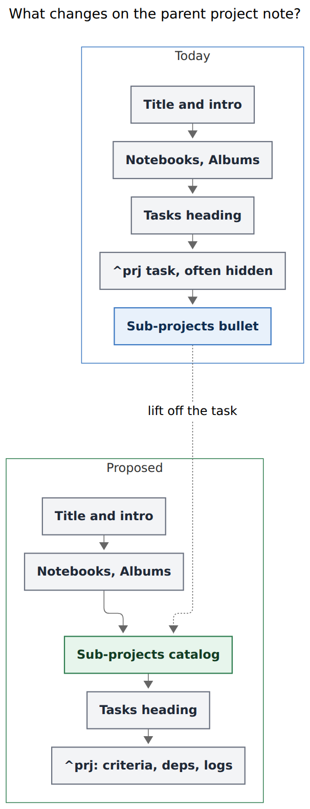
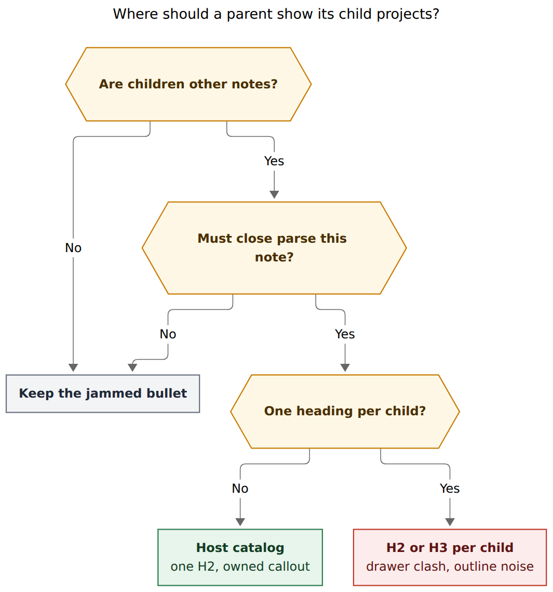
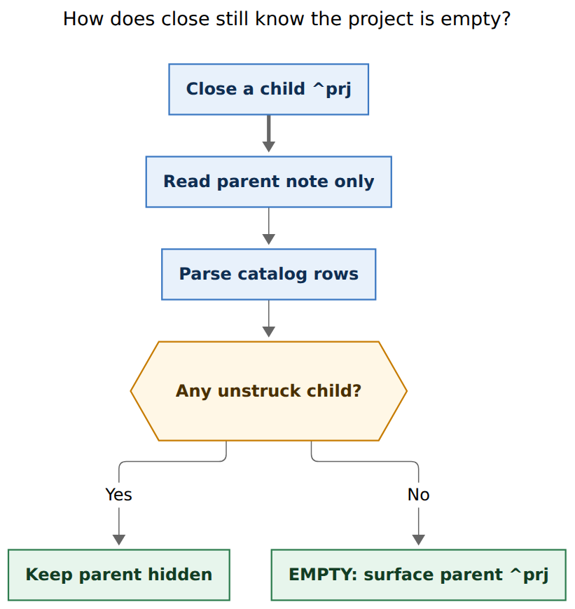

# Render sub-projects as a host catalog, in the Notebooks and Records family

**Author:** researcher grk (5-researcher swarm)  
**Date:** 2026-11-13  
**bob-cli SHA:** `c994cfbd`  
**Target repos:** `bob-cli`, `bob-plugins`  
**Decisions in force:** `notebook-routes-write-notes`, `subprojects-inherit-project-blocking`, `projects-block-from-prj-line`, `capture-bullets-mirror-the-task-block`

---

## Verdict

**Yes — lift sub-projects off `^prj`. Do it as one protected `## Sub-projects` host catalog, the same family as `## Notebooks`, `## Albums`, and an album's `## Records`.**

The request is right about the disease. Child projects are other notes. Nesting them as a puzzle-piece bullet under the parent's hidden `^prj` task makes the tree look like task plumbing, jams status into one line, and hides the map of the work under a task that `bob projects sync` is trying to keep off the dashboard.

The request is too open about the cure. "Their own H2 section (with possible H3 sub-sections?)" can be read as one heading per child. That reading collides with drawer H2s, `^prj` section targeting, and the outline. The landed, beautiful pattern in this vault is already the other reading: **one machine-owned H2, a bob-owned callout, grouping inside the callout, plugin cards for counts and hue.**

End state on a parent project note:

```markdown
# Ship the intake flow

A short intro Bryan owns.

## Notebooks

> [!notebooks]
>
> - **[[intake_notes|Intake notes]]** — Capture grammar and edge cases.

## Albums

> [!albums]
>
> - 🍽️ **[[eat|Restaurants]]** — Places to eat around here.

## Sub-projects

> [!subprojects]
>
> - **Open**
>   - **[[intake_auth|Auth]]** — Sign-in and session recovery.
>     - 🧩 [[intake_auth_sso|SSO]] — Nested child, listed on Auth's own catalog.
>   - 🗓️ **[[intake_billing|Billing]]** — Invoices and dunning.
> - **Closed**
>   - ~~[[intake_spike]]~~ ✅
>   - ~~[[intake_old_name]]~~ ❌

## Tasks

- [ ] #task #prj The intake flow is live in production #hide ^prj
  - ⛓️ **DEPENDS ON:** [[job#^api-freeze]]
```

`^prj` keeps criteria, Depends-On, BLOCKS, logs, and user notes. The catalog is the map. Each child's note remains the territory.

---

## What exists today

### The jammed Sub-projects line

`bob projects` owns a single machine-written child of an open `^prj` (`docs/projects.md`, `src/native/projects/mod.rs`):

```markdown
- [ ] #task #prj Ship the parent #hide ^prj
	- 🧩 **Sub-projects:** 🗓️ [[future_child]] • [[ordinary_child]] • ~~[[done_child]]~~ ✅ • ~~[[canceled_child]]~~ ❌
```

Contract facts that any replacement has to keep or consciously retire:

| Rule | Source |
| --- | --- |
| Direct children only, keyed by `parent:` wikilink | `docs/projects.md` |
| Open children first, then retained closed children, both case-insensitive by stem | same |
| Future child dates get `🗓️`; done is `~~[[stem]]~~ ✅`; canceled is `~~[[stem]]~~ ❌` | same |
| Line sits after the whole Depends-On / BLOCKS / first-slot Cancel Log subtree | `docs/projects.md`, MC8, `task-dependencies.md` §14.5 |
| Fully machine-owned; duplicates collapse; user bullets under `^prj` are left alone | `docs/projects.md` |
| Closed children are preserve-and-mark: deleting a closed entry by hand prunes it until the child is reopened | same |
| Terminal parents get no `^prj` edits while `^prj` stays closed | same |
| Notebooks never appear on this line | `docs/notebooks.md` |

The line is also a **local cache for EMPTY**. Close, pull-in trigger (c), and `#hide` surfacing read `SUBOPEN(N)` from the marker on the parent note. They do not walk child `parent:` fields, because that would be a vault-wide scan in a gesture that already has the parent bytes (`src/native/projects/surface.rs`; plugin mirror `PROJECT_SUBPROJECTS_MARKER` in `bob-plugins` `089-successor-project.js`). An unstruck child link means the parent still has open work. A `closed_child` override treats that stem as done for the duration of the close.

### `^prj` is the wrong shelf

On a typical project note the lifecycle task already lives under `## Tasks` and is `#hide` whenever open children or unhidden tasks exist (`examples/demo-vault/Projects/seedlings.md`; `docs/projects.md` surfacing rules). The map of the work is therefore:

- nested under a checkbox
- often hidden
- competing with Depends-On, BLOCKS, LINKS, logs, and user notes for the same indent
- rendered as one wrapping line of `•`-separated stems with no titles or summaries

That is task-child grammar. Child projects are notes. Bob already has a grammar for "other notes that hang off this host."

### The two H2 families already on a project note

A project note already mixes two heading families. They must stay distinct.

**1. Catalog H2s — maps to other notes.** Bob owns the callout; Bryan owns heading position (`docs/notebooks.md`, `docs/records.md`, `src/native/host_catalog/region.rs`).

| Heading | Callout | First write | Rows |
| --- | --- | --- | --- |
| `## Notebooks` | `[!notebooks]` | before first `## Tasks`, else EOF | `**[[stem\|Title]]** — summary`, nested by notebook parent; descendant owners under `🧩 [[project]]` |
| `## Albums` | `[!albums]` | end of `## Notebooks`, else before `## Tasks` | emoji + `**[[stem\|Title]]** — summary`; descendant owners under `🧩 [[project]]` |
| `## Records` (on an album) | `[!records]` | before first real H2 | group bullets `> - **Label** · N`, then record links; `index_by` subgroups are **nested bullets**, not document `###` |

Later writes patch only the callout. An empty subtree deletes the callout and removes the heading only when the section is then blank. Duplicates self-heal. Malformed regions are `damaged` and left untouched. Titles and summaries are inert text. Counts, dates, hues, and freshness are **never written**; `bob-ledger-tools` album cards paint them (`bob-plugins` `docs/albums.md`).

**2. Content H2s — this note's own body.** Promoting a task to a project turns ALL-CAPS drawers into `## Title Case` sections (`glossary:task-drawer`, `docs/projects.md`). On `^prj`, `@proj+prj#requirements` targets those H2s. Structural headings (`Tasks`, status-group titles, Pomodoros, Events, Highlights) and generated `## Notebooks` / `## Albums` are reserved (`docs/capture.md`, `src/native/capture/sections.rs`).

**3. Status-group H3s — only under `## Tasks`.** `task_status_groups` writes `### Next & In Progress`, `### Blocked`, `### Done & Canceled` because those headings **contain the checkbox blocks that live in this file**. That pattern is for residence, not for a map of other notes.



*Caption: The puzzle-piece child leaves `^prj`. A Sub-projects catalog sits with Notebooks and Albums, immediately before Tasks. Measured 404×1052 px, fit 84.9% (Mermaid CLI 12.0.0, PDF-mirroring config).*

---

## Is this a good idea?

**Yes.** Three independent reasons.

**Intuition.** A parent project is a place with a tree of child places. Notebooks already teach "look under `## Notebooks`." Albums already teach "look under `## Albums`." Records already teach "the index is a callout under `## Records`, grouped inside it." Sub-projects as a fourth puzzle-piece *task child* is the odd one out. After this change, the outline of a project note matches how Bryan already thinks: collections, then the work tree, then this note's tasks.

**Reliability.** The current line is a special-case writer with its own insert-anchor, duplicate-line cleanup, Depends-On ordering, and a plugin-side string match. The host-catalog engine already knows first write, later patch, empty delete, damage, BOM/CRLF, fenced-example blindness, and section protection. Routing sub-projects through that engine removes a class of `^prj`-child races (the marker sitting above Depends-On, duplicate markers, reverse conversion having to skip a managed child).

**Beauty.** A callout of titled rows with summaries can be painted the way album cards already are: root-area hue, open-count chips, a due-date chip, a blocked chevron, a folded Closed group, a hover peek of grandchild titles. The current `•`-separated stem line cannot wear that UI without looking like a sticker on a pipe.

### Where the request as written is too loose

The phrase "in their own H2 section (with possible H3 sub-sections?)" names the right *level of the document* and leaves the *unit of the heading* open. That opening is the design risk.

**One H2 per child** would reuse promotion's drawer rule ("ALL-CAPS child becomes `## Title Case`") on entities that are other notes. A child named `future_work`, `tasks`, `notebooks`, or `auth` would mint a heading that `^prj` drawer targeting, task-merge section resolution, and the outline already treat as *this note's content*. Capture's `@parent+prj#auth` would append notes into the catalog heading. Status-group code would ignore them only if we reserved every child title. That is unbounded reservation.

**Document-level `### Child` under one `## Sub-projects`** is the softer version of the same idea. It gives the outline a row per child. It also forces bob to own the whole section body, breaking the catalog rule "bob owns the callout; Bryan owns the heading and the rest of the section." User prose between H3s becomes a damage case. Closed children clutter the outline. Nested grandchildren as `####` collide with `task_status_groups` when someone later puts tasks in that section.

**Embedding a child's tasks under those H3s** would copy residence onto the parent. Every `#task` already belongs in exactly one file (`glossary:area-note`). Transclusion or duplicated checkboxes would desync lanes, freshness, and archive. Album records never copy restaurant bodies onto `body.md`; they link them.

Records already answered the H3 question. Large `[!records]` groups use nested callout bullets (`> - **Clark** · 4`, then `>   - [[eat/place]]`), and the plugin folds groups over twelve (`docs/records.md`, `src/native/albums/index.rs` `heading_row`). That is grouping without minting document headings.



*Caption: Child projects are other notes, and close still has to parse the parent, so one protected catalog H2 wins. Per-child H2/H3 headings collide with drawers and the outline. Measured 709×760 px, fit 92.0%.*

### The strongest objection

`SUBOPEN(N)` is deliberately a **parent-note parse**, so a close gesture can empty the parent without walking the vault (`docs/task-dependencies.md` §12.10 Terms; `surface.rs`). A pretty catalog that only a plugin JSON report can interpret would make trigger (c) and `#hide` depend on `bob projects list` during an editor transaction. That is slower and easier to desync than today's marker.

The answer is to keep a **parseable open/closed encoding in the catalog bytes**, the way `[!records]` still writes real wikilinks even though chips are painted. Unstruck `[[stem]]` / `**[[stem|Title]]**` means open. `~~[[stem]]~~` plus ✅/❌ means retained closed. Close, the plugin cycler, and sync share one row grammar.



*Caption: Close still reads only the parent note. Unstruck catalog rows replace the old marker line. Measured 546×580 px, fit 100%.*

A second objection: preserve-and-mark lets Bryan hand-delete a closed child from the line and never see it again. A `parent:`-driven catalog would resurrect every terminal child. That is a real behavior change. It is also the notebooks/albums rule (the catalog is the tree), and a folded **Closed** group plus plugin default-fold makes the extra rows cheap. The obscure hand-prune is the thing to give up.

---

## Alternatives

| Alternative | What it gets right | Why it loses |
| --- | --- | --- |
| **A. Keep the `^prj` bullet, restyle it as a callout under the task** | Smallest patch; EMPTY parse stays local | Still a task child, still hidden with `#hide`, still competing with Depends-On. Does not match Notebooks/Records. |
| **B. One `## Child Title` per direct child** | Outline names every child | Unbounded clash with drawer H2s and structural headings; `^prj` section targeting; reverse conversion; host-catalog engine cannot own N headings cleanly. |
| **C. One `## Sub-projects` plus document `###` per child** | One reserved H2; outline of children | Bob must own the whole section; closed H3s noise the outline; user prose between H3s; grandchildren want `####`. |
| **D. Plugin-only overlay, no vault bytes** | Zero Markdown churn | Close/EMPTY/`#hide` cannot parse the parent; source mode and git history go blank; violates "thin client of bob" for anything that currently reads the marker. |
| **E. Transclude each child's `^prj` or `## Tasks`** | Live view of child work | Residence mixing; huge parent notes; archive and grouping fight the transclusion. |
| **F. Recommended: one `## Sub-projects` + `[!subprojects]` callout, Open/Closed groups as nested bullets, plugin cards** | Same engine as Notebooks/Albums/Records; local EMPTY parse; titles and summaries; foldable Closed | Migration of every parent that already has the marker line; plugin dual-read until the line is gone. |

---

## Requirement adjustments

These are the justified changes to the request. Each one is a requirement, not a nice-to-have.

| # | Request as written | Adjustment | Why |
| --- | --- | --- | --- |
| **A1** | Sub-projects in "their own H2" | **One** reserved H2 `## Sub-projects` per host project that has children. The unit is the catalog, matching Notebooks/Albums/Records. | Per-child H2s collide with drawers and structural headings. |
| **A2** | "Possible H3 sub-sections" | Group **inside the callout** as nested bullets (`> - **Open**` / `> - **Closed**`), the records `index_by` pattern. No document `###`. | Document H3s change catalog ownership and clutter the outline. Plugin folds are how Records already make groups beautiful. |
| **A3** | Unspecified status encoding | Catalog rows stay **locally parseable**: unstruck = open, `~~[[stem]]~~ ✅/❌` = closed, `🗓️` on future-scheduled open (and retained future-closed) children. | `surface.rs` and the cycler must keep EMPTY/trigger (c) on parent bytes alone. |
| **A4** | Unspecified depth | **Direct children only** in v1. A child with its own children gets its own catalog. Optional plugin peek of grandchild count, never markdown rollup. | Notebook-style descendant `🧩` groups would make `SUBOPEN` count grandchildren that the open child already represents. Direct-only matches today's line. |
| **A5** | Unspecified closed ledger | Drive membership from **`parent:`**, including terminal children, in a folded Closed group. Retire hand-prune-is-permanent. | Catalogs are trees. Preserve-and-mark was a quirk of a single jammed line. |
| **A6** | Unspecified when the catalog is written | **Write the parent catalog in the same transaction as project-note create/capture**, the way `bob notebooks create` and `%n` already update owner catalogs. `bob projects sync` remains the repair path (Mac cron every 15 minutes, `docs/vault-git-sync.md`). | Today's "sync later adds the Sub-projects line" hint (`capture/output.rs`) is the reliability gap notebooks already closed. |
| **A7** | Unspecified migration | Dual-read (catalog rows, else legacy `^prj` child) for one release. Sync **deletes** the old marker once the catalog is current. Never leave both. | Close must not see two open sets. Reverse conversion already skips the managed child; it should skip the catalog section the same way. |
| **A8** | Unspecified capture targeting | Treat `## Sub-projects` as a generated heading: `@proj#sub-projects` refuses with `subprojects_section_generated`, same as `notebooks_section_generated` / `albums_section_generated`. | Otherwise a section selector silently writes before the first heading or into the callout (`src/native/capture/sections.rs`). |
| **A9** | Unspecified presentation | Markdown stays inert titles, summaries, and the status encoding in A3. **Plugin cards** paint counts, age, hue, blocked chevron, due chip, Closed fold. | Exact notebooks/albums split. Written counts go stale between the 15-minute syncs. |
| **A10** | "Sub-projects" on the parent | **v1 = project hosts only**, heading `## Sub-projects`. Area-note `## Projects` is a follow-up. | Areas never had the marker line. Shipping the family-complete area catalog in the same tale mixes two products. |
| **A11** | Unspecified mention rings | Catalog callout links get **no mention ring**, matching today's managed Sub-projects row (`docs/task-link-marks.md` TC5). Extend the exclusion to `[!notebooks]` / `[!albums]` if those currently ring (TC13 says callout lines ring). | The card owns those links. Rings on a map are noise. |
| **A12** | Unspecified command | Keep ownership on **`bob projects sync`**, implemented through `host_catalog::plan_host_region` with a new `SUBPROJECTS` `RegionSpec`. Do not add `bob subprojects sync`. | Nightly already has notebooks and albums as separate note types. Sub-projects are already this command's job. Placement: `AfterSectionThenTasks("Albums")`, which already falls back through Notebooks to before Tasks. |
| **A13** | Unspecified body under the new section | **Links and summaries only.** No child task checkboxes, no transclusion of child `## Tasks`. | Residence stays one file per task. |

---

## Recommended design

### Placement and ownership

Add to `src/native/host_catalog/region.rs`:

```text
callout: "subprojects"
heading: "Sub-projects"
placement: AfterSectionThenTasks("Albums")
strict_bare: true
```

`AfterSectionThenTasks("Albums")` already means: end of `## Albums` if present, else the same fallback as albums (end of `## Notebooks`, else before `## Tasks`, else EOF). First insertion of a new family therefore lands in this order:

```text
# Title
intro
## Notebooks
## Albums
## Sub-projects
## Tasks
## Future Work     ← drawer content H2s stay at EOF
```

Bob owns the `[!subprojects]` callout. Bryan may move the heading. Later syncs patch the callout in place. Empty subtree: delete callout; delete heading only if the section is then blank. Damage: malformed opener left intact, host skipped, exit 1, matching albums' `strict_bare`.

`## Sub-projects` joins the generated-heading predicates in `capture/sections.rs` and the reserved list for task-merge section resolution (`docs/task-merge.md` §4).

### Row grammar

Canonical callout (LF/CRLF inherited from the host):

```markdown
> [!subprojects]
>
> - **Open**
>   - 🗓️ **[[intake_billing|Billing]]** — Invoices and dunning.
>   - **[[intake_auth|Auth]]** — Sign-in and session recovery.
> - **Closed**
>   - ~~[[intake_spike]]~~ ✅
>   - ~~[[intake_old_name]]~~ ❌
```

Rules, all deterministic:

1. **Open** group first when it has members, then **Closed**. Omit an empty group. Omit both groups' wrapper bullets when the whole catalog would be a single open child with no closed siblings? Keep the wrappers always when both kinds can appear over the project's life — actually **always write the group bullets that have members**, omit empty ones. A parent with only open children has a single `Open` group; that is enough structure for the plugin to fold later when Closed appears.
2. Within Open: future-scheduled children first (`🗓️`), then ordinary open, each block sorted by case-insensitive **title**, path tie-breaker. (Today sorts by stem. Titles are what humans scan. Stem remains the identity.)
3. Within Closed: done then canceled, each sorted by title. Keep ✅ / ❌ so source mode and Highlights snapshots still distinguish lifecycle without opening the child.
4. Link form: `**[[stem|Title]]**` for open rows, matching notebooks. Closed rows stay `~~[[stem]]~~` plus the marker; adding a title alias inside strike is allowed if the parser treats the destination stem as identity (`surface.rs` already accepts `[[N]]`, `[[N|Alias]]`, `[[dir/N]]`, `[[N#Heading]]`).
5. Summary em-dash tail only when `summary:` is nonempty; inert-escape with the shared `notebooks::catalog::inert_text`.
6. **No nested grandchild rows in v1 markdown.** A plugin may peek. If v2 wants a hint that Auth has children, a non-parse-critical suffix such as ` · 2 nested` is still a written count and will stale — skip it; paint it.
7. Identity for EMPTY: any catalog wikilink whose span is not struck, ignoring group-label bullets and `🧩` if those ever appear. The parser must refuse to treat `**Open**` / `**Closed**` as children.

Do not write colors, open-task counts, last-touched dates, or root hues. Album cards already prove that those live in the plugin, fed by `bob projects list -f json` (extend that report with catalog state, child title, summary, open-task count, `^prj` date, blocked flag).

### EMPTY, `#hide`, and trigger (c)

Replace `first_marker_line()` in `project_surface` with a shared helper:

```text
subopen = count of unstruck child stems in [!subprojects]
          else (legacy) unstruck stems on the ^prj Sub-projects child
```

The plugin cycler gets the same helper. During dual-read, if both forms exist, **catalog wins** and sync deletes the child on the next repair. Trigger (c) still takes `closed_child` stems and treats them as struck for the in-memory count.

`#hide` on `^prj` is unchanged: hide when remaining unhidden tasks > 0 or `subopen`. The catalog's existence does not itself hide `^prj`.

### Create, capture, reverse conversion

- **Create / `@route^id@` / nav promotion:** after the new note is staged, plan the parent's catalog from the overlay (notebooks create already does this for `%n`). One guarded write. Drop the human hint "projects sync later adds the line" for the happy path.
- **Reparent** (`Ctrl+Shift+-`): old and new hosts both restage, same as notebook reparenting.
- **Reverse conversion** (project → task): omit the catalog section the way today's code omits the generated Sub-projects child (`docs/projects.md`). Child project notes are not folded back into the restored task; they keep `parent:` pointing at the restored task's new home or refuse — **keep the current skip**, do not invent a new parent rewrite in this tale.
- **Highlights snapshot:** today's snapshot turns the marker into a "Sub-projects" row (`highlights_ref/note_snapshot/bob.rs`). Snapshot the catalog callout as one named block of child links, still labelled Sub-projects.

### Plugin beauty (bob-ledger-tools, sibling of album cards)

Paint `[!subprojects]` in Live Preview and Reading view:

- Accent from the host's root area, same as notebook/album catalogs.
- Open row: title link, dim summary, chips for open-task count, future due (`Tomorrow` / `Jul 16`), blocked chevron when the child's `^prj` is Blocked.
- Closed group starts folded; remember fold in view state keyed by host path, like album record groups.
- Hover peek: up to three open task titles from the child, or "open the note" when the report is still loading. Failed report: **Retry**, never a fake zero.
- Click / Enter on a row opens the child. Ctrl/Cmd tab, Shift split. Jump recorded in navigation history when that plugin is present.
- Missing/stale catalog: **Sync projects** beside the heading, invoking `bob projects sync` through the same shared service albums use. Damaged: show bob's diagnostic; do not offer sync as a repair of a malformed opener.

Source mode stays the Markdown above. The card never writes.

### What `^prj` looks like afterwards

A parent with children becomes a clean lifecycle task again:

```markdown
- [ ] #task #prj The intake flow is live in production #hide ^prj
  - ⛓️ **DEPENDS ON:** [[job#^api-freeze]]
  - 🗓️ **SCHEDULE LOG**
    - _2026-11-01 → 2026-12-01_ — 🎲 P0 → P2 · in **20** (8–30) days
```

Depends-On order (MC8) no longer has to dance around a Sub-projects sibling. Drawer H2s remain this note's content. The walk still treats a visible `^prj` as the PROJECTS-tier freshness tracker when `#hide` is off (`decisions:recurring-occurrences-walk-when-due`).

---

## Implementation map

Blast radius is real. The marker string `🧩 **Sub-projects:**` is a cross-repo contract.

**bob-cli (authoritative bytes)**

- `src/native/host_catalog/region.rs` — new `SUBPROJECTS` spec
- `src/native/projects/{sync,edits,scan,surface,model}.rs` — plan catalog, delete legacy line, dual-read EMPTY
- `src/native/capture/{project_note,sections,output}.rs` — overlay catalog on create; refuse `#sub-projects`
- `src/native/task_children.rs`, `task_relations/parse.rs` — legacy line still classified as managed during dual-read; after migration the classifier sees no child
- `src/native/task_complete/` pull-in and keep-moving tests
- `src/native/highlights_ref/note_snapshot/bob.rs`
- `docs/projects.md`, `docs/notebooks.md` (the "never on the Sub-projects line" sentence becomes "never in the catalog"), `docs/capture.md`, `docs/task-link-marks.md`, `docs/task-merge.md`, `docs/reference/vault-format.md`, `docs/reference/json-outputs.md`
- Glossary `project-note-capture` ("sync later adds the line") and a new decision record once accepted

**bob-plugins**

- `task-status-cycler/src/089-successor-project.js` — parse catalog, dual-read
- `bob-ledger-tools` — new catalog card sibling of album cards
- mention-ring exclusion for the callout
- nav reverse-conversion skip of the section
- `docs/albums.md`-style plugin page for the card

**Ops**

- Mac `bob-projects-sync` cron already runs `bob projects sync` at :05/:20/:35/:50. No crontab change if ownership stays on that command.
- Nightly does not run `projects sync` today (`docs/vault-git-sync.md`). Repair lag on athena is the existing 15-minute Mac job plus whatever Bryan runs by hand. Optionally add the lock-free core to nightly next to notebooks/albums; that is a follow-up, not required for correctness if create already writes the parent.

**Suggested tales**

1. Contract + `RegionSpec` + dual-read parser + tests with no vault writes of the new form yet.
2. `bob projects sync` writes catalogs and deletes legacy lines; CLI tests for placement, Closed group, damage, BOM/CRLF.
3. Capture/create overlay + section protection.
4. Plugin EMPTY dual-read (must land with tale 2 so close cannot see two truths).
5. Ledger-tools cards, mention rings, Highlights, reverse conversion, docs.

Tale 4 is the dangerous one: ship parser dual-read **before** or **with** the first vault that has catalogs and no marker.

---

## Risks

| Risk | Mitigation |
| --- | --- |
| Close during dual-read counts both forms | Catalog wins; sync deletes the child in the same release that starts writing catalogs. |
| Child title equals `Tasks` / `Notebooks` / `Open` | Titles live in the callout, never as document headings. Group labels `Open`/`Closed` are bold bullets, never `###`. |
| Large Closed groups on old parents | Plugin folds Closed by default. Markdown stays a short struck list. |
| `parent:`-driven catalog resurrects hand-pruned closed children | Called out as A5. One-time visual noise, then folded. |
| Plugin card without JSON feels empty | Same as albums: keep last-good chips, status message, Retry; never paint zero. |
| `^prj` drawer targeting accidentally hits the new H2 | A8: generated-heading refusal. Add a regression next to the notebooks/albums ones. |
| Highlights and mention rings regress | Snapshot tests in `note_snapshot`; TC5 extended to the callout. |

---

## Follow-ups (out of v1)

- **Area `## Projects` catalog** of top-level projects, heading `## Projects`, same engine. Completes the family with Notebooks/Albums on areas. Do it after the project-host catalog has been lived in.
- **Grandchild peek in markdown** — reject; keep it a plugin peek.
- **Nightly `projects sync` core** next to notebooks/albums, if create-time writes plus Mac cron ever leave athena stale.
- **Create-subproject-here** command, analogue of Create notebook here (`bob-plugins` `docs/notebook-gestures.md`).

---

## Recommended solution

Build the **host-catalog** reading of the request.

1. One `## Sub-projects` heading on project notes that have children.
2. Bob-owned `[!subprojects]` callout, `host_catalog` engine, placement after Albums / before Tasks.
3. Open and Closed as nested callout groups, records-style. No document H3s, no per-child H2s, no copied child tasks.
4. Parseable unstruck / struck rows so EMPTY, `#hide`, and trigger (c) keep reading the parent note.
5. Titles and summaries in the bytes; counts, hue, due, blocked, and folds in a ledger-tools card.
6. Write the catalog at create; repair with existing `bob projects sync`; dual-read then delete the `^prj` child.
7. Protect the heading from capture and merge; skip it on reverse conversion; no mention rings on its links.

That is the intuitive layout (a map next to Notebooks and Albums), the reliable parse (one local open set), and the beautiful surface (cards Bob already knows how to paint). The alternative I would not take is minting a heading per child. The child's own note is already that heading.
