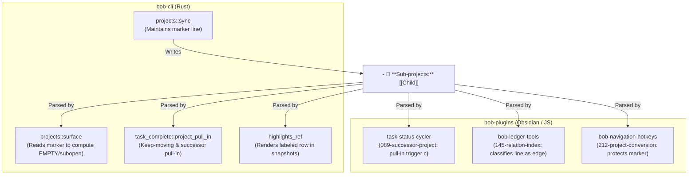

# Rendering Sub-projects in Dedicated H2 Sections: Architectural Design, Critique, and Catalog Specification

**Author:** Researcher gem (5-researcher swarm)  
**Date:** 2026-11-13  
**Target Repositories:** `bob-cli`, `bob-plugins`, Bob vault  
**Relevant Prior Decisions:** `decisions:notebook-routes-write-notes`, `decisions:projects-block-from-prj-line`, `decisions:subprojects-inherit-project-blocking`, `decisions:unblocked-tasks-are-offered`

---

## 1. Executive Summary

This research report investigates and develops the architectural design for transitioning sub-project rendering in Bob project notes from an inline sub-bullet under the `^prj` lifecycle task into a dedicated `## Sub-projects` H2 section featuring a machine-managed callout (`> [!subprojects]`).

### 1.1 The Core Motivation
In Bob's current architecture, a parent project lists its child sub-projects as an indented sub-bullet beneath its completion-criteria task:
```markdown
- [ ] #task #prj Ship the project outcome! #hide ^prj
  - 🧩 **Sub-projects:** 🗓️ [[alpha_child]] • [[beta_child]] • ~~[[gamma_child]]~~ ✅
```
While functional, this approach suffers from significant visual and architectural shortcomings:
1. **Conflation of Task vs. Entity:** The `^prj` task is an operational GTD task ("Ship the outcome!"). Sub-projects, by contrast, are full-fledged *project notes* containing their own tasks, notebooks, albums, and schedules. Subordinating major child projects to a single task checkbox misrepresents the vault's entity hierarchy.
2. **Visual Clutter & Text Wrapping:** As a project accumulates multiple sub-projects, dependencies (`⛓️ DEPENDS ON:`), blocks (`🧱 BLOCKS:`), and cancellation logs (`❌ CANCEL LOG`), the `^prj` task block becomes an impenetrable wall of text. Long lists of sub-projects wrap awkwardly across multiple lines inside a single list bullet.
3. **Information Starvation:** The sub-bullet format restricts display to bare wikilinks and emoji decorations (`🗓️`, `✅`, `❌`). It cannot present human titles, descriptive summaries, scheduled dates, or multi-level sub-sub-project hierarchies.
4. **Architectural Inconsistency:** Bob has already established a robust, beautiful, and declarative standard for vault catalogs: the `host_catalog` engine, used by `## Notebooks` (`> [!notebooks]`) and `## Albums` (`> [!albums]`). Sub-projects currently stand out as an ad-hoc, legacy exception.

### 1.2 Core Verdict & Recommendations
The proposal to elevate sub-projects into their own H2 section is **strongly endorsed**. It aligns project notes with Bob’s mature catalog architecture, dramatically improves readability, and creates a unified mental model across the vault.

However, based on an in-depth analysis of Bob's codebase and conventions, **we recommend two critical adjustments to the user's initial proposal**:
1. **Reject Physical Markdown H3 Headings in Favor of Callout-Internal Grouping:**  
   Generating literal Markdown `### Active` or `### Completed` headings in the note body violates Bob’s fundamental invariant that *the author owns the document outline, while Bob owns only the callout block*. Markdown H3s clutter Obsidian’s Document Outline / Table of Contents and cause heading churn when categories become empty. Instead, we should adopt the proven **Records Pattern** (`src/native/albums/index.rs`): use bold group header bullets *inside* the `> [!subprojects]` callout (e.g., `> - **Active** · 3`).
2. **Do Not Write Dynamic Task Counts to Disk:**  
   To prevent vault-wide write cascades whenever a leaf task is checked off, catalog entries must write only static note metadata (link, human title, summary, schedule). Dynamic metrics (such as "3 open tasks" or progress bars) must be rendered live by Obsidian client plugins, exactly as practiced in `## Notebooks` and `## Albums`.

---

## 2. Current State Analysis: The `^prj` Sub-bullet

### 2.1 Current Syntax and Lifecycle
In `bob-cli` (`src/native/projects/`), `bob projects sync` maintains the sub-project relationship based on scalar `parent: "[[Parent]]"` frontmatter links across project files:
- The sub-project marker line is nested directly under `^prj`:
  ```markdown
  - [ ] #task #prj Ship parent #hide ^prj
  \t- 🧩 **Sub-projects:** [[Alpha]] • [[Beta]]
  ```
- Formatting decorations:
  - Open sub-project: `[[child]]`
  - Future-scheduled sub-project: `🗓️ [[child]]`
  - Completed sub-project: `~~[[child]]~~ ✅`
  - Canceled sub-project: `~~[[child]]~~ ❌`
- Positioning: In `src/native/projects/edits.rs`, the marker line is inserted after `CANCEL LOG`, `DEPENDS ON:`, and `BLOCKS:` subtrees.

### 2.2 Readers and Ecosystem Dependencies
The `🧩 **Sub-projects:**` marker line is not merely decorative; it serves as a critical cache and synchronization anchor across both `bob-cli` and `bob-plugins`:



1. **`src/native/projects/surface.rs` (`project_surface`):**  
   Evaluates whether a project is `EMPTY` (eligible for unhiding `^prj` or offering it as a pull-in successor). Crucially, line 8 notes:
   > *"Sub-projects come from R's sync-maintained marker line instead of child notes' `parent:` frontmatter, which would need a vault-wide walk."*  
   Scanning the immediate marker line allows single-file evaluation in editor gestures without touching the global vault graph.
2. **`task-status-cycler` (`089-successor-project.js`):**  
   Reads `PROJECT_SUBPROJECTS_MARKER = "🧩 **Sub-projects:**"` when cycling task status to determine whether closing a task leaves the project empty, which triggers pull-in of the parent `^prj`.
3. **`bob-ledger-tools` (`145-relation-index-model.js`):**  
   Classifies `**Sub-projects:**` as a structural edge line so that wikilinks within it are not indexed as ordinary task-to-task mentions.
4. **`bob-navigation-hotkeys` (`212-project-conversion.js`):**  
   Recognizes the machine-owned line during task conversion and avoids converting or corrupting it.

Any design that relocates sub-projects must cleanly address these consumers without degrading editor gesture performance.

---

## 3. Context & Inspiration: How Notebooks and Records Work Today

Bob has already solved the problem of elegant, durable, and non-destructive entity cataloging through its **`host_catalog` engine** (`src/native/host_catalog/`).

### 3.1 The `host_catalog` Architecture
The core philosophy of `host_catalog` is strict separation of concerns between user-authored Markdown and machine-managed data:
- **User Ownership:** The author owns the document headings (`## Notebooks`, `## Albums`), their vertical ordering in the document, and all surrounding prose.
- **Machine Ownership:** Bob owns *only* the indented callout block:
  ```markdown
  ## Notebooks

  > [!notebooks]
  >
  > - **[[dev_tools|Developer tools]]** — Command-line tools and dotfile setup.
  >   - **[[git|Git]]** — Git commands, configuration, and workflow tips.
  ```
- **Byte-Span Precision:** All updates are executed as byte-range replacements over the original file buffer. File encodings, UTF-8 BOMs, and LF/CRLF line endings are perfectly preserved. Moving a callout section elsewhere in the note never marks it stale.
- **Self-Healing & Lifecycle:** If a catalog has no members, the callout is deleted; the H2 heading is also deleted *only* if its section is completely blank. Duplicate callouts are automatically collapsed to the first instance.

### 3.2 Notebooks (`NOTEBOOKS` Spec)
As defined in `docs/notebooks.md` and `src/native/notebooks/catalog.rs`:
- Placed immediately before the first `## Tasks` heading on first write.
- Emits hierarchical tree rows: notebooks nested under other notebooks indent cleanly with two spaces.
- Emits multi-tier rollup indicators: when an area or root project lists notebooks owned by child sub-projects, it groups them under `> - 🧩 [[subproject_stem]]`.
- Escape hygiene: All wikilinks, titles, and summaries escape active Markdown syntax (`[`, `]`, `|`, `#`, `^`).

### 3.3 Records and Albums (`ALBUMS` and `RECORDS` Specs)
As defined in `docs/records.md` and `src/native/albums/index.rs`:
- **Callout Head Tally:** The callout title carries a dynamic tally:
  `> [!records] 12 restaurants · 4 to try · 8 liked`
- **Internal Grouping (The Records Pattern):**  
  Records are grouped by status (or category) using bold bullet headings *inside* the callout:
  ```markdown
  > [!records] 12 restaurants · 4 to try · 8 liked
  >
  > - **🔖 To try** · 4
  >   - [[eat/luigi|Luigi's]] — Italian · Downtown
  > - **💚 Liked** · 8
  >   - [[eat/osteria|Osteria]] — Italian · Uptown
  ```
- **Facets:** Metadata fields (status, location, cuisine) are rendered as muted inline facets separated by ` · `.

---

## 4. Critique of the Proposal

### 4.1 Is Moving to an H2 Section a Good Idea?
**Yes, emphatically.**
- **Proper Hierarchy:** A project note is a container of tasks and notes; sub-projects are sibling containers. Rendering them in an H2 section gives them the visual and structural weight they deserve.
- **Unclutters the Task Block:** Removing the `Sub-projects:` sub-bullet from `^prj` restores `^prj` to what it was meant to be: a clean, single-line GTD completion criteria task with only immediate execution dependencies (`DEPENDS ON:`, `BLOCKS:`).
- **Scalability:** An H2 section can comfortably accommodate 20+ sub-projects with multi-level nesting and detailed summaries without breaking layout or readability.

### 4.2 Critique of Physical Markdown H3 Sub-sections
The prompt asks: *(with possible H3 sub-sections?)*.

We strongly advise **against** using literal Markdown H3 headings (`### Active`, `### Scheduled`, `### Completed`) for the following reasons:
1. **Pollution of the Document Outline:**  
   In Obsidian, all Markdown headings (H1–H6) appear in the Outline Pane and File Navigation outline. Generating H3 headings for sub-project statuses injects transient machine state into the user's permanent document outline.
2. **Violation of the `host_catalog` Region Boundary:**  
   `host_catalog` relies on a single contiguous callout block (`> [!spec] ...`). If Bob generates physical H3 headings in the document body, Bob now owns multiple sections of text interspersed across the file. If an author writes notes under `### Active`, what happens when those sub-projects finish? Does Bob delete the H3 heading and orphan the author's notes?
3. **Empty Section Churn:**  
   A project may have 0 completed sub-projects today, 1 tomorrow, and 0 next week if archived. Managing the lifecycle of multiple H3 headings creates fragile document surgery.

### 4.3 The Recommended Alternative: Callout-Internal Grouping
Instead of Markdown H3 headings, Bob should follow the **Records Pattern**:
- Keep a single H2 heading: `## Sub-projects`
- Place all grouped content inside `> [!subprojects]`
- Use callout list headers (`> - **Active** · 2`) when grouping is warranted (e.g., when there are multiple statuses or $>3$ entries).
- When a project has only 1 or 2 sub-projects, render them flat without group headers to avoid visual bureaucracy.

### 4.4 The Scope Question: What About Area Notes?
Currently, top-level projects hang under Area notes (`work.md`, `dev.md`), but Area notes have no generated project catalog—they only have `## Notebooks` and `## Albums`.

By building a general **Project Catalog Engine** based on `host_catalog`:
- **Project Notes** receive `## Sub-projects` with `> [!subprojects]` (listing child sub-projects).
- **Area Notes** can naturally receive `## Projects` with `> [!projects]` (listing top-level projects in that Area).

This elegantly completes the entire hierarchy of the vault:
```text
Area Note (dev.md)
  ├── ## Projects (> [!projects])
  │     └── Project Note (bob.md)
  │           ├── ## Sub-projects (> [!subprojects])
  │           │     └── Sub-project Note (bob_mac.md)
  │           ├── ## Notebooks (> [!notebooks])
  │           └── ## Tasks
  ├── ## Notebooks (> [!notebooks])
  └── ## Albums (> [!albums])
```

---

## 5. Architectural Design: The Sub-projects Catalog

### 5.1 Callout Syntax and Aesthetics

The generated section uses the `subprojects` callout kind. In Obsidian, this can be styled with custom CSS to display the iconic `🧩` puzzle piece icon and clean typography.

#### 5.1.1 Flat Layout (1–3 Sub-projects, uniform status)
```markdown
## Sub-projects

> [!subprojects] 2 sub-projects · 2 active
>
> - 🧩 **[[frontend_v2|Frontend Redesign]]** — Modern UI overhaul with design tokens.
> - 🧩 **[[api_v2|Backend API]]** — GraphQL server endpoints.
```

#### 5.1.2 Grouped Layout ($>3$ Sub-projects or mixed statuses)
```markdown
## Sub-projects

> [!subprojects] 5 sub-projects · 2 active · 1 scheduled · 2 closed
>
> - **Active** · 2
>   - 🧩 **[[frontend_v2|Frontend Redesign]]** — Modern UI overhaul with design tokens.
>     - 🧩 **[[mobile_ui|Mobile Responsive Views]]** — Mobile viewport fixes.
>   - 🧩 **[[api_v2|Backend API]]** — GraphQL server endpoints.
> - **Scheduled** · 1
>   - 🗓️ **[[analytics_pipe|Analytics Pipeline]]** [scheduled:: 2026-12-01] — Event stream ingestion.
> - **Completed** · 2
>   - ~~[[auth_migration|Auth Migration]]~~ ✅ — Completed [closed:: 2026-11-01]
>   - ~~[[legacy_db|Database Decommission]]~~ ❌
```

### 5.2 Row Formatting Rules
Each sub-project row adheres to strict layout rules:
1. **Status Icon:**
   - Active / WIP: `🧩`
   - Future Scheduled: `🗓️`
   - Done: `~~[[stem|Title]]~~ ✅`
   - Canceled: `~~[[stem|Title]]~~ ❌`
2. **Title Resolution:**  
   Uses `**[[stem|Display Title]]**`, where `Display Title` resolves to:
   - The first H1 in the sub-project note (with wikilinks reduced and formatting stripped), or
   - The first `aliases:` entry in YAML, or
   - `humanize_stem(stem)`.
3. **Summary:**  
   Appends ` — <summary>` if the sub-project note specifies a frontmatter `summary:` field (sanitized and escaped).
4. **Schedule Badge:**  
   If the sub-project has a valid future schedule on its `^prj` task, appends `[scheduled:: YYYY-MM-DD]` directly after the link.
5. **Hierarchical Nesting:**  
   Direct children of the host project sit at column-zero (or group indent). If a child project itself parents sub-sub-projects, those descendants are nested directly underneath with two spaces of indentation.
6. **No Dynamic Task Counts in Markdown:**  
   Per Bob’s vault-wide stability contract, open task counts (e.g. `3 open tasks`) are **never** written to Markdown bytes. They are injected live into the Obsidian DOM by `bob-plugins`.

---

## 6. Implementation Specification in `bob-cli`

### 6.1 Integration with `host_catalog` Engine
We define the `SUBPROJECTS` region specification in `src/native/host_catalog/region.rs`:

```rust
pub(crate) const SUBPROJECTS: RegionSpec<'static> = RegionSpec {
    callout: "subprojects",
    heading: "Sub-projects",
    head_title: None, // Dynamic tally supplied at render time
    placement: Placement::BeforeFirstTasks,
    legacy: None,
    strict_bare: true,
};
```

On first write:
- If `## Notebooks` or `## Albums` already exists, `Placement` places `## Sub-projects` *before* `## Notebooks` and before `## Tasks`, establishing the canonical order:
  1. `## Sub-projects`
  2. `## Notebooks`
  3. `## Albums`
  4. `## Tasks`
- On subsequent syncs, the author’s manual positioning of `## Sub-projects` is completely respected.

### 6.2 The Pure Catalog Planner
A new module, `src/native/projects/catalog.rs`, implements `plan_subproject_catalogs`:
1. Scans project notes and builds a `SubprojectGraph`.
2. Resolves parent-child links, display titles, summaries, and schedule states.
3. Groups sub-projects into Active, Scheduled, and Closed buckets.
4. Generates the canonical `[!subprojects]` callout lines.
5. Invokes `host_catalog::plan_host_region` to obtain atomic `FileEdit` byte replacements.

### 6.3 Fast Local Parsing in `surface.rs`
To preserve $O(1)$ editor gesture latency during task completion and status cycling, `project_surface` (`src/native/projects/surface.rs`) must determine `subopen` (whether open sub-projects remain) without walking the vault:
- **Primary Read Path:**  
  Inspects the staged note for `> [!subprojects]`. Parses the callout lines for open sub-project links:
  - Any line starting with `> - 🧩` or containing unstruck `[[stem]]` within the callout counts as open.
  - Matches the closing child's stem to discount it.
- **Fallback Read Path (Backward Compatibility):**  
  If no `[!subprojects]` callout exists, it falls back to parsing the legacy `- 🧩 **Sub-projects:**` line under `^prj`.

---

## 7. Migration and Backward Compatibility Strategy

To ensure zero downtime, no broken links, and full compatibility across existing notes and Obsidian plugins:

### Phase 1: Dual-Read Compatibility in Plugins and CLI
Before altering what `bob projects sync` writes:
1. Update `bob-plugins` (`task-status-cycler` and `bob-ledger-tools`):
   - Enhance the sub-project recognizer to check both the `^prj` sub-bullet and the `[!subprojects]` callout.
   - Update `bob-ledger-tools` relation indexer to ignore links inside `[!subprojects]` callouts.
2. Update `bob-cli` (`src/native/projects/surface.rs` and `highlights_ref`):
   - Support both callout and sub-bullet parsing.

### Phase 2: Transparent Migration via `bob projects sync`
When `bob projects sync` runs:
1. When generating the new `## Sub-projects` section for a project note:
   - It checks whether an old `\t- 🧩 **Sub-projects:** ...` sub-bullet exists under `^prj`.
   - If found, it removes the old sub-bullet and hoists all sub-project tracking into the new `## Sub-projects` callout.
2. The transformation is previewable via `bob projects sync --dry-run` and applies atomically under the vault maintenance lock.

### Phase 3: Deprecation and Cleanup
After all active projects are synced:
- Remove legacy sub-bullet insertion code from `src/native/projects/edits.rs`.
- Emit a lint warning (`subproject_legacy_marker`) if an old marker is detected in an untracked note.

---

## 8. Visual Comparison

### 8.1 Before (Current `^prj` Sub-bullet)
````markdown
# Backend Platform

- [ ] #task #prj Modernize platform services #hide ^prj
  - ⛓️ **DEPENDS ON:** [[infrastructure#^k8s-cluster]]
  - 🧱 **BLOCKS:** [[mobile_app#^api-cutover]]
  - 🧩 **Sub-projects:** 🗓️ [[analytics_pipeline]] • [[auth_service]] • [[api_gateway]] • ~~[[legacy_db_cleanup]]~~ ✅

## Tasks

- [ ] #task Set up monitoring alerts
````

### 8.2 After (Recommended `## Sub-projects` Catalog)
````markdown
# Backend Platform

- [ ] #task #prj Modernize platform services #hide ^prj
  - ⛓️ **DEPENDS ON:** [[infrastructure#^k8s-cluster]]
  - 🧱 **BLOCKS:** [[mobile_app#^api-cutover]]

## Sub-projects

> [!subprojects] 4 sub-projects · 2 active · 1 scheduled · 1 closed
>
> - **Active** · 2
>   - 🧩 **[[api_gateway|API Gateway v2]]** — GraphQL migration and endpoint routing.
>   - 🧩 **[[auth_service|Authentication Service]]** — OAuth2 & OIDC implementation.
> - **Scheduled** · 1
>   - 🗓️ **[[analytics_pipeline|Analytics Pipeline]]** [scheduled:: 2026-12-01] — Event telemetry stream.
> - **Completed** · 1
>   - ~~[[legacy_db_cleanup|Database Decommission]]~~ ✅ — Completed [closed:: 2026-11-01]

## Tasks

- [ ] #task Set up monitoring alerts
````

---

## 9. Summary of Recommendations & Next Steps

| Topic | Recommendation | Justification |
| :--- | :--- | :--- |
| **Section Structure** | Dedicated `## Sub-projects` H2 section | Separates entity hierarchy from GTD task execution; eliminates task block clutter. |
| **Callout Type** | `> [!subprojects]` | Leverages existing `host_catalog` engine; permits custom Obsidian icon styling (`🧩`). |
| **H3 Subsections** | **Reject physical H3s; use callout grouping** | Prevents Document Outline pollution; eliminates empty-section heading churn; respects `RegionSpec`. |
| **Metadata Display** | Display title, summary, schedule badge | Vastly superior readability compared to bare file stems. |
| **Task Counts** | **Do not write dynamic task counts to Markdown** | Prevents vault-wide write churn on every task completion; let Obsidian plugins render live counts. |
| **Placement** | Before `## Notebooks` / `## Tasks` | Places structural project breakdown at the top of the note while respecting author reordering. |
| **Area Notes** | Extend in future as `## Projects` (`[!projects]`) | Unifies project hierarchy across Area and Project notes. |

### Proposed Implementation Order
1. **Extend `host_catalog`:** Add `SUBPROJECTS` to `RegionSpec` in `src/native/host_catalog/region.rs`.
2. **Build Catalog Planner:** Implement `src/native/projects/catalog.rs` for sub-project graph resolution and callout generation.
3. **Update Sync & Surface:** Update `bob projects sync` to migrate legacy sub-bullets and update `surface.rs` to read from the callout.
4. **Update Plugins:** Update `task-status-cycler` and `bob-ledger-tools` in `bob-plugins` to recognize the new callout format.
5. **Deploy & Reconcile:** Run `bob projects sync` across the vault to cleanly hoist all sub-projects into their new H2 sections.
