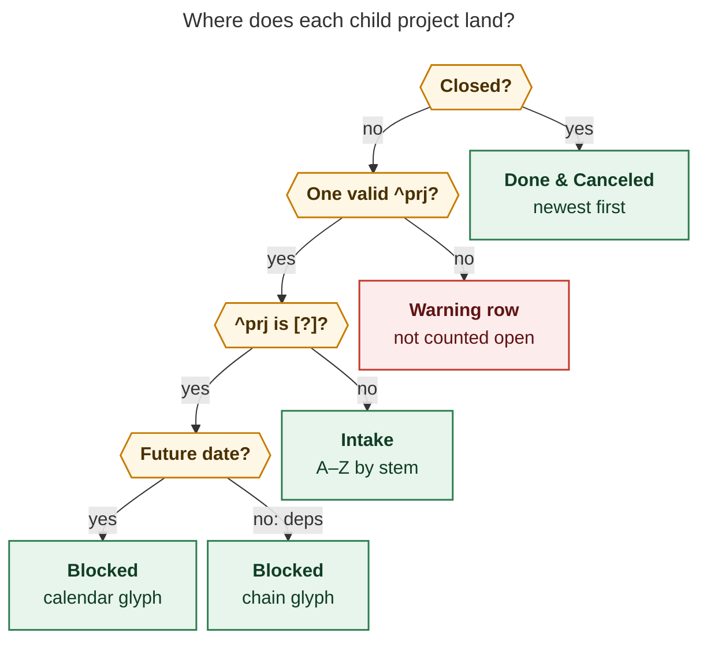

# Sub-projects as an H2 catalog: design research (cld)

**Question.** Should Bob stop writing sub-projects as the `🧩 **Sub-projects:**` child
bullet of a project's `^prj` task and write them in their own H2 section instead,
possibly with H3 sub-sections? If so, what design is intuitive, reliable, and beautiful?

**Short answer.** Yes, it's a good idea. I'd change three parts of the request:

1. Name the section `## Projects` and make it a third member of the existing host
   catalog family, after `## Notebooks` and `## Albums`. bob owns one `> [!projects]`
   callout. The heading, the block's position, and the rest of the note stay Bryan's.
2. **Don't write H3 headings.** The "sub-sections" become group rows inside the callout:
   🔴 **Blocked** and 🟢 **Done & Canceled**. They use the same titles as the `## Tasks`
   status groups, and the plugin folds them. The `[!records]` index on album notes
   already works this way.
3. Use the same rule for **area notes**, so `dev.md` and `job.md` list their projects
   too.

Each row gets the child project's `^prj` completion criterion as its description. Bob
Ledger Tools paints every number and date. The full recommendation is in
[§9](#9-recommended-solution).

![Mockup of the proposed Projects card on sase.md in Obsidian's dark theme. A
hue-tinted card under a Projects heading lists 16 of 22 open sub-projects as rows.
Each row has the bold stem, the muted completion criterion, and right-aligned chips
(task counts, a blue "today" dot, and an orange sub-project expander). Below the rows
are an expanded "Blocked · 1" group holding sase_post_blog, which waits on sase_blog,
and a folded "Done & Canceled · 38" group with a peek at the two most recent closures.
The existing Notebooks card follows in blue.](subproject_h2_sections__cld_assets/projects_card_mockup.png)

_Mockup (HTML in `subproject_h2_sections__cld_assets/`, rendered in headless Chrome). It
borrows the shipped notebook-card CSS tokens. Rows, criteria, task counts, the blocked
reason, and closure dates are real `sase.md` data from 2026-11-13. The "today" dots and
the notebook chips are illustrative._

---

## Contents

1. [What exists today](#1-what-exists-today)
2. [Is this a good idea?](#2-is-this-a-good-idea)
3. [Design space](#3-design-space)
4. [The H3 question](#4-the-h3-question)
5. [Proposed Markdown contract](#5-proposed-markdown-contract)
6. [The Obsidian card](#6-the-obsidian-card)
7. [Writers, readers, guards, migration](#7-writers-readers-guards-migration)
8. [Requirement adjustments (called out)](#8-requirement-adjustments-called-out)
9. [Recommended solution](#9-recommended-solution)
10. [Open questions](#10-open-questions)
11. [Appendix: evidence and method](#11-appendix-evidence-and-method)

---

## 1. What exists today

### 1.1 The Sub-projects line

`bob projects sync` writes one machine-owned child bullet under an active project's
open `^prj` task. It goes after the Depends-On and BLOCKS subtrees (`docs/projects.md`,
Sync Rules):

```markdown
- [ ] #task #prj Ship the project outcome! #hide ^prj
	- 🧩 **Sub-projects:** 🗓️ [[alpha]] • [[beta]] • ~~[[delta]]~~ ❌ • ~~[[gamma]]~~ ✅
```

- **Membership.** Membership is direct children: project notes whose scalar `parent:`
  resolves to this note. Open children come first, A–Z by stem. `🗓️` marks a child
  whose `^prj` has a future date.
- **Closed ledger.** Closed children use "preserve-and-mark" rules. sync marks a closed
  child only if the line already lists it. Deleting a closed entry by hand prunes it for
  good, so the line depends on its own earlier contents.
- **It also works as a cache.** Close gestures can't afford a vault walk, so they read
  this line to decide SUBOPEN(N), "does N still have open sub-projects?"
  (`docs/task-dependencies.md` §12.10 Terms). That decides whether closing N's last task
  surfaces or pulls in N's `^prj`. The line has two readers:
  - Rust: `src/native/projects/surface.rs` (`open_subprojects`, `subopen`).
  - The plugin cycler: `plugins/task-status-cycler/src/089-successor-project.js`
    (`projectMarkerHasOpenChild`). It also feeds the SO24 count line ("N sub-projects
    stay blocked…").
- **Other code that knows about the line.** Task-child classification
  (`task_children.rs` `ManagedLinkKind::SubProjects`), relation and mention exclusion
  (`task_relations/{format,mentions,parse}.rs`, plugin `145-relation-index-model.js`),
  link marks (plugin `148-task-link-marks.js`, `285-…-reading.js`), the Highlights note
  snapshot (`highlights_ref/note_snapshot/bob.rs` renders it as a labelled row), and
  reverse project conversion (plugin `212-project-conversion.js` skips it).
- **Cadence.** `bob projects sync` runs from cron on the Mac every 15 minutes (`:05`,
  `:20`, `:35`, `:50`). `bob nightly` on athena has no projects step.
- **Write path.** sync writes changed files with a plain `fs::write`
  (`src/native/projects/sync.rs:435`). It doesn't use the guarded staged writer that
  the catalogs use.

### 1.2 The precedents Bryan pointed at

| | `## Notebooks` catalog | `## Albums` catalog | `[!records]` index (album notes) | `## Tasks` status groups |
|---|---|---|---|---|
| Owned region | `> [!notebooks]` callout | `> [!albums]` callout | `> [!records]` callout | H3s owned "by title and shape" |
| Heading | Author's after first write | Author's | Author's | `Tasks` is author's; group H3s are bob's |
| Grouping | Nested notebooks; `🧩 [[project]]` group lines | `🧩 [[project]]` group lines | Bold group rows `**🔖 To try** · 11`, plugin-folded | `Next & In Progress`, `Blocked`, `Done & Canceled` |
| Numbers in Markdown | **None** ("hue, counts, and age are drawn by clients") | None | Tally and group counts | Badge row counts |
| First placement | Before first `## Tasks` | End of `## Notebooks`, else before Tasks | Before first `##` | n/a |
| Writer | `bob notebooks sync`, nightly, `%n` create | `bob albums sync`, nightly | `bob albums sync` | `bob task reconcile` |
| Engine | `host_catalog` region engine plus guarded txn | same | same | `task_status_groups` |

The shared `host_catalog` engine (`src/native/host_catalog/region.rs`) already supports
the needed pieces:

- one `RegionSpec` per callout;
- byte-span edits that keep BOM, CRLF, and every other byte;
- `missing`, `stale`, `current`, and `damaged` states;
- duplicate self-healing;
- a `BeforeFirstH2` placement.

A `PROJECTS` spec is a small addition to it.

### 1.3 The vault (read-only survey, 2026-11-13)

| Fact | Value |
|---|---|
| Project notes, by status | 100 (42 wip, 49 done, 8 canceled, 1 missing) |
| Project notes with any project child | 16. 15 of them carry a Sub-projects line today. |
| Area notes with a project child | 5 (`dev` 3, `job` 3, `gtd` 1, `mac_inbox` 1, `vacation` 1). None of them lists its projects anywhere. |
| Largest host | `sase.md`: 61 children, 23 open and 38 closed. Its line is **1,594 characters**, sits above the note's H1, and has 61 links. |
| Tree depth | Max 3 (`sase` → `sase_art` → `sase_art_links` → `sase_art_links_panel`) |
| Project notes with an H1 title | **4 of 100**. Stems are the names Bryan sees and types (`@sase_art`). |
| Closed children a vault-derived ledger would add | **1** (`sase_install` ← `sase_version`) |

So 79 project notes have no children and won't change at all. The pain is concentrated
in `sase.md`, where the line is a wall of text above the title.

---

## 2. Is this a good idea?

**Yes, for five reasons.**

1. **The line is in the wrong layer.** A `^prj` task's children are task metadata:
   Depends-On, BLOCKS, Cancel/Schedule/Work/Rotten logs. A list of child notes is
   note structure, like the notebooks and albums under a host. Notebooks and albums
   already moved to note-level H2 catalogs. Sub-projects are the odd one out.
2. **It doesn't scale.** One `•`-joined line can hold only names. With 61 entries you
   can't scan it, tell open from closed at a glance, or learn what any child is
   *for*. A row-per-child list fixes that, and a row has room for the child's
   completion criterion, which is the most useful single fact about a project.
3. **It goes wherever `^prj` goes.** Every view that shows `^prj` with its children
   drags the list along: transclusion, hover previews, Highlights snapshots, Dataview
   task renders.
4. **It removes special cases.** Six code paths in two repos treat this one line as a
   special child of one task. One more `host_catalog` region replaces that with an
   engine three features already use.
5. **It closes a gap for areas.** Today nothing lists the projects under `dev` or
   `job`. A catalog shape works the same on areas.

**What could go wrong:**

- **Footprint for tiny hosts.** A project with one closed child goes from 1 line to
  about 5 (heading, callout, group row, row). The plugin can collapse an all-closed card
  to one header line. Only 21 hosts are affected.
- **The SUBOPEN cache moves.** Both readers must switch to the new region before the
  writer removes the old line. Otherwise an old cycler sees "no open sub-projects" and
  pulls in a parent `^prj` too early. Fix: ship the readers first (§7.4).
- **Old binaries.** A pre-catalog `bob projects sync` run on any host would add the
  line back. The new sync removes it again, so this heals itself, but the hosts should
  be upgraded together.
- **Writes to area notes.** The 15-minute cron would start writing notes Bryan edits
  often in Obsidian. Catalog writes should use the guarded writer, which checks each
  file's preimage just before writing (§7.1). Writes only happen when a child's state
  or criterion changes.

**Would I take a different approach?** Mostly no. The core idea is right. What I'd
change is how it's done: a callout instead of H3s, no numbers in Markdown, a ledger
derived from the vault, and areas included. All of that follows from precedents Bob
already ships.

---

## 3. Design space

| | Option | Verdict |
|---|---|---|
| A | **Keep the line, polish it**: write only open children, let the plugin draw chips | Cheapest (≈ one day), and it shrinks `sase`'s line to 23 links. It's still a wall, still in the task layer, still drags along with `^prj`, and still has no room for criteria. **Fallback only.** |
| B | **Multi-line drawer under `^prj`** (`🧩 **SUB-PROJECTS**` with one nested row per child) | It's readable, but it stays in the wrong layer and makes the `^prj` subtree even heavier everywhere `^prj` appears. **Reject.** |
| C | **H2 with bob-owned H3 status groups** (a clone of `## Tasks`) | Native heading folds and heading links. But it adds a new ownership model (bob owns a whole H2 body), reuses the H3 titles that Tasks-grouping, capture, and snapshot code recognize, adds outline noise, and has no CSS hook. **Reject** (§4). |
| D | **H2 with one H3 per child** (with grandchildren under it, or `![[child#^prj]]` embeds) | `sase` would get 61 headings in its outline. Embeds would load 61 `^prj` subtrees. **Reject.** |
| E | **Live Dataview or Bases query** | No writer to maintain. But the notebooks decision already rejected this: "invisible to git, agents, and mobile". It also can't serve as the stored SUBOPEN cache that close gestures need. **Reject** (an optional `.base` can sit beside the catalog). |
| **F** | **H2 with a bob-owned `[!projects]` callout; group rows inside it use the Tasks group titles** | Reuses the `host_catalog` engine, the ownership contract, and the card visual family. Parses easily. Renders well with or without the plugin. **Recommend.** |

---

## 4. The H3 question

Bryan floated H3 sub-sections. I read that as one of two things: status groups like
`## Tasks` (C), or a heading per child (D). Both have real appeal. Obsidian folds
headings natively and remembers the fold per file, and status groups mirror a model
Bryan already uses every day. I still recommend against **bob-owned** H3s, for four
reasons:

- **Ownership gets blurry.** The catalog contract says "bob owns the callout; the
  heading, the position, and every other byte are the author's"
  (`docs/notebooks.md`). That's easy to explain and easy to check, because the region
  runs exactly as far as the `>` lines. Bob-owned H3s would mean bob owns a heading tree
  outside any region. The `## Tasks` precedent needed shape-ownership rules, legacy
  comment migrations, and a set of `ownership_collision`, `misplaced_badge_row`, and
  `renamed_marked_heading` warnings to make that safe (`docs/task-status-hooks.md`
  §Status Grouping). Rows inside a callout need none of that.
- **The title namespace is already taken.** `Blocked` and `Done & Canceled` are
  structural titles that capture section completion, the never-drawer list
  (`capture_drawers.rs::is_structural_h2_key`), task-move placement, and the Highlights
  snapshot all recognize. A second set under `## Projects` would mean another round of
  scoping fixes in each of those.
- **Outline noise.** Every host would gain up to three outline entries. The callout
  adds none.
- **No CSS hook.** `.callout[data-callout="projects"]` is a stable hook in both Reading
  view and Live Preview. The notebook research picked callouts for exactly this reason.
  Plain lists under H3s can't be styled as a card without fragile section detection.

**What H3 sub-sections were for, and how this design delivers it:** group rows inside
the callout with the same titles and the same emoji as the Tasks badge row (🔴 Blocked,
🟢 Done & Canceled). The plugin folds them, with Done & Canceled folded by default and
fold state kept in the pane's view state. That's the `[!records]` behaviour today. Bryan
can still write his own H3s under `## Projects`, outside the callout, for example a
"### Roadmap" paragraph. bob never touches them.

---

## 5. Proposed Markdown contract

### 5.1 Which notes, which children, where

- **Hosts.** Every project note of any status, and every area note, that has at least
  one child project. ⚠ *Including areas is an adjustment (A2).*
- **Children.** Project notes whose scalar `parent:` resolves to the host. Resolution
  follows the sub-project cascade rules: an exact vault path wins, otherwise only a
  unique case-insensitive basename resolves. List-form, ambiguous, unresolved, and self
  parents create no row.
- **Depth.** Direct children only. Each child row gets a **▸ N sub-projects** expander
  painted live by the plugin (§6). Markdown stays one level deep. ⚠ *Adjustment (A8).*
  - *Why not the notebooks rule ("whole subtree down to the next root")?* Nesting would
    rewrite every ancestor's catalog when a grandchild changes. It would also make root
    boundaries visible in a structural view: `sase_blog` is `root: true`, so its
    children would disappear from `sase.md`'s tree for a reporting reason. "A note lists
    its own children" is easier to predict.
- **First placement.** Use `BeforeFirstH2`: after the `^prj` subtree, any H1, and intro
  prose, before the first real `##`. The note then reads goal → parts → knowledge →
  work: `^prj`, **Projects**, Notebooks, Albums, Tasks. After the first write, the
  position belongs to Bryan, the same as the other catalogs.
- **Empty.** If a host has no children, delete the callout. Delete the `## Projects`
  heading too, but only if its section is then blank.

### 5.2 Row grammar

```markdown
## Projects

> [!projects]
>
> - **[[stem]]** — <criterion>
> - ⚠️ **[[stem]]** — no valid ^prj task
> - 🔴 **Blocked**
>   - 🗓️ **[[stem]]** — <criterion>
>   - ⛓️ **[[stem]]** — <criterion>
> - 🟢 **Done & Canceled**
>   - ✅ **[[stem]]** — <criterion>
>   - ❌ **[[stem]]** — <criterion>
```

- **Leading glyph means state.**
  - None: open and not blocked.
  - 🗓️: the child's `^prj` is `[?]` and has a future inline date.
  - ⛓️: the child's `^prj` is `[?]` because of its own or an inherited prerequisite.
  - ✅ / ❌: done / canceled.
  - ⚠️: a missing, malformed, or duplicate `^prj`.

  Readers key on the glyph, not the group, so a row's state is self-describing.
- **Groups.** Rows without a group are the intake. 🔴 **Blocked** and 🟢 **Done &
  Canceled** appear only when they hold a row, always in that order. This is exactly
  how `## Tasks` treats Ready versus its groups. A group row is recognized by its exact
  text and has no wikilink.
- **Link.** `**[[stem]]**`, with no alias. 96 of 100 project notes have no H1, and stems
  are the capture routes Bryan types, so the stem is the name he recognizes. The
  current line uses stems too. The plugin can show an H1 title as a tooltip when one
  exists.
- **Criterion.** This is the child's `^prj` description, run through these steps:
  1. Drop `#task`, `#prj`, and every other `#tag`.
  2. Drop inline fields (`[k:: v]`, `(k:: v)`), Tasks emoji date fields, the trailing
     `^prj`, and the Google Keep `[💡](…)` link.
  3. Reduce `[[x|y]]` to `y`, `[[x]]` to `x`, and `[t](url)` to `t`.
  4. Collapse whitespace.
  5. Backslash-escape any remaining Markdown openers (the notebook "inert text" rule),
     but let inline code spans through, since they can't link.
  6. Omit the criterion when it's empty or still the template placeholder.

  There's no length cap in Markdown; the card clamps rows to one line.
- **Order.**
  - Intake and Blocked: A–Z by stem, case-insensitive, with the path as a tie-break.
    Blocked rows are *not* ordered by date: priority rerolls move `^prj` dates, and
    sorting by them would rewrite the parent catalog on every reroll.
  - Done & Canceled: newest first by `[completion::]` / `[cancelled::]` (or the ✅/❌
    emoji date). Undated rows go last, A–Z. A closure date never changes once written.
- **No numbers and no dates.** This follows the notebook catalog and period-note rule
  ("no number is ever written into Markdown"). Tallies, task counts, schedule dates,
  and closure dates are all painted by the plugin, which keeps the catalog stable.
  Writes happen only on structural change: a child created, closed, reopened,
  reparented, blocked or unblocked, or its criterion edited.

### 5.3 How each child is routed



_Each direct child lands in one of four places, decided by its own lifecycle and by
reconcile's `[?]` on its `^prj`. "Closed" means terminal frontmatter status or a
closed `^prj`. The catalog **reads** reconcile's `[?]` and never re-derives it, so
`bob task reconcile` stays the single owner of Blocked state. Rendered with
mermaid-cli 12.0.0 at 750 × 934 px (87.1% PDF fit)._

### 5.4 Real output

Below is a prototype run over the live vault (read-only script; §11). It only
approximates the cleaning rules.

**`dev.md`** (area). Today this note lists no projects at all.

```markdown
## Projects

> [!projects]
>
> - **[[bob]]** — Finish MVP of `bob` and bob-plugins repo (no new commits for 30d)!
> - **[[dev_plex_hack_patch]]** — Plex hack patch and postmortem!
> - **[[sase]]** — sase has received >=1000 stars on GitHub!
```

**`bob.md`**. This replaces `🧩 **Sub-projects:** [[bob_better_type_descs]] • … • ~~[[bob_projects]]~~ ✅`:

```markdown
## Projects

> [!projects]
>
> - **[[bob_better_type_descs]]** — Better type descriptions!
> - **[[bob_easy_task_moves]]** — Make it way easier to move tasks anywhere!
> - **[[bob_git]]** — Migrate from Obsidian Sync to bobs-org/bob GitHub repo!
> - 🟢 **Done & Canceled**
>   - ✅ **[[bob_command_mode_improvements]]** — Command-mode improvements
>   - ✅ **[[bob_gtd]]** — Improve GTD morning review process!
>   - ✅ **[[bob_plugins]]** — Migrate bob Obsidian plugin to new bbugyi200/bob-plugins repo!
>   - ✅ **[[bob_projects]]** — Design and configure “projects” in Obsidian!
```

**`sase.md`** (excerpt). This replaces the 1,594-character line:

```markdown
## Projects

> [!projects]
>
> - **[[sase_agent_recovery]]** — Failed, killed, or interrupted agents, including after a machine restart, can be recovered in one action without losing work!
> - **[[sase_agents_repo]]** — Use `sase—agents` repos to sync sase agents across machines!
> - **[[sase_art]]** — Artifacts from Sidecars
>   … 19 more intake rows …
> - 🔴 **Blocked**
>   - ⛓️ **[[sase_post_blog]]** — Plan features to launch after sase_blog post!
> - 🟢 **Done & Canceled**
>   - ❌ **[[sase_back_policy]]** — Develop architecture policy that auto-deprecates and removes backward compatibility code!
>   - ✅ **[[sase_agent_history]]** — Migrate agent artifacts tab to "Agents" tab!
>   - ❌ **[[sase_message_boards]]** — Sase message boards!
>   … 35 more, newest first …
```

The prototype also found that `sase_post_blog` is Blocked: its `^prj` depends on
`[[sase_blog#^prj]]`. Today's line can't show that; it only knows about 🗓️ dates.

---

## 6. The Obsidian card

Bob Ledger Tools decorates the callout the same way it decorates `[!notebooks]` and
`[!albums]`. The three catalogs at the top of a host note should look like one family.

- **Card.** Use the root-ancestry hue, including mute, with the notebook card's tint,
  border, and radius tokens. The header shows the 🧩 (lucide `puzzle`) icon and hides
  the redundant callout title, as the notebook card does. On the right is a tally in
  the Tasks badge colours: `○ 22 open · ● 1 blocked · ● 38 done/canceled`.
- **Row.** A state mark (a hue ring for open, 🗓️/⛓️ for Blocked, ✓/✕ for closed), then
  the bold stem, then the muted criterion clamped to one line (the full text shows on
  hover and focus). Right-aligned chips, all live and none written:
  - **`N tasks`** comes from bob's report, not from the `open_task_count` frontmatter
    that Bob Project Tasks maintains. That frontmatter doesn't count Blocked tasks:
    `sase_post_blog` shows `open_task_count: 0` while bob counts 20 open.
  - **`● today`** appears when any resident has a live Task Link under today's open
    Pomodoros. Ledger Tools already knows today's ledger.
  - **`empty`** appears when the child's `^prj` is surfaced (no `#hide`). That's the
    existing "this project needs replenishing" signal, now visible from the parent.
  - **Blocked reason**: `Dec 8 · in 3w` for 🗓️ rows, `waits on sase_blog` for ⛓️ rows.
  - **`▸ N sub-projects`** expands that child's own children inline, read-only and
    view-state only. This is how depth shows without nesting the Markdown.
- **Groups.** 🔴 Blocked starts expanded and 🟢 Done & Canceled starts folded. A
  folded Done group peeks at its two most recent closures. Folds use the `[!records]`
  group-fold code and live in pane view state, never in the file. Space and Enter
  toggle; groups have `aria-expanded`.
- **All-closed hosts** (for example `bob_projects`) collapse to the header line.
- **Affordances.** `↻ sync` appears when bob's report calls the catalog missing or
  stale; it runs `bob projects sync`. **＋ project** copies the `@host^` project-capture
  starter, like the album card's **＋ noun**. Painting never writes the note.
- **Without the plugin** (mobile before data loads, Source mode, git diffs, the
  Highlights PDF), the Markdown still reads well. Glyphs carry state, group rows carry
  structure, and criteria say what each project is for. The Highlights snapshot should
  render the callout and omit the Done & Canceled group by default, matching how
  snapshots already omit closed tasks.
- **Verification.** Follow the album-card e2e pattern: light and dark screenshots at
  ~375 px and desktop widths, fold persistence across a refresh, and byte preservation.

---

## 7. Writers, readers, guards, migration

### 7.1 Writers

| Writer | Today | Proposed |
|---|---|---|
| `bob projects sync` (Mac cron, every 15 min, plus manual runs) | Rewrites the line with `fs::write` | Plans every host through `host_catalog::plan_host` with a new `PROJECTS` `RegionSpec`, installs through the shared guarded staged writer (preimage checks, rollback), and deletes any legacy `🧩 **Sub-projects:**` children of `^prj` in the same edit |
| `bob nightly` (athena) | — | **New `projects` step** after `albums`, lock-held like the others, so catalogs heal even when the Mac sleeps ⚠ *(A9)* |
| Capture `@route^id@` / `@route:id@` | "`bob projects sync` later adds the note" | Writes the parent's row in the same all-or-nothing batch, like `%n` notebook creation ⚠ *(A10)* |
| Plugin "Create project note from task" | Leaves it to sync | Unchanged. The card shows `↻ sync` until the next run. Optionally, the command runs `bob projects sync` afterwards on desktop. |

`#hide` management on `^prj` is unchanged. sync still decides it from the scanned
children, not from the catalog.

### 7.2 Readers (the SUBOPEN cache)

The new rule for both the Rust and plugin readers:

> SUBOPEN(N) holds when N's `[!projects]` region lists a row whose leading glyph is
> none, 🗓️, or ⛓️.

- ✅, ❌, and ⚠️ rows don't count.
- Trigger (c)'s `closed_child` override still matches by lowercased stem.
- Staleness behaves exactly as today. Sync rewrites at most every 15 minutes, and both
  stale outcomes stay benign (§12.10).
- During the transition, a reader that finds no region falls back to the legacy line.
- The legacy recognizers in `task_children`, relations, link marks, and project
  conversion stay **permanently**. That way old backups and unsynced machines keep
  parsing safely. `task_status_groups` keeps its legacy comment recognizers for the
  same reason.

### 7.3 Guards and teaching

- **Explicit section targets.** `@host#projects` refuses with
  `projects_section_generated` and the hint "capture into one of its projects".
  `capture/sections.rs` already has two near-identical functions for Notebooks and
  Albums. Fold them into one function driven by the `RegionSpec` list instead of adding
  a third copy.
- **Pre-existing bug, verified.** The `^prj` drawer selector doesn't exclude generated
  catalog headings. `is_structural_h2_key` covers Tasks, the status groups,
  Pomodoros, Events, and Highlights, but not Notebooks or Albums. In a scratch vault,
  `bob capture "drawer note text @proj+prj#notebooks"` committed
  `- drawer note text` directly under the `[!notebooks]` callout. Add Notebooks,
  Albums, and Projects to the never-drawer set. ⚠ *(A11)*
- **Other placements.** Section completion, `capture-sections`, task-move and merge
  section targets, and `@route#` placement all skip `## Projects`.
- **Docs to update.** `docs/notebooks.md` says "`bob projects sync` never lists a
  notebook on a Sub-projects line". That becomes "never lists a notebook in a
  `[!projects]` catalog".

### 7.4 Rollout: readers before writers

1. **Readers.** In bob-cli and bob-plugins, teach SUBOPEN and the SO24 count to read
   the region, with the legacy fallback. Update the Highlights snapshot. Release, then
   run `bob plugins sync`. The vault doesn't change.
2. **Writer.** Add the `PROJECTS` spec, the planner (§5), guarded install, legacy-line
   removal, capture creation, the nightly step, the guards, and
   `bob projects list -f/--format human|json`. That last report carries `projects[]`
   (state, blocked reason, schedule, closed date, criterion, children, open and shown
   counts) and `catalogs[]` states. Then:
   1. Run `bob projects sync -d` on the vault and review the roughly 21 host diffs.
   2. Upgrade all three hosts together. The Mac cron host is the one that matters most.
   3. Let the first real sync write the catalogs.
3. **Card.** Add the Ledger Tools `[!projects]` decoration (§6), reusing the
   notebook-card DOM helpers and the `[!records]` fold code.
4. **Cleanup.** Remove the old line *writer* code. Keep the recognizers.

Docs:

- Rewrite the Sync Rules in `docs/projects.md`.
- Update `docs/task-dependencies.md`: the §12.10 SUBOPEN Terms, the managed-line table
  row, and MC7, which drops the writer while the recognizer stays.
- Update the glossary entries for Project Task and Project Note Capture, and the
  capture docs.
- Add a new `decisions` record, for example "Sub-projects live in a host `[!projects]`
  catalog". It cites this research and should list the rejected options: the line,
  bob-owned H3s, per-child H3s, live queries, and nesting.

---

## 8. Requirement adjustments (called out)

| # | Adjustment | Why |
|---|---|---|
| **A1** | Heading **`## Projects`** with callout `[!projects]`, not `## Sub-projects` | It matches the `## Notebooks` and `## Albums` siblings, which also name the child type, not the relationship, and it reads correctly on area notes. Bryan can rename it; recognition keys on the callout. |
| **A2** | **Area notes get the catalog too** | 5 areas own projects and list them nowhere. The `dev` card would show `bob`, `sase`, and `dev_plex_hack_patch`. It's the same contract and only a few more hosts. Easy to drop if unwanted. |
| **A3** | **No bob-owned H3s.** "Sub-sections" are group rows inside the callout (🔴 Blocked, 🟢 Done & Canceled), folded by the plugin. | §4: a clean ownership boundary, no clash with existing H3 titles, no outline noise, a CSS hook, and an existing precedent in `[!records]`. |
| **A4** | **The closed ledger is derived from the vault.** It no longer preserves whatever the line already listed. | The catalog becomes a pure function of the vault, like Tasks grouping ("nothing is remembered between runs"). It adds one row to the vault today. Folding replaces hand-pruning. |
| **A5** | **Rows carry the child's `^prj` criterion** | Says what each project is *for*. The text is already authored, so there's no new `summary:` key to keep in sync. |
| **A6** | **New Blocked group**, read from reconcile's `[?]` on the child's `^prj` | Today only future dates (🗓️) are visible. Prerequisite and inherited blocks were invisible. |
| **A7** | **No numbers or dates in Markdown** | The notebook and period-note rule. It keeps writes structural and avoids churn from rerolls, the date boundary, and counts. |
| **A8** | **Direct children only** in Markdown, with a live ▸ expander for depth | Keeps the write fan-out to one parent per change. Predictable. Avoids root-boundary surprises. |
| **A9** | **`bob nightly` gains a projects step** | Today catalogs depend only on the Mac's cron. |
| **A10** | **Project-creating capture writes the parent row at birth** | The `%n` precedent. No 15-minute gap after `@sase^x@`. |
| **A11** | **Fix the `^prj` drawer guard** for every generated catalog heading | A verified pre-existing gap that the new heading would also hit. |

---

## 9. Recommended solution

**Replace the `🧩 **Sub-projects:**` `^prj` child with a third host catalog: a
`## Projects` heading over a bob-owned `> [!projects]` callout.**

1. **Contract** (§5).
   - Hosts: every project of any status, and every area, that has project children.
   - Rows: direct children only, as `**[[stem]]** — <^prj criterion>`, plus a leading
     state glyph.
   - Order: the intake A–Z, then 🔴 **Blocked** (🗓️ or ⛓️) A–Z, then 🟢 **Done &
     Canceled** (✅ or ❌) newest first.
   - Placement: before the first H2 on the first write; Bryan's after that.
   - No numbers and no dates in the file.
   - Reuse `host_catalog` (`RegionSpec PROJECTS`, `BeforeFirstH2`) and the guarded
     writer.
2. **Writers.** `bob projects sync` (cron), a new `bob nightly` step, and capture
   project creation in-batch. Legacy lines are removed on the first write.
3. **Readers.** SUBOPEN and SO24 read the region's open rows, with the same staleness
   semantics. Legacy recognizers stay forever.
4. **Card.** A Ledger Tools card in the catalog family:
   - a hue and a tally;
   - row chips for task counts (from bob's report), today, empty, the blocked reason,
     and the ▸ expander;
   - Blocked expanded and Done folded;
   - `↻ sync` and **＋ project** affordances.
5. **Guards.** Generated-heading refusals for `@host#projects`, and the never-drawer
   fix for Projects, Notebooks, and Albums.
6. **Rollout.** Readers first, then the writer, then the card, then cleanup. Review
   `bob projects sync -d` before the first real run.

**Phases and sizes.**

| Phase | Work | Size |
|---|---|---|
| 0 | Never-drawer fix for generated catalog headings | S |
| 1 | Dual-format readers: Rust surface, plugin cycler, snapshot | S–M |
| 2 | Catalog writer, nightly step, capture birth row, guards, `bob projects list -f json`, docs, decision record | L |
| 3 | Ledger Tools `[!projects]` card plus e2e screenshots | M–L |
| 4 | Remove the legacy writer | S |

If Bryan wants a one-day stopgap first, option **A** (write only open children on the
line) cuts `sase`'s line from 61 links to 23. It isn't worth shipping on its own merits
if the catalog is coming.

---

## 10. Open questions

1. **Areas (A2).** Should `dev`, `job`, `gtd`, `vacation`, and `mac_inbox` get a Projects
   card? I recommend yes. `mac_inbox` owning a project is probably a triage leftover the
   card would surface.
2. **Closed history (A4).** Keep every closed child, folded? Or cap it, say the 10 most
   recent plus "and N more"? A cap would put a number back into Markdown. I recommend
   keeping all of them, folded.
3. **Name (A1).** `## Projects` or `## Sub-projects` as the default heading? I
   recommend `Projects`. Either way, it's Bryan's to rename after the first write.
4. **Order.** Projects above Notebooks (goal → parts → knowledge → work), or just
   before Tasks like Notebooks? I recommend above.
5. **Terminal hosts.** Should closed projects keep a maintained catalog? I recommend
   yes, matching notebooks ("a project of any status"). Writes would be rare.

---

## 11. Appendix: evidence and method

- **Code read (bob-cli).**
  - Sub-projects writing and reading: `src/native/projects/{mod,sync,edits,scan,surface}.rs`.
  - Catalog engine: `src/native/host_catalog/{mod,region,txn}.rs`.
  - Capture guards: `src/native/capture/sections.rs` (the generated-section refusals)
    and `src/native/capture_drawers.rs` (`is_structural_h2_key`).
  - Status groups: `src/native/task_status_groups/mod.rs`.
  - Snapshot: `src/native/highlights_ref/note_snapshot/bob.rs`.
  - Nightly: `src/native/nightly.rs`, which has no projects step.
- **Code read (bob-plugins).**
  - `plugins/task-status-cycler/src/089-successor-project.js`.
  - `plugins/bob-ledger-tools/src/{145,148,285,241c,241p,241s}-*.js` and `styles.css`
    (notebook-card tokens).
  - `plugins/bob-navigation-hotkeys/src/212-project-conversion.js`.
  - `docs/albums.md` and `docs/notebook-gestures.md`.
- **Docs read.** `docs/projects.md`, `docs/notebooks.md`, `docs/records.md`,
  `docs/task-status-hooks.md` (Status Grouping), `docs/task-dependencies.md` (§12.10,
  the managed-line table), and `docs/periods.md` (the "no number in Markdown" rule).
- **Memory read.** Glossary entries for Project Note, Project Task, Leaf/Top-Level
  Project, Notebook, Record Note, Album Note, Area Note, Root Parent, and Project Note
  Capture. Decisions `projects-block-from-prj-line`,
  `subprojects-inherit-project-blocking`, and `notebook-routes-write-notes`. Prior
  research `research:202611/bob_notebooks/bob_notebooks.md`, read for the catalog
  rationale ("no numbers in Markdown", callout as the only stable CSS hook).
- **Schedule.** `cronctl list`: `bob-projects-sync` runs on the Mac at
  `5,20,35,50 * * * *`; `bob-nightly` runs on athena.
- **Vault survey.** A read-only Python pass over the root-level notes in `~/bob`
  produced the numbers in §1.3 and the derived-ledger diff, and rendered the prototype
  catalogs in §5.4.
- **Drawer-gap reproduction.** In a throwaway git vault under `/tmp`: an area, a
  project with `## Notebooks` and a `[!notebooks]` callout, and a notebook child. With
  `BOB_DIR` pointed at it,
  `bob capture "drawer note text @proj+prj#notebooks"` reported
  `under … ^prj · Notebooks` and appended the bullet on the line right after the
  callout.
- **Figures.**
  - The routing figure was rendered with `@mermaid-js/mermaid-cli@12.0.0` under the
    PDF-mirroring config: 749.8 × 934 px, 87.1% fit, checked visually.
  - A second figure (writers and readers) failed the 75% fit floor at 37.6%. The table
    in §7.1 replaces it.
  - The card mockup is hand-written HTML/CSS, rendered with the puppeteer Chrome that
    mermaid-cli installs, and inspected visually. Its source sits beside the PNG.
