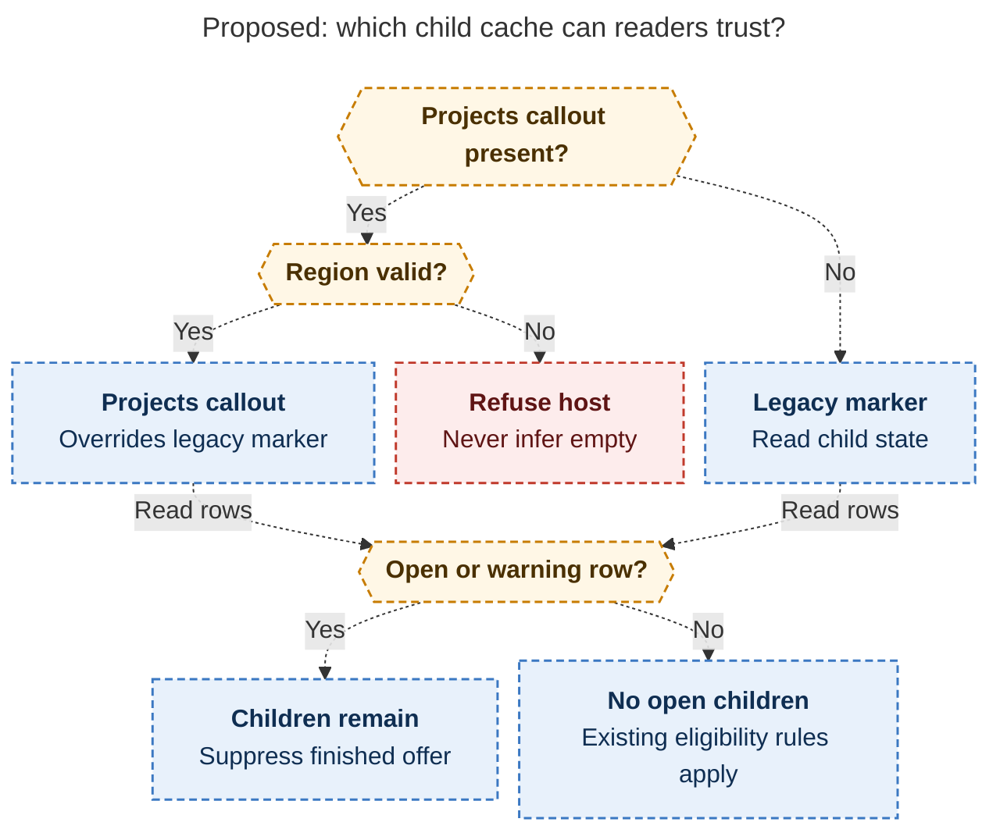
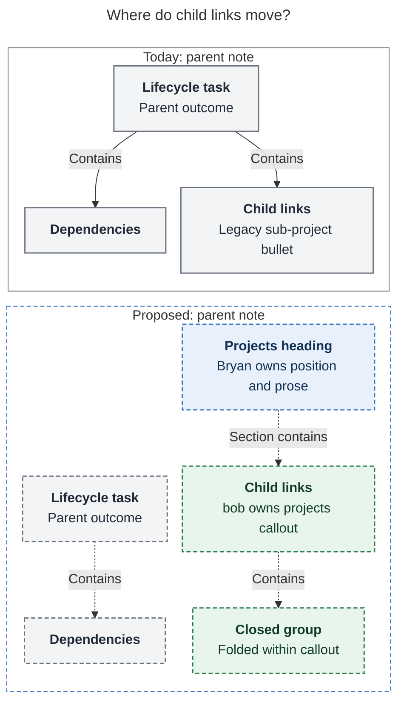

# Diagram proposals: Sub-projects as a host catalog section — consolidated design

Proposals for the swarm linker, not a report. Each diagram restates only what the source
report says.

```yaml
source: research:202611/subprojects_catalog_section/subprojects_catalog_section__final.md
producer: research.4j.image
check: "mmdc 12.0.0 via pinned npx, with Puppeteer --no-sandbox and the PDF-mirroring config, rendered 2 of 2 Mermaid diagrams; SVG/PNG reviewed; broken-input check exited nonzero"
```

## cache-selection

```yaml
anchor: |-
  region has an unstruck wikilink row; else fall back to the legacy marker; if both
question: |-
  Which local source can determine whether a parent still has open child projects?
illustrates: |-
  Proposed SUBOPEN readers prefer the catalog over the legacy marker, keep warning rows open, and never let a damaged region imply an empty child set.
caption: Proposed readers prefer the catalog, fall back when absent, and never treat damage or warning rows as proof of completion.
review: "627.072x1008 px, fit 88.6%; question, source trace and visual checks passed; alternative paths converge; 0 revisions"
```



## task-to-catalog

```yaml
anchor: |-
  A clean lifecycle task again: criterion, dependencies, logs.
question: |-
  What moves out of the parent lifecycle task, and what stays?
illustrates: |-
  The proposed host catalog moves direct child links out of the lifecycle task into a bob-owned callout beneath a Bryan-owned heading while dependencies stay with the task.
caption: Child links move to a bob-owned callout; dependencies stay under the lifecycle task, and Bryan owns the heading.
review: "474.875x944 px, fit 94.6%; question, source trace and visual checks passed; arrows mean containment; 1 revision to stack the comparison"
```


