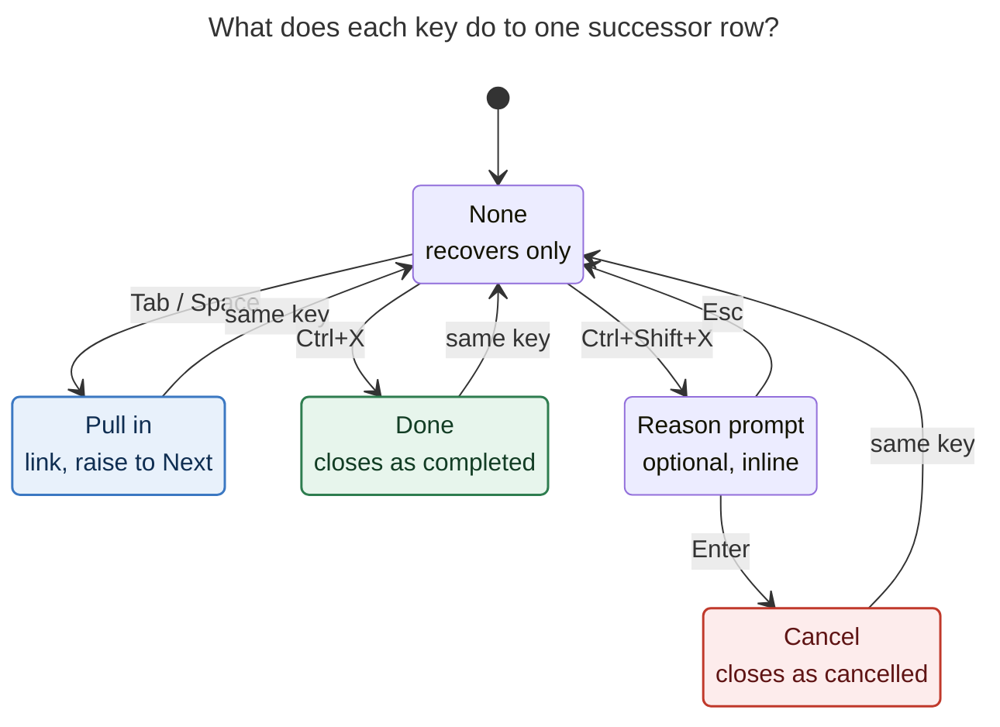

# Close and cancel tasks from successor cards

**Request.** Let Bryan close (Done) or cancel a task directly from a successor card,
both in Obsidian (the nav successor picker) and in Bob Mac Capture (the Pull-In card).
He suggested `Ctrl+X` to close and `Ctrl+Shift+X` to cancel, and asked for a design
that is intuitive, reliable, and beautiful.

**Short answer.** It is a good idea, and the suggested chords are the right ones. They
need four adjustments to fit Bob's existing contracts:

1. **Stage verdicts and apply them on Enter.** Nothing is written on the keypress.
2. **Cancel opens an optional, inline reason.** The vault shows Bryan types a reason
   almost every time a Cancel Log exists.
3. **Closing from the card never cascades offers.** Dependents of a closed row still
   recover and come back tomorrow as ticklers, and the receipt says so.
4. **bob decides which rows can be closed** and reports it, so the two clients never
   decide it themselves.

The CLI gets a matching pair: `-x/--complete-offer` and `-X/--cancel-offer`.

---

## 1. What exists today

### 1.1 The successor contract

From `docs/task-dependencies.md` §12 and `decisions:unblocked-tasks-are-offered`:

- **One offer set per gesture.** A managed Done gesture produces one offer set. So do
  promotion, `@route:id@`, parking with relation successors, and a lone `@route`
  note pull. Groups are `hand_off`, `relation`, `project`, `project_finished`,
  `keep_moving`, and `note_pull`.
- **Offers are opt-in.** Nothing is preselected. Only picked rows are linked, raised to
  Next, given a block ID, and stamped fresh.
- **Recovery is automatic.** Blocked dependents become Ready, and `[unblocked:: today]`
  is written under the WRITE rule, whether or not anything is picked.
- **Unpicked rows are not the same everywhere.**
  - A recovered `hand_off` or `project` row becomes **TICKLER in tomorrow's `]s` walk**.
  - A `keep_moving`, `relation`, or `note_pull` row was already Ready or Next. It gets
    no stamp, so it returns only when its freshness interval expires (ROTTEN, 7 days by
    default) or not at all.
  - So the cost of *not* closing an obsolete successor varies by group. It is a review
    touch either tomorrow or about a week out.
- **Cancel never offers.** Cancel, reopen, reconcile, and `x*` parks never open a picker.

### 1.2 Obsidian surfaces

**The picker.** `SuccessorOfferPickerModal` lives in
`bob-plugins/plugins/bob-navigation-hotkeys/src/206-successor-picker-modal.js` and is
exposed as `api.successors` v3.

| Key | Today |
| --- | --- |
| `Tab` / `Shift+Tab` | Toggle the mark and move down / move up |
| `Ctrl+A` | Mark every row in the highlighted group |
| `Enter` | Pull in the marked rows, or the highlighted row when none are marked |
| `Ctrl+Shift+Enter` | Retarget through block-id-prompt's Pomodoro picker |
| `Esc` | None |
| Footer | `pull in N` plus the `plan a/b → c/b` meter |

- **The Enter guard.** It deliberately ignores `Enter` that carries Ctrl, Alt, or Shift,
  that repeats, or that arrives within **350 ms of opening**. The picker opens *from* a
  `Ctrl+Enter` close, so a habitual double press must never act inside it.
- **The result shape.** It is only `{picks: [{key, destination?}]}`, and zero picks
  normalize to `null`.

**The cycler.** `planAndApplySuccessorsNow` lives in
`task-status-cycler/src/137-plugin-successor-project.js`.

- It plans with no selection, awaits one `pick(model)`, re-reads fresh text, re-plans
  with the picks, and applies.
- The predecessor's close is already written, and it is never rolled back if linking
  fails.
- A cancelled close (`closeKind === "cancelled"`) never asks for a picker.

**Writers we can reuse:**

- **Cycler API v4:** `completeTaskLineText`, `finalizeClosedTasks`, and
  `recoverBlockedDependents`.
- **Nav cancel writer:** `planTaskCancelBatch` in `240-cancel-and-lanes.js`. The Task
  Card's cancel uses it, and so do relation cancels (`596-relation-cancel-compose.js`)
  and decay. Post-cancel effects (link prune, dependent recovery) are in
  `551-post-cancel-effects.js`.
- **Precedent for closing a *different* task at commit time:** nav's relation
  complete/cancel compose (`597-relation-complete-compose.js`) already closes another
  task and then calls the cycler's `finalizeClosedTasks`.

### 1.3 The Mac Pull-In card

The card lives in `bob-mac-capture/Sources/BobMacCapture/CapturePullInChoice*.swift`
and is routed by `CaptureKeyCommandRouter`.

| Key | Today |
| --- | --- |
| `Space` | Mark the highlighted row (only when the filter is unfocused or empty) |
| `⌘A` | Mark all |
| `↩` | Pull in the marked rows, or the highlighted row when none are marked |
| `⇧↩` | Skip pull-ins and commit |
| `⌃↩` | Confirm and open the reported notes |
| `Esc` / `⌃[` | Back to the unchanged draft |
| `⌃N` / `⌃P` | Move the highlight |

- **Submission.** The whole draft goes out as one `bob capture … --pull-in KEYS`, under
  the thin-client rule (`decisions:mac-capture-is-a-thin-client`).
- **The primary button** is disabled when the pick count is 0.

### 1.4 The bob CLI

`src/native/capture/cli.rs` has:

- **`-p/--pull-in`:** `all | none | N,KEY,…`.
- **`--require-pull-in-choice`:** an internal flag used by the Mac.
- **Precedent for per-row answers:** `-i/--inbox-route <N|KEY>=<NOTE>`, which splits on
  the first `=`, and `-m/--move-in`.

Short letters `x` and `X` are free on `bob capture`.

Close engines already exist in Rust:

- **Done:** the `!note:id` close in `task_complete`, which closes the tree, retires
  links, recovers dependents, and offers successors.
- **Cancel:** the relation cancel writer in `capture/relations_close.rs`, which cancels
  "as Task Card Cancel would".

### 1.5 How keys and glyphs are already used

| Glyph or key | Meaning in Bob today |
| --- | --- |
| `[x]`, capture `x`, `x!N`, `=x` | Done / close |
| `⊘` (date-marks `cancelled`, relation `⊘ cancels`) | Cancelled; deliberately not `×` |
| `✓` (relation `✓ completes`) | Completes |
| Task Card `x` | Opens the cancel-**reason** stage; "the key alone never cancels" |
| Bob Refs `Ctrl-X` (Mac) | Closes the selected Highlights tab |
| Obsidian `Ctrl+Enter` | Close the task under the cursor. This is the gesture that *opens* the successor picker |
| Mac `⌃↩` (Pull-In card) | Confirm and open notes |

### 1.6 What the vault says

This was a read-only grep of `~/bob` on 2026-11-05:

- **Since 2026-10-01** there are **1,094** completions (`[x] … [completion:: 2026-10|11-…]`)
  and **227** cancellations (`[-] … [cancelled:: 2026-10|11-…]`).
- **98 tasks keep a `❌ CANCEL LOG`.** For **96 of them**, the newest entry is a
  sentence Bryan typed (median about 33 characters). Only 2 are machine-written: one
  📥 merge and one Google decline.
- **Typical reasons:** "We were able to fix this a different way." · "We already do
  something like this." · "Duplicate" · "Use the ref task instead" · "Research said not
  to do this." · "Obsolete by task relations".

Two inferences follow, both labelled as inference:

- **Obsolescence is common, and it is noticed when nearby work lands.** Several of the
  reasons are exactly "the predecessor solved it differently" judgments. That is what a
  successor card shows at the right moment.
- **When Bob asks for a reason, Bryan writes one.** Roughly 4 in 10 cancels since
  Oct 1 carry a log, and the rest come mostly from paths that never ask, such as
  `Alt+[` cycling, Tasks clicks, and relation cancels. A cancel verdict that skipped
  the reason would quietly lose the history Bryan already writes.

Limit: successors are computed and never stored, so no cancel can be traced back to a
successor card. I could not measure how often successor cards open.

---

## 2. Critique: is this a good idea?

**Yes, and it is better than it first looks.** Four reasons:

- **The card is the moment of maximum context.** The task that just closed is the
  evidence for whether each successor still matters. Tomorrow's tickler review
  reconstructs that context from scratch; the card has it now.
- **It cuts review load without new automation.** Every obsolete `hand_off` or
  `project` row is otherwise one guaranteed TICKLER touch tomorrow. Every obsolete
  `keep_moving`, `relation`, or `note_pull` row costs a ROTTEN touch, or a decay card,
  later.
- **It turns two cards into small project-review surfaces.** The note-pull card
  (`@route`) and the keep-moving card are already "here are this project's ready tasks"
  lists. Closing stale tasks while browsing them is high-value triage, not just
  successor hygiene.
- **The project-finished row is the killer case.** A `project_finished` offer is the
  `^prj` of a project the gesture just emptied. Today the card can only *link* it.
  `Ctrl+X` on it simply finishes the project, which is almost always the intent.

**Risks to design for:**

| Risk | Why it matters | Mitigation in the design below |
| --- | --- | --- |
| Accidental close in a fast modal | Closing has side effects: dependents recover, links are pruned, ^prj status changes | Staged verdicts, explicit row styling, a two-step `Esc` with pending closes, and the existing `Ctrl+Enter` guard untouched |
| Cascades | Closing a successor unblocks *its* dependents. Strictly, that is another managed Done | No cascade offers in v1. Recovery still runs and the receipt reports it (§4.4) |
| Four-surface contract cost | Rust, cycler, nav, and Mac must agree (the cost already named in the offers decision) | One shared row-eligibility field from the engine, one result shape, and shared conformance vectors |
| More keys to learn | The card already has five keys | Two chords, both shown in the footer and taught by a consequence line. They mirror `-x` / `-X` on the CLI |
| Writing reasons slows triage | Cancel without a reason loses history; with a reason it costs one Enter | Optional reason; blank Enter is allowed. Done never asks |

**Would I take a different approach?** I considered these alternatives:

| Alternative | Verdict |
| --- | --- |
| **Write immediately on keypress** (row disappears, task closes now) | **Reject.** It breaks "one gesture, one write set" (§12.4). The Mac cannot do it, because the draft is one `bob capture` call. Esc could no longer mean "nothing happened". |
| **Open the Task Card for the highlighted row** (full power: cancel with reason, schedule, priority) | **Reject for v1.** It nests a modal while the cycler awaits `pick()`, which raises staleness risk, and the Mac has no Task Card. "Schedule it later" is a fair future verdict (§7). |
| **Buttons on the post-commit receipt** ("close" / "cancel" per unblocked row) | **Reject.** The offers decision already rejected "choose after commit". Receipts are transient and mouse-first. |
| **Mac-only: rewrite the draft with extra `!note:id` items** | **Reject.** Capture has no cancel grammar; hash-keyed rows have no block ID for `!`; and it leaks UI choices into the draft text. Useful precedent though: capture already drops an offer when a later item completes the task (§12.2 DEDUP). |
| **Rely on the morning walk** | Complementary, not a substitute. It pays a review touch per obsolete row and loses the context. |
| **A general "row verdict" vocabulary across every Bob task picker** | **Right long-term direction, wrong v1 scope.** Design the verdict model so the Move card, `:` picker, and others can adopt `Ctrl+X` / `Ctrl+Shift+X` later. |

---

## 3. Adjusted requirements (each is a deliberate change from the request)

| # | Adjustment | Why |
| --- | --- | --- |
| **A1** | **Verdicts are staged, not executed.** `Ctrl+X` and `Ctrl+Shift+X` set a per-row verdict. `Enter` applies every verdict in the gesture's existing single write pass. | Keeps §12.4's "one gesture, one write set". On the Mac it is mandatory (one `bob capture`). It lets `Esc` stay a true "nothing", and a row's style shows what will happen before it does. |
| **A2** | **Cancel asks for an optional reason, inline.** Blank Enter cancels with no reason (the existing Cancel Log rule). | 96 of 98 Cancel Logs hold an authored reason. The Task Card's `x` already never cancels on the key alone. |
| **A3** | **No cascading offers from rows closed in the card (v1).** Their dependents still recover, get `[unblocked:: today]`, and come back tomorrow as ticklers. The receipt names them. | One round per gesture stays true on all four surfaces. A multi-round card is a protocol change for the Mac (§7). **This narrows `decisions:unblocked-tasks-are-offered` for this one path and needs a new decision record.** |
| **A4** | **bob decides which rows are closable and reports it per row** (`close: {done, cancel, why}`). Not closable: tasks this same capture creates, recurring tasks (closed through Tasks), muted still-blocked rows, and any row the engine cannot revalidate. | Thin-client rule. The precedents are `relation_cancels_new_task` and the recurring refusals. |
| **A5** | **The chords are `Ctrl+X` (done) and `Ctrl+Shift+X` (cancel) on both surfaces, and never `Ctrl+Enter`.** On the Mac they are `⌃X` / `⌃⇧X`, not Command. The CLI mirrors them as `-x/--complete-offer` and `-X/--cancel-offer`. | `Ctrl+Enter` opens the picker (double-press hazard), and on the Mac `⌃↩` already means confirm-and-open. `[x]` / capture `x` / Refs `Ctrl-X` all read as "close". `⌘X` stays Cut. |
| **A6** | **`Enter` applies all verdicts.** The "pull in the highlighted row" fallback only fires when the card holds no verdict at all. `⇧↩` (Mac) skips *pull-ins* but still applies closes. | Otherwise `Enter` after two `Ctrl+X`s would also link whatever row the cursor rests on. |
| **A7** | **`Esc` needs a second press when close verdicts are pending.** | A habitual Esc should not discard deliberate decisions. Unmarking pull-ins stays one press, as today. |
| **A8** | **Reopening the predecessor never reopens rows closed from its card.** | Those closes were independent judgments. The existing reopen receipt keeps taking back only picked links. |
| **A9** | **The walk never lands on a row closed in the same commit.** When the gesture began on a `]s` landing, rows closed in the card are removed from the advance plan. | Reliability. Today's advance is planned from the pre-write queue. |
| **A10** | **Scope includes every offer group**: `hand_off`, `project`, `project_finished` (^prj), `keep_moving`, `relation`, and `note_pull`. It also covers promotion and `@route:id@` cards where the row already exists. | The note-pull and keep-moving cards are where stale tasks are most visible. |

---

## 4. Design

### 4.1 Interaction model

Each offer row holds **exactly one verdict**: none, pull in, done, or cancel.



*Figure 1. Every row has one verdict.*

- The same key toggles a verdict off.
- A different verdict key replaces the current verdict. For example, `Ctrl+X` on a
  marked row turns pull-in into done.
- `Esc` inside the reason prompt leaves the row exactly as it was.
- `Enter` on the card applies every verdict at once.

**Keys (additive to today's):**

| | Obsidian picker | Mac Pull-In card |
| --- | --- | --- |
| Done | `Ctrl+X`: toggle done on the highlighted row, then move to the next closable row | `⌃X`: same |
| Cancel | `Ctrl+Shift+X`: open the reason field under the highlighted row. `Enter` confirms (blank allowed) and moves on; `Esc` aborts | `⌃⇧X`: same |
| Pull in | `Tab` (unchanged: toggle and move) | `Space` (unchanged: toggle in place) |
| Apply | `Enter`: apply all verdicts; with no verdicts, pull in the highlighted row (today) | `↩`: same. `⇧↩` applies closes and skips pull-ins. `⌃↩` applies and opens notes |
| Back out | `Esc`: none. With pending ✓/⊘, the first press shows "Esc again to discard 2 closes" | `Esc`: back to the draft, with the same two-step rule |

**Rules that keep it predictable:**

- **Verdict keys act on the highlighted row only, never on the marked set.** A verdict
  is a judgment about one task. Batch-closing by mark is how accidents happen, and
  relation commits already need a "↵ again to confirm" for ≥2 closes. Per-row chords
  need no confirmation, because each close was its own keypress.
- **Moving after a verdict.** `Ctrl+X` and confirming a cancel reason move the highlight
  to the next *closable or selectable* row, the same reasoning as the walk's
  answer-advance. On the Mac, `Space` keeps toggling in place.
- **A row that cannot be closed** answers a verdict chord with a soft shake (Obsidian)
  or a beep (Mac). Its details line shows bob's `why` (`recurring · close in Tasks`,
  `created by this capture`).
- **Filter text is safe.** In Obsidian, if the filter input has a text *selection*,
  `Ctrl+X` performs Cut (on Linux). Otherwise the card owns the chord, just as it
  already owns `Ctrl+A`. On the Mac, `⌘X` (Cut) is untouched.
- **The existing guards stay.** The 350 ms Enter guard and the "ignore modified Enter"
  rule are unchanged; `Ctrl+X` is not the opening chord, so it needs no guard.

### 4.2 Visual design

The goal is that **a glance at the card tells you what Enter will do.** Each verdict
gets its own glyph in the mark slot, row treatment, and colour, all reused from Bob's
existing vocabulary (date-marks ✓ / ⊘, the Mac `checkboxSymbolColor`).

| Verdict | Mark slot | Title | Details line | Accent |
| --- | --- | --- | --- | --- |
| none | `□` hollow | normal | `note · lane · → DEST` | — |
| pull in | `☑` filled accent (today) | normal | `note · lane · → DEST` (destination capsule turns green on Mac, as today) | Next blue |
| done | ✓ in a filled circle (Lucide `circle-check`; SF `checkmark.circle.fill`) | 55 % opacity, thin line-through | `✓ done today` + consequence (below) | done green (`checkboxSymbolColor("x")`) |
| cancel | ⊘ (Lucide `circle-slash`; SF `circle.slash`) | 45 % opacity, line-through | `⊘ cancel · “reason”` or `⊘ cancel · no reason` | muted red, matching relation-cancel tint |

- **Destination capsules disappear** on closed rows, since nothing will be linked. The
  plan-budget meter counts pull-ins only.
- **Consequence line.** The engine pre-computes it per row, following the precedent of
  the Task Card's Type-stage consequence lines. It shows only on the highlighted row
  when a verdict is set:
  - `✓ done · unblocks “Ship parser v2” · back tomorrow as a tickler`
  - `✓ finishes ‹parser-rewrite› · project status done at next sync` (a
    `project_finished` ^prj)
  - `⊘ cancel · ‹parser-rewrite› has no other open tasks` (when cancelling would empty
    a project)
- **Motion.** A 150 ms strike-through and fade (`.snappy(0.18)` on the Mac, matching
  `CapturePullInCheckbox`), disabled under Reduce Motion.
- **Footer summary.** Coloured segments that read like a sentence:
  `pull in 2 · ✓ 1 done · ⊘ 1 cancel` plus `plan 5/8 → 7/8`. Zero segments are
  omitted.
- **Primary action label.**
  - Mac button: `Pull in 2`, `Close 2`, or `Pull in 2 · Close 2`. "Close" counts done
    plus cancel, as in capture's existing `Capture & close N tasks`.
  - Obsidian hint: `↵ pull in` becomes `↵ apply` once any close verdict exists.
  - The Mac button is no longer disabled when only closes are pending.
- **Footer hints (Obsidian).** `Tab mark · Ctrl+X done · Ctrl+Shift+X cancel · ↵ pull
  in · Esc none`. Hints only appear when the model carries close eligibility.
- **Accessibility.**
  - Obsidian rows add `aria-label` suffixes ("will be completed", "will be cancelled:
    reason").
  - On the Mac, VoiceOver reads the verdict, and the status announcement reads "Marked
    done: Write fixture README".
  - Colour is never the only signal (glyph plus strike plus words).

Mock (Obsidian; `~~…~~` stands for the struck, faded title; highlighted row is `Port gkeep tests`):

```text
╭─ ⎇ Choose successor tasks ────────────────────────────────────────╮
│ Fix flaky gkeep test · 4 offers                                   │
│ ▏Filter tasks, notes, and groups                                  │
│                                                                   │
│ HAND-OFFS                                                         │
│ ☑  Re-enable gkeep sync in CI                                     │
│    sase · Ready · → CAPTURE                                       │
│ ✓  ~~Write gkeep fixture README~~                                 │
│    sase · Ready · ✓ done today                                    │
│ ⊘  ~~Add retry wrapper around gkeep client~~                      │
│    sase · Ready · ⊘ cancel · “Fixed it a different way”           │
│ □  Port gkeep tests to nextest                          ◀         │
│    sase · Ready · → CAPTURE                                       │
│                                                                   │
│ pull in 1 · ✓ 1 done · ⊘ 1 cancel              plan 5/8 → 6/8     │
│ Tab mark · Ctrl+X done · Ctrl+Shift+X cancel · ↵ apply · Esc none │
╰───────────────────────────────────────────────────────────────────╯
```

The reason prompt (after `Ctrl+Shift+X` on the "Add retry wrapper" row) replaces that
row's details line in place. Nothing pops over the card:

```text
│ ⊘  Add retry wrapper around gkeep client                          │
│    ⊘ Why cancel? ▏Fixed it a different way          ↵ · Esc keep  │
```

### 4.3 What each verdict writes

| | Done (`Ctrl+X`, `-x`) | Cancel (`Ctrl+Shift+X`, `-X`) |
| --- | --- | --- |
| Engine | The existing complete engine: Rust `!note:id` path / cycler `completeTaskLineText` + `finalizeClosedTasks` | The existing cancel writer: Rust relation-cancel / nav `planTaskCancelBatch` + post-cancel effects |
| Task line | `[x]` + `  [completion:: today]`; embedded subtasks close as with `!` (blocked or recurring descendants stay open and are reported) | `[-]` + `[cancelled:: today]` |
| Log | none | Cancel Log first child: `*YYYY-MM-DD* — <reason>`. A blank reason writes no log unless one exists (then `🤷 no reason given`). These are the existing rules, unchanged |
| Today's ledger | Live links are retired as `!` does. Offered rows rarely have one | Live links are pruned as Task Card cancel does |
| Dependents | Recover (Blocked → Ready, `[unblocked::]`), **not offered** (A3) | Recover, not offered (cancel never offers anyway) |
| Projects | Closing a `^prj` lets `bob projects sync` map status. Emptying a project removes `#hide` as today | Same |
| Inbox tasks | No route card; closed tasks need no destination | Same |
| Freshness / keeps | Not stamped; closing ends review | Same |

**Order inside the one write pass:**

1. Picks (today's re-plan and apply).
2. Done verdicts.
3. Cancel verdicts.
4. One combined receipt.

The rows are disjoint by construction, so the order only matters for the shared daily
note, where picks insert and closes prune.

**Failure model:**

- **Obsidian** keeps today's rule that a predecessor close is never rolled back. Each
  close verdict is preimage-checked against the line text the card saw. A changed row
  is refused alone, with a warning chip `1 not closed · changed since the card opened`,
  while the rest applies.
- **Capture** stays all-or-nothing, as every capture is. A stale note aborts the batch,
  and the Mac reopens the card with bob's error.

### 4.4 Cascades (A3) in detail

Closing row D can unblock D's own dependents. In v1:

- Recovery runs, exactly as for any close. The engine knows the result, so the receipt
  lists those tasks. For example: `also unblocked “Ship parser v2” · back tomorrow as a
  tickler`.
- No second picker and no new offer rows. In JSON they report
  `not_linked: "closed_from_offer"` in a new `cascade_unblocked[]` array.
- If closes empty a project, the receipt says `‹parser-rewrite› has no open tasks · its
  ^prj comes up in PROJECTS review`. No `project_finished` offer is made.

**Why not cascade now?** In Obsidian a second round is easy, because
`finalizeClosedTasks` would open another picker naturally. In capture it is a
multi-round protocol: `--require-pull-in-choice` would have to describe second-round
offers that depend on first-round answers. Shipping it on one surface would break the
"one offer and key contract" cost that the offers decision accepted. Revisit it as one
feature on both surfaces (§7).

### 4.5 Contracts

**bob-cli: `bob capture`.** Two new options are added, alphabetical among the existing
ones:

```text
  -X, --cancel-offer <N|KEY>[=REASON]   Cancel a successor offer instead of pulling it in;
                                        REASON goes to its Cancel Log. Repeatable.
  -x, --complete-offer <N|KEY>          Mark a successor offer Done instead of pulling it
                                        in. Repeatable; accepts a comma list.
```

- `-X` splits on the first `=`, exactly as `-i/--inbox-route` does. A reason may contain
  commas, so `-X` takes one row per flag.
- A verdict flag counts as a choice for `--require-pull-in-choice`. Rows that are not
  mentioned stay unpicked.
- **New teaching refusals.** Each writes nothing and lists the current offers with their
  closability:
  - `offer_verdict_conflict`: the same row is in `--pull-in` and in a close flag, or in
    both close flags.
  - `offer_not_closable`: bob's `why`, for example `created by this capture` or
    `recurring`.
  - Unknown or stale number or key: the existing pull-in error.
- **JSON (additive; no `schema_version`, as with capture today):**
  - Each offer row gets
    `close: {"complete": bool, "cancel": bool, "why"?: str, "unblocks"?: int, "finishes_project"?: str}`.
  - The top level gets `pull_in.close: {"supported": true}`, which the Mac uses to
    feature-detect.
  - Results get `offer_closes[]`:
    `{n, key, outcome: "done"|"cancelled", reason?, note_path, block_id, text, previous_status, cascade_unblocked[]}`.
- **Human output:**

  ```text
  ✓ done offer 2 “Write gkeep fixture README” · Ready → Done
  ⊘ cancelled offer 3 “Add retry wrapper around gkeep client” · Ready → Cancelled · “Fixed it a different way”
    ↳ also unblocked “Ship parser v2” · back tomorrow as a tickler
  ```

  Dry runs say `would close` and `would cancel`. The dry-run hint grows to
  `-p 1,2 · -p all · -x 3 · -X 4=reason`.

**bob-plugins: nav.**

- `api.successors` goes to **v4**.
  - **Model rows** gain `close?: {done, cancel, why?, unblocks?, finishesProject?}`.
  - **The result** becomes
    `{picks: [{key, destination?}], closes: [{key, outcome: "done"|"cancelled", reason?}]}`.
  - A result with zero picks and at least one close is **not** `null`. `null` still
    means none.
  - v1–v3 models render as today, without verdict hints.
- A new **`api.cancel` v1**: `cancelTasks([{notePath, line, preimage}], {reason, origin: "successor_card"})`.
  It wraps `planTaskCancelBatch` and the post-cancel effects, so the cycler can apply
  cancel verdicts without copying the Cancel Log writer.
- `api.notice` goes to **v4**: optional `offer_closes` rows (✓ / ⊘ with the reason),
  plus `cascade_unblocked`.

**bob-plugins: cycler.**

- Attach `close` eligibility only when nav's `api.successors.version >= 4`, so it never
  hands an older nav fields it would ignore.
- After the picker, apply picks first (today's path). Then apply done verdicts through
  its own completer with `finalizeClosedTasks(…, {offers: "recover_only"})`, and cancel
  verdicts through nav `api.cancel`.
- Exclude closed keys from the review-walk advance (A9) and from the reopen receipt
  (A8).

**bob-mac-capture.**

- Decode `close` and `pull_in.close` with `decodeIfPresent`. With an older bob, there
  are no hints and the chords beep.
- Add `.toggleOfferDone` and `.beginOfferCancel` router commands, plus a reason-field
  focus state. The field joins the same pattern as `pullInFilterFocused`.
- Submit `--pull-in … -x … -X KEY=REASON`, always passing keys (never numbers) for
  stability.
- Notification copy: `🔓 Pulled in 2 · ✓ 1 done · ⊘ 1 cancelled`.

### 4.6 Copy

| Surface | Text |
| --- | --- |
| Footer hint | `Ctrl+X done` · `Ctrl+Shift+X cancel` (Mac `⌃X done · ⌃⇧X cancel`) |
| Row details, done | `✓ done today` |
| Row details, cancel | `⊘ cancel · “Fixed it a different way”` / `⊘ cancel · no reason` |
| Reason placeholder | `Why cancel? (optional)` |
| Not closable | `recurring · close in Tasks` · `created by this capture` · `blocked · resolve its prerequisites first` |
| Pending Esc | `Esc again to discard 2 closes` |
| Receipt title (Obsidian) | `Pulled in 2 · closed 2` (or `Closed 2` with no picks) |
| Receipt rows | `✓ Done “…”` · `⊘ Cancelled “…” — reason` · `↳ also unblocked “…” · back tomorrow` |
| Stale row | `1 not closed · changed since the card opened` |

### 4.7 Undo and recovery

- **Obsidian.** The receipt notice gets an **Undo closes** action while it is visible,
  modelled on the existing *Undo merge* notice. It restores the pre-images of closed
  rows (and of dependents the pass recovered) only while each line is still exactly
  what the pass wrote.
  - After the notice, `Alt+]` / `Alt+[` reopens a task as usual. The receipt rows are
    links, so one click reaches the task.
  - Blocked is derived, so reopening a closed prerequisite re-blocks its dependents at
    the next hooks run anyway.
- **Mac and CLI.** No take-back, the same as `!` today. The notification names every
  closed task, and Return-to-notes (`⌃↩`) opens them.
- **Not undo.** Reopening the predecessor (A8).

### 4.8 Edge cases

- **The row changed between plan and commit**: the Obsidian row is refused and the rest
  proceed; capture aborts the batch (§4.3).
- **The row was linked or closed meanwhile**: refused with `already linked` /
  `already Done` per row, the same as stale picks today.
- **Cancelling a `^prj` with open residents** cannot happen from an offer row. A
  `project_finished` ^prj has none by definition, and `project` group headers are not
  rows.
- **Keep-moving card after closing every row**: the receipt carries the "no open tasks
  left" line (§4.4).
- **A walk-landed gesture** (the predecessor was a `]s` landing): the advance skips rows
  closed in this commit (A9). The picker's walk hold already covers the wait.
- **The relation-only card** (parked `x*` or `@route+id!`) gets the verdict keys too.
  Parking is the moment you often realize the "starts after" follower is moot.
- **Note-pull drafts on the Mac**: `⇧↩` still returns unchanged when there are no close
  verdicts. With closes, it applies them and skips pull-ins (A6).

---

## 5. Rollout

1. **Decision record and docs first.**
   - Write the new record, *Successor cards close with staged verdicts; card closes
     never cascade offers*. It narrows `unblocked-tasks-are-offered` for card closes
     and cites this report.
   - Add a new `docs/task-dependencies.md` §12.x "Closing offers" with **SC vectors**
     shared by Rust and JS: eligibility, exact done and cancel bytes with and without a
     reason and with an existing log, no cascade offers, the walk exclusion, the
     conflict refusals, and preimage refusals.
2. **bob-cli.** Ship `-x` / `-X`, the per-row `close` eligibility, `offer_closes[]`,
   human output, and help and `capture-complete` completion wiring. All of it is
   additive, so it can ride the normal release train.
3. **bob-plugins.** Ship nav `api.successors` v4, `api.cancel` v1, `api.notice` v4, the
   picker UI, and the cycler wiring. Then run `bob plugins sync`.
4. **bob-mac-capture.** Ship decoding, the card UI and router, and the reason field.
   Gate on the exact-SHA macOS CI run.
5. **Memory and glossary.** Update the `glossary:successor-offer` strand to mention
   card closes, through `/sase_memory_write`, after the decision lands.

---

## 6. Open questions for Bryan

1. **Cascades.** Is "back tomorrow as a tickler" acceptable for a closed successor's
   own dependents, or do you want a second card in the same gesture? I recommend
   tickler for v1.
2. **Cancel reason.** Should it always open (recommended, one extra `Enter` when
   blank), or should the reason be on demand (`Ctrl+Shift+X` cancels silently, a later
   key adds a reason)?
3. **Muted still-blocked rows.** Allow **cancel** on them? It is legitimate ("this
   whole branch is moot"), but it widens the card's meaning. I recommend not doing it
   in v1.
4. **Undo closes on the Obsidian receipt.** Include it in v1 (recommended, since the
   receipt machinery exists), or rely on `Alt+]`?

## 7. Later, if wanted

- **A cascade round** on both surfaces: one card per round, with the Mac using a
  `pull_in.round` protocol.
- **A third verdict, "later"** (`Ctrl+L`: schedule for N days), which would also avoid
  tomorrow's tickler. The verdict enum is designed to grow.
- **The same `Ctrl+X` / `Ctrl+Shift+X` vocabulary in other task pickers**: the Move
  card, the `:` picker, and the Mac task pickers.

---

## 8. Recommendation

Build it, with the requested chords, as **staged per-row verdicts inside the existing
successor pass**:

- **The keys.** `Ctrl+X` marks a row **Done**. `Ctrl+Shift+X` marks it **Cancelled**
  after an optional inline reason. `Tab` / `Space` still marks pull-ins.
- **Applying.** `Enter` applies every verdict in the gesture's single write pass:
  picks, then dones, then cancels, then one receipt. `Esc` with pending closes asks
  twice.
- **Reuse, not new writers.** Done uses the existing complete engine, and cancel uses
  the existing Task Card cancel writer with its Cancel Log. Closed rows recover their
  dependents but never cascade new offers in v1, and the receipt says where those tasks
  went.
- **One contract.** bob reports which rows are closable. Obsidian (nav
  `api.successors` v4 plus a new `api.cancel` v1) and the Mac (decoding `close`,
  submitting `-x` / `-X`) only present and submit. The CLI mirrors the chords as
  `-x/--complete-offer` and `-X/--cancel-offer KEY=REASON`.
- **The look.** Each verdict reads at a glance: ✓ green with a strike, ⊘ muted red with
  a strike and its reason. A one-line consequence states what closing will unblock or
  finish, and the footer reads like a sentence: `pull in 1 · ✓ 1 done · ⊘ 1 cancel`.

The most valuable single case to demo first is the **Project finished** row: one
`Ctrl+X` and the emptied project is closed in the same gesture that finished its last
task.
