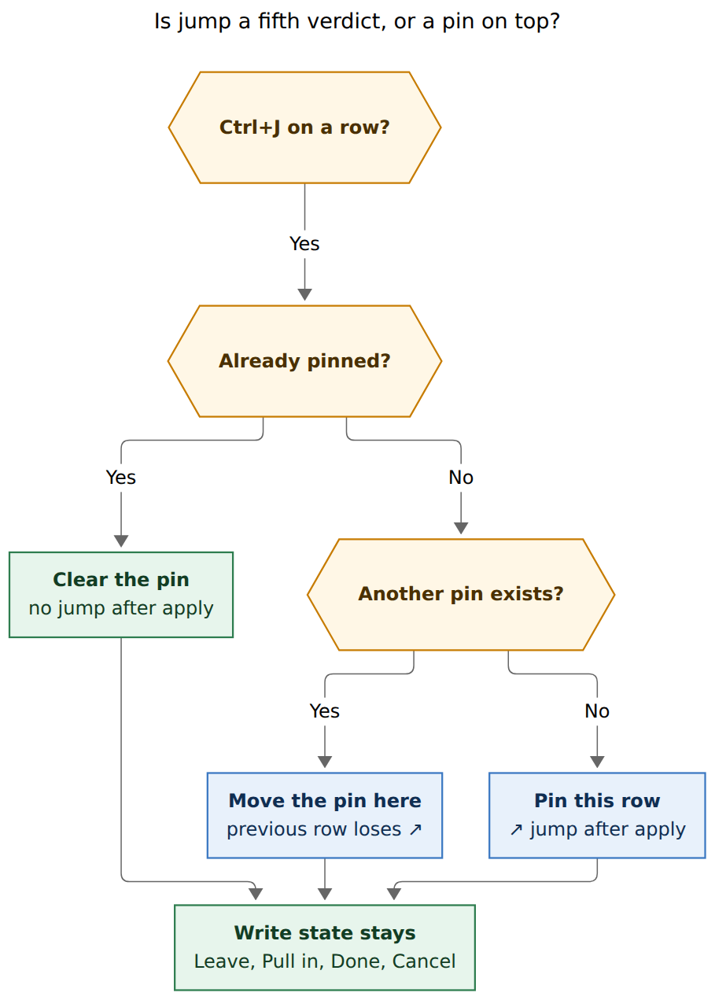
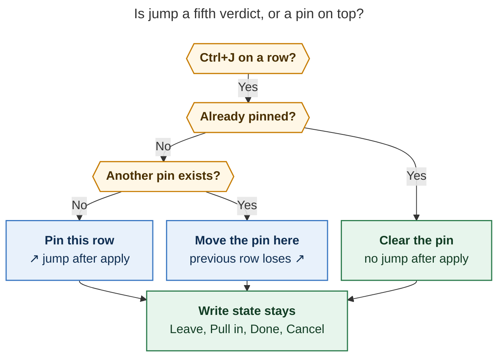
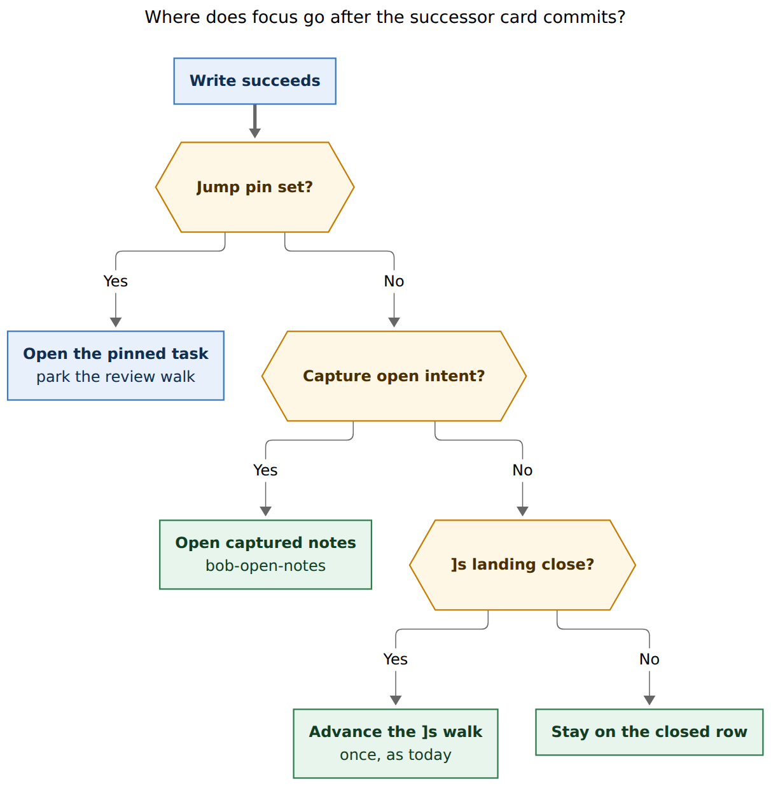
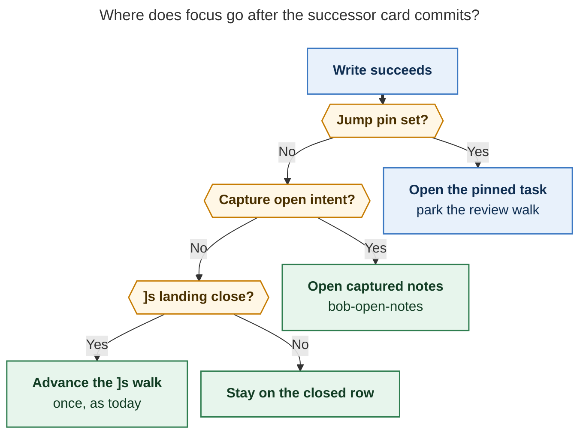

# Pin one successor, then jump there after the close

*Researcher: grk · 2026-11-20 · independent swarm report*

**Verdict.** Yes — build it. The successor card already chooses *what happens to
the work*. It still cannot choose *where Bryan's eyes go next*. A single
Control-J **jump pin** on that card fills that gap, as long as jump stays a
navigation overlay and never becomes a fifth exclusive verdict.

The request is a good idea. The implementation that will feel obvious is
narrower than "add Ctrl+J": jump must be a valid commit by itself, it must
beat both the review walk and Capture's open-notes landing, and it must
re-find the task from post-write bytes.

---

## 1. Recommendation in one page

Treat **jump** as a per-gesture pin on the existing successor card, not as a
new write.

1. **Control-J** on a visible offer row toggles a single ↗ pin. A second
   Control-J on the same row clears it. Control-J on another row moves it.
   The pin never changes Leave / Pull in / Done / Cancel.
2. **Enter** (Obsidian) / **Return** (Capture) still commits. A pin with no
   pull-in marks and no verdicts is a real commit: recover as today, link
   nothing, then jump. Highlight-fallback pull-in must not fire.
3. After a successful write, **open that task in Obsidian and focus its
   line**, using the same re-find as `obsidian://bob-goto-task` (planned
   line + digest, then `^block`, then unique digest, then clamped line).
4. That landing **overrides** Capture's Command-Return / Control-Return
   `open_notes` primary. It also **parks** the `]s` walk the way
   Ctrl+Shift+M already parks a move.
5. The pin is ephemeral UI. No vault field, no `[jump::]`, no sticky Next
   raise. Bob may emit a post-write landing (`jump_to`) so Capture stays a
   thin client.

**Do this on both surfaces of the same card** (Obsidian successor picker and
Mac Pull-In card). Skip the task-merge picker, which already stays
pull-in-only for verdicts.

**Do not** make Control-J apply immediately, make jump exclusive with
pull-in/close, auto-jump to the first pulled-in row, or invent a second
"go there later" queue.

---

## 2. Is this a good idea?

**Yes.** The successor card solved the *link* problem and created a *focus*
problem.

`decisions:unblocked-tasks-are-offered` made recovery automatic and linking
explicit. That is still right. What it left unsaid is where the caret goes
after the gesture. Today that is one of three accidents:

- Obsidian off a `]s` landing: the walk advances to the next review item
  (`decisions:answering-advances-the-walk`).
- Obsidian off-landing: the caret stays on the task Bryan just completed.
- Capture with Command-Return / Control-Return: `bob-open-notes` lands on
  captured notes in first-touch order (`src/native/capture/open_notes.rs`),
  which is usually the predecessor's note or the daily note, not the
  successor Bryan is looking at.

The request names two real moments:

- **Leave a successor sitting** so it can be prioritized, given a
  dependency, or scheduled — and go look at it *now*, without the sticky
  Next raise a pull-in would apply (`docs/task-dependencies.md` §12.4).
- **Pull it in, then edit it** — retarget, add a note, change type —
  without hunting for the new Task Link under today's Pomodoro.

Those are both "I am not done with this row." The card already has the row.
Go To (`/`), Command-\\, and `]]` are the wrong distance from that moment.

The 2026-10 successor-offers research already treated linking as a sticky
commitment. Jump is the complementary *non-sticky* commitment: eyes, not
plan. That pairing is why a pin overlay beats a fifth verdict.

---

## 3. Critique of the request

The request is directionally right. Four of its phrasings need tightening
before they become a contract.

### 3.1 "Override Cmd+Enter if it was used to submit"

On Capture, **Command-Return in the editor** is the alias of
**Control-Return**: capture, then open Bob's `open_notes`
(`docs/reference/mac-capture/keyboard.md`). On the successor card itself,
Command-Return is **consumed** and does not confirm. Control-Return on the
card is "apply and open." An earlier editor Command-Return also keeps an
open intent through the card, so a later plain Return still opens notes.

So "override Cmd+Enter" is really: **when a jump pin is set, the post-write
landing is the pinned task, and `open_notes` is not the primary.**

The pin should also fire after a plain Return. Waiting for the open-intent
chord would hide the feature on the more common "mark, then Enter" path,
and it would make Obsidian (which has no Command-Return submit) a second
design. Call this out as an adjustment in §4.1.

### 3.2 "Mark a successor that should be jumped to after completing"

"Mark" is the right verb. Control-J must **stage**, then Enter **applies**.
An immediate-jump chord cannot combine with pull-in / Done / Cancel on
other rows, because those are also staged until Enter. The card already
teaches that pattern (Space, Ctrl+X, Ctrl+Shift+X, then ↵).

### 3.3 "That task may have any other state"

Correct, and it forces the overlay model. Pull-in, Done, and Cancel are
already mutually exclusive (`docs/task-dependencies.md` §12.22: "A row
cannot be both pulled in and resolved"). Jump has to sit *beside* that
axis or Bryan cannot pin a Leave row, which is half the point of the
feature.

"Any other state" should also include rows the card will not *write*:
muted, already planned, new-in-capture, recurring. Those are the rows
Bryan often wants to inspect. Jump is navigation, so eligibility for the
pin is "visible offer row," not "selectable for pull-in." That is an
adjustment (§4.2).

### 3.4 The request does not mention the review walk

This is the reliability hole. A `]s` Ctrl+Enter already captures a walk
origin, holds it while the successor picker is open
(`holdReviewWalkForSuccessorPicker` in
`bob-navigation-hotkeys` `206-successor-picker-modal.js`), then
`walk.continue({kind: "complete"})` advances once. A jump that then opens
another note without parking will strand the walk on a completed row and
fight the caret. The move gesture already solved this
(`decisions:task-move-never-advances-the-walk`,
`parkReviewWalkAfterMove`). Jump must park the same way. Adjustment §4.3.

---

## 4. Requirement adjustments

These change the request. Each is justified by an existing Bob rule.

| # | Adjustment | Why |
| --- | --- | --- |
| A1 | The pin jumps after **every** successful apply, including plain Return. Command-Return / Control-Return still mean "also open," but the **primary** landing is the pin. Other `open_notes` entries stay closed. | The pin *is* the go intent. Doubling it with the open chord makes Obsidian and Capture diverge, and it dumps extra tabs on top of the task Bryan asked to see. |
| A2 | Jump is allowed on **any visible offer row**, including muted, new-in-capture, and recurring rows the card will not close. Folded "+N more" rows stay unpinnable until expanded. | Navigation does not need write eligibility. Bob already authors `why` for close refusals; presenters must not invent a second eligibility matrix for jump. |
| A3 | A jump pin with empty picks and empty closes is a **commit**, not Esc. Highlight-fallback pull-in is suppressed once a pin (or any verdict) is staged. | Today's API treats empty picks+closes as `null` (none). Leave+jump is the motivating case. |
| A4 | After jump, **park the `]s` walk** on the closed row's resume neighbour. Record a `<C-o>` jump from the answered row. Do not auto-advance. | Same reason Ctrl+Shift+M parks: Bryan is going to work in the destination note. |
| A5 | No vault field. The pin dies with the card. | Jump is not plan, freshness, or a relation. Writing it would create a new source of truth the hooks would have to ignore. |
| A6 | The task-merge successor card stays jump-free, matching v4 verdicts. | One card family, two jobs. Merge already has its own undo notice. |
| A7 | Control-J never applies. It only moves the pin. | Apply stays on Enter / Return / Control-Return so the footer can keep teaching one commit key. |
| A8 | `--jump-to` does **not** satisfy `--require-pull-in-choice`. Jump-only Capture still sends `-p none`. | Jump is not a pull-in answer. Mixing those meanings would make a forgotten pin skip the chooser. |

A1 is the largest behavior change relative to a literal reading of
"override Cmd+Enter if it was used to submit." The others are contract
holes the current picker will hit on day one.

---

## 5. What exists today (verified)

### 5.1 One card, four write states, two engines

`docs/task-dependencies.md` §12 is the contract. Obsidian's
`SuccessorOfferPickerModal` (`bob-navigation-hotkeys` `206*.js`) and
Capture's Pull-In card (`CapturePullInChoice.swift`) present the same
states:

| State | Obsidian | Capture | Write |
| --- | --- | --- | --- |
| Leave (default) | unmarked | unmarked | recovery only |
| Pull in | Space / Tab mark, ↵ | Space / Tab, Return | Task Link + Next + fresh |
| Done | Ctrl+X | Control-X | `[x]` + `[completion::]` |
| Cancel | Ctrl+Shift+X | Control-Shift-X | `[-]` + `[cancelled::]` |

v4 `pick()` returns `{picks, closes}` or `null`. `null` is Esc / click
outside / second picker. Empty picks with at least one close is already a
commit. Empty picks with empty closes is **not**:

```js
// bob-navigation-hotkeys 206-successor-picker-modal.js pickSuccessorOffers
if (picks.length === 0 && kept.length === 0) {
  resolve(null);
  return;
}
```

Capture matches that in `confirmPullInChoice`:

```swift
guard !selectionKeys(selection).isEmpty || !verdicts.isEmpty else {
    announceStatus("No visible successor offer is selected")
    return
}
```

That is the hole A3 has to open.

Enter with no marks and no verdicts still **pulls in the highlighted
row** (`applySelection` highlight fallback; Mac `effectiveSelectionKeys`).
A Leave+jump user who presses Enter today would accidentally plan that
task. A3's "pin suppresses highlight-fallback" is mandatory.

### 5.2 Keymap crowding

Obsidian footer chips already include Tab, Ctrl+A, Ctrl+X, Ctrl+Shift+X,
↵, Ctrl+Shift+Enter (retarget), Esc. Capture's
`CapturePullInChoiceFooter` lists ⌃N ⌃P, space, tab, ⌘A, ⌃X, ⌃⇧X, esc,
⌃↩, and drops chips through `ViewThatFits`.

Control-J is **free on this card**. It is not free elsewhere:

| Surface | Control-J today |
| --- | --- |
| Capture editor | Insert an indentation-aware `- ` row (`keyboard.md`) |
| Capture task pickers | Next picker row (emacs-style, with Ctrl+N) |
| Bob Refs | Next row |
| Album / bank / schema cards | Next field |
| Obsidian successor modal | Unhandled; falls through to the filter / Vim |

If the successor card does not consume Control-J, Capture will leak it
into `insertBulletNewline` on the hidden draft (`pullInChoiceCommand`
currently `default: return nil`). Consuming the chord is part of
reliability, not polish.

Command-J on a blank Capture draft joins the focus calendar event. That
chord stays unrelated.

### 5.3 Landing machinery already exists

Bob Navigation Hotkeys already registers:

- `obsidian://bob-goto-task?path&line&ref[&block]` — one note, caret at
  column 0, line centered, optional `<C-o>` recording
  (`docs/reference/plugins/goto-task-uri.md`).
- `obsidian://bob-open-notes` — up to eight notes, 2 s wait for Bob's
  writes, 1.2 s landing flash (`open-notes-uri.md`).

Capture Go To and Command-\\ already dispatch `bob-goto-task`. Capture
Control-Return dispatches `bob-open-notes` from Bob's `open_notes`
array, built in first-touch order from capture targets then the day file
(`src/native/capture/open_notes.rs`). Clients are not supposed to
re-derive path/line/digest.

Re-find order (goto-task): planned line if digest matches; else `^block`;
else the unique digest line; else clamped planned line with a "changed"
notice. Jump must use this, not a raw preview line number. Pull-in mints
IDs and stamps `[fresh::]`; Done/Cancel rewrite the checkbox; unpicked
recovery may write `[unblocked::]`. The preview digest is stale the
moment the write lands.

### 5.4 Walk hold is not a park

While the picker is open, `holdReviewWalkForSuccessorPicker` keeps the
gesture lock alive so the 3 s review lock does not expire mid-choice.
After apply, the cycler still continues with `{kind: "complete"}`
(`task-status-cycler` `140-plugin-vim.js`). Jump needs a park, not a
longer hold.

`parkReviewWalkAfterMove` already consumes the landing, stores a
text-identified resume neighbour, and clears `reviewWalkCurrent`. Jump
should call the same shape (a `parkReviewWalkAfterJump` wrapper is
enough; do not fork the resume math).

---

## 6. Recommended design: the jump pin

### 6.1 Overlay, not a verdict

Each visible offer row still has exactly one write state. The card as a
whole has zero or one jump pin, keyed by offer `key` (never by list
index — the relation-card lesson,
`decisions:relation-card-tab-accepts-ctrl-d-hides`).



**Caption.** Control-J is a radio pin. Leave, Pull in, Done, and Cancel
stay the row's write state, so a Leave row can still be the jump target.

Rendered size: 605.7 × 848 px; fit scale: 100.0%. Mermaid CLI 12.0.0.



### 6.2 Chord

**Control-J** (literal Control, no Shift, no Meta, no Alt) on the
highlighted visible offer row.

- Repeat is ignored.
- While the Cancel reason field is focused, consume the key and leave the
  pin alone (same isolation Ctrl+X already gets).
- On a group "+N more" row or an empty filter result, consume and say
  `Select a task to jump` in the status line.
- `q` stays reserved (`decisions:q-and-ctrl-bracket-mirror-esc`). Esc /
  `q` / Ctrl+[ keep mirroring.

Do **not** bind Command-J. Do **not** steal Capture pickers' Control-J =
next-row outside this card. The successor card is a different layer; the
footer chip teaches the local meaning.

### 6.3 Commit rules

Let `J` be the pinned key, or absent.

| Staged extras | Enter / Return | Highlight fallback |
| --- | --- | --- |
| nothing | pull in highlighted row (today) | yes |
| marks and/or verdicts, no `J` | apply those (today) | no |
| `J` only | write none extra; jump after | **no** |
| `J` + marks/verdicts | apply those; jump after | no |
| Capture Shift-Return | verdicts only, keep `J` | no |
| Esc, no verdicts | none; discard `J` with the card | — |
| Esc, verdicts staged | two-step discards verdicts **and** `J`, stays | — |

Capture Control-Return applies the same commit, then jumps. It does not
also open the rest of `open_notes` (A1).

A muted pinned row is a valid `J`. Bob writes whatever recovery it would
have written anyway; the surface then lands on that row.

### 6.4 After the write



**Caption.** The pin is the only post-write focus rule that moves the
caret to another task. Without it, Capture's open intent and the `]s`
advance keep today's behavior.

Rendered size: 807.6 × 824 px; fit scale: 80.8%. Mermaid CLI 12.0.0.



Failed writes never jump. Capture remains all-or-nothing: the card
reopens with the pin intact. Obsidian remains best-effort for verdicts: a
refused close on the pinned row still jumps to the current bytes of that
identity (the task is still there).

Inbox routing and the Move card stay in front of the write. The pin lives
on the successor card and survives Escape back from the inbox card the
same way marks already survive.

### 6.5 Beauty

The card is already busy. Jump has to read in one glance without a fourth
checkbox column.

**Row**

- Keep the existing left mark for write state (□ / ☑ / ✓ / ⊘).
- Add a trailing capsule `↗ jump` on the pinned row only, using
  `--interactive-accent` (Obsidian) / the existing pull-in accent (Mac).
  Lucide `arrow-up-right`; SF Symbol `arrow.up.right`.
- Do not strike the title. Strike is for completed writes after apply, and
  §12.22 already forbids striking before the write.
- `aria-label` appends `will jump here` so VoiceOver does not have to
  guess from the glyph.
- Hover, on the highlighted row, a quiet ↗ button next to the v4 Done /
  Cancel hover actions. Mouse users get the same pin without a new column.

**Footer**

- Summary strip gains `↗ jump “{S}”` when set, truncated like the
  existing consequence line. Counts stay
  `pull in {a} · ✓ {b} done · ⊘ {c} cancel · ↗ {title}`.
- Hint chip `Ctrl+J jump` is last before Esc in the `ViewThatFits` chain,
  so it is the first chip a narrow panel may drop. The capsule on the row
  carries the meaning when the chip is gone.

**Landing**

- Reuse the open-notes **landing flash** (1.2 s, 600 ms with Reduce
  Motion) and goto-task **centering**.
- One toast: `↗ “{S}” · {note}`. If the cycler already composed a
  successor notice, append ` · ↗ “{S}”` rather than posting a second
  card. Walk toasts stay singular
  (`decisions:answering-advances-the-walk`).

**Motion**

- Pin moves with a 120 ms cross-fade of the capsule (instant with Reduce
  Motion). No row-height animation. No panel resize (Capture's pull-in
  height policy stays fixed).

This is the same visual language as destination overrides (`→ NAME`): a
right-side consequence, not a competing checkbox.

---

## 7. Contracts

### 7.1 Obsidian `api.successors` v5

Bump `successors.version` to 5. v4 callers keep working: extra fields on
the result are ignored, and an older cycler that never reads `jump`
simply never lands.

```js
pick(model) → Promise<{
  picks: [{key, destination?}],
  closes?: [{key, outcome: "done"|"cancelled", reason?}],
  jump?: {key}
} | null>
```

- `null` still means no commit.
- `{picks: [], jump: {key}}` is a commit.
- `{picks: [], closes: [...], jump: {key}}` is a commit.
- `jump.key` addresses any **visible** row in the model, including muted
  rows. Unknown / folded keys are dropped and the rest of the commit
  still applies; the cycler then does not jump.
- `jump` is ignored when `retargetEnabled` is irrelevant; retarget stays
  pull-in-only (§12.22).
- Feature-detect `api.successors?.version >= 5` only if a caller needs to
  *hide* the chord on an older nav. The cycler should consume `jump`
  whenever it is present.

### 7.2 Capture CLI and JSON

Additive, capability-gated, in the same family as `pull_in.close`.

```text
-j, --jump-to <N|KEY>
```

Public long option with short alias `-j` (free on `bob capture` today).
Alphabetical placement is between `--inbox-route` / `-i` and `--move-in`
/ `-m` in the current flag list (`src/native/capture/cli.rs`). One offer
number or stable key. Repeat last-wins, or refuse a second distinct key
with a teaching error — last-wins is enough; the UI never sends two.

Does not conflict with `-p` / `-x` / `-X`. Does not satisfy
`--require-pull-in-choice`. Unknown/stale key: **write still happens**,
JSON omits `jump_to`, human line says the jump target was gone. That is
the opposite of a pull-in miss, which must refuse, because a missed jump
is a missed caret, not a missed plan.

Capability:

```json
"pull_in": {
  "supported": true,
  "close": {"supported": true},
  "jump": {"supported": true}
}
```

Success (and dry-run) JSON grows:

```json
"jump_to": {
  "key": "sase.md#^next-task",
  "path": "/vault/sase.md",
  "relative_path": "sase.md",
  "line": 84,
  "ref": "84:35a733bd",
  "block_id": "next-task",
  "text": "Prioritize the follow-up"
}
```

Shape matches `OpenNoteJson` plus `key` and `text`. Bob fills it from
**staged post-write** bytes so the digest matches what Obsidian will
read. Mac dispatches `bob-goto-task` from this object and does not
re-parse the vault (`decisions:mac-capture-is-a-thin-client`).

Older bob: Mac feature-detects `pull_in.jump.supported`. Without it, still
pin in the UI, then after success map the key through the existing
unblocked / not_linked rows and wait the shared 2 s for the write, the
way `bob-open-notes` already waits. Degraded, not dead.

### 7.3 Docs and memory

- `docs/task-dependencies.md` new **§12.24 Jump successor**, with SJ
  vectors (pin exclusivity, jump-only commit, muted row, post-write
  re-find, walk park, Capture override, merge-card absence).
- `docs/develop/plugins/plugin-apis.md` successors v5.
- Plugin reference and Mac `keyboard.md` / `capture-previews.md` /
  `protocol.md`.
- A new **decision record**: jump is a navigation overlay; rejected
  alternatives in §9. Glossary: add **Jump successor** under Successor
  Offer (alias: jump pin), so "mark" does not get confused with pull-in
  marks.

`just docs-gen` covers the new `-j` flag. This is a behavior change plus a
new hotkey, so it is a contract page and a plugin-reference line, not a
README change (`docs.md` routing).

---

## 8. Reliability checklist

These are the ways the feature will feel broken if they are skipped.

1. **Post-write identity.** Always re-find. Prefer `block_id` after a
   pull-in mint; else `ref` digest of the staged line; else clamped line
   with the existing "Task changed since …" notice. Never trust the
   preview line number.
2. **Wait for the write (Capture).** Same 2 s / 50 ms poll as
   `bob-open-notes`. Jumping at submit-return races Obsidian's file
   cache.
3. **Park the walk.** Jump after `parkReviewWalkAfterMove`-style resume
   is recorded. Next `]s` must not skip the neighbour of the closed row.
4. **Record `<C-o>`.** From the answered row, like every walk landing.
   Bryan can return to the completed task without `]s`.
5. **Consume Control-J** on the card, including key-repeat, including
   when the filter is focused. Linux: Control-J in a selected filter span
   must not insert a newline (mirror the v4 Ctrl+X Cut exception).
6. **Gesture lock.** Release after the land, not after picker close.
   Otherwise a fast `]s` during the 2 s wait will fight the caret.
7. **Pin by key.** Filter, fold, and verdict restage must not move the
   pin to another row.
8. **Inbox / Move round-trip.** Pin survives Escape back to the successor
   card. A new preview generation (stale draft) clears it with the card.
9. **No jump on Esc none.** Discard is discard.
10. **Single toast.** Do not stack Unblocked + walk + jump notices.

---

## 9. Rejected alternatives

| Alternative | Why it loses |
| --- | --- |
| **Fifth exclusive verdict** (Leave / Pull in / Done / Cancel / Jump) | Cannot pin a Leave row, which is the motivating case. Also cannot pin a row being closed. |
| **Control-J applies immediately** | Cannot combine with staged marks on other rows. Breaks the card's one-commit-key teaching. |
| **Jump = highlighted row at Enter** (no pin) | Highlight moves during Tab-marking. Bryan would have to re-highlight the inspect row last, every time. |
| **Always jump to the first pulled-in row** | Does not cover Leave. Silently hijacks ordinary pull-ins. |
| **Jump only when Command-Return submitted** | Obsidian has no such submit. Capture's common path is Return on the card. The pin is already an explicit go. |
| **Also open the rest of `open_notes` in background tabs** | Noise. The override is the point. Notification click can still open the captured notes later. |
| **Vault field or LINKS label** (`jump to`, `see next`) | New source of truth, hooks, and reconcile. Jump is a caret, not a plan. Relations already have `starts after` for *plan* successors. |
| **Reuse Go To (`/`) from the card** | Extra mode, extra query, loses the grouped offer context. |
| **Ctrl+G / `g` / Command-O** | `g` types in the filter. Command-O is open-file elsewhere. Control-J's mnemonic is jump, and it is free *on this card*. |
| **Multi-jump** | The request forbids it, and two carets is a contradiction. |
| **Auto-advance the walk onto the jumped row** | The jumped row is often not in today's walk (Leave, muted, another note). Parking is the move precedent. |
| **Bob-owned jump without a surface pin** (infer from `--jump-to` only) | Obsidian never sends capture flags for Ctrl+Enter. The pin has to live in the picker result. |

Control-J as "next row" on *other* pickers is a real mnemonic collision.
It loses to the request's explicit chord because this card already has
Ctrl+N / Ctrl+P / arrows for movement, and because a local footer chip
plus a visible ↗ capsule re-teaches the key in context. Do not also
rebind Control-J on those other pickers.

---

## 10. Would I take a different approach?

I would not replace the request with a different feature. I would start
from the pin overlay above rather than from "add a keymap."

If Bryan later finds he always pins the highlighted row and hits Enter, a
follow-up Control-Return-on-Obsidian (apply and jump to highlight, no
pin) could be added. That is a shortcut for the one-row case, not a
replacement. I would not ship it first: it cannot express "pull in A and
B, inspect D."

I would also not wait on a Capture-only experiment. The walk-park and
re-find problems live in Obsidian. Ship the Obsidian pin first, then the
additive bob-cli landing, then Mac. Mac without `jump_to` can already
degrade through offer rows; it should not be the design origin.

---

## 11. Implementation sequence

Small, additive, in this order. Each step is demoable.

1. **Obsidian picker pin (nav).** Control-J, capsule, footer summary,
   hover ↗, consume the chord, pin-by-key. v5 result field. Tests in
   `test-navigation-successor-*.cjs`. No landing yet: the pin is visible
   and Enter with pin-only no longer highlight-falls-back.
2. **Cycler consume + park + land.** After apply, park the walk, re-find
   from post-write note text, open the leaf, flash, one toast, `<C-o>`.
   Vectors: Leave+jump, pull-in+jump (minted id), Done+jump, muted+jump,
   failed write (no jump), walk resume neighbour.
3. **bob-cli `-j/--jump-to` + `jump_to` JSON + `pull_in.jump`.** Dry-run
   matches real-run locations. Stale key does not refuse the capture.
   Hidden `--require-pull-in-choice` still wants `-p` or a verdict.
4. **Mac pin.** Control-J in `pullInChoiceCommand` (never `nil`), pin
   state on `CapturePullInChoiceState`, jump-only confirm, persist
   through inbox Escape, `ViewThatFits` chip. After success, prefer
   `jump_to` else degraded offer-row map; dispatch `bob-goto-task`; skip
   `bob-open-notes` when the pin was set.
5. **Docs + decision + glossary.** §12.24, plugin-apis v5, Mac protocol,
   `just docs-check`.

Phase 1+2 already make the Obsidian close-and-inspect loop real. Phase 3
is the thin-client contract Mac needs to do phase 4 without guessing
digests.

---

## 12. What would reopen this

- Bryan finds he always wants the highlighted row, never a pin that
  survives Tab-marking — then add an apply-and-jump chord, keep the pin.
- Jump-from-muted rows feel surprising — then limit the pin to selectable
  rows and show Bob-authored `why` copy. I would not start there.
- Control-J collisions with Vim join inside the modal leak — then pick a
  different chord (Control-G is the next-best mnemonic; Capture editor
  already uses it for case toggle, so it is still surface-scoped).
- People want the captured notes *and* the successor — then open
  `open_notes` in background tabs after the jump, behind a setting. Do
  not make that the default.

---

## Sources

Code and contracts read for this report:

- `docs/task-dependencies.md` §12, §12.13 (picker API v1–v4), §12.14
  (CLI), §12.22 (verdicts)
- `docs/develop/plugins/plugin-apis.md` successors / notice / reviewWalk
- `docs/reference/plugins/goto-task-uri.md`, `open-notes-uri.md`
- `docs/reference/mac-capture/keyboard.md`, `capture-previews.md`,
  `protocol.md`
- `bob-navigation-hotkeys` `206-successor-picker-modal.js`,
  `206c-successor-picker-verdicts.js`, `206d-successor-picker-verdict-render.js`,
  `536-plugin-review-advance.js`, `537-plugin-review-move-park.js`,
  `675-plugin-goto-task-uri.js`, `676-plugin-open-notes-uri.js`,
  `styles.css` `.bob-successor-row*`
- `task-status-cycler` `137a-successor-offer-close-integration.js`,
  `140-plugin-vim.js`
- `CaptureKeyCommandRouter.swift`, `CapturePanelModel.swift`
  (`confirmPullInChoice`, `completeSubmit`), `CapturePullInChoice.swift`,
  `CapturePullInChoiceView.swift`
- `src/native/capture/open_notes.rs`, `src/native/capture/cli.rs`
- Decisions: `unblocked-tasks-are-offered`, `mac-capture-is-a-thin-client`,
  `answering-advances-the-walk`, `task-move-never-advances-the-walk`,
  `q-and-ctrl-bracket-mirror-esc`, `relation-card-tab-accepts-ctrl-d-hides`
- Prior research: `research:202610/successor_pull_in_offers` (offers vs
  links). Peer reports from this swarm were not read.

---

## Recommended solution (restated)

**Ship a Control-J jump pin on the successor card, overlaying the existing
Leave / Pull in / Done / Cancel axis, committing on Enter even when
nothing is pulled in or closed, then landing in Obsidian on that task's
post-write line.**

Park the review walk. Replace Capture's open-notes primary when the pin
is set. Keep Bob the authority for post-write path/line/digest via an
additive `-j/--jump-to` and `jump_to` JSON. Make it look like a single ↗
capsule, not a fifth checkbox.
