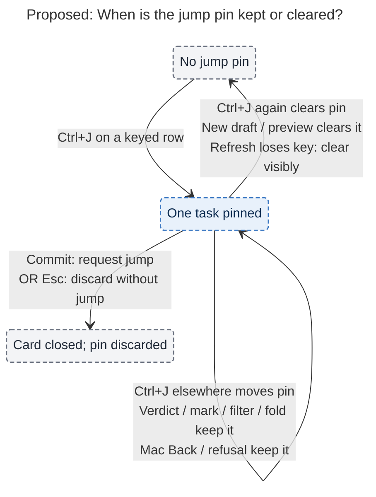
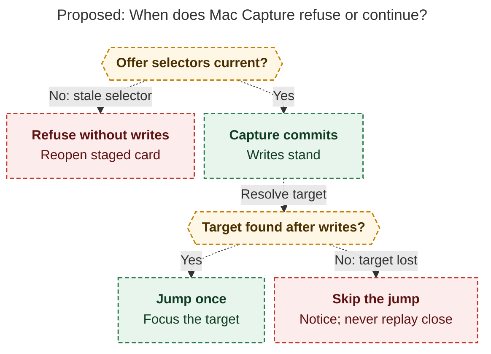

# Diagram proposals: The jump pin: Ctrl+J on the successor card

Proposals for the swarm linker, not a report. Each diagram restates only what the source
report says.

```yaml
source: research:202611/successor_jump_pin/successor_jump_pin__final.md
producer: research.5m.image
check: "mmdc 12.0.0 with the PDF-mirroring config rendered 2 of 2 Mermaid diagrams; no-sandbox Puppeteer flag; negative parser test passed"
```

## pin-lifetime

```yaml
anchor: |-
  The pin dies with the card. Esc discards it with everything else
question: |-
  When is the jump pin kept, moved, or cleared?
illustrates: |-
  The pin survives verdict and mark changes, filtering and folding, and the Mac's Back and refusal reopens, while reset events and card closure discard it.
caption: A pin survives verdicts, filtering, and Mac Back or refusal reopens, but explicit resets and card closure discard it.
review: "511.391×670 px, fit 100%; question and visual checks passed; 1 revision"
```



## failure-boundary

```yaml
anchor: |-
  refuses and the card reopens with its staged state
question: |-
  How does Mac Capture handle stale selectors before commit versus a lost target afterwards?
illustrates: |-
  Mac Capture refuses stale offer selectors before any writes, while post-commit resolution failure leaves writes in place and skips the jump.
caption: Stale selectors stop Mac Capture before writes; losing the target after commit skips navigation and never replays the close.
review: "614.172×786 px, fit 100%; question and visual checks passed; 0 revisions"
```


