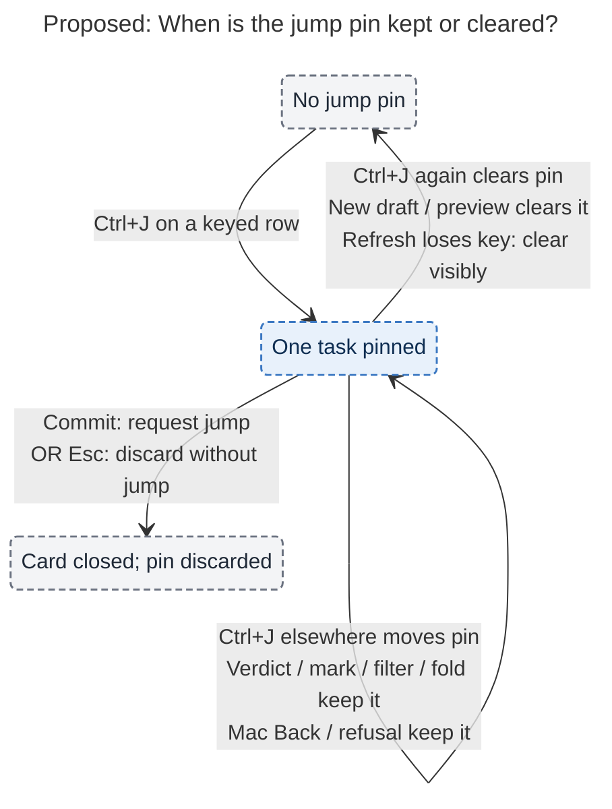
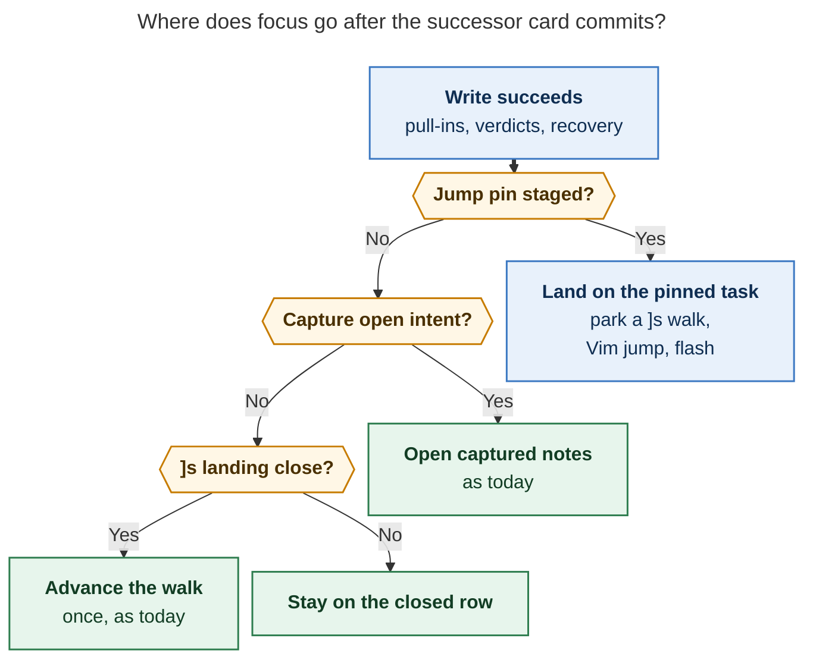
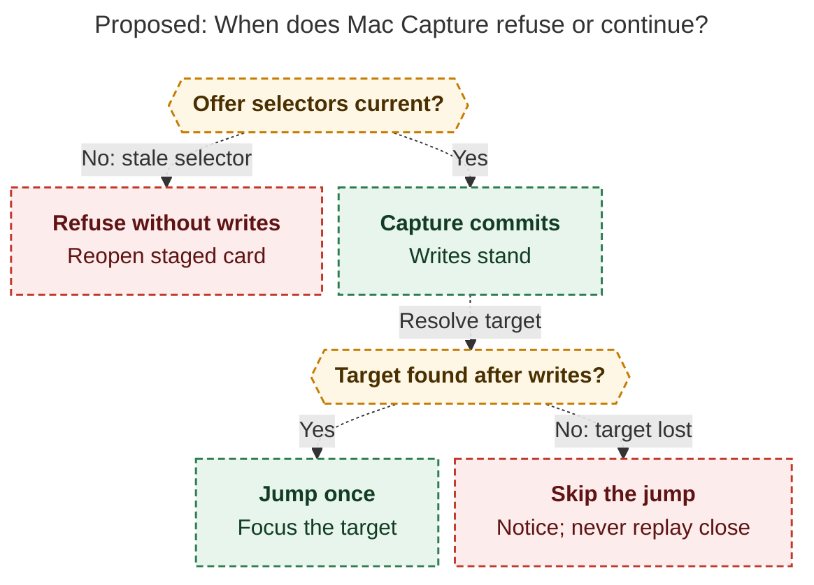

# The jump pin: Ctrl+J on the successor card — consolidated design research

> **Research query:** What is the best way to add a `<ctrl+j>` keymap to the successor
> panel, in Obsidian and in the capture panel, that marks a single "jump successor" — left
> open, pulled in, closed, or canceled — to jump to and focus in Obsidian once the
> triggering task close completes, overriding `<cmd+enter>` if that submitted the capture?
> Is this a good idea, would a different approach be better, which requirement
> adjustments are justified, and what intuitive, reliable, and beautiful solution is
> recommended?

## Bottom line

**Build it — all five researchers independently said yes, and so do I.** The successor
card today decides each offer's *state* (Leave, Pull in, Done, Cancel) but cannot say
*where your attention goes next*. Both motivating moments are real and currently cost a
"close → remember → Go To → find the line" round trip: leaving a successor unlinked so
you can reprioritize or edit it in place, and pulling one in that needs fixing before
it is actionable. Ctrl+Shift+M's follow-the-move rule
(`decisions:task-move-never-advances-the-walk` — "Bryan keeps working on the task where
it now lives") is the accepted precedent for exactly this insight.

[The shape every report converged on](#the-consensus-design), from five independent
starts:

**One staged "jump pin" per card, toggled with Ctrl+J, orthogonal to the four verdicts,
applied last, found again by identity after the writes, never written to the vault.**

The naive version — just bind a key — would fail in four specific ways the reports
unanimously identified, and most of the design work below is closing those four holes:

1. **The highlight-fallback trap.** Enter with nothing marked pulls in the highlighted
   row today; after Ctrl+J your highlight *is* the jump row, so "leave it, take me
   there" would silently become "plan it."
2. **The walk fights the jump.** A close from a `]s` landing auto-advances the walk
   (`decisions:answering-advances-the-walk`); two cursor moves, and the second wins.
3. **Line numbers lie after writes.** Pull-ins mint `^block` IDs, verdicts rewrite the
   task line and can add Cancel Logs, recovery stamps `[unblocked::]`, and inbox
   routing can move the task to another file. A jump computed from the offer's
   pre-write line lands on the wrong row.
4. **An empty-plus-jump commit is currently impossible.** The picker API returns `null`
   when picks and closes are both empty (verified: `206-successor-picker-modal.js:940`),
   and the Mac card refuses to commit with no selection — jump-only must become a
   first-class commit.

## Requirement adjustments

Deliberate changes to the request:

| # | Adjustment | Why |
| --- | --- | --- |
| A1 | **The pin fires on every commit key, not only when ⌘↩ submitted.** "Override ⌘↩" becomes "replace the open-notes landing whenever a pin is staged." | Unanimous. The pin *is* the go intent; keying it off the submit modifier hides the feature on the common plain-Return path and gives Obsidian (no ⌘↩ submit) a second design. |
| A2 | **A staged pin suppresses Enter's highlight fallback**, exactly as staged verdicts already do, and **jump-only is a real commit** (picker result `{picks:[], closes:[], jump}`; Mac `-p none --jump …`). | Unanimous; without it the motivating "leave it, go there" case silently plans the task. Reuses §12.22's existing rule. |
| A3 | **A pin from a `]s` landing parks the walk** (resume at the closed row's neighbour) instead of auto-advancing. Needs a new decision record partly superseding `answering-advances-the-walk`, alongside `task-move-never-advances-the-walk`. | Unanimous. Two landings are incoherent and the second steals the caret. |
| A4 | **No vault state, no planning side effects, ever.** | Unanimous; keeps the pin compatible with derived statuses, freshness, and offer recovery. |
| A5 | **A lost target after commit never fails the close**; one notice, writes stand, no retry of the write. | Unanimous reliability rule. |
| A6 | **v1 pins keyed/selectable rows only**; muted (still-blocked / future-scheduled) rows come in v2 once bob issues navigation-only keys. | Majority (cld, gem, cdx; grk dissents — see [Disagreements](#disagreements-and-rulings)). |
| A7 | **Esc discards the pin; a pin alone never arms two-step Esc.** The Mac's Back-from-inbox and refusal reopens restore it with the rest of the card state. | gem/grk/cld; the guard exists to protect staged writes, which a pin is not. |
| A8 | **Same card, other hosts**: enable on the parked-successor and promotion/`@route:id@` project cards (promotion must first forward `line`/`blockId` into its model rows); **disable on the relation-merge picker**, whose rows are hand-off slots for one shared target. Audit every caller: wire fully or withhold (cdx). | gem's caller inventory; cld A8. |
| A9 | **"Jump" vocabulary only** — never "Next", "Start", or "Open" — and a new glossary term so "mark" (pull-in) and "pin" (jump) stay distinct. | cdx/grk; lane and timer words are taken. |

## The consensus design

### Semantics

- **One pin per card, zero by default.** Ctrl+J toggles the pin on the highlighted row;
  pressing it on another row moves the pin; pressing it on the pinned row clears it.
  Never two pins. Keyed by offer **key**, never list index.
- **Orthogonal to verdicts.** The pin composes with all four states, each reading as a
  sentence: *Leave it, take me there* (prioritize/schedule/split) · *Link it, take me
  there* (fix before starting) · *Close it, take me there* (write the skipped Work
  Log) · *Cancel it, take me there* (salvage notes). Verdict and mark changes on the
  pinned row never clear the pin; the verdict↔mark exclusivity stays as-is.
- **Pure navigation.** No vault field, tag, lane change, freshness stamp, block-ID
  mint, timer start, or reopen. A pinned Leave row recovers exactly as an unpinned one.
  Required by `decisions:unblocked-tasks-are-offered` (only picked rows link) and by
  the derived-status decisions. The one-sentence contract (mus): **jump is where you
  land, never what happens.**
- **Ephemeral.** The pin dies with the card. Esc discards it with everything else; a
  pin alone never arms the two-step Esc (that guard protects staged *writes*). It
  survives the Mac's inbox-route/Back round trip and an offer-refusal reopen, like
  marks do; a new draft or preview generation clears it.

[The pin-lifetime diagram](#figure-pin-lifetime) shows at a glance which events keep the
one pin — verdicts, marks, filtering, the Mac's Back and refusal reopens — and which
clear or discard it.

_A pin survives verdicts, filtering, and Mac Back or refusal reopens, but explicit resets and card closure discard it._

### Keys and commit rules

Ctrl+J is literal Control (no Shift/Meta/Alt), card-scoped, consumed (otherwise the Mac
leaks it to the editor's bullet-newline), repeat- and IME-ignored, inert while the
Cancel-reason editor is focused, and active while the filter is focused (with
`preventDefault` in Obsidian). On a header/fold/empty row it does nothing but say so in
the status line. `q`/`Ctrl+[` keep mirroring Esc.

| Staged | Enter / Return | Highlight fallback |
| --- | --- | --- |
| nothing | pull in highlighted row (today) | yes |
| marks/verdicts, no pin | apply them (today) | no (today) |
| **pin only** | **commit with zero extra writes, then jump** | **no** |
| pin + marks/verdicts | apply them, then jump | no |
| Mac ⇧↩ | verdicts only, **keep the pin, still jump** | no |
| Esc | discard everything, pin included; no navigation | — |

A staged pin fires on **every** commit key. On the Mac it **replaces** (never adds to)
the `open_notes` open for ↩, ⇧↩, ⌃↩, and an earlier editor ⌘↩/⌃↩ — "override ⌘↩" is
the special case of "a staged jump always wins." Clearing the pin restores the original
submit modifier's behavior. One landing, ever; no extra tabs.

### After the commit

1. **Writes land first** — picks, verdicts, recovery, reference retirement, receipts.
2. **The target is re-found by identity against post-write text**: block ID first
   (pull-ins always have one — §12.4 mints it because the row was *picked*, never for
   the jump itself), else the planned post-write line text (the writer knows the exact
   bytes of a `[x]`/`[-]` rewrite or an `[unblocked::]` stamp), else the existing
   `ref` digest re-find, following inbox-route moves. Never the pre-write line number.
3. **One landing**: reuse the open-leaf, focus the editor line (no selection, no insert
   mode), record a Vim `<C-o>` jump, fire the shared landing flash. One toast: append
   `· ↗ "{S}"` to the existing successor notice, never a second card.
4. **A `]s`-landing close with a pin parks the walk** instead of advancing — the
   Ctrl+Shift+M rule — so the next `]s`/`[s` resumes at the closed row's neighbour.
   Focusing the pinned task never stamps it or consumes a review landing; if it is due
   it stays due.
5. **A lost target never fails the gesture.** Post-commit resolution failure keeps all
   writes, skips the jump, and shows one notice naming the lost target ("Closed —
   couldn't find …"). Navigation failure never replays the close.

*Figure. The jump pin is the single post-commit focus arbiter: when staged it wins over
Capture's open-notes intent and over the review-walk advance; without it, today's
behavior is untouched.* (Mermaid CLI 12.0.0, PDF config; rendered 803 × 898 px, fit
81.3%.)

### Look

For the "beautiful" requirement, all five reports converged on the same visual grammar:
the pin is a **trailing accent capsule on one row**, not a fifth checkbox column and not
a row tint.

- **One accent used nowhere else in the card**: Obsidian `--interactive-accent` on a
  ~12–14% tinted pill plus a 2 px accent rule on the row's leading edge (the
  `.bob-landing-flash` recipe, so staging and arrival share a hue); Mac the system
  accent. Green stays Pull-in/Done, crimson stays Cancel, amber stays caveats.
- **Icon + word**, never icon alone: `↗ Jump` — Lucide `arrow-up-right` / SF Symbol
  `arrow.up.forward` (grk, gem; matching the Mac's existing open-intent glyph). Avoid
  the glyphs Bob already uses for hand-offs (`arrow.turn.down.right`), moves (`↪`),
  destinations (`→`), and receipts (`↳`). cld's `locate-fixed`/`scope` is the
  runner-up; pick one pair and use it on both surfaces.
- **The footer summary is the safety net, not the icon**: append `· ↗ jump "{S}"` to
  the counts line so a pin hidden by a filter is never a surprise; the Ctrl+J hint chip
  sits last before Esc and may be the first dropped when narrow (the capsule carries
  the meaning).
- **Dynamic primary button** (Mac): `Leave Open & Jump ↩` / `Pull In 1 & Jump ↩` /
  `Apply & Jump ↩` — the label is what makes the suppressed fallback legible (gem).
- **Motion**: the capsule glides between rows (`matchedGeometryEffect` on Mac, 120 ms
  fade in Obsidian), cross-fade under reduced motion; arrival reuses the landing flash
  (1.2 s / 600 ms reduced).
- **Accessibility**: row label appends "will jump here after closing"; toggles announce
  "Jump set to … / Jump cleared"; pointer parity via the existing hover-action row
  (next to ✓/⊘) — on the Mac a sibling action, never a Button nested in the row Button
  (cdx).

## Verified ground truth

*Lead consolidation, 2026-11-20. Merges five independent swarm reports — cdx, cld, grk,
mus, gem (`successor_jump_pin__<suffix>.md` beside this file) — plus the lead's own
source verification in bob-cli, bob-plugins, and bob-mac-capture. Where the reports
disagreed, this report [rules and says why](#disagreements-and-rulings).*

Facts below were reported by two or more researchers and spot-checked by the lead at
bob-plugins `master`, bob-mac-capture `master`, and bob-cli `620270d1`:

| Fact | Evidence |
| --- | --- |
| The "successor panel" is two clients over one contract: Obsidian's `SuccessorOfferPickerModal` (nav `206*.js`) and Mac Capture's Pull-In card (`CapturePullInChoice*.swift`), specified by `docs/task-dependencies.md` §12. | all five reports |
| Picker API is **v4**; empty picks + closes resolves `null` (abort), closes-only is a commit; Enter with no marks/verdicts pulls in the **highlighted** row; staged verdicts already suppress that fallback (§12.22). | grk/gem code quotes; lead verified version & `null` branch |
| **Ctrl+J is free on both cards.** Obsidian's modal doesn't handle it; the Mac's `pullInChoiceCommand` has no `KeyCode.j` case (lead verified). Outside the cards it is taken: Mac editor bullet-newline, picker next-row, Refs next-row — so the binding must be card-scoped and consumed. | cld/mus/gem/grk; lead verified |
| **`-j` is free** on `bob capture` (taken shorts: `X c x b d E f h i m n R p r s t D`; lead verified in `src/native/capture/cli.rs`). `-p/--pull-in`, `-x/--complete-offer`, `-X/--cancel-offer` already select offers by number/key with write-free teaching refusals on stale selectors. | gem/cld/grk; lead verified |
| Landing machinery exists: `focusTaskAnchor` (leaf reuse, `ensureEditing`, Vim `<C-o>` context), `obsidian://bob-goto-task` (re-find by planned line + digest → `^block` → unique digest → clamped line with a "landed near" notice — lead verified), `obsidian://bob-open-notes` (2 s / 50 ms freshness poll on `ref` digests, landing flash), `parkReviewWalkAfterMove` (text-identified resume neighbour), `.bob-landing-flash`. | all five; lead verified clamp + notice |
| **Freshness-wait gap (new, lead finding):** the 2 s/50 ms *write-freshness* poll (`waitForBobOpenNotesFreshness`) lives only in the open-notes handler; the goto-task handler waits only for *layout* readiness (`waitForGoToTaskLayout`). A Mac jump dispatched via `bob-goto-task` immediately after capture success can race Obsidian's file cache. The implementation must add the freshness wait to the goto-task path (it already receives `ref`) or route the jump through an open-notes-style single-entry dispatch. | lead; reconciles cld ("goto-task waits for layout") with grk ("jump needs the open-notes wait") |
| Obsidian has **four** picker callers: cycler close (`137`), parked successors (`139`), project promotion (`667`), relation merge (`429a`). Promotion rows currently drop `line`/`blockId` when building the model; merge rows are Pomodoro hand-off slots for one shared target. | gem (unique finding) |
| Capture transactionality differs: capture is all-or-nothing (stale offer → write-free refusal, card reopens with state); Obsidian's close flow is best-effort (predecessor already closed before `finalizeClosedTasks`). | cdx/grk |
| On the Mac, draft ⌘↩ and ⌃↩ both set `openAfterCapture`; the card's ⌃↩ is "apply and open"; ⌘↩ inside the card is consumed. `open_notes` is built by bob from **staged post-write** text and follows inbox-route moves (`routed_landing`). | cld/gem/grk |

## Disagreements and rulings

**1. Does bob-cli change in v1?** mus says no — both hosts can resolve the landing
themselves; the other four add a capture flag. **Ruling: split by surface.** The
Obsidian half is pure plugin work (the close flow never shells out to `bob capture`),
so it ships with no bob change. The Mac half gets `-j` + JSON, because Swift
reconstructing post-write coordinates fails in four real cases gem enumerated (minted
block IDs, Cancel-Log line shifts, inbox-route relocation, missing `ref` digest) and
re-deriving vault coordinates in Swift violates
`decisions:mac-capture-is-a-thin-client`. mus's "no three-repo flag day" concern is
answered by capability gating, not by omission: the Mac sends `--jump-offer` only when
`pull_in.jump.supported` is present, the same way `close.supported` is gated today —
and old-bob clients can degrade by mapping the key through offer rows plus the 2 s wait
(grk) rather than losing the feature.

**2. Flag name.** `--jump` (cld) vs `--jump-to` (grk) vs `--jump-offer` (cdx, gem).
**Ruling: `-j, --jump-offer <N|KEY>`** — it parallels `--complete-offer` /
`--cancel-offer`, which is the family it joins; `-j` is verified free; alphabetical
placement and `cli_rules.md` conventions apply. It is not a pull-in choice for
`--require-pull-in-choice` (`-p none -j N` is the "leave open and jump" form).

**3. Replace `open_notes` or add a `jump` field?** gem rewrites `open_notes` to one
entry (zero new Mac URL code, notification clicks follow for free); cld/grk add a
top-level `jump` object and dispatch `bob-goto-task` instead. **Ruling: the separate
top-level `jump` object** (shape: `OpenNoteJson` + `key`, `label`, `outcome`), computed
beside `open_notes.rs` from staged post-write text. Overloading `open_notes` would make
one field mean two things and silently change the success notification's "Open Notes"
action; with a separate field the app opens the jump as the primary landing and the
notification action can still offer the captured notes afterwards (cld). Adopt gem's
one real advantage explicitly: when a jump happened, the notification's *click* target
should be the jump landing. **Implementation must close the freshness-wait gap** (lead
finding [above](#verified-ground-truth)): the goto-task route needs the open-notes-style
`ref` poll before landing, or the jump dispatch reuses that wait.

**4. Stale jump selector at submit (Mac).** cdx/cld/gem refuse write-free like `-p` /
`-x`/`-X`; grk commits anyway and drops the jump ("a missed jump is a missed caret, not
a missed plan"). **Ruling: refuse write-free.** One rule — "any stale offer selector
refuses and the card reopens with its staged state" — is simpler to document and
teaches better than a selector that sometimes refuses and sometimes degrades; the
refusal costs one Return. grk's principle still governs **post-commit** failure, where
everyone agrees: writes stand, jump skipped, one notice. The two moments get the two
different behaviors, each for its own reason. [The failure-boundary
diagram](#figure-failure-boundary) traces both branches: a stale selector stops before
any write, while a target lost after commit keeps the writes and skips only the jump.

_Stale selectors stop Mac Capture before writes; losing the target after commit skips navigation and never replays the close._

**5. How long does fallback suppression last?** cdx makes it sticky for the card's
remaining lifetime even after the pin is cleared; the other four suppress only while a
pin (or verdict) is staged. **Ruling: suppress while staged.** Clearing the pin
returns the card to its untouched state, and the dynamic primary-button label plus
footer line make Enter's consequence visible at every moment, which answers cdx's
"invisibly reinstated pull-in" worry without a hidden latch that would make an
untouched-looking card behave differently from an untouched one.

**6. Muted rows.** grk would pin any *visible* row from day one ("navigation does not
need write eligibility" — the still-blocked dependent you want to go unblock is a real
target); cld/gem scope v1 to keyed/selectable rows. **Ruling: v1 keyed rows, v2 muted**
(A6). Keyed rows cover both motivating cases; muted rows need bob to issue
navigation-only keys (a separate small contract change) and a refusal-copy story.
grk's argument is the design rationale for v2, not a reason to grow v1.

## Architecture and rollout

Per-repo work (details in cld §7, gem §5, grk §7 — they agree almost line-for-line):

- **bob-plugins / bob-navigation-hotkeys**: picker **v5** — model carries
  `jump.supported`; Ctrl+J + capsule + footer; `pick()` resolves
  `{picks, closes, jump:{key}|null}` with jump-only as a commit; a new frozen
  `api.landOnTask(target)` wrapping `focusTaskAnchor` + flash + Vim context; extend
  `reviewWalk.continue(origin, {…, follow})` to park-then-land (generalizing
  `parkReviewWalkAfterMove`); bump `reviewWalk` version for feature detection.
- **bob-plugins / task-status-cycler**: pass `jump.supported` only on nav v5; keep
  `jump` through `normalizeSuccessorChoices` and the apply pass (watch the early
  returns that bail on empty picks+closes — gem); resolve the target from post-write
  text; route it through the walk `follow` when a walk origin was captured, else
  `api.landOnTask`; one merged notice. Covers every managed-Done entry point.
- **bob-cli**: `-j/--jump-offer`, probe-key resolution across all four states,
  `pull_in.jump.supported` capability, top-level `jump` JSON from staged post-write
  text (reusing `routed_landing`), dry-run/real parity, docs
  `task-dependencies.md` **§12.24 "Jump successor"** with vectors. Rides the daily
  release train (`decisions:bob-cli-releases-ride-a-daily-train`).
- **bob-mac-capture**: `jumpKey` on `CapturePullInOutcomes` (surviving `refresh`,
  Back, and refusal reopens); `case KeyCode.j` + `.control` in `pullInChoiceCommand`;
  capsule/footer/button/accessibility; `--jump-offer` in argv behind the capability;
  on success dispatch the `jump` landing as primary (with the freshness wait) and keep
  the notification's notes action. macOS CI gate applies.

**Phasing (ruling between grk's Obsidian-first and cld/gem's bob-first): start with
Obsidian, run bob-cli in parallel, Mac last.** The hard problems — walk park,
post-write re-find, jump-only commit — all live in Obsidian and need no bob change, so
phase 1+2 are demoable immediately; the bob contract (phase 3) unblocks the Mac
(phase 4); docs, glossary term **Jump Successor**, and the decision record ("a jump
successor parks the walk", partly superseding `answering-advances-the-walk`) close it
out. Each half is independently capability-gated, so nothing flag-days.

## Reliability checklist

The merged checklist:

1. Re-find by identity post-write; never the preview line; never mint an ID to jump.
2. Wait for write freshness before landing on the Mac path (the open-notes 2 s poll —
   currently missing from goto-task; see [ground truth](#verified-ground-truth)).
3. Park the walk before focusing; record `<C-o>` from the answered row.
4. Consume Ctrl+J on the card (repeat, IME, filter-focused, Linux Ctrl+X-style
   exceptions), inert in the reason editor.
5. Pin by key — filter, fold, refresh, and verdict restage never move it; a refresh
   that loses the key drops the pin visibly (fail closed), with fallback suppression
   ending with the pin.
6. Hold the gesture lock until after the landing, not just picker close.
7. One mutation and at most one landing per gesture/request ID (duplicate Enter,
   delayed callbacks).
8. Esc discard never navigates; a failed capture restores draft + card state including
   the pin.
9. One toast; never stack unblocked + walk + jump notices.
10. Compatibility: every half capability-gated (nav v5, `pull_in.jump.supported`,
    versioned walk follow); never send new flags to an un-probed bob (old binaries can
    eat unknown flags as capture text — cdx).

## Open questions for Bryan

1. **Walk-park decision record** ([A3](#requirement-adjustments)): confirm a jump from a
   `]s` landing should park, not advance — it needs its own decision record.
2. **Ctrl+J muscle memory**: it means "next row" in the Task Wikilink picker and Mac
   pickers. All reports judged the collision tolerable (visible, reversible, no write
   until Enter); flag if it bites, and the wikilink picker can drop its Ctrl+J alias.
3. **Muted rows in v2** ([A6](#requirement-adjustments)): is "jump to a still-blocked
   dependent to fix its prerequisites" common enough to schedule the
   navigation-only-key contract now?
4. **Glyph pair**: `↗` `arrow-up-right`/`arrow.up.forward` (majority) vs `locate-fixed`
   /`scope` (cld). Either works; one pair, both surfaces.
5. **Mac Esc-to-draft reopen**: should the reopened card still hold the pin? All
   reports that addressed it say yes (it is staged card state); confirm.

## Recommended solution

Ship the **jump pin**: a capability-gated, single, ephemeral attention marker on the
successor card, toggled with Ctrl+J on both surfaces, orthogonal to Leave / Pull in /
Done / Cancel.

- **[Semantics](#semantics)**: one pin, radio-toggle by offer key, composes with every
  verdict, no vault writes, dies with the card, suppresses the Enter fallback while
  staged, makes jump-only a real commit, fires on every commit key, and replaces
  Capture's open-notes landing.
- **[Reliability](#reliability-checklist)**: the jump runs last; the target is re-found
  by identity against post-write text behind a freshness wait; a `]s` close with a pin
  parks the walk and records `<C-o>`; a lost target never fails the close; stale
  selectors refuse write-free before commit.
- **[Contract](#architecture-and-rollout)**: Obsidian picker v5 + `landOnTask` + walk
  `follow` (no bob dependency); bob-cli `-j/--jump-offer` + top-level `jump` JSON +
  `pull_in.jump.supported` for the Mac; §12.24 docs, a glossary term, and a walk-park
  decision record.
- **[Look](#look)**: one accent `↗ Jump` capsule with a leading accent rule, a footer
  summary that survives filtering, dynamic commit-button labels, a gliding capsule, and
  the shared landing flash on arrival.

This keeps the requested feature's simplicity — one key, one target, any state — while
making its promise trustworthy, and it is the design all five independent researchers
converged on once the four failure holes were closed.
