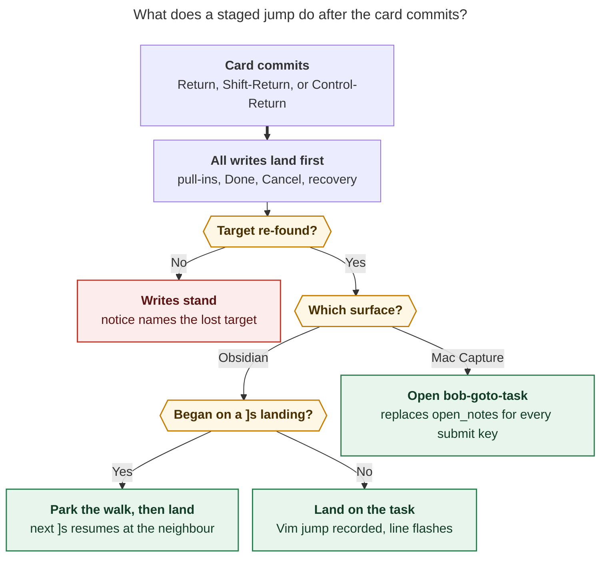

# Ctrl+J "jump successor" for the successor card — design research (cld)

*Researcher: cld · 2026-11-20 · Scope: bob-cli, bob-plugins (bob-navigation-hotkeys,
task-status-cycler), Bob Mac Capture*

## TL;DR

- **Build it.** The idea is sound. The successor card already decides each offer's
  *state* (Leave, Pull in, Done, Cancel). It cannot yet say *where your attention goes
  next*. A jump target fills that gap at the moment you have the most context, and it
  removes a "remember it, then find it again" step. Bob already has every primitive
  this needs:
  - Ctrl+Shift+M follows a moved task to its new note
    (`decisions:task-move-never-advances-the-walk`).
  - `focusTaskAnchor` and the `bob-goto-task` protocol land the cursor on a task.
  - The landing-flash decoration highlights the line you arrive on.
  - ⌃↩ / ⌘↩ already means "capture and open" on the Mac.
- **Design it as a single attention marker that is independent of the row's state, not
  as a fifth verdict.** Ctrl+J toggles one jump marker on the highlighted row. Pressing
  Ctrl+J on another row moves the marker there. Any row with an offer key can carry it,
  whatever that row's verdict.
- **Three rules make it reliable. Each one copies a rule Bob already uses:**
  1. A staged jump turns off Return's "pull in the highlighted row" fallback. Verdicts
     already work this way (§12.22).
  2. The jump runs last, after every write, and finds the task again by its identity
     *after* those writes. It never locates the task by its pre-write line number.
  3. A jump that started from a `]s` landing **parks the walk** instead of advancing it.
     This is the Ctrl+Shift+M rule.
- **Bob computes the landing on the Mac, not the app.** Add a `bob capture -j/--jump
  <N|KEY>` option and a top-level `jump` landing in the JSON. The app opens that landing
  through `bob-goto-task`. A staged jump replaces `open_notes` for **every** submit key,
  not only ⌘↩.
- **Five requirement adjustments** (marked ⚠ in §4). The main ones: the jump fires on
  plain ↩ too; it parks the review walk; it suppresses the highlight fallback; it is
  scoped to rows with an offer key (muted rows wait for v2); and if the target cannot be
  found, the writes still stand.

---

## 1. What exists today (grounded)

### 1.1 The card contract both surfaces share

`docs/task-dependencies.md` §12 (bob-cli) is the single contract for successor offers.

- **Verdicts (§12.22).** Each offer row can stage one verdict: **Leave** (the default),
  **Pull in**, **Done**, or **Cancel**.
  - Ctrl+X stages Done. Ctrl+Shift+X opens an optional inline Cancel reason.
  - "Once any verdict is staged, Return never falls back to the highlighted row."
  - With verdicts pending, Esc must be pressed twice to discard them.
  - Obsidian's Ctrl+Shift+Enter retargets the destination for pull-in rows only.
  - On Mac, ⇧↩ applies the verdicts and skips pull-ins. ⌃↩ applies both and opens the
    notes.
- **Writes and failure.** Capture is all-or-nothing: if a target is stale, nothing is
  written and the card reopens with its staged choices. Obsidian is best-effort: a
  changed row is refused on its own, and the predecessor close is not rolled back.
- **Picker API (§12.13).** Nav exposes `api.successors.pick(model)`, now at version 4:
  - `pick()` resolves `{picks:[{key,destination?}], closes:[{key,outcome,reason?}]}`
    or `null`.
  - A result with only closes is still a commit, not `null`.
  - The cycler attaches capability-gated fields only when the picker version allows them.
    That pattern is exactly what a v5 `jump` needs.
- **Capture CLI (§12.14).** `-p/--pull-in`, `-x/--complete-offer` and
  `-X/--cancel-offer` select by offer number or key. Unknown or stale selectors produce
  write-free teaching refusals.

### 1.2 Mac Capture today

- **Editor keys** (`docs/keyboard.md`).
  - Return captures, then closes the panel.
  - **Control-Return captures, opens Bob's reported notes on their captured lines, then
    closes.** Command-Return is documented as "Same as Control-Return". This is the
    "⌘↩ keymap" in the request.
- **Card keys** (`CaptureKeyCommandRouter.pullInChoiceCommand`, `CapturePullInChoice.swift`).
  - ↩ commits. ⇧↩ skips pull-ins and keeps verdicts. ⌃↩ is "Pull In & Open".
  - ⌘↩ is *consumed* inside the card and does nothing there.
  - The card state carries `openAfterCapture`, which records whether the submit that
    opened the card was ⌃↩ or ⌘↩. The footer hint `⌃↩ Pull In & Open` is dropped when
    that flag is already set.
- **Opening notes.** After a successful capture with `openAfterCapture`, the app builds
  `obsidian://bob-open-notes?count=N&path1=…&line1=…&ref1=…&block1=…` from Bob's
  batch-level `open_notes` (see `CaptureOpenPlan.swift`, `ObsidianOpenURL.swift`). Bob
  builds `open_notes` in `src/native/capture/open_notes.rs`, which follows tasks that
  inbox routing moved within the same batch (`routed_landing`).
- **Ctrl-J in the editor** inserts a new indentation-aware `- ` row. The card does not
  bind J, and the editor's input is locked while the card is up, so **Ctrl-J is free in
  the card**.

### 1.3 Obsidian today

- **Picker.** `SuccessorOfferPickerModal` (nav `206-successor-picker-modal.js`) extends
  `FilteredPickerModal`.
  - Its own keys: Tab, Space, Ctrl/Cmd+A, Ctrl+X, Ctrl+Shift+X, Ctrl/Cmd+Shift+Enter,
    Enter (with a 350 ms open guard), and Esc / Ctrl+[.
  - The base modal adds ↑/↓ and Ctrl+N/P.
  - **Ctrl+J is unbound.**
  - Muted (non-selectable) rows are still `kind:"offer"` items, so the highlight can rest
    on them.
- **Close flow.** The cycler (`task-status-cycler`) plans the close, awaits `pick()`,
  re-reads the affected notes, then applies (`137a-successor-offer-close-integration.js`,
  `130-plugin-references.js` `finalizeClosedTasks`).
- **Review walk.** A Ctrl+Enter that starts on a `]s` landing captures a walk origin
  (`reviewWalk.capture`). After the writes it calls
  `reviewWalk.continue(origin, {kind:"complete", notice, excludeRefs})`, which advances
  the walk once (`140-plugin-vim.js`, nav `536-plugin-review-advance.js`). While the
  picker is open the walk is held (`isReviewSuccessorWalkHeld`).
- **Landing primitives already in nav:**
  - `focusTaskAnchor(file, {line,text,blockId}, {vimJumpContext, ensureEditing})` is the
    shared landing used by both Ctrl+Shift+M's follow and the `bob-goto-task` URL handler
    (`650-plugin-move-commit.js`, `675-plugin-goto-task-uri.js`). It reuses an open leaf
    and records a Vim jump, so `<C-o>` returns.
  - `parkReviewWalkAfterMove(origin, handledRefs)` (`537-plugin-review-move-park.js`)
    parks the walk on a resume point identified by note path and line text.
  - The `bob-landing-flash` line decoration (`676-plugin-open-notes-uri.js`) highlights
    the line you land on.

### 1.4 Where Ctrl+J already means something (consistency check)

| Surface | Ctrl+J today |
| --- | --- |
| Successor card (Obsidian, Mac) | unbound |
| Mac editor | insert a new `- ` row (the card owns keys while it is open) |
| block-id-prompt Task Wikilink picker | **move selection down** (alongside ↓ and Ctrl+N) |
| Album schema, bank setup, and record cards | group or field jumps |
| nav global | Ctrl+Alt+J is a separate command |

The only real collision is muscle memory: someone used to Ctrl+J as "down" in the
wikilink picker might press it here. Two things contain that risk. In this card Ctrl+J
writes nothing until Return, and pressing it again undoes it. And the marker is loud
(§5.4), so a stray press is obvious. The mnemonic (**J**ump) and the card's existing
Ctrl-chord verbs (Ctrl+X, Ctrl+Shift+X) make Ctrl+J a good fit. **Keep Ctrl+J.**

---

## 2. Critique: is this a good idea?

**Yes.** It is worth the four-component cost, for these reasons:

1. **It matches how you actually use the card.** The two motivating cases are real and
   recurring:
   - *Leave the task, but go to it.* You want to reprioritize, schedule, or split it
     instead of pulling it in.
   - *Pull it in, and go fix it.* It needs a dependency, a clearer description, or a
     type.

   Today both mean closing the card, remembering the task, and finding it through Go To
   (`/`) or by hand.
2. **There is a direct precedent and an accepted rationale.** Ctrl+Shift+M was changed
   to *follow* the task because "Bryan keeps working on the task where it now lives"
   (`task-move-never-advances-the-walk`). A jump successor applies the same insight to
   the successor card.
3. **It adds no vault state.** The jump is pure navigation. It never writes a tag, field,
   or block ID, so it cannot conflict with the derived-status or freshness decisions.

**Where the naive version would go wrong:**

- **The highlight-fallback trap.** Today, Return with nothing marked pulls in the
  highlighted row. Your highlight is usually on the row you just marked for jumping. If
  Ctrl+J then Return also pulled that row in, case 1 ("don't pull it in") would be
  silently broken.
- **The walk fights the jump.** A Ctrl+Enter on a `]s` landing auto-advances the walk.
  Jumping and advancing at once is incoherent: two cursor moves, and the second one wins.
- **Line numbers lie after writes.** Pull-ins mint block IDs. Done and Cancel rewrite the
  task line and can prepend Cancel Logs. Recovery stamps `[unblocked::]`. Inbox routing
  can move a task into another note. A jump computed from the offer's pre-write line
  number will land on the wrong row.
- **Key density.** The card already has eight verbs. A ninth is acceptable only if it
  follows the existing patterns exactly: a Ctrl chord, a toggle, and a visible state
  with a footer hint.

**Would I take a different approach?** Not fundamentally. I seriously considered the
alternatives below; see §8 for the full table. The user's model, a staged single marker,
is the right core, with the three reliability rules from the TL;DR added.

- A one-shot "commit and jump" chord. This is fewer keystrokes, but you can't adjust
  anything after it, and it adds a second Return.
- A post-commit "go to" picker. This is a new surface, and the decision record already
  rejected choosing after commit.
- Auto-jumping to the first pulled-in row. This breaks the common "close and keep going"
  flow.

---

## 3. Design principles

1. **The jump records attention, not a task's state.** It never changes what gets
   written. Rows keep their verdicts, and the jump is drawn as its own layer on top.
2. **There is one jump, and it behaves like a radio button.** Moving it is one key on
   the new row, and clearing it is the same key again.
3. **The jump happens last.** All writes, recovery, and receipts settle first, and then
   the cursor moves exactly once.
4. **Identity, not position.** The target is re-found after the writes by block ID, or
   by its known post-write line text. Bob computes it on the capture side.
5. **Failing to land never fails the close.** If the jump can't land, the writes stand
   and one notice says why.
6. **One visual vocabulary across surfaces.** The same icon, words, accent, and footer
   phrase appear in Obsidian, on the Mac, and in receipts.

---

## 4. Requirement adjustments (⚠ = changes or extends what was asked)

| # | Adjustment | Why |
| --- | --- | --- |
| ⚠ A1 | **A staged jump fires on any commit key, not only when ⌘↩ submitted the capture.** On Mac it *replaces* (never adds to) `open_notes` for ↩, ⇧↩, ⌃↩, and an editor ⌘↩ / ⌃↩. | Marking a jump already says "take me there". Making it depend on the submit key would be surprising. "Override ⌘↩" is the special case of "a jump always wins". |
| ⚠ A2 | **A staged jump suppresses Return's highlight fallback**, exactly as verdicts already do. To pull a row in *and* jump to it, mark it (Space or Tab) *and* press Ctrl+J. | Otherwise Ctrl+J then Return on the "leave it, prioritize it" case would pull the task in. This reuses an existing rule rather than inventing one. |
| ⚠ A3 | **A jump that started from a `]s` landing parks the walk** (next `]s` / `[s` resumes at the closed row's neighbour) instead of auto-advancing. | This mirrors `task-move-never-advances-the-walk`. It needs a new decision record that partly supersedes `answering-advances-the-walk`. |
| ⚠ A4 | **Scope v1 to rows with an offer key**, whatever their verdict eligibility. That includes recurring rows, rows created by this capture (`project_created`), and rows whose verdict is refused. Muted or still-blocked rows (no offer key on Mac, `selectable:false` in Obsidian) get the marker in **v2**, once Bob keys them. | Keyed rows cover both motivating cases. Muted rows need Bob to issue a navigation-only key, which is a separate, small contract change. |
| ⚠ A5 | **If the target can't be found after the writes, the writes still stand.** One notice names the lost target. The gesture, walk park, and receipts are otherwise unchanged. | Reliability. Navigation must never make a committed close look failed. |
| A6 | **Esc discards the jump along with everything else.** On Obsidian Esc means "none"; on Mac it goes back to the draft and keeps the staged card state for the reopen. A jump alone never arms the double-Esc. | A jump is a cheap no-write marker. Double Esc exists to protect staged *work*. |
| A7 | **Every jump records a Vim jump**, so `<C-o>` returns to where the gesture began, and the landed line flashes. | Matches walk landings and the Ctrl+Shift+M follow. It makes an unwanted jump cheap to undo. |
| A8 | **Ctrl+J also works on the note-pull and `@route:id@` project cards.** Those are the same offer card. | "Pull in and edit" is just as natural from a lone `@route` pull or a freshly created project. |

---

## 5. Interaction design

### 5.1 Keys (both surfaces)

| Key | Effect |
| --- | --- |
| **Ctrl+J** (literal Control, Mac included) | Toggle the jump on the highlighted keyed row. On a different row, *move* the jump there. Key repeat and IME composition are ignored, as with Ctrl+X. Ignored while the Cancel-reason field is focused. On a header, expand, or fold row it does nothing and the status line says `Jump needs a task row`. The highlight does **not** move, so you can also press Space or Ctrl+X on the same row. |
| Return | Applies the staged picks and verdicts, then jumps. If only a jump is staged, Return commits with no pull-ins (Obsidian: the close already happened, so it just jumps; Mac: it runs the capture with `-p none --jump KEY`). |
| ⇧↩ (Mac) | Skips pull-ins, keeps verdicts **and the jump**. |
| ⌃↩ (Mac card) | With a jump staged, the same as Return: the jump replaces "open notes". The `⌃↩ Pull In & Open` hint hides while a jump is staged. |
| Ctrl+Shift+Enter (Obsidian) | Unchanged. It retargets the *destination* of pull-in rows and is independent of the jump. |
| Esc | Discards everything, jump included (A6). |

**Filtering.** If a filter hides the jump row, the jump stays staged; it is not a
highlight. The footer always names the jump target, so a hidden target is never a
surprise.

### 5.2 How the jump combines with each verdict

The jump is a separate layer, so every combination is legal. Each one reads as one
plain sentence:

| Row verdict | + jump | Reads as |
| --- | --- | --- |
| Leave | ✓ | "Leave it, take me there." (prioritize, schedule, split) |
| Pull in | ✓ | "Link it, take me there." (fix it before starting) |
| Done ✓ | ✓ | "Close it, take me there." (write the Work Log the card skips) |
| Cancel ⊘ | ✓ | "Cancel it, take me there." (salvage notes, write the replacement) |

### 5.3 Copy (one table shared by both surfaces, authored in bob-cli docs §12.24)

Following §12.22's practice, **Bob authors the copy and both surfaces render it.**

| Where | Text |
| --- | --- |
| Row capsule | `Jump` (icon + word) |
| Status line on toggle | `Jump to “{S}” after closing` / `Jump cleared` |
| Footer summary (appended segment) | `then jump to “{S}”`, e.g. `pull in 2 · ✓ 1 done · then jump to “Fix parser”` |
| Footer when only a jump is staged | `Jump to “{S}”` |
| Mac primary button | `Pull In 2 · Jump` / `Close 1 · Jump` / `Jump` |
| Footer hint | `Ctrl+J jump` (Obsidian), `⌃J Jump` (Mac); placed after the Cancel hint and before Esc |
| Landing notice (Obsidian, outside the walk) | `Jumped to “{S}” · Ctrl+O back` (the receipt notice keeps its own lines) |
| Walk toast (composed into the single walk toast) | `… · jumped to “{S}” · ]s resumes after “{P}”` |
| Mac notification body line | `Jumped to “{S}”` |
| Target lost | `Closed — couldn't find “{S}” to jump to` |
| Accessibility (row) | `will jump here after closing` |
| Dry run (`bob capture`) | `would jump to “{S}” · {note}:{line}` |

### 5.4 Visual design ("beautiful")

The jump marker must read as a single locator token, visibly separate from three
existing visual channels:

- the leading **mark slot**, which shows the checkbox, ✓, or ⊘;
- the **Next tint** that pull-ins use;
- the **`→ NAME` destination capsule**.

Rules:

- **One accent, used nowhere else in the card.** Obsidian uses `--interactive-accent` on
  a ~12% accent-tinted pill. Mac uses the system accent (`.tint`). Green stays Done, the
  Cancelled tint stays Cancel, and amber stays caveats (§12.22).
- **The trailing capsule names the action.** Obsidian uses Lucide `locate-fixed` plus
  "Jump". Mac uses SF Symbol `scope` plus "Jump". Avoid the arrows Bob already uses:
  `arrow.turn.down.right` (the Mac hand-off glyph), `↪` (Mac move bands), `→`
  (destinations), and `↳` (receipt tickler lines).
- **A 2 px accent rule on the row's leading edge** (inset shadow) makes the target easy
  to find while scrolling and keeps it distinct from the highlight background.
- **Motion.** On Mac, the capsule moves between rows with `matchedGeometryEffect`. The
  glide shows that only one jump exists. Under Reduce Motion it cross-fades. In Obsidian
  it fades in over 120 ms and respects `prefers-reduced-motion`.
- **Arrival.** The landed line gets the existing `bob-landing-flash` (1200 ms, or 600 ms
  with reduced motion), so Obsidian and the Mac look the same on arrival.

---

## 6. Landing semantics and reliability

### 6.1 Finding the task again after the writes

| Row outcome | Identity used to land | Notes |
| --- | --- | --- |
| Pull in | `notePath#^blockId` | A pull-in always has a block ID; §12.4 mints one for every picked offer that lacks it. The most robust case. |
| Done / Cancel | block ID if present; otherwise the **planned post-write line text** | SV6 resolves verdicts without minting an ID. The writer knows the exact bytes it wrote (`[x]` / `[-]` plus a date field). |
| Leave (recovered) | block ID; otherwise the planned post-recovery text | Recovery may rewrite `?`→` ` and stamp `[unblocked:: today]`. The planned edits are already in `plan.edits`. |
| Leave (untouched) | block ID; otherwise the pre-gesture text near its line | The `line_digest` ref (`<line>:<digest8>`) that goto-task already understands. |
| Moved by inbox routing (Mac) | Bob follows the move | The same `routed_landing` logic that `open_notes` uses. |

The goal is to **never mint a block ID just to jump.** That would write to the vault
for navigation's sake.

### 6.2 Ordering

1. The writes run: picks, verdicts, recovery, reference retirement, and receipts
   (`finalizeClosedTasks`).
2. **Then** the target is resolved against the fresh text.
3. **Then** one landing happens.

In Obsidian this is the tail of the gesture, after the cycler's notices. On Mac, Bob
computes the landing while planning the staged batch, so dry-run and real-run JSON stay
identical (SV16 parity).

### 6.3 Failure modes

| Failure | Behavior |
| --- | --- |
| Target changed or vanished before apply (Obsidian, best-effort) | Writes apply as today. The jump is skipped and a notice appears (A5). If the walk began on a landing, it parks normally. |
| Stale target before apply (Mac, all-or-nothing) | The existing refusal reopens the card **with the jump still staged**. |
| Target note is in Reading view | `ensureEditing: true`, as goto-task already does. |
| Obsidian not running (Mac) | `bob-goto-task` already waits for layout readiness. |
| Older Bob, nav, or cycler | Every half is capability-gated (§7), so the Ctrl+J hint simply doesn't appear. |
| The capture fails | The draft and the staged card return unchanged, as today. |

*Figure 1. The jump is the last step of every commit. If the target can't be found,
the writes stand; Obsidian parks a review walk before landing; Mac Capture opens Bob's
reported landing instead of the usual notes.* (Rendered with mermaid-cli 12.0.0, PDF
config: 804 × 1010 px, 81% fit.)

---

## 7. Contract and architecture per component

### 7.1 bob-cli (first, per `decisions:mac-capture-is-a-thin-client`)

**Docs.** Add a new section, `docs/task-dependencies.md` §12.24 "Jump successor", with
vectors (JV1…). Cross-link it from `docs/capture.md`.

**CLI option.** Add `-j, --jump <N|KEY>`. Following `cli_rules.md`, options stay sorted,
and `-j` is free. The capture command's short flags are currently
`b c d D E f h i m n p r R s t x X`. Help text: *"After the capture, land on this
successor offer in Obsidian (number or key). Implies nothing about pull-in."*

- It takes a single value, uses the same probe mapping as `-p/-x/-X`, and is refused
  write-free with the code `unknown_jump` when the value is unknown or stale.
- It is not a pull-in choice for `--require-pull-in-choice`.

**JSON.**

- Add a top-level object `jump: {key, path, relative_path, line, ref, block_id, label,
  outcome}`, where `outcome` is one of `left`, `pulled_in`, `done`, or `cancelled`.
  `line` and `ref` are computed from the staged post-write text with the existing
  `line_digest` helper and follow routed moves.
- Add a capability flag, `pull_in.jump: {supported: true}`. The Mac sends `--jump` only
  when this is present, the same way it gates `close.supported`.

**Human output.** Print `jump: “{S}” ({note}:{line})`. A dry run adds
`· -j N jump` to the offer hint.

**Shared code.** The landing computation should live beside `open_notes.rs` and reuse
`landed_note` and `routed_landing`.

### 7.2 bob-navigation-hotkeys (picker v5 and walk follow)

**Picker v5.**

- Bump `api.successors.version` to 5.
- The model may carry `jump: {supported: true}`. Ctrl+J and its hint appear only when it
  does.
- `pick()` resolves `{picks, closes, jump: {key} | null}`. A result with only a jump is
  a commit, not `null`, mirroring v4's closes-only rule.
- `prospectiveKeys()` and the Return branch treat a staged jump like staged verdicts: no
  highlight fallback.

**Review walk.** Extend `reviewWalk.continue(origin, outcome)` to accept
`outcome.follow = {path, line, text, blockId}`. When present, it calls a generalized
`parkReviewWalkAfterFollow` (today's `parkReviewWalkAfterMove`) and then
`focusTaskAnchor`, and composes one toast. Bump `reviewWalk.version` so the cycler can
feature-detect it.

**New API outside the walk.** Add `api.landOnTask(target)` v1, a thin frozen wrapper over
`focusTaskAnchor` that adds the landing flash and a captured Vim jump context. Nav-owned
card hosts, such as promotion successors (`667-plugin-project-promotion.js`) and
relation complete-label commits, call it directly.

### 7.3 task-status-cycler

- `pickSuccessorOfferChoices` passes `jump.supported` only when nav reports v5, and
  `normalizeSuccessorChoices` keeps `jump`.
- After the apply pass, it resolves the target (§6.1) and returns `jumpTarget` with the
  successor result. Use the same pattern as `successorNoticeBox`: add
  `successorNoticeBox.follow`.
- **The gesture tail chooses where the target goes:**
  - If the gesture captured a walk origin, call `walk.continue(origin, {kind:"complete",
    notice, excludeRefs, follow})`.
  - Otherwise call `api.landOnTask(follow)`.
- The tail covers every managed Done entry point: a Task Link, a task line, a Pomodoro
  line, a PRE/POST claim, Alt+] into Done, and `x*` / unlink relation-successor parks.

### 7.4 Bob Mac Capture

- **State.** `CapturePullInOutcomes` gains `jumpKey`, so the "Back" restore and a refused
  card reopen keep it.
- **Keys.** Add a `CaptureKeyCommand.togglePullInJump` case, mapped from `KeyCode.j` with
  `modifiers == .control` in `pullInChoiceCommand`.
- **Rows and footer.** The row capsule uses `matchedGeometryEffect`. Update the footer
  hints, summary, button label, and the accessibility text.
- **Commit.** Add `--jump KEY` to argv when `pull_in.jump.supported` is set.
- **On success.** If `success.jump` exists, open `ObsidianOpenURL.taskGotoURL(path:line:
  ref:blockID:)` **instead of** `openNotesURL(openPlan)`, regardless of
  `openAfterCapture` (A1). The notification's "Open Notes" action keeps `open_notes`,
  because the jump has already happened.
- **Testing.** The macOS CI gate applies (the repo's `AGENTS.md`).

---

## 8. Alternatives considered

| Alternative | Verdict | Reason |
| --- | --- | --- |
| **Jump as a fifth verdict** (instead of a separate layer) | Rejected | It would forbid "pull in and jump" and "Done and jump", which the request explicitly wants. |
| **Ctrl+J commits and jumps in one press** | Rejected for v1; reconsider if Ctrl+J is almost always followed by Return | It saves one key, but nothing can be adjusted afterward, it adds a second Return, and it breaks the card rule that only Return-family keys commit. |
| **Post-commit "Go to which successor?" picker** | Rejected | A new surface. The successor-offers decision already rejected "choose after commit", and the offer identities are gone by then. |
| **Auto-jump to the first pulled-in row** | Rejected | It breaks the common close-and-continue flow, and the walk would fight it. |
| **Add the jump to `open_notes` as the "primary" note** | Rejected | That opens multiple notes. A jump is a single task landing, and "replace" is easier to predict than "add". |
| **Mac computes the landing from the offer row** | Rejected | Lines shift and inbox routing moves files. It would also break the thin-client decision. |
| **Mint a block ID on the jump target to make it addressable** | Rejected | It writes to the vault for navigation's sake. Planned post-write text is enough. |
| **Let the walk advance, then jump** | Rejected | That is two landings, and the walk's resume point would be lost. Parking matches the Ctrl+Shift+M rule. |
| **A different key (Ctrl+G "go", Ctrl+O "open")** | Not preferred | Ctrl+O is Vim's back jump, which the landing relies on. Ctrl+G is less mnemonic than J. Ctrl+J is free in both cards and was requested. |

---

## 9. Risks and open questions for Bryan

1. **Ctrl+J habit from the Task Wikilink picker**, where it means "down". The risk is
   low, since the toggle is visible and reversible, but watch for it. If it bites, the
   wikilink picker could stop using Ctrl+J for "down" (it also has ↓ and Ctrl+N).
2. **Walk-park precedent.** Do you agree that a jump from a `]s` landing should park
   rather than advance (A3)? This needs a new decision record.
3. **Muted rows (A4 v2).** Is jumping to a still-blocked dependent, for example to fix
   its prerequisites, common enough to justify issuing navigation-only keys now?
4. **Mac Esc semantics.** Esc returns to the draft with the card state retained. Should
   reopening the card restore the jump? I recommend yes, since it is part of the staged
   state.
5. **Rollout order.** Obsidian (nav and cycler) can ship first; the Mac waits for bob-cli
   `-j`. Each half is independently capability-gated.

---

## 10. Recommended solution

**Ship a capability-gated "jump successor": one staged attention marker per successor
card, toggled with Ctrl+J and independent of the row's verdict.**

1. **Semantics.**
   - **One marker per card.** Ctrl+J toggles it on the highlighted keyed row and moves it
     when pressed on another row.
   - **Any verdict.** The marker composes with Leave, Pull in, Done, or Cancel.
   - **No fallback.** A staged jump suppresses Return's highlight fallback (A2).
   - **Esc discards it** (A6).
   - **Every commit key fires it** (A1).
2. **Reliability.**
   - **Last step.** The jump runs after every write.
   - **Identity.** It finds the target by identity: block ID first, then the planned
     post-write text, with no ID minting.
   - **Failure.** It never fails the gesture (A5).
   - **Walk.** A jump from a `]s` landing parks the walk instead of advancing it (A3).
   - **Back.** `<C-o>` returns to where the gesture began (A7).
3. **Contract.**
   - **bob-cli first.** Add `-j/--jump`, `jump` JSON, the `pull_in.jump.supported`
     capability, and §12.24 docs with vectors.
   - **Nav.** Picker v5 with `{jump}` in the result, plus `reviewWalk` `follow` and a
     new `api.landOnTask`.
   - **Cycler.** It resolves and routes the target.
   - **Mac.** It shows the card UI, passes `--jump`, and opens `bob-goto-task` in place
     of `open_notes`.
4. **Look.** Every surface uses the same marker:
   - one accent locator capsule ("Jump", `locate-fixed` / `scope`) and a leading accent
     rule;
   - the footer phrase "then jump to “{S}”";
   - a gliding capsule on the Mac;
   - the shared landing flash on arrival.
5. **Docs and memory.**
   - Add §12.24 and update the keyboard docs in both repos.
   - Add a glossary term, **Jump Successor**.
   - Add a decision record, "A jump successor parks the walk", which partly supersedes
     `answering-advances-the-walk`. A second, "A staged jump replaces open", is optional.

**Suggested phasing** (an epic of about five phases):

1. bob-cli contract, CLI option, JSON, and vectors.
2. Nav picker v5 and the walk follow/park.
3. Cycler wiring across all managed-Done entry points.
4. Mac card, argv, and open, gated by macOS CI.
5. Docs, glossary, and decision record.

Phases 2–3 and phase 4 can run in parallel after phase 1.
