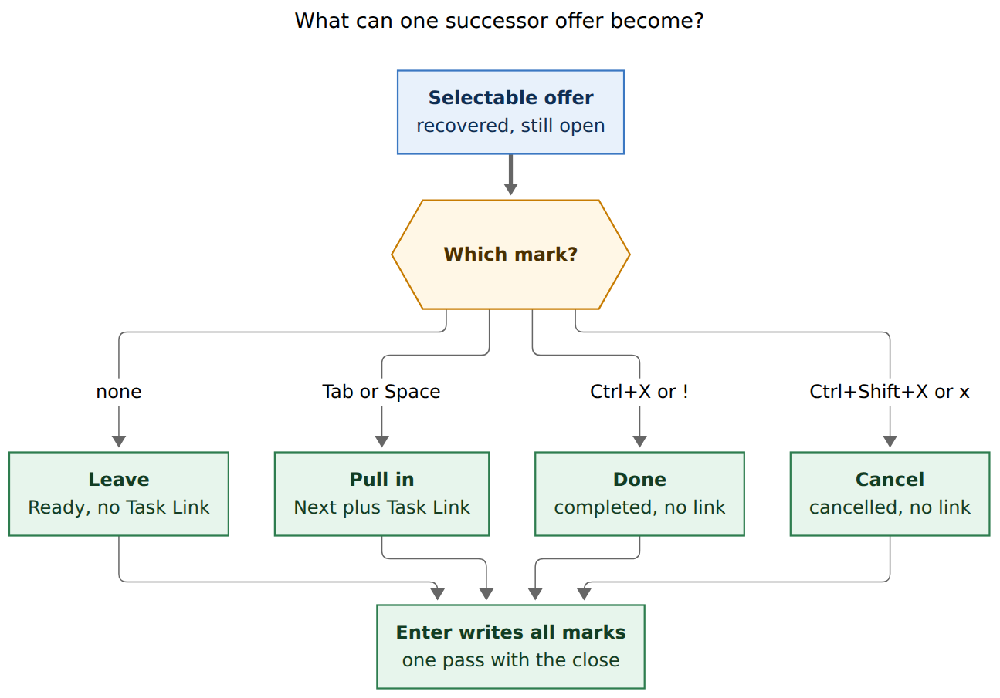
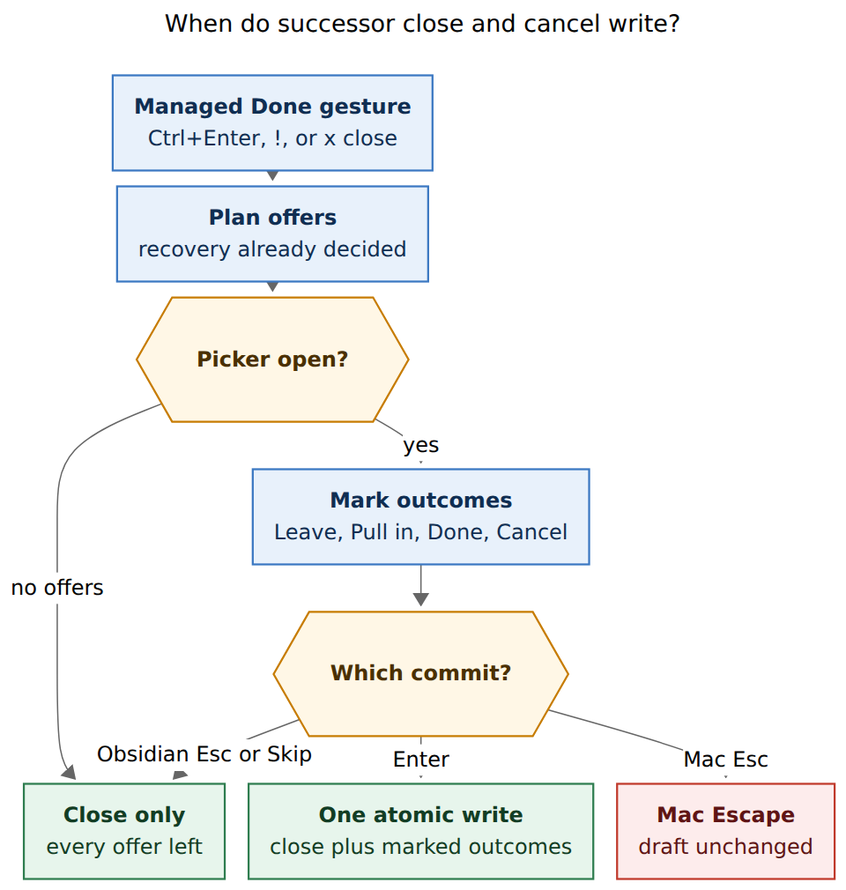

# Close and cancel from successor menus

> **Research query.** Bryan wants to close and cancel tasks from successor
> menus in Obsidian and Bob Mac Capture, perhaps with `Ctrl+X` to close and
> `Ctrl+Shift+X` to cancel, because some offers are already complete or now
> obsolete at the moment they appear. Lead the design. Critique the idea.
> Adjust requirements that need adjusting, and end with a recommended
> solution.

**Researcher:** grk. Independent swarm report. Baselines: bob-cli
`docs/task-dependencies.md` §12, bob-plugins successor picker
(`206-successor-picker-modal.js`, `api.successors` v3), Bob Mac Capture
Pull-In card (`CapturePullInChoiceView.swift`, `keyboard.md`), and
`research:202610/successor_pull_in_offers/successor_pull_in_offers.md`.

## Bottom line

**Build it.** The idea is sound, and the original chord sketch is the wrong
shape. The successor picker is already a mark-then-Enter surface. Closing a
row the instant `Ctrl+X` is pressed would split the managed Done write,
fight take-back, and collide with keys that already mean something else.

**Recommended design, in one sentence:** each selectable offer gets one
exclusive outcome — Leave, Pull in, Done, or Cancel — collected in the
existing picker and applied in the same revalidated write as the original
close.

- **`Ctrl+X` / `!` marks Done.** Completes that successor with the same
  bytes as capture `!note:id`. No Task Link. No work-log prompt.
- **`Ctrl+Shift+X` / `x` marks Cancel.** Cancels it with the Task Card
  cancel writer and a blank-reason fallback. No extra prompt in v1.
- **Tab / Space still mark Pull in.** Destination capsules and the plan
  meter count only these rows.
- **Enter applies every mark.** Esc and Skip keep today's meaning: the
  original close stands in Obsidian; Mac Escape still aborts the whole
  capture.
- **No nested picker in v1.** Dependents of a Done/Cancel mark recover
  automatically and resurface as ticklers. They are not offered in this
  gesture.

That is the missing half of Successor Offers. Picking used to mean "do this
next." It should also mean "this one is already finished" and "this one is
obsolete," which morning review and decay are the wrong tools for.

## Is this a good idea?

Yes. The 2026-10 successor-offer research made recovery automatic and the
Task Link a choice, then used the TICKLER and NEW tiers as the safety net
for everything left behind. That net is for work that **still needs
doing**. It is a poor home for work the user can already classify as done
or obsolete while looking at the offer list.

Three facts from the current contract make the gap concrete:

1. **Unpicked offers are designed to come back later.** Fully unblocked
   recoveries receive `[unblocked:: today]` when the WRITE rule applies,
   then walk as TICKLER the next morning
   (`decisions:unblocked-tasks-resurface-as-ticklers`,
   `docs/task-dependencies.md` §12 opening). Keep-moving and relation
   offers that are already Ready or Next simply stay in their lanes until
   they rot.
2. **Rotten review is a keep/decay ladder, not a completion inbox.** A
   due keep asks "is this still the work, as written?" and eventually
   opens a decay card (`glossary:task-decay`). Completing or cancelling
   from that walk is possible (`Ctrl+Enter`, Task Card `x`), but it is
   days later, on a different surface, after the context that made the
   verdict obvious has gone.
3. **The user is already in a multi-select review of exactly those
   tasks.** The picker already groups hand-offs, project residents,
   keep-moving rows, and relation standing offers, with lanes, notes, and
   destinations on each row (`§12.13`, Mac `capture-previews.md`). Asking
   them to dismiss the picker and hunt each obsolete row is the same
   miss the old 5-successor breaker produced, just for resolve instead of
   link.

The original Successor Offers report deferred "offer on cancel" because
"won't do" rarely means "do the follow-up now." This request is the
inverse: the follow-ups are on screen, and some of them should not be
done at all.

## Critique of the requested chords

The requested `Ctrl+X` close and `Ctrl+Shift+X` cancel name the right
split (done versus obsolete) and a chord family that does not type into
the filter. Four problems follow if those chords **write immediately**.

### Immediate close splits the gesture

Obsidian already plans without a selection, awaits `pick(model)`,
re-reads, re-plans with the picks, and applies (`§12.13`). Capture
collects `--pull-in` **before** any write (`mac-capture-is-a-thin-client`,
`pull_in_choice_required`). A later picker after commit was rejected in
the 2026-10 research because it cannot revalidate the same anchors and
breaks the single write set.

An immediate `Ctrl+X` that completed the highlighted successor before
Enter would be a second write: either the original close has not happened
yet, or it has and the successor pass is over. Both violate "one gesture,
one write set" (`§12.2` SELECTION).

### `Ctrl+X` is already a Bob chord, just not in this picker

| Surface | What `Ctrl+X` / Control-X does today |
| --- | --- |
| Obsidian Pomodoro entry picker | Merges the highlighted current/future Pomodoro (`docs/bob-navigation-hotkeys.md`, Pomodoro gestures) |
| Obsidian successor picker | Unused. `handleKeydown` only special-cases Enter, `Ctrl+A`, Tab, and arrows (`206-successor-picker-modal.js`) |
| Mac capture editor | Command-X is cut. Control-X is unbound on the Pull-In card (`CaptureKeyCommandRouter.pullInChoiceCommand`) |
| Mac Refs Tabs | Control-X closes a selected open tab (`RefsKeyRouter.swift`) |

Scoped to the successor picker, `Ctrl+X` is free. Globally it is not. The
chords must `preventDefault` only while this modal is open, and only when
the filter is empty, so filter cut stays cut.

### `Ctrl+Enter` looks like "close" and must not be reused here

In Obsidian the successor picker **swallows** Ctrl+Enter today (Enter with
`ctrlKey` returns without applying). That empty slot is tempting. On Mac
Capture, Control-Return is already **Pull In & Open**. Using Ctrl+Enter
for Done would fork the two surfaces. Do not.

### Four outcomes fit the Move card, not a pair of fire-and-forget keys

Bob already has a picker whose rows carry exclusive outcomes: the project
Move card. Every row starts as Leave; `^` is Move; `:` is Move & link;
Return applies the marks (`docs/task-pickers.md`, `--move-in`). Successor
resolve is the same shape with a fourth outcome.

## What exists today

### One picker, one binary mark

Obsidian (`SuccessorOfferPickerModal`):

- Footer: Tab toggle and move · Ctrl+A mark group · ↵ pull in · Esc none ·
  Ctrl+Shift+Enter retarget.
- Marks are a `Set` of keys. Enter applies the marked set, or the
  highlighted selectable row when the set is empty.
- Highlight and mark are independent. Muted still-blocked rows cannot be
  marked.
- `pick()` resolves `{picks: [{key, destination?}]}` or `null`. `null` is
  none.

Mac Pull-In card:

- Space marks the highlight. Command-A marks all. Return confirms.
  Shift-Return skips with `--pull-in none`. Escape returns to the
  unchanged draft. Control-Return confirms and opens notes.
- Rows are 44pt, two-line, with a checkbox and a green destination
  capsule on rows Return will pull in.
- The app never writes. It passes identity keys to `bob capture -p`.

CLI:

```text
-p, --pull-in <PICKS>   all, none, or a comma list of numbers and keys
```

`-X` is unused. `-C` is unused on `bob capture`. Extending `-p` is the
additive path; a second flag is not required.

### Close and cancel already have writers

| Intent | Writer to reuse |
| --- | --- |
| Complete an existing open task | Capture `!note:id` / cycler Ctrl+Enter: `[x]` plus `[completion::]`, strike live Task Links, recover dependents, refuse recurring (`docs/capture.md`, Completing tasks with `!`) |
| Cancel an existing open task | Task Card `x` then optional reason: `[-]` plus `[cancelled::]`, Cancel Log, prune today's live links. Recurring refused. Cancel never offers successors (`§12.1`) |
| Pull in | Current pick: raise Next, mint `^id` if needed, stamp `[fresh:: today]`, insert the Task Link |

Done from the picker must not prompt for a Work Log. Capture `!` does not.
The user's claim is "this is already complete," not "I just did this in
the session." Cancel from the picker should use the blank-reason fallback
the cancel-reason stage already has (`↵ to skip`), not open a nested
reason modal in v1.

### Take-back is link-shaped

Same-day Obsidian reopen of the predecessor takes back **untouched
successor links** and restores those lines from an in-memory receipt
(`§12.10` Undo, cycler docs). Rust has no take-back. A successor completed
or cancelled from the picker is not a link. Take-back must not reopen it.

## Requirement adjustments

These change the request as written. Each is justified.

1. **Marks, not immediate writes.** `Ctrl+X` and `Ctrl+Shift+X` set the
   highlighted row's outcome and move to the next row, the way Tab
   already toggles Pull in and moves. Enter is the only commit. This
   keeps one write set, one undo, and one stale-line revalidation.
2. **Four exclusive outcomes, not two extra keys beside Pull in.** A row
   is Leave, Pull in, Done, or Cancel. Tab / Space select Pull in. Done
   and Cancel replace a Pull-in mark on that row rather than stacking
   with it. A second press of the same outcome key returns the row to
   Leave.
3. **Letter aliases when the filter is empty.** `!` marks Done (capture's
   complete sigil). `x` marks Cancel (Task Card). They are no-ops once
   the filter has text, so searching for "fix" still types `x`.
4. **Selectable offers only in v1.** Muted still-blocked rows, folded
   hidden / already-planned counts, and `^prj` group headers stay
   un-markable. Killing a whole blocked tree is a later "cancel group"
   gesture, not this picker.
5. **No cascade picker in v1.** Completing a successor recovers its
   dependents and does **not** offer them in this gesture. They get the
   ordinary `[unblocked::]` WRITE and resurface as ticklers. Nested
   "already done" chains are rarer than the currently visible set; a
   live in-picker expansion is the beauty upgrade if that proves false.
6. **No work-log prompt and no cancel-reason prompt in v1.** Blank
   cancel uses the existing fallback log entry. A shared optional reason
   can wait until silent cancels feel too quiet.
7. **Recurring rows cannot be Done or Cancel.** Same refusal as `!` and
   Task Card cancel: complete them in Obsidian Tasks so the next
   occurrence is written. Show the reason on the row; the keys no-op.
8. **Take-back ignores Done and Cancel marks.** Reopening the
   predecessor restores only pulled-in links whose lines are still the
   bytes this pass wrote.
9. **Plan budget counts Pull in only.** Done and Cancel do not add
   today's Task Links and must not turn the meter red.
10. **Feature-detect picker API v4.** Older nav (`api.successors.version < 4`)
    keeps today's binary picker. The cycler must not hand it outcomes it
    would drop. Mac decodes an additive `pull_in.outcomes` list; missing
    means pull-in only.
11. **Do not bind Ctrl+Enter / Control-Return to Done.** Mac Control-Return
    stays Pull In & Open. Obsidian Ctrl+Enter stays swallowed or, if
    rebound, must remain "apply" rather than "complete this row."
12. **Ctrl+A stays "mark group as Pull in."** Mass-Done from a group mark
    is too easy to fire. Group cancel is out of v1 with muted rows.

## Recommended solution

Call the feature **Successor Resolve**. It is an additive outcome enum on
the existing offer protocol, not a new menu.

### Row outcomes



**Caption.** Each selectable successor offer is Leave, Pull in, Done, or
Cancel. Those marks are exclusive. Enter writes every marked outcome with
the original close.

Rendered size: 862.3 × 604 px; fit scale: 75.7%. Mermaid CLI 12.0.0.

| Outcome | Mark glyph | Visual | Write |
| --- | --- | --- | --- |
| Leave (default) | `□` | Current unmarked row | Recover only, as today |
| Pull in | `☑` | Current marked row plus destination capsule | Next, mint `^id`, stamp fresh, insert Task Link |
| Done | `✓` | Complete tint; title can take a light strike; **hide** the destination capsule | Same as `!note:id`; strike any live link this successor already had |
| Cancel | `⊘` | Cancel/danger tint; hide the destination capsule | Same as Task Card cancel with blank reason; prune live links |

Muted rows keep `□` in faint colour and ignore the new keys.

The Mac already lights pull-in rows green (`CapturePullInDestinationCapsule`,
`isEffective`). Done should use the complete-label ✓ tint already used on
`relation_completes[]` preview rows. Cancel should use the ⊘ tint already
used on `relation_cancels[]`. No new hue vocabulary.

### Keys

Intercept only in this picker, and only when the filter is empty (except
the existing Tab / Space / Enter / Esc / retarget chords).

| Key | Obsidian | Mac Capture |
| --- | --- | --- |
| Tab | Toggle Pull in and move (unchanged) | Filter / unused as today |
| Space | — | Toggle Pull in (unchanged; types into a nonempty filter) |
| `Ctrl+X` / Control-X | Mark Done and move | Mark Done and move |
| `Ctrl+Shift+X` / Control-Shift-X | Mark Cancel and move | Mark Cancel and move |
| `!` (empty filter) | Mark Done and move | Mark Done and move |
| `x` (empty filter) | Mark Cancel and move | Mark Cancel and move |
| Ctrl+A / Command-A | Mark group / all as Pull in | Mark all as Pull in |
| Ctrl+Shift+Enter | Retarget Pull-in rows only | Unchanged elsewhere |
| Enter / Return | Apply all marks | Apply all marks |
| Esc | Close with every offer left (`null` picks) | Abort capture, draft unchanged |
| Shift-Return | — | Skip: `--pull-in none`, close proceeds |

Second press of Done or Cancel on the same row returns it to Leave.
Applying Done or Cancel to a row that was marked Pull in replaces that
mark.

Footer hints, in priority order, collapsing with `ViewThatFits` on Mac
and wrapping on Obsidian:

`Tab pull in · Ctrl+X done · Ctrl+⇧X cancel · ↵ apply · Esc none`

When any Done or Cancel mark exists, the primary button label becomes
**Apply** instead of **Pull In**, and the summary reads

`pull in 2 · ✓ 1 · ⊘ 1`

The plan meter stays `plan current/max → next/max` and adds only Pull-in
rows.

### Write path



**Caption.** Enter re-plans marked outcomes into the original close.
Obsidian Escape and Mac Skip write the close with every offer left. Mac
Escape aborts and writes nothing.

Rendered size: 639.4 × 674 px; fit scale: 100%. Mermaid CLI 12.0.0.

Selection remains an input to each engine's existing single write pass:

```text
plan (no selection) → pick outcomes → re-read → re-plan with outcomes → apply
```

Re-plan rules, additive on `§12.2`:

- Pull-in keys keep today's PICK path.
- Done keys are extra members of C for recovery of *their* dependents,
  but those dependents are **recover-only** in this gesture (`not_linked:
  resolved_in_picker`). They are not new offers.
- Cancel keys run the cancel writer, recover dependents, and never
  offer (`§12.1` cancel exclusion stays).
- A key marked Done or Cancel is removed from the offer set (DEDUP), so
  it cannot also be linked.
- Stale line, missing note, or a row that became Blocked / closed /
  recurring since plan: refuse that row loudly; write nothing, matching
  SO30.

Walk landings: the picker still holds the gesture lock; after settle the
walk advances **once** for the original landed row. Done/Cancel marks do
not extra-advance and do not steal focus (`§12.6` walk landings).

Undo: one Obsidian undo / one capture rollback for the whole set.

### CLI and JSON

Extend `-p, --pull-in` the way `-m, --move-in` already prefixes `:KEY`
for "also link":

```text
ITEM := [OUTCOME] (N | KEY)
OUTCOME := empty | '!' | '-'
```

Examples:

```bash
bob capture -p 1,3 -- '!sase:fix-apollo'          # pull in 1 and 3
bob capture -p '1,!2,-3' -- '!sase:fix-apollo'    # pull in 1, complete 2, cancel 3
bob capture -p none -- '!sase:fix-apollo'         # leave all (unchanged)
```

`all` stays "pull in every selectable offer." There is no `all-done`.
Unknown prefixes, mixed `all` with outcomes, and `-p -3` eaten as a flag
are teaching errors; quote the list or put it after `--`.

JSON, additive:

```json
{
  "offer": {
    "key": "sase.md#^relaunch-failed-agents",
    "n": 2,
    "selected": false,
    "outcome": "done"
  }
}
```

`outcome` is `pull_in` | `done` | `cancel` | omitted (means pull_in when
`selected` is true). `pull_in.outcomes` on the batch is
`["pull_in","done","cancel"]` when this Bob supports resolve, so Mac can
feature-detect without guessing.

Human output adds two row verbs next to `linked` and `unblocked`:

```text
  completed [?] → [x] Re-launch all failed agents  sase.md ^relaunch-failed-agents
  cancelled [ ] → [-] Old retry spike  sase.md ^old-retry
  linked    [?] → [*] Book flights  travel.md ^book-flights → FIX
```

Notice / walk toast compose one extra line, for example
`✓ 1 done · ⊘ 1 cancelled · pulled in Book flights`.

### Surfaces in scope

Every current successor picker, because they share the protocol:

- Managed Done: Ctrl+Enter, Alt+] into Done, capture `!`, `x!M`, complete
  labels.
- Keep-moving groups (`§12.15`).
- Relation groups (`§12.18`).
- Promotion and `@route:id@` project-created offers.
- Lone `@route` note-pull.

Parking (`x*`) still offers relation rows only; Done/Cancel marks are
valid there too (a standing `starts after` source can already be
finished or obsolete).

### Beauty notes (so the picker stays itself)

The current picker is already a designed object: grouped, filterable,
highlight versus mark, destination capsules, keep-moving Next accent,
relation `link-2` accent, a plan meter that warns instead of refusing.
Resolve should **reuse those channels**, not add a second chrome.

- Keep the 44pt two-line Mac row and the Obsidian
  `bob-successor-row` flex. Change only the mark glyph and one tint
  class (`is-done`, `is-cancelled` beside `is-marked`).
- Hide `→ DEST` on Done and Cancel. A destination on a row that will
  not be planned is a lie.
- Do not strike the whole row so hard it becomes unreadable; a light
  title strike plus ✓ / ⊘ is enough.
- Do not add footer buttons for Done and Cancel on Mac. The two buttons
  stay Skip and Apply. The glyphs in the list carry the meaning, as
  checkboxes already do for Pull in.
- Ctrl+A remaining Pull-in-only keeps the dangerous verbs slower than
  the habitual one. That is a beauty choice as much as a safety choice.

## Alternatives considered

| Approach | Verdict |
| --- | --- |
| Immediate `Ctrl+X` write, picker stays open | **Reject.** Splits the write set, races the original close, and makes undo a stack of gestures. |
| `Ctrl+Enter` to complete the highlight | **Reject.** Collides with Mac Pull In & Open. |
| Jump to the row and use ordinary Ctrl+Enter / Task Card `x` | **Reject as primary.** That is today's path and the one Bryan wants to avoid. |
| After Skip, open a second "resolve leftovers" picker | **Reject.** Loses the hand-off moment; two modals for one close. |
| Persistent "Unblocked today" tray | **Already rejected** as primary in 2026-10. Review tiers still exist for leftovers that need doing. |
| Auto-complete offers whose text looks done | **Reject.** Status is derived from writes, not prose. |
| Cascade live into the same picker when a row is marked Done | **Defer.** Beautiful if nested "already done" is common; expensive (dry-run replan on every mark, Mac thin-client round trip). Ship v1 without it. |
| New `-X/--close-offers` and cancel flags | **Reject.** `--move-in` already proved that one choice flag with prefixes is the capture pattern. `-p` is the flag Mac already submits. |
| Allow Done/Cancel on muted still-blocked rows | **Defer.** Correct for "this whole blocked tree is dead," too easy to mis-hit next to unselectable chrome. |
| Prompt for work log / cancel reason | **Defer.** The claim is already-done / obsolete. Prompts would make resolve slower than leaving the picker. |
| Offer on cancel of the predecessor | **Out of scope.** Still deferred from 2026-10. This feature resolves *offers*, not the cancelled predecessor's would-be successors. |

## Implementation sketch

One epic across the three repos, same shape as Successor Offers.

| Phase | Repo | Scope |
| --- | --- | --- |
| P1 contract | bob-cli | `docs/task-dependencies.md` §12 PICK + outcomes; SO vectors; `docs/capture.md` `-p` prefixes; `docs/freshness.md` (Done/Cancel do not stamp); `docs/task-status-hooks.md` pointer; new decision record (do not edit `unblocked-tasks-are-offered` in place) |
| P2 Rust | bob-cli | Parse `!` / `-` prefixes on `--pull-in`; apply `!` and cancel writers in the staged batch; DEDUP; JSON `outcome`; capability `pull_in.outcomes`; tests |
| P3 plugins | bob-plugins | `api.successors` v4 `{picks: [{key, destination?, outcome}]}`; picker marks, keys, CSS; cycler re-plan; take-back exclusion; notice copy; walk toast |
| P4 Mac | bob-mac-capture | Decode outcomes; row glyphs and tints; Control-X / Control-Shift-X / empty-filter `!` and `x`; Apply label; submit prefixed `-p`; older Bob fallback |
| P5 polish | all | Optional live cascade; optional shared cancel reason; group-header cancel |

Ship P2 and P3 together. An old plugin with a new bob still only pulls
in; a new plugin with an old bob never shows Done/Cancel.

**Acceptance highlights:**

- Fan-out of 11: any mix of Leave / Pull in / Done / Cancel, nothing
  pre-marked, Enter writes exactly that mix.
- Esc in Obsidian: predecessor completes, every successor recovers, none
  completed or cancelled from the picker.
- Esc on Mac: draft unchanged, including the predecessor.
- Recurring offer: keys no-op, row explains why.
- Same-day reopen of the predecessor: pulled-in links taken back;
  Done/Cancel successors stay terminal.
- `--pull-in '1,!2,-3'` on `!note:id` matches the picker mix.
- Walk: one advance, one toast, no second landing on a resolved
  successor.

## Open questions (with defaults)

1. **Blank cancel log text.** Default: existing fallback (`🤷 no reason
   given` or the cancel planner's fallbackReason). Alternative: one
   shared optional reason the first time a Cancel mark is set.
2. **Live cascade.** Default: off in v1. Say if nested already-done
   chains are common enough to replan the picker on every Done mark.
3. **Note-pull and promotion.** Default: same outcomes. Alternative:
   resolve only on managed Done, keep those pickers pull-in-only.
4. **In Progress keep-moving rows.** Default: Done is allowed and silent
   (no Work Log). Alternative: refuse Done on `[/]` and tell the user to
   close it from the task.

## Sources

- `docs/task-dependencies.md` §12, §12.1–§12.2, §12.13–§12.15, take-back
  undo, SO vectors.
- `docs/capture.md` Completing tasks with `!`; `-p/--pull-in`;
  cancel-label commits.
- `docs/reference/cli/capture.md` flag list (`-p` present, `-X` free).
- bob-plugins `plugins/bob-navigation-hotkeys/src/206-successor-picker-modal.js`
  (keys, marks, footer, `api.successors` version 3).
- bob-plugins `plugins/bob-navigation-hotkeys/styles.css`
  `.bob-successor-row` mark/highlight system.
- bob-plugins `docs/bob-navigation-hotkeys.md` Pomodoro `Ctrl+X` merge;
  successor retarget.
- bob-plugins `docs/task-card.md` `x` cancel-reason stage.
- bob-plugins `docs/task-status-cycler.md` successor offers, take-back.
- bob-mac-capture `docs/keyboard.md`, `docs/capture-previews.md`,
  `docs/task-pickers.md` Move card outcomes and `--move-in`.
- bob-mac-capture `Sources/BobMacCapture/CapturePullInChoiceView.swift`,
  `CaptureKeyCommandRouter.swift`, `Refs/RefsKeyRouter.swift`.
- `research:202610/successor_pull_in_offers/successor_pull_in_offers.md`
  (recovery automatic, link is a choice, post-commit picker rejected,
  tray rejected, offer-on-cancel deferred).
- Decisions: `unblocked-tasks-are-offered`,
  `unblocked-tasks-resurface-as-ticklers`, `mac-capture-is-a-thin-client`,
  `task-lanes-are-sticky`, `task-decay-is-one-ladder`,
  `answering-advances-the-walk`.
- Glossary: Successor Offer, Task Successor, Task Decay, Rotten Log,
  Work Log.

Nothing in code or the vault was changed. This report is design research
only.
