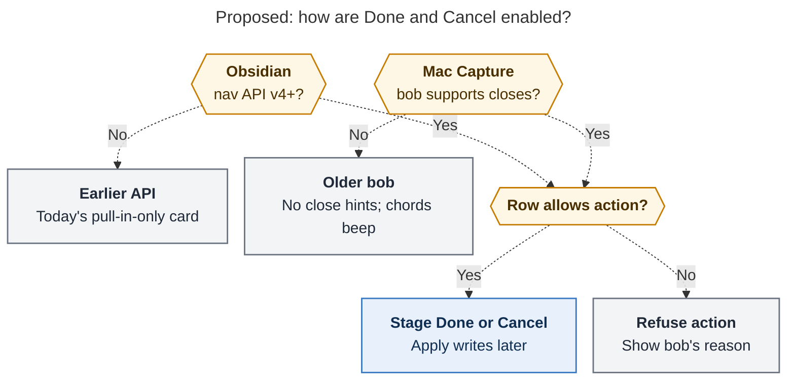
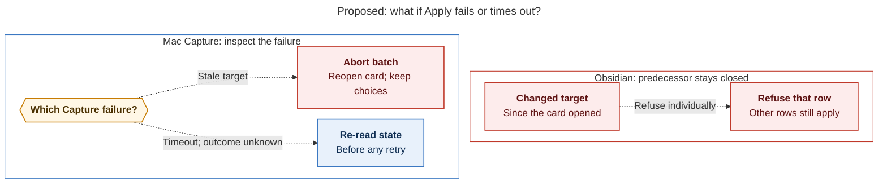

# Diagram proposals: Close and cancel tasks from successor cards

Proposals for the swarm linker, not a report. Each diagram restates only what the source
report says.

```yaml
source: research:202611/successor_offer_verdicts/successor_offer_verdicts__final.md
producer: research.3g.image
check: "mmdc 12.0.0 with the PDF-mirroring config and Puppeteer --no-sandbox rendered 2 of 2 Mermaid diagrams"
```

## eligibility-gates

```yaml
anchor: |-
  The cycler attaches eligibility only when nav reports v4 or later.
question: |-
  How do compatibility and row eligibility gate Done and Cancel?
illustrates: |-
  The cycler requires nav v4 or later and Mac Capture feature-detects bob support, after which either surface uses the requested action’s per-row eligibility.
caption: Either supported surface must also pass bob’s per-row eligibility check before Done or Cancel can be staged.
review: "777.089×588 px, fit 84.0%; question, visual and source-trace checks passed; 1 revision across 2 look rounds"
```



## apply-failure-paths

```yaml
anchor: |-
  After a timeout with an unknown outcome, re-read the state before retrying.
question: |-
  What happens on changed targets or an uncertain timeout?
illustrates: |-
  Obsidian refuses only changed rows, while Capture aborts stale-target batches and re-reads state after a timeout with an unknown outcome before retrying.
caption: Changed targets cause per-row refusals in Obsidian and batch aborts in Capture; unknown Capture outcomes require re-reading state before retrying.
review: "833.367×491 px, fit 78.3%; question, visual and source-trace checks passed; 1 revision across 2 look rounds"
```


