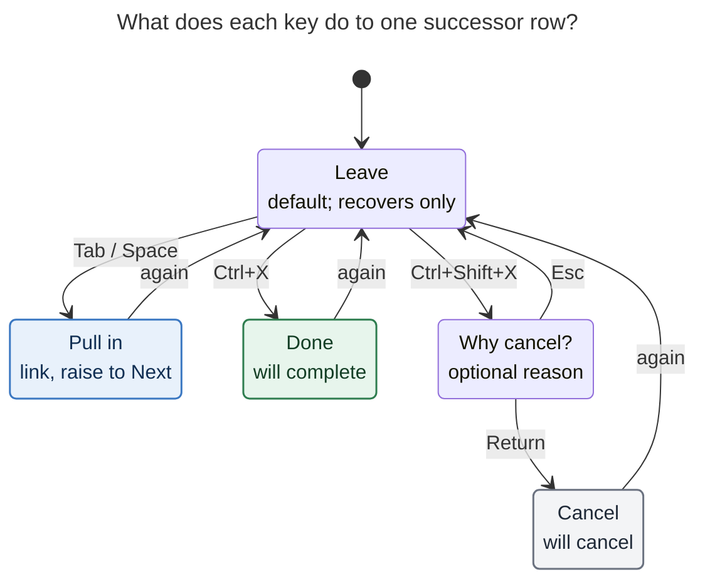

# Close and cancel tasks from successor cards

**Consolidated report.** This report merges five independent reports (`__cdx`, `__cld`,
`__grk`, `__mus`, `__gem`, all in this directory) with the lead researcher's own checks
against code, docs, and the vault. Date: 2026-11-05.

**Request.** Bryan wants to close (Done) or cancel a task directly from a successor card,
both in Obsidian's successor picker and in Bob Mac Capture's Pull-In card. He suggested
`Ctrl+X` to close and `Ctrl+Shift+X` to cancel. He asked for a design that is intuitive,
reliable, and beautiful, a critique, any justified changes to the requirements, and a
recommended solution.

## Bottom line

**Build it.** It is a good idea, and the suggested chords are the right ones. Two things
about the sketch need to change, though.

1. **The keys should stage a verdict, not write.** Writing on the keypress would split
   the gesture's single write set, which the Mac cannot even do.
2. **Each row should hold exactly one verdict.** The four verdicts are **Leave**,
   **Pull in**, **Done**, and **Cancel**. Return applies all of them together, in the
   write pass the card already uses.

All five reports reached both conclusions independently.

The rest of the design follows Bob's own precedents:

- **Labels and styling** come from relation complete/cancel.
- **Per-row outcomes** come from the Mac Move card.
- **The cancel reason** comes from the Task Card's cancel-reason stage.
- **Undo** comes from the guarded Undo notice.

The recommended solution is in [§9](#9-recommended-solution).

### Evidence base

| Repository | Inspected commit |
| --- | --- |
| bob-cli | `58e98558` (reports); lead checks also at `dd3cfd8c` |
| bob-plugins | `7b7c52f` |
| bob-mac-capture | `9714a56` |

**What was checked:**

- **Memory read through `sase memory read`:**
  - `decisions:unblocked-tasks-are-offered`
  - `decisions:unblocked-tasks-resurface-as-ticklers`
  - `glossary:successor-offer`
  - `cli_rules.md`
- **Prior research:** `research:202610/successor_pull_in_offers/successor_pull_in_offers.md`.
- **The vault (`~/bob`):** read-only greps.

**Limits.** Nothing was implemented, and neither GUI was run. Offers are computed and
never stored, so no one can measure how often a successor card opens.

---

## 1. Is this a good idea?

**Yes.** Four reasons:

- **It is the moment of maximum context.** The task that just closed is the evidence for
  whether each successor still matters. Every later review surface has to rebuild that
  context from scratch.
- **The vault shows the gap is real.** The lead's checks found three things:
  - **Same-day closes.** Six closed tasks still carry an `[unblocked:: D]` stamp. A pick
    stamps the task fresh, which clears that field, so none of these six was picked from
    its card. **Five of the six were closed the same day they unblocked.** Bryan already
    knew the verdict at unblock time and had to go somewhere else to apply it. The sample
    is small, because the field only arrived in October 2026.
  - **Typical cancel reasons.** Since 2026-10-01 there have been 1,094 completions and
    227 cancellations (`__cld`'s counts, re-verified). Cancel Log reasons are often
    exactly the judgments a successor card prompts: "We already do something like this.",
    "Duplicate", "use the ref task instead", "I think we already have a snippets tab."
  - **Reasons get written.** There are **115 `CANCEL LOG` markers** and **zero `🤷 no
    reason given` fallback entries**. When Bob asks for a reason, Bryan writes one.
- **Not closing has a cost, and it varies by group.** All five reports confirm it:
  - **Recovered `hand_off` and `project` rows** get `[unblocked:: today]` and come back as
    a TICKLER in tomorrow's `]s` walk.
  - **`keep_moving`, `relation`, and `note_pull` rows** were already Ready or Next. They
    get no stamp, so they come back only as ROTTEN, about a week later, and may then open
    a decay card.

  So Bryan's "wait for them to go rotten" is slightly overstated (`__mus`). Every
  obsolete row still costs one review touch later, in a worse context.
- **The `project_finished` row is the standout case** (`__cld`). When a gesture empties a
  project, the card offers that project's `^prj`. Today it can only be *linked*. Done
  would finish the project in the same gesture that finished its last task.

**Risks the design must handle:**

| Risk | Why it matters | Where handled |
| --- | --- | --- |
| A misfire in a fast modal | A close recovers dependents, prunes links, and changes `^prj` state | Staged verdicts, visible row state, two-step Esc (§4) |
| Cascades | A closed successor can unblock its own dependents | No new offers in v1. Recovery still runs and the receipt reports it (§5) |
| Four surfaces must agree | Rust, cycler, nav, and Mac all implement the offer contract (the cost already named in the offers decision) | bob decides which rows can be closed. One result shape, shared vectors (§7) |
| Key collisions | `Ctrl+X` is Cut on Linux, and it already merges in another Obsidian picker | Bind it only inside the card, literal Control, preserve Cut (§4.2) |
| Losing the reasons Bryan writes | The vault shows reasons are nearly universal when asked | Optional inline reason on cancel (§4.3) |

**Alternatives considered:**

| Alternative | Verdict |
| --- | --- |
| **Write immediately on the keypress** | **Reject (5/5).** It breaks "each gesture makes one write set" (`docs/task-dependencies.md` §12.4). It is impossible on the Mac, which submits one `bob capture` call. Esc could no longer mean "nothing happened". |
| **Open the Task Card for the highlighted row** | **Reject as primary.** It nests a modal while the cycler awaits `pick()`, and the Mac has no Task Card. It stays the escape hatch for anything richer. |
| **Put close/cancel buttons on the post-commit receipt** | **Reject.** The offers decision already rejected "choose after commit". Receipts are transient and mouse-first. |
| **A tray of held offers** | **Reject.** The offers decision rejected it, and it rebuilds the deferred-review problem this request is trying to remove. |
| **Auto-close offers that look done** | **Reject.** Status comes from explicit writes, not from prose. Consent must be per keypress, as in the decay ladder. |
| **Mac only: add `!note:id` lines to the draft** | **Reject.** Capture has no cancel grammar, ID-less rows have no `!` target, and it would leak UI choices into the draft. |
| **One shared "row verdict" vocabulary across every Bob task picker** | **Right long-term direction, wrong v1 scope.** Name the verdicts so the Move card, the `:` picker, and the Mac pickers can adopt `Ctrl+X` / `Ctrl+Shift+X` later. |

---

## 2. What exists today (verified)

### 2.1 The two cards

| | Obsidian `SuccessorOfferPickerModal` (`206-successor-picker-modal.js`, `api.successors` v3) | Mac Pull-In card (`CapturePullInChoice*.swift`) |
| --- | --- | --- |
| When it opens | After the predecessor's close is written. The cycler plans, awaits `pick()`, re-reads, re-plans, and applies | After the draft is previewed and before any write |
| Mark a pull-in | `Tab` toggles the mark and moves; `Shift+Tab` moves up | `Space` toggles in place (only when the filter is unfocused or empty) |
| Mark many | `Ctrl+A` marks the highlighted group | `⌘A` marks all |
| Return | Pulls in the marked rows, or **the highlighted row if none are marked** | Same fallback |
| Other commits | `Ctrl+Shift+Enter` retargets the destination | `⇧↩` skips pull-ins (`--pull-in none`); `⌃↩` pulls in and opens notes |
| Esc | None: the predecessor close stands | Back to the unchanged draft; nothing is written |
| Guards | Ignores modified, repeated, or IME Enter, and any Enter within 350 ms of opening | Ignores repeated Return |
| Failure model | Best effort. Each row is preimage-checked, and the predecessor is never rolled back | Capture is all-or-nothing |

**What the lead's checks found:**

- **Modifier handling.** The picker's existing chords accept `ctrlKey || metaKey`, so
  Cmd also triggers them on macOS.
- **No `X` handling yet.** Neither the Obsidian picker nor the Mac Pull-In router
  (`pullInChoiceCommand`) handles `X`.
- **`X` elsewhere in Bob:**
  - `Ctrl+X` merges in Obsidian's Pomodoro-entry move picker (a different modal).
  - Control-X closes a Tabs row in Mac Refs.
  - Command-X toggles completed tasks in the Mac `/` picker.
- **Short flags.** `bob capture` uses `b c d D E f h i m n p r R s t`, so **`-x` and `-X`
  are free**.

### 2.2 Precedents this design reuses

- **The Mac Move card.**
  - **Exclusive outcomes per row.** Every row starts as Leave (`·`); `^` sets Move and
    `:` sets Move & link.
  - **Outcome keys advance.** They set the outcome *and advance to the next enabled
    row*. `Space` toggles.
  - **Return never falls back to the highlight.** With no marks it shows a hint and
    stays.

  This is the closest existing shape (`docs/task-pickers.md`, `docs/keyboard.md`).
- **Relation complete/cancel indication rules** (`docs/task-relations.md` CL6 and CP6).
  These are Bob's existing visual grammar for "this other task will close":
  - ✓ plus words in Done green; ⊘ plus words in the Cancelled tint.
  - Red only for errors and amber only for caveats.
  - **"No strikethrough before the write."**
  - On the Mac, `checkmark.circle` and `circle.slash`.
  - They also define canonical strings, such as `✓ Completes “{S}” · {Status} → Done`
    and `· its {N} open tasks stay open`.
- **Cancel writers.**
  - **Nav `planTaskCancelBatch`** writes `[-]` and `[cancelled:: date]`. With an authored
    reason, it writes a Cancel Log entry and creates the log if it is missing. With a
    blank reason, it writes nothing, unless a log already exists; then it writes the
    `🤷 no reason given` fallback.
  - **Rust `task_cancel::line`** has `edit_source` and `edit_source_create_log`. Empty
    reasons write no entry, so matching the JS fallback needs a small policy wrapper.
  - **Recovery.** Cancel recovers dependents through `plan_recovery_only` and **never
    offers** (§12 SL21).
- **Recover-only Done.** The cycler already runs the successor pass with no picker for
  cancelled closes (`closeKind === "cancelled"`). Rust has `plan_recovery_only`.
- **Close scope.** In Obsidian, `Ctrl+Enter` on a plain Task Link closes **root-only**.
  LINKS and LINKED FROM rows act on their target root-only. Only embeds close a
  transcluded tree.
- **Guarded undo.** `showGuardedUndoNotice(message, restores)` (nav `654-task-undo-notice.js`)
  restores exact preimages and refuses if any postimage changed.
- **Capture already merges later closes.** "A later `!` close can make a task newly
  offerable" (§12 DEDUP). bob can already fold several closes into one offer set, which
  matters for the v2 cascade (§5).

---

## 3. Adjusted requirements (each is a deliberate change)

| # | Adjustment | Why | Reports |
| --- | --- | --- | --- |
| **A1** | **Stage, don't write.** `Ctrl+X` / `Ctrl+Shift+X` set a verdict on a row. Only an explicit commit writes. | One gesture, one write set. Required on the Mac. Esc stays harmless. | all 5 |
| **A2** | **Name the verbs Done and Cancel, not "close".** `Ctrl+X` = Done (`[x]`); `Ctrl+Shift+X` = Cancel (`[-]`). Done means "already finished"; Cancel means "no longer intended". | Different writers, logs, recovery copy, and guards. Cancel is a sibling verb, not "close harder". | cdx, mus |
| **A3** | **Verdicts act on the highlighted row only, never on the marked set.** | A verdict is a judgment about one task. Reusing pull-in marks as close targets is how accidents happen. | cdx, cld, grk, gem (mus dissented) |
| **A4** | **One verdict per row: Leave, Pull in, Done, or Cancel.** A different verdict key replaces the current one; the same key again returns the row to Leave. | Matches Tab/Space toggles and the Move card. A row cannot be both linked and closed. | cld, grk, gem (cdx preferred a no-op on repeat) |
| **A5** | **Cancel opens an optional inline reason.** Blank Return is allowed and follows the existing Cancel Log rule. Done never asks for anything, including a Work Log. | 115 Cancel Logs, zero fallback entries: Bryan writes reasons when asked. The Task Card's `x` never cancels on the key alone. | cld, cdx (grk, mus wanted no reason) |
| **A6** | **Close this task only (root-only).** Embedded or child tasks stay open, and the row says so. | The card shows only the root; closing work you cannot see breaks "a glance tells you what Return will do". Matches how plain Task Links and LINKS rows close. | cdx (cld proposed `!`'s tree close) |
| **A7** | **No cascading offers from rows resolved in the card (v1).** Their dependents still recover, get `[unblocked:: today]` under the WRITE rule, and return tomorrow as TICKLER. The receipt names them. | Keeps one offer round per gesture on all four surfaces. **This narrows `decisions:unblocked-tasks-are-offered` for this path and needs a new decision record.** | cld, grk, mus, gem (cdx wanted in-card expansion; kept as v2, §5) |
| **A8** | **bob decides which rows can be closed and reports it per row.** Not eligible: tasks created by this capture, recurring tasks, muted (still-blocked, folded, already-planned) rows, unsupported statuses, and rows whose identity cannot be revalidated. | Thin-client rule. Precedents: relation `new_task` and `recurring` refusals. | all 5 |
| **A9** | **Verdicts ride every commit; only Esc discards them.** Once any verdict exists, Return no longer falls back to the highlighted row. | Otherwise Return after two `Ctrl+X`s would also link wherever the cursor rests. | cdx, cld, gem |
| **A10** | **Esc takes two presses when verdicts are pending.** | A habitual Esc should not throw away deliberate triage. | cld |
| **A11** | **Reopening the predecessor never reopens rows resolved in its card.** Obsidian instead gets a guarded **Undo** on the receipt. | Those were independent judgments. The reopen receipt keeps taking back only untouched pull-in links. | cdx, cld, grk (gem dissented) |
| **A12** | **Bind literal Control on every surface, scoped to the card.** Never Cmd, never a global hotkey. | One physical chord across Linux Obsidian, macOS Obsidian, and Mac Capture. Cmd+X stays Cut. | lead, from code (§4.2) |
| **A13** | **No strikethrough before the write.** | It is an existing Bob design rule (CL6/CP6). A strike means "closed" in the ledger. | cdx (cld, grk, gem proposed strikes) |
| **A14** | **The CLI mirrors the chords:** `-x/--complete-offer` and `-X/--cancel-offer KEY[=REASON]`. | Reasons need a home, and parity helps memory. | cld (mus leaned this way) |

---

## 4. Interaction design

### 4.1 The row verdict model



*Figure 1.* Every row holds exactly one verdict, and nothing is written until the card is
applied.

- **"again"** means pressing the same key a second time.
- **Replacement.** A different verdict key replaces the current verdict. For example,
  `Ctrl+X` on a marked row turns Pull in into Done.
- **Esc in the reason field** restores the row's previous verdict.

The rendered figure (611.5 × 612 px; fit 100%; Mermaid CLI 12.0.0) is in
`successor_offer_verdicts__final_assets/`.

### 4.2 Keys

These are additive. Every existing key keeps its meaning.

| | Obsidian successor picker | Mac Pull-In card |
| --- | --- | --- |
| **Done** | `Ctrl+X`: toggle Done on the highlighted row, then advance (like `Tab`) | `⌃X`: same, then advance (like the Move card's `^` / `:`) |
| **Cancel** | `Ctrl+Shift+X`: open the inline reason on the highlighted row. `Enter` confirms (blank is fine) and advances; `Esc` restores the previous verdict | `⌃⇧X`: same |
| **Pull in** | `Tab` (unchanged) | `Space` (unchanged) |
| **Apply** | `Enter`: apply every verdict and mark. With **no verdicts**, today's highlighted-row fallback still applies | `↩`: same |
| **Other commits** | `Ctrl+Shift+Enter` retarget applies to Pull-in rows only | `⇧↩` applies verdicts and skips pull-ins; `⌃↩` applies everything and opens notes |
| **Back out** | `Esc`: none. With pending ✓/⊘, the first press shows `Esc again to discard 2 closes` | `Esc` / `⌃[`: back to the draft, with the same two-step rule |

**Scoping rules that keep the chords safe:**

- **Literal Control only (A12).** In Obsidian, check `ctrlKey && !metaKey` for `X`, a
  deliberate departure from the picker's `Ctrl||Cmd` convention for `A` and `Enter`.
  - **macOS Obsidian.** `Cmd+X` stays Cut and `Ctrl+X` is free.
  - **Linux.** If the filter input has a non-empty text selection, `Ctrl+X` performs Cut.
    Otherwise the card owns the chord, just as it already owns `Ctrl+A`.
  - **Mac Capture.** It already routes Control chords (`⌃N`, `⌃P`, `⌃↩`), and Control-X
    is unbound on this card.
- **Modal-only.** The chord lives in `SuccessorOfferPickerModal#handleKeydown`, never in
  the base `FilteredPickerModal`, so it can never collide with the Pomodoro picker's
  `Ctrl+X` merge (`__mus`). State this in the contract.
- **Ignore repeats and composition** (`event.repeat`, `isComposing`, keyCode 229). Since
  verdict keys advance, a held key must not resolve several rows. Keep the existing
  350 ms Enter guard unchanged.
- **Ineligible rows.** The chord gives a soft shake (Obsidian) or `NSBeep` (Mac), and the
  row's detail line shows bob's `why`.
- **No letter aliases.** Reject `__grk`'s bare `x` and `!`: the Obsidian filter input is
  always focused, so a bare `x` would steal the first letter of a search.

### 4.3 The Cancel reason

`Ctrl+Shift+X` swaps the row's detail line for an inline field. Nothing pops over the
card:

```text
│ ⊘  Add retry wrapper around gkeep client                          │
│    ⊘ Why cancel? ▏Fixed it a different way          ↵ · Esc back  │
```

- **Blank Return.** It cancels with the existing rule: no log is created, but if a Cancel
  Log already exists, the `🤷 no reason given` entry is written.
- **No invented reasons.** Never add "obsolete" or other made-up text.
- **Cost.** It is one extra Return per cancel, and that buys the history Bryan already
  writes nearly every time.
- **Done never prompts.** The claim is "this is already finished", not "I just worked on
  it", so there is no Work Log prompt (`__grk`).

### 4.4 The look

Goal: **a glance at the card says what Return will do**. Reuse Bob's existing channels
rather than adding new chrome.

| Verdict | Mark slot | Title | Trailing capsule / details | Accent |
| --- | --- | --- | --- | --- |
| Leave | `□` (today) | normal | `→ DEST` (today) | — |
| Pull in | `☑` (today) | normal | `→ DEST`, green on Mac (today) | Next accent (today) |
| Done | ✓ (Lucide `circle-check`; SF `checkmark.circle`) | secondary colour, **no strike** | `✓ Done` capsule replaces `→ DEST` | Done green (CP6) |
| Cancel | ⊘ (Lucide `circle-slash`; SF `circle.slash`) | secondary colour, **no strike** | `⊘ Cancel · “reason”` or `⊘ Cancel · no reason` | Cancelled tint (CL6) |

- **Consequence strip.** Only the highlighted verdict row shows it. bob authors it, using
  the relation canonical strings:
  - `✓ Completes “Write fixture README” · Ready → Done · unblocks “Ship parser v2” · back tomorrow as a tickler`
  - `⊘ Cancels “Add retry wrapper” · Ready → Cancelled · unblocks dependents`
  - Scope suffix: `· its 2 embedded tasks stay open`
  - For a `project_finished` `^prj`: `✓ Finishes ‹parser-rewrite›`
- **Footer.** It reads like a sentence and omits zero segments:
  `pull in 1 · ✓ 1 done · ⊘ 1 cancel`, then `plan 5/8 → 6/8`. **The plan meter counts
  pull-ins only.**
- **Primary label.**
  - Mac button: `Pull In 2`, `Close 2`, or `Pull In 1 · Close 2`. This follows capture's
    existing `Capture & close N tasks`. It is never disabled while verdicts exist.
  - Obsidian hint: `↵ pull in` becomes `↵ apply`.
  - Mac `⇧↩`: becomes `Skip pull-ins · close 2`.
- **Hints.** `Tab mark · Ctrl+X done · Ctrl+Shift+X cancel · ↵ apply · Esc none` on
  Obsidian, and `⌃X Done · ⌃⇧X Cancel` on the Mac. Show them **only when the model
  carries close eligibility**, so older bob and plugin combinations look exactly like
  today.
- **Pointer and accessibility.**
  - Obsidian rows reveal two small ✓ / ⊘ icon buttons on hover.
  - Mac rows get a context menu and VoiceOver custom actions ("Mark Done", "Mark
    Cancelled").
  - Labels and announcements carry the verdict in words ("will be completed", "will be
    cancelled: reason").
  - Colour is never the only signal.
- **Motion.** A ~150 ms glyph crossfade (`.snappy` on the Mac, matching
  `CapturePullInCheckbox`), with no reordering or focus jumps. It is disabled under
  Reduce Motion.

Mock (Obsidian; highlighted row marked `◀`):

```text
╭─ ⎇ Choose successor tasks ────────────────────────────────────────╮
│ Fix flaky gkeep test · 4 offers                                   │
│ ▏Filter tasks, notes, and groups                                  │
│                                                                   │
│ HAND-OFFS                                                         │
│ ☑  Re-enable gkeep sync in CI                       → CAPTURE     │
│    sase · Ready                                                   │
│ ✓  Write gkeep fixture README                       ✓ Done        │
│    sase · Ready                                                   │
│ ⊘  Add retry wrapper around gkeep client            ⊘ Cancel      │
│    sase · Ready · “Fixed it a different way”                      │
│ □  Port gkeep tests to nextest                      → CAPTURE  ◀  │
│    sase · Ready                                                   │
│                                                                   │
│ pull in 1 · ✓ 1 done · ⊘ 1 cancel                plan 5/8 → 6/8   │
│ Tab mark · Ctrl+X done · Ctrl+Shift+X cancel · ↵ apply · Esc none │
╰───────────────────────────────────────────────────────────────────╯
```

---

## 5. Writes, dependents, and cascades

### 5.1 What each verdict writes

| | Done (`Ctrl+X`, `-x`) | Cancel (`Ctrl+Shift+X`, `-X`) |
| --- | --- | --- |
| **Task line** | `[x]` + `[completion:: today]`, **root-only** | `[-]` + `[cancelled:: today]`, root-only |
| **Log** | none; no Work Log prompt | Cancel Log, following the Task Card rules (§4.3) |
| **Today's ledger** | No new Task Link. Any live link is retired as `Ctrl+Enter` does; offered rows rarely have one | Live links pruned, as Task Card cancel does |
| **Dependents** | Recover (Blocked → Ready, `#prj_is_blocked` stripped, `[unblocked:: today]` per WRITE). **Not offered** in v1 | Recover; never offered (unchanged cancel rule) |
| **Freshness / keeps** | Not stamped; closing ends review | Same |
| **Engine (Obsidian)** | Cycler completer with a recover-only successor pass (the existing `cancelledClose` path, generalized) | Nav `planTaskCancelBatch` and post-cancel effects, exposed to the cycler as a small API |
| **Engine (bob)** | Completion primitives with an explicit **single-task scope**. `RootPolicy::Explicit` still walks embeds, so it does not qualify (`__cdx`) | `task_cancel::line` plus a Task-Card-parity reason policy |

`__gem` made two claims that do not hold:

- **Field names.** The fields are `[completion::]` and `[cancelled::]`, not `[c::]`.
- **Cancel recovery.** Cancel *does* recover dependents (`task_cancel/recovery.rs`).

### 5.2 Cascades: v1 recovers only, v2 shows "Newly available"

Suppose closing offered row B unblocks C. Four reports say C should just recover and
come back as a TICKLER tomorrow. `__cdx` argues for re-planning inside the same card,
with C appended under **"Newly available · after completing B"**: unmarked, with no
focus jump, and invalidated if B's verdict is undone.

**Resolution.**

- **v1 ships recover-only.** The receipt says
  `↳ also unblocked “Ship parser v2” · back tomorrow as a tickler`. In JSON, those rows
  carry `not_linked: "resolved_in_card"`.
  - **Nothing is lost.** `decisions:unblocked-tasks-resurface-as-ticklers` already
    guarantees next-morning review. One round per gesture keeps the four engines simple.
- **v2 is cdx's in-card section.** It is cheaper than it looks on the bob side. Capture
  already lets "a later `!` close make a task newly offerable", so a dry run with
  `-x B` can return C in the same offer set, and the Mac only re-renders. Obsidian needs
  a pure re-plan with B overlaid as closed.
- **When to build v2.** Build it if Bryan finds himself wanting C *today*. That is the
  "B was already done, C is the real next step" chain.
- **Reject the Obsidian-only follow-up picker.** `finalizeClosedTasks` would naturally
  open a second card in Obsidian, but that breaks parity with the Mac.

Every report agreed that **cancellation never generates offers**. Keep that rule in both
versions.

### 5.3 Commit order and failure

- **Order.** Plan everything first, then write once.
  - The rows are disjoint by construction, since one verdict per row is enforced in the
    request.
  - The predecessor's picks and the verdict closes share the daily note, where picks
    insert and closes prune. Group same-note edits into one editor transaction.
- **Obsidian failure.** It stays best-effort, as today.
  - **The predecessor is never rolled back.**
  - Each verdict is preimage-checked against the line the card saw. A changed row is
    refused alone, with `1 not closed · changed since the card opened`, while the rest
    applies.
  - A partial failure must never look like a successful Apply.
  - `__mus`'s "any failed row rolls the whole gesture back" holds only for capture.
- **Capture / Mac failure.** It stays all-or-nothing.
  - A stale target aborts the batch, and the card reopens with bob's error and the
    choices intact.
  - After a timeout with an unknown outcome, re-read the state before retrying. Never
    blindly replay a capture.
- **Identity.** Keys are `path#^id` or, for ID-less rows, a description digest.
  - ID-less rows **can** be closed, since only pull-in mints IDs.
  - Bind verdicts to the preimage seen in the card, and refuse rather than resolve a
    look-alike neighbour.
- **The review walk.** Hold the existing gesture lock through the card. The walk advances
  **once** for the original landing, and must never land on a row resolved in the same
  commit (`__cld` A9; add a test).

### 5.4 Undo and reopen

- **Before Apply.** Toggling the verdict key again, or Esc in the reason field, is the
  cheap correction path.
- **After Apply in Obsidian.** The Unblocked receipt gets an **Undo** button built on the
  existing `showGuardedUndoNotice`. It restores exact preimages of resolved rows, and of
  any dependents they recovered, only while each file is still exactly what the pass
  wrote. After that, `Alt+]` / `Alt+[` reopen tasks as usual.
- **Mac / CLI.** There is no take-back, the same as `!` today. The notification names
  every resolved task.
- **Reopening the predecessor** never reopens rows resolved in its card (A11).

---

## 6. Contracts

### 6.1 bob-cli (`bob capture`)

```text
  -X, --cancel-offer <N|KEY>[=REASON]   Cancel a successor offer instead of pulling it in;
                                        REASON goes to its Cancel Log. Repeatable.
  -x, --complete-offer <N|KEY>          Mark a successor offer Done instead of pulling it
                                        in. Repeatable; accepts a comma list.
```

**Parsing:**

- **Reasons.** `-X` splits on the first `=`, like `-i/--inbox-route`. Reasons can contain
  commas, so it takes one row per flag.
- **Choices.** A verdict counts as a choice for `--require-pull-in-choice`.
- **`-p all`** means every selectable offer *without* a verdict.
- **Conflicts.** The same row in `-p` and `-x`/`-X`, or in both `-x` and `-X`, is the
  teaching refusal `offer_verdict_conflict`. It writes nothing and lists the offers with
  their eligibility.

**Why separate flags instead of prefixes inside `-p`:**

- **Reasons.** A cancel reason has no clean home in `__grk`'s `!2,-3` or `__gem`'s
  `2:close`.
- **Shell hazards.** `-3` reads as a flag, and `!` triggers shell history expansion.
- **Readability.** `--pull-in` stays pure.
- **Mnemonic.** `-x` / `-X` mirror the chords.

`cli_rules.md` allows this: these are flags, sorted, each with a short alias, and no
subcommand under `capture`.

**JSON (additive):**

- **Per-row eligibility.** Each offer row gets
  `close: {complete: bool, cancel: bool, why?, scope_note?, unblocks?: int}`.
- **Capability flag.** The batch gets `pull_in.close: {supported: true}`, so clients can
  feature-detect.
- **Results.** `offer_closes[]` with
  `{n, key, outcome: "done"|"cancelled", reason?, note_path, block_id, previous_status, recovered[]}`.

**Human output** adds the verbs `completed` and `cancelled` next to `linked` and
`unblocked`. Dry runs say `would complete` and `would cancel`.

### 6.2 bob-plugins

- **`api.successors` → v4.**
  - Model rows gain the `close` eligibility.
  - `pick()` resolves
    `{picks: [{key, destination?}], closes: [{key, outcome, reason?}]}`.
  - **Zero picks with at least one close is not `null`.**
- **Gating.** The cycler attaches eligibility only when nav reports v4 or later. v1–v3
  models render exactly as today.
- **Cancel API.** Nav exposes its cancel writer (a small `api.cancel` v1 wrapping
  `planTaskCancelBatch` and the post-cancel effects), so the cycler never copies the
  Cancel Log writer.
- **Notice.** `api.notice` gets additive `offer_closes` rows and the
  `cascade_unblocked` line.
- **Deploy.** Edit `src/` fragments, run `npm run build`, then `bob plugins sync`.

### 6.3 bob-mac-capture

- **Decoding.** Decode `close` and `pull_in.close` with `decodeIfPresent`. With an older
  bob there are no hints, and the chords beep.
- **State.** `CapturePullInChoiceState` goes from `markedKeys` to per-row verdicts, plus
  a reason-field focus state like `pullInFilterFocused`.
- **Routing.** Add router commands for `⌃X` and `⌃⇧X`.
- **Submission.** Always submit **keys**, never numbers. The Mac renders bob's
  eligibility and consequence strings and never computes them
  (`decisions:mac-capture-is-a-thin-client`).
- **CI.** Gate on the exact-SHA macOS CI run.

---

## 7. Where the reports disagreed, and the call

| Question | Positions | Call | Deciding evidence |
| --- | --- | --- | --- |
| Write on keypress or stage? | All: stage | **Stage** | §12.4 single write set; Mac submits one capture |
| What do the chords target? | mus: marked set, else highlighted; others: highlighted row | **Highlighted row** | Marks mean pull-in; batch close by mark is the misfire path |
| Same key again? | cdx: no-op; cld/grk/gem: toggle | **Toggle, ignore key repeat** | Tab/Space and Move card toggles |
| Advance after a verdict? | cdx: stay; cld/grk: advance | **Advance** | Obsidian `Tab` and Mac Move card `^`/`:` both advance |
| Cancel reason? | cld/cdx: optional inline; grk/mus: none; gem: if configured | **Optional inline** | 115 logs, zero `🤷` fallbacks |
| Cascade? | cdx: in-card now; others: none | **None in v1; cdx's design is v2** | One round per gesture; next-day TICKLER guarantee |
| Close scope? | cdx: root-only; cld: `!` tree close | **Root-only + scope note** | Plain-link and LINKS rows close root-only; the card shows only the root |
| Strikethrough? | cld/grk/gem: strike; cdx: none | **No strike before write** | CL6/CP6 rule |
| CLI shape? | cld: `-x`/`-X`; grk: `-p '!2,-3'`; gem: `-p 2:close`; cdx: internal JSON; mus: open | **`-x` / `-X KEY[=REASON]`** | Reasons, shell safety, chord parity |
| Mac `⇧↩` with verdicts? | cdx: disable; cld/gem: apply verdicts | **Apply verdicts, skip pull-ins, relabel** | "Verdicts ride every commit" is one simple rule |
| Esc with verdicts? | cld: two-step; others: one press | **Two-step** | Protects deliberate triage at no cost elsewhere |
| Reopen predecessor? | gem: restore successors; others: leave them | **Leave them; guarded Undo instead** | Independent judgments; existing undo primitive |
| Modifier on macOS Obsidian | not raised | **Literal Control, not Cmd** | Picker's `Ctrl||Cmd` convention would hijack Cut |

---

## 8. Rollout and acceptance

**Order:**

1. **Contract and decision first.**
   - Add `docs/task-dependencies.md` §12.x "Resolving offers", with shared SV/SC vectors
     for Rust and JS: eligibility, exact Done and Cancel bytes with and without reasons
     and logs, no cascade offers, the walk exclusion, conflicts, and preimage refusals.
   - Write a **new decision record**, *Successor cards resolve with staged verdicts;
     card-resolved rows recover but never offer*. Do not edit
     `unblocked-tasks-are-offered` in place.
   - Do both through `/sase_memory_write` at implementation time.
2. **bob-cli.** Ship the flags, eligibility, JSON, human output, and completion wiring.
   Everything is additive, and it rides the daily release train; agents do not touch
   the version or CHANGELOG.
3. **bob-plugins.** Ship nav v4 picker UI, the cancel API, the notice, and the cycler
   wiring, then `bob plugins sync`.
4. **bob-mac-capture.** Ship decoding, the card, the router, and the reason field, gated
   on exact-SHA macOS CI.
5. **Glossary.** Update the `successor-offer` strand.

**Acceptance highlights:**

| Scenario | Required result |
| --- | --- |
| B Done, C Cancel with reason, D marked, Return | Only B/C resolve, only D links, one combined receipt |
| Verdicts staged; Return with the cursor on an unmarked row | No highlighted-row fallback |
| Every row Done, nothing marked | Apply is enabled and nothing is linked |
| Esc once / twice with verdicts | Warning, then discard. Obsidian keeps the predecessor; Mac writes nothing |
| Blank cancel, with and without an existing Cancel Log | Matches Task Card bytes in both Rust and JS |
| Row with embedded children | Only the root closes; scope note shown |
| Recurring / new-in-capture / muted row | Chord refused with bob's `why` |
| Closing B recovers C | C gets `[unblocked:: today]`, no offer, named in the receipt |
| Row edited while the card is open | Obsidian: that row refused, the rest applies. Capture: batch aborts, card reopens |
| Same-day predecessor reopen | Pull-in links taken back; resolved rows stay closed |
| Linux filter with a text selection, `Ctrl+X` | Cut happens; no verdict |
| Held `Ctrl+X` | One verdict, no multi-row sweep |
| Old bob + new Mac, or old nav + new cycler | Today's pull-in-only card |
| Walk landing gesture | One advance, never onto a row resolved in the same commit |

**First demo:** Done on a `project_finished` `^prj`. One keypress closes the emptied
project in the same gesture that finished its last task.

---

## 9. Recommended solution

**Add staged per-row verdicts to the existing successor card on both surfaces.**

1. **The keys.**
   - **`Ctrl+X`** (literal Control everywhere: Linux, macOS Obsidian, and `⌃X` on the
     Mac) marks the highlighted row **Done**.
   - **`Ctrl+Shift+X`** opens a one-line optional reason, then marks the row **Cancel**.
   - Both advance to the next row, toggle back to Leave on a second press, and act only
     inside the card.
   - `Tab` / `Space` still mark pull-ins, and no key ever acts on the marked set.
2. **One verdict per row, applied together.** Each row is Leave, Pull in, Done, or
   Cancel.
   - **Applying.** `Enter` / `↩` applies every verdict in the gesture's existing single
     write pass. The highlighted-row fallback is disabled once any verdict exists. The
     Mac's `⇧↩` applies verdicts and skips pull-ins.
   - **Esc** asks twice before discarding verdicts.
3. **Close this task only, with the existing writers.**
   - **Done** writes `[x]` and `[completion::]`, root-only, with no prompt.
   - **Cancel** writes `[-]`, `[cancelled::]`, and the Task Card's Cancel Log rules.
   - **Dependents** recover and come back tomorrow as TICKLER. The receipt names them. No
     new offers in v1; an in-card "Newly available" section is the planned v2.
4. **bob is the authority.** It reports per-row eligibility and consequence text, and it
   performs the writes for capture: `-x/--complete-offer` and
   `-X/--cancel-offer KEY[=REASON]`.
   - **Obsidian** presents through nav `api.successors` v4 and writes through existing
     guarded paths.
   - **The Mac** decodes and submits keys only.
5. **Make it beautiful with Bob's own visual grammar.**
   - ✓ in Done green and ⊘ in the Cancelled tint, with words and **no strikethrough**
     before the write.
   - A verdict capsule replaces the destination.
   - A bob-authored consequence strip on the highlighted row.
   - A footer that reads `pull in 1 · ✓ 1 done · ⊘ 1 cancel`, and a plan meter that
     counts only pull-ins.
   - Obsidian's receipt carries a guarded **Undo**.

### Open questions for Bryan (defaults in bold)

1. **Cascades.** Is "back tomorrow as a tickler" enough for a resolved successor's own
   dependents in v1, or do you want the in-card "Newly available" section from day one?
   **Default: tickler in v1.**
2. **Cancel reason.** Should the reason field open on every cancel? **Default: yes, blank
   Return allowed.** The alternative is to cancel silently, with a second key to add a
   reason.
3. **Muted still-blocked rows.** Should Cancel work on them ("this whole branch is
   dead")? **Default: not in v1.**
4. **Pointer affordances.** Hover ✓ / ⊘ buttons on Obsidian rows, or keys and hints
   only? **Default: hover buttons.**
5. **Note-pull and promotion cards.** Should verdicts be enabled there too? **Default:
   yes, for existing tasks.** Tasks the capture creates are never eligible.

## Sources

- **Reports in this directory:**
  - `successor_offer_verdicts__cdx.md`
  - `__cld.md`
  - `__grk.md` (its figures are in `successor_menu_close_cancel__grk_assets/`)
  - `__mus.md`
  - `__gem.md`
- **bob-cli:**
  - `docs/task-dependencies.md` §12 (DEDUP, §12.4 Writes, SL21)
  - `docs/task-relations.md` CL6/CP6 (indication rules, canonical strings)
  - `src/native/capture/cli.rs` (flags, `--move-in`, `--inbox-route`)
  - `src/native/task_cancel/{line,recovery}.rs`
- **bob-plugins:**
  - `bob-navigation-hotkeys/src/206-successor-picker-modal.js` (`handleKeydown`,
    `prospectiveKeys`, v3)
  - `240-cancel-and-lanes.js` and `030-bullet-blocks-and-logs.js` (Cancel Log policy)
  - `380-picker-cancel-and-lane.js` (`🤷` fallback)
  - `241-relation-cancel-effects.js`
  - `654-task-undo-notice.js`
  - `task-status-cycler/src/137-plugin-successor-project.js` (`cancelledClose`
    recover-only path)
  - `docs/task-status-cycler.md` (root-only link closes)
- **bob-mac-capture:**
  - `CaptureKeyCommandRouter.swift` (`pullInChoiceCommand`)
  - `CapturePullInChoice.swift` (`markedKeys`, `effectiveSelectionKeys`)
  - `docs/task-pickers.md` and `docs/keyboard.md` (Move card outcomes; Command-X in `/`)
  - `Refs/RefsKeyRouter.swift`
- **Memory:**
  - `decisions:unblocked-tasks-are-offered`
  - `decisions:unblocked-tasks-resurface-as-ticklers`
  - `glossary:successor-offer`
  - `cli_rules.md`
- **Prior research:** `research:202610/successor_pull_in_offers/successor_pull_in_offers.md`
  (post-commit picker and tray rejected; offer-on-cancel deferred).
- **Vault (read-only, 2026-11-05):**
  - 1,094 `[x]` and 227 `[-]` closes since 2026-10-01
  - 115 `CANCEL LOG` markers and 0 `🤷` fallback entries
  - 6 closed rows still carrying `[unblocked::]`, 5 of them closed the day they
    unblocked

Nothing in code or the vault was changed. This is design research only.
