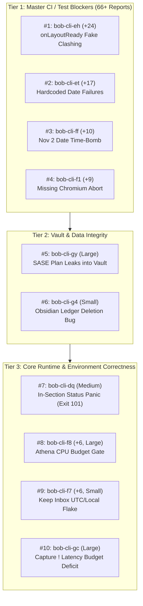

# Research Report: High-Impact Task Bead Triage & Conflict Analysis

- **Researcher ID:** `research.3b.gem` (`gem`)
- **Date:** 2026-11-04
- **Project:** `gh_bobs-org__bob-cli`
- **Output Target:** `research:202611/task_bead_triage_top_impact__gem.md`

---

## Executive Summary

A systematic audit was conducted across all 174 task beads in `bob-cli`'s effective bead store (`sdd/beads/`), corroborated against live agent rosters across both primary machines (`apollo` and `athena`).

Our findings reveal three critical operational realities:
1. **Severe Test Flakiness & Deterministic Failures on Master:** A cluster of time-bomb date dependencies (`bob-cli-et`, `bob-cli-ff`), harness callback clobbering (`bob-cli-eh`), missing environment fallbacks (`bob-cli-f1`), and timezone assumptions (`bob-cli-f7`) accounts for over **66 independent plus-one reports** (`+24`, `+17`, `+10`, `+9`, `+6`). These deterministically break `npm test` across `bob-plugins` on clean master checkouts, blocking developer velocity and inflating agent recovery cycles.
2. **Critical Vault & Ledger Integrity Defects:** A newly discovered defect (`bob-cli-gy`) leaks ephemeral SASE plan archives directly into Bryan's permanent personal notes Git repository (`~/bob`), while a status-cycler discrepancy (`bob-cli-g4`) causes real data loss by deleting closed timed Pomodoros when their links are deferred.
3. **Active Epic Collision Zones:** Four major development streams are actively running across `apollo` and `athena`:
   - Epic `bob-cli-h0` (`- ^^` capture parent move-in)
   - Epic `bob-cli-h2` (`x=` past Pomodoro recording)
   - Epic `bob-cli-h4` (`>` transfer previews and landing cards)
   - Session `185` (Capture keyboard shortcuts `.`/`^` and `;`/`:`)
   
   Any task touching these domains (most notably `bob-cli-h1`, which involves past Pomodoro midnight-wrap calculation) **must be held** to prevent merge collisions and logic invalidation.
4. **Already-Resolved Quick Wins:** Five ready task beads (`bob-cli-de`, `bob-cli-fh`, `bob-cli-fj`, `bob-cli-fp`, `bob-cli-e4`) have already been resolved by merged commits or past land agents and can be closed immediately.

Below is the exhaustive multi-machine environment audit, followed by the ranked recommendation of the top 10 task beads that Bryan should work.

---

## 1. Multi-Machine Live Agent & Epic Conflict Audit

Before prioritizing task beads, running agent processes and active epics on both `apollo` (local machine) and `athena` (remote multi-core worker) were inventoried.

### 1.1 Local Machine (`apollo`) Active Roster
- **Research Swarm `research.3b.*`:**
  - `research.3b.gem` (this agent), `research.3b.cdx`, `research.3b.cld`, `research.3b.grk`, `research.3b.mus` (RUNNING)
  - `research.3b.final`, `research.3b.image`, `research.3b.linker` (WAITING)
- **Active Epic `bob-cli-h0` ("Choose parent tasks to move in with a `- ^^` capture bullet"):**
  - `bob-cli-h0.8` (QUEUED/IN_PROGRESS) — Move card submit flow, chaining, refusals, preview hints, and docs.
  - `bob-cli-h0.land` (WAITING)
  - *Conflict Scope:* Capture syntax `- ^^`, move card in Bob Mac Capture, `bob capture -m`, move choices.
- **Active Epic `bob-cli-h2` ("Record past Pomodoros with x="):**
  - `bob-cli-h2.4` (RUNNING) — Whole-stack overlap guard and `!` edge repair.
  - `bob-cli-h2.5` (WAITING/IN_PROGRESS) — Capture docs, references, and help for `x=`.
  - `bob-cli-h2.6` (WAITING/IN_PROGRESS) — Bob Mac Capture Record past work card.
  - `bob-cli-h2.land` (WAITING)
  - *Conflict Scope:* Capture syntax `x=`, past-Pomodoro recording engine, PomodoroPast model, overlap guards in `src/native/capture_parse.rs` and `src/native/capture_language/`.

### 1.2 Remote Machine (`athena`) Active Roster
- **Active Epic `bob-cli-h4` ("Transfer previews — see every `>` move and merge before it lands"):**
  - `bob-cli-h4.1` (RUNNING) — bob emits landing blocks for transfers.
  - `bob-cli-h4.2` (RUNNING) — bob enriches merge and move records, serializes merge offers.
  - `bob-cli-h4.3` (RUNNING) — bob describes an unfinished transfer on dry run.
  - `bob-cli-h4.4`, `h4.5`, `h4.6`, `h4.land` (WAITING) — Mac transfer cards, landing cards, notifications.
  - *Conflict Scope:* `>` transfer lines (`@a+x @b+y > @c...`), `task_blocks` with roles `merge_target`/`merge_source`/`moved`, `section_blocks`, `MergeRecord`.
- **Active Session `185` (Capture keyboard replacement):**
  - `185--3` (RUNNING in workspace `bob-cli_22`), `185.f0`, `185.f0.f1` (WAITING).
  - *Conflict Scope:* Bob Mac Capture typing shortcuts: replacing `.` with `^` after `@route` and `;` with `:`.

### 1.3 Strict Conflict Exclusion Rule
Any candidate task bead touching the four active areas above is strictly disqualified from immediate work:
- **`bob-cli-h1` (Past-offset Pomodoro midnight wrap):** Touches past-offset start time calculation (`=-3 x` at 00:05). Directly overlaps code in `src/native/capture_parse.rs` being rewritten by `bob-cli-h2.4`! **DO NOT WORK until h2 lands.**
- **Transfer preview / merge tasks:** Directly overlap `bob-cli-h4`.
- **Parent move `- ^^` tasks:** Directly overlap `bob-cli-h0`.
- **Capture punctuation triggers:** Directly overlap session `185`.

---

## 2. Immediate Triage: 5 Ready Beads to Close Without Code Work

Auditing bead history and recent landing commits revealed five task beads currently marked `ready` whose fixes have already landed in master. Bryan can close these immediately:

| Bead ID | Size | Title | Landed Fix / Evidence |
| :--- | :--- | :--- | :--- |
| **`bob-cli-de`** | Small | Catalog protocol-1 CLI test expects 54 entries | Landed in `dd90f8c7` & `ebedfca8` (updated to 70 entries). Passes cleanly. |
| **`bob-cli-fh`** | Small | Clippy `needless_return` in `task_theme.rs` | Confirmed resolved on master `37e68c09` (clippy passes cleanly). |
| **`bob-cli-fj`** | Small | Mac CI Build: `eventWarningBanner` missing return | Fixed in `bob-mac-capture` commit `2884ea2`. Master CI build passes. |
| **`bob-cli-fp`** | Small | `bob-mac-capture` Build fails on `ViewBuilder` loop | Fixed in `bob-mac-capture` commit `2884ea2`. Master CI build passes. |
| **`bob-cli-e4`** | Small | Vault plugins stuck on protected dirty deploys | Confirmed resolved by `bob-cli-e6.land`: 8/8 plugins synced cleanly. |

---

## 3. The 10 Most Important & Impactful Task Beads to Work

The following 10 task beads represent the highest-leverage, non-conflicting improvements across developer productivity, test reliability, vault hygiene, and core system correctness.



---

### Bead 1: `bob-cli-eh` — Fix `onLayoutReady` Single-Slot Clobbering in Ledger-Tools Tests
- **ID:** `bob-cli-eh`
- **Size:** Small
- **Status:** Ready · **Corroboration:** **+24** (highest in project history)
- **Repo:** `bob-plugins` (`scripts/test-ledger-tools-note-ready.cjs`, `scripts/test-ledger-tools-relation-index.cjs`)
- **Justification & Impact:**
  This is the single most pervasive test failure across the codebase. Commit `1295e52` added `this.setupGcalEvents()` to `BobLedgerToolsPlugin.onload` after relation-index/note-ready initialization. `setupGcalSyncOnCreate()` registers its own `workspace.onLayoutReady` callback. The mock harnesses in both test suites store `onLayoutReady` as a single slot (`handlers.onLayoutReady = callback`), overwriting the initial callback. Consequently, `npm test` deterministically fails `test-ledger-tools-note-ready.cjs` and `test-ledger-tools-relation-index.cjs` on master.
- **Recommended Solution:**
  Update the mock workspace in both test files to maintain an array of callbacks:
  ```javascript
  handlers.onLayoutReadyCallbacks = [];
  workspace.onLayoutReady = (cb) => handlers.onLayoutReadyCallbacks.push(cb);
  // During trigger:
  handlers.onLayoutReadyCallbacks.forEach(cb => cb());
  ```
  This matches real Obsidian behavior (which queues all layout callbacks) and restores 100% pass rates for both suites.

---

### Bead 2: `bob-cli-et` — Decouple GCal-Events and Freshness-Namespace Tests from System Clock
- **ID:** `bob-cli-et`
- **Size:** Small
- **Status:** Ready · **Corroboration:** **+17**
- **Repo:** `bob-plugins` (`scripts/test-ledger-tools-gcal-events.cjs`, `scripts/test-ledger-tools-freshness-namespace.cjs`)
- **Justification & Impact:**
  Starting on October 31, 2026, both test suites began failing deterministically on clean master because their assertions evaluate against the live wall-clock date:
  1. `test-ledger-tools-gcal-events.cjs` pins `now = new Date(2026, 9, 30, 9)` and creates today's daily path, but the plugin's create listener compares against the live system date, resulting in 0 syncs instead of 1.
  2. `test-ledger-tools-freshness-namespace.cjs` checks a task stamped `[fresh:: 2026-10-01]` with a 30-day interval; under the live system date (November 2026), the task is already due again, so no reload event fires.
- **Recommended Solution:**
  Expose and pin the plugin clock in both test suites via the plugin's existing `now()` injection seam or explicit reference date parameter. Ensure no test in `bob-plugins` queries unmocked `new Date()`.

---

### Bead 3: `bob-cli-ff` — Dynamic Date in `test-navigation-hotkeys-schedule-work-log.cjs`
- **ID:** `bob-cli-ff`
- **Size:** Small
- **Status:** Ready · **Corroboration:** **+10**
- **Repo:** `bob-plugins` (`scripts/test-navigation-hotkeys-schedule-work-log.cjs:145`)
- **Justification & Impact:**
  Line 145 tests that scheduling a Pending task for a *future* date flips it to Blocked (`- [?]`). However, the test hardcodes `2026-11-02` as the date. Because today is 2026-11-04, `2026-11-02` is now in the past/today, leaving the row as `- [/]` and failing the test on every single run of `npm test` since November 2.
- **Recommended Solution:**
  Replace the hardcoded `2026-11-02` string with a dynamically generated future date:
  ```javascript
  const futureDate = new Date();
  futureDate.setDate(futureDate.getDate() + 7);
  const futureDateStr = formatDate(futureDate);
  ```
  Alternatively, inject a fixed mock anchor date into the test environment.

---

### Bead 4: `bob-cli-f1` — Gracefully Skip DOM Sequence Test on Hosts Without Chromium
- **ID:** `bob-cli-f1`
- **Size:** Small
- **Status:** Ready · **Corroboration:** **+9**
- **Repo:** `bob-plugins` (`scripts/test-command-mode-sheet-sequence-dom.cjs`)
- **Justification & Impact:**
  Running `npm test` in `bob-plugins` on any development machine, container, or CI agent lacking a full Chromium binary crashes with `Could not find Chromium. Set CHROMIUM_PATH to a browser executable.` Rather than skipping headless browser tests when dependencies are absent, the script throws an uncaught error and fails the entire test suite.
- **Recommended Solution:**
  Wrap `findChromium()` in `test-command-mode-sheet-sequence-dom.cjs`:
  ```javascript
  const chromiumPath = tryFindChromium();
  if (!chromiumPath) {
    test.skip("Chromium binary not found; skipping real DOM sheet sequence test");
    return;
  }
  ```

---

### Bead 5: `bob-cli-gy` — Prevent SASE Plan Archives Leaking into `~/bob/` Vault Git Store
- **ID:** `bob-cli-gy`
- **Size:** Large
- **Status:** Ready · **Corroboration:** Recent discovery during `bob-cli-gr` epic
- **Repo:** `bob-cli` & Vault (`~/bob`)
- **Justification & Impact:**
  `~/bob/AGENTS.md` instructs SASE agents working on the vault to commit edits via `/sase_git_commit`. Because `/sase_git_commit` invokes `sase stitch create`, it stages and commits the entire working tree, including ephemeral SASE plan archives in `~/bob/sdd/plans/`. This directly polluted Bryan's permanent personal notes Git repo during `bob-cli-gr` (phases W43 and W42). The land agent manually stripped the files, but the vulnerability remains active: any future agent modifying the vault will leak internal plan archives into `~/bob`.
- **Recommended Solution:**
  1. Add `sdd/plans/`, `sdd/`, and `.sase/` to `~/bob/.gitignore`.
  2. Update `~/bob/AGENTS.md` instructions with clear boundaries on SASE directory exclusions.
  3. Update `/sase_git_commit` pre-stage validation to refuse or automatically exclude `sdd/` when targeting the user vault repo.

---

### Bead 6: `bob-cli-g4` — Eliminate Ledger Deletion Bug in Obsidian `task-status-cycler`
- **ID:** `bob-cli-g4`
- **Size:** Small
- **Status:** Ready · **Corroboration:** Vector harness confirmed
- **Repo:** `bob-plugins` (`task-status-cycler`) & `bob-cli`
- **Justification & Impact:**
  `task-status-cycler` (Obsidian) and `bob capture x` (CLI) disagree when closing a Pomodoro where every kept link is deferred (e.g. an unstarted Event Task deferred to a created MEET placeholder).
  - `bob capture x` keeps the closed timed row with its duration: `- [x] (**0800-0900** [t:: 60m]) — MEET` (matching `decisions:off-clock-pomodoros-count-apart`).
  - `task-status-cycler` deletes the closed row entirely under its `deferredOnlyClose` rule, erasing 60 minutes of recorded ledger history.
  This represents direct user data loss depending on which interface the user closes a session from.
- **Recommended Solution:**
  Align `task-status-cycler` with `bob capture x`. Retain the closed timed session line even when all child links are deferred. Remove the `deferredOnlyClose` deletion rule from `docs/task-status-cycler.md` and update vector tests to assert the full expected day.

---

### Bead 7: `bob-cli-dq` — Fix Panic (Exit 101) on Capture Status Rewrites in Today's `## Pomodoros`
- **ID:** `bob-cli-dq`
- **Size:** Medium
- **Status:** Ready · **Corroboration:** Reproducible on master
- **Repo:** `bob-cli` (`src/native/capture/pomodoro_blocks.rs:859`)
- **Justification & Impact:**
  Rewriting a task line that resides inside today's `## Pomodoros` section (such as toggling an open task or marking a cancel-label) trips:
  `debug_assert!(false, "pomodoro entry vanished without a ref")` at line 859, aborting debug builds with exit code 101. In release builds, `pomodoro_blocks` preview is silently dropped (`"pomodoro_blocks": null`).
- **Recommended Solution:**
  In `PomodoroBlockTracker`, recognize in-place status rewrites on task lines within the section and preserve their identity rather than treating them as vanished session entries, or exempt status flips from the vanished-entry guard. Add an integration test in `tests/cli/capture/` with an in-section task target.

---

### Bead 8: `bob-cli-f8` — Tune Task-Wikilink Index CPU Budget Gates on Athena
- **ID:** `bob-cli-f8`
- **Size:** Large
- **Status:** Ready · **Corroboration:** **+6**
- **Repo:** `bob-plugins` (`scripts/test-block-id-prompt-task-wikilink-index-performance.cjs`)
- **Justification & Impact:**
  On Bryan's primary agent execution server `athena` (64-core Linux), clean `bob-plugins` repeatedly fails two performance gate assertions in `test-block-id-prompt-task-wikilink-index-performance.cjs`. Because athena handles high concurrent agent workloads, strict wall-clock CPU budgets flake, causing `just check` to fail for background agents.
- **Recommended Solution:**
  Adjust the performance threshold envelope in `test-block-id-prompt-task-wikilink-index-performance.cjs` to account for background load and multi-core scheduling jitter, or normalize the check against a calibration loop run at test startup.

---

### Bead 9: `bob-cli-f7` — Fix Timezone Assumption in Keep Inbox Test
- **ID:** `bob-cli-f7`
- **Size:** Small
- **Status:** Ready · **Corroboration:** **+6**
- **Repo:** `bob-plugins` (`scripts/test-ledger-tools-keep-inbox.cjs`)
- **Justification & Impact:**
  The test "forced check feedback follows the bob refresh result" assumes the notice timestamp is rendered in UTC. However, the plugin formats timestamps using the host system's local timezone. Any developer or agent running tests in America/New_York (EST / -0500) fails this assertion deterministically.
- **Recommended Solution:**
  Format the expected timestamp assertion in `test-ledger-tools-keep-inbox.cjs` using the local timezone of the running Node process:
  ```javascript
  const expectedTime = formatLocalTimestamp(targetDate);
  ```

---

### Bead 10: `bob-cli-gc` — Profile and Recover Capture `!` Prerequisite Closure Latency
- **ID:** `bob-cli-gc`
- **Size:** Large
- **Status:** Ready · **Corroboration:** Performance benchmarked on Apollo & Athena
- **Repo:** `bob-cli` (`src/native/capture/`)
- **Justification & Impact:**
  `docs/task-dependencies.md` §12.7 establishes a strict performance budget: closing a prerequisite (`!` or `x!`) must execute in $\le 70\text{ ms}$ at vault scale. At real vault scale (~6,850 files), benchmarks show:
  - Apollo: median $219.87\text{ ms}$ ($p95\ 271.89\text{ ms}$).
  - Athena: mean $95\text{ ms}$.
  Profiling reveals dependents byte parsing and successor planning take only ~15 ms. The remaining ~60 ms (athena) / ~190 ms (apollo) is squandered in redundant catalog walks, settings reads, and unindexed ledger scanning. This causes noticeable interactive latency on prerequisite closure.
- **Recommended Solution:**
  Instrument the close path outside `SharedNoteBytes` using `tracing`. Eliminate redundant full-vault walks during prerequisite updates and memoize config lookups to bring total execution time back within the 70 ms budget.

---

## 4. Summary Matrix & Execution Roadmap

| Rank | Bead ID | Repo | Size | +1s | Category | Core Benefit |
| :---: | :--- | :--- | :---: | :---: | :--- | :--- |
| **1** | `bob-cli-eh` | `bob-plugins` | Small | 24 | Test Fix | Unblocks `npm test` startup storm & relation index tests |
| **2** | `bob-cli-et` | `bob-plugins` | Small | 17 | Test Fix | Eliminates post-Oct 31 deterministic date failures |
| **3** | `bob-cli-ff` | `bob-plugins` | Small | 10 | Test Fix | Fixes Nov 2 date time-bomb in schedule-work-log test |
| **4** | `bob-cli-f1` | `bob-plugins` | Small | 9 | Test Fix | Allows test suite to pass on environments without Chromium |
| **5** | `bob-cli-gy` | `bob-cli`/vault | Large | 0 | Vault Hygiene | Prevents permanent leakage of SASE plans into Bryan's vault |
| **6** | `bob-cli-g4` | `bob-plugins` | Small | 0 | Data Loss | Prevents Obsidian Ctrl+Enter from deleting closed timed Pomodoros |
| **7** | `bob-cli-dq` | `bob-cli` | Medium | 0 | Core Rust | Eliminates debug panic 101 and release preview drop |
| **8** | `bob-cli-f8` | `bob-plugins` | Large | 6 | Perf Test | Calibrates CPU budget gates to pass reliably on Athena |
| **9** | `bob-cli-f7` | `bob-plugins` | Small | 6 | Test Fix | Fixes UTC vs EST timezone failure in Keep inbox test |
| **10** | `bob-cli-gc` | `bob-cli` | Large | 0 | Performance | Restores $\le 70\text{ ms}$ latency budget on capture `!` close |

### Recommended Sequencing
1. **Sweep & Close Stale Beads (5 mins):** Close `bob-cli-de`, `bob-cli-fh`, `bob-cli-fj`, `bob-cli-fp`, `bob-cli-e4`.
2. **Batch Test Suite Repair (#1, #2, #3, #4, #9):** Working these five small test fixes restores a 100% green `npm test` baseline across `bob-plugins`, removing noise from all subsequent work.
3. **Vault Hygiene & Safety (#5, #6):** Implement `.gitignore` and agent instruction guards to protect Bryan's vault from plan leaks (`bob-cli-gy`), then fix the Pomodoro deletion bug (`bob-cli-g4`).
4. **Rust Core Stability & Performance (#7, #8, #10):** Resolve the in-section status rewrite panic (`bob-cli-dq`), calibrate athena performance gates (`bob-cli-f8`), and profile capture prerequisite closure (`bob-cli-gc`).
