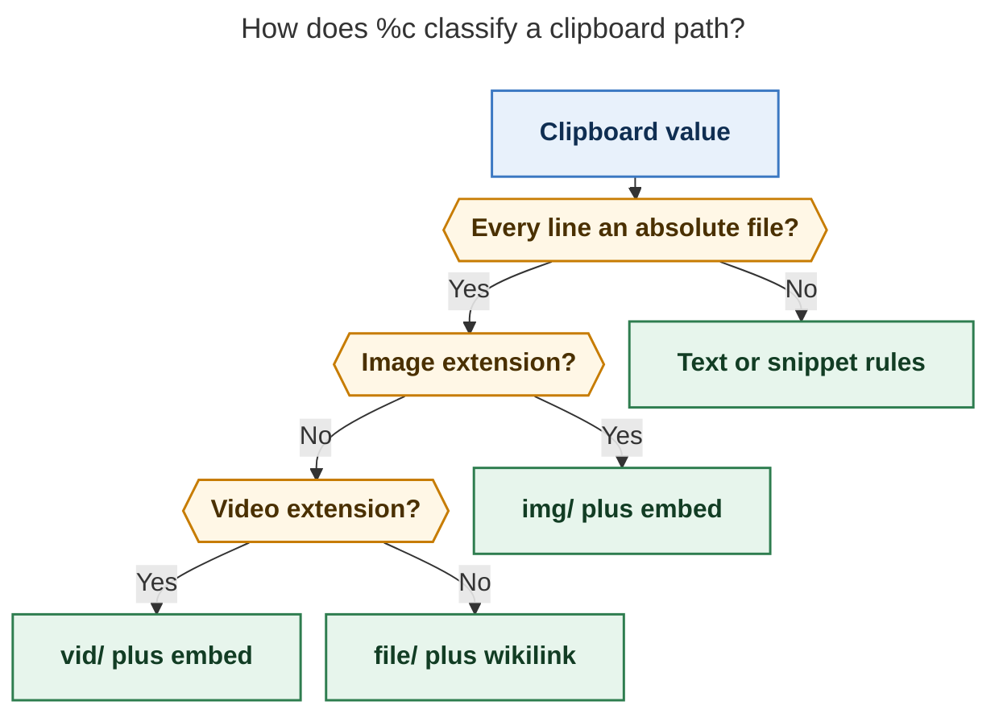
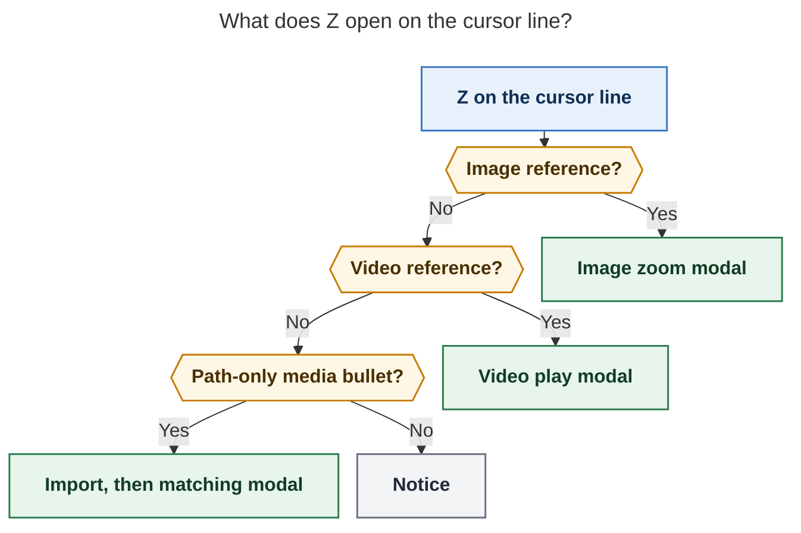

# Capture video embeds and inspect them with Z

**Question.** How should Bob copy a clipboard video path into a captured task, and how should `Z` play that video in Obsidian?

**Bottom line.** The idea is good, and the image pipeline is the right mould. Do not stuff `.mp4` into the image classifier. Add a third attachment kind, `video`, that copies into `vid/`, writes `![[vid/name.mp4|400]]` as a task sub-bullet, and opens a play-focused sibling of the image-zoom modal on `Z`. Keep `%c`. Do not add `%v`.

The example already fits: `~/tmp/screencasts/20261116_155943.mp4` is a 6.2 s H.264 MP4 at 2560×1548 and 243 KiB. `%c` today would save it as `[[file/20261116_155943.mp4]]`, a wikilink that does not play. `Z` on that line currently reports `Not an image`. The design below makes that path behave like a screenshot: small embed in the note, full inspect on `Z`, origin round-trip with `y`/`r`.

---

## 1. Verdict on the request

**Ship it.** Task capture already has a complete path-attachment loop for images. Videos are the same user gesture with a different payload: copy a path, `%c` files it under the new task, `Z` inspects it from Vim Source mode. Bryan's screencast pipeline is already the screenshot pipeline's twin (`~/tmp/screencasts/YYYYMMDD_HHMMSS.mp4` next to `~/tmp/screenshots/…png`).

The request is slightly under-specified in three places, and those are the places a naive "add `mp4` to `IMAGE_EXTENSIONS`" port would go wrong:

1. **Kind.** Images and videos share copy/hash/origin/import, and they do not share viewing. Zoom/pan/`1` for device-pixel 1:1 is the wrong modal for a player.
2. **Note layout.** `![[img/x.png|400]]` sizes an ``. The same `|400` hint on a video is widely reported as inert in Obsidian: the wrapper gets `width="400"` and the `<video>` ignores it unless CSS maps that attribute. An uncapped 2560×1548 player in a task block is ugly.
3. **Safety.** Vault git already allowlists `.mp4`/`.mov`/`.webm`/`.mkv` and calls out GitHub's 100 MiB push limit. Images in `img/` top out around 3 MiB. Video is the first attachment class that can approach that ceiling, even though today's screencasts are tiny.

Those are adjustments to the requirements, called out in §6. The recommended shape is still "the image feature, for video."

---

## 2. What exists today

### 2.1 `%c` already classifies clipboard paths

`docs/capture.md` (Clipboard) and `src/native/capture_clip/` implement one shape ladder. A clipboard whose every nonempty line is an absolute path (`~/…`, `/…`, quoted, `file://`) becomes attachments:

| Kind today | Directory | Written child | JSON `kind` |
| --- | --- | --- | --- |
| Image extension | `img/` | `![[img/name.png\|400]]` | `"image"` |
| Everything else | `file/` | `[[file/name.ext]]` | `"file"` |

The classifier is `attachment_kind` in `src/native/capture_clip/files.rs`. Image extensions are `avif bmp gif heic ico jpeg jpg png svg tif tiff webp`. There is no video list. An `.mp4` path is a `File`.

Shared machinery that video should reuse, not fork:

- Path unwrap (`'…'`, `"…"`, `<…>`), `file://` percent-decode, `~` expand, absolute-only (`classify_path_candidate`).
- SHA-256 reuse of identical bytes; eight-character hash suffix on a name clash.
- Atomic install, rollback of created files if the note write fails, `--dry-run` plans without writing.
- Origin journal `.bob/attachments/<host>.jsonl` (`via: "capture"` or `"zoom"`), `bob attachments origin`, `y`/`r` in the viewer.
- Ten-path cap, one live clipboard read per invocation.
- `bob attachments import` is the same planner with empty indent and no note edit. `Z` on a path-only bullet calls it with `--via zoom`.

The planner currently `fs::read`s the whole source into `PlannedFile.contents` and hashes in memory. That is fine for today's 0.2–0.6 MiB screencasts and for `img/` PNGs. It is the wrong default once a 40–95 MiB clip is in play (the vault already has a 42 MiB MP4 under `old_lib/videos/`).

Clipboard text is UTF-8 without NULs, with a 16 MiB stdout cap. Binary clipboard bytes are already refused; the contract says "copy a file path instead." The user's example is a path, which is the supported shape.

### 2.2 `Z` is an inspect-and-import command, not a lightbox

Prior research `research:202610/obsidian_z_image_inspection/obsidian_z_image_inspection__final.md` and the shipping feature in bob-navigation-hotkeys:

- Command id `zoom-image-on-line`, bound `nmap Z` in `obsidian_vimrc.md`.
- Line-scoped: embed, wikilink, Markdown image; cursor-containing, else next, else previous.
- Plugin-owned fullscreen `ImageZoomModal` (public APIs). Native click / Zoom button still own Reading view and Live Preview embeds.
- `y` copies the recorded original path; `r` restores the bullet to that path; vault copy stays.
- Path-only bullet (`- ~/tmp/foo.png`) imports through `bob attachments import` and opens the viewer. A non-image extension throws `Not an image: <path>`.

The plugin's candidate extensions are `png jpg jpeg gif webp svg bmp avif`. That set is already a subset of bob-cli's image list (`heic ico tif tiff` copy as images and then fail `Z`). Video work should publish one catalog both sides cite, so this split does not recur.

### 2.3 Obsidian already plays local video

[Accepted file formats](https://obsidian.md/help/file-formats) lists video as `.mkv`, `.mov`, `.mp4`, `.ogv`, `.webm`. Embed syntax is the same bang-wikilink as images: `![[clip.mp4]]`. Support "depends on the codecs available on your device."

Live Preview and Reading view render a native `<video controls>` for those embeds. Source mode shows the wikilink. There is no documented command that opens a video inspect UI from Vim, which is the same gap `Z` filled for images.

Width is the sharp edge. Image `|400` sizes the ``. Multiple 2025 reports (Obsidian forum, r/ObsidianMD, the Chinese forum) say the same pipe on a video sets `width` on the wrapper and leaves the `<video>` at the player's default. A CSS rule of the form `.video-embed[width="400"] > video { width: 400px; height: auto; }` is the established workaround. Implementation must verify this on the Mac's Obsidian build; see ADJ-2.

### 2.4 The vault is already willing to track video

`~/bob/.gitignore` ignore-everything-then-allowlist already re-includes:

```gitignore
!*.mp4
!*.mov
!*.m4v
!*.webm
!*.avi
!*.mkv
```

The same file documents GitHub's 100 MiB per-file push limit and that this vault does not use Git LFS. `img/` currently holds 214 files, 80 MiB total, max 2.9 MiB. The only vault MP4 found outside that allowlist comment is `old_lib/videos/yt_browse_web_with_neovim.mp4` (42 MiB). There is no `vid/` directory and no video under `file/`.

### 2.5 The example screencasts

Measured 2026-11-16 on athena:

| File | Duration | Size | Codec | Frame |
| --- | --- | --- | --- | --- |
| `20261116_155943.mp4` | 6.2 s | 243 KiB | H.264 High, yuv420p, no audio | 2560×1548 @ 30 fps |
| `20261116_060435.mp4` | 11.9 s | 412 KiB | same | same |
| `20261115_195328.mp4` | 7.5 s | 629 KiB | same | same |

Encoder tags are `Lavc`/`libx264`. These are short, silent, Retina-class UI captures — the video equivalent of the PNG screenshots `Z` was built for. At `|400` they scale to about 16% linear size, so UI text in the frame is unreadable in the note and readable in a full-window player. That is exactly why image `Z` exists.

---

## 3. Critique: is this a good idea?

**Yes.** Four reasons, all already true of images:

1. **The gesture already exists.** Copy path, `%c`, child bullet. Bryan does not need a new sigil, a new inbox, or a Finder drop into Obsidian.
2. **Source-mode Vim cannot play the native embed.** Live Preview's player is mouse-first. `Z` is the keyboard inspect for the same line.
3. **Self-contained notes.** Copying into the vault, with origin journal, is how screenshots survive host sync. The gitignore already expects `.mp4`.
4. **The files are cheap.** Sub-megabyte, sub-12-second, H.264. This is not a "should we Git-LFS hour-long 4K" problem.

Where the original framing is thin:

- **"Inspiration from images" is the architecture, not the widget.** Reuse classify → copy → hash → origin → import. Replace zoom/pan with play/pause/seek. Reuse modal chrome (dimmed fullscreen, origin line, chips, `y`/`r`, `Esc`/`q`/`Z` close).
- **A wikilink is not an embed.** Leaving video in `file/` as `[[file/x.mp4]]` would make `%c` "work" and still fail the "embedded in the new task" requirement.
- **Putting `.mp4` in `IMAGE_EXTENSIONS` would write `![[img/x.mp4|400]]`.** Obsidian might play it. The image modal would then load a video URL as `` and fail. `img/` would mix screenshots and screencasts. That is the trap.
- **No new directive.** `%` already means how (`decisions:capture-sigils-say-where-what-how`). `%c` is clip. A `%v` would split one clipboard into two grammars and break composition (`%c` with routes, drawers, note-less `@id`). Classification belongs in the clip planner.

Would I take a different approach than "make `%c` embed the clipboard video, view with `Z`"? Only in the internals: third kind, `vid/`, play modal, CSS width, size rail. The user-facing loop is the right one.

---

## 4. Recommended design

### 4.1 One loop, three kinds

```text
clipboard path  →  classify  →  copy + origin  →  child embed/link  →  Z inspect
```

| Kind | Extensions | Directory | Child line | `Z` |
| --- | --- | --- | --- | --- |
| `image` | existing image list | `img/` | `![[img/name.png\|400]]` | zoom/pan modal (today) |
| `video` | `mkv mov mp4 ogv webm m4v` | `vid/` | `![[vid/name.mp4\|400]]` | play modal (new) |
| `file` | everything else | `file/` | `[[file/name.pdf]]` | unchanged (`Not an image` / PDF `Cmd+Enter`) |

`m4v` is in the vault gitignore and is an MP4 sibling; include it. `avi` is in the gitignore and is a poor Chromium citizen; leave it as `file` until someone actually captures one.

Happy path codec: H.264 + AAC (or silent) in `.mp4`, which is what these screencasts already are. `.mov` is accepted because Obsidian lists it; HEVC-in-MOV may fail to play in Electron, in which case the modal shows the native failure and `y` still copies the original path. Do not transcode on capture.

### 4.2 `%c` write

For the stated example, `bob capture Investigate the TUI glitch %c` with clipboard `~/tmp/screencasts/20261116_155943.mp4` writes:

```markdown
- [ ] #task Investigate the TUI glitch [created::2026-11-16] ^…
	- ![[vid/20261116_155943.mp4|400]]
```

Same indent rule as images (note-dominant tab or two spaces, else tab). Same sanitizer, reuse, suffix, rollback, dry-run. Origin event:

```json
{"v":1,"kind":"attachment.import","saved":"vid/20261116_155943.mp4","source":"/home/bryan/tmp/screencasts/20261116_155943.mp4","display":"~/tmp/screencasts/20261116_155943.mp4","via":"capture"}
```

JSON `clip.attachments[].kind` gains `"video"` additively. Capture JSON is unversioned; the Mac app already stores `kind` as `String`. Until the Mac clip card is updated, a video counts as a "file" in the header (`files = count - images`). That is acceptable for a bob-cli-first slice and ugly enough that the Mac phase should ride the same epic.

This changes the bytes `%c` would write for a video path that today lands in `file/`. Mark the changelog `!`. Unlikely anyone depends on `[[file/*.mp4]]`; the contract text today is explicit ("other files … linked"), so the break is real.

### 4.3 `Z` inspect

Keep command id `zoom-image-on-line` and the vimrc `nmap Z`. Rename the palette string to **Inspect media on cursor line**. Dispatch inside the existing command:

1. Image candidate on the line → today's zoom modal.
2. Else video candidate (same ref grammar, video extensions, including `![[vid/x.mp4|400]]` and a leftover `[[file/x.mp4]]`) → play modal.
3. Else path-only bullet whose extension is image or video → `bob attachments import --via zoom`, rewrite to bob's embed, open the matching modal with `Imported to vid/name.mp4 · r to undo`.
4. Else today's notices.

Play modal, same chrome as image zoom (dim 0.9 scrim, title, origin, chips, toast):

| Key | Action |
| --- | --- |
| `Esc`, `q`, `Ctrl+[`, `Z` | Pause and close; restore cursor/scroll/Vim mode |
| `Space` | Play / pause (Space is free; image zoom does not bind it) |
| `0` | Restart |
| `←` / `h`, `→` / `l` | Seek −5 s / +5 s |
| `j` / `k` | Seek −10 s / +10 s, or keep `j`/`k` unused if that fights image muscle memory — prefer seek; video has nothing to pan |
| `m` | Mute |
| `<` / `>` | Slow / faster playback |
| `f` | Fullscreen the `<video>` |
| `y` | Copy recorded original path |
| `r` | Restore bullet to that path |

Readout where images show zoom percent: `0:04 / 0:06`. Autoplay when the file has no audio track (true of the current screencasts); start paused when an audio stream exists. Do not intercept native Live Preview / Reading `<video>` clicks.

Path-bullet detection currently throws `Not an image` for `.mp4`. Change that throw to run only after both catalogs miss, and import videos.

### 4.4 Width in the note

Write `|400` for contract parity with images (same `attachment_reference` shape, same restore target). Ship this CSS in bob-navigation-hotkeys `styles.css`:

```css
.internal-embed.video-embed[width="400"] > video {
  width: 400px;
  height: auto;
  max-width: 100%;
}
```

One value is enough: bob only mints 400. Hand-written `|640` can be added later if it appears. Verify on the Mac whether 1.14 already honors the pipe; if it does, the rule is harmless. If it does not, the rule is what keeps a task block scannable.

Do not emit raw `<video>` HTML. Wikilinks rename, origin-restore, and `Z` parsing all assume bang-wikilink form.

### 4.5 Size rail

Refuse a source whose size is ≥ 95 MiB with a stable code `too_large` (import JSON) / a capture error that names GitHub's 100 MiB limit and suggests shrinking or linking. Today's screencasts are ~200× under that line. The rail protects `vault-sync` push, matching the gitignore comment that this repo does not use Git LFS.

Stream the copy: SHA-256 the source while copying into the temp file, then install. Stop holding the whole video in `PlannedFile.contents`. Apply that streaming path to video first; images can keep the current in-memory path. Cleanup/rollback still deletes created destinations.

### 4.6 Mac clip card

Thin-client rule: bob-cli ships the kind and the embed line first. Mac `CaptureClipPresentation` then counts `"video"` separately (`"1 video"` / `"1 video · 1 image"`), and `ClipAttachmentRow` can decode a first-frame thumbnail with `AVAssetImageGenerator` from Bob's `source` path, falling back to the summary row. That is beauty, not capture correctness.

### 4.7 What stays out of v1

- Audio (`.mp3`/`.m4a`/… already gitignored; different widget).
- A `%v` directive, HTML `<video>` children, YouTube URLs.
- Transcode, poster/ffmpeg thumbnails, Git LFS.
- Galleries, counted `NZ`, mobile.
- Changing `Enter` / `[[` / `]]` to treat video files as jump targets.
- Stuffing videos into `img/` or leaving them in `file/`.

---

## 5. How the pieces route

**Reader question:** How does `%c` decide what to write for a clipboard path?

**Caption:** A clipboard of absolute file paths still becomes attachments; video is a third kind that embeds under `vid/` at 400 px, beside images under `img/` and other files under `file/`.


Rendered size: 724.1 × 800 px; fit scale: 90.2%. Mermaid CLI 12.0.0.



**Reader question:** What does `Z` open on the cursor line?

**Caption:** `Z` keeps image zoom first, then plays a video reference, then imports a path-only image or video bullet through `bob attachments import`; every other line stays a notice.


Rendered size: 726.2 × 824 px; fit scale: 89.9%. Mermaid CLI 12.0.0.



Converging arrows mean one chosen branch, not all.

---

## 6. Adjustments to the requirements

These change the request. They are justified by the code and the vault, not by taste alone.

**ADJ-1. Third kind `video`, directory `vid/`.** The request says "inspiration from images." Images are `AttachmentKind::Image` + `img/` + bang-wikilink. A boolean `is_image` cannot describe a player. `vid/` parallels `img/` and keeps PDFs out of the screencast folder. Rejected: stuffing `.mp4` into `IMAGE_EXTENSIONS`; leaving video in `file/` as a plain wikilink.

**ADJ-2. `|400` plus CSS.** Keep the 400 px contract so the note stays scannable (these frames are 2560 px wide). Because Obsidian's pipe is reported inert on `<video>`, bob-navigation-hotkeys must size `.video-embed[width="400"] > video`. Verify on the Mac before treating the CSS as optional.

**ADJ-3. Play modal, same `Z`.** Do not teach a second key. Do not reuse zoom/pan/`1` 1:1. Space plays; `Z` still closes. Palette name becomes Inspect media; command id stays `zoom-image-on-line` so the vimrc mapping does not move.

**ADJ-4. No `%v`.** `%c` already means clip. Classification is a planner concern. A new directive would be a grammar change for a case the shape ladder already covers.

**ADJ-5. 95 MiB hard refuse (`too_large`).** Matches the vault's "no Git LFS / GitHub 100 MiB" policy. Current screencasts are 243–629 KiB; this does not constrain the stated workflow. Stream the copy so a future 40 MiB clip does not sit twice in RAM.

**ADJ-6. Shared extension catalog in `docs/attachments.md`.** bob-cli and the plugin already disagree on image extensions. Video must not add a third list. The contract table in attachments.md is the source; both implementations cite it. `heic`/`tif` remaining on the image side can be a follow-up.

**ADJ-7. Changelog `!`, additive JSON.** Written markdown for video paths changes (`file/` wikilink → `vid/` embed). `kind: "video"` is additive. Attachments API `schema_version` stays 1. No capture-grammar bump.

**ADJ-8. Audio is out.** The gitignore already allowlists audio, and `%c` of an `.m4a` would be a natural later sibling. v1 is screencasts.

**ADJ-9. Mac clip-card video header and first-frame thumbnail are phase two of the same epic, not a separate wish.** Thin-client: bob-cli first. Shipping bob-cli without the Mac header leaves videos labelled "file" in the panel, which is a small lie.

---

## 7. Options considered

| Option | `%c` result | `Z` | Note layout | Verdict |
| --- | --- | --- | --- | --- |
| 0. Do nothing | `[[file/x.mp4]]` | `Not an image` | Click the wikilink, hope the file view plays | Baseline. Fails the request |
| 1. Add `mp4` to `IMAGE_EXTENSIONS` | `![[img/x.mp4\|400]]` | `` load fails | Mixes media in `img/` | Reject. Wrong widget, wrong folder |
| 2. Keep `file/`, write `![[file/x.mp4\|400]]` | Embed in `file/` | Needs video modal anyway | PDFs and videos share a directory | Workable, less clear than `vid/` |
| 3. HTML `<video src>` child | Plays if `src` resolves | Custom parser | Breaks rename, origin, `Z` ref grammar | Reject |
| 4. `file://` original, no vault copy | Depends on host | Maybe | Breaks athena↔Mac git sync | Reject. Images copy for this reason |
| 5. External player (`openWithDefaultApp`) | Any link form | Leaves Obsidian | No in-note player | Possible later `gx`; not `Z` |
| 6. Community media plugin | N/A | Third-party keymap | Fights native `<video>` | Reject, same reason image `Z` rejected toolkits |
| 7. **Third kind `video` + `vid/` + play modal** | `![[vid/x.mp4\|400]]` | Owned player, `y`/`r` | 400 px via CSS | **Recommended** |

Option 2 is the only serious runner-up. I still want `vid/` because `ls vid/` is the screencast gallery the way `ls img/` is the screenshot gallery, and origin `saved` paths stay self-describing.

---

## 8. Implementation sketch

Three repositories, bob-cli first (`decisions:mac-capture-is-a-thin-client`). This is an epic, not a single-repo tale: the plugin cannot play what bob still classifies as `file`, and the Mac card cannot label a kind bob does not emit.

**Phase A — bob-cli (capture contract).** `AttachmentKind::Video`; `VIDEO_EXTENSIONS`; `vid/` + `![[…|400]]`; stream copy; `too_large`; origin journal unchanged in shape; tests in `capture_clip/tests.rs` and `tests/cli/attachments.rs` using a tiny fake MP4; `docs/capture.md` Clipboard, `docs/attachments.md` kind table, `docs/reference/cli/attachments.md` via `just docs-gen`; changelog `!`. Help examples gain one screencast path.

**Phase B — bob-plugins (Z).** Shared catalog with bob-cli; video candidate detection beside `isImageZoomCandidate`; play modal fragment (keep each fragment ≤ 1000 lines); path-bullet import accepts video; CSS width rule; tests next to `scripts/test-navigation-image-zoom-path.cjs` and `test-navigation-image-zoom-viewer.cjs`; `docs/image-zoom.md` becomes inspect-media (or a sibling `media-inspect.md` mounted the same way); `bob plugins sync`. Command id unchanged.

**Phase C — bob-mac-capture (clip card).** Count `"video"` in the header; optional first-frame thumbnail from `source`; additive decode. Gated by macOS CI.

**Docs routing** (`docs.md`): behavior change → capture and attachments contracts; new hotkey behavior → plugin reference; no README novel. No new `bob capture` subcommand (`cli_rules.md`).

**Decision record.** Write one after acceptance: a video path is a third attachment kind, stored under `vid/`, embedded at 400 px, inspected with `Z`. Cite this report.

Suggested tests, minimum:

- `%c` of the example path (or a 1×1 fake MP4) writes `![[vid/…|400]]`, `kind=video`, origin `via=capture`.
- `%c` of a `.png` is unchanged.
- `%c` of a `.pdf` is unchanged.
- Reuse on identical bytes; suffix on clash.
- Dry-run creates no `vid/` file.
- Import JSON `embed` matches capture.
- Source ≥ 95 MiB → `too_large`, no write.
- Plugin: `Z` on `![[vid/x.mp4|400]]` opens play modal; path-only `~/tmp/a.mp4` imports; `.md` path still `Not an image`; image path still zooms.
- `y`/`r` round-trip for a video origin.

Smoke on the Mac: Live Preview plays the 400 px embed; Source `Z` autoplays the silent 6 s clip; `Z` closes; `r` restores the `~/tmp/screencasts/…` bullet; `git -C ~/bob status` shows `vid/*.mp4` tracked.

---

## 9. Risks

| Risk | Why it matters | Mitigation |
| --- | --- | --- |
| `\|400` does not size `<video>` | Task notes grow a huge player | CSS in bob-navigation-hotkeys; verify on Mac 1.14 |
| HEVC `.mov` from Screenshot.app | Electron may not decode | Document H.264 MP4 as the happy path; modal shows native failure; `y` still works |
| 20 s plugin spawn timeout on a huge copy | `Z` import looks hung | 95 MiB cap; stream copy; keep timeout unless a real clip approaches it |
| In-memory `fs::read` of a 42 MiB file | Capture RAM spike | Stream for `video` |
| Mac clip card says "file" | Preview lies until phase C | Same epic, bob-cli first |
| GitHub 100 MiB | `vault-sync` push fails | `too_large` at 95 MiB; no LFS |
| Extension-list drift | `Z` misses what `%c` wrote | One table in `docs/attachments.md` |
| Native player vs `Z` | Double UI | Native clicks stay native; `Z` is Source/Vim |

---

## 10. Recommended solution

**Implement video as a third attachment kind that reuses the image capture loop and grows `Z` into a media inspect command.**

1. **bob-cli.** Classify Obsidian video extensions as `video`. Copy into `vid/`. Write `![[vid/name.mp4|400]]` as the `%c` child. Record origin. Stream the copy. Refuse ≥ 95 MiB. Keep `%c`. Mark the write-shape change `!`.
2. **bob-plugins.** Same `Z`. Image lines still zoom. Video lines open a play modal with Space/seek/`y`/`r` and the existing close keys. Path-only video bullets import through `bob attachments import`. CSS makes `|400` real on the in-note player.
3. **bob-mac-capture.** Header counts videos; optional first-frame thumbnail from Bob's `source`.
4. **Verify** on the example file `~/tmp/screencasts/20261116_155943.mp4`: capture embeds it; Live Preview plays a 400 px player; Source `Z` autoplays the silent clip; `y` copies `~/tmp/screencasts/20261116_155943.mp4`.

That is the image feature, done honestly for motion.

---

## Sources

- bob-cli `src/native/capture_clip/{files,plan,model,persist}.rs`, `src/native/attachments/cli.rs`, `docs/capture.md` (Clipboard), `docs/attachments.md`, `docs/reference/cli/attachments.md`, `tests/cli/attachments.rs`, `src/native/capture_clip/tests.rs`
- bob-plugins `plugins/bob-navigation-hotkeys/src/{679-plugin-image-zoom.js,679a-image-zoom-path.js,207-image-zoom-modal.js,207a-image-zoom-origin.js}`, `styles.css` (image-zoom), `docs/image-zoom.md`, `scripts/test-navigation-image-zoom-*.cjs`, `plugins/bob-ledger-tools/src/173-plugin-attachments-api.js`
- bob-mac-capture `Sources/CaptureCore/CaptureClipPresentation.swift`, `Sources/BobMacCapture/ClipCardView.swift`, `docs/capture-previews.md`
- Vault `~/bob/.gitignore` (video allowlist, 100 MiB note); `img/` size census; `old_lib/videos/yt_browse_web_with_neovim.mp4`
- Example clips `~/tmp/screencasts/*.mp4` (ffprobe: H.264 2560×1548, 6–12 s, 243–629 KiB, no audio)
- `research:202610/obsidian_z_image_inspection/obsidian_z_image_inspection__final.md`
- Memory: `glossary:Capture`, `decisions:capture-sigils-say-where-what-how`, `decisions:mac-capture-is-a-thin-client`, `docs.md`, `cli_rules.md`
- [Obsidian accepted file formats](https://obsidian.md/help/file-formats); [Embed files](https://obsidian.md/help/embeds)
- Width reports: [r/ObsidianMD, 2025-10-06](https://www.reddit.com/r/ObsidianMD/comments/1nzn45n/css_tip_resize_an_embedded_video_like_any_other); [Chinese forum topic 31243](https://forum-zh.obsidian.md/t/topic/31243)
