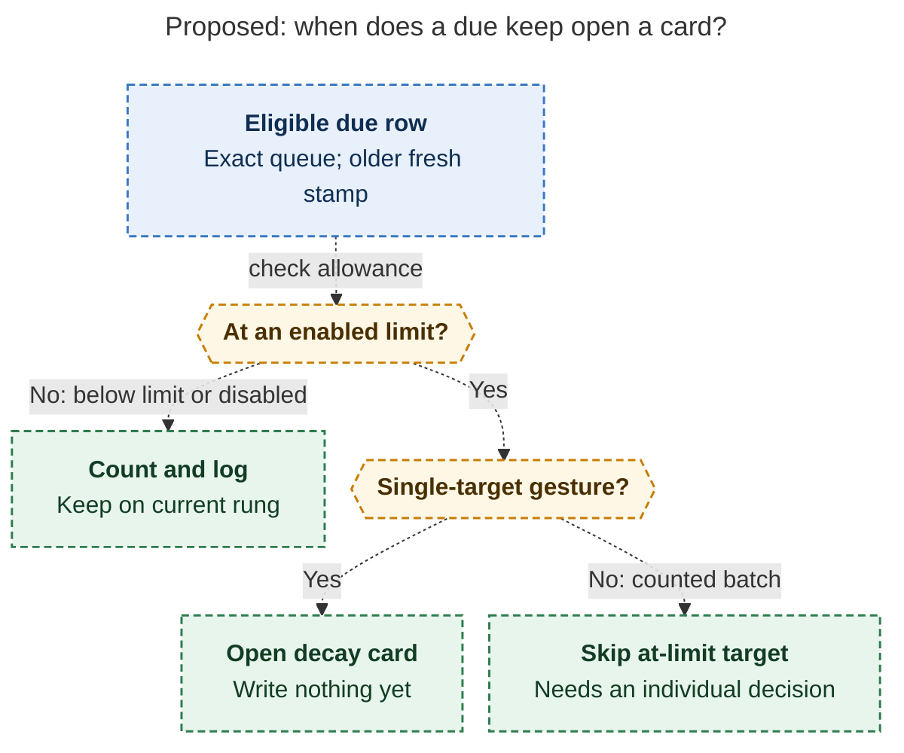
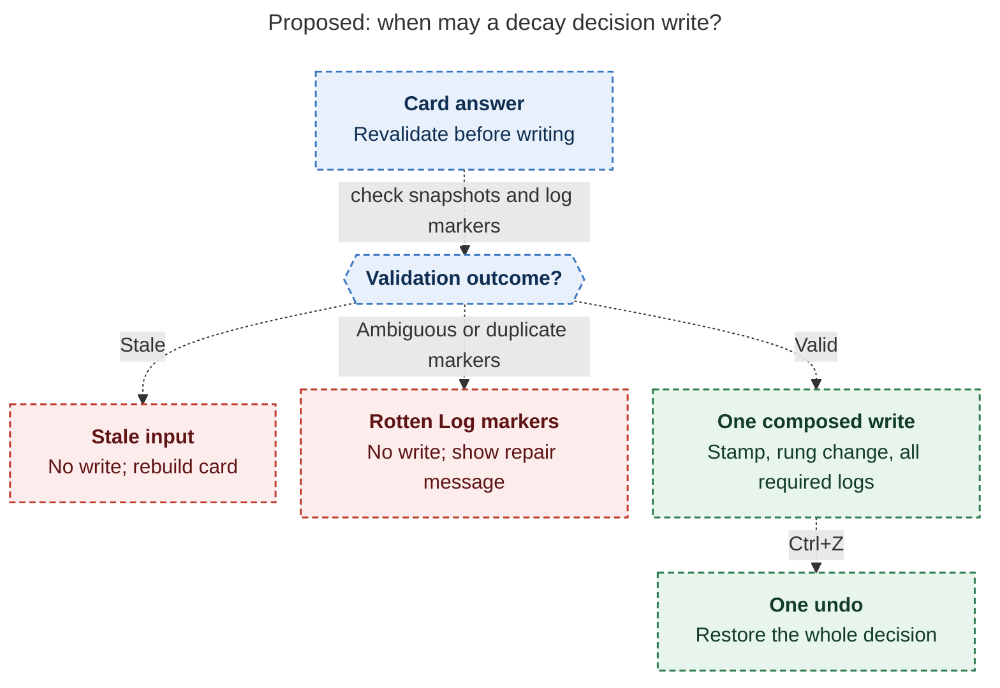

# Diagram proposals: Task Decay: One Ladder, Two Stays Per Rung, One Card

Proposals for the swarm linker, not a report. Each diagram restates only what the source
report says.

```yaml
source: research:202611/task_decay_ladder/task_decay_ladder__final.md
producer: research.32.image
check: "mmdc 12.0.0 with the PDF-mirroring config rendered 3 of 3 Mermaid diagrams; Puppeteer --no-sandbox; SVG and PNG reviewed"
```

## counted-review-routing

```yaml
anchor: |-
  a single due Alt+F / Ctrl+Alt+F opens the card and writes
question: |-
  When does an eligible due keep count, open a decay card, or wait for an individual decision?
illustrates: |-
  For eligible due rows, the allowance controls whether a keep counts and logs or needs a decision, and counted batches skip at-limit targets for individual decisions.
caption: For eligible due rows, an enabled, exhausted allowance opens a card for single gestures; counted batches skip those targets for individual decisions.
review: "656.763x786 px, fit 99.4%; question, source trace and visual checks passed; 1 revision; scoped to counted gestures, excluding Task Link sessions"
```



## priority-threshold-bypass

```yaml
anchor: |-
  The card must step one level directly.
question: |-
  Why must the freshness card bypass the priority roll threshold?
illustrates: |-
  The current freshness card can offer another same-level roll after the keep allowance, while the proposed P1–P3 card steps one level directly and bypasses the Schedule-Log threshold.
caption: At P1–P3, the proposed freshness card steps directly; the Schedule-Log threshold still governs Ctrl+Enter on the Task Card.
review: "616x577 px, fit 100.0%; question, conditional wording, source trace and visual checks passed; 0 revisions"
```



```mermaid
---
title: "Why bypass a second priority threshold?"
accTitle: "Current versus proposed freshness card at a priority level"
accDescr: "Today a freshness card can consult a second Schedule Log roll threshold and recommend another same-level roll. The proposed card steps one level directly. This comparison applies to P1 through P3."
config:
  flowchart:
    rankSpacing: 20
    nodeSpacing: 26
    wrappingWidth: 200
---
flowchart TD
  subgraph CURRENT["Today · P1–P3 freshness card"]
    A["`**Keep allowance exhausted**<br/>Open freshness card`"]
    B["`**Roll recommendation**<br/>Checks Schedule Log threshold`"]
    C["`**Same-level roll**<br/>Another stay may be offered`"]
    A -->|"Not now delegates"| B
    B -->|"can recommend"| C
  end
  subgraph PROPOSAL["Proposed · P1–P3 freshness card"]
    D["`**Keep allowance exhausted**<br/>Open freshness card`"]
    E["`**Next priority level**<br/>Step directly`"]
    D -.->|"Enter bypasses roll threshold"| E
  end
  classDef focus fill:#E8F1FB,stroke:#3B78C2,stroke-width:1.5px,color:#0F2E52
  classDef risk fill:#FDECEC,stroke:#C0392B,stroke-width:1.5px,color:#5F1414
  classDef outcome fill:#E7F5EC,stroke:#2E7D4F,stroke-width:1.5px,color:#123D24
  classDef proposed stroke-dasharray:5 3
  class A,D focus
  class B,C risk
  class E outcome
  class D,E proposed
  style CURRENT fill:none,stroke:#C0392B
  style PROPOSAL fill:none,stroke:#2E7D4F,stroke-dasharray:5 3
```

## atomic-decision-validation

```yaml
anchor: |-
  The stamp, rung change, Rotten Log entry, and any
question: |-
  How does a decay decision commit safely when inputs or Rotten Log markers are invalid?
illustrates: |-
  Each answer revalidates before one composed write; stale input writes nothing and rebuilds the card, while ambiguous or duplicate Rotten Log markers block the whole decision.
caption: A decay answer writes its stamp, rung change and logs together; stale inputs or ambiguous Rotten Log markers prevent any write.
review: "765.109x812 px, fit 85.3%; question, source trace, labels and visual checks passed; 1 revision"
```


