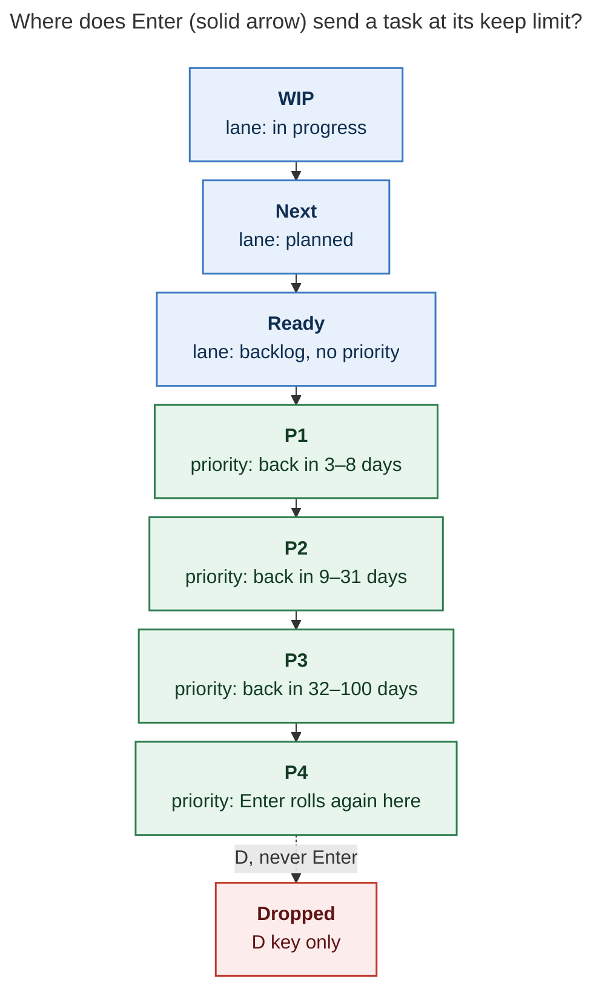

# Task Decay: One Ladder, Two Stays Per Rung, One Card

_Consolidated report · 2026-11-02 · merges researchers cdx, cld, grk, mus, and gem with
the lead researcher's own verification. Scope: bob-cli (Rust freshness and status
hooks), bob-plugins (bob-navigation-hotkeys, bob-ledger-tools), chezmoi
`home/dot_config/bob/config.yml`, the Bob vault's review journal, and SASE memory._

## Bottom line

**Build it.** Bob already asks a real question about a Ready task after repeated keeps.
WIP and Next tasks never get that question, and the review journal shows the cost. Over
22 review days, Next rows were kept 88 times, and five Next tasks were kept 11–12 times
each. The vault has **zero** Next Rotten Log entries because every Next reason was left
blank, and a blank reason writes nothing. WIP is at 14 tasks against a soft cap of 8.

The recommended shape:

1. **Fix the screenshot first, as an independent hotfix.** The message "no priority
   ladder is configured" comes from a plugin wiring bug, not a missing config. The decay
   card reads `this.config` on the navigation plugin, and nothing ever assigns it. Two
   more defects sit behind it:
   - The card's entry rule would pick P2, not P1, for Bryan.
   - **Enter on the card actually runs Keep**, because Keep is the focused row.

   I verified all three in source.
2. **Adopt one decay ladder:** WIP → Next → Ready → P1 → P2 → P3 → P4.
   - Each rung allows **two stays**. On a lane, a stay is a due Alt+F keep. On a
     P-level, it is a due keep or a same-level Ctrl+Enter roll.
   - After the allowance, the next due Alt+F opens one decay card. **Enter steps one
     rung down.** **Alt+F stays and restarts the count.** D drops.
   - Enter never drops a task. Nothing moves without a keypress.
3. **Make the Rotten Log the complete history.**
   - Every counted keep, stay, and step writes one entry that names the rung and the
     count: `kept 2× in Next`, `stayed in WIP after 2 keeps`, `🍂 Next → Ready · after 2
     keeps`.
   - A blank reason writes `🤷 no reason given` with the same tail.
   - Alt+F on a WIP task stops asking for a Work Log summary.
4. **Configure it explicitly.**
   - Add `freshness.decay.pending_keeps` / `next_keeps` / `ready_keeps` (flat keys, like
     `pending_interval`).
   - Set `enter: P1`.
   - Uncomment the priority property's `decay.rolls: 2`.

Ten adjustments to the request are called out in [§5](#5-adjustments-to-the-request).
The most important ones:

- The freshness card must **not** stack the roll threshold on top of the keep threshold.
- "WIP is rotten" means *logged in the Rotten Log*, not moved to the ROTTEN tier.
- Reconcile-driven lane raises must clear the keep streak.
- A Next task that today's linked work depends on must not be offered a demotion that
  reconcile would undo.

## 1. What Bob does today

| Area | Current behavior (verified) | What the request changes |
|---|---|---|
| Ready keep streak | `[keeps:: N]` counts due Ready ROTTEN/TICKLER keeps; `freshness.decay.keeps` defaults to 3; at the limit the next due Alt+F opens the card and writes nothing | Limit 2; extend to lanes |
| Next Alt+F | Asks "Why keep it in Next?" even when early; a typed reason writes `· kept in Next`; blank writes nothing; never counts | Count due keeps; always log |
| WIP Alt+F | Asks for an optional **Work Log** summary; never touches the Rotten Log or `[keeps::]` | Rotten Log instead |
| Card's Keep | Increments again and asks again at the next review | Must reset ("Stay") |
| Card at a P-level | "Not now" reuses `planPriorityRollRecommendation`, which applies its own Schedule-Log roll streak | Would stack a second threshold |
| Priority rolls | `properties.priority.decay.rolls`, default 1; commented out in chezmoi | Set to 2 explicitly |
| Counting helper | `api.freshness.keepLine(line, date, {counted})` is lane-agnostic; uncounted keeps *preserve* the streak; every other human stamp clears it; automation never touches it | Eligibility lives in callers, so lanes are an eligibility change |
| `decide` | `enabled && lane ready && tier rotten/tickler && keeps ≥ limit` (`src/native/freshness/state.rs::decide_for`) | Add lane tiers |

Bryan's chezmoi config sets `interval: 3`, `pending_interval: 1`, `next_interval: 1`,
`project_interval: 1`, no `freshness.decay` block, and a P1–P4 ladder: P1 `high` 3–8
days, P2 `medium` 9–31, P3 `low` 32–100, P4 `lowest` 101–365. Two reports (cdx, cld)
read `next_interval: 2`. That value was reverted in chezmoi commit `baf49514` ("fix: next
interval has to be 1!"). Apollo's deployed config is stale: `bob freshness` there prints
`every 7d · … · keeps 3`. Run `chezmoi apply` on each host after the config change.

## 2. The screenshot: three stacked defects, not a missing ladder

The screenshot shows the decay card on a P0 task ("foo bar baz", 3 keeps logged).
**Not now** is disabled with "no priority ladder is configured". The 1–4 promise is still
in the footer. The purple focus ring sits on **Keep**.

### 2.1 Defect A: the card never loads the priority config (all hosts)

`530-plugin-freshness-refresh-and-decay.js` calls
`findFreshnessDecayPriorityProperty(this.config)` at four sites:

- the card build (line 157);
- revalidation (365);
- level resolution (558);
- deferral commit (589).

`540-plugin-decay-picker-and-cancel.js:24` also passes `this.config` to the Less-often
picker. The navigation plugin has exactly one `this.config =` assignment, in
`BulletPropertyPickerModal`'s constructor (`340-picker-core.js:9`). Other gestures call
`loadBulletPropertyConfig()` on demand. So on the plugin, `this.config` is always
`undefined`, the finder returns `null`, and `050-decay-planner.js` sets
`notNow = unavailable("no priority ladder is configured")`.

The handler suite hides the bug: `scripts/test-navigation-decision-card-handlers.cjs`
sets `plugin.config = decayConfig()` by hand. cdx and cld each reproduced the
screenshot's rows exactly with Bryan's real config. With the fixture assignment the rows
work; without it they fail.

mus attributed the screenshot to a missing or unapplied config file on the Mac. That is
wrong as a root cause, because no host can ever reach a ladder through this code path.
mus's adjacent point stands, though: missing, unreadable, invalid, and absent configs
deserve four distinct messages, not one dead end.

**Fix.** Load the normalized config through `loadBulletPropertyConfig()` when the card
opens, and keep that snapshot. Re-load and revalidate it before commit at all five sites.
Repairing only the first lookup is not enough: revalidation currently compares two
`null`s, so it would never notice a real ladder change. Then:

- Add a regression test that enters through the real handler with no injected
  `plugin.config`.
- Cover the changed, malformed, and missing config cases.

### 2.2 Defect B: P0 entry skips P1 on Bryan's cadence

`resolveFreshnessDecayP0EntryLevel` (`040-priority-roll.js`) enters at the first level
whose `min_days > interval`. With `interval: 3` and P1 `min_days: 3`, `3 > 3` is false,
so the card would offer P2 even after Defect A is fixed. Meanwhile the Task Card's
Ctrl+Enter on an unprioritized task assigns `levels[0]`, P1, so the two gestures
disagree.

The interval test has a purpose. With a long interval and a short P1 window, entering P1
would bring the task back *sooner* than a plain keep. The documented example (interval 7
→ P2 on the default 2–7 / 8–30 ladder) depends on it.

**Answer to "always use P1, right?": yes for Bryan, and the code should agree without
inventing levels.**

- Relax the test to `min_days >= interval`. That still yields P2 for the documented
  example, yields P1 for Bryan, and never enters a level that returns sooner than a keep.
- Pin `enter: P1` in chezmoi so the policy is explicit.
- Do **not** hardcode a P1 write when no ladder is loaded (cdx, mus). That would invent
  a Tasks value that the Task Card cannot roll.

### 2.3 Defect C: Enter runs Keep, not the recommended row

cld flagged this as likely; I confirmed it in source.

- `FreshnessDecayCardModal.onOpen` calls `focusKeepRowOrFirst()`, which focuses the
  Keep row whenever it is available.
- Each available row has its own `keydown` handler. It catches Enter, calls
  `stopPropagation()`, and runs `choose(row.action)`.
- The content-level `Enter → notNow` handler therefore never sees Enter, so Enter opens
  Keep's reason stage.
- The card's chip and "recommended" badge still put Enter on Not now. The screenshot
  shows the focus ring on Keep.

**Fix:**

- Focus the recommended row, so the focus ring, the chip, and the Enter behavior agree.
- Build the footer from the rows that exist, so "1–4" appears only when level rows
  exist.

I verified this in source, not in a live Obsidian session. Smoke-test it on the Mac.

## 3. Is this a good idea?

**Yes.** The evidence is strong, and the design keeps the property that made Ready decay
acceptable: consent.

| Signal (verified, 2026-10-12 → 2026-11-02, 22 review days) | Value |
|---|---|
| NEXT-tier answers | 88 keep · 49 today · 17 sequence · 8 defer · 7 done · 2 lane · 1 drop |
| Keeps per NEXT task (journal key) | 12, 12, 12, 11, 11, 4, 3, 3, 3, … |
| PENDING-tier answers | 97 done · 61 today · 23 keep · 5 defer; keeps per task 4, 4, 3, 2, … |
| TICKLER answers | 415 defer · 39 done · 24 drop · 5 keep (P-level tasks "stay" by being rolled) |
| `· kept in Next` entries in the vault | 0 |
| Lanes today (`bob plan`) | PENDING 14/8 · NEXT 6/13 |

- **It repairs a known gap.** The sticky-lanes decision accepted "no automatic
  forgetting" and relied on daily release. The journal shows 2 lane releases against 88
  Next keeps.
- **Both reopen conditions for `next-keeps-ask-an-optional-rotten-reason` are now met.**
  Next reasons were blank for the whole period, and Bryan wants Pending keeps in the
  Rotten Log.
- **It is not the "age-based Next decay" that sticky lanes rejected.** Nothing moves on
  age alone. A step needs a due review, an exhausted allowance, and an explicit keypress
  on a card that always offers Stay. It still needs a new decision record, because the
  current record says "only release lowers Next or Pending".

**Risks and how the design handles them:**

- **Muscle memory.** Below the limit, "Alt+F, Enter" means keep with no reason. At the
  limit it means step down. Four mitigations:
  - The walk footer and the 🍂 mark announce that a decision is due.
  - The card already ignores the opening chord and key repeats; also ignore Enter until
    the opening Alt+F is released.
  - Every step is one undo, with a "Ctrl+Z undoes" notice.
  - The card names the destination on the Enter row.
- **WIP that is legitimately waiting** (for example, agent epics). Stay with a reason
  restarts the count. If that becomes a daily tax, `pending_keeps: 3` or `false` is one
  config line.
- **Card volume.** The journal shows about 4 Next keeps and 1 WIP keep per day. A task
  kept at every due review becomes a card on every third due review: roughly **1.7 cards
  a day** at steady state. Expect a one-time wave about three days after rollout, when
  the five chronically kept Next rows reach the limit together. Volume then falls as
  stepped tasks move to Ready's 3-day cadence. grk's estimate of about 7 cards a day
  assumed every capped lane slot is kept daily; the journal contradicts that.
- **Version skew.** Three codebases implement this (Rust, ledger-tools, navigation).
  Gate lane cards on capability versions (§7).

**Alternatives I would not take:**

- **Only lengthen `pending_interval` / `next_interval`.** That hides stale work instead
  of cooling it.
- **Silent auto-demotion.** Already rejected for Ready; it would reopen the sticky-lanes
  objection.
- **Per-status lifetime fields or one global counter.** These add line noise or conflate
  rungs.
- **Folding Ctrl+Enter rolls into `[keeps::]`.** That would rewrite the 15-vector roll
  table for little gain. Revisit only if "2 keeps vs 2 rolls" confuses in practice.

## 4. The design

### 4.1 Vocabulary

- **Rung:** where a task sits.
  - WIP is a `[/]` task (machine lane `pending`).
  - Next is a `[*]` task.
  - Ready is a `[ ]` task with no priority (implicit P0).
  - A `[ ]` task with `[priority::]` sits on its P-level.
  - Blocked is an overlay, never a rung.
- **Stay:** an answer that leaves the task on its rung. It is either a counted due keep
  (`[keeps::]`) or, on a P-level, a same-level Ctrl+Enter roll (Schedule Log streak, as
  today).
- **Allowance:** how many stays in a row a rung permits (Bryan: 2).
- **Step:** move one rung down. **Stay** on the card keeps the task on its rung and
  restarts the count.
- Copy says **WIP**: it is Bryan's word, and the walk footer already abbreviates PENDING
  as WIP. Config keys say `pending`, matching `pending_interval` and `plan.max_pending`.
  Decision R12 names `[/]` "In Progress", so the glossary should list WIP as an alias.

### 4.2 The ladder



**Caption:** With Bryan's ladder, each Enter on the decay card moves a task exactly one
rung down after two stays. Alt+F instead keeps it on its rung and restarts the count.
Only D ever drops a task.

### 4.3 What each rung does

| Rung | Stays counted | Enter at the allowance | What the step writes (one transaction, one undo) |
|---|---|---|---|
| WIP `[/]` | Due Alt+F in the PENDING tier | **Move to Next** | `[/]` → `[*]` via the Task Link pause checkbox planner, without its Work Log; stamp (clears `[keeps::]`); Rotten Log step |
| Next `[*]` | Due Alt+F in the NEXT tier | **Move to Ready** | `[*]` → `[ ]` via the release planner, minus the Work Log; a due counted row has no live Today links; stamp; Rotten Log step |
| Ready (P0) | Due Alt+F in ROTTEN / scheduled TICKLER | **Defer to P1** (`enter`) | Existing entry writer: `[priority:: high]` plus a date in P1's window; Schedule Log `🎲 P0 → P1 decay · … · kept 2×`; Rotten Log step |
| P1–P3 | Due Alt+F (keeps) or same-level Ctrl+Enter rolls | **Defer one level** | Existing decay writer, **bypassing the roll streak**; Schedule Log and Rotten Log in one composed write |
| P4 | Same | **Roll again at P4** | Same-level roll; D (Drop) is visible but never on Enter |

The **"do not stack thresholds"** rule (cdx, cld): today the card's Not now on a P-level
delegates to `planPriorityRollRecommendation`. After two freshness keeps, that can
recommend yet another same-level roll. The card must step one level directly. It reuses
the ladder, the window maths, and the writers, but skips the Schedule-Log threshold. That
threshold still governs Ctrl+Enter on the Task Card, where `rolls: 2` means the same
"two stays, then step".

### 4.4 Counting rules

- **A keep counts** when the pre-write queue holds exactly this row (path, line, raw
  text) on its rung's tier: PENDING for WIP, NEXT for Next, ROTTEN or scheduled TICKLER
  for Ready and P-levels. `keepLine` must also see a valid prior `fresh < today`. Each
  counted keep increments once per review day, saturating at 999.
- **No count, streak preserved** (existing uncounted `keepLine` path):
  - NEW;
  - early or FRESH rows;
  - same-day repeats (byte-identical no-op);
  - Today-linked rows;
  - PROJECTS trackers;
  - recurring rows;
  - unblock ticklers (`returned_by: unblocked`);
  - unresolved cache matches.

  Early keeps stamp quietly with an "early · not counted" notice and do not prompt
  (adjustment A6). With interval-1 lanes, almost every early press is a same-day repeat
  anyway.
- **Dependency-held lane rows are excluded** (cdx; verified). Reconcile's
  `desired_statuses` (`task_status_hooks/references.rs`) raises prerequisites of linked
  tasks through dependency edges. A Next task that today's linked work depends on would
  be pushed back to Next by the next reconcile. Treat such rows like Today-linked rows:
  they don't count or decide. The freshness evaluator can flag them from the same
  computation. That beats offering a step that reconcile silently undoes.
- **Every rung change clears the streak, whoever makes it.**
  - Human lane and priority writers already stamp, which clears it.
  - Reconcile's `MarkNext` and `MarkInProgress` must strip `[keeps::]` in the same line
    write. Otherwise a Ready streak leaks into Next after an automatic raise, and the
    next NEXT review opens a false "Kept 2× in Next" card.
  - Blocked and Unblock transitions are overlays and preserve the streak, consistent
    with `unblock_keeps`.
  - Hand edits remain unobserved, as documented today.
  - Optional hardening: before opening a card, the plugin checks that the newest counted
    Rotten Log entry names the current rung. Always-logging makes that check possible.

  cdx's alternative, a `[keep_stage::]` field, is more robust to hand edits but adds a
  visible field to every kept task line and another parser hazard in the Tasks suffix.
  I recommend against it.
- **At the allowance** a single due Alt+F / Ctrl+Alt+F opens the card and writes
  nothing. Counted `N<Alt+F>` batches and Task Link sessions skip at-limit targets ("N
  need a decision"), now including lane targets.

### 4.5 One card for every rung

The card gets a rung-aware title. The Enter row always names the destination and holds
the focus.

```text
🍂  Kept 2× in WIP
    Write migration notes · project.md · started Oct 28
    🥀 WIP 2 · last Nov 3 — waiting on the agent epic

 ↵      Move to Next                              recommended
        [/] → [*] · still planned, no longer in progress
 Alt+F  Stay in WIP
        say why · logs 🥀 · count starts over
 E      Reword       edit the task · count starts over
 D      Drop         cancel · dropped after 2 keeps in WIP

 Esc changes nothing · ↵ never drops
```

```text
🍂  Kept 2× in Ready
    foo bar baz · sase.md · captured Oct 30
    🥀 Next 2 · Ready 2 · last Nov 2 — 🤷 no reason given

 ↵      Defer to P1                               recommended
        P0 → P1 · back in 5 days (3–8)
 Alt+F  Stay in Ready
        say why · logs 🥀 · count starts over
 L      Less often   review every 7 days instead of 3
 E      Reword       edit the task · count starts over
 D      Drop         cancel · dropped after 2 keeps
 1–4    Pick a level P1 6d · P2 20d · P3 61d · P4 190d

 Esc changes nothing · ↵ never drops
```

- **Next** mirrors WIP, with "Move to Ready · park it in the backlog".
- **P-level** cards read "Defer to P3 · back in 41 days (32–100)".
- **P4** reads "Roll again at P4 · bottom of the ladder".
- **Stay replaces Keep everywhere, including Ready.** Today's Keep increments and asks
  again at the next review. That becomes a daily tax and contradicts the request's reset.
  Stay reuses the in-card `RottenKeepReasonStage`, titled "Stay in Next?". Blank Enter
  logs `🤷`; Esc returns to the choices.
- **Lane cards omit Less often**, because lane cadence overrides `[refresh::]`. They also
  omit 1–4, because jumping from Next to a P-level skips rungs. Reword and Drop stay.
- **Header line 3** shows per-rung tallies derived at read time from the Rotten Log. This
  answers "how many times was it kept in each status" without new fields.
- **Walk rules are unchanged.** Alt+F stays on the row; Ctrl+Alt+F advances once after a
  committing answer; Esc and failed validation never advance.
- **Accessibility.** Focus stays in the modal, the dialog and input are labeled, and
  unavailable rows explain themselves. These follow the WAI-ARIA modal pattern.

### 4.6 Reliability

- **One composed write per answer.** The stamp, rung change, Rotten Log entry, and any
  Schedule Log or Cancel Log entry go in one transaction and one undo. Each answer
  revalidates:
  - the line;
  - the local day;
  - the decay config;
  - eligibility;
  - Today and dependency membership;
  - the child-block preimages;
  - the ladder.

  Stale input writes nothing and rebuilds the card. Never commit a priority change first
  and append the log in a second write (cdx).
- **Ambiguous or duplicate Rotten Log markers** block the whole decision with a repair
  message. Silently skipping the required entry would violate the always-log contract.
- **Mixed versions.** Old navigation on a new ledger stamps lane rows without a card:
  under-roll, never a surprise move. Show the 🍂 mark on lane rows only when the card
  capability is new enough.
- **No backfill.** Lane streaks start at 0 and legacy log entries parse as they are.

### 4.7 Rotten Log grammar

| Event | Entry (tail after ` · `) |
|---|---|
| Counted keep | `*2026-11-04* — waiting on Alice · kept 1× in Next` (`in WIP`, `in Ready`, or `at P2`) |
| Counted keep, blank reason | `*2026-11-05* — 🤷 no reason given · kept 2× in Next` |
| Stay (count restarts) | `*2026-11-06* — still the next thing · stayed in Next after 2 keeps` |
| Step | `*2026-11-06* — 🍂 Next → Ready · after 2 keeps` |
| Priority step | `🍂 Ready → P1 · after 2 keeps`, `🍂 P2 → P3 · after 2 keeps` (plus the Schedule Log `🎲` entry) |
| P4 re-roll | `🍂 rolled again at P4 · after 2 keeps` |
| Drop from the card | `🍂 Next → dropped · after 2 keeps` (plus the Cancel Log entry) |
| Legacy (parsed forever) | `<reason> · kept N×` read as Ready; `<reason> · kept in Next` read as uncounted Next |

A full timeline, newest first:

```markdown
- 🥀 **ROTTEN LOG**
  - *2026-11-09* — 🍂 Next → Ready · after 2 keeps
  - *2026-11-08* — 🤷 no reason given · kept 2× in Next
  - *2026-11-07* — waiting on Alice's review · kept 1× in Next
  - *2026-11-06* — 🍂 WIP → Next · after 2 keeps
  - *2026-11-05* — 🤷 no reason given · kept 2× in WIP
  - *2026-11-04* — still mid-refactor · kept 1× in WIP
```

Design choices:

- **`kept N× in <Rung>` extends the legacy `kept N×` form**, so old and new entries read
  alike.
- **🍂 marks machine-written steps**, as 🎲 does in the Schedule Log. Steps take no
  reason prompt, so Enter stays a single keystroke.
- **Keep `🤷 no reason given` for blanks.** grk proposed retiring it. However, the
  decision records' reopen tallies measure blank rates, and a uniform marker keeps that
  signal countable.
- **No `2/2` limit in entries.** cdx proposed one. The step entry already records when
  the allowance ran out, and the card header shows the current allowance.
- **mus proposed no step entries.** The request explicitly asks for transitions in the
  log, so steps are logged.
- **Parsers.** Update navigation's `ROTTEN_LOG_ENTRY_RE` (`010-requires-and-config.js`)
  and ledger-tools' `135-freshness-rotten-log.js` together, with shared parse/format
  vectors. Rust only counts entries under the marker. Replace the "N keeps logged"
  header with the per-rung tallies.

### 4.8 Prompts by surface

| Surface | Today | Proposed |
|---|---|---|
| Due WIP Alt+F | Optional Work Log summary | "Keep in WIP?" → Rotten Log; blank → 🤷; counts |
| Due Next Alt+F | Optional reason; blank writes nothing | Same prompt; blank → 🤷; counts |
| Due Ready / P-level Alt+F | Reason; blank → 🤷; counts | Same, with a rung-qualified tail |
| Early, same-day, Today-linked, dependency-held, or Task Link session target | Next prompts; WIP asks for Work summary | Quiet stamp, uncounted, no log |
| Counted `N<Alt+F>` batch | Work summary field plus keep reason | One Rotten reason for counted targets; at-limit targets listed for individual decisions |

The Work Log keeps its real writers: Ctrl+Shift+Enter unlink, Alt+N release, `=x` close,
and Task Link pause. mus suggested a second, optional Work field in the WIP prompt. The
request says to stop the Work Log prompt, and those other writers already cover progress
notes, so I recommend against it.

### 4.9 Configuration

Use **flat per-rung keys inside `freshness.decay`**:

- `pending_keeps`, `next_keeps`, and `ready_keeps` each accept an integer 0–999 or
  `false`. `false` means count and log, but never ask, mirroring `decay: false`.
- An absent key falls back to `keeps`. The `keeps` code default stays 3, so existing
  configs keep their meaning.
- `enter` is unchanged.

Why this shape:

- **It matches the file's own idiom** (`pending_interval`, `next_interval`).
- **It is forward-compatible.** `parse_decay_config` in `src/native/config/freshness.rs`
  ignores unknown keys, so an older bob on another host keeps working. An int-or-map
  `keeps` (cld) would make an older bob exit 2.
- **It answers Bryan's "allowed rolls per status".** They are named `*_keeps` because
  the gesture is a keep; "rolls" stays the Ctrl+Enter vocabulary.

Rejected shapes:

- Target maps (grk's `lanes: {pending: next|stay}`, mus's `pending_to`): the ladder has
  one honest next rung, and skipping rungs is a footgun.
- cdx's `keeps_by_lane` beside `keeps`: two knobs, unclear precedence.
- gem's `enabled`: it duplicates `decay: false`.

**chezmoi `home/dot_config/bob/config.yml`.** Merge this into the existing `freshness:`
block. Land it only after the parsers support the new keys (Phase 4).

```yaml
freshness:
  interval: 3 # Ready backlog review cadence
  pending_interval: 1 # [/] lane daily review; false = not walked
  next_interval: 1 # [*] lane daily review; false = not walked
  project_interval: 1 # Bryan's ^prj review cadence (personal setting, not a built-in default)
  # rotten_daily_budget: 15 # counts upkeep outside the lanes; never hides tasks
  # Task decay: after N due Alt+F keeps on one rung, the next one opens the decay card.
  # Enter steps one rung down (WIP → Next → Ready → P1 → … → P4; never drops),
  # Alt+F stays and restarts the count. Every answer writes a 🥀 ROTTEN LOG entry.
  decay:
    pending_keeps: 2 # WIP [/] → Next; false = count and log, never ask
    next_keeps: 2 # Next [*] → Ready
    ready_keeps: 2 # Ready → P1, and each P-level → the next
    enter: P1 # unprioritized Ready tasks enter the ladder at P1
```

On the priority property, replace the commented `# decay: / #   rolls: 1` lines and keep
the existing four-line explanation above them:

```yaml
    decay:
      rolls: 2 # two same-level Ctrl+Enter rolls per level, then step down
```

**Interim step (Phase 0).** `decay: {keeps: 2, enter: P1}` and `rolls: 2` are valid
today, so Bryan can apply them alongside the hotfix. That immediately gives Ready decay
at 2 and P1 entry. The final config swaps `keeps` for the three per-rung keys.

`rolls: 2` is a real behavior change, not just an explicit default (cld). Each level
gets three windows instead of two. With Bryan's windows, a task rolled at every review
takes about 2.7 years, instead of about 1.8, to fall from P1 to cancellation.

### 4.10 Memory: glossary term and decision record

Route these through `/sase_memory_write` when implementing; this research edits no
memory.

**New glossary strand `glossary:task-decay`** (proposed text):

> **Task Decay** (aka decay, decay ladder, decay card, step down)
>
> Bob's consent-based answer to a task that keeps being confirmed without changing. Every
> in-scope open task sits on one rung of the decay ladder: WIP (`[/]`, lane `pending`,
> also "In Progress") → Next (`[*]`) → Ready (`[ ]`, no priority, implicit P0) → P1 → P2
> → P3 → P4 of the configured priority ladder. A *stay* leaves a task on its rung: a due
> Alt+F or Ctrl+Alt+F keep (the [[keep-streak]]) or, on a P-level, a same-level Ctrl+Enter
> roll (counted from the [[schedule-log]]). Each rung allows a configured number of stays
> (`freshness.decay.<lane>_keeps` and the priority property's `decay.rolls`; Bryan: 2 and
> 2). After the allowance, the next due Alt+F writes nothing and opens the decay card:
> Enter *steps* the task one rung down, Alt+F *stays* and restarts the count, E rewords,
> and D drops. Enter never drops; at P4 it rolls again. Nothing decays on a timer, and
> freshness stamps alone never change a rung. Every counted keep, stay, and step writes
> one [[rotten-log]] entry naming the rung and count (`kept 2× in Next`, `stayed in WIP
> after 2 keeps`, `🍂 Next → Ready · after 2 keeps`); a blank reason logs `🤷 no reason
> given`. Blocked is an overlay, never a rung. Distinct from `bob task reroll`, Ready-cap
> triage, and automatic aging.

**Strand updates:**

- `keep-streak`: the current-rung streak; lanes count; any rung change clears it,
  reconcile included.
- `rotten-log`: the new grammar; WIP logs; blanks always log; step entries.
- `work-log`: freshness of WIP is no longer a writer.
- `task-freshness`: one pointer to Task Decay.

**New decision `task-decay-is-one-ladder`.** It partly supersedes four records; mark
each with `superseded_by` and never edit it in place.

- `rotten-keeps-use-priority-decay`: limit 3, Ready-only counting, Keep +1, P-level Not
  now reusing the roll recommendation.
- `rotten-keeps-are-logged`: the Pending exclusion; card answers never logging.
- `next-keeps-ask-an-optional-rotten-reason`: blank writes nothing; Next uncounted;
  early prompts.
- `task-lanes-are-sticky`: "only release lowers Next or Pending" and the
  automation-never-clears-keeps corollary.

Cite the §3 journal numbers as evidence. Preserve these rules unchanged:

- immediate availability;
- review-walk navigation;
- recurring exclusion;
- unblock-tickler non-counting.

## 5. Adjustments to the request

| # | Request | Adjustment | Why |
|---|---|---|---|
| A1 | "Always use P1" to fix the card | Fix the config wiring and the focus bug. Adopt P1 as policy via `enter: P1` plus a `>=` entry rule. Never hardcode a P1 write | P1 was not the cause; a hardcoded P1 invents Tasks values |
| A2 | Allowed rolls per status | Per-rung `*_keeps`; priorities keep `rolls` | Rolls mean nothing on lanes |
| A3 | 2 keeps per status/priority | 2 keeps per rung plus `rolls: 2`. Two counters on P-levels; the card's step bypasses the roll streak | Avoids a stacked second threshold; `rolls: 2` adds a third window per level |
| A4 | Decay "by default" at the limit | The default *answer* on a card, never a silent move | Consent is what separates this from rejected age-based decay |
| A5 | Keep-same resets the count | Stay replaces today's increment-Keep on **every** card, Ready included | Otherwise the three cards disagree |
| A6 | Always add a Rotten Log entry | Always, for counted keeps, stays, and steps. Early, same-day, and Today-linked stamps stay quiet | Every entry then marks a real review decision and its N× is truthful |
| A7 | WIP tasks "considered rotten" | Logged in the Rotten Log; **not** moved into the ROTTEN tier or `state: rotten` | Lane, freshness state, and walk tier are separate contracts |
| A8 | (implicit) | Reconcile's lane raises clear `[keeps::]` | Stops Ready streaks leaking into Next |
| A9 | (implicit) | Dependency-held lane rows never count or decide | Reconcile would undo a Next → Ready step |
| A10 | (implicit) | Enter never drops; P4 rolls again; lane cards drop Less often and 1–4 | Safe terminal; lane cadence ignores `[refresh::]` |

## 6. Where the reports disagreed

| Question | Positions | Resolution |
|---|---|---|
| Screenshot cause | cdx, cld, grk, gem: unassigned `this.config`; mus: missing or unapplied config file | Wiring (verified). Keep mus's distinct error copy |
| P0 entry | cld: drop the interval scan; gem: fall back to `levels[0]`; cdx, grk, mus: pin `enter: P1` | `>=` rule plus pinned `enter: P1` |
| Enter runs Keep | Only cld (unverified) | Verified; Phase 0 |
| Card at a P-level | cdx, cld: step one level; grk, gem: reuse the recommendation | Step one level |
| Rung tracking | cdx: `[keep_stage::]`; cld: clear on every rung change | Clear on rung change, reconcile included; no new field |
| Config shape | Five different shapes | Flat `*_keeps` (forward-compatible) |
| Lane decay with no config | cdx: off; others: on | On, via the `keeps` fallback |
| Early keeps | cld: quiet; cdx, grk: prompt and log uncounted | Quiet (moot for interval-1 lanes) |
| Step entries | mus: none; others: yes | Yes |
| Blank text | grk: structured default; others: 🤷 | 🤷 plus the rung tail |
| WIP Work Log | mus: optional second field; others: remove | Remove from freshness gestures |
| Lane name in copy | cld: Pending; others: WIP | WIP in copy, `pending` in config |
| Dependency re-raise | cdx only | Verified; exclude such rows |
| `next_interval` | cdx, cld: 2; others: 1 | 1 (chezmoi `baf49514`) |
| Card load | grk: about 7 a day; cld: 1–2 a day | About 1.7 a day, from the journal |
| Code default for `rolls` | cld: 1 → 2 | Keep 1; set 2 explicitly (avoids rewriting the 15-vector table) |

## 7. Implementation sequence

This is one epic in five phases. Phase 0 ships alone.

**Phase 0 — hotfix (bob-plugins navigation; small).**

- Load the config in the card and at all five `this.config` sites.
- Use the `>=` entry rule.
- Focus the recommended row; build the footer from rows.
- Give distinct messages for missing, invalid, and unreadable config.
- Add a regression test that does not inject `plugin.config`.
- Run `npm run build`, `npm test`, and `bob plugins sync`.
- Optionally apply the interim chezmoi values (§4.9).

**Phase 1 — contract (bob-cli).**

- Parse `*_keeps` (integer or `false`) in `config/freshness.rs`.
- `decide_for` for the PENDING and NEXT tiers.
- Exclude dependency-held rows.
- `MarkNext` / `MarkInProgress` strip `[keeps::]`.
- JSON schema 14 → 15 (per-lane config; `rung` and `keeps` on lane rows). This is a
  contract break, so mark the commit `!`. Do not edit the `Cargo.toml` version or
  `CHANGELOG.md`.
- Extend `tests/fixtures/freshness_keeps/vectors.json`.
- Update `docs/freshness.md` §2/§2a/§4/§7, `docs/projects.md` (planner), and
  `docs/reference/vault-format.md`.

**Phase 2 — ledger-tools mirror.**

- Config and evaluate parity.
- The Rotten Log parser and per-rung tallies.
- The 🍂 mark on lane rows, gated on the card capability.
- A freshness namespace bump.

**Phase 3 — navigation behavior (largest).**

- Lane eligibility in `classifyRottenKeepTarget`.
- Always-log prompts with rung tails.
- Remove the WIP Work-Log path from Alt+F (`197`, `520`).
- A generalized card planner (`050`): steps, Stay resets, the P-level bypass, P4.
- Step writers composed with their logs (`530`, `540`).
- The Enter-after-keyup guard.
- `ROTTEN_LOG_ENTRY_RE`.
- A card capability bump.

**Phase 4 — memory, docs, config.**

- The glossary strand and decision record (§4.10).
- Plugin docs.
- The final chezmoi block.
- `chezmoi apply` on every host (Apollo is stale).

**Acceptance cases** (condensed from cdx):

1. The card finds P1–P4 with no injected config. Bad configs give the right message. A
   config change mid-card writes nothing.
2. Every rung follows `0 → 1 → 2 → card`, and a step moves exactly one rung. A P-level
   step ignores the roll streak.
3. Stay writes `stayed in <Rung> after N keeps`, clears `[keeps::]`, and allows two more
   keeps.
4. A blank WIP or Next keep writes a 🤷 entry with its tail. Freshness keys never write
   the Work Log.
5. The exclusions in §4.4 hold: early, same-day, Today, dependency-held, NEW, PROJECTS,
   recurring, and unblock ticklers.
6. A reconcile raise clears the streak, and no false "Kept 2× in Next" card appears.
7. Each decision is one transaction: stamp, rung change, and all logs. Undo restores
   everything; stale or duplicate markers write nothing.
8. Rust and JS agree on configs 0, 2, 999, `false`, and invalid values, and on legacy
   log parsing.
9. Enter follows focus. Ctrl+Alt+F advances once; Esc never advances. Batches skip
   at-limit targets.

## 8. Open questions for Bryan

1. Is **WIP** right for card and log copy, given that R12's canonical name for `[/]` is
   "In Progress"?
2. Should `rolls: 2` add a third window per level, as above? The alternative is to keep
   1.
3. Should early keeps stay quiet, or prompt and log an uncounted `kept early in Next`?
4. Are two days of WIP grace enough for agent epics, or should it be `pending_keeps: 3`?

## 9. Recommended solution

**Ship the Phase 0 hotfix now.**

- Load the priority config in the decay card.
- Focus the recommended row, so Enter does what the card says.
- Enter P1 via the `>=` rule plus `enter: P1`.
- Add the no-injection regression test.

This alone turns the screenshot into a working "Defer to P1 · back in ~5 days" card.

**Then adopt one Task Decay ladder (WIP → Next → Ready → P1 → P4)** with two stays per
rung:

- Lane stays are counted due Alt+F keeps in `[keeps::]`; P-level stays are keeps or
  same-level Ctrl+Enter rolls.
- At the allowance, the next due Alt+F opens one rung-aware card. Enter steps exactly
  one rung, bypassing the roll streak; Alt+F stays and restarts the count; Enter never
  drops.
- Every counted keep, stay, and step writes one rung-qualified Rotten Log entry, with
  `🤷` for blanks.
- WIP Alt+F stops asking for a Work Log summary.
- Stage changes clear the streak, reconcile included. Lane tasks that today's work
  depends on stay out of decay.
- Configure it with flat `pending_keeps` / `next_keeps` / `ready_keeps: 2`,
  `enter: P1`, and priority `decay.rolls: 2`.
- Record the policy as the new **Task Decay** glossary term plus one superseding
  decision record.

That is intuitive: two keeps, then a question that names its answer. It is reliable:
existing writers and fields, one transaction per answer, version-gated. And it is
beautiful: one card, one log grammar, one ladder.

## Sources

- **Researcher reports** (this directory):
  - `task_decay_ladder__cdx.md`: stacked thresholds, dependency re-raise, transactions;
  - `__cld.md`: journal census, focus bug, ladder vocabulary;
  - `__grk.md`: consent framing, writer reuse;
  - `__mus.md`: distinct error copy, config idiom;
  - `__gem.md`: state table, card mockups.
- **bob-plugins** (`plugins/bob-navigation-hotkeys/src/`):
  - `530-plugin-freshness-refresh-and-decay.js:157,365,558,589`;
  - `540-plugin-decay-picker-and-cancel.js:24`;
  - `340-picker-core.js:9`;
  - `050-decay-planner.js` (`planFreshnessDecayCard`, ladder-unknown branch, P-level
    delegation);
  - `040-priority-roll.js` (`resolveFreshnessDecayP0EntryLevel`);
  - `060-decay-card-modal.js` (`focusKeepRowOrFirst`, row `keydown` with
    `stopPropagation`);
  - `197-freshness-refresh-prompt-plan.js`;
  - `scripts/test-navigation-decision-card-handlers.cjs` (`plugin.config` injection);
  - `plugins/bob-ledger-tools/src/080-freshness-placement.js` (`freshnessKeepLine`).
- **bob-cli:**
  - `docs/freshness.md` §2a;
  - `docs/projects.md` (approved-decay planner, roll vectors, priority `decay` block);
  - `src/native/config/freshness.rs` (`parse_decay_config` ignores unknown keys);
  - `src/native/freshness/state.rs::decide_for`;
  - `src/native/task_status_hooks/references.rs::desired_statuses` and `sync.rs`
    (dependency promotion; no `keeps` handling).
- **chezmoi:** `home/dot_config/bob/config.yml` and commits `3873ee30` and `baf49514`.
- **Vault:**
  - `~/bob/.bob/stats/review/*.jsonl` (1,388 answers, 2026-10-12 → 2026-11-02);
  - a Rotten Log grep;
  - `bob plan` and `bob freshness` on Apollo, 2026-11-02;
  - the screenshot `~/tmp/screenshots/20261102_134505.png`.
- **Memory:**
  - `decisions:rotten-keeps-use-priority-decay`;
  - `decisions:rotten-keeps-are-logged`;
  - `decisions:next-keeps-ask-an-optional-rotten-reason`;
  - `decisions:task-lanes-are-sticky` (including R12);
  - `decisions:unblocked-tasks-resurface-as-ticklers`;
  - `glossary:keep-streak`.
- **Web:** W3C WAI-ARIA modal dialog pattern (via cdx).
