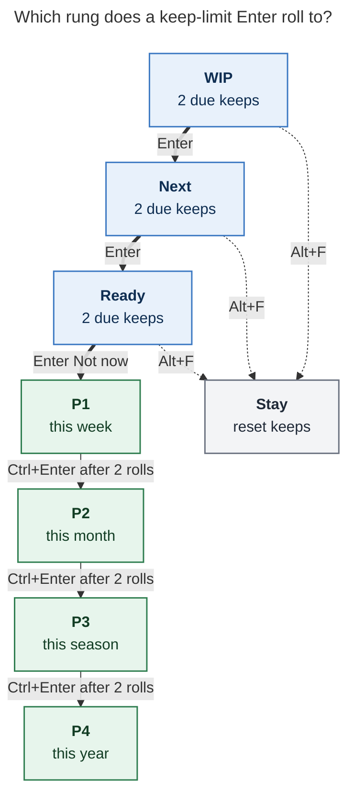
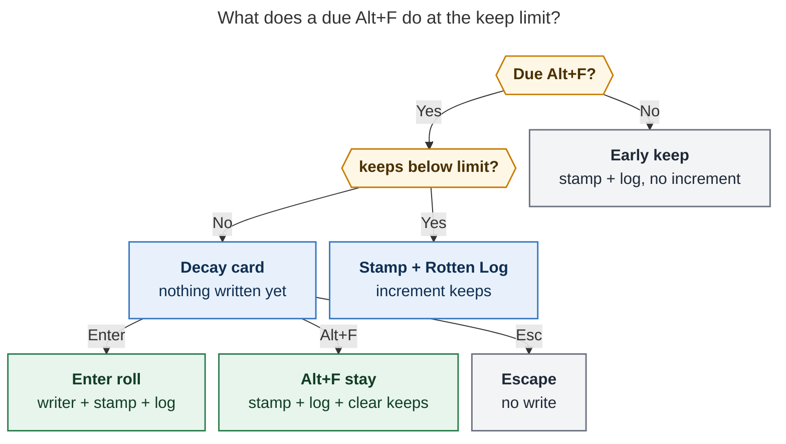

# Unify keep-limited task decay across lanes and priority

> **Research query:** Generalize Bob's keep-streak decay so Alt+F / Ctrl+Alt+F treat WIP, Next, and Ready as rungs of one consent ladder; add a glossary term for task decay; add flexible config (including chezmoi); use 2 keeps per status/priority; fix the Ready decay card that says "no priority ladder is configured"; default WIP → Next and Next → Ready at the limit, with Stay resetting the count; always write a Rotten Log entry (structured default when blank); stop asking for a Work Log when marking WIP fresh. Critique the plan, call out justified requirement changes, and recommend an intuitive, reliable, and beautiful design.

## Bottom line

**Yes, build this. Treat it as one product with two rungs, not three separate keep behaviors.** Alt+F is already the cheap "still right" answer. Ready already asks a real question after enough of those answers. WIP and Next still do not. The missing piece is a single keep-limited consent ladder: two due keeps in the current lane, then a card whose Enter rolls one rung and whose Alt+F stays and resets the clock.

Do this in that shape, with the requirement changes in [Requirement adjustments](#requirement-adjustments):

1. **Ship the screenshot bug as the first slice.** The card's "no priority ladder is configured" is a loader miss, not a missing P1 table. Bryan's `config.yml` already has P1–P4. The decay card reads `this.config` on the navigation plugin, and that field is only ever set on the Task Card modal. Call `loadBulletPropertyConfig()` in `buildFreshnessDecayCardCtx`, the way `openBulletPropertyPicker` already does.
2. **Set `freshness.decay.enter: P1` anyway.** Once the ladder loads, P0 "Not now" still skips P1 on Bryan's cadence: interval 3, P1 `min_days` 3, so interval-aware entry lands on P2. `enter: P1` is the config that already exists for this.
3. **One `[keeps:: N]` field, current-rung streak.** Due Alt+F in WIP, Next, or Ready increments it. Stay, a lane roll, and every other human stamp clear it. Lifetime per-status counts live in the Rotten Log header, never in extra task-line fields.
4. **One decay card family.** Enter takes the rung's default roll (WIP → Next, Next → Ready, Ready → P1 Not now). Alt+F is Stay: stamp, write the log, reset `[keeps::]`. Ready keeps Less often, Reword, Drop, and 1–4. Lane cards omit Less often, because the lane interval already overrides `[refresh::]`.
5. **Always write a Rotten Log entry**, including blank Enter, with a structured default that names the lane and the current-rung count. WIP freshness uses this log. Work Log stays on unlink, Alt+N release, Pomodoro close, and Task Link pause.
6. **Configure both ladders explicitly in chezmoi:** `freshness.decay.keeps: 2` plus `lanes`, and `properties.priority.decay.rolls: 2` for Ctrl+Enter. Those are two different streaks that share a number, not one knob.

A new glossary term **Task Decay** names this. A new decision record reopens the sticky-lanes rejection of Next/Pending decay, because the mechanism is keep-limited consent, the same shape Ready already uses.

## Is this a good idea

**Yes.** Ready decay already closed the loophole that Alt+F was the only review answer with no memory. WIP and Next are now the same loophole on a daily cadence. `plan.max_pending` is 8 and `plan.max_next` is 13; `pending_interval` / `next_interval` are 1. Those lanes are reviewed every morning, and a keep currently changes nothing about membership.

The October keep-streak research was right to keep lanes out of scope then (`research:202610/rotten_keep_streak_and_approved_decay`). Sticky lanes had just landed, and counting daily Next keeps would have hit any threshold in three days. That research also said a diligent reviewer piles up keeps while an ignorer piles up nothing, and answered it by making the consequence a question. The same answer works here: the card asks; Stay is one key; Enter is the honest default Bryan asked for.

Folding WIP and Next into the same card, log, and `[keeps::]` field is the beautiful version. Three prompts (Work Log for WIP, optional Next reason, Ready 🤷 + decay card) is three products. One prompt family that always previews the line it will write is one.

### Where the request as written goes wrong

1. **"Always use P1" as the screenshot fix.** P1 is the right *entry policy* for Bryan. It is not why Enter is dead on that card. The planner already implements P0 entry, including a fixed `freshness.decay.enter` override. The card never received the priority property, so it never reached that code. See [The screenshot bug](#the-screenshot-bug).
2. **"Allowed rolls for each task status" as the only new config.** Lane rolls need a default target. Priority already has its own `decay.rolls` on the property. One nested `freshness.decay` block plus uncommenting `properties.priority.decay.rolls` is enough. A per-status list of allowed rolls is a v2 escape hatch, not the first knob.
3. **Silent defaulting to the next status.** "Decay by default when the keep limit has been reached" has to mean "Enter on the card", matching Ready. Silent WIP → Next would reopen the sticky-lanes rejection as automatic aging. Bryan already asked for a Stay option, which is a card.
4. **Keep-same that only applies to new lane cards.** Ready's current Keep increments `[keeps::]` and the card returns every subsequent due review. Stay has to reset on every rung, including Ready, or the three cards disagree.
5. **Default Rotten Log text that dumps the lifetime breakdown into every bullet.** Put per-status lifetime counts in the prompt header and the freshness-mark tooltip. Put the current rung and its streak in the entry tail. The log stays readable as a diary.

### The strongest objection

`decisions:task-lanes-are-sticky` rejected "age-based Next decay" and said never for Pending. Counting due Next/WIP keeps with a daily interval is close to that rejection.

The distinction that makes this safe: nothing changes membership until Bryan answers a card, Stay is always offered, and the streak resets on Stay. That is Ready's approved-decay rule applied to lanes. It is a new decision that supersedes the sticky-lanes rejection for this mechanism only. Alt+N remains the deliberate release. Hooks still never lower a lane.

The load risk is real. Amortized, 8 WIP + 13 Next hitting a card every third due morning is about seven extra cards a day on top of today's Next reason prompt. The prompt already exists for Next; this replaces "optional reason, no consequence" with "always a log line, and every third time a real choice". That is the point.

## Requirement adjustments

| # | Request | Recommendation | Why |
| --- | --- | --- | --- |
| **A1** | Always use P1 for the missing ladder | Fix the loader, *and* set `freshness.decay.enter: P1`. | Two bugs stacked: no property object, then interval-aware P0 entry skips P1 when `min_days` is not strictly greater than `freshness.interval`. |
| **A2** | 2 keeps per status/priority | `freshness.decay.keeps: 2` for Alt+F rungs; `properties.priority.decay.rolls: 2` for Ctrl+Enter. | Those are different streaks (review keeps vs Schedule Log rolls). Both already exist. Both should be explicit in chezmoi. |
| **A3** | Allowed rolls per status | Scalar default per lane: `pending: next`, `next: ready`. Stay is always Alt+F. | A list of allowed rolls is extra surface for a product that has one honest default. `pending: stay` is the escape hatch if Enter-roll feels too sharp on a daily cadence. |
| **A4** | WIP/Next decay by default at the limit | Consent card, Enter = roll, Alt+F = Stay and reset. | Matches Ready. Silent rolls would be automatic lane aging. |
| **A5** | Stay resets the keep count | Stay uses `stampLine` (already clears `[keeps::]`) plus a Rotten Log entry. Ready Keep stops incrementing. | Current Keep-anyway makes the card a daily tax after the first trigger. Reset is the clock restart people expect from "2 keeps then ask". |
| **A6** | Always write a Rotten Log entry, default names status and per-status counts | Always write. Default reason is `kept in WIP` / `stayed in Next` / `rolled WIP → Next`. Tail is `· kept in <Lane> N×`. Lifetime WIP/Next/Ready counts go in the header. | Ready already always writes (`🤷 no reason given`). Next currently skips on blank. Unify on structured defaults; retire 🤷 for new entries. |
| **A7** | Stop Work Log on WIP freshness | Rotten Log for Alt+F / Ctrl+Alt+F on `[/]`. Leave Work Log on Ctrl+Shift+Enter unlink, Alt+N release of Pending, Pomodoro close, and Task Link pause. | "What did you get done?" is a work outcome. A keep means the task is still here. |
| **A8** | Count Next/WIP toward `[keeps::]` | Yes, on exact due walk rows only (PENDING / NEXT tiers). Early Next still prompts and logs, and does not increment. | Mirrors Ready: NEW and early Ready do not count. Daily due rows are the rubber stamp. |
| **A9** | Next → Ready at the limit | Reuse Alt+N release (`planTaskLaneBatch` mode `release`): checkbox `[ ]`, stamp, drop today's live Task Links. | Release already is that writer. A decay roll that left today-links in place would still look like Next in the ledger. |
| **A10** | WIP → Next at the limit | Reuse Task Link pause's checkbox write (`[/]` → `[*]`), without its Work Log. Keep today's links. | Pause already is WIP → Next. Freshness decay is "no longer in progress, still planned". |
| **A11** | Less often / Reword / Drop on every card | Ready keeps all three plus 1–4. Lane cards get Reword and Drop. They omit Less often. | Lane interval overrides `[refresh::]`, so lengthening refresh does nothing to WIP/Next due-ness. |
| **A12** | New glossary term "task decay" | Add it. Cover both the Alt+F lane ladder and the Ctrl+Enter priority ladder as rungs of one idea. | The word "decay" already means two config keys. The term should make that one concept. |

## The screenshot bug

Screenshot `~/tmp/screenshots/20261102_134505.png` (2 Nov 2026): decay card on `foo bar baz` in `sase.md`, captured today, **3 keeps logged**, last Nov 2, no reason given. Enter **Not now** is disabled with **"no priority ladder is configured"**. Less often is live (7 days instead of 3). Keep, Reword, and Drop are live. Footer still offers 1–4.

That copy is this guard in `bob-navigation-hotkeys` `src/050-decay-planner.js`:

```js
const hasPriorityLadder = Boolean(property && property.values === "priority");
// ...
} else if (!hasPriorityLadder) {
  notNow = unavailable("no priority ladder is configured");
}
```

The same miss disables every 1–4 pick (`levels` are marked unavailable with the same reason).

The caller is `buildFreshnessDecayCardCtx` in `src/530-plugin-freshness-refresh-and-decay.js`:

```js
const property = findFreshnessDecayPriorityProperty(this.config);
```

`this` is the navigation **plugin**. `this.config` is assigned in one place in the whole plugin: `BulletPropertyPickerModal`'s constructor (`src/340-picker-core.js`). The Task Card loads config with `loadBulletPropertyConfig()` at open (`src/550-plugin-cancel-and-counted-property.js`). The decay card never does.

Chezmoi `home/dot_config/bob/config.yml` already has a full priority property: P1–P4, `values: priority`, `schedules: scheduled`. The ladder is configured. The card cannot see it.

The planner tests never catch this. `scripts/test-navigation-decay-planner.cjs` always injects `property: decayProperty()`. There is no test that the plugin mixin loads config. The missing-property string does not appear in that suite.

A second, real policy gap sits behind the bug. After the loader is fixed, P0 Not now uses `resolveFreshnessDecayP0EntryLevel`: the first level whose `min_days` is strictly greater than the effective interval, unless `freshness.decay.enter` names a level. Bryan's Mac cadence in the screenshot is interval 3 (Less often 3 → 7). Chezmoi P1 is `min_days: 3`. `3 > 3` is false, so entry is P2. That is why `enter: P1` belongs in chezmoi even after the loader fix.

October research measured 176 of 177 visible Ready tasks as implicit P0. The default Enter on this card is the path that matters, and it is the path that is dead.

## What exists today

Verified against bob-cli `docs/freshness.md` §2a, `docs/projects.md` "Recommended roll and priority decay" / "Approved-decay decision planner", bob-plugins navigation/ledger source, and chezmoi `home/dot_config/bob/config.yml`.

| Fact | Why it matters |
| --- | --- |
| `[keeps:: N]` is a due-Ready streak, 1–999, absent means 0. Only `api.freshness.keepLine(..., { counted: true })` increments. Generic stamps clear it. | Lane counting is an eligibility change in `keepLine`'s callers and in `decide_for`, not a new field. |
| `decide = enabled && lane ready && tier rotten/tickler && keeps >= limit`. Default limit 3. Unblock ticklers never decide. | Extending `decide` to PENDING/NEXT is a freshness schema bump (14 → 15) and a `decide_for` contract change. Tests today pin "lane rows never decide". |
| Ready counted keep asks "Why keep it as written?" and always writes `*YYYY-MM-DD* — <reason> · kept N×` (`🤷 no reason given` on blank). | This is the always-write behavior to copy. |
| Next Alt+F asks "Why keep it in Next?" even when early. Nonblank writes `· kept in Next`. Blank writes no entry and does not change `[keeps::]`. | This is the optional-log behavior to retire. |
| Pending Alt+F asks for a Work Log summary and never writes the Rotten Log. | This is the prompt to replace. |
| Rotten Log regex is duplicated in nav `ROTTEN_LOG_ENTRY_RE` and ledger `FRESHNESS_ROTTEN_ENTRY_RE`: `kept N×` or `kept in Next`. | Grammar change needs both parsers, vault-format, freshness §2a, and the mark tooltip. |
| Ready decay card: Not now, Less often, Reword, Drop, Keep (increments), 1–4. Keep opens an in-card reason stage. | Stay should become the Keep row, resetting instead of incrementing. |
| Priority Ctrl+Enter decay: `properties.priority.decay.rolls` (default 1, `levels[].rolls` override). Chezmoi has this commented out. | This is the "already supported for priorities" knob. Set `rolls: 2` explicitly. |
| `freshness.decay` already has `keeps` and `enter`. Chezmoi omits the whole block, so defaults are enabled / 3 / interval-aware. | Adding the block is additive config, not a new loader. |
| WIP → Next already exists as Task Link pause (`planTaskLinkLaneBatch` mode `pause`). Next/WIP → Ready already exists as Alt+N release (`planTaskLaneBatch` mode `release`), which stamps and can write a Work Log for Pending. | Decay rolls should call these writers, not invent a third checkbox path. |
| `decisions:next-keeps-ask-an-optional-rotten-reason` reopens when Bryan wants Pending in the Rotten Log. | This request is that reopening. |
| `decisions:rotten-keeps-use-priority-decay` rejected counting non-Ready lanes. | This request reopens that too, on purpose. |

## Recommended design

### Glossary term

Add **Task Decay** (aliases: decay, keep decay) to the glossary web, then regenerate `docs/reference/glossary.md`.

Proposed strand body:

> **Task Decay** is a consent-based demotion after a task is kept as written too many times on its current rung. Each open lane — WIP (`[/]`), Next (`[*]`), Ready (`[ ]`) — and each configured priority level is a rung. A due Alt+F or Ctrl+Alt+F on that rung increments `[keeps:: N]` (absence means 0). At the configured limit the next due press opens a decay card instead of stamping: Enter takes the rung's default roll (WIP → Next, Next → Ready, Ready → the next priority window), and Stay (Alt+F) keeps the current rung while resetting the keep count. Nothing rolls without that choice. Every keep, stay, and roll writes one 🥀 Rotten Log entry. Freshness itself still never changes a lane or priority; the card invokes the existing lane and schedule writers. Distinct from automatic aging. The Ctrl+Enter priority-roll streak (`properties.priority.decay.rolls`) is the same idea on the schedule ladder.

Update **Keep Streak** so it is the current-rung due-keep count, not Ready-only. Update **Rotten Log** so every keep/stay/roll writes, including WIP, and so the tail is `kept in <Lane> N×`. Update **Work Log** so freshness of WIP is no longer a writer.

New decision: **Task Decay Is Keep-Limited Consent Across Lanes And Priority**. It supersedes in part:

- `task-lanes-are-sticky` (the rejection of Next/Pending decay only)
- `rotten-keeps-use-priority-decay` (Ready-only counting; Keep increments)
- `next-keeps-ask-an-optional-rotten-reason` (blank Next writes nothing; Next does not count)
- `rotten-keeps-are-logged` (Ready-only counted keeps; 🤷 as the blank form)

Use `/sase_memory_write` for those memory edits. Do not hand-edit `sase/memory/`.

### Two ladders, one keep field



**Caption:** Alt+F keep-limit Enter walks the lane ladder into the priority ladder. Stay from any lane rung restarts that rung's keep clock. Ctrl+Enter keeps its own roll streak on P1–P4.

The Alt+F ladder is membership (which checkbox). The Ctrl+Enter ladder is schedule (which P-window). They share the word decay and the number 2. They do not share a counter.

`[keeps:: N]` is only the Alt+F current-rung streak. The priority roll streak stays derived from the Schedule Log, as today.

### Counting rule

Three lines:

> **`keeps`** = how many due reviews in a row the walk asked "still right?" about this task in its current lane, and the answer was only Alt+F / Ctrl+Alt+F below the limit. Absent means 0.

Increment when the pre-write queue lists the target exactly (path + line + raw) as:

- lane `ready`, tier `rotten` or `tickler`, `returned_by` not `unblocked`, or
- lane `pending`, tier `pending`, or
- lane `next`, tier `next`

and `keepLine` sees a prior `fresh < today`.

Unchanged (stamp, maybe log, no increment): NEW, early/FRESH Ready, early Next/WIP, PROJECTS, recurring, unblock ticklers, same-day repeats, cache misses.

Cleared: Stay, a decay roll, Alt+N, Task Card writes, Ctrl+Shift+M, Ctrl+Enter roll/decay, capture stamps, cycler open-status writes. `stampLine` already clears; Stay and rolls should go through it.

At `keeps >= limit`, the next due press opens the card and writes nothing. Counted `N<Alt+F>` and Task Link sessions skip those targets (`N needs a decision`).

### Decay card

One modal family. Title names the rung: `Kept 2 reviews in WIP`. Subtitle is task · note · age. A second subtitle line is the lifetime breakdown from the log: `lifetime · WIP 2× · Next 1× · Ready 4×`.



**Caption:** The keep limit gates a card, not a silent write. Every committing branch stamps and writes the Rotten Log; only Stay and rolls clear the streak.

Row copy, Ready (after the loader fix, `enter: P1`, interval 3):

| Key | Label | Detail |
| --- | --- | --- |
| Enter | Not now | P0 → P1 · back in 3–8 days |
| L | Less often | review every 7 days instead of 3 |
| E | Reword | edit the task · start the count over |
| D | Drop | cancel · dropped after 2 keeps |
| Alt+F | Stay | reset the keep count · asks again after 2 reviews |
| 1–4 | P-level | one previewed roll each |

Row copy, WIP:

| Key | Label | Detail |
| --- | --- | --- |
| Enter | Next | still planned, no longer in progress |
| E | Reword | edit the task · start the count over |
| D | Drop | cancel · dropped after 2 keeps |
| Alt+F | Stay | reset the keep count · asks again after 2 reviews |

Row copy, Next: Enter is **Ready** — park in the backlog and leave today.

Walk rule is unchanged: Alt+F is the stay-on-row answer; Ctrl+Alt+F advances after a committing choice. The card still opens without writing.

### Rotten Log grammar

Writer form, newest first under `🥀 **ROTTEN LOG**`:

```text
*2026-11-02* — waiting on legal · kept in Next 2×
*2026-11-02* — stayed in WIP · kept in WIP 2×
*2026-11-02* — rolled WIP → Next · kept in WIP 2×
*2026-11-02* — kept in Ready 1×
```

Rules:

- Tail is always `· kept in <Lane> N×` with Lane in `{WIP, Next, Ready}` and N the current-rung streak **after** this keep (or the streak that triggered a stay/roll).
- Typed reason sits before the tail.
- Blank Enter uses a structured default and still writes: `kept in <Lane>` below the limit, `stayed in <Lane>` on Stay, `rolled <From> → <To>` on a roll. No 🤷 on new entries.
- Early Next/WIP keeps use the same below-limit form and do not increment N (N is the preserved streak, omitted from the tail if 0; if the field is absent, write `kept in Next` with no count, or `kept in Next 0×` — prefer **no count on uncounted early keeps**: `*2026-11-02* — kept in Next`. Counted due keeps always have N).
- Parsers accept legacy `· kept N×` (Ready) and `· kept in Next` (no count) forever.
- Lifetime WIP/Next/Ready counts are derived at read time from parsed tails, plus legacy Next entries as Next, plus legacy `kept N×` as Ready. Display-only. Nothing reads them to change decay.

Ambiguous or dual markers still refuse a typed reason and allow a blank keep with no entry, as today.

### Config

Extend `freshness.decay` in `src/native/config/freshness.rs`. Unknown keys stay ignored. Invalid values keep the current freshness failure contract (CLI exit 2; plugin defaults + `invalid`).

```yaml
freshness:
  decay:
    keeps: 2          # integer 0–999; 0 asks on every due keep in a counted lane
    enter: P1         # P0 Not now level; absent/null = interval-aware
    lanes:
      pending: next   # WIP Enter roll: next | ready | stay | false
      next: ready     # Next Enter roll: ready | stay | false
```

Semantics:

- `keeps` is the shared Alt+F limit for WIP, Next, and Ready.
- `enter` is unchanged, just set.
- `lanes.<lane>` is the Enter action at the limit. `stay` makes Stay the Enter row and still offers the roll as a secondary row. `false` disables that lane's card (keeps still count and log; no roll is offered). Absent `lanes` means no lane rolls (Ready-only cards), so old configs do not start parking Next after 3 keeps until chezmoi is applied.
- Ready's Enter remains Not now (schedule). Do not add `lanes.ready`.

Default in code if we want the feature on without chezmoi: I recommend **no default lane rolls** in the parser (`lanes` absent → Ready-only), and chezmoi opts Bryan in. That keeps mixed-machine and docs-default behavior from silently draining Next the day a plugin ships. Bryan's vault should set the map explicitly. Call this out as an adjustment: the request implied the new rolls are the product default; making them opt-in-by-config is the safe ship, and chezmoi is that opt-in.

Alternatively, default `pending: next` / `next: ready` in code so an empty `decay:` block gets the new product. I prefer chezmoi-as-opt-in because the sticky-lanes cost is real and the plugin ships to the vault before a config edit might.

**Recommendation: default the new lane map in code to `pending: next`, `next: ready`, matching the request, and let `lanes: false` or per-key `false` turn it off.** Bryan is the only user; chezmoi will be edited in the same change. Docs should show the map. `freshness.decay: false` still disables every card.

Priority, unchanged shape:

```yaml
- name: priority
  decay:
    rolls: 2
```

### Chezmoi

In `home/dot_config/bob/config.yml`, add the decay block under `freshness` and uncomment/set priority rolls. Concise comments:

```yaml
freshness:
  interval: 3 # Ready backlog review cadence
  pending_interval: 1 # [/] lane daily review; false = not walked
  next_interval: 1 # [*] lane daily review; false = not walked
  project_interval: 1 # Bryan's ^prj review cadence (personal setting, not a built-in default)
  decay:
    keeps: 2 # due Alt+F keeps in the current lane before the decay card
    enter: P1 # P0 Not now enters P1; without this, interval 3 skips to P2
    lanes:
      pending: next # WIP Enter rolls to Next
      next: ready # Next Enter rolls to Ready (Alt+N writer)
```

And on the priority property, replace the commented `decay: { rolls: 1 }` with:

```yaml
    decay:
      rolls: 2 # Ctrl+Enter same-level rolls before decaying one P-level
```

### Prompt copy (below the limit)

Reuse `RottenKeepReasonStage`. Title `Keep in WIP?` / `Keep in Next?` / `Keep as written?`. Placeholder `Why keep it in WIP? (optional · ↵ logs default)`. The preview row always shows the exact entry, including the default. Enter hint `Keep & log` / `Keep, log & next`. Escape cancels.

WIP no longer opens `FreshnessRefreshSummaryModal`'s Work summary field for a single Pending target. Mixed counted batches that still include a Pending freshness target use the Rotten reason field only; they do not show Work summary. A batch that is only Task Link pause / unlink / Alt+N release still uses Work Log.

## Implementation sequence

One epic, four slices. Slice 1 is a bugfix that can land alone.

1. **Loader + P1 entry + keep limit 2.** `loadBulletPropertyConfig()` in `buildFreshnessDecayCardCtx` and in the stale-commit revalidate path (it uses `this.config` too). Test: plugin mixin with `this.config` unset still plans Not now from the on-disk config. Chezmoi `enter: P1`, `keeps: 2`, `decay.rolls: 2`. Ready Stay still increments in this slice if you want a smaller diff; better to reset Stay in the same slice so the card copy can change once.
2. **Rotten Log unification + WIP freshness.** New tail grammar, dual parsers, always-write, structured defaults, WIP uses the keep prompt. Next blank Enter starts writing. Update vault-format, freshness §2a, glossary, mark tooltip.
3. **Lane counting + lane cards + writers.** `decide_for` and JS `decide` for PENDING/NEXT. Exact-queue counted keeps. Cards for those tiers. Enter calls pause / release writers. Schema 15, freshness namespace bump, `freshnessDecayCard.version` 3. Mixed-version: lane cards only when both sides are new; otherwise stamp+log without rolling.
4. **Memory and docs.** Glossary strand, new decision, contract pages, plugin help, `just docs-gen`.

Do not bump `Cargo.toml` version or `CHANGELOG.md` (daily train). Mark a JSON contract break with `!` in the stitch subject.

## Risks

| Risk | Mitigation |
| --- | --- |
| Habitual Enter drains Next on a daily cadence | Enter labels say "park in the backlog, leave today". `lanes.next: stay` flips the default without a code change. Watch the first week. |
| Next cap 13 + WIP cap 8 produce a card pile every third morning | Same as today's Next prompts, plus a real choice every third time. Counted batches still skip at-limit rows so `]s` returns to them. |
| Sticky-lanes muscle memory (only Alt+N lowers a lane) | Decay Enter *is* a release, previewed. Footer copy on NEXT/PENDING can mention the card when `decide` is true. |
| `[keeps::]` leftover across lanes | Already cleared by Alt+N / `=x` stamps. Roll writers must stamp. |
| Dual rotten-log regex drift | Keep the existing "byte-for-byte mirror" comment and a shared vector for parse/format. |
| Mixed plugins | Capability v3 for lane cards. Old nav on a new ledger will stamp lane at-limit rows without rolling; under-count/under-roll, never a surprise membership change. |
| P1 window 3–8 vs interval 3 | `enter: P1` still defers: it writes `[scheduled::]` and `[priority:: high]`, so the task leaves ROTTEN for a future TICKLER. That is a real Not now. |

## Tests and contracts

Minimum new coverage:

- Plugin mixin loads `loadBulletPropertyConfig()` when `this.config` is missing; Not now is available for a P0 line against Bryan's ladder; 1–4 are available.
- P0 + interval 3 + no `enter` → P2 (chezmoi P1 min 3). P0 + `enter: P1` → P1.
- `decide_for` true for due PENDING/NEXT at limit; false for early lane rows, NEW, unblock ticklers, `decay: false`.
- Stay clears `[keeps::]` and writes `stayed in <Lane>`.
- Below-limit due WIP keep increments, writes `kept in WIP N×`, writes no Work Log.
- Blank Next keep writes a default entry.
- WIP Enter roll writes `[*]`, keeps today's links, writes `rolled WIP → Next`, clears keeps.
- Next Enter roll writes `[ ]`, drops today's links, writes `rolled Next → Ready`, clears keeps.
- Legacy Rotten Log lines still parse.
- Config: `lanes` map, `pending: stay`, `next: false`, invalid `lanes.pending: later` is a freshness config error.
- Shared `tests/fixtures/freshness_keeps/vectors.json` extended for lane increment/clear/decide.

Docs: `docs/freshness.md` §2a and schema history, `docs/projects.md` planner, `docs/reference/vault-format.md`, `docs/concepts/freshness-and-the-review-walk.md`, plugin references, `docs/develop/decisions.md` via docs-gen.

## Alternatives considered

| Alternative | Verdict |
| --- | --- |
| Per-status keep fields (`[next_keeps::]`) | Reject. One streak field, reset on lane change, history in the log. |
| Derive the current-rung streak from the Rotten Log | Reject for v1. Ready already has `[keeps::]`; pips already read it. Log-derived streaks are how priority rolls work because those never had a field. |
| Always invent P1 when the property is missing | Reject. Inventing levels behind the configured ladder would desync Tasks values. Load the config. |
| Silent auto-roll at the limit | Reject. Ready already rejected this. Stay requires a card. |
| Stay as Enter on daily lanes, roll as a secondary key | Attractive if week-one telemetry is "I keep parking Next by accident". Config `lanes.next: stay` is the switch. Ship Enter = roll as requested. |
| Allowed-roll lists (`pending: [next, ready]`) | Defer. One default is the product. Skip-a-rung is a footgun. |
| Keep 🤷 as the blank Ready reason | Reject for new writes. Structured defaults are how you read a log six months later. |
| Counting early Next keeps | Reject. Early keeps are not the rubber stamp. Still log them. |

## Open questions

None that should block the plan. Defaults above are the answers I would ship:

- Enter = roll on WIP/Next.
- Lane map defaults on in code, chezmoi documents it.
- Stay resets everywhere, including Ready.
- Reword and Drop on lane cards; no Less often there.
- Early Next still prompts.

If week one of lane cards feels sharp, set `lanes.next: stay` in chezmoi before writing more code.

## Recommended solution

**Fix the decay-card config loader, then make Alt+F one keep-limited consent ladder across WIP, Next, and Ready, with Stay resetting the clock and the Rotten Log always recording the rung.**

Concrete ship list:

1. `loadBulletPropertyConfig()` in the decay-card context builder and revalidate path; add a test that does not inject `property`.
2. Chezmoi: `freshness.decay.keeps: 2`, `enter: P1`, `lanes: { pending: next, next: ready }`; `properties.priority.decay.rolls: 2`.
3. `[keeps::]` counts due WIP/Next/Ready keeps; `decide` at limit on those tiers.
4. One card: Enter rolls (pause writer / release writer / P1 Not now); Alt+F stays via `stampLine` + log.
5. Rotten Log tail `kept in <Lane> N×`; structured defaults; WIP freshness uses it; Work Log stays on work outcomes.
6. Glossary **Task Decay**; decision record that reopens sticky-lanes for keep-limited consent only.
7. Schema 15 / freshness namespace bump / `freshnessDecayCard.version` 3; mixed-version under-rolls, never auto-rolls.

That is the intuitive version (two keeps, then a question), the reliable version (existing writers, existing field, existing card, loader actually called), and the beautiful version (one prompt family, one log grammar, one clock, copy that names the rung).

## Sources

- Screenshot `~/tmp/screenshots/20261102_134505.png`
- `docs/freshness.md` §2a, §4, schema 14
- `docs/projects.md` "Recommended roll and priority decay", "Approved-decay decision planner"
- `docs/reference/vault-format.md` Rotten Log grammar
- `docs/concepts/freshness-and-the-review-walk.md`
- Decisions: `rotten-keeps-use-priority-decay`, `decay-decisions-are-available-immediately`, `rotten-keeps-are-logged`, `next-keeps-ask-an-optional-rotten-reason`, `task-lanes-are-sticky`, `ready-is-freshness-gated`, `review-walk-is-tiered`, `unblocked-tasks-resurface-as-ticklers`
- Glossary: Keep Streak, Rotten Log, Work Log, Task Freshness
- Prior research: `research:202610/rotten_keep_streak_and_approved_decay`, `research:202610/freshness_auto_decay_check.md`
- bob-plugins: `plugins/bob-navigation-hotkeys/src/050-decay-planner.js`, `src/530-plugin-freshness-refresh-and-decay.js`, `src/195-rotten-keep.js`, `src/340-picker-core.js`, `src/550-plugin-cancel-and-counted-property.js`, `src/230-schedule-review.js`, `src/245-task-link-lane.js`, `src/010-requires-and-config.js`; `plugins/bob-ledger-tools/src/080-freshness-placement.js`, `src/135-freshness-rotten-log.js`
- bob-cli: `src/native/config/freshness.rs`, `src/native/freshness/state.rs` `decide_for`
- chezmoi: `home/dot_config/bob/config.yml`
- Tests: `scripts/test-navigation-decay-planner.cjs` (always injects `property`); `tests/fixtures/freshness_keeps/vectors.json`
