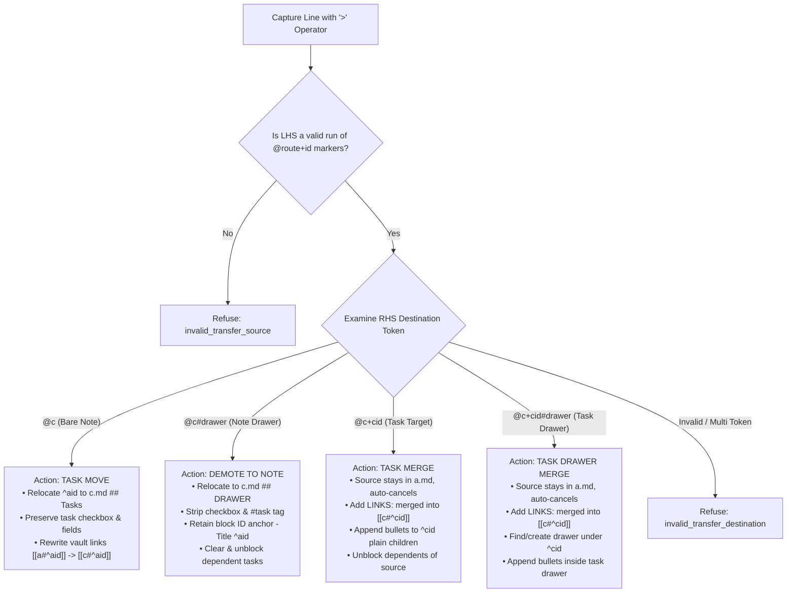
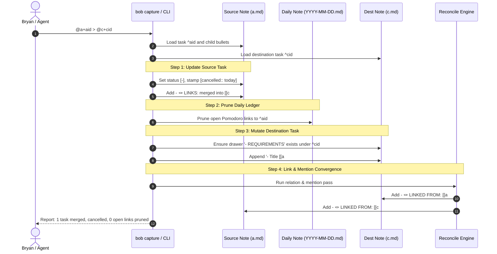
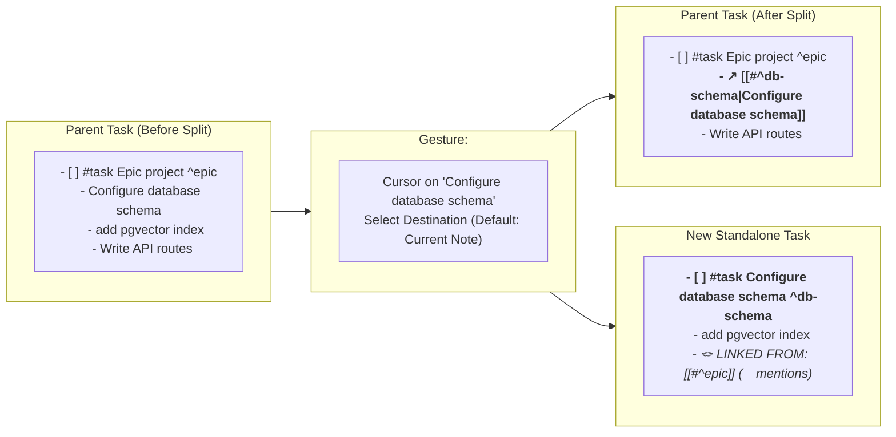

# Architectural Research & Design: Task Moves, Merges, and Bullet Splitting in Bob

> **Author:** Researcher `gem` (Swarm 36)  
> **Date:** 2026-11-03  
> **Target:** `bob-cli` & `bob-plugins`  
> **Status:** Proposal & Recommended Architecture  

---

## 1. Executive Summary & Verdict

### Bottom Line: Build It — With Five Crucial Adjustments

The user's proposal introduces a long-overdue, complete lifecycle for task refactoring across Bob:
1. **Transferring & Demoting via Capture (`>`):** Moving tasks between notes (`@a+aid > @c`) and converting them to notes in project drawers (`@a+aid > @c#drawer`).
2. **Merging Tasks (`@a+aid > @c+cid`):** Consolidating tasks into a destination task, retaining source history with an auto-cancelling `merged into` relation.
3. **Splitting Bullets (`<ctrl+shift+t>`):** Extracting task bullets into standalone tasks in Obsidian, replacing bullets with concise inline links that automatically generate `(💬 mentions)` backlinks.
4. **First-Class CLI & Relation Symmetry:** Unifying these operations across `bob capture`, dedicated `bob task` subcommands, and Obsidian hotkeys (`<ctrl+shift+m>`, `<ctrl+shift+l>`, and `<ctrl+shift+t>`).

**Verdict:** The core idea is **exceptional**. In real-world task management, tasks are rarely static: they grow too big (requiring bullet splitting), become redundant or consolidated (requiring merging), or belong elsewhere (requiring moving or demoting to background project drawers). Currently, Bob handles task moves only via `bob task move` / `<ctrl+shift+m>` (which only moves tasks to `## Tasks`), relation linking via `<ctrl+shift+l>` (which links and can cancel, but cannot merge content), and capture sub-bullets (which append notes, but cannot move existing tasks). This proposal elegantly bridges capture, editor gestures, and vault maintenance into a cohesive whole.

However, a naive implementation would create serious hazards around **vault-wide link breakage, broken task dependencies, grammatical ambiguity in capture, and unintentional content mutation in relation gestures**.

To make this feature intuitive, reliable, and beautiful, we recommend the following **Five Key Adjustments**:

1. **Strict Capture Transfer Grammar (`Transfer` Mode):**
   The `>` line must be parsed as a dedicated `Transfer` capture mode (`LHS > RHS`), where LHS is a run of `@route+id` target markers and RHS is a single destination (`@c`, `@c#drawer`, `@c+cid`, or `@c+cid#drawer`). Any explanatory notes or additional bullets must be authored as child bullets below the header line rather than mid-line prose, preventing syntax ambiguity.
2. **Anchor Retention and Dependency Resolution on Drawer Demotion:**
   When a task is converted to a note in `@c#drawer`, it must retain its block ID anchor (`- Title ^aid`) so that vault-wide wikilinks (`[[old#^aid]]` → `[[c#^aid]]`) do not break. Furthermore, any open tasks depending on `^aid` must have their dependency cleared and stamped with `[unblocked:: today]`, rather than leaving them pointing to a non-task block.
3. **Formalizing `merge_labels` in Configuration:**
   Do not overload `cancel_labels` with invisible content-mutation side effects. Instead, introduce a dedicated `relations.merge_labels` configuration list (defaulting to `["merged into"]`). Committing a relation whose label is in `merge_labels` executes the full merge operation: auto-cancelling the source, pruning daily open Pomodoro links, unblocking dependents, and appending the source content to the destination task.
4. **Two-Tier `<ctrl+shift+t>` Bullet Splitting Interaction:**
   In Obsidian, `<ctrl+shift+t>` should open a destination picker pre-filled with the current note (`(Current note) <stem>.md`). Pressing `Enter` instantly splits the bullet into a new task in the current note; typing a target note moves the new task directly into that project note. The original bullet is replaced with an arrow-aliased wikilink: `  - ↗ [[note#^new-id|Original bullet text]]`. Under §19 of `docs/task-relations.md`, this inline link automatically generates a `🪢 **LINKED FROM:** [[parent#^id]] (💬 mentions)` backlink on the new task without any extra manual steps.
5. **Full CLI Subcommand Symmetry:**
   In addition to capture syntax, provide explicit CLI commands: extend `bob task move` with `--drawer <DRAWER>` (for demoting/moving tasks into drawers), add `bob task merge` for batch task consolidation, and add `bob task split` for scriptable bullet extraction.

---

## 2. Problem Statement & Motivation

### The Natural Lifecycle of Tasks: Split, Move, Merge, Demote

In Getting Things Done (GTD) and markdown-based task systems, tasks evolve through four distinct refactoring operations:

```
                  ┌───────────────────────────────────────────────┐
                  │                 RAW CAPTURE                   │
                  └───────────────────────┬───────────────────────┘
                                          │
                                          ▼
   ┌─────────────────────────────────────────────────────────────────────────────┐
   │                               ACTIVE TASK                                   │
   │  - [ ] #task Implement widget authentication ^auth                          │
   │    - configure JWT validation logic                                         │
   │    - add integration tests with auth0                                       │
   └───────────┬──────────────────────────┬───────────────────────────────┬──────┘
               │                          │                               │
       SPLIT   │                  MERGE   │                       DEMOTE  │
 (<ctrl+shift+t>)              (@a+x > @b+y)                   (@a+x > @c#drawer)
               ▼                          ▼                               ▼
┌───────────────────────────┐ ┌───────────────────────────┐ ┌───────────────────────────┐
│        NEW TASK(S)        │ │    CONSOLIDATED TASK      │ │       NOTE BULLET         │
│ - [ ] #task Configure JWT │ │ - [ ] #task Big Epic ^epic│ │ ## BACKGROUND             │
│   validation logic ^jwt   │ │   - Implement widget      │ │ - Implement widget        │
│                           │ │     auth [[auth]]         │ │   authentication ^auth    │
│ (Original gets ↗ link)    │ │ (Source auto-cancelled)   │ │ (Removed from task pool)  │
└───────────────────────────┘ └───────────────────────────┘ └───────────────────────────┘
```

### Current State in Bob (Where the System Falls Short)

1. **Task Moves Are Note-Level Only:**
   `bob task move` and Obsidian's `<ctrl+shift+m>` move open task blocks from one note's `## Tasks` section to another note's `## Tasks` section. They cannot move a task into a specific section or drawer, nor can they demote a task to a background note.
2. **Capture Cannot Move or Merge Existing Tasks:**
   Capture supports creating new tasks (`@route`), creating project notes (`@route^id@`), appending sub-bullets under existing tasks (`@route+id note`), and toggling task states (`@route+id!`). However, capture currently has no transfer or redirection syntax: an existing task cannot be moved or merged via capture.
3. **Task Relations Record Links, But Cannot Transfer Content:**
   Bob's task relations system (`docs/task-relations.md`, `src/native/task_relations/`) supports directed links (`~`, `~~`, `l`, `⇧L`) and closing effects (`cancel_labels` like `duplicate of`, `complete_labels` like `implemented by`). However, relations only manipulate task status and link lines; they cannot transfer, merge, or nest task descriptions or child bullets.
4. **Splitting Tasks Is Manual and Error-Prone:**
   When a sub-bullet grows into a standalone task, Bryan must manually cut the bullet, navigate to the tasks section or target note, paste it, add `- [ ] #task`, mint a block ID, navigate back to the parent task, and write a manual backlink.

---

## 3. Deep Critique of the Proposal

### 3.1 The `>` Operator in Capture: Lexical & Syntactic Evaluation

The proposed capture syntax introduces `>` as a redirection/transfer operator:
```text
@a+aid @b+bid > @c
@a+aid @b+bid > @c#drawer
@a+aid @b+bid > @c+cid
@a+aid @b+bid > @c+cid#drawer
```

#### Strengths
- **Intuitive & Universal:** The `>` symbol is immediately recognizable as "transfer to" / "redirect to" across Unix pipes, shell redirection, and everyday notation.
- **Composable with Multi-Target:** It pairs naturally with the in-progress multi-target epic (`capture_multi_target.md`), allowing multiple source tasks on the LHS (`@a+aid @b+bid`) to fan into a single destination on the RHS.

#### Hazards & Edge Cases
1. **Markdown Blockquote Collision:**
   In Markdown, a line starting with `>` is a blockquote. If a user types `> @c` (with no LHS) or indents with `>`, lexers could misclassify it.
   *Resolution:* The transfer operator `>` must strictly appear **between** valid route tokens, or be preceded by valid `@route+id` markers. A line beginning with `>` remains a Markdown blockquote or a syntax error.
2. **Whitespace Flexibility:**
   Users will type `@a+aid > @c`, `@a+aid >@c`, `@a+aid> @c`, or `@a+aid>@c`.
   *Resolution:* The lexer should recognize `>` as an independent boundary token whether surrounded by whitespace or glued to markers.
3. **Body Text Ambiguity:**
   What does `@a+aid > @c+cid Check this out` mean? Does `Check this out` apply to the destination task `^cid`, or is it a note on `^aid`?
   *Resolution:* On the physical header line, `LHS > RHS` must be a pure transfer directive. Any explanatory text must be provided as child bullets below the line:
   ```text
   @a+aid @b+bid > @c+cid#drawer
   - Merged due to overlapping scope in sprint 42
   ```
4. **Multi-Target on the RHS?**
   Can someone write `@a+aid > @c+cid @d+did`?
   *Resolution:* **Refuse.** Merging one task into multiple destination tasks simultaneously is logically ambiguous (which task gets the bullets?). The RHS must be exactly **one** destination target.

---

### 3.2 Moving as a Task (`@c`) vs. Demoting to a Note (`@c#drawer`)

The user prompt specifies:
- `@a+aid > @c`: moves the tasks to `@c`.
- `@a+aid > @c#drawer`: "tasks should be converted to notes and moved to that drawer".

#### Critical Analysis
This is a profound semantic distinction:
- When the destination is a bare note (`@c`), the entity remains a `#task`. It is relocated to `c.md`'s `## Tasks` section.
- When the destination has a `#drawer` (`@c#drawer`), the entity is **demoted from a task to a plain note bullet** (`- Title`) and placed inside `c.md`'s `## DRAWER` H2 section.

#### The Dependency & Link Preservation Hazard
When a task is demoted to a plain note bullet:
1. **What happens to `^aid`?**
   If the block ID `^aid` is deleted, any inbound wikilink in the vault (`[[a#^aid]]`) becomes a broken link.
   *Requirement:* The converted note bullet **must preserve its trailing block ID**:
   `- Implement widget auth ^aid`
   Then, Bob's link rewrite engine (`rewriteTaskMoveBlockLinks`) cleanly rewrites all inbound vault links to `[[c#^aid]]`.
2. **What happens to tasks depending on `^aid`?**
   If task `^other` has `Depends-On: [[a#^aid]]`, and `^aid` is no longer a `#task`, `bob task reconcile` will view `^other` as blocked on a non-task block.
   *Requirement:* Demoting a task to a note is equivalent to retiring/cancelling the task from the backlog. Any open dependents blocked by `^aid` must have `[[a#^aid]]` pruned from their `Depends-On` line and be stamped `[unblocked:: today]`, exactly as if `^aid` had been cancelled.

---

### 3.3 The "merged into" Relation: Graph Edge vs. Content Mutation

The prompt states:
> "When merging one task into another, we should not delete the source tasks. Instead, we should add a new 'merged into' task relation that points from the source tasks to the destination task (and auto-cancels the source task). This 'merged into' task relation should be able to be used on its own (in Obsidian via the `<ctrl+shift+l>` keymap, for example) to perform the same operation..."

#### Critical Analysis & Architectural Evaluation

This is the most nuanced requirement in the entire design. Today, in Bob:
- Relations (`docs/task-relations.md`) are directed edges stored on `🪢 **LINKS:**` lines.
- Configured closing labels (`cancel_labels`, `complete_labels`) alter the status of the source task (`[-]` or `[x]`), prune daily Pomodoro links, and unblock dependents.
- **Crucially: No existing relation label mutates the destination task's body or child bullets!**

If choosing `merged into` in `<ctrl+shift+l>` also moves bullets into the target task, we are bridging **graph metadata** and **content refactoring**.

#### Trade-Off Matrix: How `merged into` Should Behave

| Approach | Behavior in Capture (`> @c+cid`) | Behavior in Obsidian `<ctrl+shift+l>` | Pros | Cons / Hazards |
| :--- | :--- | :--- | :--- | :--- |
| **A. Pure Graph Relation (Cancel Only)** | Merges content via capture; relation is just a cancel label. | `<ctrl+shift+l>` only adds relation and cancels source; does NOT move bullets. | Safe; no surprise edits to target note. | Does not satisfy user request: `<ctrl+shift+l>` cannot perform the full merge operation. |
| **B. Unified Merge Effect (`merge_labels`)** *(Recommended)* | Merges content into target; cancels source; writes `merged into`. | Selecting `merged into` in `<ctrl+shift+l>` opens a small confirmation showing target drawer, then merges bullets, cancels source, and writes `merged into`. | 100% feature symmetry; beautiful workflow; predictable and safe. | Requires a cross-file edit transaction in Obsidian when target is in another note. |
| **C. Silent Content Mutation in `<ctrl+shift+l>`** | Merges content; cancels source. | Selecting `merged into` silently injects bullets into target task without drawer choice or confirmation. | Zero extra clicks. | High hazard: if target is in another note, user doesn't see where bullets landed; risk of cluttering target. |

**Recommended Solution:** **Approach B**. We formalize `merge_labels` in `config.yml`. When invoked via `<ctrl+shift+l>`, if the label has a merge effect, the Task Card displays a dedicated merge banner:
`⊘ Merges into “{T}” · appends bullets to “{T}” · cancels source`
With `Enter` defaulting to target task's plain-child anchor (or default drawer).

---

### 3.4 Obsidian `<ctrl+shift+t>`: Bullet Splitting & Mention Backlinks

The user prompt specifies:
> "We should add a new `<ctrl+shift+t>` keymap to Obsidian that makes it easy to split out one or more top-level bullets from a task into new tasks. When this is done, the bullets (and their child bullets) should be replaced by some concise and useful text containing inline links to the new tasks that were created from the old bullets (the old tasks should wind up being given 'linked from' mentions which are triggered by these inline links)."

#### Analysis of Replacement Text
When bullet `- Split lexer into tokens.rs` is split into new task `^new-id` in note `c.md`:
What should replace it in the parent task?

1. **Option 1 (Prose link):**
   `- split into [[c#^new-id]]`
   *Pros:* Explicit verb.  
   *Cons:* Verbose; loses original text context in the parent note.
2. **Option 2 (Aliased Wikilink):**
   `- [[c#^new-id|Split lexer into tokens.rs]]`
   *Pros:* In Obsidian Live Preview / Reading View, it renders as a clean clickable title (**Split lexer into tokens.rs**). Clicking jumps straight to the new task.
3. **Option 3 (Prefixed Arrow + Aliased Wikilink) *(Recommended)*:**
   `- ↗ [[c#^new-id|Split lexer into tokens.rs]]`
   *Pros:* The `↗` glyph immediately signals to Bryan that this line is a delegated/split-out task, while the link title preserves the original text. In Live Preview, it renders cleanly as: `↗ Split lexer into tokens.rs`.
   *Mention Integration:* Under §19.2 (M1–M8) of `docs/task-relations.md`, any block link inside a task's child bullets treats the parent task as mentioning the target task. When `bob task reconcile` runs, the target task automatically gets:
   `- 🪢 **LINKED FROM:** [[parent-note#^parent-id]] (💬 mentions)`
   This requires zero new backlink code: it leverages existing, battle-tested mention mechanics!

---

## 4. Requirement Adjustments (Explicitly Called Out)

To ensure this feature is robust, intuitive, and consistent with Bob's architectural invariants, we propose the following five adjustments:

### Adjustment 1: Header Line is Strictly Structural in `>` Capture
* **User Requirement:** Add capture syntax `@a+aid @b+bid > @c` and `@c+cid#drawer`.
* **Adjustment:** The physical header line containing `>` is **strictly a structural transfer directive**. No trailing task description or note text is allowed on that line. Any additional context, notes, or sub-bullets must be supplied as child bullets below the header line.
* **Justification:** Allowing mid-line prose like `@a+aid > @c+cid Note text` creates lexical ambiguity (does `Note text` belong to `^cid` or is it an instruction?). Disallowing it ensures unambiguous parsing, aligns with marker-only capture grammar (`@route+id!`), and allows child bullets to cleanly serve as appended notes.

### Adjustment 2: Anchor Retention & Dependency Clearing on Note Demotion
* **User Requirement:** `@c#drawer` specifies that tasks should be converted to notes and moved to that drawer.
* **Adjustment:**
  1. The demoted bullet in `## DRAWER` must retain its trailing block ID: `- Task title ^aid`.
  2. Any task in the vault depending on `^aid` must have its dependency pruned and be stamped `[unblocked:: today]`.
* **Justification:** Stripping `^aid` would break every inbound wikilink (`[[source#^aid]]`) in the vault. Retaining `^aid` allows Bob's link rewrite engine to safely update all links to `[[c#^aid]]`. Clearing open dependencies prevents tasks from remaining permanently blocked on an anchor that is no longer a `#task`.

### Adjustment 3: Dedicated `relations.merge_labels` Configuration
* **User Requirement:** Add "merged into" relation pointing from source to destination, auto-cancelling source, usable in `<ctrl+shift+l>`, and configurable if possible.
* **Adjustment:** In `config.yml`, define a dedicated `merge_labels` section alongside `cancel_labels` and `complete_labels`:
  ```yaml
  relations:
    cancel_labels:
      - duplicate of
      - superseded by
    merge_labels:
      - merged into
  ```
* **Justification:** Placing `merged into` into `cancel_labels` would fail to distinguish between relations that merely close a task (like `duplicate of`) and relations that transfer bullet content into the target. A dedicated `merge_labels` list makes the content-merging side effect explicit, auditable, and configurable.

### Adjustment 4: Two-Tier Splitting Destination Picker in `<ctrl+shift+t>`
* **User Requirement:** Add `<ctrl+shift+t>` in Obsidian to split bullets into new tasks.
* **Adjustment:** `<ctrl+shift+t>` should open a quick-destination modal pre-selected to `(Current Note)`. Pressing `Enter` immediately performs an in-note split; typing any other project note stem moves the new task to that note. The replaced bullet in the parent task is formatted as:
  `  - ↗ [[destination#^new-id|Original bullet title]]`
* **Justification:** Often sub-bullets belong in the same project note; requiring the user to type a destination every time would introduce unnecessary friction. Pre-selecting the current note gives instant 1-keystroke in-place splitting while preserving full cross-note flexibility.

### Adjustment 5: Comprehensive CLI Subcommand Suite
* **User Requirement:** Good command-line support for all new functionality.
* **Adjustment:** Implement three distinct CLI capabilities:
  1. `bob capture '@a+aid > ...'` (Capture interface)
  2. `bob task move SOURCE DEST -b ID [--drawer <DRAWER>]` (Moving tasks as tasks, or demoting to note drawers)
  3. `bob task merge SOURCE_TASK DEST_TASK [--drawer <DRAWER>]` (Dedicated batch merge command)
  4. `bob task split NOTE:BLOCK_ID --bullet <INDEX_OR_MATCH> [--dest <NOTE>]` (CLI bullet extraction)
* **Justification:** Not all task operations happen via the interactive capture shell or Obsidian. Providing explicit `bob task` subcommands enables automated agents, shell scripts, and batch migrations to use the exact same underlying engines.

---

## 5. Recommended Technical Design & Architecture

### 5.1 Capture Language & Grammar Revision

#### Lexer & AST Node (`Transfer`)
In `src/native/capture_language/`:
1. Bump `GRAMMAR_REVISION` to **9** (or the next sequential integer).
2. Add `CaptureKind::Transfer`:
   ```rust
   pub(crate) enum CaptureKind {
       // ... existing variants ...
       Transfer {
           sources: Vec<TransferSource>,
           destination: TransferDestination,
       },
   }

   pub(crate) struct TransferSource {
       pub(crate) route: String,
       pub(crate) block_id: String,
   }

   pub(crate) enum TransferDestination {
       Note { route: String },
       NoteDrawer { route: String, drawer: DrawerSelector },
       Task { route: String, block_id: String },
       TaskDrawer { route: String, block_id: String, drawer: DrawerSelector },
   }
   ```

#### Token Recognition Rules
- **Line Structure:** `TOKEN_RUN_LHS > TOKEN_RHS`
- **LHS:** One or more adjacent target markers (`@route+id`). If any token on LHS is not a valid target marker, refuse with `invalid_transfer_source`.
- **Operator:** `>` (standalone or glued).
- **RHS:** Exactly one valid destination token:
  - `@route` → `TransferDestination::Note`
  - `@route#drawer` → `TransferDestination::NoteDrawer`
  - `@route+block-id` → `TransferDestination::Task`
  - `@route+block-id#drawer` → `TransferDestination::TaskDrawer`
- Any extra tokens after RHS are refused with `unexpected_transfer_tokens`.
- Child bullets below the header line are parsed as `transfer_notes` and appended to the destination entity.

#### Editor Support (`capture-parse`, `capture-complete`, `capture-rewrite`)
- **`capture-parse -f json`:**
  Reports `mode: "transfer"`, `transfer: { sources: [...], destination: { ... } }`, with accurate byte spans for each source marker, the `>` operator, and the destination token.
- **`capture-complete`:**
  - Cursor before `>`: completes source routes and block IDs (`@route+...`).
  - Cursor on `>`: offers transition hint (`> @destination`).
  - Cursor after `>`: completes destination routes, task block IDs, and drawer slugs based on the typed prefix.
- **`capture-rewrite`:**
  Normalizes block ID separators (e.g., switching `:` to `+` when extending LHS runs or RHS task targets).

---

### 5.2 The Unified Move & Merge Engine

The execution logic resides in `src/native/task_move/` and a companion `src/native/task_merge/`:

```
               ┌────────────────────────────────────────────────────────┐
               │                     CAPTURE LINE                       │
               │             @a+aid @b+bid > @c+cid#drawer              │
               └───────────────────────────┬────────────────────────────┘
                                           │
                                           ▼
               ┌────────────────────────────────────────────────────────┐
               │                CAPTURE PLANNER / STAGING               │
               │   1. Acquire maintenance lock & load vault snapshot    │
               │   2. Resolve source tasks ^aid, ^bid in a.md, b.md     │
               │   3. Resolve destination ^cid in c.md                  │
               └───────────┬────────────────────────────────┬───────────┘
                           │                                │
                           ▼                                ▼
       ┌──────────────────────────────────────┐ ┌──────────────────────────────────────┐
       │         SOURCE REFACTORING           │ │       DESTINATION REFACTORING        │
       │ For each source task:                │ │ In c.md under ^cid:                  │
       │ 1. Extract title & content bullets   │ │ 1. Find or create drawer `DRAWER`    │
       │ 2. Set status to `[-]`               │ │ 2. Append merged entry for each src: │
       │ 3. Upsert `[cancelled:: today]`      │ │    `- <title> [[source#^id]]`        │
       │ 4. Prune from today's open Pomodoros │ │      `  - <source child bullets...>` │
       │ 5. Unblock dependent tasks           │ │ 3. Append any capture child bullets  │
       │ 6. Add `merged into [[c#^cid]]`      │ └──────────────────────────────────────┘
       │    to `🪢 **LINKS:**` line           │
       └──────────────────┬───────────────────┘
                          │
                          ▼
       ┌────────────────────────────────────────────────────────┐
       │                 POST-COMMIT & RECONCILE                │
       │ 1. Write note postimages atomically                    │
       │ 2. Mirror `🪢 **LINKED FROM:**` on destination         │
       │ 3. Auto-generate `(💬 mentions)` for backlinks         │
       └────────────────────────────────────────────────────────┘
```

#### Detailed Operations by Destination Type

1. **Case 1: Move to Note (`@a+aid > @c`)**
   - Pure task move via `task_move::plan_task_move`.
   - Source block `^aid` is extracted from `a.md` and appended to `c.md`'s `## Tasks` section.
   - All vault-wide block links `[[a#^aid]]` are rewritten to `[[c#^aid]]`.
   - Task status, priority, and schedule remain unchanged.
2. **Case 2: Demote to Note Drawer (`@a+aid > @c#drawer`)**
   - Source task `^aid` is removed from `a.md`.
   - In `c.md`, the H2 section `## DRAWER` is found or created.
   - The task line is converted to a plain bullet: `- Title ^aid`.
   - Child bullets nest under it with appropriate indentation.
   - All vault-wide block links `[[a#^aid]]` are rewritten to `[[c#^aid]]`.
   - Any tasks depending on `^aid` have their dependency cleared and are stamped `[unblocked:: today]`.
3. **Case 3: Merge into Task (`@a+aid > @c+cid`)**
   - Source task `^aid` remains in `a.md`.
   - Source task is cancelled: status becomes `[-]`, date `[cancelled:: today]` is added.
   - Source task gains `- 🪢 **LINKS:** merged into [[c#^cid]]`.
   - Source task's open Pomodoro links are pruned from today's daily note.
   - Dependents of `^aid` are unblocked.
   - In `c.md`, under `^cid`, at the plain-child anchor:
     Append `- Title [[a#^aid]]`, with `^aid`'s child bullets nested underneath.
4. **Case 4: Merge into Task Drawer (`@a+aid > @c+cid#drawer`)**
   - Identical to Case 3, except the merged bullets land inside the task drawer `  - DRAWER` under `^cid` (created if missing).

---

### 5.3 Relations Integration (`merge_labels`)

In `docs/task-relations.md` and `src/native/task_relations/`:
1. Add §21: **Merge labels**.
2. Update configuration schema in `config.yml`:
   ```yaml
   relations:
     cancel_labels:
       - duplicate of
       - superseded by
     complete_labels:
       - implemented by
       - verified by
     merge_labels:
       - merged into
     successor_labels:
       - follow-up of
   ```
3. **Precedence & Exclusivity:** A relation label can belong to only one effect list. If a label appears in both `cancel_labels` and `merge_labels`, `merge_labels` takes precedence (or a configuration warning is emitted).
4. **Indication in UI:**
   In Obsidian Task Card and Mac Capture:
   - Glyph: `⊘` (in Cancelled tint) with merge icon `arrow.triangle.merge` or `⊘ merges`.
   - Consequence string:
     `⊘ Merges into “{T}” · appends bullets · cancels source · unblocks dependents`
   - Notice string:
     `🪢 {S} — merged into → {T} · ⊘ cancelled · merged {n} bullets · unblocked {k}`

---

### 5.4 Obsidian Plugins Architecture (`bob-navigation-hotkeys`)

#### New Command: `split-task-bullets-to-new-task` (`<ctrl+shift+t>`)
1. **Binding:**
   Register in `plugins/bob-navigation-hotkeys/src/490-plugin-lifecycle.js`:
   ```javascript
   this.addCommand({
     id: "split-task-bullets-to-new-task",
     name: "Split task bullets into new task",
     hotkeys: [{ modifiers: ["Ctrl", "Shift"], key: "T" }],
     editorCallback: (editor, view) => this.openTaskBulletSplitPicker(editor, view),
   });
   ```
2. **Context Discovery:**
   - Verify cursor is on a list item that is a child of an active `#task`.
   - Determine target bullets:
     - If text is selected: all top-level bullets intersecting the selection.
     - If count prefix is active (`N<ctrl+shift+t>`): the current bullet plus next `N-1` sibling bullets.
     - Otherwise: the single bullet under the cursor.
   - For each target bullet, extract its full subtree (all nested child bullets).
3. **Destination Picker Modal:**
   - Opens a filtered picker modal (matching `TaskMoveDestinationPickerModal`).
   - First entry: `(Current note) <active-note-stem>.md` (default selected).
   - Remaining entries: All eligible project and area notes in the vault.
4. **Execution & Atomic Commit:**
   - In target note (or current note):
     - Format new task: `- [ ] #task <Bullet Title> ^<minted-id>`
     - Append child bullets indented below it.
     - Insert into target note's `## Tasks` section (or immediately below the parent task if current note).
   - In parent task:
     - Replace the bullet and its subtree with:
       `  - ↗ [[target-note#^<minted-id>|<Bullet Title>]]`
     - If in the same note, the note stem can be omitted: `  - ↗ [[#^<minted-id>|<Bullet Title>]]`.
   - Update editor in a single undo transaction (`editor.transaction`).

---

### 5.5 CLI Interface Specifications

#### 1. `bob task move` (Extended)
```bash
bob task move <SOURCE> <DEST> -b <BLOCK_ID> [--drawer <DRAWER>] [--dry-run] [-f json]
```
- When `--drawer <DRAWER>` is passed, target note's H2 `## DRAWER` is targeted. The task is converted to a note bullet, retaining its block ID anchor.

#### 2. `bob task merge` (New Command)
```bash
bob task merge <SOURCE_SPEC>... <DEST_SPEC> [--drawer <DRAWER>] [--dry-run] [-f json]
```
- `SOURCE_SPEC`: `note:block-id` or `-b id` with source note.
- `DEST_SPEC`: `note:block-id`.
- `--drawer <DRAWER>`: Target a specific child drawer in the destination task.
- Performs atomic merge, writes `merged into` relation, auto-cancels sources.

#### 3. `bob task split` (New Command)
```bash
bob task split <NOTE:BLOCK_ID> --bullet <INDEX_OR_MATCH> [--dest <DEST_NOTE>] [--dry-run] [-f json]
```
- Extracts the specified bullet and its subtree from the task.
- Creates new task in `--dest` (defaults to same note).
- Replaces original bullet with `↗ [[dest#^new-id|title]]`.

---

## 6. Visual Workflows & Mermaid Diagrams

### Figure 1: Capture `>` Operator Syntax & Decision Routing

> **Reader Question:** How does the capture parser classify a line containing the `>` operator into task move, note demotion, task merge, or task drawer merge?  
> **Caption:** The destination target format after `>` determines whether the source tasks are moved as tasks, demoted to note bullets, or merged into an existing task.



---

### Figure 2: Sequence of Task Merge with Auto-Cancel and Backlinks

> **Reader Question:** What happens across notes, daily Pomodoro ledgers, and relation lines during a task merge?  
> **Caption:** Merging updates both notes atomically, prunes open Pomodoro links, unblocks dependents, and records bi-directional relations and mentions.



---

### Figure 3: Obsidian `<ctrl+shift+t>` Bullet Splitting Workflow

> **Reader Question:** How does the `<ctrl+shift+t>` gesture transform a task bullet into a standalone task while maintaining mention links?  
> **Caption:** Splitting extracts the bullet subtree into a standalone `#task` and replaces the original line with an arrow-aliased wikilink that triggers a derived mention.



---

## 7. Concrete Examples & Walkthroughs

### 7.1 Capture Examples

#### Example 1: Moving Tasks to a Project Note
```bash
bob capture '@inbox+buy-ram @inbox+clean-desk > @hardware'
```
* **Result:** Both tasks are moved from `inbox.md` to `hardware.md`'s `## Tasks` section. All existing block links across the vault are updated. Checkboxes remain open `[ ]`.

#### Example 2: Demoting Tasks to a Project Drawer
```bash
bob capture '@dev+old-proto > @archive#ideas'
```
* **Result:** The task is moved from `dev.md` to `archive.md` under `## IDEAS`. It becomes:
  ```markdown
  ## IDEAS
  
  - Old prototype for WebSockets ^old-proto
    - researched socket.io vs uWebSockets
  ```
  Any tasks in `dev.md` that were blocked on `^old-proto` are immediately unblocked and stamped `[unblocked:: 2026-11-03]`.

#### Example 3: Merging Two Tasks into a Target Task's Drawer
```bash
bob capture '@auth+jwt @auth+oauth > @backend+login-epic#requirements'
```
* **In `auth.md` (`^jwt` and `^oauth`):**
  ```markdown
  - [-] #task JWT token generator [cancelled:: 2026-11-03] ^jwt
    - 🪢 **LINKS:** merged into [[backend#^login-epic]]

  - [-] #task OAuth provider flow [cancelled:: 2026-11-03] ^oauth
    - 🪢 **LINKS:** merged into [[backend#^login-epic]]
  ```
* **In `backend.md` (`^login-epic`):**
  ```markdown
  - [ ] #task Login Epic ^login-epic
    - REQUIREMENTS
      - JWT token generator [[auth#^jwt]]
        - secret rotation every 30 days
      - OAuth provider flow [[auth#^oauth]]
        - support Google and GitHub
  ```

---

### 7.2 Obsidian `<ctrl+shift+t>` Splitting Walkthrough

Suppose Bryan is editing `dev.md` and has the following task:

```markdown
- [ ] #task Modernize search subsystem ^search-subsystem
  - Migrate Elasticsearch to Meilisearch
    - index documents on insert
    - configure stop words and synonyms
  - Add search bar debounce
```

1. Bryan places the cursor on the line `- Migrate Elasticsearch to Meilisearch`.
2. He presses `<ctrl+shift+t>`.
3. A modal appears:
   ```text
   ╭─ Split bullet into task ───────────────────────────────────────────────────╮
   │ >                                                                          │
   │ ➔ (Current note) dev.md                                                    │
   │   infra.md                                                                 │
   │   frontend.md                                                              │
   ╰────────────────────────────────────────────────────────────────────────────╯
   ```
4. Bryan presses `Enter` to keep it in `dev.md`.
5. The editor immediately rewrites the parent task and appends the new task:

```markdown
- [ ] #task Modernize search subsystem ^search-subsystem
  - ↗ [[#^meilisearch-migrate|Migrate Elasticsearch to Meilisearch]]
  - Add search bar debounce

- [ ] #task Migrate Elasticsearch to Meilisearch ^meilisearch-migrate
  - index documents on insert
  - configure stop words and synonyms
```

6. When `bob task reconcile` runs (or live in Obsidian), `dev.md` gains:
   ```markdown
   - [ ] #task Migrate Elasticsearch to Meilisearch ^meilisearch-migrate
     - 🪢 **LINKED FROM:** [[#^search-subsystem]] (💬 mentions)
     - index documents on insert
     - configure stop words and synonyms
   ```
7. Clicking `↗ Migrate Elasticsearch to Meilisearch` navigates directly to the new task.

---

## 8. Implementation Roadmap

We recommend executing this work in five well-bounded phases:

### Phase 1: Core Engine Extensions (`task_move` & `task_merge`)
- Add drawer support to `task_move`: demoting tasks to note H2 drawers with anchor retention and dependency clearing.
- Create `src/native/task_merge/` implementing multi-source task consolidation, auto-cancellation, and Pomodoro link pruning.
- Add CLI commands: `bob task move --drawer` and `bob task merge`.

### Phase 2: Capture Grammar Revision & AST (`Transfer` Mode)
- Bump `GRAMMAR_REVISION` to sequential revision (e.g. 9).
- Implement `CaptureKind::Transfer` in `src/native/capture_language/`.
- Wire `LHS > RHS` parser into `resolve_line_inner` and `parse_ordinary_draft`.
- Implement `capture-parse`, `capture-complete`, and `capture-rewrite` support.

### Phase 3: Relations Integration (`merge_labels`)
- Document §21 (Merge labels) in `docs/task-relations.md`.
- Add `merge_labels` parsing to `src/native/config/relations.rs`.
- Update `bob relations list` and relation completion candidates to render `⊘ merges into source`.
- Update `bob task reconcile` to ensure `LINKED FROM` mirrors converge correctly.

### Phase 4: Obsidian `<ctrl+shift+t>` Bullet Splitting Plugin
- Implement `openTaskBulletSplitPicker` in `bob-navigation-hotkeys`.
- Implement bullet subtree extraction, block ID minting, and destination insertion.
- Replace split bullets with `↗ [[destination#^id|title]]`.
- Add unit tests in `scripts/test-navigation-hotkeys-*.cjs`.

### Phase 5: Obsidian `<ctrl+shift+l>` Merge Handling & CLI Polish
- Extend `<ctrl+shift+l>` relation picker to detect `merge_labels`.
- Present merge confirmation banner and append source bullets to target task.
- Implement `bob task split` CLI subcommand.
- Update documentation in `docs/capture.md`, `docs/task-relations.md`, and generated CLI manuals (`just docs-gen`).

---

## 9. Conclusion

The proposed functionality elevates Bob's task management system from static list tracking to a dynamic, fluent task refactoring environment. By incorporating the **Five Key Adjustments**—strict capture transfer grammar, anchor retention and dependency unblocking on drawer demotion, formalized `merge_labels`, two-tier `<ctrl+shift+t>` splitting with arrow backlinks, and full CLI symmetry—the resulting architecture will be **eminently reliable, wonderfully intuitive, and undeniably beautiful**.
