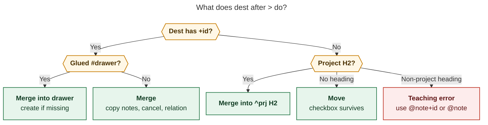

# Move, merge, and split should share one dest-shape family

Researcher: `grk`. Independent report. Do not treat this as the swarm synthesis.

- **Question:** How should Bob gain better task-to-task-file moves, a new capture `>` merge/demote family, a configurable `merged into` relation that auto-cancels, a Ctrl+Shift+T bullet-to-task split that leaves mention backlinks, and first-class CLI for all of it — while staying intuitive, reliable, and beautiful?
- **Evidence:** bob-cli `docs/capture.md` (routing, `@route+id` notes, drawers, whole-item `=*`/`=/` Pomodoro merge/split); `docs/task-relations.md` §§1–2, 10, 17–20 (cancel/complete/successor label effects, named inverses `merged into`/`merged from` and `split from`/`split into`, text mentions); `docs/task-dependencies.md`; `src/native/config/relations.rs` (`LabelEffect::{Cancel,Complete,Successor}`); `src/native/task_relations/inverse.rs`; `src/native/task_move/{command,plan}.rs`; `src/native/capture/sub_bullet.rs` (on-demand drawers and `^prj` H2s); `src/native/capture_language/mod.rs` (`GRAMMAR_REVISION = 7`); `src/runner.rs` `TASK_MEMBERS` (archive, move, reconcile, reroll); `tests/fixtures/task_cancel/vectors.json` (`merged-into-not-configured`, commented `# - merged into`); chezmoi-shaped config block in `docs/task-relations.md` CL2; bob-plugins `bob-navigation-hotkeys` commands Ctrl+Shift+M / L / B (no T binding); Obsidian core **Undo close tab** = Ctrl+Shift+T; decisions `capture-bullets-mirror-the-task-block`, `capture-sigils-say-where-what-how`, `mac-capture-is-a-thin-client`, `task-move-never-advances-the-walk`, `unblocked-tasks-are-offered`, `relation-label-hide-is-suggestions-only`; glossary Capture, Task Drawer, Task Relation, Task Mention, Task Link, Bulk Capture; in-flight `plan:202611/capture_multi_target.md` (target runs) and `plan:202611/capture_move_bullets.md` (residence moves into a *new* project). CLI rules: `bob task <verb>` rewrites task lines vault-wide; never add a subcommand under `bob capture`.
- **Date of evidence:** bob-cli, bob-plugins, and bob-mac-capture trees in this workspace on 2026-11-03.

## Verdict

Do it. The request names three real GTD verbs Bob only half-supports today: **file** a task in another note, **fold** several tasks into one, and **promote** a bullet into its own task. The grammar, the relation-effect machinery, the move engine, on-demand drawers, and mention projection are already the right bones.

Ship it as **one dest-shaped family**, not three unrelated features:

1. **Move** (`@a+aid > @c`) keeps the checkbox. It is Ctrl+Shift+M / `bob task move` with capture's multi-source superpower.
2. **Merge** (`@a+aid > @c+cid` and `@a+aid > @c+cid#drawer`) copies user notes into the dest (creating the drawer when missing), writes `merged into`, and cancels the sources. The same payload fires from Ctrl+Shift+L when the label is a configured merge label.
3. **Split** is the inverse of merge for *bullets*, not for tasks. Ctrl+Shift+T (with a documented Restore-tab conflict) and `bob task split` mint new sibling tasks and replace the bullets with aliased block links, which become `(💬 mentions)` on the new tasks.

The original `>` spelling is right. Two of its implied behaviors should change: dest shape must decide **move vs merge** using the meanings those markers already have, and merging must never destroy identity. Split belongs in the editor and `bob task`, with capture as a later convenience.

## Is this a good idea?

Yes. Bryan already performs these operations by hand, and the seams show.

**Move is incomplete, not missing.** Ctrl+Shift+M and `bob task move SRC DEST -b id` already preserve children, fields, and vault-wide links. The gaps are multi-source-from-several-notes in one gesture, a capture spelling, and filing into a dest *task* rather than a dest *note*. Inbox routing and the in-flight project-note move bullets (`plan:202611/capture_move_bullets.md`) already compose the same engine inside a capture batch. Capture `>` for the MOVE family is that composition with an explicit dest.

**Merge is the actual new product.** Duplicate tasks, overlapping captures, and "this bullet list is really one job" are daily. Today's workaround is copy-paste plus Task Card Cancel. That drops history, breaks inbound links, and leaves no `merged from` chip. A cancelled stub with a labelled edge is how Linear-style issue merge works: the source remains a redirect, the dest carries the work.

**Split is the missing promote.** Tasks accrete notes until one of them is a next action. Promoting it today is create-task, cut-paste, hope the parent still points at it. Replacing the bullet with `[[note#^id|title]]` is the mention system (`docs/task-relations.md` §19) doing what it was built for. The cancelled-duplicate example in that section is already the picture: `- OBSOLETE: See [[#^supersede]]!` produces `[[#^old-supersede]] (💬 mentions)` on the survivor.

**The request would be a bad idea** if `>` deleted sources, if dest shape silently demoted tasks to inert bullets, or if `merged into` were only a cancel label (cancel-without-copy). Those are the traps this design closes.

## Critique of the request

The benefit is real and the `>` character is free in capture (Pomodoro merge is whole-item `=*`; successor selection explicitly rejected `>1,3`). The sketch still overloads one token, under-specifies the merge payload, and puts split in the wrong surface as a capture twin.

**Dest shape is doing too many jobs without saying so.** `@c`, `@c#drawer`, `@c+cid`, and `@c+cid#drawer` are four destinations. In *today's* grammar they already mean four different writes (`docs/capture.md` glance table):

| Dest marker | Today, as a new capture | Honest `>` reading |
| --- | --- | --- |
| `@c` | new **task** in `c.md` | **Move** sources as tasks into `c.md` |
| `@c#Section` | ordinary **bullet** under a heading | tempting to demote; see ADJ-1 |
| `@c+cid` | **note** under an existing task | **Merge** sources as notes under `^cid` |
| `@c+cid#drawer` | **note** inside that drawer | **Merge** into that drawer, creating it |

The request treats `@c` and `@c#drawer` as "convert tasks to notes." That fights `@c`'s existing meaning (tasks) and destroys identity: inbound `[[c#^id]]` links, Pomodoro Task Links, freshness, Depends-On, and stats all assume a `#task` checkbox. Merge-with-stub is the identity-preserving way to "become notes under dest."

**`@c#drawer` is a heading, not a task drawer.** A `#` glued to `@route` names a note heading; a `#` glued to `@route+id` names a drawer (`decisions:capture-sigils-say-where-what-how`, glossary Task Drawer). On a project's `^prj`, eligible `##` sections *are* that task's drawers. So `@c#admin` on a project is `@c+prj#admin` in all but spelling. The design should say that, and refuse `@c#admin` on a non-project rather than inventing a third demote engine.

**"Any number of notes on the left" is the wrong noun.** The examples are `@a+aid @b+bid` — existing-task markers, the same members `plan:202611/capture_multi_target.md` calls a **target run**. Whole-note `@a > @c` (move every task in `a.md`) is a different, blunter verb. Keep LHS as a target run of `@route+id`. File-level bulk move can wait on `bob task move --all`.

**`>` must not fan out.** Multi-target's equivalence principle ("N members = N items") is correct for "file this note under each parent." Merge/move is one operation over N sources and **one** dest. Implement it as a new `CaptureKind` (alongside `PomodoroMerge` / `PomodoroSplit`), planned as one batch. A second dest after `>` is a teaching error.

**Cancel-label-only `merged into` is a footgun.** CL2 already comments `# - merged into` under `relations.cancel_labels`. Enabling that comment would cancel S at commit and copy nothing. Ctrl+Shift+L would then "merge" by destroying the source's notes. The request wants the *same* operation from the relation gesture and from `>`. That is a fourth label effect, parallel to cancel / complete / successor, with copy+cancel as its payload.

**Split does not want a relation.** `split from` / `split into` is already a named inverse pair (`inverse.rs`, `docs/task-relations.md` §10). Putting that label on the new tasks would **suppress** mentions (M7: a LINKS entry wins over a mention). The request asked for mentions triggered by inline links. Honour that: replacement text is the mention source; leave `split from` for optional manual labelling.

**Ctrl+Shift+T collides with Obsidian core.** Restore closed tab is Ctrl+Shift+T / Cmd+Shift+T. Plugin default hotkeys that conflict often fail to bind. Ship the command; prefer Ctrl+Shift+Alt+T as the default chord and tell Bryan he can steal Ctrl+Shift+T if Restore-tab is rebound. T still reads as *taskify*.

**Capture is a weak split surface.** Split starts from *this task's bullets in the editor*. Capture would need bullet indexes or a paste of the bullet text, which is how you know you wanted an editor keymap. v1 is Obsidian + `bob task split`. A capture spelling can wait.

**Shell `>` is redirection.** `bob capture @a+x > @c` truncates a file named `@c`. Help, docs, and examples must quote the draft, the same way `*` and `~` already warn. Mac Capture has no shell, so the panel is the pleasant path.

## Requirement adjustments

These change the request. Each is a product call.

| ID | Adjustment | Why it is justified |
| --- | --- | --- |
| **ADJ-1** | Dest without `+id` **moves** (checkbox survives). Dest with `+id` **merges** (notes copy, source cancels, relation written). `@c#Section` on a project is `@c+prj#Section` (merge into that H2). `@c#Section` on a non-project is a teaching error in v1. | Matches today's marker meanings. Demoting a task to a heading bullet drops `#task` identity and every engine that keys on it. |
| **ADJ-2** | Merge **never deletes** the source task. It cancels it, the way Task Card Cancel does, after the dest write succeeds. | Inbound links, Pomodoro history, and git blame keep working. This is the request's own merge rule, applied also to the `@c#drawer` case the request described as conversion. |
| **ADJ-3** | Add `relations.merge_labels` as a fourth effect (`LabelEffect::Merge`). Bob default `[]`, chezmoi enables `merged into`. A key in two effect lists is dropped from both, same warning as cancel∩complete. | Cancel-only would copy nothing. Hide still does not disable (`relation-label-hide-is-suggestions-only`). Config remains host YAML; bob never edits it. |
| **ADJ-4** | Capture `>` with a task dest always writes the first configured merge label, or `merged into` if the list is empty, and always runs the merge payload. Ctrl+Shift+L runs that payload only when the typed label's key is in `merge_labels`. | `>` is an explicit fold gesture even before chezmoi is updated. The Links stage stays inert for unconfigured labels, matching cancel/complete. |
| **ADJ-5** | Merge copies **user notes only**, wrapped as one aliased title link per source: `- [[src#^id\|Title]]` plus that source's non-managed children. Managed lines (Depends-On, BLOCKS, LINKS, LINKED FROM, Cancel/Schedule/Work/Rotten logs, `TASKS`) stay on the cancelled source. Drawers of the source nest as ALL-CAPS children under that wrap in v1 (no by-name drawer fold). | One subtree per source is readable and retry-safe. Auto-merging `REQUIREMENTS` drawers across unrelated tasks mixes lists. The wrap link is a mention of the stub from dest (`site: note`). |
| **ADJ-6** | Write dest **first**, then source relation+cancel. Retry is idempotent: a dest child whose only block link is that source is "already copied." | Copied notes are not reconcile-owned. Cancel-then-copy can lose the only copy if dest fails. Dest-then-cancel can duplicate on retry unless the wrap link is the identity. |
| **ADJ-7** | LHS is a **target run** of `@route+id` (the multi-target member kind). One dest. Whole item. Optional prose after dest is a cancel-log reason. Authored child bullets on a MERGE item append as extra dest notes; children on a MOVE item are refused. | Multi-target fan-out would merge N times independently and could not share one dest drawer create. Pomodoro `=*` already teaches "whole item." Extra notes while folding is the beautiful exception. |
| **ADJ-8** | Split is **editor + `bob task split` in v1**. Replacement is one aliased block link per promoted bullet, in situ. New tasks are Ready siblings minted after the parent block in the same note. No `split from` relation. | Mentions require an inline block link in the parent's own text (§19 M1–M2). A relation would hide them (M7). Capture has no good bullet cursor. |
| **ADJ-9** | Default split keymap is **Ctrl+Shift+Alt+T**. Command id `split-bullets-into-tasks`. Document that Ctrl+Shift+T is Restore closed tab; Bryan may rebind. Counted `N` and a visual selection both work; cursor on the task line opens a bullet picker (user bullets only). | Honour the T mnemonic without silently stealing a core tab chord that often fails to bind. |
| **ADJ-10** | `bob task merge` and `bob task split` nest under `bob task`. Capture `>` is grammar on `bob capture`, never a `bob capture merge` subcommand. Existing `bob task move SRC DEST -b id` stays; add additive `--from note+id` / `--into note[+id][#drawer]`. | CLI rules: `bob task` rewrites vault-wide task lines; never add a subcommand under `bob capture`; never hard-rename. |
| **ADJ-11** | Land **after** the multi-target target-run lexer (`plan:202611/capture_multi_target.md`, `GRAMMAR_REVISION` currently 7, that plan bumps to 8). This feature bumps once more. Mac stays a thin client of new span kinds and JSON. | `>` sits beside a run. Implementing it against today's single-marker resolver would be thrown away. |
| **ADJ-12** | Refuse `^prj` as a merge *source*. Allow `^prj` as a merge *dest* (that is `@c#H2` on a project). Refuse recurring sources. Already-closed sources link+copy and skip cancel. Self-merge and dest-in-LHS refuse. Do not auto-link dest into today; do not stamp dest fresh; do not transfer Depends-On. | Cancelling a project from a fold is a disaster. Recovery of the source's dependents already happens through the cancel engine. Offers stay explicit (`unblocked-tasks-are-offered`). |
| **ADJ-13** | MOVE via `>` stamps `[fresh::]` the way Ctrl+Shift+M / inbox-route already do for an open moved task. Merge-cancel does **not** stamp dest. Split-created tasks are new: no freshness stamp. | Move is a filing confirmation of the same work. Merge is "this work now lives on dest." Creation never stamps (glossary Task Freshness). |
| **ADJ-14** | Ctrl+Shift+M, walk parking, and project-note `- ^id` bullets stay as they are. `>` does not open the move picker; it names dest in the draft. | Three move surfaces, three jobs: in-note picker, birth-of-project bullets, capture multi-source. |

## What already exists

### Move

- **Obsidian:** Ctrl+Shift+M `move-tasks-to-note` (`bob-navigation-hotkeys`). Counted `N` moves siblings. Follows the task and parks the `]s` walk (`task-move-never-advances-the-walk`).
- **CLI:** `bob task move SOURCE DEST -b ID` / `-m TEXT`, repeatable selectors, `--dry-run`, JSON. One source note. Closed tasks refused (inbox routing sets `allow_closed`).
- **Engine:** `src/native/task_move/plan.rs` — whole blocks, link repair, `[id::]` / `[dependsOn::]` repair, dest id-collision handling. Capture inbox-route already calls it inside a staged batch. The move-bullets plan adds `MovePlacement::{Intake, BeforeLines}` for draft-order slots.
- **Destinations:** areas and open projects; inboxes excluded from the route picker.

This family does not file *into another task*. That is merge.

### Relation effects

Relations are inert except at commit of a configured label (`docs/task-relations.md` §2, §17–20):

| List | Default | Commit does |
| --- | --- | --- |
| `cancel_labels` | `[]` (chezmoi: `duplicate of`, `superseded by`) | Cancel the source |
| `complete_labels` | `[]` | Mark the source Done |
| `successor_labels` | `[]` (chezmoi: `starts after`) | Offer the source when dest is parked or done |

Policy lives in `RelationsConfig`; one key, one effect; hide is suggestions-only; explicit gestures only (capture `~`/`~~`, nav Links / Linked-from). Reconcile, rename, and hand edits never fire.

`merged into` → `merged from` is already a display inverse. The cancel-label config block already names `merged into` as the next candidate, commented out. Vectors include `merged-into-not-configured`. The missing piece is a **copy** step, which those lists do not have.

### Drawers and notes under a task

`@route+id` files a child note. `@route+id#drawer` files inside an ALL-CAPS drawer and **creates** it on demand (`capture/sub_bullet.rs`, glossary Task Drawer). On `^prj`, the same selector names an H2 and will append a new `## Title Case` section. Capture never creates an empty drawer. Merge into `#drawer` should reuse that resolver byte-for-byte, including near-duplicate refusals and catalog spelling.

### Mentions

A block link in a task's title, user notes, or logs projects `[[S]] (💬 mentions)` on T. Aliased links count (M5). Links on LINKS / Depends-On do not (M2). A relation on the pair wins (M7). Split's replacement line is therefore a user note containing `[[#^new\|title]]`. Merge's wrap link on dest is a mention of the cancelled source.

### Whole-item merge/split precedent

Pomodoro `=*` / `=/` are whole-item tokens with teaching errors for extra text, JSON kinds `pomodoro_merge` / `pomodoro_split`, and Mac span kinds. Task `>` should feel like that family: claimed, complete, previewable, refused with codes — applied to tasks instead of types.

### In-flight neighbours

- **Target runs** (`plan:202611/capture_multi_target.md`): adjacent `@route+id` markers fan out *notes*. `>` consumes a run as **sources** of one fold/move. Sequence: grammar phase of multi-target, then this.
- **Move bullets** (`plan:202611/capture_move_bullets.md`): `- ^id` inside a *new* project-note item. Different verb (birth vs later filing). Share the move engine and eligibility (`^prj`, nested, closed stay out).



*Caption: Dest shape reuses today's capture meanings. A block id folds notes into that task; a bare route files the checkbox; a project heading is the `^prj` drawer.*

## Recommended solution

### The one rule

**After `>`, the dest marker means what it already means as a capture destination.** Sources on the left are existing tasks. The operator names the verb.

```text
@cash+sell-stocks @work+old-prep > @life+taxes
@cash+sell-stocks @work+old-prep > @life+taxes#receipts
@cash+sell-stocks @work+old-prep > @life
@life+taxes#receipts              # today's "notes in a drawer" — still valid
```

Quoted for the shell:

```bash
bob capture --dry-run '@cash+sell-stocks @work+old-prep > @life+taxes#receipts'
```

### Grammar

Claim a parent line as `CaptureKind::TaskFold` (name bikeshed: `TaskFold` covers move and merge) when:

1. A whitespace-bounded `>` token sits on the parent line.
2. The left side, after stripping `&`/`*`/`~` (refused on this kind), `#type`, `%`, and `s:`/`$`, is a target run of one or more `@route+id` markers (optional per-member `#drawer` is **ignored with a teaching error**: sources are tasks, not drawers).
3. The right side is exactly one dest marker: `@route`, `@route#Section`, `@route+id`, or `@route+id#drawer` (quoted `#"TITLE"` allowed).
4. The line has no other route/mode slot.

`capture-parse` reports `mode: task_move` or `task_merge` (dest shape), `sources[]`, `dest`, optional `drawer`/`section`, `needs` (`fold_source`, `fold_dest`, `drawer`), and spans `task_fold_arrow`, `task_fold_source`, `task_fold_dest`, `drawer`. Single-marker items stay byte-identical.

**Completion.** Cursor in a source member completes that task (same as a run member). Cursor after `>` completes routes, then `+id`, then `#drawer` using dest's drawers. A trailing `>` with no dest needs `fold_dest`.

**Duplicates.** Same resolved (path, id) twice on the LHS is `duplicate_capture_target`. Dest equal to a source is `fold_same_task`. Two `>` tokens, dest runs of length > 1, and leading+trailing dest are teaching errors.

**Forced `-r` / `--task` / `--drawer`.** Today's rule: those flags make `@…` literal. A `>` item under a forced dest is refused (`fold_forced_destination`): the dest is on the line.

### Merge payload

One pure engine, `task_merge`, called from capture `>`, capture `~`/`~~` when the label key is a merge label, `bob task merge`, and nav Links / Linked-from.

For each open source S → dest T (optional drawer D):

1. Resolve D with the existing drawer writer (create on demand, catalog spelling, near-duplicate guard). On `^prj`, this is an H2.
2. Insert under T (or D) a wrap subtree:

   ```markdown
   - [[cash#^sell-stocks|Sell stocks]]
     - call Morgan
     - REQUIREMENTS
       - 1099 from Vanguard
   ```

   Title is S's cleaned description (the note-tasks cleaner already used for chips). Children are S's non-managed direct subtrees, relative indent preserved.
3. Author on S: `🪢 **LINKS:** merged into [[life#^taxes]]` (first label wins if an entry for T exists: relabel into the merge label).
4. Cancel S exactly as CL4 (status `[-]`, `[cancelled:: today]`, optional Cancel Log prepend `*date* — 🪢 merged into [[T]]` plus the optional `>` reason, prune today's open Pomodoro links, recover dependents). Verdict table clones CL5 (`cancels` / `already_closed` / `recurring` / `new_task` / `conflict`) with `^prj` source → refuse `merge_project_source`.
5. T's LINKED FROM mirror is the usual follow-up; reconcile remains authority. Inverse display: `merged from`.

**Nav atomicity** matches cancel labels honestly: same-note S and T, one undo; cross-note dest write first, then source, chip on follow-up failure. Capture is one staged preimage-checked batch.

**Preview (human):**

```text
⤵ merge  2 tasks → life.md ^taxes  RECEIPTS  (created)
  ⊘ cash.md ^sell-stocks  Sell stocks  Ready → Cancelled
  ⊘ work.md ^old-prep     Old prep     Next → Cancelled
  + [[cash#^sell-stocks|Sell stocks]]
  + [[work#^old-prep|Old prep]]
  🪢 merged into
  would remove 1 Pomodoro link · would unblock “File 1099”
```

JSON kind `task_merge` with `sources[]`, `dest`, `drawer?`, `created_drawer`, `relation_cancels[]` (existing shape), `copied[]`, `wrap_links[]`. Dry-run uses `would`. Footer verb on Mac: **Merge** (or **Move**).

### Move payload

Reuse `plan_task_move` with selectors from the LHS, dest note from `@c`, placement Intake (Tasks section / last top-level `#task`, same as capture routing). Multi-source across notes: one `MoveRequest` per source file, dest shared, then one repair pass. Stamp freshness like Ctrl+Shift+M. Human header `↪ move N tasks → c.md`. JSON kind `task_move` can wrap the existing move report so `bob task move --format json` and capture agree.

Into a blocked project, open moved tasks become `[?]` + `#prj_is_blocked` + unlinked, matching Ctrl+Shift+M (`docs/task-dependencies.md`).

### Split payload

Inputs: parent task P, an ordered list of its **top-level user bullets** (managed lines ineligible). For each bullet B with its nested children:

1. Mint a block id from the bullet's slug (`next_available_block_id` in P's note).
2. Insert after P's block (same heading, sibling):

   ```markdown
   - [ ] #task Draft the resignation memo [created::YYYY-MM-DD] ^draft-the-resignation-memo
     - nested notes travel
   ```

   ALL-CAPS-with-notes children become drawers of the new task (`capture-bullets-mirror-the-task-block`).
3. Replace B (and its nested lines) with one child of P:

   ```markdown
   - [[#^draft-the-resignation-memo|Draft the resignation memo]]
   ```

   Same-note `#^id` form. Alias is the original bullet text, trimmed, no checkbox chrome (there was none).

Mentions: P now contains a block link to each new task → each new task's LINKED FROM gains `[[P]] (💬 mentions)` on the next reconcile (nav can write it eagerly the way other LINKED FROM follow-ups do).

**Picker.** Cursor on a user bullet: that bullet. Visual selection: those top-level user bullets whose head lines intersect the selection (children come along). Cursor on P's task line or a managed child: modal listing user bullets in document order, multi-select, none preselected (same discipline as successor offers). Counted `N` from a bullet takes that bullet and the next N−1 user siblings.

Walk: split does not advance `]s`. It is not a review answer.

### Config

```yaml
relations:
  cancel_labels:
    - duplicate of
    - superseded by
  complete_labels:
    - implemented by
  successor_labels:
    - starts after
  merge_labels:
    - merged into
```

Chezmoi change is part of landing, like the original cancel-label enablement. `bob relations list` grows `merge_labels` count and a `⤵ merges into dest` row cue. Overlay rows are `configured`. Inverse `merged from` already exists; no table change.

Rename into or out of a merge label **never** copies or cancels; warn to update `relations.merge_labels` (clone the cancel-rename warning).

### Command line

Additive members, alphabetical inside `bob task`:

```text
bob task merge --from cash+sell-stocks --from work+old-prep --into life+taxes
bob task merge --from cash+sell-stocks --into life+taxes#receipts -d -f json
bob task split life+taxes --bullet 2 --bullet 4
bob task split life+taxes --match 'Draft the resignation' --dry-run
```

`--from` / `--into` accept the capture marker without `@`. `--bullet` is 1-based among top-level user bullets. `--match` is literal substring, unique or refuse. `--dry-run`, `-f json`, `-o` offline, `-r` retry: copy `bob task move`.

Keep `bob task move SOURCE DEST -b id`. Add:

```text
bob task move --from cash+a --from work+b --into life
```

as sugar that builds several source requests. Help examples must quote capture `>`.

`bob capture-parse` / `capture-complete` / `capture --dry-run` are the capture CLI. No `capture-*` sibling is required beyond the existing protocol; add span kinds and needs only.

### Obsidian

| Chord | Command | v1 |
| --- | --- | --- |
| Ctrl+Shift+M | Move tasks to note | unchanged |
| Ctrl+Shift+L | Links to | merge payload when label ∈ `merge_labels` |
| Ctrl+Shift+Alt+L | Linked from | same, source is the picked task (CL3 table) |
| Ctrl+Shift+Alt+T | Split bullets into tasks | new |
| Ctrl+Shift+P | Task Card | no new stage; split is its own command |

Links-stage copy for a merge label: `⤵ Merges notes into “{T}” · ⊘ cancels “{S}”`. Return hint `↵ merge & cancel`. Batch banner `⤵ Merges {N} tasks into “{T}” — ↵ again to confirm`. Drawer targeting stays capture/CLI in v1 so the stage does not grow a second field.

### Mac Capture

Thin client (`mac-capture-is-a-thin-client`). Decode new span kinds, `needs`, `mode`, and dry-run `task_merge` / `task_move` bands. Footer **Merge** / **Move**. Ghost titles after source markers (the move-bullets plan's overlay) make `@cash+sell-stocks` readable. Older bob: no `task_fold_arrow` span, `>` stays prose, no footer change. Do not raise `CaptureGrammarGate.minimumRevision` until the grammar bump ships; additive decodeIfPresent is enough for preview once bob is new.

### Architecture

Three layers, cloned from CL8:

1. **Policy.** `RelationsConfig::label_effect(key) -> Option<LabelEffect>` gains `Merge`. Shared vectors in `tests/fixtures/task_merge/vectors.json` (bob-cli source, plugins copy).
2. **Pure plans.** `task_merge` (copy + wrap identity + cancel composition); `task_move` (existing); `task_split` (mint + replace).
3. **Existing writers.** Capture batch planner, nav editor transactions, `bob task` maintenance lock + sync + scoped commit.

Do not call the relation writer and then a separate cancel handler. Compose, then write.

Docs: `docs/capture.md` (new subsection under Tasks, glance-table rows, grammar revision); `docs/task-relations.md` §21 merge labels; `docs/task-move.md` multi-source; new `docs/task-split.md` or a split section beside mentions; plugin keymap reference; `just docs-gen` for clap help. Decision records after acceptance: merge-labels-are-a-label-effect; dest-shape-after-gt; split-writes-mentions.

### Phasing

Parallel-friendly once the merge engine exists.

| Phase | Repo | What |
| --- | --- | --- |
| 0 | bob-cli | Wait for multi-target `grammar` (target runs + revision 8) |
| 1 | bob-cli | `LabelEffect::Merge`, config parse, vectors, `task_merge` pure engine, capture `~` composition, `bob relations list` cue |
| 2 | bob-cli | `>` lexer/parser/spans/needs, `CaptureKind::TaskFold`, planner MOVE+MERGE, glance docs, grammar bump `feat(capture)!:` |
| 3 | bob-cli | `bob task merge` / `bob task split` / additive `task move --from` |
| 4 | bob-plugins | Links-stage merge payload; split command + picker + counted/selection; copy vectors |
| 5 | bob-mac-capture | spans, preview band, footer verb, ghost titles |
| 6 | chezmoi | enable `merge_labels: [merged into]` |

Phases 3 and 4.partial (split) can start after 1 without waiting for `>`. Phase 2 needs 0 and 1.

### Risks

- **Copied notes vs reconcile.** Mitigated by dest-first order and wrap-link idempotency. Still: a crashed dest write leaves S open (safe). A crashed source write after dest copy leaves a wrap plus an open source; retry no-ops the copy and then cancels.
- **Grammar break.** `@a+x > @c` today files a note `> @c` under `^x`. Whole-item claim plus revision bump, same class as multi-target.
- **Shell redirection.** Docs and `--help` examples in single quotes; Mac path is the daily driver.
- **Hotkey bind failure.** Ctrl+Shift+Alt+T default; command palette always works.
- **Merge of large trees.** Preview must list titles, not dump every nested line; JSON carries the bytes.
- **Interaction with move-bullets.** A project-note item that also contains `>` is a duplicate route slot → existing `duplicate_capture_marker`.

### What I would not do

- A submit-time "merge these?" card. The draft *is* the gesture; preview shows it.
- A new sigil besides `>` (`=>`, `>>`, `~> `). `>` reads as into, and it is unused.
- Deleting sources. Identity is the whole point of the stub.
- Auto-folding same-named drawers across sources. Wrap instead.
- Auto-linking dest into today, auto-Next, dest freshness stamps, transferring Depends-On.
- Capture grammar for split in v1.
- Fan-out of dests.
- Putting `merged into` only on `cancel_labels`.

## Open questions (defaults if unasked)

1. **Chezmoi enable at land, or bob default `['merged into']`?** Default: chezmoi enable, bob default `[]`, matching cancel/complete. Capture `>` still folds (ADJ-4).
2. **Wrap alias vs plain title plus a trailing link?** Default: aliased wrap `- [[src#^id\|Title]]` (ADJ-5). Shortest readable line, mention-bearing, retry key.
3. **Split new-task home always the parent note?** Default: yes. A dest picker on split is a second product.

## Recommended solution (short)

Lead with a **dest-shaped `>` family** on a target run of existing tasks, implemented as one whole-item capture kind after the multi-target lexer:

- `@sources > @note` **moves** checkboxes via the existing task-move engine.
- `@sources > @note+id[#drawer]` **merges**: dest-first copy of user notes as aliased wrap links, `merged into` relation, Task-Card-quality cancel of each source, on-demand drawer/H2.
- **`relations.merge_labels`** is the configurable effect that makes Ctrl+Shift+L (and capture `~`) run that same payload.
- **Split** is Ctrl+Shift+Alt+T plus `bob task split`: promote user bullets to sibling Ready tasks and replace them with aliased block links so the new tasks gain `(💬 mentions)`.

That is the request, with identity preserved, dest markers keeping their current meanings, and every new write going through an engine Bob already trusts.
