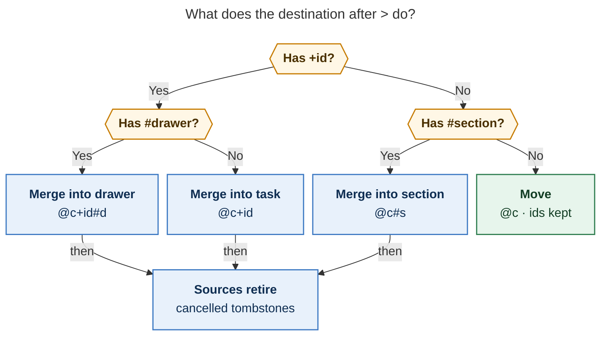

# Move, merge, and split tasks: one destination-shaped family

*Lead researcher's consolidated report · 2026-11-03 · merges the `cdx`, `cld`, `grk`,
`mus`, and `gem` reports with independent verification*

**Evidence snapshot.** bob-cli `9a606395` (HEAD, which includes the new capture batch-move
adapter `cf1e4644` and note pull `c673d144`), bob-plugins `e1aad7c`, the multi-target plan
`plan:202611/capture_multi_target.md` and its epic `bob-cli-gm`, the move-bullets epic
`bob-cli-gl`, `docs/task-relations.md` §§17–20, `docs/capture.md`,
`docs/task-link-marks.md`, glossary and decision memory, and a survey of H2 sections in
Bryan's area notes. Bracketed tags such as [cld] credit the researcher whose finding I
kept. Where the reports disagreed, §9 records how I decided.

---

## Recommendation in one screen

**Build it.** Moving, merging, and splitting are the three refactorings of an outline whose
nodes are tasks and notes. Bob already has most of the machinery: a vault-wide move
engine, drawer resolution, cancel composition, relation label effects, and text
mentions. What it lacks is an operation that turns tasks into notes (**merge**) and one
that turns notes into tasks (**split**).

| Refactoring | Gesture | Identity | Back-pointer |
| --- | --- | --- | --- |
| **Move** | `@a+x @b+y > @c`, Ctrl+Shift+M, `bob task move` | kept (same `^id`, links repaired) | none needed |
| **Merge** | `> @c+id[#drawer]`, `> @c#section`, the `merged into` label, `bob task merge` | the source **retires** as a cancelled tombstone | `🪢 LINKS: merged into [[T]]` on the source; T shows *merged from* |
| **Split** | Ctrl+Shift+T, `bob task split` | new tasks are **born** | live links left in the parent; each new task shows `(💬 mentions)` |

The design rests on one rule: **the destination decides the shape.** A note holds tasks,
so `>` to a bare note moves them. A task, or a note's section, holds notes, so `>` to
either one merges the sources into it.

I made eight adjustments to the request (§2). The five that matter most:

1. **`> @c#section` merges into that note's H2 section, on area and project notes alike.**
   The source becomes a cancelled tombstone. It is not deleted.
2. **A merge cuts the source's authored notes into the destination instead of copying
   them.** The tombstone keeps the task line, ID, fields, logs, and relations.
3. **Tasks that depended on a merged source now wait on the destination.** Today's cancel
   behavior would unblock them, which would release work that is not done.
4. **Split's mentions land on the new tasks, not the old one.** That is how §19 mentions
   work. The parent instead gets a live per-bullet checklist of links.
5. **Ctrl+Shift+T collides with Obsidian's core "Undo close tab" on Linux.** Keep the
   chord and rebind the core command in `hotkeys.json`.

---

## 1. What exists today (verified)

| Area | Fact | Consequence for this feature |
| --- | --- | --- |
| Move engine | `plan_task_move(snapshot, MoveRequest)` moves open, column-0, non-`^prj` blocks. It repairs block links, pathless links, embeds, aliases, and descendant anchors vault-wide, plus `[id::]`/`[dependsOn::]`. `MovePlacement::{Append, CaptureSlots}`, `IdCollisionPolicy::{Rename, Refuse}`. | `> @c` is this engine. A merge's cut of child subtrees can reuse its fragment link repair. |
| Capture batch move | New in `cf1e4644`: `capture/batch_move.rs` stages destination-before-source postimages into the capture batch and stamps moved roots with `stamp_fresh`. | `>` moves need no new writer. |
| Drawers | `@route+id#drawer` matches by exact key, refuses near-duplicates, honors quoted literals, and creates on demand. On `^prj`, drawers are the note's `##` sections, created in Title Case. | `> @c+id#drawer` reuses the resolver as-is. |
| Section bullets | `@c#Prefix` writes a plain bullet under a heading. It prefix- and slug-matches, falls back to the zeroth section, and **never creates** a heading. | A `>` section destination needs creation, so it uses the stricter drawer-style resolver (§3.2). |
| Area notes | `dev.md` and `mac_inbox.md` have `## Future Work`; `cash.md` has `## Area Notes`; `body.md` has `## Notes`. | `> @dev#future-work` is a real "not now, maybe later" demotion. Refusing it on area notes, as three reports did, would drop the most natural use. |
| Cancel labels | `relations.cancel_labels` (bob default `[]`, chezmoi `duplicate of`, `superseded by`, with `# - merged into` commented out). Commit cancels S, prunes today's open-Pomodoro links, and **recovers S's Blocked dependents with `[unblocked::]`**. There are "no successor offers and no dependency transfer" (CL4). | Enabling `merged into` as a cancel label would copy nothing **and** release dependents early. Merge needs its own effect. |
| Label effects | `enum LabelEffect { Cancel, Complete, Successor }`. A key in more than one list is dropped from all of them, with a warning. | Add `Merge`. |
| Inverses | `inverse.rs` already pairs `merged into ↔ merged from` and `split from ↔ split into`. | No display work is needed. |
| Mentions | §19: if S's own text holds a block link to T, then T's LINKED FROM gains `[[S]] (💬 mentions)`. Identity is directional ("A → B and B → A are independent"). A relation or dependency on the pair takes precedence (M7). | Split's links in the parent produce mentions on the **new** tasks. A `split from` relation would suppress them. |
| Link rings | bob-ledger-tools draws a status ring before **every** rendered block link to a `#task`, closed ones included (◯ ◉ ✓ ⊘). | Split stubs become a live checklist. A merged group header in T must **not** link to the cancelled source, or it would show ⊘ beside live work. |
| Multi-target | `bob-cli-gm` is in progress with `split_edges = refuse`: `@a+x note @b+y` is refused as `split_capture_targets`. A run is two or more adjacent `@route+id` markers that fan out. | After gm lands, `@a+x > @c+z` is a *refused* line, so merge claims an error. `@a+x > @c` still files the note "> @c" under `^x`, so the move form is a grammar break. |
| Grammar revision | Code says `7`; docs already say `8` (move bullets and note pull). gm takes "one more than the highest either claims". | `>` takes the next free revision after gm. Do not hard-code a number. |
| Obsidian keys | nav binds the literal `Ctrl`, not `Mod`. `hotkeys.json` overrides Alt+T only. Obsidian's core "Undo close tab" is Mod+Shift+T. | Ctrl+Shift+T collides on athena and apollo (Linux), not on the Mac. |
| Counted keys | `N<Ctrl+Shift+M>` moves the current task plus the next N. Counted Ctrl+Shift+L applies one target to every source. | Ctrl+Shift+T should follow the same count rule. Counted Ctrl+Shift+L with a merge label becomes "merge N into one". |
| Plugin → bob | ledger-tools already shells out to `bob relations rename` for multi-note writes. | There is precedent for Obsidian running the Rust merge engine. |
| Rust cancel | `task_cancel/{line,prune,recovery,verdicts}.rs`, including `edit_source_create_log`. | Merge composes the existing cancel line edit, prune, and verdict code. The Cancel Log writer covers section merges. |

---

## 2. Critique and requirement adjustments

The request is coherent, and its instincts are right. `>` is free in capture grammar and
mnemonic ("put these there"). Keeping merged sources preserves every inbound link,
ledger row, and dependency. Mentions are the right inert back-pointer. Merge as a
relation label effect fits how Bryan already retires tasks (`superseded by` cancels,
`implemented by` completes).

The real risk is that one pleasant syntax hides operations with different consequences.
Move keeps a commitment. Merge folds one commitment into another. Merging into a section
retires a commitment into context. Split creates new commitments. These should share
parsing and planning machinery, while the preview, verbs, and JSON keep them visibly
distinct [cdx].

I would not build NLP merging, fuzzy de-duplication, flattening of drawers by name, or a
general Markdown refactoring framework.

| # | The request said | I recommend | Why |
| --- | --- | --- | --- |
| **A1** | `> @c#drawer` converts tasks to notes in that drawer | **Merge into section.** The source's notes move under the note's H2, which is created in Title Case if missing. Works on **area and project notes**. The source becomes a cancelled tombstone whose new Cancel Log entry reads `merged into [[c#Section]]`. **Refused when the source has open dependents.** | A `#` glued to `@route` names a place (`capture-sigils-say-where-what-how`). Area notes have real drawer-like sections. With no task to wait on, open dependents cannot be honestly re-pointed. Typing `@proj+prj#section` instead gives a relation-bearing merge into `^prj`. |
| **A2** | Converted tasks are "moved" (gone) | Every task-to-notes conversion leaves the **source line as a tombstone** | Ledger history, dependency targets, relations, and mentions all point at the source. Deleting it, or demoting it to a plain bullet that keeps `^id` (gem), would leave Task Links pointing at a non-task. |
| **A3** | "Should not delete the source tasks" | Keep the source line. **Cut** its authored children into the destination, with anchor link repair from the move engine. Logs, LINKS, and Depends-On stay on S. | The content then lives in one place. Copying (cdx, grk, mus) duplicates anchors, doubles mentions, and leaves two diverging copies. Writing T first makes partial failure produce a duplicate, never a loss. |
| **A4** | Merge "auto-cancels" the source | Merge is its own effect. Before S is cancelled, **S's open dependents are re-pointed to T** (deduplicated; a cycle refuses). S's own prerequisites are **reported, not transferred**. | Cancel's recovery would unblock work whose prerequisite still lives inside T. Transferring S's prerequisites would silently block all of T and prune T's Task Links. |
| **A5** | (unstated) Today's plan | S's live links under today's open Pomodoros are pruned, as on cancel. If T is not linked there, **T is offered** in S's place and never auto-linked. | This follows `unblocked-tasks-are-offered`: Bob never chooses what you work on today. Picking the offer raises T to Next under the usual rules. |
| **A6** | The old task gets "linked from" mentions | The **new** tasks get `[[P]] (💬 mentions)`. The parent gets per-bullet live links. No reverse "From" lines and no `split from` relation. | §19 is directional. Reverse links in each child (cdx) would make P's LINKED FROM repeat its own stubs. A relation would suppress the mention (M7). |
| **A7** | Configurable `merged into` | Add `relations.merge_labels` and `LabelEffect::Merge`. Bob's default is `[]`; chezmoi enables `[merged into]` and deletes the commented cancel entry. `>` and `bob task merge` always write the first configured label, falling back to `merged into`. | This matches the cancel, complete, and successor conventions. The explicit operators must always write *some* label. |
| **A8** | Ctrl+Shift+T | Keep it. Ship a vault `hotkeys.json` entry that moves `workspace:undo-close-pane` (for example to Ctrl+Shift+Alt+T). | Otherwise two commands share the chord on Linux. T pairs with M ("**T**ask" / "**M**ove"). |

Narrower adjustments (all reports agreed): the left-hand side names **tasks**
(`@route+id`), never whole notes. A `>` line carries no other markers and no child
bullets in v1. Merge refuses recurring, `^prj`, closed, or open-subtask-bearing sources,
and closed targets or targets nested inside a source. Split never advances the `]s` walk.

---

## 3. Capture: the `>` line



*Figure 1. After `>`, the destination's shape picks the verb. A bare note moves the tasks
intact. Any `+id` or `#section` merges their notes in and retires the sources as
cancelled tombstones.*

```text
@inbox+bench @work+pgdump > @db                          # move 2 tasks into db.md's ## Tasks
@inbox+bench @work+pgdump > @db+upgrade                  # merge into ^upgrade
@inbox+bench @work+pgdump > @db+upgrade#future-work      # merge into its FUTURE WORK drawer
@mac_inbox+ws-proto > @dev#future-work                   # merge into dev.md's ## Future Work
```

### 3.1 Recognition

```text
transfer := source (" " source)* " > " destination
source   := @route+block-id                 (complete; no #drawer, no !)
dest     := @route | @route#section | @route+id | @route+id#drawer   (quoted #"…" allowed)
```

- **Claim before fan-out.** A parent line whose leading run of one or more `@route+id`
  markers is immediately followed by a standalone `>` token is a transfer. It is
  recognized **before** gm's fan-out and `split_edges` check, so it never runs Ensure
  Next or files notes per member [cdx, cld, grk]. One source is valid; gm's runs need two.
- **Once claimed, never prose.** A malformed right-hand side is a teaching error or an
  incomplete transfer, never a note filed under `^x` [cdx, cld].
- **Standalone `>` only.** `@a+x>@c` gets a teaching error (`transfer_arrow_spacing`)
  rather than a guess (rejecting gem's glued form). `\>` keeps today's literal prose.
  Mid-line `>` (`called Bob > 3 times`), line-initial blockquotes, and code are untouched.
- **v1 lines are pure directives.** No `s:`, `$`, `#type`, `%`, `&`/`*`/`~`, trailing
  text, or child bullets. Forced `-r`/`--task`/`--drawer` keep `@…` literal, as today.
  `@@` never applies. A reason line (child bullet → Cancel Log) is a reasonable v2.
- **Order and duplicates.** Keep typed order. Refuse the same resolved `(path, id)` twice
  (reuse `duplicate_capture_target`, including aliases), a destination that is also a
  source, and overlapping ancestor/descendant sources.

### 3.2 Destination rules

| Destination | Verb | Notes |
| --- | --- | --- |
| `@c` | **Move** | `plan_task_move` through `batch_move`, once per source note on staged snapshots. Same eligibility as Ctrl+Shift+M: column-0, open, non-`^prj`; a project born Blocked accepts only `[?]` tasks. Freshness is stamped like Ctrl+Shift+M. A same-note source is refused (`move_same_note`). |
| `@c+id` | **Merge into task** | Notes land at T's plain-child anchor, before its managed logs. |
| `@c+id#drawer` | **Merge into drawer** | Uses the existing drawer resolver. On `^prj` this is an H2. |
| `@c#section` | **Merge into section** | An exact-key or slug match to an eligible non-structural H2. A strict prefix or edit-distance-1 slug of an existing heading is **refused** with "did you mean ## Future Work?". Otherwise a `## Title Case` section is created at the end of the note. `#"Exact Title"` forces creation. Completion lists existing sections first, so prefix typing still feels like today's `@c#Pre`. |

The section resolver is deliberately stricter than `@c#Prefix` section bullets, which
fall back to the zeroth section and never create. Creating a heading because of a typo
would be worse than refusing.

### 3.3 Editor assist and contracts

- **`capture-complete`.** In a source member it offers that note's open tasks, filtered
  to movable or mergeable rows. After `> ` it offers the same list Ctrl+Shift+M shows,
  plus a `+` drill-in hint. After `@db+` it offers db's open tasks with sources removed,
  each row labelled `⤵ merge into`. After `#` it offers T's drawers or c's sections in
  document order, then catalog recents, then a creation row [cld].
- **`capture-parse`.** `mode: "task_move" | "task_merge"` plus an additive
  `transfer: {sources[], arrow, destination{kind: note|task|drawer|section, route,
  block_id?, drawer?, section?}}`. Spans are `transfer_source`, `transfer_arrow`, and
  `transfer_destination` with the existing `drawer`/`section` sub-spans. Needs are
  `transfer_destination`, `block_id`, `drawer`, and `section`. Legacy fields stay
  additive.
- **`bob capture -f json`.** `moves[]` reuses `bob task move`'s `MoveRecord`. `merges[]`
  is described in §7. A dry run must equal the real result except for `dry_run`.
- **Bob Mac Capture** stays a thin client (`mac-capture-is-a-thin-client`). It renders
  span kinds and preview bands. The optional change is a footer verb (**Move** /
  **Merge**) with `arrow.right` / `arrow.triangle.merge`.

### 3.4 Teaching refusals (selected)

| Code | Message (illustrative) |
| --- | --- |
| `transfer_source_marker` | `` name tasks to move with @route+id; `@inbox:bench` would link it `` |
| `transfer_source_suffix` | `` sources are whole tasks; drop #requirements from @inbox+bench `` |
| `transfer_extra_text` | `` a > line takes one destination and nothing else; put notes in a separate @db+upgrade item `` |
| `merge_section_has_dependents` | `` “Cut over prod” waits on ^bench; merge into a task (@db+upgrade) so it can wait there `` |
| `merge_source_open_subtasks` | `` “Benchmark…” has 2 open subtasks; move or close ^tune first `` |
| `merge_dependency_cycle` | `` “Cut over prod” would wait on “Upgrade…”, which already waits on it `` |
| `merge_target_inside_source` | `` ^upgrade is nested under ^bench; merge ^bench elsewhere or move ^upgrade out first `` |
| `merge_source_recurring` / `merge_source_project` / `merge_source_closed` / `merge_target_closed` | cancel's existing copy, adapted |

### 3.5 The shell hazard

Unquoted, `bob capture @a+x > @c` is a shell redirect. bob receives only `@a+x`, which is
**Ensure Next plus Task Link relocation**, a real ledger write, and stdout lands in a file
named `@c` [cld, grk]. Every doc and `--help` example must quote the draft.

As an optional, cheap guard of my own: when `bob capture`'s stdout is a regular file
whose basename starts with `@` (`/proc/self/fd/1` on Linux, `F_GETPATH` on macOS), refuse
before writing: "it looks like your shell ate `>`; quote the draft". The Mac panel has no
shell, so it stays the pleasant path.

---

## 4. Merge semantics

### 4.1 The rule

> **Merging S into T** writes T first. S's description becomes one plain title bullet at
> T's anchor (or drawer, or section). S's authored children are cut beneath it, with
> their anchors' inbound links repaired. Bob then re-points S's open dependents to T and
> prunes S's live links today, offering T in their place. S is written last: it is
> cancelled with `🪢 LINKS: merged into [[T]]`.

| Thing | Fate |
| --- | --- |
| S's task line | `[-]` with `[cancelled:: today]`. `^id`, fields, and creation date are kept, so every link to S still resolves. |
| S's description | Becomes T's group title, stripped by Bob's description extractor. **No link back to S**, because a ring would draw ⊘ next to live work and S would gain a reverse mention. Provenance is T's `merged from` chip. |
| S's authored notes and drawers (closed nested tasks included) | **Cut** under the group title, keeping relative indentation. Descendant anchors move, with move-engine link repair and collision handling. Same-note links inside them are rebased. Same-named drawers are **not** flattened. |
| S's open nested subtasks | Refused (`merge_source_open_subtasks`). |
| S's Schedule, Work, Rotten, and Cancel logs, LINKS, and Depends-On | Stay on S as history. An existing Cancel Log gets `*date* — 🪢 merged into [[T]]` prepended, as in CL4. |
| Open tasks that depend on S | Their Depends-On link is **re-pointed to T**, deduplicated. If the dependent is T itself, the edge is dropped (T may recover with `[unblocked::]`). A cycle refuses the whole operation. Re-pointing happens **before** the cancel, so cancel's recovery finds nothing to release. |
| S's own open prerequisites | Not transferred. Reported, with a hint such as `⚠ S waited on “Provision staging”; T does not · add &infra:staging`. |
| `starts after` successors pointing at S | Untouched (relations are history). Warn: `1 task starts after S; it won't be offered when T finishes · relink with ~`. |
| S's links under today's **open** Pomodoros | Pruned with cancel's rules. If T has no live link and can hold one, **T is offered** under that Pomodoro. |
| Closed sessions, other days, mentions of S | Untouched. |
| T's status, schedule, priority, and type | Unchanged. T owns them. Conflicting source values appear in the preview only. |
| T's LINKED FROM | Gains `[[S]] (merged into)`, displayed **merged from**. |
| Re-run of a merge whose edge exists | `Unchanged`, with zero writes. `merge → bob task reconcile` must be a no-op. |

Through the relation gesture, an already-closed S gets the link only, matching
`already_closed` in CL5. The explicit `>` and CLI forms refuse a closed source instead.

### 4.2 Worked example

Capture: `@inbox+bench > @db+upgrade#future-work`. Generated mirrors are schematic.
Today's BUILD Pomodoro has `- [[inbox#^bench]]`.

Before, `inbox.md` and `db.md`:

```markdown
- [*] #task Benchmark logical replication [created:: 2026-10-28] ^bench
  - Try pgbench at 10k TPS
  - REQUIREMENTS
    - staging box with 64 GB
  - 🗓️ **SCHEDULE LOG**
    - *2026-10-30* — moved to Friday
- [?] #task Cut over prod [created:: 2026-10-28] ^cutover
  - ⛓️ **DEPENDS ON:** [[#^bench]]

- [ ] #task Upgrade Postgres to 17 [created:: 2026-10-20] ^upgrade
  - FUTURE WORK
    - Try logical replication
```

After:

```markdown
<!-- db.md -->
- [ ] #task Upgrade Postgres to 17 [created:: 2026-10-20] ^upgrade
  - 🧱 **BLOCKS:** [[inbox#^cutover]]
  - 🪢 **LINKED FROM:** [[inbox#^bench]] (merged into)
  - FUTURE WORK
    - Try logical replication
    - Benchmark logical replication
      - Try pgbench at 10k TPS
      - REQUIREMENTS
        - staging box with 64 GB

<!-- inbox.md -->
- [-] #task Benchmark logical replication [created:: 2026-10-28] [cancelled:: 2026-11-03] ^bench
  - 🪢 **LINKS:** merged into [[db#^upgrade]]
  - 🗓️ **SCHEDULE LOG**
    - *2026-10-30* — moved to Friday
- [?] #task Cut over prod [created:: 2026-10-28] ^cutover
  - ⛓️ **DEPENDS ON:** [[db#^upgrade]]
```

Preview (human; a dry run says *would*):

```text
⤵ merge 1 task into “Upgrade Postgres to 17” · db.md › FUTURE WORK
  ⊘ Benchmark logical replication     Next → Cancelled · 2 notes move
  ⛓ Cut over prod                     now waits on “Upgrade Postgres to 17”
  ◌ BUILD link removed                offer: link “Upgrade Postgres to 17” under BUILD
```

Nightly `bob task archive` later sweeps the tombstone into `done/` and repairs T's
mirror path.

### 4.3 Merge into a section

`@mac_inbox+ws-proto > @dev#future-work` places the content under `dev.md`'s
`## Future Work` and leaves:

```markdown
- [-] #task Prototype WebSocket sync [created:: 2026-10-02] [cancelled:: 2026-11-03] ^ws-proto
  - ❌ **CANCEL LOG**
    - *2026-11-03* — 📥 merged into [[dev#Future Work]]
```

This is the same payload writer with a different container. Provenance uses
`task_cancel::edit_source_create_log` instead of a relation, because relations need task
endpoints [cdx]. The operation is refused when S has open dependents (A1).

Split, below, is its exact inverse. Ctrl+Shift+T on a Future Work bullet promotes it back
into a task.

---

## 5. `merged into` as a configurable label effect

```yaml
relations:
  cancel_labels: [duplicate of, superseded by]    # delete the commented "merged into"
  complete_labels: [implemented by, verified by]
  successor_labels: [starts after]
  # Committing a link with one of these labels merges the task it is phrased from
  # ("S merged into T"): S's notes move under T, S's open dependents wait on T, and
  # S is cancelled. The first entry is the label `>` and `bob task merge` write.
  # Empty disables only the label trigger; `>` still merges and writes "merged into".
  merge_labels: [merged into]
```

- `LabelEffect::Merge` joins the other three effects. The one-effect-per-label rule now
  spans four lists. An upgrade must not quietly turn a cancel-only `merged into` into a
  content move, so the overlap warning applies [cdx].
- **It fires on exactly the cancel-label gestures** (CL1): capture `~`/`~~`, the Links
  and Linked-from stages, and counted or marked batches. It **never** fires on
  reconcile, rename, hand edits, unlink, relabeling *away*, mirrors, sync, config
  changes, or an `Unchanged` re-add. Unlinking does not unmerge. Hide stays
  suggestions-only.
- **Equivalences.** `@inbox+bench ~db:upgrade|"merged into"` ≡
  `@inbox+bench > @db+upgrade`. A new task with `~~old:a|"merged into"` creates an
  umbrella and folds `old:a` into it. `New task ~old:a|"merged into"` is refused (it
  would be born merged), mirroring cancel's `new_task` verdict [cld].
- **Ctrl+Shift+L.** Picking a merge label turns the confirm strip into the merge
  preview: `⤵ Merges “S” into “T” · moves 3 notes · cancels “S” · 1 dependent now waits
  on “T” · offers “T” under BUILD`. The Return hint is `↵ link & merge`. Counted
  `N Ctrl+Shift+L` merges N sources into one T behind the existing second-Return batch
  banner. Ctrl+Shift+Alt+L merges the picked task into the task under the cursor. v1
  lands at T's plain-child anchor; letting Tab cycle T's drawers is a v1.1 nicety.
- `bob relations list` and completion rows gain `merges_source`, with the cue
  `⤵ merges` (verb plus glyph, never color alone, per CL6).

---

## 6. Ctrl+Shift+T: split bullets out into tasks

### 6.1 Gesture

| Cursor | Effect |
| --- | --- |
| In a first-level authored note of a task, or a drawer entry (any nested line) | That bullet and its subtree become one new task, with no picker. |
| `N<Ctrl+Shift+T>` | That bullet plus the next N splittable siblings, matching `N<Ctrl+Shift+M>`. |
| Visual selection | Every splittable bullet whose head line the selection touches. A selection that crosses task owners is refused. |
| On the task line or a drawer title | A picker of splittable bullets (a drawer title scopes it to that drawer). Nothing is pre-marked. `Tab` marks; `Enter` splits the marked rows, or the highlighted one. This mirrors the Split-Pomodoro picker. |
| A plain section bullet with no owning task (for example `## Future Work`) | Promotes it into the note's `## Tasks` intake and leaves the link stub in place. |
| Depends-On, BLOCKS, LINKS, LINKED FROM, any log, a Pomodoro line | A notice explaining the line is managed; nothing is written. |

### 6.2 What it writes

```markdown
<!-- before -->
- [ ] #task Upgrade Postgres to 17 [created:: 2026-10-20] ^upgrade
  - Ping Alice about the cutover window
  - Write the rollback runbook
    - include pg_dump timing
  - FUTURE WORK
    - Try logical replication

<!-- after 1<Ctrl+Shift+T> on "Ping Alice…" -->
- [ ] #task Upgrade Postgres to 17 [created:: 2026-10-20] ^upgrade
  - [[#^ping-alice-cutover|Ping Alice about the cutover window]]
  - [[#^write-rollback-runbook|Write the rollback runbook]]
  - FUTURE WORK
    - Try logical replication
- [ ] #task Ping Alice about the cutover window [created:: 2026-11-03] ^ping-alice-cutover
  - 🪢 **LINKED FROM:** [[#^upgrade]] (💬 mentions)
- [ ] #task Write the rollback runbook [created:: 2026-11-03] ^write-rollback-runbook
  - 🪢 **LINKED FROM:** [[#^upgrade]] (💬 mentions)
  - include pg_dump timing
```

In Live Preview the parent becomes a **live checklist** of its split-out work, whose rings
fill as the children progress:

```text
☐ Upgrade Postgres to 17
   • ◯ Ping Alice about the cutover window
   • ◯ Write the rollback runbook
   • FUTURE WORK
       • Try logical replication
```

- **Stub format: one aliased link per split bullet, in place** [grk, gem]. This keeps the
  parent's outline shape and position, and every link carries a ring. The alias is the
  bullet's own text with its anchor removed, and `|`, `]]`, and `#` escaped. I chose
  this over a joined `✂️ Split out: A • B` run line [cld, cdx] because the run line grows
  long and loses list order. A split drawer entry is replaced inside its drawer, so the
  drawer is never emptied.
- **New task.** `- [ ] #task <text> [created:: today] ^<id>`, exactly what a captured task
  gets, so it enters the NEW tier. An existing `^anchor` on the bullet **becomes** the
  task ID, so links to it now resolve to a task [cld]. Otherwise the ID is minted with
  `mint_block_id`. Children travel byte-for-byte. An ALL-CAPS child with notes naturally
  becomes the new task's drawer. Nothing is inherited from the parent: no priority,
  schedule, dependencies, lane, freshness, or explicit type. The note's clock and type
  defaults apply as for any new task. Task-like inline fields already on the bullet are
  surfaced in the notice [cdx]. Content is never re-parsed as capture grammar.
- **Placement.** Directly after the parent's block, at the parent's indentation, in
  bullet order (one note, one transaction, one Ctrl+Z) [cld, grk, mus].
  - If the parent lives in a **daily note** (an Event Task or `^gtd`), new tasks go to
    the parent's `[root::]` note's `## Tasks` intake, else the default inbox, because
    daily notes hold no ordinary tasks by residence. That is a two-file write with a
    guarded rollback and an "Undo split" notice action. This is the meeting-notes →
    action-items flow, likely the most common use, and only cdx anticipated it.
  - Section bullets go to `## Tasks`.
  - To send split tasks elsewhere, compose with `N<Ctrl+Shift+M>`. A destination picker
    in the hot path (gem) costs a keystroke on every split.
- **Mentions.** The nav courtesy write puts `[[P]] (💬 mentions)` on each new task and
  mints P's `^id` if it lacks one, in the same transaction; reconcile converges anyway.
  Respect `linked_from_mentions: false`.
  - Caveat: a stub under a project H2 section or an area section has no owning `#task`
    (M1), so it yields no mention. Document that rather than widen M1.
- **Cursor.** It lands on the first new task, and `Ctrl+O` returns. Split never answers
  or advances the `]s` walk. Notice:
  `✂ Split 2 notes into tasks · ◯ Ping Alice… · ◯ Write the rollback runbook`.
- **Later.** `Alt+Enter` in the picker could mean "split as prerequisites": the parent
  then depends on each child, through the existing Depends-On writer.

### 6.3 Hotkey

Register `bob-navigation-hotkeys:split-bullets-into-tasks` ("Split bullets into tasks")
with the default `Ctrl+Shift+T`. On Linux, Obsidian's core **Undo close tab**
(`workspace:undo-close-pane`, Mod+Shift+T) claims the same chord. Bryan's `hotkeys.json`
does not override it, so add, for example,
`"workspace:undo-close-pane": [{"modifiers": ["Mod","Shift","Alt"], "key": "T"}]`.
The Mac is unaffected, because its Undo close tab is Cmd+Shift+T.

One researcher reported the chord as free; that was not true.

Naming: "split" already names a Pomodoro operation (Ctrl+S, `=/`), and "merge" names
Merged Pomodoros. Add glossary strands **Task Merge** and **Task Split** that
disambiguate them.

---

## 7. Command line

`bob task <verb>` is reserved for commands that rewrite task lines across the vault.
Every long option needs a short alias, options are alphabetical, and nothing nests under
`bob capture`. The task locator is the one capture already teaches after `&`, `*`, and `~`:
`note:block-id`. `[[note#^id]]` is also accepted.

```text
bob task move  [OPTIONS] <SOURCE> <DEST> (-b ID | -m TEXT)...     # unchanged
bob task move  [OPTIONS] -t <NOTE> <TASK>...                       # new: many notes → one note
bob task merge [OPTIONS] -i <TASK|NOTE> [-D TITLE | -s TITLE] <TASK>...
bob task split [OPTIONS] <TASK> (-m TEXT | -n N)...

  -D, --drawer TITLE           (merge) T's drawer; created if missing (exact title, like capture --drawer)
  -d, --dry-run                Plan and print only; never mints, creates, or writes recovery state
  -f, --format human|json
  -i, --into TASK|NOTE         (merge) a task, or a note when -s is given
  -m, --match TEXT             (split) a splittable bullet containing TEXT; repeatable; unique or refuse
  -n, --nth N                  (split) the Nth splittable bullet, 1-based; repeatable
  -o, --offline                Skip both sync cycles; commit locally
  -r, --retry-timeout SECONDS  Lock wait and re-plan budget
  -s, --section TITLE          (merge) the note's H2 section; created if missing
  -t, --to NOTE                (move) many-source mode: positionals become note:block-id
```

- **Two verbs, not one** [cld, grk, mus, gem over cdx's single `task transfer`]. The CLI
  rule is **move keeps tasks; merge retires them into notes**. A shell has no live
  preview and a merge cancels, so the verb must say so. `--to db:upgrade` (a task) is
  refused with "to fold tasks into db:upgrade, use `bob task merge … -i db:upgrade`".
  `merge -i dev` without `-s` is refused with "a note holds tasks; use `bob task move -t
  dev`, or name a section with -s".
- **`bob task split` with no selector** exits 2 and lists the numbered candidates
  (`1 Ping Alice…`, `2 Write the rollback runbook (+1)`, `3 FUTURE WORK › Try logical
  replication`). With `-f json` it emits the candidates. That avoids a new read-only
  listing command. A hidden `--bullet-ref <line>:<digest>`, modelled on capture's hidden
  `--task-ref`, gives pickers and agents a stale-safe selector, so opaque tokens are
  unnecessary.
- **Shared contract.** All three verbs use `bob task move`'s shell: maintenance lock,
  pre-sync, guarded staged writes (destination first, source last), one scoped git
  commit (`bob task merge: 2 → db#^upgrade`), post-sync, dry-run parity, and schema-1
  JSON with `ok`, `dry_run`, `applied_paths[]`, `deferred_paths[]`, `git`, and `error`.
  Exit 2 means usage, 1 means operational.
  - `merges[]` records hold: `source`, `target{…, drawer?, section?}`, `label`,
    `previous_status`, `moved_lines`, `dependents_repointed[]`, `prerequisites_left[]`,
    `successors_orphaned[]`, `links_pruned`, `offers[]`, `repaired_files[]`, and
    `message`.
  - `splits[]` records hold the parent, the minted IDs, the stub lines, and the
    placement.
- Help and docs always quote capture: `bob capture '@inbox+bench > @db'   # quote it: >
  is a shell redirect`.

---

## 8. Architecture and reliability

```text
              ┌──────────────── Rust (authoritative) ────────────────┐
 capture >  ──┤ plan_task_move   (existing, via capture/batch_move)  │
 capture ~  ──┤ plan_task_merge  = task_move fragment repair         │
 task merge ──┤                  + capture_drawers / section resolver│
 nav label  ──┤                  + dependents re-point (Depends-On)  │
  (bob task merge -o -f json)    + task_cancel line/prune/verdicts   │
 task split ──┤ plan_task_split  (pure, single note) ◄─ vectors ──┐  │
              └───────────────────────────────────────────────────┼──┘
 nav Ctrl+Shift+T ── JS planSplitBullets (editor transaction) ◄───┘
```

- **Merge has exactly one engine, in Rust** [cld]. It is a multi-note graph rewrite
  touching T, S, dependents, the daily note, and link repair. A JS twin (cdx, grk, gem)
  would double the hardest code in the feature.
  - Obsidian saves the affected buffers, previews with
    `bob task merge --dry-run -f json`, and commits with `bob task merge -o -f json`.
    That follows the ledger-tools `bob relations rename` precedent.
  - Costs: desktop only (mobile shows `⤵ merging needs the desktop app` and writes
    nothing), and undo is the scoped commit, not Ctrl+Z.
  - Measure preview latency, because the plan scans the vault for link repair. If it is
    slow, a preview mode that resolves only S, T, and dependents can feed the strip, with
    the full plan at commit.
- **Split is twinned** [cld]. It is the frequent case, the transform is pure text, and
  undo matters. The Rust `plan_task_split` serves the CLI. The JS planner serves the
  editor transaction. `tests/fixtures/task_split/vectors.json` pins both
  byte-for-byte, as `task_cancel/vectors.json` already does.
- **Write order is copy, then retire:** T, then dependents' notes, then the daily note,
  then S. A failure after T leaves S open and intact, a visible duplicate rather than a
  loss. Capture inherits this from `batch_move`'s destination-before-source staging.
- **Honest guarantees** [cdx]. Markdown files cannot provide a crash-atomic multi-file
  transaction. Promise "validated as one operation, guarded writes, recoverable partial
  failure", and report `applied`, `unchanged`, `stale`, or `partial` with paths.
  Revalidate every input at commit, including the dependency graph's read set. Never
  fall back from a stale selector to similar text.
- **Invariants as property tests:**
  - every block link that resolved before still resolves (to the moved task, the
    tombstone, or the relocated anchor);
  - `bob task reconcile` is a no-op afterwards;
  - a dry run equals the result except for `dry_run`;
  - a re-run is `Unchanged`;
  - merge never produces a transient unblock.
- **Undo.**
  - A same-note split is one Ctrl+Z.
  - A cross-note split or an Obsidian merge gets an "Undo" notice action. It reverts the
    operation's postimages only while they still match the files, and otherwise refuses
    and lists the paths.
  - Deleting the relation never unmerges.

---

## 9. Where the researchers disagreed, and how I resolved it

| Question | Positions | Resolution |
| --- | --- | --- |
| `> @c#section` | cdx: file as notes later · cld, grk: `^prj` only, refuse on areas · mus: refuse · gem: demote and delete the task, keeping `^id` | **Merge into section on both note kinds**; tombstone plus Cancel Log; refuse open dependents. The vault survey shows real area sections. gem's demotion breaks ledger and task identity. |
| Payload | copy (cdx, grk, mus) · cut (cld; gem implicitly) | **Cut.** One home for the content and no duplicate anchors or mentions. T-first ordering keeps it non-lossy. |
| Group header in T | link to S (cdx, grk, gem) · plain title (cld) | **Plain title.** Rings would mark live work ⊘. T's `merged from` chip is the provenance. |
| S's dependents | re-point to T (cdx, cld) · cancel recovery unblocks them (grk, mus, gem) | **Re-point.** CL4 recovery would release unfinished work. |
| S's prerequisites | union into T (cdx) · report (cld) · ignore (others) | **Report with a hint.** A union silently blocks all of T and prunes its links. |
| Today's ledger | hand S's link to T (cld) · prune (others) | **Prune, then offer T.** This applies `unblocked-tasks-are-offered`. |
| Config | new `merge_labels` (four reports) · uncomment in `cancel_labels` (mus) | **`merge_labels`.** A cancel label copies nothing and unblocks dependents. |
| Obsidian merge engine | Rust plus shell-out (cld) · JS twin (cdx, grk, gem) | **Rust plus shell-out**, accepting desktop-only and commit-based undo. |
| Split mention direction | both directions (cdx) · new tasks only (cld, grk, gem) · stored `split from` (mus) | **New tasks only.** §19 is directional, and M7 would let a relation hide the mention. |
| Stub format | joined run line (cld, cdx) · per-bullet link (grk, gem, mus) | **Per-bullet aliased link.** It makes a live checklist and keeps order and position. |
| Split placement | below parent (cld, grk, mus) · intake or inbox (cdx) · picker defaulting to the current note (gem) | **Below the parent**; the root note or inbox for daily-note owners; `## Tasks` for section bullets. |
| Ctrl+Shift+T | conflict (cld, grk) · free (mus) · unchecked (cdx, gem) | **Verified conflict on Linux.** Keep the chord and rebind the core command. |
| CLI | one `task transfer` verb (cdx) · move, merge, and split verbs (others) | **Separate verbs** (move keeps tasks; merge retires them). |
| Extra text or children on `>` | reason or extra notes (grk, gem) · refuse (others) | **Refuse in v1** and reserve a reason bullet for v2. |
| Glued `>` | allowed (gem) · spaces required (cld, mus) | **Standalone token**, with a teaching error for glued forms. |

Other corrections:

- gem's merge diagram cancels the source *before* writing the destination. The order
  must be reversed.
- gem hard-codes `GRAMMAR_REVISION = 9`. The revision must be computed at landing time.
- mus treats Ctrl+Shift+L as something to rebind. The request only uses it as an
  example; merge rides the existing Links stage.

---

## 10. Delivery sequence

1. **Split** (independent, ship first) [cld].
   - Rust `plan_task_split` with its vectors, and `bob task split`.
   - The nav Ctrl+Shift+T gesture and picker, and the `hotkeys.json` rebind.
   - `docs/task-split.md`.
   - Highest frequency, no grammar change, smallest blast radius.
2. **Merge engine.**
   - `plan_task_merge`, covering task, drawer, and section containers.
   - `LabelEffect::Merge` and the `merge_labels` parser.
   - The capture `~`/`~~` merge path beside `relations_cancel`.
   - `bob task merge`, and `bob task move -t`.
   - `docs/task-merge.md` with its MG vectors, and the chezmoi config edit.
3. **`>` grammar**, after gm (`bob-cli-gm`) and the move-bullet lexer (`bob-cli-gl.2`)
   land.
   - Recognition in both resolvers; `capture-parse`, `capture-complete`, and
     `capture-rewrite`; execution through steps 1–2 and `batch_move`.
   - **One** grammar bump to the next free revision, committed as
     `feat(capture)!:` with a `BREAKING CHANGE:` footer. Never touch `Cargo.toml` or
     the CHANGELOG.
   - All four destination shapes ship in this one bump.
4. **Nav merge label and Mac verbs.** The Links-stage branch shells out to `bob task
   merge`, with the consequence strip and mobile refusal. Add the Mac footer
   **Move**/**Merge**.
5. **Optional.**
   - A Ctrl+Shift+M drill-down (Tab into a note's tasks, then Enter merges): the Obsidian
     twin of `>`.
   - Drawer entries as `>` sources (`@a+x#d > @c` splits from capture).
   - A merge reason bullet, and one-click Undo.

After acceptance, record decisions via `/sase_memory_write`:

- *The destination decides the shape*
- *A merge cuts and retires, never deletes*
- *Merge re-points dependents*
- *Split leaves live links; mentions point back*

Add glossary strands Task Merge and Task Split.

**Starter conformance vectors:**

- **Grammar.** One versus many sources. Partial right-hand sides. `\>`, prose, and code
  `>`. Duplicate aliases. No fan-out and no Ensure Next. `@a+x > @c` before and after gm.
- **Move.** Cross-note typed order, freshness, and a blocked-birth project.
- **Merge.**
  - Payload: a title-only S, nested drawers, anchors linked from a daily note, and
    fences and tables.
  - Dependencies: re-point, a T-depends-on-S drop, a cycle refusal, a successor warning,
    and no transient unblock.
  - Ledger: T already linked, T Blocked, and an offer.
  - Section: the dependents refusal, near-duplicate refusal, and Title Case creation.
  - Lifecycle: idempotent re-run, reconcile no-op, archive, and a label in two effect
    lists.
- **Split.**
  - Selection: cursor, count, selection, and the picker; non-contiguous picks; an
    emptied drawer.
  - IDs and text: anchor reuse; `|`, `]]`, and `#` in the text.
  - Placement: a daily-note owner routed to its root, and a section bullet routed to
    `## Tasks`.
  - Effects: the mention courtesy write, P minted when it lacks an ID, and one undo.

---

## 11. Open questions for Bryan (defaults in bold)

1. **Today's plan on merge:** **prune S's link and offer T**, or hand the link to T
   automatically? Auto-hand-off is smoother but makes Bob choose today's work.
2. **Section merge on project notes:** **Cancel Log provenance, like area notes** (type
   `@proj+prj#section` for a `merged into [[^prj]]` relation), or always relate to `^prj`?
3. **S's prerequisites on merge:** **report them with an `&` hint**, or carry them to T,
   blocking it?
4. **Ctrl+Shift+T:** **rebind Obsidian's Undo close tab**, or pick another chord?
5. **Obsidian mobile:** do you merge on mobile? If so, the Rust-only merge needs a JS
   twin after all, at real cost.

---

## 12. Recommended solution

Build **Move, Merge, and Split as one family under one rule: the destination decides the
shape.**

- **Capture `>`** comes after the multi-target epic, claimed before fan-out, with one
  grammar bump.
  - `@a+x @b+y > @c` **moves** the tasks intact through the existing move engine and
    capture batch-move adapter.
  - `> @c+id` and `> @c+id#drawer` **merge** into that task or drawer, creating the
    drawer if missing.
  - `> @c#section` **merges into a note section** on area and project notes. The H2 is
    created if missing, and the merge is refused when the source has open dependents.
  - The line takes nothing else. Completion, parse, and rewrite reuse the `@route`,
    `+id`, and `#` assists. Docs always quote `>`.
- **Merge cuts and retires.**
  - T is written first: S's description becomes a plain group title, and S's authored
    notes are cut beneath it with their anchors repaired.
  - S's open dependents now wait on T. S's prerequisites and successors are reported.
  - S's live links today are pruned and T is offered in their place.
  - S is written last as a cancelled tombstone carrying `🪢 LINKS: merged into [[T]]`
    (or a Cancel Log entry for sections). T shows *merged from*.
  - Re-runs are `Unchanged`, and reconcile is a no-op.
- **`relations.merge_labels`** (bob `[]`, chezmoi `[merged into]`) is a fourth label
  effect. It fires on the same explicit gestures as cancel labels and runs the same Rust
  engine. Ctrl+Shift+L shells out to `bob task merge` for the preview and the commit.
- **Ctrl+Shift+T** splits the bullet under the cursor, a counted run, a selection, or
  picker-marked bullets, including drawer entries and section bullets.
  - New tasks are born as captured tasks directly below the parent, or under the
    Event Task's root for meeting notes.
  - Each bullet is replaced by a live `[[#^id|Title]]` link, so the parent becomes a
    ring checklist.
  - The new tasks get the `💬 mentions` back-pointers.
  - A same-note split is one transaction and one Ctrl+Z. Rebind Obsidian's Undo close
    tab.
- **CLI:**
  - `bob task move -t NOTE TASK…`;
  - `bob task merge -i TASK|NOTE [-D|-s] TASK…`;
  - `bob task split TASK (-m|-n)…`, which lists candidates when given no selector.
  - All share the task-move lock, scoped commit, dry-run parity, and JSON contract.
- **Order:** split, then the merge engine with the label and CLI, then the `>` grammar,
  then the Obsidian merge label and Mac verbs.

This keeps every promise in the request that holds up: multi-source `>` moves, merges
that keep their sources, a configurable `merged into` that runs the same operation, a
Ctrl+Shift+T split with inline links and linked-from mentions, and full CLI support. It
changes only what would break identity, release dependents early, or contradict how
mentions and drawers already work. The result is three verbs, one rule, and one engine
per operation. The parent's live link checklist and the tombstone's single line pointing
to its new home are where the beauty shows.

---

## Evidence index

- **Researcher reports** (now under this stem):
  - `__cdx`: architecture, write-order guarantees, the Note composer precedent, and
    daily-note placement;
  - `__cld`: cut-and-retire, the hotkey conflict, the Rust-only merge, and the CLI
    shape;
  - `__grk`: destination-shape routing, the idempotent wrap, and per-bullet stubs;
  - `__mus`: the existing-vocabulary inventory and the shell and blockquote hazards;
  - `__gem`: the `CaptureKind::Transfer` sketch and the arrow stub.
- **bob-cli `9a606395`:**
  - `src/native/task_move/plan.rs` (`MoveRequest`, `MovePlacement`, `IdCollisionPolicy`,
    `validate_movable_task`);
  - `src/native/capture/batch_move.rs`;
  - `src/native/task_cancel/{line,prune,recovery,verdicts}.rs`;
  - `src/native/config/relations.rs` (`LabelEffect`);
  - `src/native/task_relations/inverse.rs` (`merged into` / `split from`);
  - `src/native/capture_language/mod.rs` (`GRAMMAR_REVISION = 7`);
  - `docs/task-relations.md` CL1–CL5, §19 M1–M8, and SU1–SU4;
  - `docs/capture.md`: sub-bullets and drawers, Section bullets, Moving parent tasks in,
    and the `grammar: 8` mentions;
  - `docs/task-link-marks.md`;
  - `docs/reference/cli/task.md`.
- **bob-plugins `e1aad7c`:**
  - `bob-navigation-hotkeys/src/490-plugin-lifecycle.js` (literal `Ctrl` bindings);
  - `docs/bob-navigation-hotkeys.md` (counted Ctrl+Shift+M, Cancel Log, counted
    Ctrl+Shift+L);
  - `bob-ledger-tools/src/172-plugin-relation-labels.js` (shells out to
    `bob relations rename`).
- **Vault:** `~/bob/.obsidian/hotkeys.json` (only `duplicate-current-tab` on Alt+T), and
  the H2 survey of area notes (`dev`, `mac_inbox`, `cash`, `body`).
- **Plans, beads, and memory:**
  - `plan:202611/capture_multi_target.md` with `bob-cli-gm`'s `split_edges = refuse`
    decision;
  - `bob-cli-gl` phase status;
  - `glossary:{task-drawer, area-note, project-note, project-task, successor-offer}`;
  - `sase/memory/cli_rules.md`;
  - decisions `unblocked-tasks-are-offered`, `capture-sigils-say-where-what-how`,
    `mac-capture-is-a-thin-client`, `task-move-never-advances-the-walk`, and
    `bob-cli-releases-ride-a-daily-train`.
- **External:** Obsidian core "Undo close tab" defaults to Mod+Shift+T, corroborated
  by two researchers' sources: the Obsidian forum threads cited in `__cld`.
