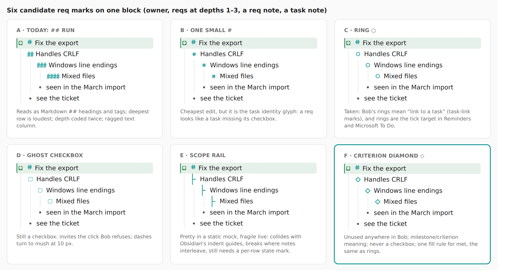

# Task requirement display redesign: the criterion diamond

> **Research query:** The task reqs feature (`bob-cli-on`) is going in the right
> direction, but presenting reqs in Obsidian and in the capture panel as `##`, `###`, and
> so on looks bad. Once the epic's work is complete, change how reqs are displayed
> without changing how they behave. Lead the design so it is intuitive, reliable, and
> beautiful. Research the best UX, critique the plan, make and clearly flag any justified
> requirement adjustments, and end with a recommended solution.

_Figure 1. The same bytes rendered both ways (mockup, light theme). Left: the hash run
that ships today. Right: the proposed criterion diamond. Nothing in the file changes._

## Bottom line

**Yes, do it. Make every requirement wear one small hollow diamond, `◇`.** It replaces
the `[ ]` checkbox in the owner's ink and is the same at every depth. Indentation already
shows depth. The diamond's shape shows state:

- **◇ hollow:** pending.
- **◆ filled:** met.
- **Slashed diamond:** dropped.
- **→ arrow:** carried into its own task.
- **Faded hollow:** moot or excluded.

The diamond extends a rule Bob already follows. Bob's task-link marks are built on
*"identity by shape, state by fill"* and *"rings, not checkboxes"* (`docs/task-link-marks.md`).
The diamond adds one more shape to that system:

- a **square** is a task;
- a **ring** is a link to a task;
- a **diamond** is a requirement;
- a **dot** is a note.

`◇` appears nowhere in bob-cli, bob-plugins, or Bob Mac Capture today, so it collides
with nothing.

The change is small and low-risk because the epic already did the hard part:

- **Obsidian.** The plugin already puts `data-bob-req-state` and `data-bob-req-depth` on
  every req line. The new look is almost entirely a `styles.css` change.
- **Mac.** The change is one overlay view in Bob Mac Capture.
- **bob-cli.** The change is one helper (`req_run`) plus a few strings.

**One timing adjustment.** Make the design decision **now** and ship it after the epic,
as you asked. Three in-flight phases are building the `⌗⌗` run into brand-new cards and
wire values:

- `bob-cli-on.8`: the close-engine vectors;
- `bob-cli-on.11`: the Obsidian card;
- `bob-cli-on.15`: the Mac Pull-In card.

Each week of waiting adds more `⌗⌗` to unwind. If you agree, the next agent can route the
glyph through one token per host so the later swap is one line (see
[Adjusted requirements](#adjusted-requirements)).

## Contents

- [What ships today, and why it looks wrong](#what-ships-today-and-why-it-looks-wrong)
- [Critique of the plan](#critique-of-the-plan)
- [Design criteria](#design-criteria)
- [Options considered](#options-considered)
- [The criterion diamond, specified](#the-criterion-diamond-specified)
- [Adjusted requirements](#adjusted-requirements)
- [Delivery](#delivery)
- [Risks and how they are handled](#risks-and-how-they-are-handled)
- [Side findings](#side-findings)
- [Open questions for Bryan](#open-questions-for-bryan)
- [Evidence and sources](#evidence-and-sources)
- [Recommended solution](#recommended-solution)

## What ships today, and why it looks wrong

### What is on screen

| Surface | What draws the req | Evidence |
| --- | --- | --- |
| Obsidian (Live Preview and Reading view) | The checkbox `input` becomes a CSS mask of 2, 3, or 4 slanted hashes. It is `calc(count × 0.5em)` wide (1em, 1.5em, or 2em), in the owner's type ink. | bob-plugins `plugins/bob-ledger-tools/styles.css` (`--bob-req-glyph`, `--bob-req-count`); `src/264-plugin-task-reqs.js` |
| Bob Mac Capture draft | A SwiftUI `Text(String(repeating: "⌗", count: min(depth, 3) + 1))` in 11-pt system monospace and **neutral grey**. It is centered over the four `[ ] ` cells, after the visible `- `. | bob-mac-capture `Sources/BobMacCapture/CapturePanelView.swift` (`RequirementMarkerGlyphOverlay`) |
| bob human output | `⌗⌗ adds 4 requirements to “Ship the exporter” · files 1 note under NOTES` | `src/native/capture/output.rs:1128`; checked with a dry run in a scratch vault |
| Close card JSON (in flight) | `copy.glyph: "⌗⌗"` on the group and a per-row `run: "⌗⌗"`, `"⌗⌗⌗"`, or `"⌗⌗⌗⌗"` | `tests/fixtures/req_close/vectors.json` (34 occurrences); `req_run` in `src/native/task_reqs.rs:784` |
| JS twins | `taskReqRun(depth)` returns the same runs and is exported from three plugins | `195-task-reqs-twin.js` (cycler), `695-…` (nav), `166-…` (Block ID Prompt) |
| Obsidian notice | `⌗⌗ First requirement · filed {n} notes under NOTES` | `task-status-cycler/src/199-req-toggle.js` |

The plan of record (`plan:202611/task_requirements.md`, "Design calls" item 3) chose the
run on purpose. `#task` draws one `⌗`, so a req draws `⌗⌗`: "the same family, one step
down." Depth 3 or more draws `⌗⌗⌗⌗`, so four hashes fill the four cells of `[ ] ` on the
Mac. It also honored your own early wording. In `^micro-tasks` you wrote "These should be
rendered in Obsidian as `##`, `###`, etc...". The cleanup task says "The `[ ]` checkbox
should not be shown, only `##`". Now that it is live, you have filed
`^replace-reqs-hash-hash` ("Replace `##` with something better!"). That is the right
call. A visual idea is cheap to test before it becomes a contract, and this one only
shows its problems on screen.

### Why it looks wrong: six diagnoses

1. **It reads as Markdown.** In a Markdown editor, `##` means "heading level 2" and `#`
   starts a tag. A `##` at the start of a list item looks like unrendered source or a
   broken heading. Obsidian users have read it that way for years, and no tooltip
   undoes that.
2. **The hierarchy is upside down.** The parent task gets one `⌗`, and its deepest req
   gets `⌗⌗⌗⌗`, the heaviest mark on the block. The least important line is the loudest.
3. **Depth is shown twice.** Indentation already says how deep a line is. The run says
   it again, and it stops at four, so depth 3 and depth 9 look the same. The encoding is
   redundant at shallow depths and wrong at deep ones.
4. **The text column is ragged.** The run is 1em, 1.5em, or 2em wide, so req text starts
   0.5–1em further right at each level than a checkbox item's text would. Each nested
   req's text also drifts relative to its own notes.
5. **Shape carries no state.** "Ink never encodes state" is the right rule. But the run
   is the same shape in every state, so in a `done/` archive a met req and a dropped one
   differ only by a strikethrough on the text.
6. **The family link never shows.** The task's `⌗` sits in the *identity slot* after the
   checkbox. The req's run sits in the *checkbox slot*. The eye never compares the two,
   so "same family, one step down" never comes across. What comes across is "heading."

On the Mac it is worse. The run is a literal text character in neutral grey, after a
visible `- `, so a draft row reads `- ## Handles CRLF`, Markdown that looks typed by
mistake. The plan asked for "the owner ink bob reports, or the neutral teal". The phase
shipped grey text instead.

## Critique of the plan

**Is changing only the display a good idea? Yes.** The epic got the hard parts right:

- **Derived met.** Met is computed from the owner's state, never stored.
- **The recognizer.** One structural rule decides what a req is.
- **The zones.** Every child kind has a fixed place in the task block.
- **Carry.** A req can become its own task, leaving a stub behind.
- **The close-card audit.** The successor card reviews pending reqs once, at close.

Rendering is decoupled from all of those. It is attributes and CSS in Obsidian, an
overlay on the Mac, and strings in bob. That makes it the cheapest part of the feature
to redo, and the part that most affects whether you enjoy using it. Requirements are
also new: the vault holds about 39 req lines, all at depth 1, mostly in `done/`. (This
was a quick scan that approximates the recognizer.) Changing the look now costs nobody
any relearning.

**Would I take a different approach?** I keep the scope (display only) and change four
things.

1. **Decide now; ship after the epic.** The run is being built into new surfaces right
   now:
   - the Obsidian successor card (`bob-cli-on.11`);
   - the Mac Pull-In card (`bob-cli-on.15`);
   - the close-engine JSON and RV vectors (`bob-cli-on.8`).

   None of these has shipped. The requirements group's wire format (§12.25) is not yet
   written up in `docs/task-dependencies.md`. Deciding now and routing each host through
   one helper costs almost nothing. Waiting means unwinding fresh `⌗⌗` from three repos
   and a vector file. (ADJ-1)
2. **Treat the glyph as a token, not a contract.** The run is copied into RV vectors,
   three JS twins, and the docs. A display choice ended up in the byte-for-byte contract
   machinery that exists for *behavior*. The requirements group's `copy.glyph` is the
   literal `"⌗⌗"`. Every other group's `glyph` is a semantic token (`hand_off`,
   `relation`, `note_pull`) that each client maps to its own icon. The fix is
   `glyph: "requirement"` plus a Unicode fallback for text-only surfaces, so the next
   look change touches no vectors. (ADJ-2)
3. **Let shape carry state.** Keep "ink never encodes state" and add "shape does." Met,
   dropped, carried, and moot should be readable in grayscale, as the task-link rings
   already are. (ADJ-4)
4. **Retire the deferred `⌗⌗ 2/4` owner chip.** Under derived met nothing is ever "2 of 4
   done" while the owner is open. The count only falls through drops and carries. A
   progress chip would show a ratio that cannot move the way it implies. (ADJ-5)

**What I would not do:**

- **A heavier "Requirements" block under the task**, such as a callout or a boxed list
  with a header. It fights Obsidian's outliner editing, it breaks Live Preview cursor
  reveal, and it makes a light feature look like a form.
- **Colored text or a vertical scope rail instead of a glyph.** Both are covered in
  [Options considered](#options-considered).

## Design criteria

Each criterion below maps to one of your three words. The options are scored against
them.

| # | Criterion | Why it matters here |
| --- | --- | --- |
| C1 | **Means "requirement," not heading, tag, task, or link** | Intuitive: the glyph should explain itself before the tooltip does. |
| C2 | **Does not look clickable** | Intuitive: reqs cannot be ticked, and every tick gesture already refuses. A box or ring invites the click that Bob then refuses. |
| C3 | **Quieter than the owner, a bit louder than a note** | Beautiful: the parent stays the loudest line, and scope outranks prose. |
| C4 | **One width at every depth** | Beautiful: req text lines up at every level, and the outline alone shows depth. |
| C5 | **Shape shows state, grayscale-safe** | Intuitive and accessible: met and dropped can be told apart in `done/`, and color is never the only signal. |
| C6 | **Collides with nothing in Bob's vocabulary** | Reliable: no glyph already used for another meaning. |
| C7 | **Same mark on every surface** | Reliable: the same mark in Obsidian, the Mac draft, both cards, the CLI, and notices, with a Unicode fallback that terminals render. |
| C8 | **Display-only, mostly CSS** | Reliable: no bytes, grammar, spans, or state changes, and the smallest possible diff. |

## Options considered

_Figure 2. Six candidate req marks on one block: an owner task, reqs at depths 1–3, a
note on a req, and a note on the task._

The cell values below are short labels that name each option's failure.

| Option | C1 meaning | C2 not clickable | C3 quieter | C4 one width | C5 shape = state | C6 no collision | C7 every surface | Verdict |
| --- | --- | --- | --- | --- | --- | --- | --- | --- |
| A. Today's `⌗⌗` run | ✗ heading/tag | ✓ | ✗ inverted | ✗ | ✗ | ~ | ~ | Replace |
| B. One small `⌗` | ✗ the task glyph | ✓ | ✓ | ✓ | ✗ | ✗ task identity | ✓ | Reject |
| C. Ring `○` | ~ step | ✗ Reminders and To Do tick target | ✓ | ✓ | ✓ | ✗ **task-link rings** | ✓ | Reject |
| D. Ghost checkbox | ✓ checklist | ✗ it *is* a box | ✓ | ✓ | ✓ | ✗ square = task | ~ dashes blur when small | Reject |
| E. Scope rail | ✓ belongs to | ✓ | ✓ | ✓ | ✗ needs a glyph too | ~ Obsidian indent guides | ✗ terminal, Mac | Reject |
| **F. Criterion diamond `◇`** | **✓ milestone/criterion** | **✓** | **✓** | **✓** | **✓ same rule as rings** | **✓ unused** | **✓ `◇`/`◆` fallback** | **Recommend** |

Notes on the two closest losers:

- **The ring (C)** is the most familiar "sub-step" mark from other apps. In Bob it is
  taken: every link to a task wears a status ring. A carried req's stub *is* such a link,
  so a ring in the slot would put two rings side by side on one line.
- **The scope rail (E)** looks good in a static mockup. Live, it would need per-line
  positioning against Obsidian's own indent guides. It breaks wherever notes interleave
  with reqs, which §3 of the contract allows under a req. It still needs a per-row state
  mark.

**Why a diamond in particular:**

- **The diamond is the established milestone marker.** Project tools draw a checkpoint
  that work must reach as a diamond. That is a close match for "a condition the task
  must satisfy, met when it closes." (Fill conventions vary between tools, so the
  hollow-to-filled rule below is Bob's own and is borrowed from the rings, not from Gantt
  charts.)
- **It sits between Bob's other two shapes.** It is a square turned 45°, so it is no
  longer a checkbox but still kin to one. Reqs began life as `[ ]` boxes, and the eye
  keeps that link.
- **It follows the Bullet Journal rule.** In rapid logging, the bullet's shape says what
  kind of line it is, and the bullet *changes* to record state, for example the dot
  turning into `>` when migrated. Carried `[>]` already follows that, and the diamond
  completes it: the diamond becomes an arrow when its req is carried out.

## The criterion diamond, specified

### Bob's shape grammar

_Figure 3. One shape for each kind of line, and one fill rule for each state. The diamond
row is the only new one._

### Geometry

All marks use a 16×16 viewBox with round joins and caps, in the same stroked family as
the hash, book, and ring.

| Mark | Path | Notes |
| --- | --- | --- |
| Hollow (pending) | `M8 1.7 14.3 8 8 14.3 1.7 8Z`, stroke 1.75, no fill | The half-diagonal (6.3) roughly matches the ring's radius (6.05), so the diamond reads slightly smaller and quieter than a task-link ring. |
| Filled (met) | Same path, filled, stroke 1.75 | Solid. The check knocked out of the ring's "done" disc is unreadable inside a ~9 px diamond, and the CLI's `◆` cannot carry one either. |
| Slashed (dropped) | Hollow plus `M4.4 11.6 11.6 4.4` | The same `/` slash as the cancelled ring (`M5.3 10.7 10.7 5.3`), lengthened to cross both edges. |
| Arrow (carried) | `M2.4 8h10.4M9.2 4.3 12.9 8 9.2 11.7` | The diamond "migrates." The stub's link then shows its own live status ring. |

**Unicode fallback for text surfaces:** `◇` U+25C7 (pending) and `◆` U+25C6 (met). Drop
and carry reuse the existing `⊘` and `→` copy.

### Size, slot, and ink

- **Slot.** The checkbox `input` keeps acting as the mask host, as today. Its width
  becomes a constant **1em** at every depth, with the existing `0.24em` right margin.
  The diamond is masked at **0.92em**, centered. **Depth-1 text does not move at all**:
  today's depth-1 run is also 1em plus 0.24em, and every req in the vault is at depth 1.
  Deeper reqs move 0.5–1em left, into line.
- **Ink.** Keep the owner's hash ink: the owner's type hue, or the task-identity teal.
  The diamond stays visibly part of its owner. Ink still never encodes state.
- **Weight.** A stroke of 1.75/16 at 0.92em draws about a 1.4–1.6 px line, close to the
  ring's 1.9/16 at 0.86em. That puts the diamond below a checkbox's visual weight and
  well above a note bullet's.

### State styling

_Figure 4. Every state in both themes (mockup)._

| State | Glyph | Text | Selector (all of it already exists) |
| --- | --- | --- | --- |
| Pending | ◇ full ink | normal | `[data-bob-req-state="pending"]` |
| Met (owner done, or hand `[x]`) | ◆ at 0.62 opacity | `--text-muted`, **never struck** | `[data-bob-req-state="met"]` |
| Moot (owner cancelled) | ◇ at 0.42 opacity | muted | `[data-bob-req-state="moot"]` |
| Dropped | slashed ◇ at 0.55 opacity | muted and struck; its Cancel Log shows beneath | `[data-bob-req-state="dropped"]` |
| Excluded (an ancestor was dropped or carried) | ◇ at 0.42 opacity | muted, not struck; tooltip `goes with “{ancestor}”` | `[data-bob-req-state="excluded"]` |
| Carried | → full ink | the stub's wikilink with its live task-link ring | `[data-bob-req-state="carried"]` (drop today's trailing `::after` arrow) |
| Flagged (any other mark, pending) | ◇ in the repair orange the tag marks already use | normal | `[data-bob-req-state="pending"]:not([data-task=" "])`, which reads Obsidian's own `data-task` |

**Two display fixes ride along; neither changes behavior:**

1. **Neutralize the vault's status tints on every req row, not only `[-]`.** Today's
   override covers just the grey cancelled bar. A flagged `[?]`, `[*]`, or `[/]` req
   would still get the red Blocked, green Next, or amber In Progress lane gradient from
   `task-statuses.css`. That tells you a req has a lane, which the contract says it
   never does. Widen the existing rule to
   `.HyperMD-task-line[data-bob-req="true"]:is([data-task="/"],[data-task="*"],[data-task="?"],[data-task="-"])`
   and the matching `li` selectors.
2. **Make both kinds of met look the same.** Obsidian strikes `[x]` lines in Live
   Preview, so a legacy hand-ticked req is struck while a derived-met req is not. In a
   `done/` archive the two would differ for no reason. Set
   `--checklist-done-decoration: none` on `[data-bob-req][data-task="x"]` and
   `[data-task="X"]`.

### Interaction and copy

- **Unchanged:**
  - `pointer-events: none` on the glyph;
  - the cursor reveal of the raw `- [ ] `;
  - the tag-marks session toggle that restores native checkboxes;
  - Reading view through the same attributes.
- **Tooltip.** First line: `Requirement of “{Owner}” · {state}`. Add ` · level {d}` only
  when d ≥ 2, so the exact depth stays available even though the glyph no longer shows
  it. Second line: the teaching copy, unchanged. A new third line names the keys:
  `Alt+[ drop · Ctrl+Shift+T own task`. As with the tag-mark tooltips, no string may
  contain `::`.
- **Accessibility.** The aria label equals the tooltip, unchanged. Masks follow the
  task-tag pattern with `print-color-adjust: exact`. Add one rule for
  `@media (forced-colors: active)`: `background-color: CanvasText;`
  `forced-color-adjust: none`. Without it, a mask drawn with `background-color` vanishes
  in Windows High Contrast. The day-strip styles already handle forced colors.

### Bob Mac Capture

![Three dark Mac capture drafts in a monospace font. Left: raw bytes with [ ] markers. Middle: today's grey hash runs over [ ]. Right: one teal hollow diamond centered over each [ ].](task_req_display_redesign__cld_assets/mac_capture_draft.png)

_Figure 5. The capture draft (mockup): raw bytes, today's overlay, and the proposed
overlay._

- **Draft overlay.** Replace the `Text("⌗…")` with a SwiftUI `Shape` that has the same
  four normalized vertices as the CSS path. A custom shape keeps the Mac pixel-identical
  to Obsidian and depends on no SF Symbol name.
  - **Size and position.** About 0.8× the line height, centered over the three `[ ]`
    cells. The trailing space cell stays empty.
  - **Ink.** The task-identity teal, which is what the plan intended. The current draft
    has no owner hue to use. An optional additive `hue` on `req_marker` spans could add
    one later.
  - **Unchanged:**
    - drafts only ever contain pending reqs, because pre-checked ones are refused, so
      only `◇` is needed;
    - the caret-adjacent raw reveal;
    - `expand_req_marker`;
    - atomic Backspace;
    - the `req_marker` span and its `depth`.
- **Pull-In card rows** (`bob-cli-on.15`, in flight). Draw the same `Shape`, chosen from
  `req.state`. Indent by `req.depth` at a fixed step per level. Ignore `run` text. Bob
  already sends `state` and `depth` on every row.

### Successor cards (Obsidian and Mac)

_Figure 6. The requirements group on the successor card (mockup). Layout, keys, and copy
follow contract §7; only the glyph is new._

- **Rows.** A diamond before each row's text, indented by depth, unchanged otherwise.
  Card rows are a flat list, so indentation alone shows the branch; the glyph should not
  show it a second time.
- **Header.** A hollow diamond in the group-glyph slot, mapped from
  `copy.glyph: "requirement"` the same way `relation` maps to Obsidian `link-2` and Mac
  `link`.
- **Footer summary.** `reqs ◆2 ⊘1 →1` instead of `reqs ✓2 ⊘1 →1`. The filled diamond
  *is* "met" in this language. Either is fine; the diamond ties the summary back to the
  rows.
- **Obsidian card plumbing.** The card plugins (nav and cycler) render a
  `span.bob-req-mark[data-state]` whose text is the Unicode fallback. When ledger-tools'
  styles are loaded, they hide the text (`color: transparent`) and draw the mask in
  `::before`, the same way the `#task` tag mark keeps its text in the DOM. The card
  stays readable if ledger-tools is off.

### bob-cli strings and wire values

| Where | Today | Proposed |
| --- | --- | --- |
| `bob capture` summary | `⌗⌗ adds 4 requirements to “S” · files 1 note under NOTES` | `◇ adds 4 requirements to “S” · files 1 note under NOTES` |
| Close receipt (no flags) | `⌗⌗ {n} requirements met with “{S}”` | `◆ {n} requirements met with “{S}”` |
| `bob task split` preview | `styler.cyan(req_run(depth))` | `styler.cyan("◇")` |
| Obsidian Ctrl+] notice | `⌗⌗ First requirement · filed {n} notes under NOTES` | `◇ First requirement · filed {n} notes under NOTES` |
| `pull_in.groups[].copy.glyph` (requirements) | `"⌗⌗"` | `"requirement"`, a semantic token like `relation` and `note_pull` |
| Row `run` | `"⌗⌗"`, `"⌗⌗⌗"`, `"⌗⌗⌗⌗"` | `"◇"` at every depth, kept as a text fallback; rich clients draw from `req.state` |

`req_run(depth)` becomes `req_glyph(state)` (Unicode fallback). `taskReqRun` becomes
`taskReqGlyph` in all three twins. The RV vectors change only in these display strings.
No key, shape, or schema changes, so this is a display change, not a contract break: no
`!` in the commit subject, but each phase's commit message should mention the new
strings.

## Adjusted requirements

Every place this report departs from your request or from the accepted plan:

| # | Adjustment | Instead of | Why |
| --- | --- | --- | --- |
| **ADJ-1** | **Decide now; ship after the epic.** Record the decision and let the in-flight card phases (`.8`, `.11`, `.15`) draw through one per-host helper (`req_glyph` / `taskReqGlyph` / one Swift `Shape`). | "Once the work … is complete, change the way that we display task reqs" | None of the card surfaces has shipped, and §12.25 is unwritten. Deciding late means unwinding fresh `⌗⌗` from three repos plus the RV vectors. |
| **ADJ-2** | **"Without changing behavior" means display-only, but it still touches copy strings and two JSON display values** (`copy.glyph`, row `run`) and their vectors. Writes, spans, grammar, recognizer, states, keys, and JSON keys do not change. | A literal "no contract-visible change at all" | The run is in human output and vectors. Pretending otherwise would leave `⌗⌗` in the CLI and on the Mac card. Using a semantic `copy.glyph` token also fixes a small inconsistency with every other group. |
| **ADJ-3** | **The glyph no longer encodes depth.** Indentation does; the tooltip and aria label keep the exact level. | Plan design call 3 ("the hash run is capped at four") | Depth was shown twice, and wrongly past 4. One width keeps the text column straight. |
| **ADJ-4** | **Shape encodes state** (◇ ◆, slashed ◇, →, faded). Ink still never does. | Contract §4: the "run" is the same in every state, with only opacity and text styling | Met and dropped must be distinguishable in `done/` and in grayscale. Bob's task-link rings already work this way. |
| **ADJ-5** | **Retire the deferred owner-line `⌗⌗ 2/4` chip.** | Plan §10, deferred polish | Under derived met, a pending ratio cannot progress while the owner is open, so a progress chip misleads. |
| **ADJ-6** | **Fold in two display-only fixes:** status-tint neutralization on every req row, and the same met styling for hand-ticked `[x]`. | Override only for the `[-]` grey bar | These cases are rare now (the vault has 9 `[x]` reqs), but each makes a req look like it has a lane or a different state. |
| **ADJ-7** | **The Mac draws a vector shape in teal**, not a grey text glyph. | What `mac-authoring` shipped (the plan had asked for owner or teal ink) | It matches Obsidian, avoids font fallback for `⌗`/`◇` in SF Mono, and stops the draft from looking like typed Markdown. |

Not adjusted, but recommended next: **`^no-all-caps-for-drawers`**. Each first-req scoop
creates an ALL-CAPS `NOTES` header right under the new quiet diamonds, so the loudest
line in a req-owning block will be a drawer title. It is out of scope here (a separate
task, and a drawer change rather than a req change). It is the obvious next step for
"beautiful."

## Delivery

One small follow-up plan with four phases, after `bob-cli-on` lands. ADJ-1 asks only
that the in-flight phases use one helper per host.

1. **`req-diamond-cli` (bob-cli, small).**
   - Code and output: `req_run` → `req_glyph(state)`; the four human strings;
     `copy.glyph: "requirement"`; the `run` fallback `◇`; RV vector string updates.
   - Docs:
     - `docs/task-requirements.md`: the intro line, §4 Rendering rewritten from this
       report's spec, and the §5 notice copy;
     - `docs/task-tag-marks.md`: its `⌗⌗ Pack charger` example;
     - the §12.25 glyph token in `docs/task-dependencies.md`.
   - Then `just docs-gen` and `just docs-check`.
2. **`req-diamond-obsidian` (bob-plugins, small).**
   - `styles.css`:
     - four masks, defined once on `body` (`--bob-req-glyph-pending`, `-met`,
       `-dropped`, `-carried`);
     - delete the depth→count map;
     - the constant 1em slot;
     - the per-state rules above;
     - the widened tint override;
     - the `[x]` normalization;
     - forced colors.
   - JS: the three twins' `taskReqGlyph`, the Ctrl+] notice, the tooltip line, and the
     card `span.bob-req-mark`.
   - Ship: `npm test`, the real-Obsidian e2e task-reqs scenarios (`7b96dced`), then
     `bob plugins sync -p` for each changed plugin.
3. **`req-diamond-mac` (bob-mac-capture, small).**
   - The overlay `Shape`, and Pull-In card rows drawn from `req.state` and `depth`.
   - Mounted docs: `capture-panel.md` and `protocol.md`.
   - Gate: `just portable-check`, `Scripts/macos-ci-check`, then the exact-SHA macOS
     run to green.
4. **`req-diamond-memory` (needs your approval).**
   - Update the `glossary:task-requirement` strand that `bob-cli-on.17` is writing (its
     plan text says "the ⌗ run").
   - Add one decision record, e.g. *"Requirements wear the criterion diamond"*. It
     marks the rendering part of the `bob-cli-on` decision record (written by `.17`) as
     partly superseded, if that record names the run.

**Acceptance checks:**

- **Obsidian, live:**
  - no line in the vault changes;
  - depth-1 req text does not move;
  - req text at depths 1–4 starts at the same offset from its bullet column;
  - a hand-ticked `[x]` and a derived-met req render the same;
  - a `[?]` req carries no red lane tint.
- **Card and terminal:**
  - every state is identifiable in a grayscale screenshot;
  - the card renders with ledger-tools disabled (text fallback);
  - `bob capture` and receipts print `◇`/`◆` in a plain terminal.

## Risks and how they are handled

| Risk | Handling |
| --- | --- |
| `◇` is missing from a terminal or SF Mono font | Rich surfaces draw vectors. Only plain text uses Unicode, and U+25C7/U+25C6 are in the Geometric Shapes block that common terminal fonts cover; macOS falls back automatically. |
| The diamond is mistaken for a bullet style | Obsidian draws note bullets as filled dots and never as diamonds. The owner ink, the tooltip, and the zone position (after the links, before the drawers) all disambiguate. |
| Too subtle next to busy task lines | The diamond keeps owner ink at full strength while pending and is about as heavy as a task-link ring. If it reads too quiet in real use, the one knob is the mask size (0.92em → 1em), not a louder shape. |
| Twin drift during the swap | The swap is one constant per host, and the RV string updates land in the same change as the twins, as with any vector edit today. |
| Changing a shipped look again | Nothing outside the epic depends on the run, and only about 39 req lines exist. ADJ-2's semantic token makes any later change CSS-only. |

## Side findings

These came up while researching, outside the requested scope:

1. **The capture preview shows the authored layout, not what gets written.**
   - **Reproduction.** In a scratch vault, dry-run
     `Ship the exporter @work` / `- [ ] Handles supported inputs` /
     `  - [ ] Handles Windows files` / `- Morgan reported it`.
   - **Human output.** The block lists `- Morgan reported it` as a loose child, while
     the summary says `· files 1 note under NOTES`.
   - **JSON.** `sub_bullets` likewise carries `\t- Morgan reported it` with no `NOTES`
     line.
   - **The real write.** The note does land under `NOTES`, so the Mac preview stack,
     which renders the dry run, shows a block that differs from what gets written.
   - **Status.** Observed with the installed `bob 0.5.0`, built 2026-11-22 02:24. No
     later master commit touches that preview path, so it likely still reproduces on
     master. Worth a bug bead. A good fix would also give preview children a `kind`
     (`req`/`note`/`drawer`), so the preview stack can draw the diamond instead of raw
     `[ ]`.
2. **The Mac overlay shipped grey text, not the planned ink.** The `mac-authoring` plan
   called for "the owner ink bob reports, or the neutral teal". The shipped
   `RequirementMarkerGlyphOverlay` uses `CaptureEditorPalette .neutral` text. ADJ-7
   fixes it either way.
3. **Contract §4 promises more than the CSS does.** §4 says Met/Moot take "the owner's
   done or cancelled line treatment". The shipped CSS only mutes the text color.
   Harmless, but the §4 rewrite should state what is actually drawn.

## Open questions for Bryan

1. **The diamond itself.** Approve `◇` (recommended) over the ring, the ghost box, and
   the single hash in Figure 2?
2. **Met fill.** Solid `◆` (recommended: crisp at 9 px and identical in the CLI), or the
   ring-style check knocked out of the fill (slightly more explicit, but unreadable at
   Obsidian sizes)?
3. **ADJ-1 timing.** May the next agent ask the in-flight `.8`, `.11`, and `.15`
   workers to draw through one helper now, so the swap later is a one-liner?
4. **Memory.** Approve updating `glossary:task-requirement` and adding the new decision
   record when the follow-up lands?

## Evidence and sources

**Code and docs read (bob-cli master `b7945e75`; bob-plugins `9b4bc2ca`; bob-mac-capture
`8562f811`):**

- **Contract and plan:**
  - `docs/task-requirements.md` §§1–7, 10;
  - `plan:202611/task_requirements.md`: design call 3, §4, §10, and the `ledger-marks`,
    `mac-authoring`, and `mac-close-card` phases;
  - the `bob-cli-on` epic bead and its notes.
- **The vocabulary the diamond joins:**
  - `docs/task-tag-marks.md`: the hash, book, PRE/POST, and project glyphs, and the
    identity slot;
  - `docs/task-link-marks.md`: the ring family, "identity by shape, state by fill,"
    "rings, not checkboxes";
  - `docs/task-dependencies.md`: the `copy.glyph` token enum;
  - `docs/capture.md`: requirement bullets and the `req_marker` span.
- **Obsidian:**
  - bob-plugins `plugins/bob-ledger-tools/styles.css` (req section);
  - `src/264-plugin-task-reqs.js`;
  - `src/139-task-reqs.js`;
  - `taskReqRun` in the cycler, nav, and Block ID Prompt twins;
  - `task-status-cycler/src/199-req-toggle.js`.
- **Mac:** bob-mac-capture `CapturePanelView.swift` (`RequirementMarkerGlyphOverlay`)
  and `CapturePanelModel.requirementMarkerSpans()`.
- **bob-cli:**
  - `src/native/task_reqs.rs` (`req_run`);
  - `src/native/capture/output.rs`;
  - `src/native/task_complete/req_close.rs`;
  - `tests/fixtures/req_close/vectors.json`.
- **Vault:**
  - `~/bob/.obsidian/snippets/task-statuses.css`;
  - `~/bob/bob.md` (`^micro-tasks`, `^replace-reqs-hash-hash`);
  - an approximate requirement scan over 5,838 notes (39 req lines, all depth 1: 21
    `[ ]`, 9 `[-]`, 9 `[x]`).
- **Glyph collision survey:** counts of `◇ ◆ ○ ● ◦ ◌ ▸ › ✦ □ ■ ◎ ◉ ☐` and others across
  bob-cli docs and src, bob-plugins src and styles, and the Mac `Sources/`. `◇` has zero
  uses; `◆` appears only as the default-Pomodoro marker in two CLI listings
  (`capture_pomodoros`, `ref today`), a different context.
- **Prior research (Bob):**
  - `research:202611/task_reqs_design/task_reqs_design.md`: the origin of the `⌗⌗`
    choice and your verbatim cleanup bullets.
- **Mockups:** Figures 1–6 are HTML/CSS mockups rendered with headless Chromium. They
  use the shipped masks for today's run, the hash, and the rings, and DejaVu fonts stand
  in for Obsidian's. Emoji on the managed lines are omitted. The generator is in
  `task_req_display_redesign__cld_assets/mockup_generator.py`.

**External:**

- Bullet Journal rapid logging (a bullet's shape is its type and changes to record its
  state; `>` means migrated):
  [bulletjournal.com — rapid logging bullets and signifiers](https://bulletjournal.com/blogs/faq/what-is-rapid-logging-understand-rapid-logging-bullets-and-signifiers),
  [The Week — How to Bullet Journal](https://theweek.com/73607/how-to-bullet-journal-new-method-will-revamp-your-to-do-list).
- The diamond as the standard milestone marker, with tool-specific fill conventions:
  [Celoxis — milestones](https://www.celoxis.com/kb/latest/tasks/concepts/milestones),
  [Edraw — what is a milestone in a Gantt chart](https://www.edrawsoft.com/project/what-is-milestone-in-gantt-chart.html),
  [Smartsheet community — hollow vs filled milestone diamonds](https://community.smartsheet.com/discussion/118930/gantt-chart-milestones).
- Obsidian's "alternate checkbox" convention: a glyph inside the square means a task
  status in themes such as Minimal, which is why squares stay "task" in Bob:
  [Obsidian forum — alternate checkboxes in Minimal](https://forum.obsidian.md/t/how-to-implement-alternate-checkboxes-using-minimal-theme/80300),
  [SlRvb's alternate checkboxes (Tasks docs)](https://publish.obsidian.md/tasks/Reference/Status+Collections/SlRvb's+Alternate+Checkboxes).

## Recommended solution

**Ship the criterion diamond as a small, display-only follow-up to `bob-cli-on`, and
decide it now.**

1. **One shape, constant width.** Every req draws a small diamond in the checkbox slot,
   0.92em wide, in a constant 1em slot, at every depth, in the owner's ink. Indentation
   alone shows depth. The tooltip keeps the exact level.
2. **Shape shows state, using the ring family's rule.**
   - ◇ hollow: pending.
   - ◆ filled: met, derived or hand-ticked, never struck.
   - Slashed ◇: dropped, with struck text and the Cancel Log beneath.
   - →: carried, followed by the stub link's own live ring.
   - Faded ◇: moot or excluded.
   - Orange ◇: a flagged unknown mark.
3. **The same mark everywhere:**
   - Obsidian Live Preview and Reading view, through masks keyed on the
     `data-bob-req-state` the plugin already emits (almost entirely a `styles.css`
     change);
   - the Mac draft and Pull-In card, through one SwiftUI `Shape` in teal;
   - both successor cards, through a `copy.glyph: "requirement"` token;
   - bob's human output and notices, through `◇`/`◆` text.
4. **Two reliability fixes in the same change:** no lane tints on any req row, and one
   met style for hand-ticked `[x]`.
5. **Process:**
   - Have the in-flight card phases draw through one helper per host (ADJ-1).
   - Retire the `2/4` chip (ADJ-5).
   - Take `^no-all-caps-for-drawers` next, so the `NOTES` header becomes as quiet as the
     reqs above it.

The result:

- **Intuitive:** a requirement no longer looks like a heading, a tag, a task, or a
  checkbox. Its shape follows the same rule as Bob's other marks.
- **Reliable:** no byte, grammar, state, or key changes. The glyph becomes a token
  rather than a contract, and two latent mis-stylings are fixed.
- **Beautiful:** the parent task becomes the loudest line again, the text column
  straightens, and a `done/` archive shows what was met, dropped, and carried at a
  glance.
