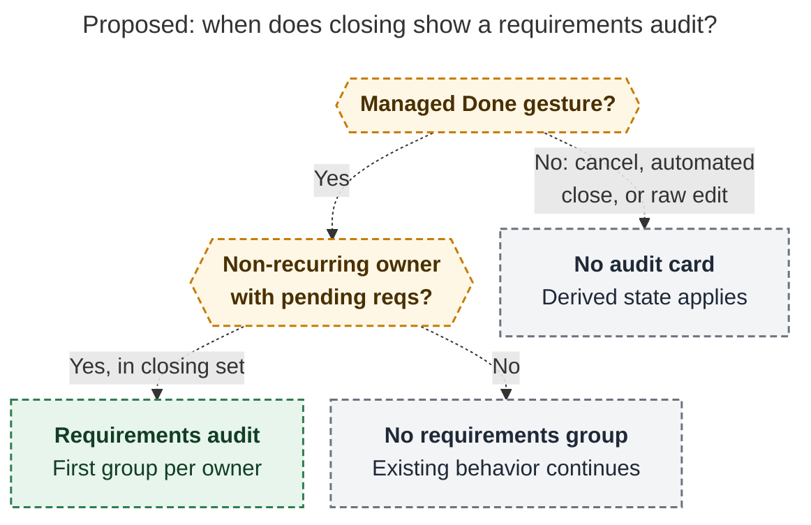
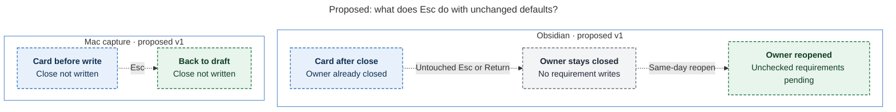
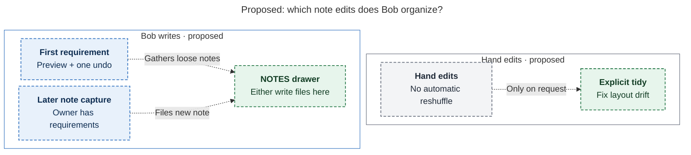

# Diagram proposals: Task requirements for Bob: consolidated design and recommendation

Proposals for the swarm linker, not a report. Each diagram restates only what the source
report says.

```yaml
source: research:202611/task_reqs_design/task_reqs_design__final.md
producer: research.5p.image
check: "mmdc 12.0.0 with the PDF-mirroring config rendered 3 of 3 Mermaid diagrams; pinned CLI, Puppeteer --no-sandbox"
```

## audit-trigger

```yaml
anchor: |-
  with pending reqs; the req group alone suffices to open the card and is placed first
question: |-
  When does closing a task show a requirements audit?
illustrates: |-
  A managed Done gesture adds a requirements group first per eligible owner, while cancelled, automated, raw, recurring, and req-less cases follow the bypass branches.
caption: Only managed Done with a non-recurring owner and pending requirements adds an audit group; bypass closes rely on derived state.
review: "638.078×658 px, fit 100.0%; question, source trace, labels, arrowheads, crossings, and visual checks passed; 1 revision, 2 looks"
```



## escape-timing

```yaml
anchor: |-
  defaults write nothing, so Esc and Return produce identical req outcomes, only explicit
question: |-
  What does Esc with untouched defaults leave behind in Obsidian and Mac capture?
illustrates: |-
  Obsidian keeps the post-close card and same-day reopen, while Mac capture keeps the pre-write card and Esc-returns-to-draft.
caption: With untouched defaults, Obsidian’s Esc leaves the owner closed; Mac capture’s Esc returns to the draft before writing.
review: "584.688×529 px, fit 100.0%; question, source trace, labels, arrowheads, crossings, and visual checks passed; 1 revision, 2 looks"
```



## notes-write-boundary

```yaml
anchor: |-
  one-undo write; later note captures to a req-owning task file into the drawer
question: |-
  Which actions organize notes automatically, and which leave hand edits alone?
illustrates: |-
  The first-req gesture gathers loose notes and later note captures file into NOTES, while hand edits stay in place until an explicit tidy.
caption: Bob organizes notes during first-req and later capture writes; hand edits wait for explicit tidy.
review: "748×469 px, fit 87.3%; question, source trace, labels, arrowheads, crossings, and visual checks passed; 1 revision, 2 looks"
```


