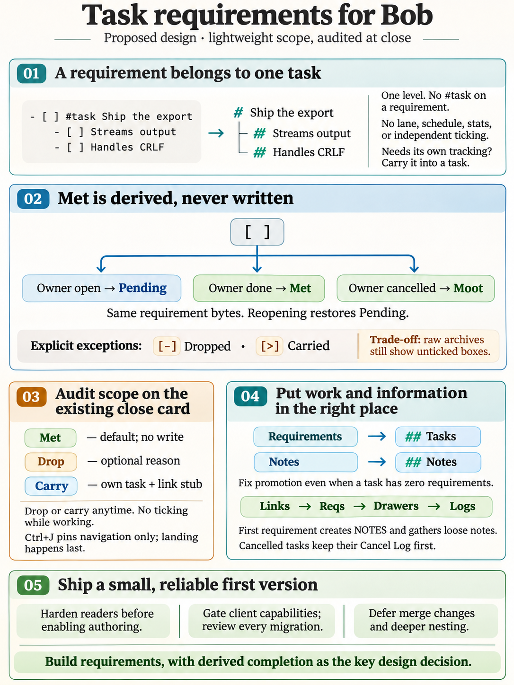
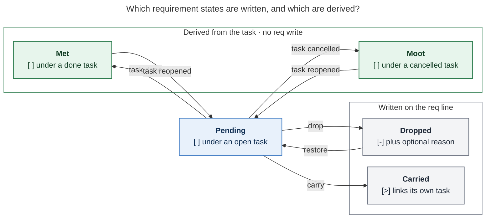
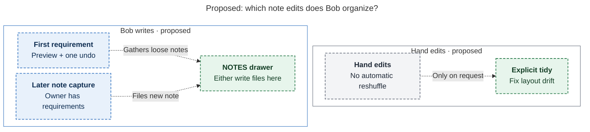
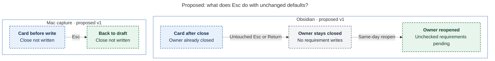
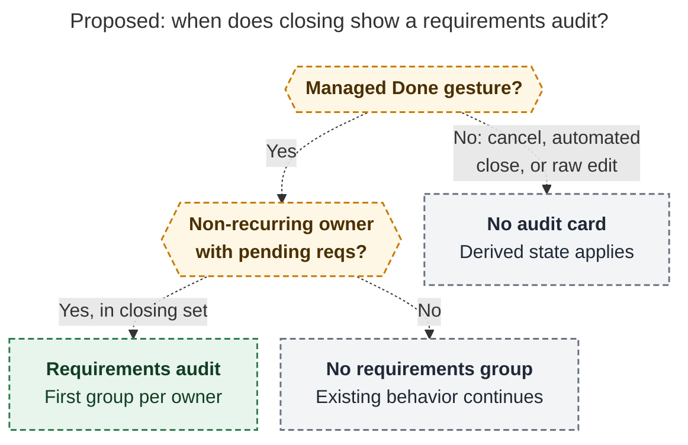
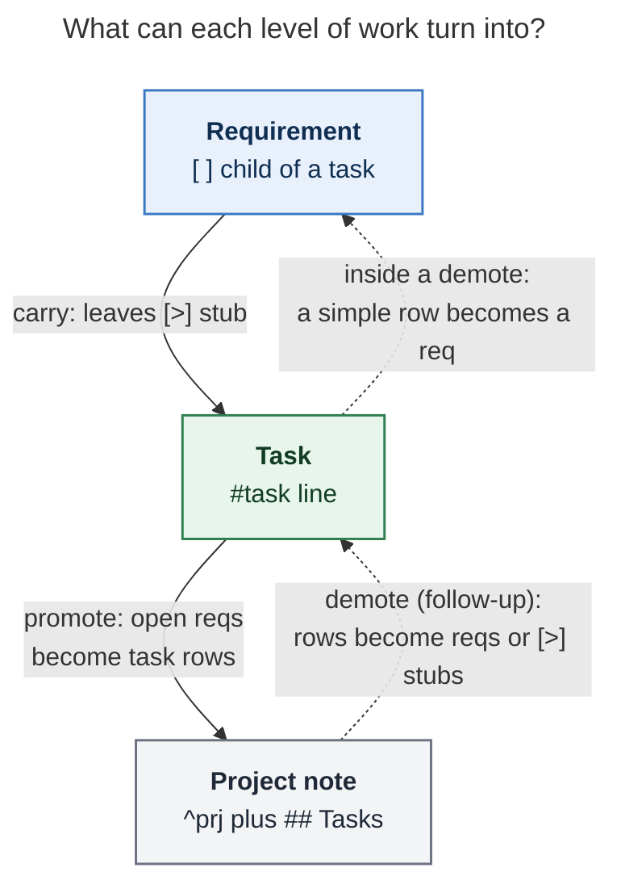

# Task requirements for Bob: consolidated design and recommendation

> **Research query:** How should bob support sub-tasks, first planned as "micro tasks" under the canceled `bob-cli-of` epic, in light of the `^micro-tasks-cleanup` task and the tasks that `^micro-tasks` depends on in `~/bob/bob.md`? Is it a good idea, what would you do differently, which requirement adjustments are justified (called out clearly), and what intuitive, reliable, and beautiful solution do you recommend?



## Bottom line

**Build it — but as the cleanup cluster describes it, not as the canceled epic built
it.** All five researchers independently reached the same verdict: canceling
`bob-cli-of` was right, and the [`^micro-tasks-cleanup` revision](#what-bryan-actually-asked-for) is the better species.
Ship **task requirements** ("reqs"): one level of checkbox children (`- [ ]`, no
`#task`) under a `#task` line, drawn as a quiet `⌗⌗` in the owner's ink with the
checkbox hidden, impossible to tick by hand, audited on the existing [successor card](#the-close-card) when
the owner closes, filed above drawers and below links, with a `NOTES` drawer appearing
once a task has reqs, typed as `- [<space>` → `- [ ] ` with an atomic Backspace, and a
[promotion mapping](#promotion-and-the-project-round-trip) that finally sends work to `## Tasks` and prose to `## Notes`.

Where the five reports disagreed, the rulings (argued in [Disagreements and rulings](#disagreements-and-rulings)):

1. **[Name](#name):** *task requirement / req* — Bryan's own words, and the semantics match.
2. **[Storage](#storage):** checkbox bytes, never a stored `##` and never a new inline field.
3. **[Completion](#completion-model):** **met is derived, never written** (cld's model). Bob writes only
   dropped `[-]` and carried `[>]`; a pending req under a done task *is* met. This is
   the one load-bearing **[ADJUSTMENT](#adjusted-requirements)** and the biggest reliability win on the table.
4. **Ticking while working:** refused, per Bryan's rule (mus's tick-anytime dissent
   rejected; its rubber-stamp concern is mitigated, not ignored).
5. **[`NOTES` drawer](#notes-drawer):** auto-created on the first req, scooping loose notes in that same
   previewed write (mus's dissent rejected; Bryan asked for this).
6. **[`..` alias](#capture-alias):** dropped in favor of `- [<space>` expansion, per Bryan (mus's
   keep-both dissent rejected).
7. **[Ctrl+J](#jump-pin):** stays **navigation-only**, as the accepted decision record states
   verbatim; a pin lands on the carried task when the row's verdict creates one. The
   one-key "jump implies carry" variant (grk, cld) would reopen an accepted decision.
8. **[Merge-writes-a-req](#merge):** deferred out of v1 (3/5 wanted it; nothing in the cleanup
   asks for it, and it has an unresolved flattening edge).

## Is this a good idea

**Yes.** Three wins, in order of value, each independently reached by multiple
researchers:

1. **Promotion becomes correct.** With an explicit marker, reqs become `## Tasks` rows
   and notes become `## Notes`. Today's converter is wrong for the majority of loose
   children. This alone justifies the feature — and the notes-to-`## Notes` half should
   ship **even for tasks with zero reqs** (grk), because it fixes the live bug for every
   existing noted task without waiting for anyone to type a req.
2. **Closing becomes an honest audit.** A task's committed scope gets one look at the
   moment it is called done; anything unmet is dropped with a reason or carried into its
   own task. The card already exists — this is a new group on it, not a new panel.
3. **Tasks, reqs, and projects become one closed family.** A req carries out into a
   task; a task promotes into a project; a project later demotes back into a task whose
   simple rows become reqs. Every dependent of `^micro-tasks` becomes a small,
   well-defined follow-up instead of a new concept ([Downstream tasks made small](#downstream-tasks-made-small)).

**Honest costs** (kept, not papered over):

- **Ceremony.** Every managed Done on a task with pending reqs opens a card. Contained:
  default is Met, Esc ≡ Return (defaults write nothing), the group appears only when
  pending reqs exist, and req-less tasks behave exactly as today.
- **Rubber-stamp risk.** This is the real price of Bryan's no-ticking rule, and mus is
  right that it exists: with no tick-while-working, a long task's close card lists every
  req defaulted to Met. Mitigations: drop (`[-]`) and carry (split) are available *any
  time*, not just at close; the group leads the card with a visible count; and reopen
  is free under derived met. **Reopens-when test (cdx):** if Bryan repeatedly wishes he
  could tick reqs early, revisit the semantics — do not add hidden exceptions.
- **A second task system** is the failure mode. Contained by a hard line: a req never
  has `#task`, `[created::]`, lane, freshness, priority, schedule, dependencies, Task
  Links, walk rows, Ready-cap membership, Today membership, or stats. The moment it
  needs any of those, it becomes a task (carry).
- **Plugin-less rendering** of a req is an ordinary Markdown checklist item — an
  acceptable fallback and the reason not to invent new syntax. Under derived met, a
  done task's archive shows unticked boxes when viewed raw ([Completion model](#completion-model)).

**Alternatives the swarm examined and rejected** (unanimous or near-unanimous):
`TASK:`/`ALSO:` prefixes (drawer-title collision, reserved `TASKS` one letter away);
stored literal `- ##` (ATX chrome inside a list, outline pollution, no state slot,
survives capture as a note, desyncs from split); nested `#task` children as the feature
(full lane/walk/freshness weight — the heavyweight species the vault already avoids);
remaining work as Depends-On tasks (pollutes lanes and the walk); a `REQUIREMENTS`
drawer holding the reqs (buries the contract a level down; collides with the live
drawer); inferring reqs from `!` endings (wrong about as often as right); Things-style
tickable checklists (the canceled epic's species); only fixing promotion (cheapest, but
no audit and no round-trip shape — do the promotion fix *as part of* reqs, not instead).

External precedents (species, not imports): Things keeps checklist steps inside a to-do
and out of Today; Bullet Journal's `>` migration mark is exactly carried `[>]`;
org-mode's `org-enforce-todo-checkbox-dependencies` shows the pain of the opposite rule
(parents blocked on checkboxes); Todoist/Linear show first-class subtasks are a
different, heavier species.

## Where all five researchers agree

These points carry the highest confidence.

- Build it; supersede `bob-cli-of`; the cleanup cluster is the right direction.
- **Single level only.** A req's children are plain notes; a checkbox under a req is
  not a req (refused in capture, plain checklist elsewhere). The recognizer may accept
  deeper structure so a future version needs no migration, but v1 never authors it.
- **Render `⌗⌗` in the tag-marks family**, in the owner's ink (type ink included), in
  the checkbox's slot, cursor-revealable, session-toggleable, attribute+CSS only. Never
  store or paint literal ATX `##`.
- **The close-time audit rides the existing successor card** as a per-owner
  requirements group placed first; resolved rows fold to one quiet line; mark-all never
  touches req rows; capture stays all-or-nothing with stale-row refusal; carries apply
  before the stub, drops next, pull-ins after the close, jump landing last.
- **Carry reuses Task Split** (`[>] [[#^id|Alias]]` stub, LINKED FROM back-link, child
  notes travel, trailing `^anchor` reused as the new task's ID). Carry never adds a
  dependency to the old owner (cld A6) — `&`/Ctrl+Shift+B says that explicitly.
- **Promotion maps reqs → `## Tasks` (status preserved), loose notes + `NOTES` →
  one `## Notes`, drawers → sections, logs → `^prj`** — and unmarked children become
  `## Notes` even on zero-req tasks.
- **Child-order invariant** links < reqs < drawers (`NOTES` first) < logs, with the
  existing Cancel-Log-first exception preserved on cancelled tasks; enforced by writers
  plus an explicit previewed tidy, never a silent reorder, never a validity rule.
- **Reader hardening first**; capability gates on every surface; `GRAMMAR_REVISION`
  28 → 29 and release-train `!` marks; Rust is the authority with shared JS vectors;
  Mac stays a thin client; **no silent vault rewrite** — gated, reviewed migration only.

## Disagreements and rulings

### Name

**Ruling (follow Bryan):** task requirement / "req".

cdx, cld, and grk endorse *req*; mus argues *step*; gem argues *sub-task*. Ruling:

- Bryan proposed the name himself and already uses "reqs" in `^better-o`.
- "Sub-task" is **taken**: Bob's close JSON and docs already use `subtasks` /
  `subtasks_left_open` / `open_subtask` for nested and embedded `#task` lines (cld) —
  adopting it would overload a live contract term, and it promises full task semantics
  v1 deliberately withholds.
- "Step" implies ticking in order, which Bryan's rule forbids. "Requirement" matches
  the chosen semantics exactly: met when the owner closes, or explicitly removed from
  scope.
- The real cost — collision with the `REQUIREMENTS` drawer convention (mus, gem) — is
  small (a handful of live drawers) and self-resolving: the migration phase converts or
  retires them, and reqs never live in a drawer. Reserve `Requirement` for headings and
  glossary, `req` for compact UI and flags.

### Storage

**Ruling (4-of-5 majority):** checkbox without `#task`.

cdx alone recommends a non-checkbox marker (`[req:: active]` on a plain bullet), on the
principle that an item that cannot be ticked should not be a toggleable control. The
majority position wins because: Bryan's own [bullets 5+6](#what-bryan-actually-asked-for) presume checkbox bytes; the
checkbox gets split, archive-travel, status-preserving promotion, and Obsidian styling
for free; it degrades to readable Markdown with plugins off; the `[ ]`/`[-]`/`[>]`
states are byte-visible and greppable; and the toggle-control objection is answered in
rendering — the checkbox is hidden, `pointer-events: none`, and every tick gesture is
guarded (see [Rendering](#rendering) and [Authoring](#authoring)). cdx's two durable contributions are kept: the **writer audit** (no
representation makes old clients safe by itself — capability gates are mandatory either
way, and the embedded-tree finding in [Code facts](#code-facts) proves the audit is needed) and the
**pasted-checklist rule** (outside text copied into task children — gcal descriptions, gkeep,
gmail, highlights — must never become reqs by accident; cld A14).

### Completion model

**Ruling (cld — the key ADJUSTMENT):** met is derived, never written.

Three positions: mus allows ticking anytime; grk and gem refuse ticking but have the
close **write** `[x]` on leftover reqs; cld refuses ticking and **never writes `[x]` at
all** — met is derived from the owner's state.

mus's tick-anytime directly contradicts Bryan's bullet 4 and is rejected (its
rubber-stamp evidence is honored in [the critique's mitigations and reopens-when test](#is-this-a-good-idea)).

Between *stamp-at-close* and *derived*, derived wins on the evidence:

- **Every close path is correct by construction.** More than ten paths close tasks —
  capture `x`, Ctrl+Enter, Alt+], gcal past-day sync, collect-done, a Tasks-query
  click, mobile, raw edits. Stamping requires each to know about reqs or leave
  inconsistent bytes; grk and gem *both* fall back to a derived reader rule for
  unmanaged closes anyway — so stamping stores the same fact twice without removing the
  reader rule.
- **The invariant becomes structural.** "Not completed before the parent" cannot be
  violated by a Bob writer because no Bob writer writes req completion, ever.
- **Reopen and undo are free.** Reopening the owner makes its reqs pending again with
  zero writes. grk's worry — reopen "resurrecting settled work" — is re-read as a
  feature: an open task's committed scope is live scope. A hand-written or legacy `[x]`
  still reads as met and is never rewritten, so history imported from collapses stays
  settled.
- **Verified hazard, handled:** the embedded-tree close path (see [Code facts](#code-facts)) can write `[x]`
  onto an anchored req today. Under derived met that write is harmless (reads as met),
  but phase 1 should still guard it so bytes stay canonical.

Accepted costs: raw/GitHub views of `done/` show unticked boxes under done tasks, and
any future outside consumer must apply the owner rule. **Fallback if Bryan rejects
this:** write `[x]` on managed close and have reconcile revert on reopen — at the price
of a second stored form (cld's open question 1). **Reopens when** an outside consumer
that cannot apply the owner rule needs req state.

The resulting state model:

| Bytes | Owner open | Owner done `[x]` | Owner cancelled `[-]` |
| --- | --- | --- | --- |
| `[ ]` | **Pending** | **Met** (derived) | **Moot** (derived) |
| `[-]` + optional ❌ CANCEL LOG child | **Dropped** | Dropped | Dropped |
| `[>] [[note#^id\|Alias]]` | **Carried** | Carried | Carried |
| `[x]` (hand-written or legacy) | reads as Met | Met | Met |
| any other mark | reads as Pending, flagged, never rewritten | | |



*Figure 1. Closing, cancelling, or reopening the task changes what a pending req means
without touching its line; only an explicit drop or carry writes to the req itself.
(Adapted from the cld report; rendered with mermaid-cli 12.0.0 under the PDF config;
766 × 648 px, fit 85.2%.)*

### NOTES drawer

**Ruling (follow Bryan):** for the `NOTES` drawer, auto-create on first req, scoop in the same write.

cld, grk, and gem accept the drawer with a scoop-on-transition rule; mus rejects it
("loose bullets *are* the notes"). Ruling: Bryan asked for it explicitly (bullet 3), and
the transition rule resolves gem's split-brain worry: the gesture that adds a task's
*first* req also files that task's loose notes into `NOTES` in the same previewed,
one-undo write; later note captures to a req-owning task file into the drawer
(`@route+id#notes` keeps working); zero-req tasks keep loose notes untouched (the
majority of tasks see no churn); Obsidian hand edits are never reshuffled beneath the
cursor — tidy fixes drift on request, and `bob task reconcile` never scoops in the
background. mus's strongest point survives as a sequencing note: the ALL-CAPS `NOTES`
header is loud, which is precisely why `^no-all-caps-for-drawers` should land right
after v1 through the single drawer-module seam (gem), so the drawer can be born quieter
(cld's bold-title `**Notes**` proposal is the leading candidate). [The notes-filing diagram](#figure-notes-write-boundary) separates the Bob writes that file notes into `NOTES` — the first-req gesture and later captures — from hand edits, which stay put until an explicit tidy.

<div id="figure-notes-write-boundary">



_Bob organizes notes during first-req and later capture writes; hand edits wait for explicit tidy._

</div>

### Capture alias

**Ruling (follow Bryan):** drop `..`, expand `- [<space>`.

All five accept the `- [<space>` → `- [ ] ` expansion with atomic Backspace; mus alone
would also keep `..`. Ruling: follow the cleanup — hand-typed `[ ] ` is already valid
req syntax under this design, so `..` buys two saved keystrokes at the cost of grammar
surface and its existing collisions (the Mac's fast-double-dot literal escape, sealed
project-note `- .` Move). Drop `Ctrl+G T` from the canceled epic too; the expansion plus
Obsidian's `Ctrl+]` toggle (see [Authoring](#authoring)) cover the need. Backspace removes the whole `[ ] `
whenever the caret sits right after it, not only immediately post-expansion (cld A11) —
the marker renders as one glyph, so it deletes as one.

### Jump pin

**Ruling (the decision record):** Ctrl+J is navigation-only and lands on what the verdict creates.

grk ("extract **and** pin") and cld ("Ctrl+J upgrades the row to carry") make the pin
imply a verdict. The accepted record `decisions:successor-jump-parks-the-walk` says
plainly: *"The pin is navigation only."* A side-effecting pin would reopen that
decision. Ruling (gem's shape, which cdx independently matches):

- Ctrl+J pins/unpins a req row like any offer row — at most one pin per card.
- The **landing resolves to what the final verdicts create**: the newly split `#task`
  line when the row commits as carry or carry+pull-in; the row's final line in the
  owner's note otherwise, with a status-bar hint (`↗ jumps to the closed req — ⌃⇧T
  keeps it as a task`). Staging carry while pinned upgrades the landing without
  re-pinning.
- After all writes land, Bob focuses the landing and parks the `]s` walk, exactly per
  the record.

If Bryan prefers the one-key "jump = carry + pin" ergonomics on req rows, that is a
legitimate choice — but it requires a new decision record superseding the
navigation-only clause, not a quiet exception.

### Close-card keys and Esc

**Ruling (cld, with the cdx/gem refinement named):** polarity-preserving keys; post-close card in v1.

Two traps surfaced. First, the canceled epic made Ctrl+X mean Keep-open on micro rows
while meaning Done on offer rows of the same card; grk's proposal flips the same key the
other way. Ruling: keep **one polarity per key across the whole card** (cld):

| Key on a req row | Verdict | Write |
| --- | --- | --- |
| *(default)* / Ctrl+X | ✓ Met | none |
| Ctrl+Shift+X | ⊘ Drop, inline optional reason (Log Recall) | `[-]` + ❌ CANCEL LOG entry |
| Ctrl+Shift+T | → Own task (carry) | Task Split; `[>]` stub |
| Space / Tab | → Own task + pull in | carry, then link + raise to Next |
| Ctrl+J | jump pin (navigation only) | none |

Ctrl+X keeps its affirm polarity (✓), Ctrl+Shift+X its negative polarity (⊘), and the
carry family gets its own keys. Each key toggles its row back to Met; a different key
replaces the verdict.

Second, Esc. cdx and gem argue the review must precede the close so Esc can abort
("Not done yet"); cld keeps Obsidian's shipped post-close card and makes it safe by
construction. Ruling for v1: **post-close, because derived met makes it harmless** —
defaults write nothing, so Esc and Return produce identical req outcomes, only explicit
verdicts arm the double-Esc guard, and "not done yet" is the existing same-day reopen,
hinted in the card footer. The Mac card already opens pre-write and keeps
Esc-returns-to-draft. gem's pre-close audit (Esc aborts, parent stays open, walk stays) is recorded
as the candidate refinement if lived experience shows reopen-after-Esc is common — it
is a contract change to the shipped cycler flow and should not gate v1. [The Esc-timing diagram](#figure-escape-timing) follows both v1 surfaces side by side: Obsidian's post-close card with its same-day reopen, and the Mac's pre-write card that returns to the draft.

<div id="figure-escape-timing">



_With untouched defaults, Obsidian’s Esc leaves the owner closed; Mac capture’s Esc returns to the draft before writing._

</div>

### Merge

**Ruling (cld + cdx):** defer.

grk, mus, and gem would make task→task merge write the source as a req. Deferred from
v1: the cleanup never asks for it; "merged into" often means *duplicate*, not *new
requirement* (cld); and a source that itself owns reqs forces a flattening rule
(gem's fold-into-notes vs refuse) that deserves its own decision. Current merge
behavior — including the existing refusal for sources with open nested tasks — stays.
Revisit after living with reqs; if adopted, gem's fold-or-refuse analysis is the
starting point.

## Recommended design

### Definition

A **requirement** is a list item whose body starts with a checkbox, does not carry the
global filter `#task` (whole-token match), and whose nearest list-item parent is a
`#task` line (its **owner**), outside code fences and quotes. A `^prj` task may own
reqs (they become that project's completion criteria and map straight across on
demotion). Not a req: any checkbox under a note, under a req, inside a drawer, in a
notebook, in a Pomodoro ledger row, in a bank row, or carrying `#task`.

A req never has `#task`, `[created::]`, a lane, freshness, priority, a schedule,
dependencies, Task Links, walk rows, Ready-cap or Today membership, or stats. It may
have a trailing `^anchor` (reused as the carried task's ID), child note bullets, and a
❌ CANCEL LOG child when dropped. A Pomodoro link to a req anchor is refused with
teaching copy naming the owner.

### Canonical block layout and the layout module

```text
- [ ] #task Ship the export command ^export
	- ❌ **CANCEL LOG**                      ← cancelled tasks only; stays first (existing contract)
	- ⛓️ **DEPENDS ON:** …                   ← links: DEPENDS ON, BLOCKS, SUB-PROJECTS, LINKS, LINKED FROM
	- [ ] Streams output instead of buffering        ← reqs, authored order
		- tokio streams look right                 ←   a note about this req
	- [-] Benchmarks within 5% of v1
		- ❌ **CANCEL LOG**
			- *2026-11-21* — v1 is gone; nothing to compare against
	- [>] [[#^export-docs|Docs cover every flag]]
	- NOTES                                          ← drawers (NOTES first when present)
		- The old flag confused people
	- 🗓️ **SCHEDULE LOG** / 🛠️ **WORK LOG** / 🥀 **ROTTEN LOG**   ← logs
```

Implement one shared Rust module (`task_block_layout`) answering "where does a new
child of kind K go?", used by every writer (capture notes and reqs, `ensure_drawer`,
log writers, split stubs, promotion/demotion), mirrored in JS with shared vectors, and
powering an explicit `bob task tidy` (previewed, one commit, subtrees move whole,
nothing silent). This module is also the down payment on `^better-o`.

### Rendering

- **Glyph:** one `--bob-req-glyph` CSS mask — two of the existing slanted tag-mark
  hashes, tightly kerned — drawn in the checkbox's slot so req text aligns with task
  text. `#task` draws `⌗`; a req draws `⌗⌗`: same family, one step down.
- **Ink:** the owner's hash ink (teal, or the owner's type ink). Ink never encodes
  state.
- **States:** pending = full ink; met/moot = the owner's done/cancelled line treatment
  with the glyph faded; dropped = muted struck text + the Cancel Log child, **with an
  explicit override** so `task-statuses.css` never paints its full-width grey
  cancelled-task bar on a req row (gem); carried = glyph + small `→`, the stub's
  wikilink keeps the live Task-Link status mark so the carried task's lane shows in
  place.
- **Mechanics:** Live Preview via `Decoration.line` attributes and Reading view via an
  attribute-only post-processor (zero new DOM nodes), the proven Blocked-Marks pattern;
  checkbox chrome stripped with `appearance: none` **and `pointer-events: none`** so it
  cannot be clicked; cursor reveals raw `- [ ] `; the tag-marks session toggle restores
  native checkboxes; hover tooltip teaches (`Requirement of "…" · met when it closes ·
  ⌃⇧X drops · ⌃⇧T makes it a task`).
- **Mac:** `bob capture-parse` emits a `req_marker` span over the `[ ] ` bytes; the Mac
  hides them and draws `⌗⌗` via the record-route overlay pattern; caret adjacency
  reveals raw bytes; preview cards share the glyph.
- Deferred polish: an owner-line `⌗⌗ 2/4` pending-count chip (cheap, additive, not v1).

### Authoring

**Capture** (bob authoritative; grammar 28 → 29, commit with `!`):

- Eligible positions: a first-level bullet under a new task item; a first-level bullet
  under a note-less `@route+id`; the nested bullet under a project-note capture's task
  bullet; the same-line form `[ ] Handles CRLF @bob+export`. Nested plain bullets under
  a req bullet are that req's notes — still the existing two-level authored grammar, so
  `decisions:capture-bullets-mirror-the-task-block` is not reopened.
- `expand_req_marker`: typing the space in `- [` at an eligible bullet start rewrites
  to `- [ ] ` (one native undoable edit, caret after). `- [x`, `- [link…` never
  trigger; paste, templates, and `bob capture` never rewrite (alias rule). Backspace
  with the caret right after `[ ] ` removes the whole marker.
- Refusals on the bullet's byte range: `req_in_drawer` ("Drawers hold notes — put the
  requirement directly under the task"), `req_parent` ("A requirement needs a task
  directly above it"), `req_nested` ("Requirements are single-level — carry it or
  promote the task"), `req_state` ("Requirements start open — they're met when the task
  closes"), `req_link` (Pomodoro link to a req anchor).
- Notes routing: a note captured to a req-owning task files into `NOTES` via
  `ensure_drawer`; the first-req gesture scoops loose notes in the same previewed
  write, and the dry run says so.

**Obsidian gestures on a req line** (one shared `isReqLine` guard, bank-row-guard
shape):

| Gesture | Behavior |
| --- | --- |
| Ctrl+] | Toggle note ↔ req (enforces zone placement; refused in drawers, under reqs) |
| Alt+[ / Alt+] | Drop ↔ restore; drop asks `Why drop it? (optional)` with Log Recall, writes `[-]` + Cancel Log in one undo |
| Ctrl+Shift+T | Carry now (Task Split; `[>]` stub; children travel; anchor reused) |
| Ctrl+Enter | Refuses: `Requirements are met when "Owner" closes — Ctrl+Enter on the task` |
| Ctrl+Shift+P | Opens the **owner's** Task Card |
| Alt+N, Alt+F, Ctrl+Shift+], freshness stamps | Refuse, as on any non-`#task` line (cycler + `freshnessTaskStatus` gain the guard) |
| CM6 typing assist | `- [<space>` expansion and atomic Backspace, handling Obsidian's `autoPairBrackets` (gem) |

### The close card

**Trigger:** any managed Done gesture whose closing set includes a non-recurring task
with pending reqs; the req group alone suffices to open the card and is placed first
per owner. Cancels, automated closes, and raw edits open nothing — derived state covers
them. Recurring owners may hold reqs, but the card skips them in v1; per-occurrence
reqs ride `^better-recur`'s pinned sub-bullets (cld A9). [The audit-trigger diagram](#figure-audit-trigger) branches a close first on the gesture, then on the owner, showing which closes gain the requirements group and which bypass it.

<div id="figure-audit-trigger">



_Only managed Done with a non-recurring owner and pending requirements adds an audit group; bypass closes rely on derived state._

</div>

```text
Requirements · "Ship the export command"
Met when it closes, unless you say otherwise
  ⌗⌗ Streams output instead of buffering                     ✓ met
  ⌗⌗ Handles CRLF line endings                               → own task in ‹bob› · ↗ jump
  ⌗⌗ Benchmarks within 5% of v1                              ⊘ drop · "v1 is gone"
  · 1 dropped earlier · 1 carried earlier
Hand-offs · …
⌃X met · ⌃⇧T own task · space pull in · ⌃⇧X drop · ⌃J jump        reqs ✓1 →1 ⊘1
```

Keys per [Close-card keys and Esc](#close-card-keys-and-esc); Esc ≡ Return with untouched defaults; footer hints the same-day reopen.
Write order: carries bottom-to-top (each new task persisted before its stub), drops,
the owner close bookkeeping, pull-in links, jump landing last; capture all-or-nothing
with `req_close_stale`. CLI: `-k/--carry <PICKS>`, req meanings of `-x`, `-X N[=why]`,
`-p N`, `-j N`, hidden `--req-choice` capability flag. JSON (additive):
`kind: "requirements"` groups with owner, folded counts, per-row
`req{owner, text, line, state}` + bob-authored consequence copy, receipts gain
`req_outcomes[]`; row keys `<owner key>/req/<8-hex sha256(clean text)>[~k]`.
`api.successors` bumps v5 → v6; clients without the capability get the default — Met,
no write — which is always safe (this is what makes derived met the right default for
old clients, fixing the canceled epic's silent-Done-on-old-clients flaw flagged by cdx).

### Promotion and the project round-trip

Promotion (v1, changes `110-project-seed.js`): pending req → open `## Tasks` row
(notes nested); dropped req → `[-]` row keeping its Cancel Log; carried req → `## Notes`
line verbatim (the carried task lives where it lives); loose notes + `NOTES` → one
`## Notes`; other drawers → sections; logs → `^prj`; **unmarked children → `## Notes`
even on zero-req tasks**. A req-less task promotes to an empty `## Tasks` with the
notice `No requirements to promote — Ctrl+] marks one`.



*Figure 2. Solid arrows ship with v1; dashed arrows are the `^task-to-project` /
`^tasks-parent-projects` follow-ups: every project row lands back in the restored task —
inline as a req when simple, carried as a `[>]` stub when not. (Adapted from the cld
report; rendered with mermaid-cli 12.0.0 under the PDF config; 409 × 590 px, fit
100%.)*

### Downstream tasks made small

- **`^better-o`:** falls out of `task_block_layout` — `o` on a task headline opens a
  sibling `#task` after the whole block; `o` on a req opens the next req; `o` in a
  drawer opens the next note there; `Ctrl+Shift+O` on a headline opens a child in the
  reqs slot.
- **`^no-all-caps-for-drawers`:** orthogonal by construction — req identity is parent +
  checkbox, never title casing, and all drawer detection routes through the one drawer
  module, so a quieter marker (leading candidate: bold `**Notes**`; only ~5 bold-only
  bullets exist vault-wide and 4 are drawer-like) is a single-seam change. Land it
  right after v1 so auto-`NOTES` is born quiet. (One more reason stored `##` was
  rejected: under any non-ALL-CAPS drawer scheme it is one typo from a section marker.)
- **`^tasks-parent-projects`:** a project note's `parent:` may be a task block link,
  tracked by the existing `SubProjects` managed-link slot; the owner shows the project
  as a carried stub; blocking flows down as `subprojects-inherit-project-blocking`
  already does; the owner never waits on the project unless a dependency says so.
- **`^task-to-project`:** demotion maps every project row into the restored task —
  simple open rows (no reqs/links/logs/fields of their own) become pending reqs, other
  open rows move out as sibling tasks leaving `[>]` stubs, closed rows become stubs to
  their archived tasks, `## Notes` becomes `NOTES`, sub-projects re-parent to the task.
  This removes today's "project has child notes; move them first" refusal without
  inventing a 95-req monster. The "lossless round trip" promise stays bounded (cdx):
  conversion proves representability and refuses otherwise; tasks with independent
  history stay tasks.

## Adjusted requirements

Every departure from Bryan's written requirements, called out explicitly:

| # | Adjustment | Instead of (source requirement) |
| --- | --- | --- |
| A1 | Name **Requirement / req**; "subtask" stays the existing term for nested/embedded `#task` | "micro task" (original); "sub-task"/"step" (dissents) |
| A2 | **Met is derived**; Bob never writes `[x]` on a req; hand `[x]` reads as Met | "only canceled/obsoleted before the parent" — strengthened: no writer writes completion at all |
| A3 | Store the checkbox, hide it, render `⌗⌗` in owner ink | "`[ ]` not shown, only `##`" — honored as display, never as stored ATX |
| A4 | Drop writes `[-]` + a standard ❌ CANCEL LOG child | an unspecified one-off reason format |
| A5 | Card keys keep one polarity: ⌃X met, ⌃⇧X drop, ⌃⇧T carry, Space carry+pull, ⌃J pin | canceled epic's ⌃X = Keep-open reversal |
| A6 | Defaults write nothing, so Esc ≡ Return; post-close card in v1 with a reopen hint | unspecified; pre-close abort recorded as candidate refinement |
| A7 | Ctrl+J stays navigation-only; landing resolves to what the verdict creates | "make sure Ctrl+J is supported" — honored without reopening the jump decision |
| A8 | Carry never adds a dependency to the old owner | unspecified |
| A9 | `NOTES` auto-create scoops loose notes only in the first-req write; no background scooping; zero-req tasks untouched | "auto-create and use NOTES" — bounded |
| A10 | Order adds the Cancel-Log-first exception and is writer-rule + explicit tidy, never silent | "links < reqs < drawers < logs" |
| A11 | Backspace removes `[ ] ` whenever the caret is right after it | only immediately after expansion |
| A12 | Capture refuses pre-checked reqs and reqs in ineligible positions | unspecified |
| A13 | Recurring owners: card skips their reqs in v1; per-occurrence reqs ride `^better-recur` | unspecified |
| A14 | Writers that copy outside text (gcal, gkeep, gmail, highlights) are audited so pasted `[ ]` never becomes a req | unspecified |
| A15 | Merge-writes-a-req deferred out of v1; promotion's notes→`## Notes` mapping ships even for zero-req tasks | canceled epic's merge rewrite; original promotion bullet |

## Delivery

**Epic hygiene first:** close `bob-cli-of` and all 13 phases as superseded ([verified](#the-canceled-epic)
still `IN_PROGRESS`); the live tracking tasks are `^micro-tasks` + cleanup.

**Phases (~8, replacing 13):**

1. **Contract (bob-cli):** `TaskChildKind::Requirement` recognizer; `task_block_layout`
   + `bob task tidy`; shared vectors; reader hardening — `projects/scan.rs`
   `parse_task_line`, the embedded-tree close guard (see [Code facts](#code-facts)), `vault_task_loss`,
   `vault_clobber`, `event_task`, `capture_pomodoros_agenda`, dataview emulation;
   `docs/task-requirements.md`; glossary strand + decision record via
   `/sase_memory_write`.
2. **Capture (bob-cli):** positions, same-line form, refusals, `req_marker` span,
   `expand_req_marker`, NOTES routing + first-req scoop; grammar 29, `!`.
3. **Close engine (bob-cli, plan first):** req rows, verdicts, carry via the split
   library, drops, pull-in, `-j` landing resolution; JSON/CLI/vectors; `!`.
4. **Render (bob-ledger-tools):** glyph, ink, state styling, `task-statuses.css`
   override, reading view, toggle, freshness guards; update `docs/task-tag-marks.md`.
5. **Obsidian gestures + card (cycler, nav; plan first):** guards, Alt+[ drop,
   Ctrl+Shift+T stub twin, picker v6 requirements groups with Ctrl+J.
6. **Mac (bob-mac-capture):** rewrite trigger (prefiltered on `[`), atomic Backspace
   (reusing the existing provenance-tracked deletion precedents), `⌗⌗` overlay,
   Pull-In card req rows behind `--req-choice`; exact-SHA macOS CI to green.
7. **Promotion (nav):** the [promotion](#promotion-and-the-project-round-trip) seed rule and receipt, including the zero-req
   notes→`## Notes` fix.
8. **Migration (vault, gated):** convert the live `REQUIREMENTS` drawers; dogfood on
   `^micro-tasks-cleanup`'s own bullets; opt-in review list of `!`-style notes (nothing
   converts without Bryan's approval); one reviewed `bob task tidy` pass.

Follow-ups in order: drawer marker (`^no-all-caps-for-drawers`), `^better-o`,
`^tasks-parent-projects`, `^task-to-project`, merge-writes-a-req (if wanted), the
owner-line `⌗⌗ N` chip, `^better-recur` pinned reqs.

**Acceptance evidence worth pinning** (condensed from cdx's scenario table): same-titled
reqs reordering under an open card never misapply a verdict (stale preimages refuse);
Esc after staging writes nothing anywhere; failure between carry and parent close
recovers to one consistent state with no duplicate task; dirty Obsidian buffers are
never overwritten from disk; a Ctrl+J landing happens once, after commit, with correct
walk parking; closes that bypass the card leave bytes the reader rule interprets
correctly; review walk, Ready caps, Today, and stats count only real `#task` lines;
Source mode and plugin-less views stay readable. And cdx's live test: run five real
tasks through the flow — the success signal is predicting where every bullet goes and
what Finish/Esc does without reading the docs.

## Open questions for Bryan

1. **[Derived met](#completion-model) (A2)** — the one adjustment the rest leans on. Accept that `done/`
   archives show `[ ]` under done tasks when viewed without plugins? (Fallback: stamp
   `[x]` on managed close + reconcile-revert on reopen, at the cost of a second stored
   form.)
2. **[Name](#name)** — confirm *req* (recommended, your own word) over *sub-task* (gem) /
   *step* (mus); confirm retiring the `REQUIREMENTS` drawer convention in migration.
3. **[Obsidian card timing](#close-card-keys-and-esc)** — v1 keeps the post-close card (safe under derived met,
   reopen hinted); do you want gem's pre-close Esc-abort as a fast follow?
4. **[Ctrl+J on req rows](#jump-pin)** — navigation-only two-key flow (recommended; honors the
   accepted decision) or one-key carry+pin (requires a new decision record)?
5. **[Merge](#merge)** — confirm deferring merge-writes-a-req out of v1.
6. **[Drawer marker](#downstream-tasks-made-small)** — green-light bold-title `**Notes**` as the `^no-all-caps` follow-up
   so auto-`NOTES` is born quiet?

## Evidence base

Lead consolidation of five independent swarm reports (`cdx`, `cld`, `grk`, `mus`,
`gem`), 2026-11-21, plus the lead's own verification of the vault tasks, the canceled
epic bead, the accepted decision records, and the load-bearing code claims in bob-cli at
`ce0dcc54`. Every place this report departs from Bryan's written requirements is marked
**ADJUSTMENT** and gathered again in [Adjusted requirements](#adjusted-requirements).

### What Bryan actually asked for

*Read from `~/bob/bob.md`, 2026-11-21.*

`^micro-tasks` (`[/]` WIP, P-high) still carries the old epic's spelling (`TASK:`/`ALSO:`
prefixes "?!", `##`/`###` rendering, `- ..` → `- ##`), plus: reqs "should show
up as successors with a default closed state", normal bullets migrate to a Notes H2 on
promotion "or just immediately added to a `NOTES` (or `REQUIREMENTS`?) drawer", and the
Rotten Log entry: *"I canceled the epic for this since I think it needs some
rethinking."*

`^micro-tasks-cleanup` (`[?]`, depends on `^micro-tasks`) is the live spec. Verbatim
distilled: (1) better name — *"task requirement" (aka "task req", "req")*; (2) reqs
sorted after links, before drawers, drawers before logs; (3) auto-create and use a
`NOTES` drawer once reqs exist; (4) *"task reqs can't be completed (only
canceled/obsoleted, with an optional reason) before their parent"*; (5) *"The `[ ]`
checkbox should not be shown, only `##`"*; (6) remove `..` in favor of expanding
`- [<space>` to `- [ ] `, with Backspace restoring `- `; (7) Ctrl+J successor jump
supported; (8) single level only.

Two readings matter for the rulings below:

- Bullet 5 is a **display** rule — "should not be *shown*" presumes checkbox bytes
  exist, and bullet 6 types those bytes. Taken together the cleanup already says: store
  the checkbox, render the hashes.
- Bryan already uses the name: `^better-o` says *"respect the task sub-bullet ordering
  (links < **reqs** < drawers < logs)"*.

Downstream, all blocked on `^micro-tasks`: `^better-o` (`o`/`Ctrl+Shift+O` insertion),
`^no-all-caps-for-drawers`, `^tasks-parent-projects` → `^task-to-project` ("converting
any project note to a task"). Nearby: `^better-recur` ("Support pinned sub-bullets!"),
`^recursive-task-cancel` (work log: "I'm not sure if this is ever desirable now").
`^ctrl-j-successor-jump` is already done and shipped.

### The canceled epic

*Verified via audited bead read.*

`bob-cli-of` ("Explicit micro tasks", 13 phases) and **every one of its phases still
read `IN_PROGRESS`** in the bead store, with no micro-task commit on any `master`.
Nothing landed. Its design of record: arbitrarily nested micro tasks (`⌗⌗⌗…`),
tick-while-working via Ctrl+Enter, `..` and Ctrl+G T authoring, a close card that writes
`[x]` by default with Ctrl+X meaning Keep-open on micro rows (opposite its meaning on
offer rows), and merge writing micro tasks. The epic and its phases should be closed as
superseded before any new plan goes out.

### Vault evidence

*Three independent scans, converging.*

The researchers' scans differ in filters (574–779 open tasks; 160–229 with loose
children; 241–353 loose child bullets) and in how "step-like" is estimated (~5% by
grk's reading of prose vs ~42% of noted tasks having `!`-terminated bullets by cld's —
not contradictory: ending in `!` does not make a bullet a step, and many `!` notes are
commentary). What every scan agrees on:

- Bryan **already writes requirements** under tasks — unmarked (the
  `^micro-tasks-cleanup` body itself is a textbook req list).
- The **majority of loose children are information**, so any heuristic conversion
  guesses wrong; the marker must be explicit and migration must be reviewed, never
  silent.
- The proposed form has **near-zero collision surface**: 0 plain-checkbox children
  under open tasks (cld found 8, all in `done/`, including real `[x]`/`[-]` examples of
  the proposed shape), ~1 nested `#task`, a handful of drawers (including one live
  `REQUIREMENTS`), and 242 embedded `![[…#^id]]` subtask lines that are ledger-era.
- Project **promotion turns every non-drawer child into a `#task` row**
  (`buildProjectSeedFromChildBullets`, bob-plugins
  `plugins/bob-navigation-hotkeys/src/110-project-seed.js`) — images, Gmail links, and
  prose included. This is the live bug the feature fixes.

### Code facts

*Independently re-verified by the lead in this checkout.*

- `src/native/projects/scan.rs:1319` — `parse_task_line` accepts **any** checkbox line,
  no `#task` check. In a scheduled project, `bob projects sync` would stamp
  `[scheduled::]` onto a req. Reader hardening must land first (cld, gem — confirmed).
- `src/native/task_complete/tree.rs:794` — `complete_task_tree` **clears the global
  filter**, and `finish_close_node` sets the checkbox to `x` *before* checking
  `task_has_global_filter` (the filter only gates the `[completion::]` field). So the
  embedded-tree close path *can* write `[x]` on a plain checkbox reached through an
  embed with a block ID (cdx — confirmed). "No Bob writer can touch a non-`#task`
  checkbox" is **false** today; this path needs a guard or an explicit decision
  whichever completion model wins.
- `src/native/task_children.rs` — `TaskChildKind` is `Authored | Drawer | ManagedLink |
  ManagedLog | NestedTask`; a req becomes one more kind. `ManagedLinkKind::SubProjects`
  already exists (gem), which `^tasks-parent-projects` can reuse.
- `src/native/capture_language/mod.rs:63` — `GRAMMAR_REVISION = 28`.
- `src/native/capture_drawers.rs` — `:` is valid as a drawer title's final character
  and `TASKS` is a reserved drawer key, so `TASK:`-family prefixes are a teaching trap
  (grk); the drawer-shortcut lexer keeps `##` as prose, so stored `- ##` would survive
  capture as a *note* (grk).
- `docs/task-split.md` §1 — an unchecked `- [ ] text` without `#task` is already
  splittable into a real task; checked ones refuse. Carry is split reuse, not a new
  birth path.
- `docs/task-dependencies.md` §12.22/§12.24 — the successor card already stages
  Leave / Pull in / Done (Ctrl+X) / Cancel (Ctrl+Shift+X, with inline optional reason)
  per row, and picker v5 ships the Ctrl+J jump pin.
- `decisions:successor-jump-parks-the-walk` (read in full): *"Ctrl+J pins at most one
  successor offer per card. **The pin is navigation only.** After every write lands,
  Bob focuses that task. A pinned close that started on a `]s` landing parks the walk…"*
- bob-plugins: the cycler's `TASK_LINE_RE` and bob-ledger-tools'
  `freshnessTaskStatus` match **any** checkbox and need req guards (mus, grk, gem —
  consistent across three independent readings);
  `~/bob/.obsidian/snippets/task-statuses.css` paints a loud grey bar on every `data-task="-"` row and needs an
  override for dropped reqs (gem).

## Sources

**The five swarm reports** (this directory): `task_reqs_design__cdx.md` (requirement
field alternative, precommit review, reliability architecture, acceptance scenarios);
`task_reqs_design__cld.md` (derived met, key polarity, `task_block_layout`, phasing,
vault scan); `task_reqs_design__grk.md` (species analysis, zero-req promotion fix,
vault scan, close-card-as-receipt); `task_reqs_design__mus.md` (rubber-stamp critique,
`..`/typing analysis, mirror-decision reopen clause); `task_reqs_design__gem.md`
(pre-close audit, CSS/CM6/Mac implementation detail, task⇄project isomorphism,
`api.successors` v6).

**Independently verified by the lead:** `~/bob/bob.md` `^micro-tasks`,
`^micro-tasks-cleanup`, `^better-o`, `^no-all-caps-for-drawers`,
`^tasks-parent-projects`, `^task-to-project`, `^better-recur`,
`^recursive-task-cancel` (read 2026-11-21); bead `bob-cli-of` (audited read; 13 phases
`IN_PROGRESS`); bob-cli at `ce0dcc54`: `src/native/projects/scan.rs:1319`,
`src/native/task_complete/tree.rs:641–794`, `src/native/task_children.rs`,
`src/native/capture_language/mod.rs:63`; memory
`decisions:successor-jump-parks-the-walk`,
`decisions:capture-bullets-mirror-the-task-block`,
`decisions:unblocked-tasks-are-offered` (audited reads).

**Key external precedents** (cited in the individual reports): Things 3 checklists;
Bullet Journal migration (`>`); org-mode `org-enforce-todo-checkbox-dependencies`;
Todoist sub-task reset; OmniFocus action groups; WAI checkbox interaction pattern.
