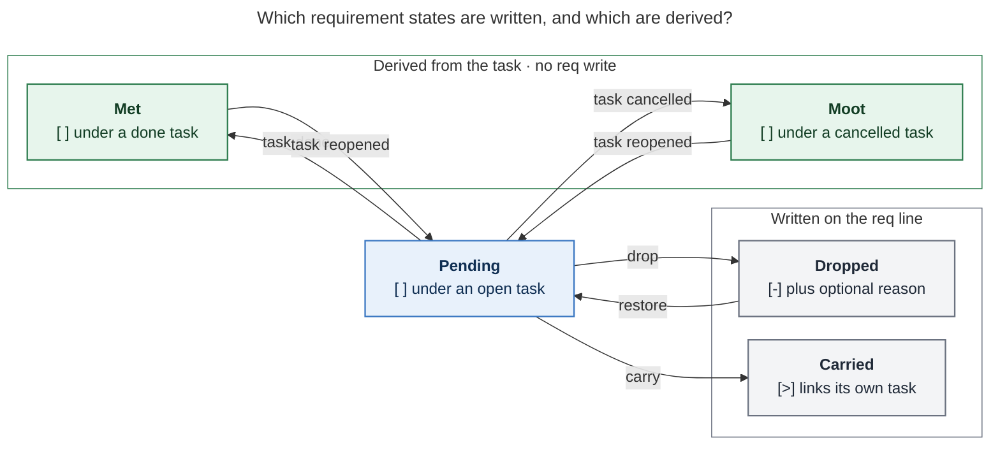
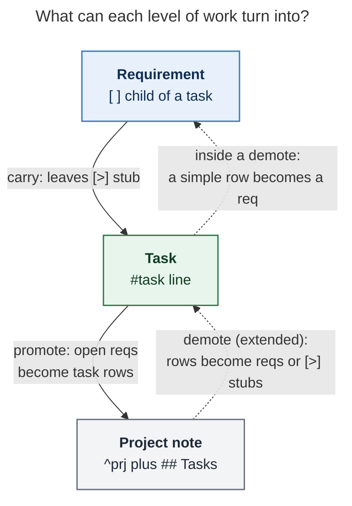

# Task requirements: a sub-task design for Bob that is met when its task closes

Researcher: `cld` (5-researcher swarm). Date: 2026-11-21.

Inputs: the `^micro-tasks` task and the tasks around it in `~/bob/bob.md`, the canceled
epic `bob-cli-of` and its plan `plan:202611/explicit_micro_tasks.md`, bob-cli source and
docs at `ce0dcc54`, bob-plugins `master`, the decision and glossary memory, a read-only
scan of the vault, and a few outside precedents.

## Bottom line

1. **Build it.** Bryan already writes requirements under his tasks. About 42% of the loose
   notes under open tasks are imperative `…!` lines, and project promotion currently turns
   every one of those notes into a `#task`. An explicit marker fixes promotion and gives
   each close a real audit.
2. **Call the feature a _requirement_ ("req").** Do not call it a sub-task. Bob already
   uses "subtask" for nested and embedded `#task` lines, including in close JSON
   (`subtasks`, `subtasks_left_open`). The new name also matches the new rule: a req
   cannot be completed on its own.
3. **Store a req as a checkbox without `#task`, one level deep under a `#task` line.**
   Hide the checkbox and draw `⌗⌗` in the task's ink instead. Plain `#task` already
   renders as `⌗`, so `⌗⌗` reads as "part of the task above".
4. **The biggest change from the canceled epic: "met" is derived, never written.** A
   pending req (`[ ]`) under a done task _is_ met; under a cancelled task it is moot.
   Bob writes only the two exceptions: dropped (`[-]` plus an optional reason) and
   carried (`[>]` plus a link to the task it became). This turns "reqs can't be
   completed before their parent" from a rule every writer must enforce into a fact of
   the data model. Every close path is correct without knowing reqs exist: capture `x`,
   Ctrl+Enter, Alt+], gcal past-day sync, collect-done, a Tasks-query click, and mobile.
5. **The close card audits; it does not ask for confirmation.** Pending reqs appear on
   the existing successor card as Met by default. Their keys match the offer rows
   already on the card (Ctrl+X ✓, Ctrl+Shift+X ⊘), plus "carry" verbs that create a
   task: Ctrl+Shift+T makes it its own task, Space also pulls it in, and Ctrl+J also
   jumps to it. Esc and Return give the same result because the defaults write nothing.
6. **Scope is about 8 phases instead of 13.** Cut nesting, depth runs, `..`, the Ctrl+G T
   leader, tick-while-working, writing `[x]`, and the merge rewrite. Keep reader
   hardening, rendering, capture, the card on all three surfaces, promotion, the Notes
   drawer, block ordering, and a small migration.

Every place this departs from Bryan's stated requirements is marked **ADJUSTMENT** and
listed again in §8.

---

## 1. What exists today (evidence)

### 1.1 The vault

I scanned every `.md` file outside `.git`, `.obsidian`, `_generated`, `.bob`, and
templates, using the same heuristics as `task_children.rs`.

| Measure | Count |
| --- | --- |
| `#task` lines (all) / open, outside `done/` | 5,433 / 779 |
| Open tasks with ≥1 loose note child | 213 (median 1 note, max 8) |
| Loose notes under open tasks ending in `!` / `?` or `?!` / other | 142 / 36 / 157 |
| Open tasks whose notes are all `!` / mixed / none `!` | 89 / 29 / 95 |
| Notes that have their own nested bullets | 27 |
| Plain checkbox children (no `#task`) under a `#task` | 8, all in `done/bob_done.md` |
| Drawers under tasks | 5 (`REQUIREMENTS` ×3, `MOTIVATION`, `DONE`) |
| Nested `#task` children | 1 |
| Embedded `![[…#^id]]` subtask lines | 242, mostly June–July 2026 daily notes |
| Task blocks with a note _after_ a managed log | 33 |
| Bold-only bullets (`- **X**`) vault-wide | 5 (4 are drawer-like: `**Agenda:**`, `**Note:**`, `**ROADMAP**`) |
| Dataview `TASK` queries in notes | 0 (Tasks queries use the `#task` global filter) |

What this shows:

- **The form already exists in Bryan's history.** The 8 plain checkbox children are
  exactly the proposed shape, including the "dropped" state:
  `- [x] E2E test bob dataview command!` and `- [-] Migrate AI ref notes!` under done
  tasks. No open task has one today, so the new parent rule changes the meaning of no
  live line.
- **Requirements are already written, just not marked.** The bullets of
  `^micro-tasks-cleanup` are textbook requirements. So are the `!` notes on many tasks,
  such as "Support pinned sub-bullets!" and "Auto-link to previously completed task!".
  About half the noted tasks have only `!` notes.
- **Guessing would be wrong often.** Many `!` notes are commentary ("See the `sase-1m7`
  task bead!", "Use this to spread out tasks…"). The marker must be explicit, in the
  same "truthful, never guessing" spirit as `docs/task-tag-marks.md`.
- **Existing sub-task shapes go unused.** There is 1 nested `#task`, and embeds are
  ledger-era. Bob has no live sub-task idiom to protect.

### 1.2 The canceled epic

`bob-cli-of` ("Explicit micro tasks") has 13 phases across bob-cli, bob-plugins, and Bob
Mac Capture. All of them still read `IN_PROGRESS` in the bead store. `git log --grep
micro` finds no micro-task commit on bob-cli or bob-plugins `master`, so **nothing
landed**. The phases should be closed as superseded before a new plan goes out.

Its design of record (plan §§1–7):

- micro tasks nest to any depth and are drawn as `⌗⌗`, `⌗⌗⌗`, …;
- states `[ ]`, `[x]`, `[-]`, `[>]`;
- Ctrl+Enter ticks a micro task while working;
- `..` and Ctrl+G T author them;
- the close card writes `[x]` by default, with Ctrl+X toggling Done ↔ Keep open;
- merge writes a micro task;
- promotion maps micro tasks to `## Tasks` rows.

### 1.3 Code facts the design leans on

- **Child classification.** `src/native/task_children.rs` classifies a task's direct
  children as `Authored | Drawer | ManagedLink | ManagedLog | NestedTask`. A req becomes
  one more kind.
- **Where writers insert.** `capture/sub_bullet.rs` inserts a captured note before the
  first managed log, which puts it _after_ drawers. `capture_drawers::ensure_drawer` also
  creates drawers before the first log. That is how notes end up after drawers today.
- **A real reader bug.** `projects/scan.rs::parse_task_line` accepts any checkbox, with
  or without `#task`. In a scheduled project, `bob projects sync` would therefore stamp
  `[scheduled::]` onto a req. Any design must fix this first.
- **Archiving.** `docs/task-archive.md` says "untagged checklist items and prose under
  that root travel with it". Reqs move with their task into `done/`, and only open
  `#task` descendants hold an archive.
- **The successor card already has the right vocabulary** (`docs/task-dependencies.md`
  §12.22 and §12.24):
  - per-row verdicts Leave / Pull in / Done (Ctrl+X) / Cancel (Ctrl+Shift+X, with an
    inline optional reason);
  - the Ctrl+J jump pin (v5): navigation only, lands after every write, and parks the
    `]s` walk (`decisions:successor-jump-parks-the-walk`).
- **Reversal already exists.** "Create project note from task" run on a `^prj` restores
  a task block in the parent's `## Tasks`. It refuses when the project has child notes,
  when other notes link to it, or when its parent is not an area or open project
  (`665-plugin-project-conversion.js`). Those refusals are what `^task-to-project` and
  `^tasks-parent-projects` want to remove.
- **Rendering precedent.** `#task` already renders as one slanted teal `⌗` (or the
  type's name in its ink). It is display-only and reversible: the cursor reveals the raw
  text (`docs/task-tag-marks.md`).

## 2. Is this a good idea?

**Yes.** Three concrete wins, in order of value:

1. **Promotion becomes correct.** `buildProjectSeedFromChildBullets` turns every
   non-drawer child into a `#task` row. With an explicit marker, reqs become tasks and
   notes become `## Notes`. That fixes a lossy, mostly-wrong conversion that Bryan hits
   every time a task grows into a project.
2. **Closing becomes an honest audit.** A task's acceptance criteria get one look at the
   moment it is called done. Anything unmet is dropped with a reason or carried into its
   own task. Nothing is lost silently.
3. **Tasks, reqs, and projects form one closed family.** A req carries out into a task,
   a task promotes into a project, and a project demotes back into a task whose rows
   become reqs (Figure 2). Every dependent of `^micro-tasks` (`^better-o`,
   `^no-all-caps-for-drawers`, `^tasks-parent-projects`, and through it
   `^task-to-project`) becomes a small, well-defined follow-up instead of a new concept.

**Risks, and how the design contains them:**

- **Ceremony.** Every Done on a task with pending reqs opens a card. This is contained
  in four ways:
  - the default is Met;
  - Return and Esc give the same result;
  - the card appears only when pending reqs exist;
  - tasks without reqs behave exactly as today.
- **A second task system.** Reqs get no fields, lanes, freshness, Task Links, walk rows,
  stats, or dependencies. The moment a req needs any of those, it becomes a task
  (carry). Holding that line is what kept Things-style checklists lightweight. Their
  checklist items live inside a to-do as steps, not as to-dos of their own.
- **Plugin-less rendering.** Without Bob's plugins a req is an ordinary Markdown
  checklist item. That is an acceptable fallback, and the reason not to invent a new
  syntax.

**Precedents.**

- **Org-mode** has the opposite policy as an option: `org-enforce-todo-checkbox-
  dependencies` blocks a parent from DONE while checkboxes are unchecked. Its users
  report the predictable pain: they cannot cancel a parent without ticking its boxes.
  Bob's rule avoids both problems. The parent's close _resolves_ its reqs, and a cancel
  makes them moot.
- **Bullet Journal** marks a migrated task with `>`, which is exactly the "carried"
  meaning proposed for `[>]`.

## 3. Critique of the canceled micro-task epic

Requirements Bryan has since rejected (`^micro-tasks-cleanup`) are struck below. My own
additions are marked _(cld)_.

| Canceled-plan choice | Problem |
| --- | --- |
| ~~Unlimited nesting, drawn as `⌗⌗⌗…`~~ | Needed depth computation, subtree verdict propagation, nested card rows, and depth spans in capture. A requirement with sub-requirements is a task, so carry it. |
| ~~Ctrl+Enter ticks a micro task while working~~ | Turned steps into tiny tasks that compete with the parent's status. It also created the "all steps ticked, parent open" limbo. |
| ~~`..` alias, Ctrl+G T leader~~ | `..` collides with the Mac's existing fast-double-dot escape (`..` → one `.`). The leader was a whole new key family for one toggle. |
| Close card writes `[x]` by default _(cld)_ | A second copy of the parent's state. It needed a separate reader rule for every close that bypasses the card, so the same fact had two stored forms. Reopening the parent leaves `[x]` children under an open task. |
| Ctrl+X means Keep open on micro rows _(cld)_ | On the same card, Ctrl+X means **Done** on offer rows (§12.22). One key with two opposite meanings breaks muscle memory. |
| Merge writes the source as a micro task _(cld)_ | "Merged into" often means "duplicate", not "new requirement". Changing merge output is a break that `^micro-tasks-cleanup` never asked for. Defer it. |
| Captured notes stay loose next to micro tasks | Lets reqs and notes interleave. `^micro-tasks-cleanup` now asks for a Notes drawer once reqs exist, and I agree (§6.7). |
| 13 phases, 4 refusals, 3 new vector families, an involutive verdict model | Too much surface for v1. Most of it served nesting and ticking. |

The parts the epic got right, which I keep:

- the checkbox-without-`#task` storage;
- the parent rule;
- "Rust is the authority, JS twins pass shared vectors";
- the reader-hardening audit;
- reusing Task Split for carry, with the `[>] [[#^id|Alias]]` stub;
- promotion mapping;
- the Mac as a thin client.

## 4. Critique of each new requirement (`^micro-tasks-cleanup` and friends)

**R1. Name it "task requirement" / "req".** Endorse.

- "Subtask" is taken: nested and embedded `#task` in `docs/capture.md` close JSON,
  `docs/task-merge.md` (`merge_source_open_subtasks`), `docs/task-archive.md`
  (`open_subtask`), and the keep-moving docs.
- "Step" implies ticking in order, which R4 forbids.
- "Criterion" is accurate but clunky.

Use **Requirement** in headings and glossary, **req** in compact UI and flags. Reserve
`REQUIREMENTS` as a drawer name once reqs ship. The 4 existing `REQUIREMENTS` drawers
migrate into reqs (§9, phase 8).

**R2. Order children as links < reqs < drawers < logs.** Endorse, with
**ADJUSTMENT A8**.

- The Cancel Log stays the **first** child. That is the current contract ("an optional
  reason kept in a first-child Cancel Log"), and on a cancelled task the reason is the
  headline.
- Loose notes, when a task has no reqs, take the reqs slot.
- Ordering is a **writer rule plus an explicit tidy**, never a silent reorder and never a
  validity rule. Readers accept any order.

**R3. Auto-create and use a Notes drawer once a task has reqs.** Endorse, with
**ADJUSTMENT A7**:

- Bob writers file new notes into the drawer.
- The gesture that adds a task's _first_ req also files that task's loose notes into the
  drawer, in the same previewed write.
- Obsidian hand edits are never reshuffled underneath the cursor. Tidy fixes them on
  request.
- Tasks without reqs keep loose notes. 138 of the 213 noted tasks have exactly one note,
  and a drawer for one note is heavier than the note.

**R4. Reqs can't be completed before their parent, only cancelled or obsoleted with an
optional reason.** Endorse. **ADJUSTMENT A2** strengthens it: Bob never writes `[x]` on
a req at all, because met is derived from the parent (§6.2).

- Dropping writes `[-]` plus a Cancel Log child, reusing the task Cancel Log shape so
  log recall and completion work unchanged (**A3**).
- Ctrl+Enter on a req refuses with a teaching notice and does not close the owner
  (**A14**).

**R5. Show `##`, not the `[ ]` checkbox.** Endorse:

- Draw the two hashes as one glyph in the owner's ink, in the checkbox's slot.
- The checkbox stays in the stored text and is revealed under the cursor, like `#task`
  tag marks.
- Hiding the checkbox also removes the click target that would let a req be "completed"
  by hand.

**R6. Replace `..` with `- [␠` → `- [ ] `, and let Backspace undo it to `- `.** Endorse,
with **ADJUSTMENT A13**:

- The rewrite fires only where a req is eligible.
- Backspace right after the marker deletes the whole marker at any time, not just
  immediately after the expansion. The marker is drawn as one glyph, so it should delete
  as one.
- Pre-checked forms (`- [x`, `- [-`) are refused in capture.

**R7. Support Ctrl+J successor jumps.** Endorse. Ctrl+J on a req row means "carry it and
land on the new task" (§6.6).

**R8. Only one level of reqs.** Endorse.

- A req's children are notes.
- A `[ ]` under a req is not a req. It renders and reads as a plain checklist line, and
  capture refuses it at that position.

**R9. Reqs show up as successors with a default closed state.** (This is from the
`^micro-tasks` body.) Endorse as "Met by default". **ADJUSTMENT A5:** the default writes
nothing.

## 5. Alternatives I considered

| Shape | Verdict | Why |
| --- | --- | --- |
| **`- [ ] text` under a `#task`, no `#task` tag** | **Chosen** | Native state slot; Tasks ignores it through the global filter; archive carries it; degrades to a plain checklist; the form is already in Bryan's history. |
| `- ## text` stored literally | Rejected | Markdown renders an H2 inside the list item. It enters Obsidian's outline and heading-link space, collides with `@note#Heading` routing, and has no state slot. |
| `TASK:` / `ALSO:` prefixes (`^micro-tasks` title) | Rejected | `TASK:` is a valid drawer title one letter away from the reserved `TASKS`. Prefixes are typing burden and still need a state encoding. |
| Nested `#task` subtasks | Rejected | Each would get lanes, freshness, walk rows, `[created::]`, and stats. That is the heavyweight form the vault already avoids (1 instance). |
| A `REQUIREMENTS` drawer holding plain bullets, notes loose | Rejected, but close | No capture grammar needed, since `#requirements` exists. But it buries the contract one level down and pushes the context up. The task title should be followed directly by what "done" means. |
| Infer reqs from `!` endings | Rejected | Wrong about as often as right (§1.1). |
| Write `[x]` on reqs when the owner closes | Rejected in favor of derived met | Two stored forms of one fact. Needs a reader rule anyway, and reopening leaves contradictions. See §6.2 for the costs I accept. |

## 6. Recommended design

### 6.1 Definition

A **requirement** is a list item whose body starts with a checkbox, does not carry the
global filter `#task` (matched as a whole token), and whose **nearest list-item parent
is a `#task` line** (its **owner**). It is outside code fences and quotes.

Not a req:

- a checkbox under a note, under a req, inside a drawer, in a notebook, in a Pomodoro
  ledger row, or in a bank row;
- anything carrying `#task`.

A `^prj` task may own reqs. They are that project's completion criteria, and demotion
(§6.8) maps them straight across.

A req never has `#task`, `[created::]`, a lane, freshness, priority, a schedule,
dependencies, Task Links, walk rows, a Ready-cap count, Today membership, or stats. It
may have a trailing `^anchor`, which carry reuses as the new task's ID. It may also have
child notes, and a Cancel Log when dropped.

### 6.2 States: two written, two derived

| Bytes | Owner open | Owner done `[x]` | Owner cancelled `[-]` |
| --- | --- | --- | --- |
| `[ ]` | **Pending** | **Met** (derived) | **Moot** (derived) |
| `[-]` + optional `❌ CANCEL LOG` child | **Dropped** | Dropped | Dropped |
| `[>] [[note#^id\|Alias]]` | **Carried** | Carried | Carried |
| `[x]` (hand-written or legacy) | read as Met | Met | Met |
| any other mark | read as Pending, never rewritten | | |



_Figure 1. Closing, cancelling, or reopening the task changes what a pending req means
without touching its line. Only an explicit drop or carry writes to the req itself._

Why derived met is the right call:

- **Reliability.** No closer needs to know about reqs. That covers more than ten close
  paths, including automated ones and ones outside Bob (a Tasks-query click, mobile).
- **The invariant is structural.** "Not completed before the parent" cannot be violated
  by a Bob writer, because no Bob writer ever writes completion.
- **Reopen and undo are free.** Reopening the owner makes its reqs Pending again with no
  write. Undo of a close never has to restore children.
- **Fewer bytes change.** The card writes only the exceptions.

Costs I accept:

- Without Bob's plugins, a done task's met reqs still show empty boxes. This affects
  `done/` archives viewed on GitHub or in a bare editor.
- A future reader must apply the owner rule. Only Bob reads reqs, and it does so through
  one recognizer.

**Reopens when:** an outside consumer that cannot apply the owner rule needs req state.

### 6.3 Canonical task block layout

```text
- [ ] #task Ship the export command ^export
	- ❌ **CANCEL LOG**                      ← only on cancelled tasks; first (existing contract)
	- ⛓️ **DEPENDS ON:** …                   ← links: DEPENDS ON, BLOCKS, LINKS, LINKED FROM
	- [ ] Streams output instead of buffering         ← reqs, authored order
		- tokio streams look right                  ←   a note about this req
	- [-] Benchmarks within 5% of v1
		- ❌ **CANCEL LOG**
			- *2026-11-21* — v1 is gone; nothing to compare against
	- [>] [[#^export-docs|Docs cover every flag]]
	- **Notes**                                       ← drawers (Notes first when present)
		- The old flag confused people
	- **Future work**
		- …
	- 🗓️ **SCHEDULE LOG** / 🛠️ **WORK LOG** / 🥀 **ROTTEN LOG**   ← logs
```

(`**Notes**` assumes the drawer-marker follow-up in §7. Until then the drawer is
`NOTES`.)

Implement this as **one shared Rust module** (`task_block_layout`) that answers "where
does a new child of kind K go in this block?". Every writer uses it:

- capture notes and reqs;
- `ensure_drawer`;
- log writers;
- split stubs;
- promotion and demotion.

Pin the module with shared vectors and mirror it in JS for nav and the cycler. The same
module powers `bob task tidy` (and a nav "Tidy task block" command), which sorts one
block or a note on request: previewed, one commit, child subtrees moved whole. Nothing
reorders silently. The 33 existing out-of-order blocks are a tidy run, not a migration.

### 6.4 Rendering (the "beautiful" part)

Live Preview, with the bob-ledger-tools plugin:

```text
☐ ⌗ Ship the export command                          ▮▮▮   + Nov 24
     ⛓️ DEPENDS ON: Parser library
     ⌗⌗ Streams output instead of buffering
     ⌗⌗ Handles CRLF line endings
     ⌗⌗ Benchmarks within 5% of v1          (muted, struck through)
          ❌ CANCEL LOG · Nov 21 — v1 is gone
     ⌗⌗ → Docs cover every flag   ● Next
     Notes
        • The old flag confused people
     🛠️ WORK LOG
```

**The glyph.**

- One `--bob-req-glyph` CSS mask: two of the existing soft slanted hashes, overlapped by
  about 40%.
- It sits in exactly the checkbox's box, so req text lines up with task text.
- It reads as "⌗, twice": the same family as the task's `⌗`, clearly subordinate, and
  never mistakable for a Markdown heading.

**Ink.**

- The owner's hash ink: teal by default, or the owner's explicit type ink, such as
  `#FIX`.
- Reqs visibly belong to their task, and a FIX task's reqs read as FIX.
- As with tag marks, ink never encodes state.

**State styling.** Use only line treatments that Obsidian users already read:

- **Pending:** glyph at full ink, normal text.
- **Met:** the req takes the owner's done-line treatment (muted text) and the glyph
  fades to 55%. A done task's block looks finished as a whole.
- **Moot:** like Met, plus the owner's cancelled treatment.
- **Dropped:** muted, struck text. The Cancel Log child renders as it does on tasks.
- **Carried:** the glyph is followed by a small `→`, and the link keeps the existing
  Task Link status mark, so the carried task's live lane (● Next, ✓ done) shows
  in place.

**Reversible, like `#task` marks.**

- The cursor on the glyph reveals the raw `[ ] `.
- Source mode shows raw text.
- The tag-mark session toggle also turns req glyphs off.
- Reading view uses attribute plus CSS only: `li[data-bob-req]` hides the native
  checkbox input and draws the glyph with `::before`. No new DOM nodes.

**Hover tooltip** (no click action):

> `Requirement of “Ship the export command” · met when it closes · Alt+[ drops ·
> Ctrl+Shift+T makes it a task`

**Bob Mac Capture.**

- bob returns a `req_marker` span over the `[ ] ` bytes.
- The Mac hides those bytes and draws `⌗⌗` in their place, using the record-route
  adornment pattern.
- With the caret right after the span, Backspace removes the whole span in one undoable
  edit, leaving `- `.

**Optional follow-up.** A folded-block chip on the owner line, `⌗⌗ 3`, counting pending
reqs. It is not needed for v1.

### 6.5 Authoring

**Capture** (bob-cli is the authority; the Mac renders bob's answers):

- A `- [ ] text` bullet is a req at these positions:
  - a first-level bullet under a new task item;
  - a first-level bullet under a note-less `@route+id`;
  - a nested bullet under a project-note capture's task bullet.

  First-level project-note bullets stay `## Tasks` rows.
- **Same-line form.** In `[ ] Handles CRLF @bob+export`, the leading checkbox on a note
  item routed to `+id` writes a req instead of a note.
- **New rewrite rule `expand_req_marker`.** At an eligible bullet start, typing the space
  after `- [` answers with `- [ ] ` and the caret after it, as one native undoable edit.
  - Ineligible positions keep the literal `[`: under a note, in a drawer bullet or on a
    `#drawer` route, on a notebook route, and anywhere that is not a bullet start.
  - `[` followed by a non-space never triggers, so `- [link…` stays safe.
  - Paste, `bob capture`, and templates never rewrite, like every alias.
- **Refusals,** each reported on its byte range:

  | Code | Situation | Copy |
  | --- | --- | --- |
  | `req_in_drawer` | A req inside a drawer | `Drawers hold notes — put the requirement directly under the task` |
  | `req_parent` | A req under a note or under a req | `A requirement needs a task directly above it` |
  | `req_state` | A pre-checked req (`[x]`, `[-]`, …) | `Requirements start open — they're met when the task closes` |
- **Notes routing (R3).** A note captured to a task that has reqs files into its Notes
  drawer, which is created on demand through `ensure_drawer`. The gesture that adds a
  first req also files the task's loose notes into Notes, and the dry-run preview says
  so: `files 2 notes into Notes`.
- **Grammar revision 28 → 29.** Commit with `!`. Drafts that wrote a literal checkbox
  note inside a drawer now refuse.

**Obsidian:**

| Gesture on a req line | Behavior |
| --- | --- |
| Ctrl+] (existing marker toggle) | Turns a note into a req or back. Documented as the req toggle; refused in drawers and under reqs |
| Alt+[ / Alt+] | Drop ↔ restore. Dropping asks `Why drop it? (optional)` with Log Recall, and writes `[-]` plus a Cancel Log entry in one undo |
| Ctrl+Shift+T (Task Split) | Carry. Splits the req into a new task (placed by split's existing rules) and leaves `- [>] [[#^id\|Alias]]`; children travel |
| Ctrl+Enter | Refuses: `Requirements are met when “Owner” closes — Ctrl+Enter on the task` |
| Ctrl+Shift+P | Opens the **owner's** Task Card, as it already does from a Depends-On line |
| Ctrl+Shift+] (promote to `#task`) | Refuses and teaches Ctrl+Shift+T |
| Alt+N, Alt+F, freshness stamps | Refuse, as on any non-`#task` line; ledger-tools freshness helpers gain the global-filter guard |

### 6.6 The close card

**Trigger.** Every managed Done gesture (§12.1) whose closing set includes a
**non-recurring** task with **pending** reqs. The req group alone is enough to open the
card. Cancels, automated closes, and raw checkbox edits open nothing, and derived state
covers them.

**Layout.** One `Requirements` group per owner, placed first:

```text
Requirements · “Ship the export command”
Met when it closes, unless you say otherwise
  ⌗⌗ Streams output instead of buffering                     ✓ met
  ⌗⌗ Handles CRLF line endings                               → own task in ‹bob› · ↗ jump
  ⌗⌗ Benchmarks within 5% of v1                              ⊘ drop · “v1 is gone”
  · 1 dropped earlier · 1 carried earlier
Hand-offs · …
⌃X met · ⌃⇧T own task · space pull in · ⌃⇧X drop · ⌃J jump        reqs ✓1 →1 ⊘1
```

**Keys on a req row** (**ADJUSTMENT A4**). They match the offer rows on the same card:

| Key | Verdict | Write |
| --- | --- | --- |
| _(default)_ / Ctrl+X | ✓ Met | none |
| Ctrl+Shift+X | ⊘ Drop, with an inline optional reason (Log Recall) | `[-]` plus a Cancel Log entry |
| Ctrl+Shift+T | → Own task (carry) | Task Split; `[>]` stub |
| Space / Tab | → Own task + pull in | carry, then link at the §12.3 anchor and raise to Next (no fresh stamp, as for created tasks) |
| Ctrl+J | → Own task + jump pin | carry; after all writes, focus the new task and park the `]s` walk |

The rules that make these keys predictable:

- Each key toggles its row back to Met when pressed again.
- A different key replaces the verdict.
- Ctrl+J on a row that is Met or Dropped upgrades it to carry, because carry is the only
  verdict with a landing. If the verdict later leaves carry, the pin drops and the footer
  says `jump cleared`.
- Mark-all (Ctrl+A / ⌘A / `-p all`) never touches req rows.

**Return and Esc (ADJUSTMENT A5).**

- Defaults write nothing, so Esc and Return-with-defaults give the same req outcome.
- Only explicit req verdicts count as staged and arm the existing double-Esc warning.
- In Obsidian the owner is already closed when the card shows. "Not done yet" is the
  existing same-day reopen, which leaves reqs Pending with no write.
- On the Mac the card opens before any write, so Esc returns to the draft unchanged.
- On the Mac, ⇧↩ applies verdicts and downgrades pull-ins to plain carry.

**Write order.**

- Obsidian, best effort and guarded by the batch Undo notice:
  1. carries, bottom to top within each note, each new task persisted before its stub;
  2. drops;
  3. pull-in links;
  4. the jump landing last.
- Capture stays all-or-nothing. A stale row refuses the batch with `req_close_stale`.

**Carry never adds a dependency (ADJUSTMENT A6).**

- At close time the owner is leaving, so the carried task stands alone.
- Before close, Ctrl+Shift+T does the same. If Bryan wants the owner to wait, `&` (or
  Ctrl+Shift+B) says so explicitly.
- An automatic dependency would make the owner Blocked and remove it from today's
  Pomodoros (`decisions:projects-block-from-prj-line` semantics), which is too heavy a
  side effect for a split.

**CLI.** `bob capture` additions, kept alphabetical:

- `-k, --carry <PICKS>`;
- the req meanings of `-x`, `-X N[=why]`, `-p N`, and `-j N`;
- a hidden `--req-choice` capability flag.

**JSON** (additive):

- `pull_in.groups[]` gains `kind: "requirements"` groups, carrying owner and
  `folded{dropped, carried}`;
- each req row has `req{owner{key,path,line,text}, text, line, notes, state}` and
  bob-authored `consequences{met, carry, carry_pulled, drop}`;
- `pull_in.requirements{supported, pending}`;
- receipts gain `req_outcomes[]`.

Row keys are `<owner key>/req/<8 hex of sha256(clean text)>`, with a `~k` ordinal for
duplicates, in the same shape as `note_tasks::stable_task_key`.

Without `--req-choice`, the Mac and older clients get the default (Met, no write),
which is always safe.

### 6.7 The Notes drawer

The Notes drawer is an ordinary drawer whose writer rule is special:

- it exists only on tasks with reqs;
- it sits first among drawers;
- capture `@foo+bar#notes` keeps working;
- promotion merges it with loose notes into `## Notes`, as the existing title-matching
  section rule already does;
- demotion of a project with reqs restores `## Notes` into the Notes drawer.

### 6.8 Promotion, demotion, and tasks that parent projects



_Figure 2. Solid arrows ship with reqs; dashed arrows are the follow-up extension of the
existing project reversal (`^task-to-project`). Every child of a project becomes a req of
the restored task: inline when it fits, carried when it does not._

**Promotion** (task → project; v1 changes `110-project-seed.js`):

| Direct child | Becomes |
| --- | --- |
| Pending req | a `## Tasks` row `- [ ] #task … [created:: today]`, its notes nested |
| Dropped req | a `## Tasks` row `[-]` keeping its Cancel Log (existing status-keeping writer) |
| Carried req | a `## Notes` line, verbatim (the carried task stays where it lives) |
| Loose notes, Notes drawer | `## Notes` |
| Other drawers | `## Title Case` sections (unchanged) |
| Logs | under `^prj` (unchanged) |

The receipt reads `Promoted “S” · 3 tasks · 2 notes`. A task with no reqs promotes to an
empty `## Tasks` and the notice `No requirements to promote — Ctrl+] marks one`.

**Demotion** (project → task; this is the `^task-to-project` follow-up, sketched so v1
does not paint into a corner). Every row of the project lands in the restored task:

- a **simple** open row becomes a pending req. Simple means: no reqs of its own, no
  managed links or logs, no Task Link today, no fields beyond `created`, `id`, and `type`;
- any other open row moves out as a sibling task in the parent note and leaves a `[>]`
  stub;
- a closed row becomes a `[>]` stub to its (archived) task;
- the `^prj` line's own reqs become the task's reqs;
- each **sub-project** is re-parented to the restored task and leaves a `[>]
  [[sub_project]]` stub. This is the `^tasks-parent-projects` piece.

With that rule, today's "Project has N child notes; move them before converting" refusal
goes away.

**Tasks that parent projects** (`^tasks-parent-projects`, sketched):

- A project note's `parent:` may be a block link, `parent: "[[bob#^export]]"`.
- The parent walk, root-parent attribution, and inherited blocking treat it as the
  task's note, plus the task as a blocking source:
  - a Blocked owner blocks the project's residents, like
    `decisions:subprojects-inherit-project-blocking`;
  - the owner never waits on the project unless a dependency says so.
- The owner shows the project as a carried req stub, `- [>] [[bob_export_cli]]`. This is
  how "carry this req into a project" looks: carry it to a task, then promote that task,
  and the stub's link is rewritten to the new note by promotion's existing link repoint.

## 7. How the dependent tasks fit

- **`^better-o`.** Both keys place the new line through `task_block_layout`:
  - `o` on a task headline opens a new sibling `- [ ] #task ` line **after the whole
    block**;
  - `o` on a req opens the next req;
  - `o` inside a drawer opens the next note in that drawer;
  - Ctrl+Shift+O on a headline opens a new child in the reqs slot: a req when the task
    has reqs, otherwise a loose note, which Ctrl+] can flip.
- **`^no-all-caps-for-drawers`.** My recommendation is a separate small decision:
  - mark a drawer as a bullet whose whole body is **one bold span** with nested children,
    such as `- **Notes**` or `- **Future work**`;
  - only 5 bold-only bullets exist, and 4 are already used as drawers in spirit;
  - it reads naturally without plugins and matches the bold labels on managed lines
    without their emoji;
  - capture's `- #future-work` completes to `- **Future work**`;
  - ALL-CAPS drawers keep reading as drawers (legacy), and tidy can convert them.

  Do this right after v1, so the auto-created Notes drawer is born `**Notes**` rather
  than `NOTES`.
- **`^tasks-parent-projects` and `^task-to-project`:** §6.8.

## 8. Adjusted requirements (explicit callouts)

| # | Adjustment | Instead of |
| --- | --- | --- |
| A1 | Name: **Requirement** / **req**. "Subtask" stays the existing term for nested and embedded `#task` lines | "micro task" or "sub-task" |
| A2 | **Met is derived** from the owner's close. Bob never writes `[x]` on a req; a hand-written `[x]` reads as Met | Card writes `[x]` (canceled plan) |
| A3 | A drop writes `[-]` plus a standard `❌ CANCEL LOG` child under the req | A one-off reason-note format |
| A4 | Card keys match offer rows: Ctrl+X ✓, Ctrl+Shift+X ⊘, plus Ctrl+Shift+T carry, Space carry+pull, Ctrl+J carry+jump | Ctrl+X = Keep open (canceled plan) |
| A5 | Defaults write nothing, so Esc ≡ Return for reqs; only explicit verdicts arm double-Esc | Esc and Return differing |
| A6 | Carry never adds a dependency, at close time or before | Unspecified |
| A7 | Notes drawer: Bob writers use it once reqs exist; adding a first req files existing loose notes in the same previewed write; Obsidian hand edits are not reshuffled | Unspecified |
| A8 | Order is Cancel Log first, then links < reqs (or loose notes) < drawers < logs; enforced by writers plus explicit `tidy`, never silently | links < reqs < drawers < logs |
| A9 | Recurring owners: reqs are allowed, but the card skips them in v1; per-occurrence reqs ride `^better-recur` ("pinned sub-bullets") | Unspecified |
| A10 | Out of v1: nesting, `..`, Ctrl+G T, tick-while-working, the merge rewrite, a progress chip | Canceled-plan scope |
| A11 | Backspace deletes the whole `[ ] ` marker whenever the caret is right after it | Only immediately after expansion |
| A12 | Ctrl+Enter on a req refuses and teaches; it does not close the owner | Unspecified |
| A13 | Capture refuses pre-checked reqs; `- [␠` expands only where a req is eligible | Unspecified |
| A14 | Audit writers that copy outside text into task children (gcal descriptions, gkeep, gmail, highlights) so a pasted `[ ]` never becomes a req by accident. With derived met this is cosmetic, but it should be a decision, not an accident | Unspecified |

## 9. Phasing (proposed epic)

Close the 13 `bob-cli-of` phases as superseded first. Proposed phases:

1. **contract** (bob-cli)
   - `task_reqs.rs` recognizer and `TaskChildKind::Req`.
   - The `task_block_layout` slots module and `bob task tidy`.
   - RQ and TL shared vectors.
   - Reader hardening: `projects/scan.rs::parse_task_line` plus the audit list from the
     old plan (`vault_task_loss`, `vault_clobber`, `event_task`,
     `capture_pomodoros_agenda`, dataview emulation).
   - `docs/task-requirements.md`.
   - Memory: the glossary strand and a decision record that supersedes part of
     `capture-bullets-mirror-the-task-block`, gated through `/sase_memory_write`.
2. **capture** (bob-cli)
   - Positions, the same-line form, refusals, and the `req_marker` span.
   - `expand_req_marker`.
   - Notes-drawer routing and first-req filing.
   - Grammar 29.
   - Commit with `!`.
3. **close engine** (bob-cli; plan first, large)
   - Req rows, verdicts, carry through the split library entry, drops, pull-in, `-j`
     integration.
   - JSON, CLI, and RC vectors.
   - Commit with `!`.
4. **render** (bob-ledger-tools)
   - Glyph, ink, state styling, reading view, toggle.
   - Freshness guards.
   - Update `docs/task-tag-marks.md`.
5. **Obsidian gestures and card** (cycler and nav; plan first, large)
   - Req guards.
   - Alt+[ drop with reason.
   - Ctrl+Shift+T `[>]` stub, as the JS split twin plus SP vectors.
   - Successor picker v6 `requirements` groups with Ctrl+J.
6. **Mac** (bob-mac-capture)
   - Wire the rewrite rule.
   - Atomic Backspace.
   - `⌗⌗` overlay.
   - Pull-In card req rows with `--req-choice`.
7. **promotion** (nav): the §6.8 seed rule and receipt.
8. **migration** (vault, gated)
   - Convert the 4 `REQUIREMENTS` drawers into reqs.
   - Dogfood: convert `^micro-tasks-cleanup`'s own bullets.
   - Produce an opt-in review list of `!` notes under open tasks. Nothing converts
     without Bryan's approval.
   - Run `bob task tidy` across the vault as a reviewed commit.

Follow-ups, in order: the drawer marker (§7), `^better-o`, `^tasks-parent-projects`,
`^task-to-project` (demotion), and the owner-line `⌗⌗ N` chip.

## 10. Open questions for Bryan

1. **Derived met (A2)?** This is the one adjustment the rest of the design leans on.
   If you would rather see `[x]` in archives, the fallback writes `[x]` on close and has
   reconcile revert it on reopen, at the cost of a second stored form.
2. **Ctrl+Enter on a req (A12):** refuse and teach (recommended), or close the owner?
3. **Cancel Log first (A8):** keep it as the cancelled task's headline (recommended),
   or move it to the logs slot?
4. **Drawer marker (§7):** bold-title drawers, or keep ALL-CAPS?
5. **Carry before close (A6):** never add a dependency (recommended), or ask?

## 11. Recommended solution

Ship **task requirements**: one level of `- [ ] text` checkbox children under a `#task`
line, with no `#task` and no properties.

- **Rendering.** Draw them as a soft `⌗⌗` in the owner's ink, in place of the checkbox.
  Reqs read as part of their task and can never be ticked by hand.
- **State.** Store only Pending `[ ]`, Dropped `[-]` (with a standard Cancel Log), and
  Carried `[>]` (a link to the task it became). Derive Met and Moot from the owner's
  close, so every close path in Bob and outside it is correct by construction, and
  reopen and undo cost nothing.
- **Closing.** When a managed Done gesture closes a task with pending reqs, list them
  first on the existing successor card as Met by default. The keys match the card's
  offer rows (Ctrl+X ✓, Ctrl+Shift+X ⊘), and the carry family (Ctrl+Shift+T own task,
  Space pull in, Ctrl+J jump) reuses Task Split and the jump pin.
- **Authoring.** Type `- [␠` in capture; Backspace removes the marker as one glyph.
  Toggle with Ctrl+] in Obsidian, carry with Ctrl+Shift+T, and drop with Alt+[.
- **Structure.** Put one `task_block_layout` contract under every writer: Cancel Log
  first, then links, reqs, drawers (Notes first), and logs. File notes into the Notes
  drawer once reqs exist, and offer an explicit `tidy` for everything else.
- **Projects.** Promotion maps reqs to `## Tasks` and notes to `## Notes`. Demotion
  later maps every project row back to a req, inline or carried. That one rule unlocks
  `^tasks-parent-projects` and `^task-to-project`.

This keeps what the canceled epic got right (checkbox storage, the parent rule, Rust
authority with shared vectors, the split-based carry). It drops the parts that made it
large and confusing (nesting, ticking, written `[x]`, conflicting keys, `..`), and it
cuts the epic from 13 phases to 8.

---

## Sources

Internal:

- `~/bob/bob.md`: `^micro-tasks`, `^micro-tasks-cleanup`, `^better-o`,
  `^no-all-caps-for-drawers`, `^tasks-parent-projects`, `^task-to-project`, and
  `^ctrl-j-successor-jump` (done).
- `plan:202611/explicit_micro_tasks.md` and bead `bob-cli-of` (read with an audit
  reason).
- bob-cli at `ce0dcc54`:
  - `src/native/task_children.rs`;
  - `src/native/capture/sub_bullet.rs` (`plan_sub_bullet_capture`);
  - `src/native/capture_drawers.rs` (`is_drawer_title`, `reserved_drawer_keys`,
    `ensure_drawer`);
  - `src/native/projects/scan.rs:1319` (`parse_task_line`);
  - `src/native/capture_language/rewrite.rs` (`RewriteRule`);
  - `docs/task-dependencies.md` §§12.13, 12.22, 12.24;
  - `docs/task-archive.md`, `docs/task-tag-marks.md`, `docs/projects.md`;
  - `docs/reference/plugins/bob-navigation-hotkeys.md`.
- bob-plugins `master`: `bob-navigation-hotkeys/src/110-project-seed.js`,
  `212-project-conversion.js`, `665-plugin-project-conversion.js`.
- Memory: `decisions:capture-bullets-mirror-the-task-block`,
  `decisions:successor-jump-parks-the-walk`, and glossary `task-drawer`, `task-split`,
  `task-merge`, `successor-offer`, `task-successor`, `project-task`, `capture-alias`,
  `task-mention`.

External:

- [Org manual: TODO dependencies](https://www.gnu.org/software/emacs/manual/html_node/org/TODO-dependencies.html)
- [Variable: org-enforce-todo-checkbox-dependencies](https://doc.emacsen.de/30.2/var/org-enforce-todo-checkbox-dependencies.html)
- [org-mode list thread: checkbox dependencies vs. CANCELED](https://yhetil.org/emacs/87wnnif0tu.fsf@drac/t)
- [Bullet Journal FAQ: migration (`>`)](https://bulletjournal.com/blogs/faq/migration)
- [Bullet Journal: rapid logging bullets and signifiers](https://bulletjournal.com/blogs/faq/what-is-rapid-logging-understand-rapid-logging-bullets-and-signifiers)
- [Apple App Store story: Break tasks down with Things 3 (checklists inside a to-do)](https://apps.apple.com/us/story/id1437833617)
