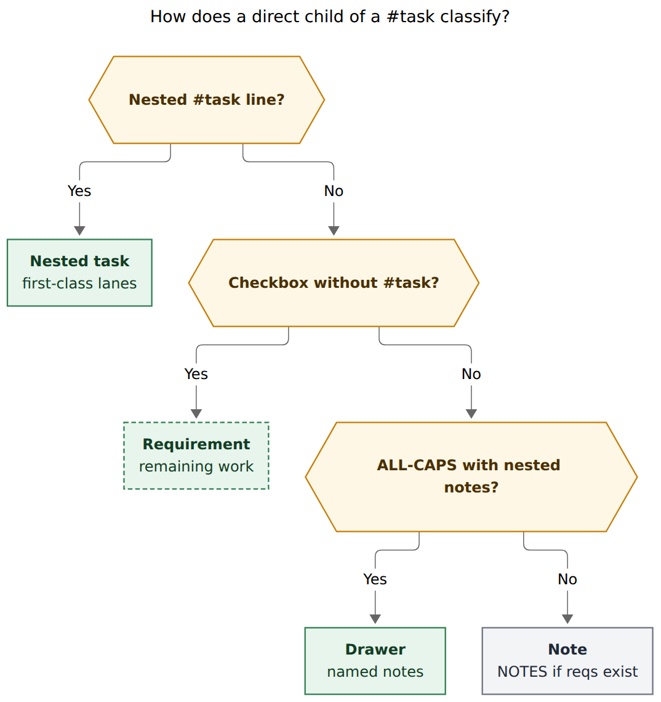
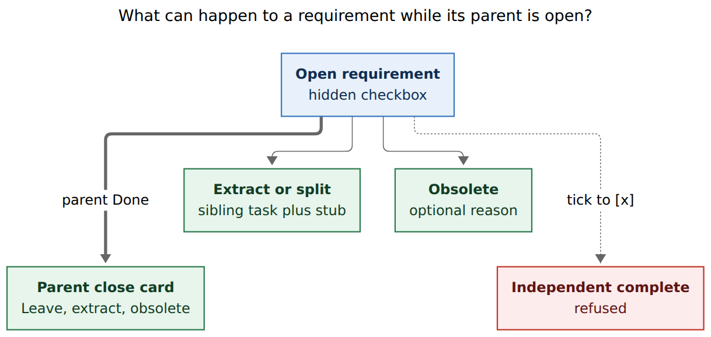
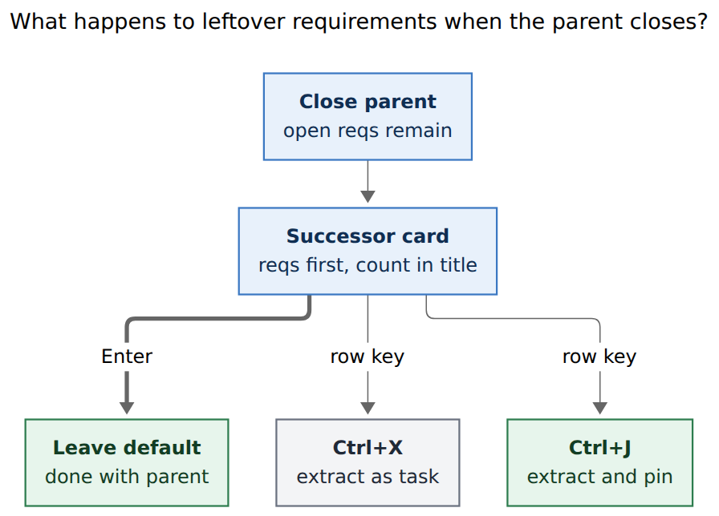

# Task requirements: remaining work under a `#task`

*Researcher: grk · 2026-11-21 · independent swarm report*

**Verdict.** Build it. Give Bob **task requirements** (reqs): the remaining
committed work of a sitting, audited on the existing successor card, default
closed with the parent. The canceled `bob-cli-of` epic was the wrong species —
tickable nested mini-tasks. The cleanup cluster in `bob.md` is the right
species. Lead with remaining-work, a hidden checkbox in source, two Bob hashes
on screen, a physical `NOTES` drawer once any req exists, and a close card
whose Control-J on a req **extracts and pins**.

---

## 1. Recommendation in one page

A **requirement** is remaining work the parent still owes. It is not a nested
`#task`, not a Depends-On link, not a drawer, and not a Things-style checklist
row you tick while you work. It lives inside the parent, stays off every walk
and Ready pool, and dies with the parent unless Bryan extracts it.

Recommended encoding:

```markdown
- [ ] #task Prepare the launch review [created:: 2026-11-21] ^launch
	- [ ] Confirm the rollout owner
	- [ ] Attach the final checklist
	- [>] [[#^owner-mail|Mail the owner the date]]
	- NOTES
		- brand preference still TBD
		- link the runbook when it lands
	- 🛠️ **WORK LOG**
		- *2026-11-21 14:02* — drafted the checklist
```

On screen the `[ ]` is hidden and each open req wears two identity hashes
(`##` / `⌗⌗`) in the parent's ink. The stub from an extract stays in the req
band as a pointer. Notes live in `NOTES` because this parent has reqs.

- **Store** an unchecked checkbox without `#task`. Split already speaks this
  language (`docs/task-split.md` §1). Capture's `- [` + space expansion lands
  on the same bytes.
- **Render** two Bob hashes. Do not store literal ATX (`- ##`) and do not
  paint Obsidian heading chrome inside a list.
- **One level only.** No nested reqs. A req that grows up is extracted (split)
  into a sibling `#task`, or later a project hanging off the parent task.
- **While the parent is open:** add, extract/split, or obsolete (`[-]` with an
  optional reason). Ticking `[ ]` → `[x]` is refused. Extract is growth, not
  completion.
- **At close:** leftover open reqs are the first successor group, always
  shown, with a loud remaining count. Leave (default) writes `[x]` with the
  parent. `Ctrl+X` extracts. `Ctrl+Shift+X` obsoletes. Tab / Space extracts
  and pulls in. `Ctrl+J` extracts **and** pins, then parks the walk.
- **Notes:** auto-create `NOTES` on the first req, scooping existing loose
  notes in that same write. Capture onto a task that already has reqs files
  notes into `NOTES`. Tasks with zero reqs keep today's loose notes.
- **Child order** is a writer invariant: Cancel log (existing first-child
  exception) → Depends-On → BLOCKS → LINKS → LINKED FROM → **reqs** → drawers
  (`NOTES` first when present) → other logs.
- **Promotion:** reqs become `## Tasks` rows; `NOTES` and unmarked leftover
  notes become `## Notes`; other drawers become sections; logs stay on `^prj`.
- **No silent vault rewrite.** A gated doctor may offer the ~241 current
  loose children as notes (default) or reqs. Shipping the classifier does not
  rewrite the vault.

Mac Capture stays a thin client of `bob`. Nested `#task` lines stay a
different species. The canceled epic `bob-cli-of` should be superseded, not
resumed.



**Figure 1.** Nested `#task` lines stay first-class tasks. A checkbox without
`#task` is the new requirement kind. An ALL-CAPS title with nested notes is
still a named drawer. Remaining unmarked bullets are notes, scooped into
`NOTES` once any requirement exists. Rendered with mermaid-cli 12.0.0;
715 × 760 px, fit 91.3%.

---

## 2. Is this a good idea?

**Yes.** Bob already has a hole between a single next action and a project
note, and it already has a promotion bug that makes that hole expensive.

**The outline already has four child species, and none of them is remaining
work.** `TaskChildKind` today is `Authored`, `Drawer`, `ManagedLink`,
`ManagedLog`, and `NestedTask` (`src/native/task_children.rs`). Authored
means "note, until promotion pretends it was a task." Drawers hold named
notes. Managed links point at *other* tasks. Nested `#task` lines are
first-class (lanes, freshness, the walk). Remaining committed work of *this*
sitting has nowhere to live.

**Promotion already treats every non-drawer child as a task.**
`docs/projects.md` and `buildProjectSeedFromChildBullets` (bob-plugins
`plugins/bob-navigation-hotkeys/src/110-project-seed.js`) convert a
no-checkbox ALL-CAPS bullet with nested list items into a section, keep
managed logs on `^prj`, and send every other direct child through
`buildProjectTaskLineFromChildBullet`, which forces a checkbox, inserts
`#task`, and stamps `[created::]`. That is why a Gmail embed, a prose
reminder, and "brand preference still TBD" would all become project tasks.

An independent vault scan on 2026-11-21 (open `#task` statuses ` `, `?`, `/`,
`*`; excluding `done/` and `.bob/`):

| Count | What |
| ---: | --- |
| 574 | open `#task` lines (61 TODO, 487 `[?]`, 9 WIP, 17 Next) |
| 160 | of those with at least one authored (non-managed) child |
| 241 | authored loose children |
| 0 | nested open `#task` |
| 0 | `##` / `###` children under open tasks |
| 0 | real plain-checkbox children (one Gmail-link false positive) |
| 6 | non-managed drawers, including 1 `REQUIREMENTS` and 1 `NOTES:` |
| 8 | embeds among the authored children |
| 4 | bare links |
| ~229 | remaining prose and the occasional imperative step |

Roughly nineteen in twenty loose children are information. Promotion's
implicit "every sub-bullet is a would-be task" rule is wrong as a default.
Making remaining work *explicit* is how the converter becomes lossless on
purpose: reqs become `## Tasks`, notes become `## Notes`.

**The successor card already has the close-time verbs.**
`docs/task-dependencies.md` §12.22 stages Leave, Pull in, Done, and Cancel
per row, with Leave the default. Picker API v5 already pins one jump
(`Ctrl+J`, `-j/--jump-offer`). Requirements are a new offer group on that
card, so closing a parent with leftover commitments cannot skip the audit.
That is the feature. The mark in the outline exists so the card has something
true to ask.

**Split is already the extract gesture.** An unchecked `- [ ] text` without
`#task` is splittable and becomes an open task (`docs/task-split.md` §1).
Keep-open of a req is that planner with a `[>]` stub left in the req band
and a LINKED FROM mention on the new task. Inventing a third promotion path
would fork identity.

The idea would be a bad idea if reqs entered Ready, the walk, or Today; if
they were independently completable while the parent was open; if they were
stored as `#task`, `TASK:`, or a `REQUIREMENTS` drawer; or if leftover work
could vanish on close without the card. The design below refuses all four.

---

## 3. Critique of the requested plan

There are three stacked requests, and they disagree.

### 3.1 The original `^micro-tasks` spelling is the canceled epic

`bob.md` `^micro-tasks` still titles the work "Require that task sub-bullets
be prefixed with `TASK:`/`ALSO:`?!" and still mentions `- ..` → `- ##`,
nested `##` / `###`, and "OLD EPIC: bob-cli-of". Its rotten log says the epic
was canceled because it needs rethinking.

That spelling should not land:

- `#task` *is* the Tasks global filter. A prefix `#task` on a non-task line
  collides with every "is this a task?" predicate, with capture's
  `- #<drawer>` shortcut, and with tag indexing.
- `TASK:` is a valid drawer title (`:` is accepted exactly as the final
  character in `is_drawer_rest`, `src/native/capture_drawers.rs`). `TASKS` is
  already a reserved drawer key. A `TASK:` / `TASKS` pair is a teaching trap.
- Nested micros you tick while working are mini-tasks. They recreate the
  Things/Todoist checklist, fight "reqs cannot be completed before their
  parent," and were the heart of the canceled epic.
- Prior consolidated research (`research:202611/explicit_micro_tasks/explicit_micro_tasks.md`)
  recommended the checkbox-plus-tick-while-working species, with nested
  depth, for that earlier brief. Cleanup is a course correction. Resume the
  cleanup, not the epic.

### 3.2 The cleanup cluster is the live spec, and it is mostly right

`^micro-tasks-cleanup` is the design to lead. It already names the species
("task requirement" / "task req" / "req"), the child order (links < reqs <
drawers < logs), the `NOTES` drawer once reqs exist, the no-independent-
complete rule, hidden checkbox / `##` rendering, `- [` + space capture,
Backspace undoing that expansion, single level, and `Ctrl+J` support.

`^better-o`, `^no-all-caps-for-drawers`, and `^tasks-parent-projects` (which
blocks `^task-to-project`) are the right downstream cluster. `^ctrl-j-successor-jump`
is already done (completion 2026-11-21) and should be integrated, not rebuilt.
`^better-micro-task-name` is already merged into cleanup.

### 3.3 Two cleanup lines need a designer, not a literalist

**"The `[ ]` checkbox should not be shown, only `##`"** sits in the same note
as **"expanding `- [<space>` to `- [ ] `"**. Taken together those are
checkbox *storage* and hash *display*. Storing literal `- ##` would fight the
capture expansion written in the same breath, paint Obsidian H2 chrome inside
a list (huge type, outline pollution, CSS war), and desync from split, which
already promotes `- [ ] text` without `#task`. Single-level display also
kills the earlier objection to stored hash-depth (the hashes no longer encode
depth; there is only `##`).

**"Make sure `Ctrl+J` is supported"** cannot mean "pin a leftover req and then
Leave it," because Leave writes `[x]` and the jump would land on a dead line
under a closed parent. Jump on a req implies extract (keep-open) plus pin.
That is the load-bearing close-card integration.

**"Reqs cannot be completed before their parent"** is a gesture rule. Historical
`[x]` under a closed parent must remain legal so reopen does not resurrect
settled work, and so collapse-imported done rows have a home. The cycler and
hidden checkbox refuse *ticking* while the parent is open. Extract/split is
allowed the whole time: it is how remaining work becomes a task, which is the
opposite of completing it in place.

### 3.4 Do not put reqs in a `REQUIREMENTS` drawer

The original `^micro-tasks` note floated `NOTES` or `REQUIREMENTS` as the
notes home. Glossary Task Drawer already uses `REQUIREMENTS` as an example
drawer, and the live vault already has a `REQUIREMENTS` drawer on an open
task. Reqs are remaining work, not a notes cabinet. Notes go in `NOTES`.
Reqs are first-class children in their own band.

---

## 4. The recommended model

### 4.1 Name and species

Use **task requirement**, spoken **req**. "Micro task" sounds like a small
task, which is the species Bryan rejected. A req is closer to acceptance
criteria / remaining work of the sitting than to a subtask.

Four neighbors, four jobs:

| Kind | Job | Completes? | Walks? |
| --- | --- | --- | --- |
| `#task` | first-class work | on its own | yes |
| nested `#task` | first-class child work | on its own | yes |
| Depends-On | other tasks that block this one | when those tasks complete | those tasks do |
| **req** | remaining work of *this* sitting | with the parent, or by extract | never |
| drawer | named notes | n/a | no |

Things 3 checklists tick independently and stay out of Today. Todoist
subtasks are first-class and a parent may close with open children. Linear
sub-issues optionally auto-close the parent. SASE beads keep a parent open
until descendants close. Bob reqs take the remaining-work cut: they are
invisible to plan surfaces, they cannot finish themselves, and they default
to dying with the parent unless extracted. That is the cut that matches
cleanup and that fills the GTD hole (a next action that still has a short
committed tail, without promoting the whole sitting to a project).

### 4.2 Storage and display

**Source:** `- [ ] Title` as a direct child of a `#task`, with no `#task`
token of its own. Status characters:

| Char | Meaning |
| --- | --- |
| `[ ]` | open remaining work |
| `[x]` | closed with the parent, or historical done after collapse |
| `[-]` | obsoleted, optional reason in the Cancel log or a short trailing note |
| `[>]` | extracted; bullet body is the stub link |

Checked (`[x]`) rows are never independently splittable
(`split_not_splittable`). Open rows are.

**Screen:** hide the checkbox in reading and live preview. Paint two Bob
identity hashes before the title, in the parent's ink, using the same
tag-marks family that already turns `#task` into one hash (`⌗`). Two hashes
read as "one step down from a task" without becoming an ATX heading. If CSS
fails, the fallback is an ordinary checkbox, which is understandable source.

Do not render Obsidian `##` heading chrome. Literal ATX inside a list item
becomes huge type, lands in the outline pane, and fights every heading CSS
rule in the vault.

`##` in the drawer-shortcut lexer already stays prose (`drawer_bullet.rs`:
`#` plus a digit, `##`, and `#-` stay prose). Stored `- ## Title` would
survive capture as a note, not as a req. The classifier must key off the
checkbox, which is another reason the checkbox is the stored mark.

### 4.3 Lifecycle



**Figure 2.** While the parent is open, a requirement can be extracted into a
sibling task, obsoleted with an optional reason, or held for the parent close
card. Ticking it complete is refused. Rendered with mermaid-cli 12.0.0;
812 × 386 px, fit 80.4%.

The refused tick is the semantic heart. A req is not a progress bar. Progress
on remaining work is either (a) still remaining, (b) extracted because it
outgrew the sitting, or (c) obsoleted because it no longer belongs. The close
card is where leftover (a) becomes (c) by default, or (b) by key.

Writers that complete a parent also stamp leftover Leave-reqs `[x]` in the
same transaction, so a later reopen does not resurrect settled work. Collapse
from a project may import historical `[x]` reqs; they stay historical. The
gesture still cannot tick them.

### 4.4 Child order

Cleanup's band order, enforced as a writer invariant (capture, `o` /
Ctrl+Shift+O later, split stub placement, merge, reconcile-on-write):

1. Cancel log (existing first-child exception, unchanged)
2. Depends-On
3. BLOCKS
4. LINKS
5. LINKED FROM
6. **Requirements** (open, then stubs, then obsoleted, then historical `[x]`)
7. Drawers, `NOTES` first when present
8. Schedule / Work / Rotten logs

`better-o` is insertion-point work on top of this invariant (`o` on the
headline creates a sibling `#task` after the whole block; `o` on a req
creates another req in the req band). It is downstream of v1, not a
prerequisite.

### 4.5 The `NOTES` drawer

Accept cleanup's physical drawer, against the previous swarm's "loose notes
*are* the notes" dissent.

Once a task has one or more reqs, unmarked authored children have no band
left that reads as "notes" — the req band is remaining work. A `NOTES`
drawer is the home. Auto-create it on the first req and scoop existing loose
notes in that same write. Later captures of notes onto that task file into
`NOTES` (this is the "when capturing a new note to a task, for example"
clause in cleanup).

Tasks with zero reqs keep today's loose notes. Creating `NOTES` on every
task would noise the vault for no gain; 414 of 574 open tasks have no
authored children at all.

Do not scoop on a vault-wide pass. Scooping is local to the write that
introduces the first req.

### 4.6 Capture

Drop `..` as a req alias. Item-start `..` is already the `.bashrc` /
literal-dot escape; `- .` on a sealed project-note first-level bullet is
Move. Those stay.

New rewrite, grammar 28 → 29, marked `!` on the release train:

- At an eligible list-item body start under a task (new task item, or a
  nested bullet that will be a child of a task), `- [` immediately followed
  by space expands to `- [ ] `, caret after the checkbox.
- `- [foo` does not expand, so Markdown links stay ordinary.
- Backspace with an empty body and the caret at the end of `[ ] ` removes
  `[ ] ` and leaves `- `. Undo still restores the alias, as other capture
  aliases do.
- A first-level `- [ ] Title` on a task item is a req. A note-less
  `@file+id` bullet that is a req files as a req on that task. A note bullet
  on a task that already has reqs files into `NOTES`.

Mac Capture renders the rewrite bob returns. It does not grow a second
expander.

`Ctrl+G t` from the canceled epic is unnecessary once `- [` + space is the
gesture. Leave that leader alone.

### 4.7 Close card



**Figure 3.** Leftover open requirements are the first successor group, with
the remaining count in the title. Leave (Enter, the default) closes them with
the parent. `Ctrl+X` extracts a sibling task. `Ctrl+J` extracts and pins,
then parks the walk. Tab / Space extract-and-pull-in, and `Ctrl+Shift+X`
obsoletes, use the same row keys with req-aware consequence copy. Rendered
with mermaid-cli 12.0.0; 596 × 430 px, fit 100%.

The card always opens when any open req remains, even if there are no
ordinary successor offers. That is the audit. Title copy names the remaining
count (`3 remaining on Prepare the launch review`).

Row keys on a **req** row are polarity-flipped from ordinary successor rows.
This is the trap the previous swarm already named, and it is still the trap:

| Key | Ordinary successor | Requirement |
| --- | --- | --- |
| Enter / Leave | recover as today | **done with parent** (`[x]`) |
| `Ctrl+X` | Done (`[x]`) | **extract** as Ready `#task` |
| `Ctrl+Shift+X` | Cancel | **obsolete** (`[-]`, optional reason) |
| Tab / Space | pull in | **extract and pull in** |
| `Ctrl+J` | pin (verdict independent) | **extract and pin** |

Consequence copy on a req row must say extract, not "✓ Completes". Footer
counts should say `extract {E}` rather than reusing `✓ {D} done` for req
extracts. The ordinary Done chord staying `Ctrl+X` on non-req rows is fine;
the *row* is what changes the verb.

Default-closed leftovers have a rubber-stamp risk, because there is no
tick-while-working to empty the list first. Mitigations in v1: the card
always opens, the count is loud, `Ctrl+J` is the "this one still matters"
key. A later optional abort when many leftovers are still Leave is a follow-up,
not v1. Fully empty req bands skip the group; a parent with only historical
`[x]` / `[-]` / `[>]` children and no ordinary offers closes without a card.

Cancel / park / raw / automated parent closes do not offer. They stamp open
reqs `[x]` with the parent on managed Done only. Cancel of the parent
obsoletes open reqs (`[-]`) in the same write, matching "cancel the sitting,
its remaining work is gone."

Open nested `#task` children stay open, as §12.22 already reports. They are
not reqs.

### 4.8 `Ctrl+J` on a req

`decisions:successor-jump-parks-the-walk` already pins at most one successor
and parks the walk after the write. Cleanup asked for that gesture to work
on reqs.

A jump target has to exist after the write. Leave would complete the req.
Therefore `Ctrl+J` on a req stages extract (keep-open) and the pin together.
A second `Ctrl+J` on the same row clears both. `Ctrl+J` on another row moves
the pin and, if the previous row was a req whose only staged act was the
implied extract, restores that row to Leave.

After the write, bob focuses the new sibling `#task` (same re-find as
`obsidian://bob-goto-task`) and parks `]s`. Capture's open-notes primary
yields, as jump already does.

Jump on an *ordinary* successor row stays verdict-independent, as shipped.

### 4.9 Promotion, merge, and the later round-trip

Promotion (`Ctrl+Shift+Alt+N` / capture `@route:id@`) becomes:

| Source child | Project note |
| --- | --- |
| open req | open `#task` under `## Tasks` |
| `[>]` stub | keep as a note under the new task, or drop if the extract already lives in `## Tasks` |
| historical `[x]` / `[-]` | done / cancelled `#task` under `## Tasks`, or a short Done section — pick one in the plan and vector it; do not revive them as open |
| `NOTES` drawer and unmarked leftover notes | `## Notes` |
| other drawers | `##` sections, title-cased as today |
| managed logs | children of `^prj`, as today |
| nested `#task` | first-class `## Tasks` rows, as today |

Even on a task with **zero** reqs, unmarked authored children must become
`## Notes` rather than `## Tasks`. That is the original `^micro-tasks` note
("Normal bullets should be migrated to a Notes H2 when promoting") and it
fixes the promotion bug for the 160 tasks that already have loose children.
Ship that mapping in the same cut as the classifier; it does not require
anyone to have typed a req yet.

Merge of a `#task` into a `#task` writes the source title as an **open req**
on the target (and creates `NOTES` / scoops if this is the target's first
req). Drawer and section merges stay notes.

The later `^task-to-project` reverse — any project note back to a task —
is the north star, not v1. When it lands, open project tasks become open
reqs, done ones become historical `[x]`, `## Notes` becomes `NOTES`, and
a project that is still a programme stays a project hanging off the parent
task (`^tasks-parent-projects`). v1 should not invent a 95-req monster;
the escape hatch is "this sitting is a project."

### 4.10 Walk, Today, stats, recurring

Reqs never appear in `]s`, Ready, Next, Today, lane excess (`w`), or stats.
They are not tasks. No freshness, no keep streak, no decay.

A later optional owner chip (`## 3` on the parent in the idle agenda) can
wait. Recurring-req reset (`^better-recur`'s pinned sub-bullets) waits;
v1 reqs persist on the template.

### 4.11 Beauty

Beauty here is hierarchy you can read at a glance and a close that feels like
a receipt.

- One hash means "this is a task." Two hashes mean "this is remaining work
  of that task." Same family, one step down, no extra chrome.
- The checkbox is hidden so the outline does not look like a second task
  list. The hashes are quiet until you look under the parent.
- `NOTES` appears only when the outline needs a notes home, so tasks without
  remaining-work stay as lean as they are today.
- The close card lays leftover reqs down like a bill: count in the title,
  Leave pays them with the parent, `Ctrl+J` keeps the one that still matters
  and takes your eyes there.
- Capture is one `[` and a space, Backspace undoes it, and it looks like the
  Markdown everyone already knows.

Reliability is the same picture: one classifier, one writer invariant, one
close-card group, capability-gated plugins, no silent rewrite.

---

## 5. Requirement adjustments

_All called out against `^micro-tasks-cleanup` and the original
`^micro-tasks` note._

| # | Request | Adjustment | Why |
| --- | --- | --- | --- |
| A1 | Name "micro task" | **Task requirement / req** | Cleanup; "micro task" reads as a small task |
| A2 | Store `##` / only show `##` | **Store `- [ ]`, hide checkbox, render two Bob hashes** | Same-note capture expansion; split reuse; ATX chrome; `##` already carved out of the drawer shortcut |
| A3 | Nested `###` | **Single level only** | Cleanup; depth rot; extract is the growth valve |
| A4 | `- ..` → `- ##` | **`- [` + space → `- [ ] `; drop `..` as req alias** | Cleanup; `..` is already the literal-dot escape |
| A5 | Cannot complete before parent | **Gesture-refuse ticking while parent is open; historical `[x]` legal; extract allowed** | Reopen must not resurrect; split is growth |
| A6 | `Ctrl+J` supported | **`Ctrl+J` on a req implies extract + pin** | Leave would kill the jump target |
| A7 | `Ctrl+X` on the close card | **Row-aware: extract on a req, Done on an ordinary successor** | Polarity trap vs §12.22 |
| A8 | Notes in `NOTES` or `REQUIREMENTS` | **Physical `NOTES` iff reqs exist; never a `REQUIREMENTS` drawer for reqs** | Glossary collision; live `REQUIREMENTS` drawer already in the vault |
| A9 | Tick-while-working (canceled epic) | **No independent complete** | Wrong species; rubber-stamp risk handled by a mandatory card + loud count |
| A10 | `#task` / `TASK:` prefix | **Checkbox without `#task`** | Global filter; drawer title; reserved `TASKS` |
| A11 | Promotion of unmarked bullets | **Always `## Notes`, even when the source had zero reqs** | Fixes the live promotion bug for 241 children |
| A12 | Silent rewrite of loose bullets | **No. Gated doctor only** | Meaning change needs a review |
| A13 | Resume `bob-cli-of` | **Supersede / cancel the epic** | Cleanup is the spec |
| A14 | Drawers leave ALL-CAPS | **Follow-up (`^no-all-caps-for-drawers`), not v1** | Reqs must not wait on a drawer-marker redesign |
| A15 | `o` / Ctrl+Shift+O band respect | **Follow-up (`^better-o`) after the invariant exists** | Insertion points need the bands |
| A16 | Recurring pinned sub-bullets | **Follow-up (`^better-recur`)** | v1 reqs persist on the template |

---

## 6. Alternatives considered

**Just fix promotion (unmarked = notes), skip reqs.** Cheapest. It stops the
converter minting surprise tasks and matches ~95% of today's children. It
gives no close-time audit, no place to hang remaining work, and no
project↔task round-trip shape. Do the promotion fix *as part of* reqs, not
instead of them.

**Nested `#task` as the feature.** Already exists, unused in the live vault
(0 nested open `#task` under 574 open parents). Nested real tasks walk,
enter Ready, and can block the parent. That is a different job. Keep the
species; do not overload it.

**Remaining work as Depends-On real tasks.** Pollutes lanes, the walk, the
Ready cap, and freshness. Depends-On is for other tasks that block this one.

**Stored literal `- ## Title`.** Fights the cleanup capture expansion, the
drawer-shortcut carve-out, split's checkbox language, and Obsidian heading
rendering. Single-level hashes as *display* keep the visual request without
those costs.

**Things-style independently tickable checklists.** The canceled epic. Easy
to implement (show the checkbox, let the cycler run). Teaches the wrong
lesson: remaining work of a sitting is not a second task list.

**GTD-pure: every multi-step sitting is a project.** Over-promotes. Bryan
already has 95-task notes and a high promotion bar. Reqs are the missing
middle: a next action with a short committed tail.

**SASE-beads rule (parent stays open while descendants are open).** Correct
for beads, wrong for remaining-work. A Bob sitting should be allowed to
finish; leftover reqs either die with it or become siblings.

**Physical `REQUIREMENTS` drawer holding the reqs.** Collides with an
existing drawer name and with glossary Task Drawer. Reqs are not notes.

---

## 7. Downstream work and v1 cuts

**v1 (this feature):** classifier, renderer, capture rewrite, `NOTES`
auto-create + scoop, writer invariant, close-card group with row-aware keys
and `Ctrl+J` extract+pin, promotion mapping, merge-as-req, capability gate,
gated doctor, docs + glossary, grammar 29 with `!`.

**Immediately after, blocked on v1:**

- `^better-o` — `o` on headline → sibling task after the block; both `o` and
  Ctrl+Shift+O respect links < reqs < drawers < logs.
- `^tasks-parent-projects` — escape hatch when remaining work outgrows a
  sitting and should become a project hanging off the parent *task*.
- `^task-to-project` — reverse round-trip, blocked on the above.

**Later:**

- `^no-all-caps-for-drawers` — visual hierarchy (`# Notes` vs `##` reqs) once
  drawers are marked some other way.
- `^better-recur` — occurrence-local / pinned reqs.
- Optional parent chip `## N` in idle capture.
- Optional close abort when many leftovers are still Leave.

**Out of v1:** nested reqs, tick-while-working, stored ATX, `..` req alias,
`Ctrl+G t`, vault-wide rewrite, walking reqs, freshness on reqs, resuming
`bob-cli-of` phases.

---

## 8. Implementation sketch

1. **Classifier.** Add `TaskChildKind::Requirement { status }` beside
   `NestedTask`. A direct-child checkbox without `#task` under a `#task` is a
   req. Nested checkboxes under a req are notes (single level). Capability-
   gate JSON so old plugins do not cycle them.
2. **Guards.** Task-status cycler (any-checkbox `TASK_LINE_RE` plus the
   bank-row-guard pattern) refuses ticking a req while its parent is open.
   `bob-ledger-tools` `freshnessTaskStatus` currently matches any checkbox
   and needs the same guard. Hidden checkbox in reading CSS.
3. **Renderer.** Tag-marks family: one hash for `#task`, two hashes for a
   req, owner ink. Stubs and obsoleted rows keep muted hashes plus their
   status character if it is not space.
4. **Capture.** `GRAMMAR_REVISION` 28 → 29. Shared rewrite vectors for
   `- [` + space, Backspace, and "does not fire on `- [foo`". Thin-client
   Mac. Capture bullets still mirror the task block
   (`decisions:capture-bullets-mirror-the-task-block`).
5. **Writers.** Child-order invariant in capture, split stub placement,
   merge, and any later `o`. `NOTES` create+scoop on first req. Parent Done
   stamps Leave-reqs `[x]`; parent Cancel stamps them `[-]`.
6. **Close card.** New offer group, always present when any open req exists,
   count in title, row-aware consequence copy, `Ctrl+J` implies extract+pin
   (`docs/task-dependencies.md` §12.22 / §12.24). Shared Rust/JS vectors.
7. **Promotion / merge.** `buildProjectSeedFromChildBullets` and
   `docs/projects.md`: reqs → `## Tasks`, unmarked → `## Notes`. Merge of
   task-into-task writes an open req.
8. **Doctor.** Preview-only suggestions over current loose children; default
   leave as notes. No flag day.
9. **Docs + glossary.** New Task Requirement term; Task Drawer keeps
   `REQUIREMENTS` as a notes-drawer example. Decision record for "reqs are
   remaining work, checkbox stored, hashes rendered, default-closed at
   parent close."
10. **Epic hygiene.** Cancel or supersede `bob-cli-of`. Do not implement its
    phases. The live tracking task is `^micro-tasks` plus cleanup.

Release-train contract break: grammar 29 and the close-card JSON shape, marked
`!`.

---

## 9. Recommended solution

Ship **task requirements** as remaining committed work of a `#task`.

1. Name them reqs. Treat the canceled micro-task epic as the wrong species.
2. Store `- [ ] Title` without `#task`. Hide the checkbox. Render two Bob
   hashes in owner ink. One level only.
3. Refuse independent complete while the parent is open. Allow extract/split
   and obsolete. Stamp historical `[x]` at parent close so reopen is honest.
4. Auto-create `NOTES` when the first req lands; scoop loose notes then;
   file later notes there. Leave tasks without reqs lean.
5. Enforce links < reqs < drawers < logs as a writer invariant.
6. Capture with `- [` + space and Backspace undo. Leave `..` to the
   literal-dot escape. Bump grammar 28 → 29 with `!`.
7. Put leftover open reqs first on the existing successor card, always, with
   a loud count. Leave defaults to done-with-parent. `Ctrl+X` extracts.
   `Ctrl+J` extracts and pins and parks the walk. Tab pulls in. `Ctrl+Shift+X`
   obsoletes.
8. Fix promotion so unmarked children become `## Notes` even when no req
   exists; reqs become `## Tasks`.
9. Capability-gate plugins, guard the cycler and freshness placement, share
   vectors, keep Mac a thin client.
10. Do not silently rewrite the vault. Gated doctor only. Supersede
    `bob-cli-of`. Park `better-o`, drawer-marker redesign, tasks-parent-
    projects, and recurring pinned reqs as follow-ups.

That is the design I would implement: intuitive (checkbox bytes, hash
picture, remaining-work semantics), reliable (one classifier, one invariant,
one close-card group, no silent rewrite), and beautiful (quiet two-hash
tail under a task, a close that reads as a receipt, `Ctrl+J` as the one
key that keeps what still matters and takes your eyes there).

---

## Sources

### Vault and prior research

- `~/bob/bob.md` — `^micro-tasks`, `^micro-tasks-cleanup`, `^better-o`,
  `^no-all-caps-for-drawers`, `^tasks-parent-projects`, `^task-to-project`,
  `^better-micro-task-name` (canceled, merged), `^ctrl-j-successor-jump`
  (done), `^better-recur`
- Independent vault scan, 2026-11-21, open `#task` children excluding
  `done/` and `.bob/`
- `research:202611/explicit_micro_tasks/explicit_micro_tasks.md` — prior
  consolidated design for the canceled checkbox-tickable species
- `plan:202611/explicit_micro_tasks.md` — canceled epic plan
- Bead `bob-cli-of` — canceled-in-spirit, still showing in-progress phases

### bob-cli and bob-plugins

- `src/native/task_children.rs` — `TaskChildKind` (no req kind yet)
- `src/native/capture_language/mod.rs` — `GRAMMAR_REVISION = 28`
- `src/native/capture_language/drawer_bullet.rs` — `##` stays prose
- `src/native/capture_drawers.rs` — `is_drawer_title` / `:` as final
  character; reserved `TASKS`
- `src/native/task_split/plan.rs` and `docs/task-split.md` §1 — unchecked
  `- [ ] text` without `#task` is splittable
- `docs/task-dependencies.md` §12.22, §12.13, §12.24 — Leave/Done/Cancel/
  pull-in; picker v5 jump
- `docs/projects.md` — promotion: ALL-CAPS+nested → section, else `#task`
- bob-plugins `plugins/bob-navigation-hotkeys/src/110-project-seed.js` —
  `buildProjectSeedFromChildBullets`
- bob-plugins `plugins/bob-navigation-hotkeys/src/100-yank-and-paths.js` —
  `buildProjectTaskLineFromChildBullet`
- `docs/capture.md` — reserved `TASKS`; capture bullets mirror the task block
- `docs/reference/glossary.md` — Task Drawer (`REQUIREMENTS` as example)

### Decisions

- `decisions:capture-bullets-mirror-the-task-block`
- `decisions:unblocked-tasks-are-offered`
- `decisions:successor-jump-parks-the-walk`
- `decisions:mac-capture-is-a-thin-client`
- `decisions:bob-cli-releases-ride-a-daily-train`

### External analogs (species, not imports)

- GTD project vs next action — remaining-work as the missing middle
- Things 3 checklists — independently tickable, hidden from Today
- Todoist subtasks — first-class, parent may close with open children
- Linear sub-issues — optional parent/sub auto-close
- SASE beads — parent stays open until descendants close
