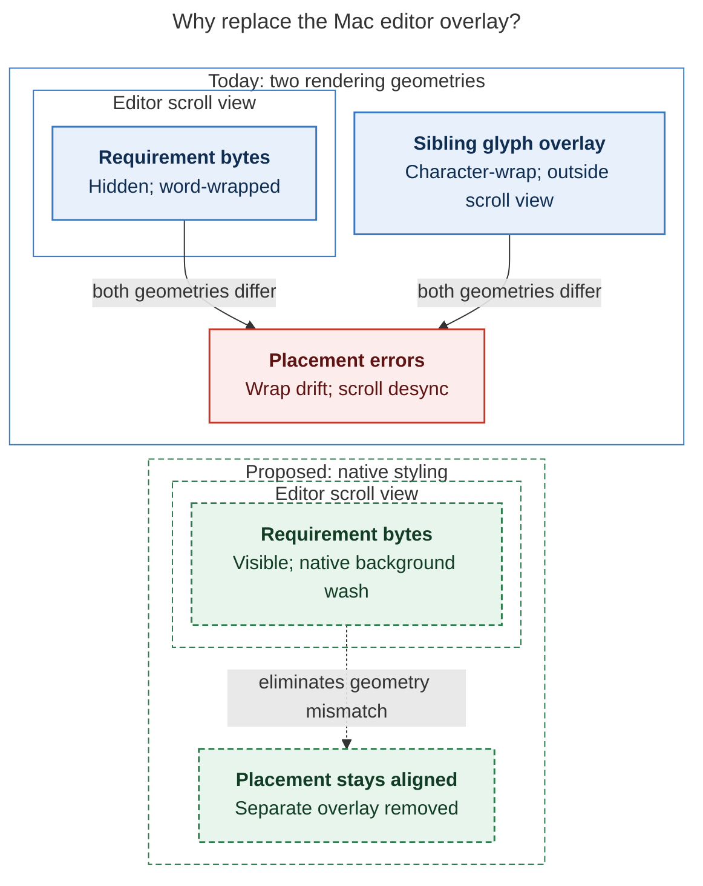

# Diagram proposals: Task requirements display redesign: one diamond, every depth

Proposals for the swarm linker, not a report. Each diagram restates only what the source
report says.

```yaml
source: research:202611/task_reqs_display_redesign/task_reqs_display_redesign__final.md
producer: research.5u.image
check: "mmdc 12.0.0 with the PDF-mirroring config and Puppeteer --no-sandbox rendered 1 of 1 Mermaid diagrams"
```

## mac-editor-geometry

```yaml
anchor: |-
  The overlay is a `ZStack` sibling *outside* the editor's internal scroll view
question: |-
  Why does native Mac editor styling avoid the overlay's wrap and scroll failures?
illustrates: |-
  The proposed native AttributedString chip deletes the overlay and concealment, avoiding wrap drift and scroll desync from two mismatched rendering geometries.
caption: Native styling keeps requirement bytes in the editor, eliminating the separate wrapping and scrolling geometry that can misplace today's overlay.
review: "608.141x994 px, fit 89.8%; question, visual, source-trace, and unique-anchor checks passed; 1 layout revision across 2 visual review rounds; today's convergence means both geometries differ"
```


