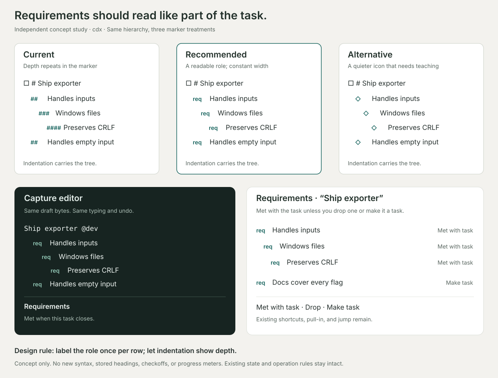

# Task requirements: make the meaning visible, keep the model intact

Independent research by **cdx** · 22 November 2026

**Recommendation:** replace the repeated hash run with a small, unboxed **`req` text marker**, identical at every depth. Keep ordinary indentation, authored Markdown, and every task-requirement operation. Use the full word **Requirements** in existing preview and close-card headings, with one sentence explaining that requirements are met with their task. This is a typography and presentation change, not a new task system.

The direction is good. The most useful adjustment is to define “better display” as **clearer meaning plus calmer typography**, rather than finding a prettier mystery glyph. A tiny diamond is a plausible visual alternative, but I would test it against `req`, not assume it is intuitive.



*Concept study, not an application screenshot. It compares identity marks and illustrates layout; the application’s existing controls and keyboard behavior remain authoritative. The SVG uses simplified task marks and shows the proposed, explicitly identified copy changes.*

## Evidence and limits

I independently read the approved `plan:202611/task_requirements.md` through `sase artifact read`, the audited `bob-cli-on` bead, the current requirements contract and recognizer, Obsidian rendering sources, and Mac editor overlays. I consulted official Obsidian documentation, W3C accessibility guidance, NN/g research guidance, and Linear’s documentation. I did not consult any other report, transcript, or finding from this research swarm.

The epic was still **in progress** when inspected. Its recognizer, capture authoring, Obsidian marks and guards, and Mac authoring were marked closed; close-card integration and other phases remained active. This report designs against the approved completed behavior, with code observations pinned below. Recheck the final landed contract before implementation. This is an expert design assessment, not observed usability testing or a claim that I ran the Mac/Obsidian interfaces.

| Repository | Inspected revision | Relevant evidence |
| --- | --- | --- |
| bob-cli | `b7945e75d038506675de04f06bac826990db3d27` | `docs/task-requirements.md`; `docs/task-tag-marks.md`; `src/native/task_reqs.rs`; `src/native/task_complete/req_close.rs`; `src/native/capture_parse.rs` |
| bob-plugins | `9b4bc2ca3b2c72c30538739b029dca705ee9f131` | `plugins/bob-ledger-tools/styles.css`, requirements section; `src/264-plugin-task-reqs.js` in that plugin; `plugins/task-status-cycler/src/195-task-reqs-twin.js` |
| bob-mac-capture | `8562f811bb0d28c74fede42a78ca85e546cc60df` | `Sources/BobMacCapture/CapturePanelModel.swift`, `requirementMarkerSpans()`; `CapturePanelView.swift`, `RequirementMarkerGlyphOverlay`; `Sources/CaptureCore/CaptureModels.swift`, `CaptureSpan.depth` |

The contracts and implementation observations below refer to these snapshots, not an assumption that the entire epic has shipped everywhere.

## What the feature actually means

The user’s `##`, `###` description captures the visual problem, but these are **rendered hash runs**, not Markdown headings. The stored form is already an ordinary checkbox list item without `#task`. A structural parent that is a task or another requirement establishes ownership. Checkboxes under notes, drawers, code, or quotes are different. Changing the display therefore does **not** require a vault migration. [Requirements contract, §§1–5](https://github.com/bobs-org/bob-cli/blob/b7945e75d038506675de04f06bac826990db3d27/docs/task-requirements.md)

The following behavior must survive unchanged:

- A requirement describes part of one task’s scope. It has no independent lane, scheduling, freshness, dependency, or planning identity.
- Pending requirements become **Met** when their owner is done and **Moot** when it is cancelled; reopening derives Pending again. Bob does not stamp their boxes complete.
- Drop, restore, and carry keep their existing meanings. Carry creates an actual task and leaves a linked stub, without silently creating a dependency.
- A dropped or carried ancestor excludes its descendants. Excluded does not mean met. Historical hand-written `[x]` and unknown marks retain the contract’s special handling.
- Nesting and ownership remain structural, with the existing depth bound of 16. Subtasks carrying `#task` establish a different ownership boundary.
- The NOTES rule, first-requirement note relocation, promotion, close defaults, shortcut meanings, transaction guards, and undo behavior stay intact.

These invariants come from the [recognizer and state model](https://github.com/bobs-org/bob-cli/blob/b7945e75d038506675de04f06bac826990db3d27/src/native/task_reqs.rs) and the [approved contract](https://github.com/bobs-org/bob-cli/blob/b7945e75d038506675de04f06bac826990db3d27/docs/task-requirements.md). They are the acceptance baseline for this proposal.

## Critique: yes to the redesign, with a narrower ambition

**The existing rendering overuses depth as a visual signal.** A top-level requirement gets two hashes, a child three, and all depths from three onward four. Indentation already communicates hierarchy, while the mark grows heavier as the content becomes more subordinate. The saturation also means it is not an accurate depth readout for deep trees. Obsidian’s CSS changes marker width with this count; the Mac instead draws the run inside a fixed four-character slot. These are concrete implementation observations, not a finding from user testing. [Obsidian styles](https://github.com/bobs-org/bob-plugins/blob/9b4bc2ca3b2c72c30538739b029dca705ee9f131/plugins/bob-ledger-tools/styles.css), [Mac overlay](https://github.com/bobs-org/bob-mac-capture/blob/8562f811bb0d28c74fede42a78ca85e546cc60df/Sources/BobMacCapture/CapturePanelView.swift)

**There is also a semantic problem that a nicer icon alone cannot solve.** A checkbox invites completion. A hash suggests a tag, heading, or abbreviated task. Neither tells the reader that completion is inherited from the owning task. The W3C checkbox pattern explicitly associates the control with state changes and Space activation; that is the wrong promise for a passive requirement identity mark. [W3C checkbox pattern](https://www.w3.org/WAI/ARIA/apg/patterns/checkbox/)

**Keep the feature for completion criteria; watch for pressure to use it as a step tracker.** “Handles empty input” fits naturally. “Run the migration, then notify support” may express work the user wants to tick independently. That is a model question, not a styling defect. Keep the approved behavior for this work, but regard repeated attempts to complete individual requirements as evidence to revisit the model separately. Do not add progress percentages or independent checkoffs to make a misleading appearance feel consistent.

**Finish the epic first, as requested.** A stable behavioral baseline makes a later visual change independently assessable. It also prevents the redesign from obscuring unfinished close and carry integrations. The follow-up should not absorb the epic’s already recorded implementation defects or repeat its vault migration.

**Preserve the text editor.** Building a nested form, callout, or mini application around every task would make a large design and engineering investment for a small repeating element. Obsidian already supports revealing syntax during Live Preview editing, and the Mac has a nonmutating overlay. Work with those mechanisms. [Obsidian editing modes](https://obsidian.md/help/edit-and-read)

## Options compared

These are design judgments, not numerical scores disguised as research results.

| Option | Main benefit | Main drawback | Decision |
| --- | --- | --- | --- |
| Refine the repeated hash run | Cheapest visual adjustment; retains the task-mark family | Still ambiguous; duplicates indentation; increasing visual weight remains | Reject |
| Show ordinary checkboxes | Familiar; identical to Markdown source | Suggests independent completion, contradicting the core rule | Reject as the enhanced display; retain raw fallback |
| One outlined diamond, `◇` | Compact; distinct from the task hash; no depth repetition | Has no established meaning here; still needs teaching or a visible label | Runner-up to test |
| Small `req` text mark | Names the row’s role; same width at every depth; fits existing editor slot | Slightly more textual texture; abbreviation must be taught once | **Recommend** |
| Plain bullets plus indentation only | Quietest possible outline | Requirements become hard to distinguish from their attached notes | Reject |
| `1.2.3` numbering | Explicit hierarchy and useful verbal references | Renumbering is visually noisy; ordinals look like stable IDs but are not | Keep out of resting UI |
| “Requirements” drawer or callout | Strong grouping and a visible title | A real drawer/quote changes recognition; a virtual wrapper adds editor complexity | Reject as storage; defer synthetic editor containers |
| Per-row chips/cards | Large space for status and actions | Excess chrome, wrapping, and density cost in notes and capture | Reserve existing cards for review |

The icon-label concern is grounded in NN/g’s guidance that unfamiliar icons need visible text and should not rely on hover for meaning. The inference for Bob is mine: `req` is a better first candidate than inventing a universal “requirement” symbol. It is not an assertion that NN/g tested either Bob design. [Icon usability](https://www.nngroup.com/articles/icon-usability/)

Linear’s sub-issues are a useful boundary comparison: they are independently meaningful pieces of work, including work split among teammates. Bob requirements deliberately do not carry that independence. Borrow readable hierarchy, not the subtask semantics or progress model. [Linear parent and sub-issues](https://linear.app/docs/parent-and-sub-issues)

## Proposed presentation

### One quiet identity mark

Use lowercase **`req`**, in the interface typeface at approximately 80–85% of the surrounding text size, medium weight, with no border, pill background, shadow, underline, or hover animation. Treat that size as a prototype starting point: it must scale with text and remain readable rather than shrink to fit. Preserve the owner’s existing identity hue where available; color is redundant with the label and never indicates state.

Reserve a constant marker slot independent of depth and state. In capture, keep the existing four-character `[ ] ` layout slot; draw `req` within it without changing any text-storage advance. In Obsidian, use one consistent marker width at every requirement depth. Do not attempt to force identical pixel widths across native and web fonts.

Indentation communicates the tree. Existing outline guides can remain. Do not add a second tree of connecting lines or depth counters. Notes keep their ordinary bullet treatment. Task identity marks stay as they are. An explicit task nested in the outline still looks like a task, not a requirement.

Use **Requirements** in group titles, notices with room, accessible names, and explanatory copy. Use **req** only where space is genuinely tight. Do not introduce a parallel vocabulary of “specs,” “conditions,” and “scope items.” Explain the idea using completion criteria without renaming the feature.

### Obsidian

Illustrative rendering, with the existing task checkbox and task identity represented schematically:

```text
□ # Ship the exporter
    req Handles supported inputs
        req Handles Windows files
            req Preserves CRLF
            • Fixture: windows.csv
        req Handles empty input
    req Benchmarks within 5% of v1       Dropped
    req Docs cover every flag →         Own task
    NOTES
        • Morgan reported the original issue.
```

“Dropped” and “Own task” here make the mockup self-explanatory; see the state specification below for when labels belong in the actual compact outline. Keep the list structure and note locations exactly as stored. In particular, do not insert an authored `REQUIREMENTS` heading, or put a container between a task and its requirements.

Live Preview and Reading view use the same identity mark. Source mode remains literal Markdown. Editing or selecting the marker exposes the existing source bytes according to the current reveal behavior. A decoration must not create an extra cursor stop or intercept normal text selection. The existing session toggle still restores the native presentation.

The literal source remains:

```markdown
- [ ] #task Ship the exporter ^export
    - [ ] Handles supported inputs
        - [ ] Handles Windows files
            - [ ] Preserves CRLF
            - Fixture: windows.csv
        - [ ] Handles empty input
```

There is no new `req` authoring syntax. Copying the source copies `[ ]`, not the visual label. A cursor inside the source marker may show `[ ]` temporarily; that is the editor doing its job, not a reason to introduce a second parser. The existing portability cost remains: a plugin-free reader can show unchecked boxes beneath a completed task. This redesign improves Bob’s presentation; it cannot make unrelated Markdown consumers understand derived state.

### Capture: the same role, two different surfaces

**Editor:** replace the hash overlay with `req`, preserving every byte, range, wrapping advance, typing expansion, overtype, Backspace, and undo operation. Do not make a text-entry panel behave like a draggable checklist. Raw source remains available while editing the marker.

**Preview:** use the full heading **Requirements** when presenting the group and one explanatory sentence: **“Met when this task closes. Drop one or make it a task if the scope changes.”** Keep existing information about first-requirement note relocation visible; it describes a real write and should not disappear during visual simplification. If a new contextual hint is added, it belongs in the existing auxiliary area without shifting the editor’s fixed eye line.

The Mac must only decorate valid `req_marker` spans returned by Bob for the exact current draft. If the parse is stale, the depth is absent, or support is unavailable, show raw Markdown. The inspected implementation already guards draft identity and a four-byte marker. Preserve those checks. Never infer requirements in Swift by searching for `[ ]` locally. This follows `decisions:mac-capture-is-a-thin-client` and the [current span consumer](https://github.com/bobs-org/bob-mac-capture/blob/8562f811bb0d28c74fede42a78ca85e546cc60df/Sources/BobMacCapture/CapturePanelModel.swift).

### Close and successor cards

Keep the completed epic’s card structure, requirement ordering, selection model, defaults, shortcuts, and branch behavior. Replace the hash run here too. Retain **Requirements · “Owner”** as the heading.

The most useful copy improvement is to describe the default as **“Met with task”** or **“Met when closed”**, rather than a bare “Met” that can look like a claim of independently recorded progress. The exact tense must match the surface: capture previews a pending close; Obsidian can present its card after the owner is already done. These are proposed presentation changes, not current strings.

```text
Requirements · “Ship the exporter”
Met with the task unless you drop one or make it a task.

req Handles supported inputs               Met with task
    req Handles Windows files             Met with task
        req Preserves CRLF                Met with task
req Docs cover every flag                 Make task

Existing row actions and shortcuts remain here.
```

Show the available verbs in the existing selected-row action/footer area: **Met with task**, **Drop**, **Make task**, and the existing pull-in and jump actions. Do not add clickable checkboxes to every row. Keep inline drop reasons and explicit branch consequences such as “2 nested go with it.” The actions already exist; the proposal changes their visual explanation.

Do not add a new “acknowledge every requirement” gate. An untouched requirement still follows the current default. Keep the platform-specific cancellation contract: dismissing the Obsidian post-close card leaves its owner done, while escaping the Mac interaction returns to the draft. Uniform styling must not imply uniform transaction timing. [Approved close contract](https://github.com/bobs-org/bob-cli/blob/b7945e75d038506675de04f06bac826990db3d27/docs/task-requirements.md), `plan:202611/task_requirements.md` §7 and acceptance evidence.

### State specification

`req` always identifies the row kind. Do not overload changing marker shapes to encode lifecycle. In existing cards and accessible descriptions, use words; in the dense outline, combine the owner’s visible state with established row styling and explicit exception cues.

| Effective state | Compact outline | Full description in card/accessible context |
| --- | --- | --- |
| Pending | Normal readable text; owner’s identity ink on `req` | “Requirement · pending · met when [owner] closes” |
| Met | Existing done-owner line treatment; readable muted marker | “Requirement · met with [owner]”; distinguish legacy explicit met where relevant |
| Moot | Existing cancelled-owner treatment | “Requirement · moot because [owner] was cancelled” |
| Dropped | Existing strikethrough; preserve Cancel Log and reason | “Requirement · dropped”; reason remains discoverable |
| Carried | `req`, existing arrow, and live destination link | “Requirement · carried into its own task”; link retains destination status |
| Excluded | Muted but not struck; add a short “with parent” annotation only where needed to disambiguate | “Requirement · excluded with [ancestor]”, naming whether it was dropped or carried |

The last row’s visible annotation is an explicitly proposed addition; it is not essential to swapping the mark and must not introduce source text. Avoid making a long annotation appear and disappear next to the caret. Prefer existing card or focused-context space if a stable inline implementation cannot be demonstrated.

No fraction such as `3/7`, progress ring, or completion percentage should appear. If an existing surface needs a count, say **“7 requirements”**, and preserve the authoritative pending/branch-count definition. Dropped and carried history is separate. Parent and child requirements are statements of scope, not equal units of effort.

## Beauty, accessibility, and editing reliability are one design problem

A calm appearance should come from consistent alignment, normal body text, restrained secondary type, and little chrome. It should not come from making meaningful information faint. Use at least 4.5:1 contrast for normal-size labels and text; meaningful graphical indicators need at least 3:1 against adjacent colors. These are design targets derived from WCAG, not a claim of certification for either application. [Text contrast](https://www.w3.org/WAI/WCAG22/Understanding/contrast-minimum.html), [non-text contrast](https://www.w3.org/WAI/WCAG22/Understanding/non-text-contrast.html)

Because `req` is text, an existing owner ink that passed only the graphical 3:1 threshold may need a contrast-adjusted text variant while retaining its hue identity. Test marker and state readability in grayscale and across actual owner hue/background combinations. The word `req`, the arrow, strikethrough, and state text must carry meaning without hue. [Use of color](https://www.w3.org/WAI/WCAG22/Understanding/use-of-color.html)

Do not rely on CSS masking or `pointer-events: none` to establish accessibility semantics. The inspected Obsidian code adds labels to native checkbox inputs; the Mac marks its drawing overlay accessibility-hidden. Those are implementation facts, not proof of a screen-reader failure. Verify the resulting accessibility trees and keyboard paths. In enhanced rendered views, a requirement must be described as a requirement and its effective state, without inviting independent checkbox activation. Preserve ordinary raw-text editing and avoid duplicate announcements. Where changing the accessibility host is necessary, prefer a small explicit renderer change over pretending a misleading control is fixed by new colors.

For the first release, retain existing folding behavior. Progressive disclosure is useful for secondary controls and historical detail, but automatically hiding active requirements would weaken the review. Do not default-collapse pending branches, introduce depth-based truncation, or hide notes to make the screenshot tidy. This application of the principle is a design inference. [Progressive disclosure](https://www.nngroup.com/articles/progressive-disclosure/)

A real Obsidian callout is not a cosmetic wrapper: it is authored as a blockquote, and Bob’s recognizer excludes quoted checkboxes. A synthetic callout could avoid that semantic break, but then has editor geometry, selection, and accessibility costs. Neither is justified for this change. [Obsidian callouts](https://obsidian.md/help/callouts)

## Explicit adjustments to the request

| Adjustment | Why it is justified | Scope boundary |
| --- | --- | --- |
| Treat this as a shared presentation contract across notes, capture editor, preview, close cards, notices, and human output | Fixing only one screen leaves contradictory vocabulary | No change to machine semantics or stored Markdown |
| Prefer a readable compact label over another icon | The problem includes interpretation, not just ornament | `req` is display text, never a new capture token |
| Allow small explanatory-copy and accessibility changes | A passive glyph cannot explain derived completion by itself | No new confirmation step, independent checkoff, or shortcut |
| Explicitly require stable editor geometry and safe raw fallback | Reliability is central to a text-first workflow | Preserve current source-reveal behavior and offsets |
| Validate the design with real task examples after the epic lands | The final integration is still moving and beauty is not empirically established | A short comparison and dogfood pass, not a new research program |
| Keep deep nesting but stop encoding it in the mark | Removing supported depth would change behavior | No new nesting limit, automatic flattening, or forced promotion |

These are recommendations for the follow-up’s scope, not newly approved product changes. The SVG and text mockups intentionally label the proposed copy; no runtime, vault, or memory changes were made during this research.

## Practical delivery and validation

This is a bounded follow-up. The first pass should replace the marker and align its label across the already implemented surfaces. Add only the minimum explanatory copy and accessibility work needed to make the presentation truthful. Do not bundle a new requirements panel, drag-and-drop, new fold controls, independent status editing, or a migration.

The relevant implementation seams already exist:

- **bob-cli:** `req_run()` currently returns the repeated hash strings; close groups expose a run/glyph and authoritative consequences. Audit human output, notices, and display-only fixtures. Keep requirement paths, row identities, verdicts, and JSON semantics unchanged. If any additive display field is needed, preserve version compatibility rather than silently changing the meaning of existing fields.
- **Obsidian:** change the requirement-specific mask/marker presentation in `bob-ledger-tools`; preserve ownership attributes, state handling, source reveal, and the reading-view pass. Audit the other plugin copies of display strings separately from the shared semantic recognizer. Do not alter conformance vectors to disguise semantic drift.
- **Mac:** change `RequirementMarkerGlyphOverlay` and the completed epic’s card renderers. Keep Bob’s span authority, current-draft guards, four-cell layout, and literal copy behavior. The inspected overlay uses a neutral palette entry; do not promise an owner hue unless Bob actually provides it on that surface. Neutral is the honest fallback.

This is not guaranteed to be a one-line CSS substitution. The current Obsidian contract uses an attribute-only pass and paints native checkbox inputs with an SVG mask. The prototype must establish how a text mark fits that mechanism; if a small replacement widget is needed for reliable text or accessibility, call out that rendering-mechanism change explicitly. It must preserve selection, source reveal, and document bytes. No semantic parser rewrite follows from that choice.

Obsidian’s decoration API distinguishes styling lines from inserting/replacing elements, and warns that decorations affecting viewport layout need appropriate state handling. That supports starting with a fixed-size marker instead of synthetic full-width sections. [Obsidian decorations](https://docs.obsidian.md/Plugins/Editor/Decorations)

A focused acceptance matrix:

| Question | Evidence to collect |
| --- | --- |
| Is this still exactly the same feature? | Existing RQ/RL/RW, carry, and close vectors pass unchanged for semantic fields and written bytes; display snapshots are reviewed separately |
| Is hierarchy readable? | Depths 1, 2, 3, 8, and 16; long wrapped text; interleaved notes; nested real tasks; owner scrolled offscreen |
| Are states truthful? | Pending, met, moot, dropped with reason, carried live link, excluded descendants, legacy `[x]`, unknown marks; close/cancel/reopen |
| Does editing remain ordinary? | Marker reveal, pointer selection, keyboard selection across a marker, copy/paste, undo/redo, Tab/Shift-Tab, Vim insert, IME composition |
| Is capture robust? | Stale parse responses, missing depth, Unicode before the span, narrow widths, long wraps, resize while typing; raw fallback never loses text |
| Does it survive different presentations? | Obsidian Reading/Live Preview/Source, tag-mark toggle, plugin-disabled view, Mac capture/preview/close, dark/light, text scaling and increased contrast |
| Does accessibility tell the truth? | Inspect accessibility tree; keyboard focus and Space; VoiceOver and an Obsidian-supported screen reader; no active standalone completion control or duplicate labels |
| Are operations unchanged? | Same carry/drop/restore results, cancellation timing, transaction refusals, branch consequences, source bytes, and undo boundaries |

Use the existing meaningful suites and host-specific build/CI checks; do not write tautological tests for the spelling of `req`. On the Mac, hosted compilation and the repository’s exact-revision CI gate remain necessary for actual implementation. This research did not change Swift or run those gates.

For usability, compare the current hashes, `req`, and diamond-with-context on the same three examples: a short task, a nested branch with notes, and a close card with a dropped or carried branch. Ask Bryan to identify requirements versus tasks versus notes, predict what closes with the owner, find what can be scheduled, and carry one branch. Repeat on a handful of real tasks after a day’s use. Record misunderstandings and editing errors, not just visual preference. Testing icon interpretation in context is specifically recommended by NN/g. [Testing digital icons](https://www.nngroup.com/articles/how-to-test-digital-icons/)

**Decision rule:** ship the smallest presentation that makes those predictions reliable and is comfortable to read. If `req` is clearly understood but feels too repetitive, compare the diamond with an always-visible Requirements heading in cards; do not silently switch the text editor to an unexplained diamond. If Bryan repeatedly wants to tick individual requirements, stop polishing the marker and discuss the model in a separate change.

## Recommended solution

**After `bob-cli-on` is complete, ship a presentation-only follow-up centered on a constant, unboxed `req` marker.** Keep depth in indentation, retain the exact Markdown and operations, and use existing preview/close-card space to explain **“met with the task.”** Preserve the owner’s visual identity, make exceptional outcomes readable, and verify editing and accessibility rather than relying on a clean screenshot.

This removes the hash noise without introducing a new symbol language or another container to manage. It is the best balance of intuitive meaning, reliable implementation, and visual restraint. Keep the single diamond as a tested alternative; do not change the underlying requirement model unless real use shows that independently completing steps is the actual unmet need.
