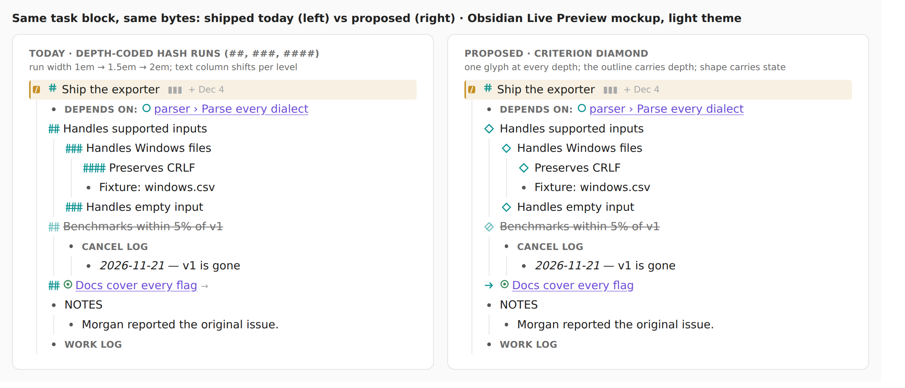

# Task requirements display redesign: one diamond, every depth

Lead consolidation of five independent reports (cdx, cld, grk, mus, gem) plus the lead's
own code verification · 2026-11-22

**Research question:** Bryan likes the task-reqs feature (`bob-cli-on`) but the
presentation — hash runs that read as `##` / `###` / `####` in Obsidian and the capture
panel — is bad. Once the epic's work is complete, change how reqs are *displayed*
without changing how they *behave*. Lead the design: intuitive, reliable, beautiful.
Critique the plan, call out any justified requirement adjustments, and end with a
recommended solution.

## Bottom line

**Yes, this is a good plan, and the swarm converged hard on the fix: replace the
depth-counted hash run with one constant-width requirement mark at every depth, and let
indentation (which already carries depth) be the only depth signal.** Three of five
researchers independently recommended the same mark — a small hollow **diamond `◇`** in
the checkbox slot — and the other two recommended constant-width alternatives (`req`
text; a constant `⌗⌗`) while agreeing on every structural point. I recommend the
diamond, with state carried by the mark's fill the way Bob's task-link rings already
work: **◇ pending · ◆ met · slashed ◇ dropped · → carried · faded ◇ moot/excluded**.

Two adjustments to the request itself, both justified below and both unanimous or
near-unanimous across the swarm:

1. **Decide now; ship after the epic.** Three phases still in flight (`.8` close-engine
   vectors, `.11` Obsidian successor card, `.15` Mac Pull-In card) are building the
   hash run into brand-new cards and wire values. A one-line instruction to those
   phases — route the glyph through one helper per host, indent from `depth`, treat
   `run` as opaque — makes the later swap a near-one-liner instead of a three-repo
   unwind.
2. **"Display-only" still touches copy strings and two JSON display values**
   (`copy.glyph`, row `run`) plus their RV vectors. No key, schema, byte, grammar,
   state, or gesture changes — but pretending the CLI strings and vectors are out of
   scope would leave `⌗⌗` in half the surfaces.

The redesign is cheap because the epic already did the hard part: Obsidian emits
`data-bob-req-state` / `data-bob-req-depth` attributes (the new look is almost entirely
`styles.css`), the Mac draws one overlay view, and bob-cli funnels the glyph through one
helper (`req_run`). Alongside the glyph swap, the swarm found and I **verified** several
shipped display defects worth fixing in the same pass (§4).

_Figure 1 (from the cld report): the same Markdown rendered both ways. Nothing in the
vault changes._

## 1. What ships today, and the shared diagnosis

The stored form is already right: a requirement is an ordinary `- [ ] ` checkbox item
without `#task`, owned structurally by the task (or req) above it, met/moot *derived*
from the owner's state, dropped/carried by gesture. No display change needs a migration
(≈39 req lines exist in the vault, all depth 1 — cld's scan).

What draws today (verified in this consolidation at bob-cli `b7945e75`, bob-plugins and
bob-mac-capture master as of 2026-11-22):

- **Obsidian:** the checkbox `input` becomes a CSS mask of 2/3/4 slanted hashes, width
  `calc(count × 0.5em)`, in the owner's type ink (`styles.css:7497–7595`; sixteen
  near-identical depth selectors express "3 or more").
- **Mac capture:** a `ZStack` overlay draws literal `⌗` text
  (`String(repeating:count: min(depth,3)+1)`) in **neutral grey** monospace over the
  concealed `[ ] ` bytes.
- **bob-cli:** `req_run(depth)` returns `"⌗⌗"`/`"⌗⌗⌗"`/`"⌗⌗⌗⌗"`; the run is copied into
  human output, notices, close-card JSON (`copy.glyph`, row `run`), three JS twins, and
  the RV vectors.

All five reports, working independently, converged on the same five-part diagnosis:

1. **It reads as Markdown headings.** A run of hashes at line start is ATX heading
   chrome (CommonMark §4.2) to anyone who has used Markdown; Bryan describing his own
   feature as "`##`, `###`, etc" is the proof the disguise failed. On the Mac it is
   literally grey monospace text — a draft row reads like typed, broken Markdown.
2. **The hierarchy is upside down.** The owner task wears one `⌗`; its deepest, least
   important req wears `⌗⌗⌗⌗` — the loudest mark on the block.
3. **Depth is triple-encoded and then lies.** Indentation, the run, and the tooltip all
   carry depth; the run saturates at four, so depths 3–16 look identical.
4. **The growing slot wrecks alignment.** Marker width grows 1em → 1.5em → 2em with
   depth, so nested req text drifts right relative to its own notes.
5. **Shape carries no state.** Every state paints the same mask; in a `done/` archive,
   met and dropped differ only by a strikethrough. Meanwhile a checkbox-shaped thing
   invites the tick that Bob then refuses (W3C checkbox pattern; cdx).

Industry practice agrees: TaskPaper, Todoist, Things, OmniFocus, and Org-mode all keep
the bullet constant and let indentation carry nesting; nobody counts glyphs to feel
depth (mus). Things' checklists and GitHub's task-lists-vs-sub-issues split both show
the same species boundary Bob already drew: lightweight criteria inside a task look
*quieter* than the task, never like headings or sibling issues (grk).

## 2. Critique: is the plan a good idea?

**Yes.** The epic got the durable parts right — recognizer, derived met, zones, carry,
close-card audit — and rendering is deliberately decoupled from all of them
(attributes + CSS in Obsidian, one overlay on the Mac, strings in bob). Display is the
cheapest layer to redo and the one Bryan touches hundreds of times a week. With ~39 req
lines in the vault and the look days old, there is no relearning cost. Every report
endorsed the display-only constraint; none proposed reopening storage, authoring,
derived-met, NOTES, carry, or promotion.

**Boundaries the redesign must respect** (consensus):

- No vault migration, no byte changes, no new capture syntax, no `GRAMMAR_REVISION`
  bump. Raw surfaces (source mode, GitHub, plugin-off) keep showing honest `- [ ]`.
- Keep the hidden, unclickable checkbox; cursor/caret reveal of raw bytes; the
  tag-marks session toggle; existing state line treatments; all shortcuts and card
  behavior; the depth-16 bound.
- Don't build a heavier "Requirements" container (callout, boxed form, drag-and-drop
  checklist): it fights the outliner, breaks Live Preview cursor reveal, and makes a
  light feature feel like a form (cdx, cld).
- Don't "fix" raw `done/` views or Dataview queries in this pass — that's behavior and
  migration territory with its own owners (mus).

**The one timing correction (ADJ-1):** Bryan said "once the work … is complete." Four
of five reports (cld strongest) say *decide now, implement after*: phases `.8`, `.11`,
and `.15` are pouring `⌗⌗` into new card JSON, vectors, and two card UIs right now, and
§12.25's requirements-group wire format is not yet written up. The fix is not to
interrupt the epic but to send its in-flight phases one instruction: draw through one
helper per host (`req_glyph` / `taskReqGlyph` / one Swift view), indent from
`row.req.depth`, never parse the `run` string. cdx's dissent — finish first so the
baseline is stable — is honored by keeping *implementation* strictly after the epic
lands.

## 3. Resolving the swarm's disagreements

### 3.1 The mark: diamond vs. `req` text vs. constant `⌗⌗`

| Candidate | Backers | Why it wins / loses |
| --- | --- | --- |
| **Hollow diamond `◇`** | cld, grk, gem | **Recommend.** Extends Bob's verified design language — `docs/task-link-marks.md` literally states *"Identity by shape, state by fill"* and *"Rings, not checkboxes"*. The grammar becomes: **square = task, ring = link to a task, diamond = requirement, dot = note**. Diamond is the established milestone/criterion mark (Gantt, UML, Bullet Journal signifiers), is a square rotated 45° (kin to the checkbox it replaces, but visibly not tickable), and has **zero collisions** in bob-cli/bob-plugins/Mac sources (verified; `◆` appears only twice, as the CLI default-Pomodoro marker). |
| `req` text label | cdx (diamond as runner-up) | Strongest on instant meaning (NN/g: unfamiliar icons need labels), but adds textual texture to every row, carries no state axis, and the labeling concern is better served by cdx's own copy recommendations (full word **Requirements** in group headings, "met with the task" teaching line) — which this report adopts. |
| Constant `⌗⌗` | mus | The minimal diff, and faithful to Bryan's original "only `##`" spec — but Bryan is the one revisiting that spec (he filed `^replace-reqs-hash-hash`), a constant `⌗⌗` still wears the H2 silhouette, and it still doubles the `#task` identity glyph. Keep as the fallback if the diamond disappoints in a live mock. |
| Ring, ghost checkbox, `↳` crook, `REQ` pill, scope rail, heading CSS | — | Independently rejected across reports: rings collide with task-link rings (a carried stub would wear two rings on one line); squares invite ticking; `↳` collides with Carried `→` and Mac sub-bullets; pills violate "no pill at rest"; rails are geometry-brittle on all three surfaces and still need a per-row mark. |

Every candidate that survived any report shares the structural consensus: **one mark,
one width (1em slot in Obsidian), every depth; indentation is the only visible depth
signal; exact level stays in the tooltip, aria label, and card JSON.**

### 3.2 State: shape-by-fill vs. constant mark

cld and gem put lifecycle in the mark's fill; cdx and grk keep the mark constant and
leave state to the existing text treatments. **Recommend shape-by-fill** — it is the
same rule the task-link rings already follow, it is grayscale- and colorblind-safe, and
it fixes a real legibility gap (verified: in `done/`, met and dropped reqs differ today
only by strikethrough; the carried `→` is a line-trailing `::after` that Reading view
renders *below the entire nested subtree*):

| State | Mark | Text |
| --- | --- | --- |
| Pending | ◇ full ink | normal |
| Met (derived or legacy `[x]`) | ◆ muted | muted, **never struck** |
| Moot (owner cancelled) | ◇ faded | muted |
| Dropped | slashed ◇ | muted + struck; Cancel Log beneath |
| Carried | → in the marker slot | stub wikilink keeps its live task-link ring |
| Excluded (ancestor dropped/carried) | ◇ faded | muted, not struck; tooltip `goes with "{ancestor}"` |
| Unknown hand mark (`[?]`, `[*]`) | ◇ repair orange | normal |

Ink still never encodes state (contract rule, kept). No `2/4` progress chip, ever: under
derived met, a pending ratio cannot move while the owner is open, so it misleads
(cld ADJ-5, gem A7, grk defers — consensus to retire; if a count is ever needed, say
"7 requirements" or `◇ 3`, never a fraction).

**Rejected: gem's depth taper** (scale 100% → 84% → 72% and opacity fading with depth).
It quietly reintroduces depth encoding in the mark — the very defect being removed —
and it spends opacity, which this design reserves for *state*. Four of five reports
specify a constant mark; adjacent depths would be indistinguishable anyway (mus's
critique of fade ramps).

### 3.3 Ink: owner's type hue vs. identity teal

cld, cdx, and gem keep the owner's ink (type hue, or teal default) — the shipped rule;
grk argues type ink is a task signal and reqs should be flat identity teal. **Recommend
keeping the owner's ink**: it visually ties each requirement to its owner (valuable
when a long block scrolls), the shipped CSS ink ramp needs zero changes, and "ink never
encodes state" still holds. grk's purism is noted as the one-variable alternative if
the owner hue reads too loud in practice. (On the Mac the current draft has no owner
hue available — use the identity teal there, honestly, until/unless bob adds an additive
`hue` to `req_marker` spans. The shipped grey was a plan miss; the plan asked for owner
ink or teal.)

### 3.4 The Mac editor: overlay vs. native styling — the real reliability fork

gem audited the shipped Mac code and claimed the `ZStack` glyph overlay is
architecturally fragile. **I verified the load-bearing claims:**

- `CaptureMonospaceGlyphOrigin.wrappingOrigin` counts characters and hard-wraps at
  `charsPerLine` with **no word-wrap awareness** — while the `TextEditor` soft-wraps at
  spaces. Overlay drift on wrapped drafts is real in principle (shared with the
  route-emoji overlay, which uses the same mechanism).
- The overlay is a `ZStack` sibling *outside* the editor's internal scroll view, so a
  draft that scrolls under its height ceiling desyncs the glyphs.
- **The contract/implementation divergence is confirmed:** `docs/task-requirements.md`
  §4 promises "Caret adjacency reveals the raw bytes" on the Mac, but
  `requirementMarkerSpans()` / the `.clear` concealment branch have **no caret gate at
  all** — the bytes are always concealed, and the caret walks invisibly across four
  transparent cells. (cdx and grk quoted the contract; gem read the code; the
  divergence itself is a bug, filed as a task bead with this research.)

Given that, the Mac recommendation is two-tier:

- **Editor (default): gem's native `AttributedString` chip.** Delete the overlay and
  concealment; render the real `- [ ] ` bytes with a quiet tertiary `- ` and a soft
  teal/owner-ink wash behind `[ ]` — the exact pattern the `@route^id@` manila chips
  and `#TYPE` washes already use. Zero wrap drift, zero scroll desync, zero invisible
  caret, bytes stay honest in a byte-honest editor. If Bryan specifically wants `◇`
  inside the editor, the fallback is a TextKit-rect-anchored (`firstRect(forCharacterRange:)`)
  single diamond with a real caret-adjacency reveal — never `wrappingOrigin`.
- **Preview and cards: the diamond, pixel-matched to Obsidian.** The `BlockDiffCard`
  live preview and the Pull-In card draw one SwiftUI `Shape` (same normalized vertices
  as the CSS mask), chosen from `req.state`, indented from `req.depth`. This keeps
  `decisions:mac-capture-is-a-thin-client` intact: Swift never infers reqs from `[ ]`.

### 3.5 Wire format: glyph as token, not contract

Three compatible fixes, merged:

- `copy.glyph` on the requirements close-card group becomes the semantic token
  `"requirement"` — like every other group's `hand_off` / `relation` / `note_pull` —
  so the next look change touches no vectors (cld ADJ-2).
- Row `run` becomes a constant `"◇"` text fallback at every depth; rich clients render
  from `req.state` + `req.depth` and treat `run` as opaque (grk A5).
- Additive, optional fields only where a surface genuinely lacks data: `req: {depth,
  state}` on `CaptureBlockLine` so the Mac preview can draw the diamond, and optional
  owner `hue` on `req_marker` (gem A6). Decoded with `decodeIfPresent`; older clients
  unaffected. No key, shape, or schema changes → display change, not a contract break;
  no `!` in the commit subject.

## 4. Verified ride-along defects (fix in the same pass)

Each of these was claimed by at least one report and verified by the lead in the shipped
sources; none changes behavior:

1. **Status-tint reset covers only `[data-task="-"]`** (`styles.css:7591`): a hand-typed
   `[?]`/`[*]`/`[/]` req still inherits the vault's red/green/amber lane gradients —
   telling you a req has a lane, which the contract forbids. Widen to every
   `[data-bob-req][data-task]` row (cld ADJ-6, gem).
2. **Carried `→` rides a line/li `::after`** (`styles.css:7580–7581`): in Reading view
   it renders below the entire nested subtree. The `→`-in-the-marker-slot design (§3.2)
   deletes this mechanism.
3. **Excluded reqs never fade their marker** — the opacity rule covers met/moot/dropped
   only (`styles.css:7557–7562`); an excluded child shows a full-brightness mark next
   to muted text (gem).
4. **`pointer-events: none` on the input kills the positioned tooltip it carries**,
   while a whole-line native `title` (set on `.HyperMD-task-line`/`li`) leaks slow OS
   tooltips anywhere over the prose (verified in `264-plugin-task-reqs.js:254,345–347,
   457–479`). Move hover semantics to an element that receives events; drop the
   whole-line `title`; keep "never ticks" via a non-mutating guard (gem A5).
5. **Legacy hand-ticked `[x]` reqs are struck while derived-met reqs are not** —
   Obsidian's `--checklist-done-decoration` applies to `[x]` lines; normalize so both
   kinds of met look the same (cld ADJ-6).
6. **Hand-edited unknown marks carry no flag attribute**, so `[?]` looks identical to a
   clean pending req; add the repair-orange treatment (gem).
7. **Mask on the raw `<input>` without suppressing `::after`** lets theme/snippet
   check/dash glyphs bleed through on `[-]`/`[>]`/`[x]` rows; move the mask to
   `input::before` and kill `::after` explicitly (gem's CSS architecture, which also
   enables a hover halo and `forced-colors` support — without it a
   `background-color`-drawn mask vanishes in Windows High Contrast; cld).
8. **Mac contract divergence:** no caret-adjacency reveal (§3.4) — resolved by the
   chip approach or fixed explicitly if the overlay is kept.
9. **Separately (own bead, not this redesign):** cld reproduced the capture dry-run
   preview showing the *authored* layout (loose note child) while the real write files
   the note under NOTES — the Mac preview renders a block that differs from what lands.
   A good fix would also give preview lines the `kind`/`req` field from §3.5.

## 5. Recommended solution

**After `bob-cli-on` lands, ship a small display-only follow-up epic: the criterion
diamond.** Decide it now; instruct in-flight phases today.

1. **One shape, constant width, every surface.** A small hollow diamond in the checkbox
   slot — masked at ~0.92em in a constant 1em slot in Obsidian (depth-1 text does not
   move; deeper text comes back into line), one SwiftUI `Shape` on Mac preview/cards,
   `◇`/`◆` Unicode in CLI output and notices. Indentation alone shows depth; tooltip,
   aria (`Requirement · level {d} of "{Owner}" · {state}` + teaching line), and card
   JSON keep the exact level.
2. **State by fill** (§3.2 table), ink by owner (§3.3), never both encoding the same
   thing. Grayscale-safe; WCAG non-text 3:1 checked per hue in light and dark.
3. **Copy that explains derived completion** (cdx): full word **Requirements** in group
   headings; default verdict reads **"Met with task"** (not bare "Met"); teaching line
   "Met when this task closes. Drop one or make it a task if the scope changes." CLI
   met receipts use `✓ {n} requirements met with "{S}"` — `✓`, not `◆`, avoiding the
   default-Pomodoro `◆` collision in terminal output.
4. **Glyph becomes a token** (§3.5): `req_run(depth)` → `req_glyph(state)`;
   `copy.glyph: "requirement"`; `run: "◇"` fallback; `taskReqGlyph` in all three JS
   twins; RV vectors change only in display strings.
5. **Mac editor goes native** (§3.4): chip wash on real bytes in the editor; diamond in
   `BlockDiffCard` and the Pull-In card from additive `req: {depth, state}`.
6. **Fix the nine verified defects** (§4) in the same phases they touch.
7. **No new containers, no independent checkoffs, no progress fractions, no new
   authoring syntax, no migration.** If real use shows Bryan repeatedly wanting to tick
   individual requirements, that is a *model* conversation, not a styling one (cdx).

**Delivery** (four small phases, after the epic): ① bob-cli token + strings + vectors +
docs (`task-requirements.md` §4 rewritten from this spec — §4 currently promises more
than the CSS draws; `task-tag-marks.md`; §12.25 token) · ② bob-plugins CSS + twins +
notices + card span, real-Obsidian e2e, `bob plugins sync` · ③ bob-mac-capture editor
chip + preview/card diamonds, portable-check, exact-SHA macOS CI · ④ memory:
`/sase_memory_write` to update `glossary:task-requirement` (phase `.17` is writing it
with run wording) and one decision record ("Requirements wear the criterion diamond"),
superseding the rendering clause of whatever `.17` records.

**Acceptance:** no vault line changes; req text aligns at depths 1–16; every state
identifiable in grayscale; hand-`[x]` and derived met render the same; `[?]` carries no
lane tint; cursor/caret reveal and session toggle work; cards render with ledger-tools
disabled (text fallback); existing RQ/RL/RW/SP semantic vectors pass untouched; VoiceOver
and an Obsidian screen reader say "requirement," never invite a tick.

**Validation before committing the look** (cdx): mock the current hashes, the diamond,
and (cheaply) `req` on the same three real examples — a short task, a nested branch with
notes, a close card with a dropped and a carried branch. Ask: which rows are
requirements vs. tasks vs. notes? What closes with the owner? Then dogfood a day. Ship
the smallest presentation that makes those predictions reliable.

## 6. Open questions for Bryan

1. **The mark:** approve the hollow diamond `◇`? (Fallbacks, in order: constant `⌗⌗`
   [mus], `req` text label [cdx], `↳` crook [grk].)
2. **Met fill:** solid `◆` (recommended — crisp at 9px, identical in CLI) or a
   ring-style knocked-out check (unreadable at Obsidian sizes)?
3. **Ink:** owner's type hue (recommended, shipped rule) or flat identity teal (grk)?
4. **Mac editor:** native chip wash on real `[ ] ` bytes (recommended) or a
   TextKit-anchored `◇` overlay with a real caret reveal?
5. **ADJ-1:** may the in-flight `.8`/`.11`/`.15` phases be asked now to draw through
   one helper per host and indent from `depth`?
6. **Memory:** approve the `glossary:task-requirement` update + new decision record
   when the follow-up lands?

## 7. Where the five reports stand (for drill-down)

- **cdx** (`__cdx.md`): `req` text marker; strongest on copy, accessibility
  (WCAG/NN/g), and the "don't overload the marker with lifecycle" dissent; the
  validation protocol adopted above.
- **cld** (`__cld.md`): the criterion diamond, fully specified (geometry, CSS, state
  sheet, mockups); the shape-grammar argument; ADJ-1 timing; semantic `copy.glyph`
  token; vault scan; capture-preview bug side-finding.
- **grk** (`__grk.md`): the diamond with identity-teal dissent; the species analysis
  (Things/Linear/GitHub/Org); "decide now, cards paint `run` and indent from `depth`."
- **mus** (`__mus.md`): constant `⌗⌗` minimal-diff position; the sharpest saturation
  ("lies from depth 3") and triple-encoding arguments; rollout-by-revertibility; the
  warning not to smuggle behavior into a display pass.
- **gem** (`__gem.md`): the forensic defect audit (nine verified items in §4), the Mac
  AttributedString chip architecture, additive wire fields, and the full CSS/SVG
  implementation sketch.

## 8. Evidence

**Lead's own verification (2026-11-22):** `bob-cli-on` bead (12 phases closed; `.8`,
`.11`, `.12`, `.15`, `.17` in progress); bob-cli `b7945e75`
(`src/native/task_reqs.rs:784` `req_run`; `docs/task-requirements.md` §4;
`docs/task-link-marks.md` "Identity by shape, state by fill" / "Rings, not
checkboxes"); bob-plugins master (`plugins/bob-ledger-tools/styles.css:7497–7595` —
16 depth selectors, growing slot, mask on `<input>`, carried `::after`, tint reset only
`[data-task="-"]`, excluded missing from marker fade; `src/264-plugin-task-reqs.js` —
input `title`/`aria-label`/`data-tooltip-position` under `pointer-events: none`,
whole-line `title`); bob-mac-capture master
(`CapturePanelView.swift:1600–1944` ZStack overlay;
`CaptureRecordPresentation.swift:1194` character-count `wrappingOrigin`;
`CapturePanelModel.swift:1941,22969` unconditional concealment — no caret gate,
confirming the §4 contract divergence); glyph collision scan (`◇` zero uses; `◆` only
`capture_pomodoros.rs:1492`, `ref_library/today.rs:799`).

**Per-report sources:** each companion report lists its full code, plan, bead, memory,
and external citations (CommonMark §4.2; W3C ARIA checkbox pattern; WCAG 2.2 contrast
and use-of-color; NN/g icon usability and progressive disclosure; Linear sub-issues;
Things 3; GitHub task lists; Org-mode checkboxes; Bullet Journal rapid logging; Lucide;
Obsidian decorations/callouts/editing modes; Gantt milestone conventions). Figures:
`task_req_display_redesign__cld_assets/` (six-candidate comparison, shape grammar,
state sheet, Mac mockups), `task_reqs_display_ux__grk_assets/` (heading collision,
today-vs-proposed, surfaces), `task_requirements_typographic_markers__cdx.svg` (concept
study).
