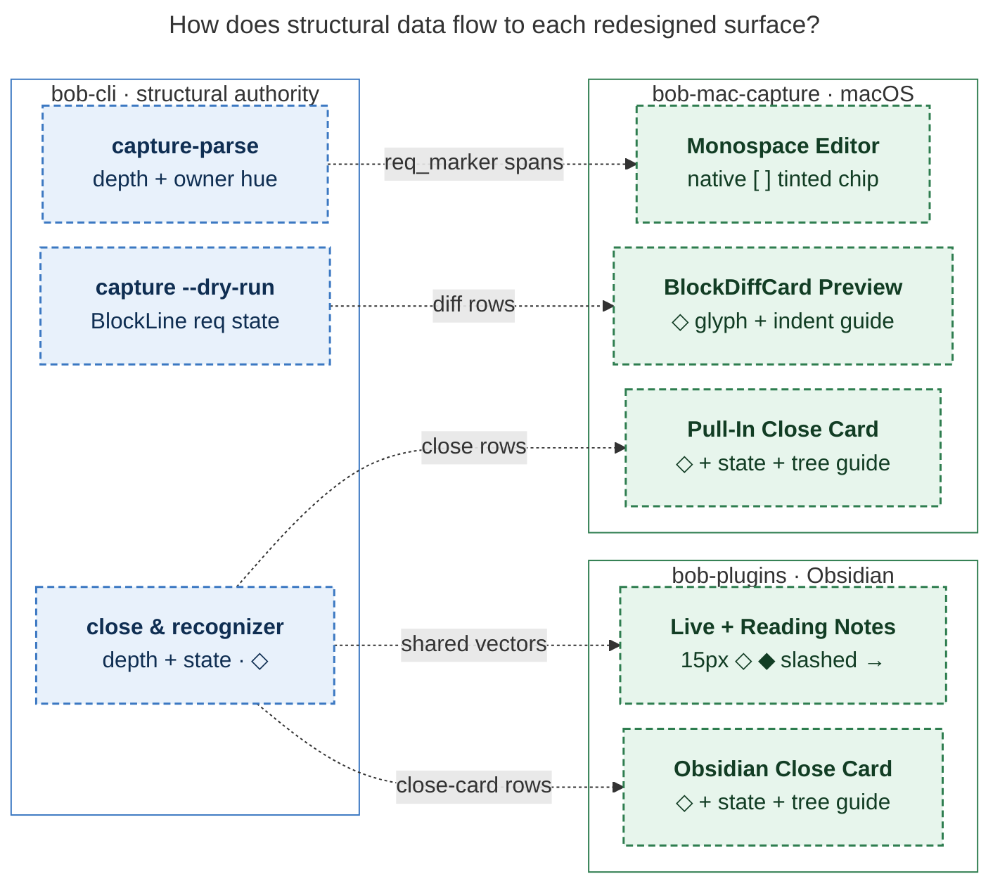

# Redesigning Task Requirements Display in Obsidian, Bob Mac Capture, and CLI

> **Research goal:** Evaluate and redesign how Bob displays task requirements ("reqs") across Obsidian and the Mac Capture panel — replacing the `##` / `###` / `####` (`⌗⌗`–`⌗⌗⌗⌗`) presentation shipped in `bob-cli-on` without changing requirement semantics or storage — critique the plan, call out justified requirement adjustments, and recommend an intuitive, reliable, and beautiful UX.

## Bottom line

**Do this redesign right after `bob-cli-on` closes — keeping storage and behavior unchanged is a strong architectural call, because the current presentation fails on both semiotics and implementation reliability.**

The recommended UX is **The Rounded-Diamond Scope System**:

1. **Replace `⌗⌗` / `⌗⌗⌗` / `⌗⌗⌗⌗` with one fixed-width, Lucide-matched rounded diamond (`◇`)** on all rich surfaces (Obsidian Live Preview, Obsidian Reading View, both Close Cards, and Mac Capture's live `BlockDiffCard` preview), paired with `◇` in CLI output and notices.
   - **Shape is 100% unclaimed in Bob:** Squares are interactive task checkboxes / Blocked marks; circles/rings are Task Link status indicators and plain bullets; hashes (`⌗`) are `#task` tags and Markdown headings. A rounded diamond never invites clicking to tick early, never collides with Markdown `##`/`###` headings, and naturally reads as *"scope criterion / commitment"*.
   - **Never repeat or widen glyphs for nesting:** List indentation already shows depth. Keep a fixed `15×15 px` marker column at every depth (`1..16`), and taper deeper levels *downward* (`100% → 84% → 72%` scale) with a subtle owner-ink tint on Obsidian's `--indentation-guide-color` — so deeper requirements grow quieter and lighter rather than wider and louder.
   - **Make every lifecycle state visually distinct on the same family:** `◇` hollow diamond (Pending), `◆` solid muted diamond (Met), faint hollow `◇` (Moot / Excluded), slashed grey diamond (Dropped + struck text), crisp `→` in the marker slot itself (Carried, sitting cleanly before the live Task Link ring `◯`), and repair-orange `◇` (Unknown hand-edited mark).
2. **Fix the Mac Capture panel's architecture — delete the fragile `ZStack` glyph overlay in the monospace editor.**
   - Paint `- [ ] ` natively in `AttributedString`: quiet tertiary `- ` plus a soft owner-ink/teal **chip wash behind `[ ]`** (the exact pattern already proven by `@route^id@` manila chips and `#TYPE` washes), eliminating the word-wrap drift, scroll desync, 4-cell gap, and invisible-caret bugs we found in `RequirementMarkerGlyphOverlay`.
   - Upgrade **`BlockDiffCard` (Live Preview)** right underneath the editor to render the rich **`◇` rounded diamond + tinted indent guide** via one additive `req: { depth, state }` field from `bob capture --dry-run`, so the live preview teaches and mirrors Obsidian pixel for pixel.
3. **Fix five real rendering bugs uncovered in the shipped `bob-cli-on` code** (Obsidian `:checked::after` bleed, `li::after` stranding Carried's `→` below nested subtrees, `pointer-events: none` killing Obsidian hover tooltips while leaking native browser `title` across prose lines, missing `excluded` marker fade, and `task-statuses.css` resets scoped only to `[data-task="-"]`).

---

## 1. Forensic audit: why `##` / `###` / `####` (`⌗⌗`–`⌗⌗⌗⌗`) feels bad

Inspecting the actual code shipped in `bob-cli`, `bob-plugins` (`fb30f8de`, `bob-cli-on.9`), and `bob-mac-capture` (`e1a55464`, `bob-cli-on.13`) reveals that the current look suffers from both **semiotic mismatches** and **concrete rendering defects**.

### 1.1 Semiotic and typographic failures

- **Instant Markdown heading collision.** In a Markdown-native tool like Obsidian, repeating hash marks (`##`, `###`, `####`) at the start of a line mean H2, H3, and H4 headings. Even when drawn slanted (`⌗⌗`) or with Unicode `U+2317` (Viewdata Square), the eye parses a run of 2–4 hashes as headings, not subordinate task requirements.
- **Wrong semantic parent (`#task`).** Bob's `docs/task-tag-marks.md` explicitly defines the single slanted hash (`⌗`) as *"tracked task and nothing else."* A requirement's defining invariant is that it is **not** a `#task` — it has no lane, walk row, schedule, or early tick. Doubling and tripling the `#task` glyph visually shouts *"double task! triple task!"* — the exact inverse of its meaning.
- **Inverted visual hierarchy and ragged alignment.** In `bob-ledger-tools/styles.css:7500–7535`, the marker width grows with depth (`calc(var(--bob-req-count, 2) * 0.5em)`): `1.0em` at depth 1, `1.5em` at depth 2, `2.0em` at depth 3+. That causes three simultaneous regressions:
  1. Every nested level shifts requirement text farther right *beyond* list indentation, breaking clean vertical alignment with sibling notes.
  2. Deeper items look heavier and louder (`⌗⌗⌗⌗` vs. `⌗⌗`) instead of quieter and more subordinate.
  3. The SVG mask (`viewBox="0 0 32 16"`, `stroke-width="1.45"`) crams four hashes into `2em × 1em` — spindly strokes half as wide as `#task`'s `16×16` `stroke-width="1.8"` glyph, reading like a tiny barcode — and then caps arbitrarily at depth 3 so depth 3 and depth 4 look identical.
- **Zero state differentiation.** Pending, Met, Moot, Dropped, Carried, and Excluded all draw the exact same `⌗⌗` mask (`styles.css:7532–7587`). A satisfied requirement under a `[x]` task still shows a faded hash fence instead of reading as fulfilled, and Dropped shares the same icon shape as Met and Moot.
- **Root cause in the original plan.** Tracing `plan:202611/task_requirements.md` (Design Call #3) exposes how this happened: *"Four hashes fill exactly the four cells of `[ ] ` in the Mac's monospace grid, and every surface uses the same cap."* Trying to stuff glyphs into four concealed monospace cells in the Mac editor forced a multi-character hash run onto Obsidian and both Close Cards.

### 1.2 Verified rendering bugs in the shipped Obsidian code

Inspecting `bob-plugins/plugins/bob-ledger-tools/styles.css:7493–7595` and `src/264-plugin-task-reqs.js` revealed five concrete defects that a redesign should fix cleanly:

| Defect | Code location | User-visible symptom |
| --- | --- | --- |
| **Mask placed directly on `<input>` without suppressing `:checked::after`** | `styles.css:7532–7555` | Obsidian's theme and `task-statuses.css` draw check/dash/arrow glyphs via `input.task-list-item-checkbox:checked::after`. Masking the `<input>` itself neither clears `::after` (causing cropped status artifacts on `[-]`, `[>]`, `[x]`) nor permits a clean circular hover halo behind the icon. |
| **Carried `→` attached to the whole row / `<li>` via `::after`** | `styles.css:7580–7587` | `.HyperMD-task-line[data-bob-req-state="carried"]::after` floats `→` at the far right edge of the line; in Reading View, `li.task-list-item[data-bob-req-state="carried"]::after` renders `→` on a new block line **below the entire nested `<ul>` subtree**. |
| **`pointer-events: none` kills Obsidian tooltips while whole-line `title` leaks** | `styles.css:7545`, `264-plugin-task-reqs.js:254,345–347,466` | `input.task-list-item-checkbox` gets `aria-label` + `data-tooltip-position="top"`, then `pointer-events: none !important` blocks all hover events on it. Meanwhile `title` on the whole `.HyperMD-task-line` / `<li>` triggers a slow native OS tooltip whenever the mouse rests anywhere on the prose. |
| **Excluded markers fail to fade; unknown marks stay unflagged** | `styles.css:7557–7564`, `264-plugin-task-reqs.js:252` | Only `met`, `moot`, and `dropped` reduce checkbox opacity; an `excluded` child shows a full-brightness marker next to muted text. Hand-edited unknown marks (`[?]`, `[*]`) carry no `data-bob-req-flag` attribute and look indistinguishable from clean `[ ]`. |
| **Incomplete `task-statuses.css` row-tint reset** | `styles.css:7591–7595` | Only `[data-task="-"]` overrides `background: transparent !important`. A carried `[>]`, hand-checked `[x]`, or hand-typed `[?]` req can still inherit full-width status tints or left rails from vault status snippets. |

### 1.3 Verified rendering defects in the shipped Mac Capture code

Inspecting `bob-mac-capture` commit `e1a55464` (`bob-cli-on.13`) revealed even sharper reliability issues:

1. **Raw Unicode `⌗` (`U+2317`) in stark `.primary` ink.** `CapturePanelView.swift:1924–1926` draws `Text(String(repeating: "⌗", count: min(depth, 3) + 1))` in 11 pt system monospace using `CaptureEditorPalette.color(for: .neutral)` (plain black/white, not teal or owner ink — `capture-parse` does not emit owner hue on `req_marker`). On macOS, `U+2317` falls back to a clunky technical-symbol glyph unrelated to Obsidian's SVG mask.
2. **Word-wrap drift.** `RequirementMarkerGlyphOverlay` positions glyphs via `CaptureMonospaceGlyphOrigin.wrappingOrigin` (`CaptureRecordPresentation.swift:1194–1226`), which counts raw characters per line (`if column >= charsPerLine { line += 1 }`) without word-wrap awareness. Whenever any line above wraps at a space before `charsPerLine`, **every requirement overlay below drifts vertically and horizontally onto wrong text**.
3. **Scroll desync.** In `CapturePanelView.swift:1611–1707`, `RequirementMarkerGlyphOverlay` sits as a sibling in a `ZStack` outside `TextEditor`'s internal scroll view. Once a long draft exceeds the panel height ceiling and scrolls, the overlaid glyphs stay frozen while the draft scrolls beneath them.
4. **Missing caret-adjacency reveal & 4-cell gap.** `CapturePanelModel.swift:1941–1959` and `22969–22979` never inspect `cursorUTF8` for `req_marker`. Concealing `[ ] ` with `.clear` leaves an awkward 4-character gap after the still-visible `- ` dash (`-  ⌗⌗  Handles inputs`) and lets the arrow-key caret walk invisibly across four transparent bytes underneath a frozen overlay.
5. **Visual split-brain with Live Preview.** Directly beneath the editor, `BlockDiffCard.swift:293–327` and `CapturePomodoroLineTokens.swift:88–101` render the exact same requirement lines as raw grey `- [ ] Handles inputs` — zero requirement styling at all.

---

## 2. Critique of the plan and justified adjustments

### 2.1 Is this plan a good idea?

**Yes — unequivocally.** Changing *only* presentation while preserving `bob-cli-on`'s storage (`- [ ] `, `[-]`, `[>]`) and behavioral contract (derived Met/Moot, no early ticking, canonical zones, close-card audit, one-level promotion, `- [ ` expansion + atomic Backspace) has three huge advantages:

- **Zero vault migration and zero data risk.** Not a single byte in `~/bob/` changes.
- **Zero vector churn on core logic.** RQ, RL, RW, and SP behavior fixtures stay byte-identical.
- **High daily leverage.** Task blocks are read hundreds of times a week across Obsidian and Capture; replacing a jarring, buggy presentation with a serene, state-accurate visual system pays back immediately.

### 2.2 Sequencing critique: wait for `bob-cli-on` to finish

Right now `bob-cli-on` has 12 closed phases and 5 in-progress phases (`.8` close-engine, `.11` obsidian-close-card, `.12` promotion, `.15` mac-close-card, `.17` memory). **Bryan's plan to wait until `bob-cli-on` completes is the right call:** interrupting in-flight phase agents to swap glyphs mid-epic would trigger merge conflicts across RV fixtures and card tests for zero gain.

One caveat: phase `.17` (`memory`) will land `glossary:task-requirement` describing the `⌗` run. Our post-`bob-cli-on` visual redesign epic should include a tiny final step using `/sase_memory_write` to update the visual wording in `glossary:task-requirement` (the `decisions:task-reqs-are-met-with-their-task` record governs lifecycle/storage, so it needs no supersession).

### 2.3 Justified adjustments to the requirements

| # | Adjustment | Why it is justified |
| --- | --- | --- |
| **A1** | **Expand scope from "Obsidian + Capture editor" to all 7 display surfaces** (Obsidian Live Preview, Reading View, Obsidian Close Card, Obsidian Notices, Mac Capture Editor, Mac `BlockDiffCard` Preview, Mac Pull-In Card, and CLI output). | Leaving `BlockDiffCard` showing raw `- [ ]`, Close Cards showing `⌗⌗`, or CLI/notices printing `⌗⌗` creates visual split-brain across Bob's surfaces. |
| **A2** | **Retire depth-counting glyph repetition completely.** Use one fixed-width `15×15 px` marker slot at every depth (`1..16`) with subtle downward scale taper (`100% → 84% → 72%`) and a quiet tinted indent guide. | Indentation already encodes tree depth. Repeating glyphs breaks alignment, inverts hierarchy, and caps arbitrarily at depth 3. |
| **A3** | **Drop the floating `ZStack` overlay in the Mac Capture editor; use native `AttributedString` chip styling on `[ ]` in the editor and rich `◇` diamonds in `BlockDiffCard` preview + Pull-In Card.** | Proved above: the `ZStack` overlay breaks on word-wrap, breaks on scroll, leaves a 4-cell chasm after `- `, and fights monospace caret navigation. Pure `AttributedString` chip styling is 100% reliable and matches `@route^id@` / `#TYPE`. *(Section 4.4 also gives a clean TextKit-rect fallback if Bryan strongly wants `◇` inside the raw editor box.)* |
| **A4** | **Make marker silhouettes state-expressive, move Carried `→` into the marker slot, fade Excluded markers, and tint Unknown marks repair-orange.** | Currently every state paints the same `⌗⌗` mask; Carried strands `→` at the end of the line/subtree; Excluded and Unknown have visual bugs. Shape + fill communicates state even in grayscale. |
| **A5** | **Replace dead `pointer-events: none` in Obsidian with a non-mutating click guard + real marker tooltips (and drop whole-line `title`).** | Fixes broken Obsidian `.tooltip` hovers, removes intrusive OS tooltips over prose, and turns an accidental checkbox click into a calm teaching Notice instead of a silent dead click — without changing the "never ticks early" behavior. |
| **A6** | **Decouple wire JSON from literal glyph strings.** Clients render from structural `depth` + `state`; add optional `req: { depth, state }` on `CaptureBlockLine` and optional `owner_hue` on `req_marker` / `CaptureTaskBlock` (strictly additive). | Keeps `Bob Mac Capture Is A Thin Client Of bob` intact (`BlockDiffCard` never guesses reqs vs. plain checklists under `NOTES`) and stops `bob-cli` from hardcoding presentation strings (`req_run`) for rich clients. |
| **A7** | **Keep the parent task line clean (defer any owner-line count badge; if ever built later, show `◇ 3`, never `2/4`).** | Avoids crowding already-dense task rows out of scope. Under derived-met semantics, `2/4` falsely implies early ticking; a plain pending count (`◇ 3`) is the only truthful badge. |

---

## 3. Design space exploration

Any requirement visual must harmonize with Bob's **already-claimed visual grammar** (verified across `docs/task-tag-marks.md`, `docs/blocked-marks.md`, `docs/task-link-marks.md`, `docs/date-marks.md`, and every SVG mask in `bob-ledger-tools/styles.css`):

- **Squares (`15×15 px`, `4 px` radius):** Interactive task checkboxes & Blocked-reason marks (`[ ]`, `[*]`, `[/]`, `[&]`, `[^]`, `[✈]`, `[1–4]`, `[⟲]`, `[x]`, `[-]`).
- **Circles / Rings (`16×16`):** Task Link status rings (`◯`, `◉`, `◐`, `⊖`, `✓`, `⊘`) and Obsidian's plain list bullet (`•`).
- **Slanted Hash (`⌗`) & Identity Icons (`📖`, `◎`, `☀`, `⚑`):** `#task` and task-kind identity tags, `16×16`, `stroke-width: 1.8`, `round` caps/joins, in owner type ink or identity teal (`--bob-task-tag-hue`).
- **Trailing Monochrome Marks (`+`, `⧗`, `✓`, `⊘`, `⟲`, `▮▮▮`, eye-off):** Dates, priority bars, `#hide`.
- **Hue Budget:** Red (Blocked), Orange (attention/ROTTEN/repair), Yellow (In Progress), Green (Next/fresh), Blue (Ready), Violet (tags/links), Teal (task identity & inline code), Grey (metadata/cancelled), plus the 8 task-type palette slots (`--bob-type-ink-*`).

### 3.1 Comparing the five candidate visual paradigms

| Candidate | Visual look | Semiotic fit | Non-clickable clarity | Depth & alignment | State range | Verdict |
| --- | --- | --- | --- | --- | --- | --- |
| **A. Rounded Diamond (`◇` / `◆` / slashed / `→`)** | 45°-rotated softly rounded diamond in `16×16` Lucide stroke; fixed `15×15 px` column; tapers `100%→84%→72%` at deeper levels + subtle tinted indent guide | **Excellent.** Unclaimed in Bob; reads as *"scope criterion / milestone / deliverable"* (UML, Linear, Bullet Journal) | **High.** Clearly not a square checkbox; never invites early clicking | **Fixed 1-cell column** across all 16 depths; deeper = quieter | **Complete:** `◇` open, `◆` filled met, faint `◇` moot/excluded, slashed `◇` dropped, `→` carried, orange `◇` unknown | **Recommended** |
| **B. Tree Connectors Only (`├` / `└` rail)** | Tinted vertical bar + horizontal elbow into each req line | Good parent–child grouping | High | Brittle across CM6 flat `.cm-line` divs vs. Reading View nested `<ul><li>`; no standalone icon for CLI/same-line capture | Poor (no open vs. filled state axis on an elbow) | **Use as subtle companion only** (`--indentation-guide-color`), not standalone |
| **C. Mini / Dashed Checkbox (`▫` / `⬚`)** | Smaller square or dashed box echoing stored `[ ]` | Echoes Markdown bytes | **Fails.** Squares in task lists invite clicking; dashed box already means `stale` Blocked (`docs/blocked-marks.md`) and "new drawer" | Fixed column | Good, but fights the core "cannot tick early" rule | **Reject** |
| **D. Return Arrow / Chevron (`↳` / `▸`)** | `↳` child arrow or `▸` disclosure triangle | `↳` implies hierarchy | `▸` **fails** (looks like fold/unfold toggle); `↳` collides with Carried (`→`) and Mac Capture's `↳ Sub-bullet` | Fixed column | Poor (no open vs. met fill axis) | **Reject** |
| **E. Inline Text Pill (`REQ`)** | Small-caps `REQ` capsule before each row | Explicit on day 1 | High | **Fails.** Wide (`2.5–3 em`), creates a repetitive wall of labels; violates Bob's *"no pill at rest"* rule (`docs/task-tag-marks.md`) | Cluttered | **Reject** |

### 3.2 External precedents (calibrated to Bob's rules)

- **Things 3 checklists** show how lightweight sub-items belong visually *inside* a task without competing with the parent's bold status control — quiet, subordinate, aligned cleanly beneath the parent text. Unlike Things, Bob's reqs cannot be ticked early, which is why Things' clickable circular check-ring would be misleading here (and would collide with Bob's Task Link rings).
- **Linear / GitHub / Engineering spec diamonds** use the hollow-to-filled diamond (`◇` → `◆`) as the canonical non-checkbox symbol for milestones, acceptance criteria, and deliverables — distinct from both issue circles and task checkboxes.
- **Bullet Journal migration (`>`)** directly inspires putting a clean `→` in the marker slot itself for Carried `[>]` stubs rather than tacking a stray arrow onto the end of the line.

---

## 4. Recommended solution: The Rounded-Diamond Scope System

### 4.1 What you see (before vs. after)

**In Obsidian (open task with nested reqs, notes, dropped req, carried req, and `NOTES` drawer):**

```text
BEFORE (shipped in bob-cli-on.9):
  ☐  ⌗  Ship the exporter                                + today
        ⌗⌗ Handles supported inputs
           ⌗⌗⌗ Handles Windows files                     ← wider! ragged text! louder!
              ⌗⌗⌗⌗ Preserves CRLF                        ← looks like Markdown H4!
              •  Fixture: windows.csv
           ⌗⌗⌗ Handles empty input
        ⌗⌗ Benchmarks within 5% of v1                    ← still ##, same icon as met
           ❌ CANCEL LOG
              •  2026-11-21 — v1 is gone
        ⌗⌗ ◯ Docs cover every flag →                     ← arrow stranded at end / under <li>
        •  NOTES
           •  Morgan reported the original issue.
        •  🛠️ WORK LOG

AFTER (proposed):
  ☐  ⌗  Ship the exporter                                + today
        ◇  Handles supported inputs                      ← crisp rounded diamond, owner ink
           ◇  Handles Windows files                      ← 84% scale, exact column alignment
              ◇  Preserves CRLF                          ← 72% scale, quieter still
              •  Fixture: windows.csv                    ← plain grey bullet
           ◇  Handles empty input
        ⟐  Benchmarks within 5% of v1                    ← slashed grey diamond + struck text
           ❌ CANCEL LOG
              •  2026-11-21 — v1 is gone
        →  ◯ Docs cover every flag                       ← arrow in slot + live Task Link ring
        •  NOTES
           •  Morgan reported the original issue.
        •  🛠️ WORK LOG
```

**When the owner closes (`[x]`):**

```text
  ☑  ⌗  Ship the exporter                                + today  ✓ today
        ◆  Handles supported inputs                      ← solid muted diamond (fulfilled, not struck)
           ◆  Handles Windows files
              ◆  Preserves CRLF
              •  Fixture: windows.csv
           ◆  Handles empty input
        ⟐  Benchmarks within 5% of v1                    ← stays dropped (slashed + struck)
        →  ✓ Docs cover every flag                       ← arrow + done Task Link ring
```

*(Note: `⟐` above stands in for the custom slashed-diamond SVG mask in plain-text diagrams.)*

### 4.2 Complete state and depth visual specification

Every state is distinguishable by **shape/fill alone** (colorblind- and grayscale-safe) while owner ink ties live requirements visually to their owning task:

| Effective state | Marker silhouette | Ink & opacity | Text treatment | Indent guide tone | Hover tooltip / Click Notice |
| --- | --- | --- | --- | --- | --- |
| **Pending** (`[ ]`, open owner) | Hollow rounded diamond (`◇`) | `--bob-req-ink` (owner type ink, or default teal `--bob-task-tag-hue`). Depth taper: d1 `scale(1)` `0.95`, d2 `scale(0.84)` `0.85`, d3+ `scale(0.72)` `0.78` | Normal (`--text-normal`) | `color-mix(in srgb, var(--bob-req-ink) 28%, transparent)` | Tooltip: `Requirement · level {d} of “{Owner}” · Pending` + teaching line. Click: `Met when “{Owner}” closes · Alt+[ drops · Ctrl+Shift+T makes it a task` |
| **Met** (`[ ]` under `[x]` owner, or legacy `[x]`) | Solid filled rounded diamond (`◆`, optically balanced at `8.8/16` units) | Closed-task resting mix: `color-mix(in srgb, var(--bob-req-ink) 40%, var(--text-faint))`, `opacity: 0.78` | Muted (`--text-muted`), **not** struck | Quiet (`--text-faint` 40%) | Tooltip: `… · Met`. Click: `Met with “{Owner}”` |
| **Moot** (`[ ]` under `[-]` owner) | Hollow rounded diamond (`◇`) | `--text-faint`, `opacity: 0.55` | Muted (`--text-muted`), **not** struck | Quiet (`--text-faint` 40%) | Tooltip: `… · Moot`. Click: `Moot — “{Owner}” was cancelled` |
| **Dropped** (`[-]`) | Slashed hollow diamond | `--text-muted`, `opacity: 0.65` | Muted (`--text-muted`) + `line-through` | Quiet (`--text-faint` 40%) | Tooltip: `… · Dropped`. Click: `Dropped requirement · Alt+] restores` |
| **Carried** (`[>]`) | Crisp right arrow (`→`) inside the `15×15 px` marker slot | `color-mix(in srgb, var(--bob-req-ink) 70%, var(--text-muted))`, `opacity: 0.85` | Normal link styling; live Task Link status ring (`◯`/`◉`/`◐`/`✓`) shows immediately after `→` | Quiet (`--text-faint` 40%) | Tooltip: `… · Carried`. Click: `Carried — open the linked task` |
| **Excluded** (under dropped/carried ancestor) | Hollow rounded diamond (`◇`) | `--text-faint`, `opacity: 0.50` (fixes missing fade bug!) | Muted (`--text-muted`), **not** struck | Quiet (`--text-faint` 40%) | Tooltip: `… · Excluded · goes with “{Ancestor}”`. Click: `Goes with “{Ancestor}”` |
| **Unknown mark** (e.g. hand-typed `[?]`) | Hollow rounded diamond (`◇`) + `data-bob-req-flag="unknown"` | Bob repair-orange: `color-mix(in srgb, var(--bob-hue-orange) 70%, var(--text-normal))` | Normal | Repair-orange 28% | Tooltip: `Requirement · level {d} of “{Owner}” · Unexpected mark [{c}]` + teaching line |

### 4.3 Exact SVG mask geometry and Obsidian CSS architecture

All four masks live on `body` beside `--bob-task-tag-glyph`, sharing Bob's exact `16×16` viewBox, `stroke-width="1.8"`, `stroke-linecap="round"`, and `stroke-linejoin="round"` stroke language:

```css
body {
  /* Pending / Moot / Excluded / Unknown: symmetrical rounded diamond around (8,8), span ~12.6u */
  --bob-req-glyph-pending: url("data:image/svg+xml,%3Csvg xmlns='http://www.w3.org/2000/svg' viewBox='0 0 16 16' fill='none' stroke='black' stroke-width='1.8' stroke-linecap='round' stroke-linejoin='round'%3E%3Cpath d='M7.3 2.9a1 1 0 0 1 1.4 0l4.4 4.4a1 1 0 0 1 0 1.4l-4.4 4.4a1 1 0 0 1-1.4 0L2.9 8.7a1 1 0 0 1 0-1.4Z'/%3E%3C/svg%3E");

  /* Met: solid filled rounded diamond, optically scaled (8.8u span) to match hollow weight */
  --bob-req-glyph-met: url("data:image/svg+xml,%3Csvg xmlns='http://www.w3.org/2000/svg' viewBox='0 0 16 16' fill='black'%3E%3Cpath d='M7.4 3.9a.85.85 0 0 1 1.2 0l3.5 3.5a.85.85 0 0 1 0 1.2l-3.5 3.5a.85.85 0 0 1-1.2 0L3.9 8.6a.85.85 0 0 1 0-1.2Z'/%3E%3C/svg%3E");

  /* Dropped: rounded diamond with diagonal cancel slash (matches --bob-date-glyph-cancelled) */
  --bob-req-glyph-dropped: url("data:image/svg+xml,%3Csvg xmlns='http://www.w3.org/2000/svg' viewBox='0 0 16 16' fill='none' stroke='black' stroke-width='1.8' stroke-linecap='round' stroke-linejoin='round'%3E%3Cpath d='M7.3 2.9a1 1 0 0 1 1.4 0l4.4 4.4a1 1 0 0 1 0 1.4l-4.4 4.4a1 1 0 0 1-1.4 0L2.9 8.7a1 1 0 0 1 0-1.4ZM3.4 3.4l9.2 9.2'/%3E%3C/svg%3E");

  /* Carried: crisp right arrow centered in the 16x16 slot (replaces broken li::after) */
  --bob-req-glyph-carried: url("data:image/svg+xml,%3Csvg xmlns='http://www.w3.org/2000/svg' viewBox='0 0 16 16' fill='none' stroke='black' stroke-width='1.8' stroke-linecap='round' stroke-linejoin='round'%3E%3Cpath d='M3.5 8h9M9 4.5 12.5 8 9 11.5'/%3E%3C/svg%3E");
}
```

**Key Obsidian CSS & JS mechanics (fixing all 5 shipped bugs, zero new DOM nodes):**

1. **Draw the mask on `input.task-list-item-checkbox::before`, NOT on `<input>` itself:**
   - The `<input>` stays a clean, fixed `var(--checkbox-size, 15px)` square with `appearance: none`, `border: 0`, `border-radius: 999px`, `background: transparent`, `position: relative`, `pointer-events: auto`, and `cursor: default`.
   - `input::before` renders `content: ""; position: absolute; inset: 0; background-color: var(--bob-req-marker-ink); mask-image: var(--bob-req-glyph); transform: scale(var(--bob-req-scale, 1));` with `print-color-adjust: exact`.
   - `input::after` and `input:checked::after` are explicitly killed (`content: none !important; display: none !important;`), stopping Obsidian and `task-statuses.css` checkmarks/dashes from ever bleeding through.
   - Hovering `<input>` paints a subtle `14%` circular halo (`background-color: color-mix(in srgb, var(--bob-req-marker-ink) 14%, transparent)`, `120ms ease`, disabled under `prefers-reduced-motion: reduce`), matching `bob-task-tag-mark` identically.
2. **Three depth rules instead of fourteen:** Default `[data-bob-req]` sets `--bob-req-scale: 0.72; --bob-req-opacity: 0.78;` (covering depths 3–16+); `[data-bob-req-depth="2"]` sets `0.84` / `0.85`; `[data-bob-req-depth="1"]` sets `1` / `0.95`. Because scale carries the taper while opacity stays `≥ 0.78`, all depths pass the WCAG 3:1 non-text contrast floor in both light and dark themes (base `--bob-task-tag-hue` measures ~3.8:1 light / >10:1 dark; all eight `--bob-type-ink-*` tokens are already node-tested to ≥4.5:1).
3. **Full row-tint reset:** Reset `background: transparent !important; background-image: none !important; border-inline-start: none !important;` on **all** `.HyperMD-task-line[data-bob-req="true"][data-task]` and `li.task-list-item[data-bob-req="true"][data-task]` rows (not just `[data-task="-"]`), so vault status snippets never tint a requirement line.
4. **Quiet indent-guide whisper:** Set `--indentation-guide-color: color-mix(in srgb, var(--bob-req-ink) 28%, transparent);` on active `[data-bob-req]` rows (and quiet `--text-faint` on resolved states). Zero layout shift, zero brittle absolute rails, automatically invisible if the user hides indent guides, and turns neutral grey the moment the block transitions into `NOTES` or `WORK LOG`.
5. **Real marker tooltips + non-mutating click guard:** Remove whole-line `title` from `.HyperMD-task-line` and `<li>`. Keep `aria-label` + `data-tooltip-position="top"` on the `<input>` (which now receives hover events). Register one capture-phase `mousedown`/`click` listener in `bob-ledger-tools` on `input.task-list-item-checkbox` inside `[data-bob-req]` that calls `preventDefault()` + `stopPropagation()` and displays the concise state-aware teaching Notice — safe on desktop and mobile, never mutating the checkbox.
6. **Cursor reveal & toggle unchanged:** Moving the caret onto `[ ] ` in Live Preview drops `data-bob-req` on that line to expose raw `- [ ] `; moving into the text restores the diamond immediately. `toggle-task-tag-marks` restores native checkboxes everywhere. `@media (forced-colors: active)` maps `--bob-req-ink` to `CanvasText` / `GrayText`.

### 4.4 Bob Mac Capture: editor, live preview (`BlockDiffCard`), and Pull-In Card

#### A. Monospace Editor — Native `AttributedString` Semantic Chip (Recommended)

Delete `RequirementMarkerGlyphOverlay` (`CapturePanelView.swift:1691–1707, 1905–1944`) and the `.clear` concealment branch (`CapturePanelModel.swift:22969–22979`). Instead, style every `req_marker` span directly in `paintHighlighting`:

- Paint the leading `- ` dash before the marker in tertiary label color (quiet Markdown chrome).
- Paint the 3-byte `[ ]` portion of `req_marker` (excluding its trailing space so the wash terminates crisply at `]`) as a **soft requirement chip**:
  - **Background wash:** `reqTint.opacity(increaseContrast ? 0.24 : 0.14)` (default `.teal`, or the owner's task-type hue once `capture-parse` emits additive `owner_hue` on `req_marker`).
  - **Foreground:** `reqTint` at `1.0` opacity for depth 1, `0.82` for depth 2, `0.68` for depth 3+ — subtly tapering deeper levels while keeping every character readable.
- Plain note bullets (`- Fixture: windows.csv`) stay unwashed neutral text; refused requirement positions keep Bob's red diagnostic underline.

```text
Capture Editor (native monospace, zero overlay bugs):
  Ship the exporter @bob
  - [ ] Handles supported inputs        ← `[ ]` wears soft teal chip wash
    - [ ] Handles Windows files         ← slightly softer teal chip wash
      - [ ] Preserves CRLF
      - Fixture: windows.csv            ← plain unwashed note bullet
```

**Why this wins over an editor overlay:** Zero word-wrap drift, zero scroll desync, zero 4-cell horizontal chasm, zero invisible-caret stepping, and 100% consistency with how `@route^id@` (manila chip wash) and `#TYPE` (theme wash) already render in Bob Mac Capture.

> **Alternative if Bryan specifically wants `◇` inside the editor text box itself:** Do *not* reuse `wrappingOrigin`. Bridge `NSTextView.firstRect(forCharacterRange:)` (scroll-clip observed inside `CapturePanelController`) to draw a single SwiftUI `RoundedDiamond` centered over the 3-byte `[ ]` range (never the 4th space), conceal `[ ]` *only* while the caret is outside `span.start...span.end`, and accept the minor 1-cell breathing room on each side of `◇` (`-  ◇  text`). This adds AppKit coordinate/scroll plumbing and reveal-flicker on `- [ ` expansion, so pure `AttributedString` chip styling + rich `BlockDiffCard` preview is the stronger default.

#### B. Live Preview (`BlockDiffCard`) — Full Obsidian Parity

Add an additive `req: { depth: u8, state: String }?` object on `CaptureBlockLine` (omitted on non-req lines) and optional `type_hue` on `CaptureTaskBlock` in `bob capture --dry-run --format json`. Decoded with `decodeIfPresent`, older `bob` versions stay unaffected.

In `BlockDiffCard.swift`:
- Requirement rows replace the raw `- [ ] ` token cluster with a crisp SwiftUI `ReqDiamondView(state:depth:ink:)` (drawn with the exact `16×16` rounded-diamond `Path` coordinates from §4.3) and softly tint that row's 1 px vertical indent guide in `ink.opacity(0.32)`.
- When the first-req scoop runs, the live preview immediately visualizes the newly minted `◇` requirements sitting above `NOTES` while loose notes gather below under `•` — teaching the layout rule on screen before Return is ever pressed.

#### C. Pull-In Card & Obsidian Close Card — Unified Tree + Live State

Both Close Cards (`bob-navigation-hotkeys` picker v6 and Mac Capture's Pull-In Card) ignore the legacy `run` hash string whenever structural `depth` is present:

- **Group header:** Single `◇` icon in owner ink beside `Requirements · “Ship the export command”`, plus scope count (`4 reqs in 2 branches`).
- **Hierarchy:** Clean indentation `(depth - 1) * 16 px` with a quiet 1 px vertical tree guide connecting nested children to their parent branch — never widening the marker column.
- **Live state-reflective marker:** Default/Met rows show `◇` (quiet `✓ met` on the right); staging **Drop** (`Ctrl+Shift+X`) flips the marker live to the **slashed grey diamond** and strikes the row text; staging **Carry** (`Ctrl+Shift+T`) or **Carry + Pull in** (`Space`/`Tab`) flips the marker live to **`→`** (in teal / Next accent). What you stage on the card matches what lands in your note.

```text
Requirements · “Ship the export command”                 4 reqs in 2 branches
Met when it closes, unless you say otherwise
  ◇  Handles supported inputs                                           ✓ met
  │  ◇  Handles Windows files                                           ✓ met
  │  │  ◇  Preserves CRLF                                               ✓ met
  │  →  Handles empty input                               → own task · ↗ jump
  · 1 dropped earlier · 1 carried earlier
⌃X met · ⌃⇧X drop · ⌃⇧T own task · space pull in · ⌃J jump        reqs ✓3 →1
```

#### D. CLI output, notices, and cross-surface data flow

Replace `task_reqs::req_run(depth)` (`"⌗⌗"` / `"⌗⌗⌗"` / `"⌗⌗⌗⌗"`) and hardcoded `"⌗⌗ "` notices (`capture/output.rs:1128`, `task_complete/req_close.rs:101,348`, `task_split/command.rs:670`, `task-status-cycler/src/199-req-toggle.js:12,14`) with a single clean Unicode `◇` (`U+25C7`, universal across SF Mono, Menlo, JetBrains Mono, DejaVu Sans, and every terminal):

- `◇ adds 3 requirements to “Ship the exporter” · files 2 notes under NOTES`
- `◇ First requirement · filed 2 notes under NOTES`
- `✓ 3 requirements met with “Ship the exporter”` (using `✓` consistently with `met_receipt` in `req_close.rs:95`)

<div id="figure-display-architecture">



*Figure 1. `bob-cli` emits structural depth, state, and owner hue instead of hardcoded hash runs, letting Obsidian and Bob Mac Capture each render idiomatically while keeping thin-client boundaries intact. (Rendered with mermaid-cli 12.0.0 under the PDF config; 698 × 576 px, fit 93.5%.)*

</div>

---

## 5. Implementation roadmap and verification (post-`bob-cli-on`)

Once `bob-cli-on` closes, ship this as one focused, 4-phase follow-up epic with **zero vault migration** and **zero grammar-revision break** (every wire addition is optional/additive):

1. **Phase 1 — `bob-cli` structural display fields & `◇` text copy:**
   - Replace `⌗⌗`/`⌗⌗⌗`/`⌗⌗⌗⌗` in `src/native/task_reqs.rs`, `src/native/capture/output.rs`, `src/native/task_complete/req_close.rs`, and `src/native/task_split/command.rs` with `◇` (and `✓` for human met receipts).
   - Add optional additive `req: { depth, state }` on `CaptureBlockLine` and optional `owner_hue` on `CaptureParseSpan` (`req_marker`) & `CaptureTaskBlock`.
   - Update `docs/task-requirements.md` §4 and `docs/task-tag-marks.md` ("Requirement marks").
   - Gate: `just check && just docs-check`.
2. **Phase 2 — `bob-plugins` Obsidian notes, Close Card, and notices:**
   - Update `bob-ledger-tools/styles.css` (four `16×16` diamond/arrow masks on `input::before`, `::after` suppression, 3-rule depth taper, full `[data-bob-req][data-task]` status reset, `--indentation-guide-color` tint, hover halo, `forced-colors` + `prefers-reduced-motion`).
   - Update `bob-ledger-tools/src/264-plugin-task-reqs.js` (remove whole-line `title`, add `data-bob-req-flag="unknown"`, add capture-phase non-mutating click guard with state-aware Notice).
   - Update `bob-navigation-hotkeys` Close Card (`206*` + `styles.css`: `◇` header icon, 1 px vertical tree guides, live state-reflective marker) and `task-status-cycler/src/199-req-toggle.js` (`◇ First requirement`).
   - Verify with unit tests, a light/dark contrast check on depths 1–3, and a real-Obsidian CDP screenshot pass across Live Preview, Reading View, and the Close Card (light & dark), then `bob plugins sync`.
3. **Phase 3 — `bob-mac-capture` editor chip, `BlockDiffCard`, and Pull-In Card:**
   - Delete `RequirementMarkerGlyphOverlay` and `.clear` concealment; paint `[ ]` as a soft owner-ink/teal `AttributedString` chip with depth taper in `CapturePanelModel.paintHighlighting` + `CaptureEditorPalette`.
   - Decode additive `CaptureBlockLine.req` and `type_hue` (`decodeIfPresent`); render `ReqDiamondView` + tinted indent guide in `BlockDiffCard.swift`.
   - Update Pull-In Card requirement rows to render `ReqDiamondView` + 1 px tree guides from structural `depth` and live staged verdict.
   - Update `bob-mac-capture/docs/capture-panel.md` and `docs/capture-previews.md`; gate with `just portable-check`, `Scripts/macos-ci-check`, and exact-SHA macOS CI.
4. **Phase 4 — Memory sync:**
   - Use `/sase_memory_write` to update the visual description in `glossary:task-requirement` (replacing the `⌗` run wording with the Rounded-Diamond Scope System), run `sase memory init`, and regenerate `docs/reference/glossary.md`.

### Reopens when

- Live usage in Obsidian shows folded tasks frequently hiding pending requirements → add the quiet deferred `◇ N` (pending-only) badge on folded owner rows.
- Live usage in Mac Capture shows Bryan still wanting a `◇` glyph inside the raw monospace editor text box despite the rich `◇` `BlockDiffCard` preview directly below → implement the TextKit-rect-anchored `◇` overlay over `[ ]` with real caret-adjacency reveal.

---

## 6. Sources and verified code references

- **Beads & plans:** `bob-cli-on` (`plan:202611/task_requirements.md`), phases `.8`, `.9`, `.10`, `.11`, `.13`, `.14`, `.15`, `.17`; prior consolidated design `research:202611/task_reqs_design/task_reqs_design.md` and amendment `research:202611/task_reqs_nested_and_notes_impact.md` (read via `sase artifact read`).
- **Audited memory reads:** `decisions:mac-capture-is-a-thin-client`, `decisions:capture-bullets-mirror-the-task-block`, `decisions:capture-sigils-say-where-what-how`, `decisions:task-deps-are-depends-on-links`; `glossary:Task Drawer`, `glossary:Capture Panel`, `glossary:Property Card`, `glossary:Copy Chip`, `glossary:Command Chip`, `glossary:Annotation Section`.
- **`bob-cli` (workspace checkout):** `docs/task-requirements.md`, `docs/task-tag-marks.md`, `docs/blocked-marks.md`, `docs/task-link-marks.md`, `docs/date-marks.md`; `src/native/task_reqs.rs`, `src/native/task_complete/req_close.rs`, `src/native/capture/output.rs`, `src/native/capture_parse.rs`, `src/native/capture_language/req_bullets.rs`.
- **`bob-plugins` (opened via `/sase_repo`):** `plugins/bob-ledger-tools/src/139-task-reqs.js`, `src/264-plugin-task-reqs.js`, `styles.css` (lines 1624–3609, 7493–7595, commit `fb30f8de`); `plugins/task-status-cycler/src/195-task-reqs-twin.js`, `src/199-req-toggle.js`; `plugins/bob-navigation-hotkeys/src/206d-successor-picker-verdict-render.js`, `src/695-task-reqs-twin.js`.
- **`bob-mac-capture` (opened via `/sase_repo`):** `Sources/BobMacCapture/CapturePanelView.swift` (lines 1600–1945, 6510–6760), `Sources/BobMacCapture/CapturePanelModel.swift` (lines 1895–1970, 22840–23030), `Sources/BobMacCapture/CaptureEditorPalette.swift`, `Sources/BobMacCapture/BlockDiffCard.swift`, `Sources/CaptureCore/CaptureRecordPresentation.swift` (lines 1184–1227), `Sources/CaptureCore/CaptureTaskBlockPresentation.swift`, `Sources/CaptureCore/CapturePomodoroLineTokens.swift`, commit `e1a55464`; `docs/capture-panel.md`, `docs/capture-previews.md`.
