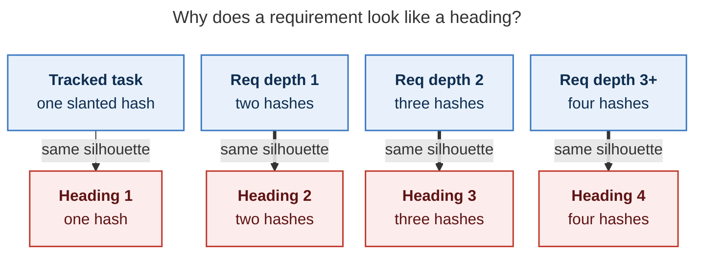
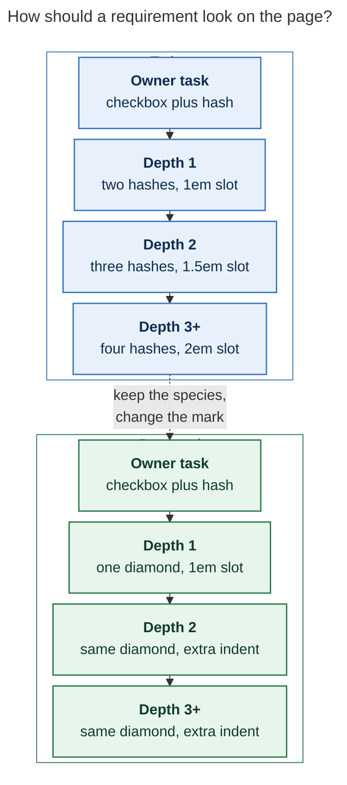
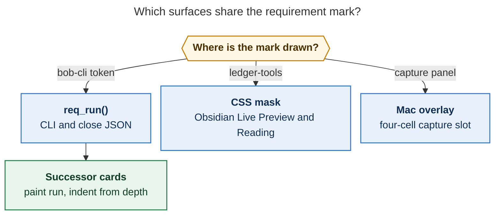

# Task requirement display: leave the heading metaphor

**Researcher:** grk · **Date:** 2026-11-22 · **Swarm suffix:** `__grk`
**Question:** Once `bob-cli-on` lands, how should Bob present task requirements in Obsidian and in the capture panel, given that the current `##` / `###` / `####` hash-run looks bad — while keeping requirement behavior unchanged? Is waiting for the epic and doing a display-only pass a good plan, and what visual should replace the hash run?
**Peer reports:** not consulted (per swarm instructions).
**Input material:** `plan:202611/task_requirements.md` (audited `sase artifact read`); `docs/task-requirements.md` §4; `docs/task-tag-marks.md`; `docs/date-marks.md`; `docs/blocked-marks.md`; `src/native/task_reqs.rs` `req_run`; `src/native/task_complete/req_close.rs`; `tests/fixtures/req_close/vectors.json`; bob-ledger-tools `styles.css` requirement rules; Bob Mac Capture `RequirementMarkerGlyphOverlay`; bead `bob-cli-on`; prior research `research:202611/task_reqs_design/task_reqs_design.md` and `research:202611/task_reqs_nested_and_notes_impact.md`; glossary Capture / Capture Panel / Property Card; CommonMark ATX headings; Things 3 checklists; Linear sub-issues; GitHub task lists.

Figures rendered with mermaid-cli 12.0.0 under the Highlights PDF config (DejaVu Sans, `securityLevel: strict`).

## Bottom line

**Keep the requirement species. Replace the mark.**

The feature is a good idea and should finish. A requirement is committed scope under a real `#task`, stored as `- [ ]` without the filter, met with its owner, dropped or carried by gesture. That model is sound. The presentation is the part that failed: Bob paints a growing hash run (`⌗⌗`, `⌗⌗⌗`, `⌗⌗⌗⌗`) in the checkbox slot, which is the same visual rule Markdown uses for heading levels. Bryan asked for that look in `^micro-tasks-cleanup` ("only `##`"). After nesting stretched two hashes into three and four, the run reads as `##` / `###` / `####` in a Markdown-native editor. That is the complaint, and it is justified.

**Recommended visual:** one constant, non-hash **scope diamond** in the checkbox's slot, in the identity teal, at a fixed 1em width. Indent, the close-card `depth` field, and the existing accessibility string carry hierarchy. Cursor-reveal, session toggle, hidden checkbox, derived states, and plugin-off fallback stay as they are.

**Recommended plan:** decide the display now; implement it as a small follow-up epic after `bob-cli-on` behavior phases land. Do not reopen storage, authoring, derived-met, NOTES, carry, or promotion. Remaining card work should paint `row.run` and indent from `row.req.depth`, and should treat `run` as an opaque glyph string.

## Critique of the plan

The plan as stated: wait until `bob-cli-on` is complete, then change how requirements display, without changing how they behave, and lead a design that is intuitive, reliable, and beautiful.

**Waiting to implement is right.** Rendering already shipped (`bob-cli-on.9` Obsidian, `bob-cli-on.13` Mac overlay). The still-open work is behavioral: capture successor card (`.8`), Obsidian successor card and carry-now (`.11`), promotion (`.12`), Mac Pull-In card (`.15`), and memory records (`.17`). Mixing a glyph swap into those phases would churn vectors and screenshots on the close engine. A display epic that starts after those land can swap one token, one CSS mask, and one overlay.

**Waiting to decide is too late.** Close-card JSON already emits both `run` (the glyph string) and `req.depth` (the hierarchy). RV vectors pin `"run": "⌗⌗"` / `"⌗⌗⌗"` / `"⌗⌗⌗⌗"`. If in-flight card UIs count hashes or assume a growing run, the later display epic has to unwind that. The cheap instruction for those phases: indent from `depth`, draw `run` as given, never infer level from the string.

**Display-only is the right constraint**, with one load-bearing clarification: stopping the mark from encoding depth is still display. Close JSON already has `depth`. Indent already has depth. The accessibility label already speaks `requirement, level {d}`. Growing hashes are redundant decoration that imported ATX.

**The feature itself is a good idea.** Three things it still buys, independent of the mark:

1. Promotion can send scope to `## Tasks` and prose to `## Notes`.
2. Close-time audit rides the existing successor card.
3. Tasks, requirements, and projects stay one family through carry and one-level promotion.

I would take the same sequencing Bryan sketched, and I would lock the visual now so the follow-up is a swap rather than a second design fight.

## What ships today

A requirement is a checkbox list item without the whole `#task` token whose structural parent is a tracked task or another requirement (`docs/task-requirements.md` §1). Depth is computed from that tree, never stored. Writers never stamp completion; pending `[ ]` under a done owner is Met by derivation (§2).

**Obsidian.** Live Preview uses `Decoration.line` attributes; Reading view uses an attribute-only post-processor. Neither creates DOM nodes. CSS in bob-ledger-tools (`styles.css` around `--bob-req-glyph`) masks the checkbox with a four-cell Lucide hash strip, clipped by `--bob-req-count`:

| `data-bob-req-depth` | `--bob-req-count` | Painted run | Slot width |
| --- | --- | --- | --- |
| 1 | 2 | two hashes | 1em |
| 2 | 3 | three hashes | 1.5em |
| 3–16 | 4 | four hashes | 2em |

Ink follows the owner's type hue, or teal. The checkbox is `appearance: none; pointer-events: none`. Cursor on the marker reveals `- [ ] `. The task-tag session toggle restores native checkboxes. Tooltips already say `Requirement · level {d} of “{Owner}” · {state}`.

**Capture panel.** `capture-parse` emits a `req_marker` span over the four bytes `[ ] `, with `depth`. The Mac conceals those bytes and draws `String(repeating: "⌗", count: min(depth, 3) + 1)` in a four-cell monospace frame (`RequirementMarkerGlyphOverlay` in `CapturePanelView.swift`). Caret adjacency reveals the raw bytes. The overlay currently uses the capture `.neutral` palette, not owner type ink.

**Cards and CLI.** `task_reqs::req_run(depth)` is the shared token. Close-card JSON copies it onto every row as `run` and onto the group as `copy.glyph`. The same function colors split-candidate lists. RV vectors assert the hash strings byte for byte.

**What is already true, and easy to miss:** hierarchy is carried three times. Indent carries it. `depth` carries it. The growing run carries it again, then gives up at four hashes, so depths 3 through 16 look identical. The third encoding is the one that looks like a heading.

## Why the hash run fails

The original design chose hashes on purpose. `#task` already renders as one slanted Lucide hash. A requirement was supposed to be "the same family, one step down": two hashes. The cleanup bullet was explicit: *"The `[ ]` checkbox should not be shown, only `##`"*. Researchers correctly refused to *store* ATX (`- ##` survives capture as a note, pollutes the outline, and has no state slot) and instead *painted* VIEWDATA SQUARE `⌗` (U+2317) as a CSS mask. Nesting then stretched the run: depth 1 → two hashes, depth 2 → three, depth 3+ → four, capped so the Mac's `[ ] ` slot still fills.

That is ATX heading syntax with a fancier code point.

**Reader question:** Why does a requirement look like a heading?

**Caption:** Bob draws more hashes as requirement depth grows, which is the same visual rule Markdown uses for heading levels.

Rendered size: 764.5 × 318 px; fit scale: 85.4%.

Five concrete failures follow from that mapping.

1. **Obsidian is a heading machine.** Headings own the Outline pane, fold carets, heading CSS (size, weight, color), TOC, and `[[note#Heading]]` links. Lists own hierarchy through indent. Painting list depth as heading marks fights the grain of the editor. The bytes are still `- [ ]`, so the Outline stays clean — the *look* still says "heading." Bryan describing the feature as `##`, `###` is evidence the disguise failed.

2. **More hashes do not mean "more of a tag."** The family argument assumed a reader would see `⌗` then `⌗⌗` as "task, then quieter task-child." In Markdown, more hashes mean a deeper heading. The capture panel makes this worse: it paints literal `⌗` characters in monospace, which sit in the draft exactly where a typed heading would.

3. **The slot grows with depth.** Obsidian width is `calc(var(--bob-req-count) * 0.5em)`, so a depth-2 row's mark is 1.5em and a depth-3 row's mark is 2em. Nested requirement *text* starts further right on top of the indent. That is a layout stutter, not a hierarchy cue.

4. **Depth encoding saturates.** The cap at four hashes was a Mac-grid constraint (`[ ] ` is four cells). Depths 3–16 already share one look. The run is a weak depth meter even on its own terms.

5. **Type ink on a non-task.** Owner-type hue on the run makes a requirement look like a typed task. Type ink is a task signal (`docs/task-tag-marks.md`). A requirement has no type, no lane, and no `#task`. Borrowing that ink was part of the "same family" brief; leaving the family means the ink rule should leave with it.

The nested-reqs amendment already warned that literal `###` / `####` have CommonMark ATX semantics and that hashes must not establish structure. The implementation kept checkbox bytes (good) and then painted the forbidden silhouette (the miss).

## What comparable products do

These are species analogies, not imports.

**Things 3.** Area → Project → Heading → To-Do → Checklist. A checklist item lives *inside* a to-do, uses a smaller quieter control than the to-do's rounded square, and never appears in Today on its own. Headings in Things are project grouping labels, a different layer. Bob already has that stack: area/project notes, `##` sections, `#task` lines, requirements. The mistake is drawing the innermost layer with the outermost layer's mark (hashes).

**Linear.** Sub-issues are first-class issues (id, assignee, status, optional parent auto-close). Linear's method prefers short issues over user-story ceremony; acceptance criteria, when teams want them, stay in the description as a checklist. Bob's *carry* and *promotion* are the sub-issue species. Requirements are the checklist species. They should look quieter than a task, never like a document heading or like another issue.

**GitHub.** Task lists in issue bodies are lightweight checkboxes. Sub-issues are the heavyweight child. GitHub moved "real" child work off the checklist and onto sub-issues because a checkbox in Markdown is a poor issue. Bob already made that split. The display should honor it.

**Org-mode.** `* TODO` headlines are the tracked species; `[ ]` checkboxes are the lightweight species. Org will roll parent checkboxes with `[2/5]` cookies. Bob rejected that cascade on purpose (derived met with the *owner task*, never a parent-requirement progress cookie). The useful lesson is visual: the two species do not share a mark.

**Obsidian itself.** Nested lists already show hierarchy through indent. Community CSS that turns list depth into heading-sized type exists because people want outline weight without ATX; it is widely described as a trade against portability. Bob should keep list indent as the hierarchy, and keep headings for notes, drawers, and project sections (`## Tasks`, `## Notes`).

**Bob's own mark family.** Date marks, blocked-reason marks, and tag marks share a brief: display-only, shape carries meaning, color whispers, cursor-reveal, session toggle, one glyph definition, plugin-off fallback. Requirements already follow that brief mechanically. They fail it aesthetically by reusing the tag-mark *shape* and then repeating it.

## Alternatives

| Option | What you would see | Disposition |
| --- | --- | --- |
| **A. Keep growing hashes, restyle them** | Same `##` / `###` silhouette, thinner stroke or tighter kerning | Reject. The collision is the silhouette, not the stroke. |
| **B. Single small hash at every depth** | One `⌗`, indent for depth | Weak. Still heading-adjacent (H1), still the task-tag shape. Quietest of the hash options; still the wrong family. |
| **C. Show the native checkbox** | Ordinary `[ ]` that cannot be clicked | Reject for v1 of this pass. Bryan's cleanup still wants the box hidden so the row does not invite a tick. Revisit only if the diamond feels too invented. |
| **D. Indent only, no mark** | Quiet text under the task | Too easy to miss against notes. A requirement has to scan as scope in a block that also holds notes, drawers, and logs. |
| **E. Real heading CSS** (`h2`/`h3` size and weight on the row) | Bigger type at shallower depth | Reject. Makes the heading confusion true in layout, fights list metrics, still leaves capture as characters. |
| **F. `req` text kicker / chip** | A small `REQ` capsule | Too loud. Property-card kickers (ALBUM, RECORD, DAY) work because they own the note title. An inline kicker on every child row would shout. |
| **G. Things-style small circle** | Hollow dot in the slot | Strong semantically (checklist inside a to-do). Looks tickable, which is the invitation the hidden checkbox exists to refuse. |
| **H. Corner `↳` / Lucide `corner-down-right`** | Child-of crook | Honest about hierarchy; noisy next to indent, which already says "child of." Fine as a runner-up. |
| **I. Quote-bar / tree gutter** | Vertical owner-ink line down the reqs zone | Beautiful later polish. Does not replace a per-row mark, and fights Obsidian list styling. Defer. |
| **J. One constant diamond (recommended)** | Unfilled Lucide diamond in the checkbox slot; `◇` on Mac and CLI | Distinct from task hash, from ATX, from a tickable box, from capture sigils (`@ # % & * =`). Outliner tradition for non-task nodes. CSS-maskable. Fits the four-cell slot. |

**Reader question:** How should a requirement look on the page?

**Caption:** Today grows a hash run with depth and widens the mark slot. The proposal keeps one diamond in a constant slot and lets indent carry hierarchy.

Rendered size: 421.0 × 1088 px; fit scale: 82.1%.

## Recommended solution

### The mark

One unfilled **scope diamond** in the checkbox slot, at every depth.

- **Obsidian:** a Lucide-style stroked diamond as `--bob-req-glyph`, `viewBox 0 0 16 16`, `fill: none`, round caps, stroke about 1.6. Suggested path on the 16 grid: `M8 1.8 14.2 8 8 14.2 1.8 8 Z` (tune ±0.3 like the task hash). Mask the checkbox; keep `pointer-events: none` and `appearance: none`.
- **Mac and CLI:** Unicode `◇` (U+25C7 WHITE DIAMOND) centered in the existing four-cell `[ ] ` overlay. One character, constant. The overlay pattern stays; only the string changes.
- **Close JSON / cards:** `req_run(_depth)` returns `"◇"` always. Rows still carry `req.depth`. Cards indent from `depth` and paint `run`. Group `copy.glyph` is the same character.
- **Width:** constant 1em in Obsidian, matching the task checkbox so requirement text at a given indent lines up with notes at that indent. Delete `--bob-req-count` width scaling.
- **Ink:** identity teal (`--bob-task-tag-hue` / `--bob-task-tag-color`), the tracked-task ink, at rest opacity about 0.85 so it recedes under the owner's hash. Type ink stays a task signal. State still does not use hue: pending full mark, met/moot faded with the owner's done/cancelled treatment, dropped muted plus struck text (and the existing `task-statuses.css` override), carried mark plus a small `→`, excluded muted without strike.
- **Reveal and toggle:** unchanged. Cursor on the marker shows `- [ ] `. Session toggle shows native checkboxes. Source mode and plugin-off stay ordinary Markdown.
- **Accessibility:** keep `Requirement · level {d} of “{Owner}” · {state}` plus the teaching line. Speak "requirement", never "diamond" or "hashes".

The load-bearing claim is the **shape family**: one constant non-hash mark, indent for depth, hidden checkbox. The exact SVG path can be tuned in the vault the way the task hash was. If the diamond feels too "Roam / playing-card" in Live Preview, the runner-up is a small corner crook (`↳`) on the same constant-width rules.

### What stays frozen

Storage (`- [ ]` / `[-]` / `[>]`), derived met, first-req NOTES scoop, capture grammar 29, `expand_req_marker`, Ctrl+] / Alt+[ / Alt+] / Ctrl+Shift+T, close-card keys, carry via Task Split, one-level promotion, `bob task tidy`, drawer rename. No new inline field. No stored ATX. No early tick.

Dry-run capture preview continues to show the bytes that will be written (`- [ ] text`). The editor overlay is the pretty view; the preview is the honest view. That split is correct.

### Surfaces that must change together

**Reader question:** Which surfaces share the requirement mark?

**Caption:** One character from `req_run`, one CSS mask, and the Mac overlay must change together. Close cards already receive `run` and a separate `depth` field.

Rendered size: 786.1 × 476 px; fit scale: 83.0%.

Repos: `bob-cli` (`req_run`, `docs/task-requirements.md` §4, `docs/task-tag-marks.md` requirement section, RV vectors), `bob-plugins` / bob-ledger-tools (CSS mask, any JS that assumes hash counts), `bob-mac-capture` (overlay string and tests).

JSON schema stays. `run` / `copy.glyph` values change. That is a display-string change, not a grammar `!`. RV vectors update in the same change. Clients that already indent from `depth` keep working.

### Deferred polish (not this pass)

- Owner-line pending count (`◇ 2` or `◇ 2/4`) — already deferred in the original design; still a good additive chip once the mark is stable.
- Faint tree gutter in owner-ink down the reqs zone.
- Stamping owner type hue onto `req_marker` so the Mac can match Obsidian if we later *want* owner ink. Under this recommendation we do not.

## Adjusted requirements

Each row is a change to Bryan's stated brief or to the shipped rendering contract. Behavior of requirements is untouched.

| ID | Adjustment | Replaces | Why |
| --- | --- | --- | --- |
| **A1** | Hide the checkbox; show a quiet non-interactive **scope diamond** (or, if that fails in the vault, a corner crook) | Cleanup bullet 5, "only `##`"; contract §4 hash run | The heading silhouette is the reported problem. Checkbox bytes and the hidden-box rule stay. |
| **A2** | One mark at every depth. Indent, `depth`, and a11y carry hierarchy | Plan choice "hash run capped at four"; `--bob-req-count` width scaling | Depth is already in the tree. Growing hashes are ATX. Width scaling stutters nested text. |
| **A3** | Identity teal for every requirement mark | Contract §4 "owner's hash ink / type hue" | Type ink is a task signal. A requirement has no type. Teal keeps it in the identity family without looking like a typed task. |
| **A4** | Decide the visual now; implement after `bob-cli-on` behavior phases | "Once the epic is complete" read as "think about it later" | Cards in flight should treat `run` as opaque. Implementation still waits. |
| **A5** | Remaining card phases paint `row.run` and indent from `row.req.depth` | Implied by A4 | Cheap isolation so the follow-up is a token swap. |
| **A6** | Teaching copy, CLI, docs, and RV vectors follow the new glyph | Docs that say `⌗⌗` / `##` as if that were the species | Display-contract consistency. No grammar bump. |

**Not adjusted:** name (req), storage, derived met, NOTES drawer, capture authoring, close-card keys, carry, one-level promotion, migration, plugin-off fallback, cursor-reveal, session toggle.

## Delivery after `bob-cli-on`

A small follow-up epic, display-only, three repos, one contract-section edit (`docs/task-requirements.md` §4 plus the tag-marks requirement section). Suggested shape:

1. **Token.** Change `req_run` to `"◇"`; update RV vectors and CLI split coloring; docs.
2. **Obsidian.** Replace `--bob-req-glyph` with the diamond mask; constant 1em slot; drop count-based width; keep state rules and the cancelled-bar override.
3. **Mac.** Overlay draws one `◇` in the four-cell frame; tests for caret reveal still hide `[ ] `.
4. **Cards.** No logic change if they already paint `run`. Screenshot / e2e refresh.
5. **Vault dogfood.** Five real tasks, Live Preview and capture panel, light and dark, plugin toggle off/on, source mode.

Capability gates stay as they are. No vault rewrite. No `GRAMMAR_REVISION` bump. Release-train subject without `!` unless a client is discovered that parses hash counts (none found in-tree; `depth` is the field).

## Open questions for Bryan

1. **Diamond vs corner crook.** Recommendation is the diamond. If a five-minute Live Preview mock of both is wanted before the follow-up epic is planned, that is the one visual fork worth seeing in the vault.
2. **Identity teal vs owner type ink.** Recommendation is teal (A3). Keeping owner type ink is compatible with the diamond if the color-link to the owner feels more important than species separation.
3. **Card-phase note.** A one-line instruction to `.8` / `.11` / `.15` (paint `run`, indent from `depth`) is worth sending now even if the display epic waits.

## Evidence and sources

**Shipped contract and code (this checkout):**

- `docs/task-requirements.md` §4 Rendering: hash run, owner ink, state styling, Mac overlay, cards.
- `docs/task-tag-marks.md` "Requirement marks": depth 1 = two hashes, 2 = three, 3+ = four.
- `src/native/task_reqs.rs` `req_run`: `"⌗⌗"` / `"⌗⌗⌗"` / `"⌗⌗⌗⌗"`.
- `src/native/task_complete/req_close.rs`: `run: req_run(node.depth)`, `glyph: req_run(1)`.
- `tests/fixtures/req_close/vectors.json`: pinned `"run": "⌗⌗"` / `"⌗⌗⌗"` / `"⌗⌗⌗⌗"` next to `"depth": 1|2|3` and `"accessibility": "requirement, level N, will be met"`.
- bob-ledger-tools `styles.css`: `--bob-req-glyph` four-hash strip; `--bob-req-count` 2/3/4; slot width `count * 0.5em`; type-hue ink; cancelled-bar override.
- Bob Mac Capture `CapturePanelView.swift` `RequirementMarkerGlyphOverlay`: `Text(String(repeating: "⌗", count: min(depth, 3) + 1))` in a `monoCharWidth * 4` frame; `CapturePanelModel.swift` conceals `[ ] ` for `req_marker`.
- Bead `bob-cli-on`: `.9` and `.13` closed (render + Mac overlay); `.8` `.11` `.12` `.15` `.17` still open.

**Design history:**

- `^micro-tasks-cleanup` bullet 5, quoted in `research:202611/task_reqs_design/task_reqs_design.md`: checkbox hidden, only `##`.
- Same report, Rendering: `--bob-req-glyph` as two tag-mark hashes; "Never store or paint literal ATX `##`."
- `research:202611/task_reqs_nested_and_notes_impact.md`: hashes do not establish structure; CommonMark ATX is why stored `###` was refused; glyph depth derived from the tree.
- `plan:202611/task_requirements.md`: "The hash run is capped at four" as a design call beyond the reports, so the Mac grid fills.

**External:**

- CommonMark 0.31.2 §4.2 ATX headings: 1–6 hashes are heading levels. <https://spec.commonmark.org/0.31.2/#atx-headings>
- Things 3 hierarchy (Area → Project → Heading → To-Do → Checklist) and in-to-do checklists. Cultured Code / MacStories reviews; Blake Crosley design notes.
- Linear parent/sub-issues docs (first-class child issues, optional auto-close). <https://linear.app/docs/parent-and-sub-issues>
- GitHub: task lists in issue bodies vs sub-issues as first-class children.
- Org-mode checkboxes vs TODO headlines. <https://orgmode.org/manual/Checkboxes.html>
- Lucide `diamond`, 24×24 stroked path, ISC. <https://lucide.dev/icons/diamond>
- Obsidian outline vs list indent: headings own Outline; bullets own indent hierarchy (Obsidian forum "Notes vs Headings vs Bullets").

**Bob mark principles reused here:** `docs/date-marks.md` (display-only, shape carries meaning, reversible); `docs/blocked-marks.md` (shape on the checkbox, plugin-off fallback); `docs/task-tag-marks.md` (Lucide stroke as CSS mask, identity teal, cursor reveal).
