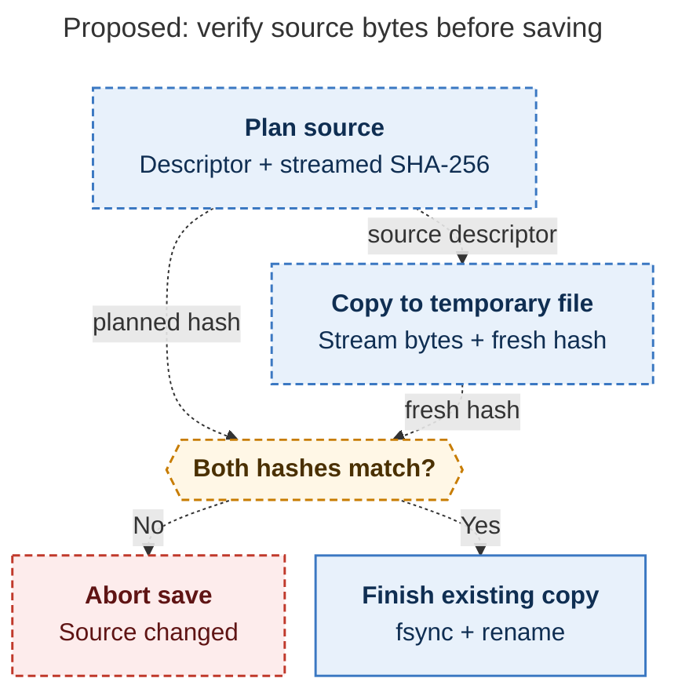
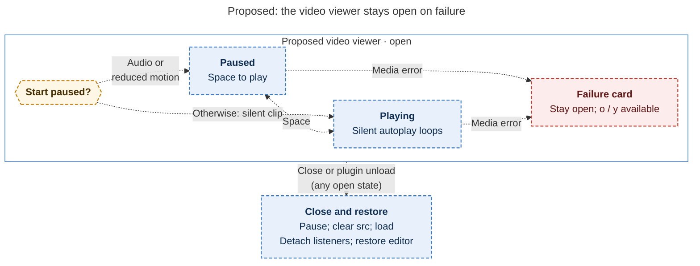

# Diagram proposals: Video embeds in task captures, viewed with `Z`

Proposals for the swarm linker, not a report. Each diagram restates only what the source
report says.

```yaml
source: research:202611/task_video_capture_z_viewer/task_video_capture_z_viewer__final.md
producer: research.63.image
check: "mmdc 12.0.0 with the PDF-mirroring config rendered 2 of 2 Mermaid diagrams"
```

## source-integrity

```yaml
anchor: |-
  commit streams source → temp file while re-hashing and aborts if
question: |-
  What prevents a changed source from being saved after planning?
illustrates: |-
  The proposed save compares the planned hash with the streamed-copy hash, requiring both to match before finishing the existing copy and aborting when the source changed.
caption: "The proposed save requires both hashes to match; changed source bytes abort the save before the existing copy finishes."
review: "467.16x716 px, fit 100.0%; question, source tracing and visual checks passed; 1 revision, 2 visual look rounds."
```



## viewer-lifecycle

```yaml
anchor: |-
  pause, clear `src`, call `load()` to release the decoder, detach
question: |-
  How does the proposed viewer start playback, handle failure, and close?
illustrates: |-
  Either playing or paused video can fail into an in-place card, while closing or plugin unloading from any open state releases the decoder and restores editor state.
caption: "Proposed: errors stay visible (o opens the default app; y copies the path); closing releases the decoder and restores the editor."
review: "455.312x1063 px, fit 84.0%; question, source tracing and visual checks passed; 2 revisions, 2 visual look rounds; scope excludes native-fullscreen Esc."
```


