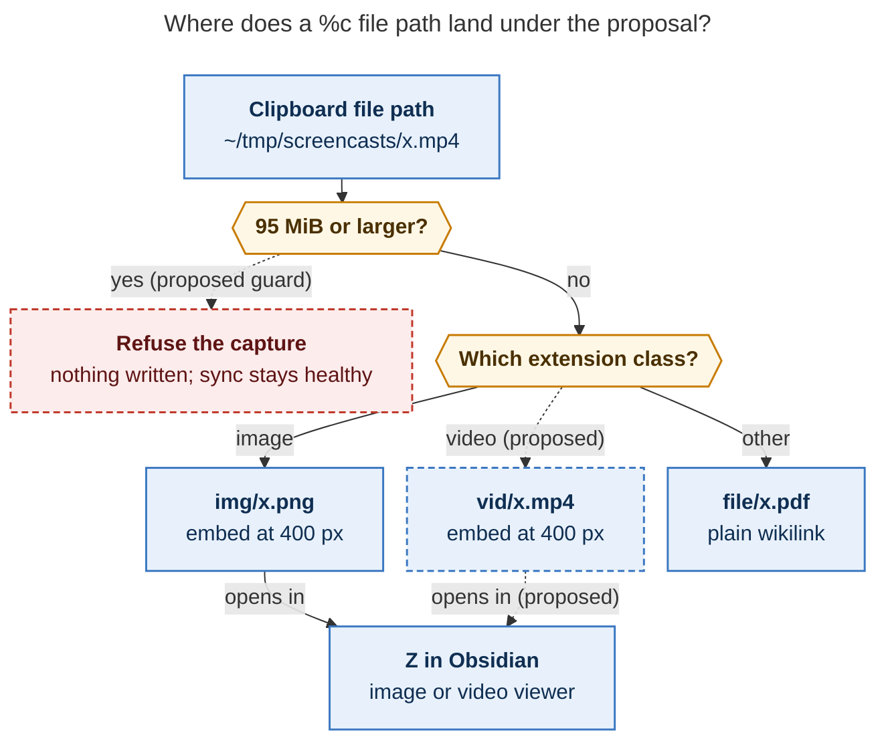

# Video clips in `%c` captures and a `Z` video viewer

*Researcher: cld · 2026-11-16 · scope: bob-cli, bob-plugins (bob-navigation-hotkeys,
bob-ledger-tools), bob-mac-capture, the Bob vault, chezmoi `macrec`*

## TL;DR

The feature is a good idea, and about half of it already works. Today, `%c` on
`~/tmp/screencasts/20261116_155943.mp4` copies the clip into the vault, but it goes
into `file/` and is written as a plain `[[file/…mp4]]` link. It is not embedded, and
`Z` refuses it as "Not an image". Bryan's own recorder, `macrec`, already makes the
best possible input: small, fast-start H.264 MP4s that reach all three hosts, with a
`~/…` path on the clipboard. Obsidian already plays MP4 embeds natively.

What's left is to (1) give the shared attachment planner a third kind, **video**,
(2) teach the `Z` viewer to play video, and (3) close two reliability holes that
videos make much more likely to hit. Both holes exist today:

- **A large `%c` file wedges vault sync.** `%c` and `bob attachments import` copy a
  file of any size. Once a file of 95 MiB or more is in the vault, *every*
  `bob vault-sync` cycle on that host fails until someone deletes it by hand.
- **Some attachment types never sync.** `%c` copies files whose extensions the
  vault's allowlist `.gitignore` ignores. Examples are `.heic`, `.avif`, `.tiff`,
  `.bmp`, `.ico` and `.zip` today, and `.ogv` if it were treated as a video. Those
  embeds work only on the host that captured them.

**Recommendation (details in §9):**

- **bob:** add `AttachmentKind::Video` (`mp4 m4v mov webm mkv`). Copy videos to a new
  `vid/` directory and embed them as `![[vid/NAME.mp4|400]]`, the same way images
  embed. Refuse any attachment that vault sync would refuse or git would ignore.
  Warn at 50 MiB. Hash and copy by streaming instead of buffering whole files.
- **Obsidian:** add a `VideoZoomModal` that subclasses today's `ImageZoomModal`, so
  the chrome, origin line, `y` / `r`, zoom and pan stay identical. On top of that it
  adds a hairline scrubber, a `Space` / `←→` / `,.` / `[ ]` transport, looping
  autoplay, and a calm "can't play here → `o` open in default app" state instead of
  closing on error. Keep the command id `zoom-image-on-line` so the vimrc `Z` mapping
  keeps working.

---

## 1. What exists today (verified)

### 1.1 The `%c` attachment pipeline (bob-cli)

- `plan_entry` (`src/native/capture_clip/plan.rs`) sends a clipboard to the
  attachment path when every non-empty line is an existing absolute path (quoted,
  `file://`, or `~/…`; at most 10 paths).
- `plan_attachments` (`src/native/capture_clip/files.rs:126`) does
  `fs::read(source)`, hashes the bytes, and classifies the file by extension
  (`attachment_kind`, `:190`). The `IMAGE_EXTENSIONS` list is avif, bmp, gif, heic,
  ico, jpeg, jpg, png, svg, tif, tiff and webp. Images go to `img/`; everything else
  goes to `file/`.
- `attachment_reference` (`:181`) renders `![[img/x.png|400]]`
  (`IMAGE_EMBED_WIDTH = 400`, `:17`) for images, and `[[file/x]]` for everything
  else.
- If the destination already holds identical bytes, the file is reused. If it holds
  different bytes, the new copy gets an 8-hex hash suffix. Writes go to a temp file,
  are fsynced, then renamed (`persist.rs`). Created files are removed if the note
  write fails.
- After commit, each attachment appends an origin event to
  `.bob/attachments/<host>.jsonl`. `Z`'s `y` / `r` keys use those events
  (`docs/attachments.md`).
- `bob attachments import` reuses the same planner. The `Z` path-bullet import calls
  it through bob-ledger-tools.

**Baseline experiment** (scratch vault, `--dry-run`, clipboard = the real clip):

```text
[dry-run] ok would capture  mac_inbox.md
  - [ ] #task Check the walk footer flicker [created::2026-11-16]
  	- [[file/20261116_155943.mp4]]
[dry-run] ok would savefile/20261116_155943.mp4
```

The JSON reports `"kind": "file"`. So the request is really "promote video from
*file* to a first-class embedded kind", not "add video support from scratch". (The
missing space in `would savefile/` is a separate cosmetic bug; see §3.)

### 1.2 The `Z` image viewer (bob-plugins → bob-navigation-hotkeys)

- `obsidian_vimrc.md` maps `nnoremap Z :bob_zoom_image<CR>` →
  `obcommand bob-navigation-hotkeys:zoom-image-on-line`.
- The resolver (`src/679-plugin-image-zoom.js`) finds wiki and Markdown links and
  embeds on the cursor line, skipping code. It filters them by
  `IMAGE_ZOOM_EXTENSIONS` (png jpg jpeg gif webp svg bmp avif), picks the
  containing, next, or previous match, and resolves it with
  `metadataCache.getFirstLinkpathDest` and `vault.getResourcePath`.
- `ImageZoomModal` (`src/207-image-zoom-modal.js`) is a full-window black stage. It
  has a header (title plus zoom readout), an origin line (`↳ ~/tmp/…` with a state
  suffix), a toast pill, and a footer of `kbd` chips. Inputs:
  - keys: Esc / `q` / `Z` close, `+` / `-` zoom, `0` / `1` fit / 1:1, `hjkl` and
    the arrow keys pan;
  - pointer: wheel to zoom, drag to pan, double-click toggles fit and 1:1;
  - origin: `y` copies the recorded origin path, `r` restores the link to it.

  On a load error it closes and shows a Notice.
- The path-bullet import (`src/679a-image-zoom-path.js`) handles a bullet whose
  whole content is an image path. It runs `bob attachments import`, rewrites the
  bullet to bob's embed in one undoable edit, and opens the viewer with an
  "Imported" pill. A non-image extension throws `Not an image: …` (`:60`), and the
  import result must have `kind === "image"` (`:168`).

### 1.3 Where screencasts come from (chezmoi `macrec`)

- `⌃⌥⇧V` records a screen region on the Mac.
- `macrec_ship` encodes the clip with
  `libx264 -preset veryfast -crf 23 … -movflags +faststart`, with `fps=30`, the long
  side capped at 2560 px, and yuv420p. If the mic was on, it adds mono AAC.
- Recordings stop automatically at **10 minutes**.
- Clips land at `~/tmp/screencasts/YYYYMMDD_HHMMSS.mp4` on **the Mac, apollo, and
  athena**. apollo prunes its copies to 2 GiB.
- The Hammerspoon notification copies the `~/…` path. That is exactly the clipboard
  shape in the request.

Probe of the three clips on athena today:

| Clip | Codec | Size (px) | Length | File size | Bitrate |
| --- | --- | --- | --- | --- | --- |
| 20261115_195328.mp4 | H.264 High, yuv420p, no audio | 2560×1548 | 7.5 s | 644 KB | 687 kb/s |
| 20261116_060435.mp4 | same | 2560×1548 | 11.9 s | 422 KB | 283 kb/s |
| 20261116_155943.mp4 | same | 2560×1548 | 6.2 s | 249 KB | 321 kb/s |

`moov` comes before `mdat` (fast-start), so the clips seek instantly.

**Takeaway:** a typical clip costs about as much as one or two screenshots. The vault's
`img/` holds 214 files totalling 80 MiB, an average of 382 KiB and a maximum of
2.9 MiB. At the measured 0.3–0.7 Mb/s, a full 10-minute clip would be about 22–52 MB.
High-motion content can exceed the 95 MiB sync limit.

### 1.4 The vault and sync constraints

- The vault's allowlist `.gitignore` already re-includes `*.mp4 *.mov *.m4v *.webm
  *.avi *.mkv`, so a new `vid/` directory needs **no ignore change**. I checked this
  with `git check-ignore`.
- It does **not** re-include `*.ogv`. It also omits `*.heic *.avif *.tif(f) *.bmp
  *.ico *.zip *.docx`, even though bob's `IMAGE_EXTENSIONS` copies most of those.
- `bob vault-sync` refuses to stage a file of 95 MiB or more (`vault_sync.rs:33`,
  `:1274`). The refusal is a **fatal cycle error**, so nothing on that host syncs
  until the file is removed. It warns at 50 MiB.
- The vault's git pack is already **2.06 GiB**. GitHub recommends repositories stay
  ideally under 1 GB, and strongly recommends under 5 GB.

### 1.5 Obsidian's native video support

- Obsidian accepts MP4, WebM, OGV, MOV and MKV, and plays them with whatever codecs
  the platform provides.
- `![[x.mp4]]` renders an inline `<video controls>`.
- The forums report that the `|width` suffix on video embeds is **not honored**: it
  lands as a `width` attribute but does not resize the player.
- Obsidian has no native `#t=` timestamp support in wikilink embeds.

### 1.6 Bob Mac Capture

- `CaptureAttachmentOutput.kind` is a `String`, so a new `"video"` value decodes
  safely.
- The clip card counts every non-`"image"` attachment as a "file", and builds image
  thumbnails with `NSImage(contentsOfFile:)`. A video would therefore show as
  "1 file" with no thumbnail. That is cosmetic, not broken.

---

## 2. Critique: is this a good idea?

**Yes.** The reasons are specific to this setup:

1. **The input pipeline is already ideal.** `macrec` makes small fast-start H.264
   clips, the format with the best playback support in Electron on every platform.
   They land on every host and the path is already on the clipboard. Nothing needs
   transcoding.
2. **It completes an existing loop.** Screenshots go path → embed → `Z` → `y` / `r`
   back to the path. Screencasts are the obvious second member of that loop. Bryan
   builds UIs: Obsidian plugins, the Mac app, TUI walkers. Bugs like a flicker,
   a jump or a race need motion to show, and a still can't capture them.
3. **The vault copy outlives `~/tmp`.** apollo prunes screencasts at 2 GiB, and
   `~/tmp` is temporary by name. A task that links to the clip in `~/tmp` will
   eventually lose its evidence. A vault copy keeps it as long as the task does, and
   any agent on any host can read it from the synced vault.
4. **It's cheap.** On the bob side it's roughly one enum variant, one directory and
   one embed form. Most of the work is the viewer.

**Risks, and how the design handles each:**

| Risk | Severity | Mitigation in this design |
| --- | --- | --- |
| A clip of 95 MiB or more wedges vault sync on that host | **High.** One capture blocks all sync. | Refuse such files at plan time, for every attachment kind (§5.1) |
| Git history grows forever | Medium | Typical clips are under 1 MB. Warn at 50 MiB. A separate `vid/` keeps a later move to LFS or out-of-band storage a one-line change (§6). |
| The file's type is ignored by the vault `.gitignore`, so it never syncs | Medium, and silent | Plan-time `git check-ignore`; keep video extensions to the allowlisted set (§5.1) |
| The codec doesn't play in Obsidian (an HEVC `.mov` from an iPhone, an odd `.mkv`) | Low for macrec clips, medium for other sources | Classify by extension, but in the viewer turn a failure into an "open in default app" state (§5.2) |
| Viewer complexity | Medium | Subclass the image modal and reuse its math and chrome. Ship only the transport keys that matter for screencasts. |
| Inline embeds render at full line width | Cosmetic, but it's the "beautiful" requirement | Write `|400` like images, and have plugin CSS honor it (§5.3) |

**Would I take a different approach?** Not a different *architecture*: copy into the
vault, embed, and view with `Z` is the right shape. I would change the *edges*. Make
video a general attachment kind rather than a task-capture feature. Store videos in
`vid/`. Add the size and ignore guards. Give video playback in the viewer its own
small, careful design instead of reusing image semantics as-is. §4 lists these.

---

## 3. Bugs found along the way (independent of video)

1. **Large `%c` / import files wedge vault sync.**
   - Plan-time check: a sparse 100 MiB `.mov` plans cleanly as
     `[[file/big.mov]]`.
   - What sync does: `preflight_one_file` turns any file of 95 MiB or more into
     `CycleError::fatal`.
   - Why it's urgent: nothing in `%c` or `bob attachments import` checks size. Videos
     make the trigger much more likely.
2. **Attachments the vault never syncs.**
   - `img/x.heic`, `img/x.avif`, `img/x.tiff`, `img/x.bmp`, `img/x.ico`,
     `file/x.zip` and `file/x.docx` are all `IGNORED` per `git check-ignore`.
   - `%c` copies them without complaint and embeds or links them. They then appear
     broken on every other host.
   - An `.ogv` "video" would join this list.
3. **Memory and latency.**
   - A 94 MiB attachment dry run took **0.32–0.37 s** and peaked at **206 MiB RSS**.
     The same dry run without a clip took 0.01 s and 21 MiB. Planning holds the whole
     file in memory and clones it into the reservations.
   - Bob Mac Capture's live preview reruns `bob capture --dry-run` with the clip
     whenever a `%c` is present, so a big video makes every preview slow.
4. **Cosmetic.** `print_clip_file_confirmation` pads the verb with `{verb:<10}`
   (`capture/output.rs:7340`). `"would save"` is exactly 10 characters, so dry runs
   print `would savefile/…`.

Items 1, 2 and 4 are worth filing whatever is decided about video.

---

## 4. Requirement adjustments (explicitly called out)

| # | Original requirement | Adjusted requirement | Why |
| --- | --- | --- | --- |
| A1 | Videos embed in **task captures** via `%c` | Videos embed wherever the shared planner runs: every `%c` route (tasks, bullets, notebook notes, drawers, `%c<N>` history) **and** `bob attachments import` | It's one planner. A task-only special case would make two paths that disagree. |
| A2 | *(none)* | **New:** refuse an attachment of 95 MiB or more (any kind), and warn at 50 MiB | Prevents the sync wedge (§3.1). Reuses vault-sync's own constants so bob has a single policy. |
| A3 | *(none)* | **New:** refuse an attachment whose destination the vault's `.gitignore` ignores | Prevents silent single-host embeds (§3.2) |
| A4 | Embed "as a sub-bullet" | Same sub-bullet, but stored in **`vid/`** (not `file/`, where videos land today, and not `img/`) and written `![[vid/NAME.mp4|400]]` | Matches `img/`. Lets you audit the video footprint at a glance. Lets you move videos to LFS or out-of-band storage later without touching notes. |
| A5 | "Viewing with `Z`" | `Z` plays the video in the full-window viewer, and **also keeps zoom and pan** for inspecting a paused frame | A 2560-px screencast fitted to a laptop screen has unreadable text. Pausing and pressing `1` is the killer feature for bug clips. |
| A6 | *(implied)* | **New:** `Z` on a bullet holding only a video *path* imports it (the same rule images already follow) | Keeps the path → embed → path loop symmetric |
| A7 | *(implied)* | **Out of scope:** trimming, transcoding, poster generation in bob, galleries, audio-only files, YouTube or URL video, mobile | Keeps v1 small. Each has a revisit trigger in §6. |
| A8 | *(none)* | **Follow-up, non-blocking:** Bob Mac Capture shows "1 video" and a poster thumbnail | The JSON is already decode-safe; this is polish |

---

## 5. Design

### 5.1 bob-cli: one new kind, two guards, streamed bytes

**Classification and storage.**

- `AttachmentKind::Video`, serialized as `"video"`, where
  `VIDEO_EXTENSIONS = ["mkv", "m4v", "mov", "mp4", "webm"]`.
  - These are exactly the playable formats the vault already tracks.
  - `.ogv` stays out until the vault `.gitignore` gains `!*.ogv`.
  - `.avi` stays a `file/` link, because Chromium can't play it.
  - `.gif` stays an image; animated GIFs already work in the image viewer.
- The directory is chosen by kind: Image → `img/`, Video → `vid/`, File → `file/`.
- `attachment_reference`:
  - Video → `![[vid/NAME.mp4|400]]`.
  - Rename `IMAGE_EMBED_WIDTH` to `EMBED_WIDTH`, so one width covers both embed
    kinds.
- Reuse, hash suffixes, sanitizing, the origin journal and cleanup all stay the same.
  They are already kind-agnostic.

**Guards** (applied at plan time, before any write, for every kind):

- **Size.** Read `fs::metadata(source).len()` *before* reading the bytes.
  - At `vault_sync::LARGE_FILE_LIMIT_BYTES` (95 MiB) or more, refuse with an
    actionable message, for example:
    `clipboard attachment ~/tmp/screencasts/x.mp4 is 120.4 MiB; vault sync refuses
    files at 95 MiB — trim it first (macrec clips cap at 10 min)`.
  - `bob attachments import` returns a new failure code, `too_large`.
  - At `LARGE_FILE_WARNING_BYTES` (50 MiB) or more, the capture still goes through
    but carries a structured `CaptureWarning` with code `attachment_large`. This is
    the same channel as `attachment_origin_failed`, so Bob Mac Capture already
    renders it.
- **Sync-ability.** When `BOB_DIR` is a git work tree, pipe all planned destinations
  through one `git check-ignore --stdin` call.
  - Refuse any destination that is ignored, for example:
    `img/x.heic would never sync: the vault .gitignore ignores *.heic. Convert it, or
    add !*.heic to the vault .gitignore`.
  - Skip the check when the vault is not a git repo (tests, other users).
  - One subprocess per capture that has attachments costs a few ms.

**Streaming** (fixes §3.3; do it in the same change).

- `PlannedFile` keeps a *source path* plus a SHA-256 computed while streaming, not a
  `Vec<u8>`. The hash streams through a 1 MiB buffer.
- Reuse checks stream-hash the existing destination.
- `save` streams the source into the temp file, hashing as it goes. If the copied
  bytes no longer match the planned hash, it aborts: the source changed between
  planning and commit.
- Dry runs for live preview can skip hashing when the destination doesn't exist. The
  hash only decides reuse and collision suffixes, and the commit-time hash covers the
  journal.
- Snippets keep in-memory bytes, since they are at most 16 MiB of clipboard text.

**Output contract.**

- `clip.attachments[].kind` and `bob attachments import`'s `kind` gain the value
  `"video"`.
  - This is additive: the field is documented without an enumerated set, and every
    known consumer treats `kind` as a string.
  - So it's a `feat(capture): …`, **not** a `!` break under the release-train rule.
  - Document the values `image | video | file` in `docs/reference/json-outputs.md`.
- Human confirmation lines gain the size for videos:
  `✓ saved      vid/20261116_155943.mp4 · 243 KiB`. This keeps size visible, which
  is what keeps git history healthy. Fix the padding bug at the same time
  (`{verb:<11}`).

**Docs.** Update these to match:

- `docs/capture.md` (the Clipboard section: the shape list and the limits paragraph);
- `docs/attachments.md`, which is the contract file shared with the plugins;
- `docs/vault-git-sync.md` (a line about `vid/` under authored-content coverage).

Read the `cli_rules.md` and `docs.md` reference memory before implementing. Once
Bryan accepts the design, record it as a decision (suggested key:
`clip-videos-embed-from-vid`).



*Figure 1. The proposal adds one guard in front of the existing extension routing and
one new branch. Dashed shapes and edges are proposed; solid ones exist today. The
`.gitignore` guard (not drawn) sits next to the size guard. Rendered with
mermaid-cli 12.0.0: 707×848 px, 92% fit.*

### 5.2 Obsidian: a video viewer that feels like the image viewer

**Architecture.**

- Add `class VideoZoomModal extends ImageZoomModal` in a new fragment
  (e.g. `src/208-video-zoom-modal.js`, staying under the 1000-line fragment limit).
- The subclass overrides only these parts:
  - creating the media element (`<video>` instead of ``);
  - the load and error events (`loadedmetadata` and `error`, reading
    `videoWidth/Height` for `natural`);
  - the key map (`videoZoomKeyAction` first, falling back to `imageZoomKeyAction`);
  - the footer chips;
  - teardown.
- Everything else is reused as-is: fit, 1:1 and pan math, drag, wheel, origin
  resolution, `y` / `r`, toasts, editor restore.
- Subclassing (rather than a parallel modal, or generalizing in place) leaves the
  image viewer byte-for-byte unchanged. Its existing tests stay the regression net.

**Resolver changes.**

- In `679-plugin-image-zoom.js`, add `VIDEO_ZOOM_EXTENSIONS` (mp4 m4v mov webm mkv).
- A candidate is any image *or* video, using the same containing / next / previous
  rule. The resolved target carries `kind: "image" | "video"`, and the command opens
  the matching modal.
- Update the notices: "No image or video on this line" and
  "Not an image or video: …".
- `[[file/old.mp4]]` links written before this change open as well.
- Rename the command's display name to **"View image or video on cursor line"** but
  **keep the id** `zoom-image-on-line`, so the vimrc mapping keeps working.

**Path-bullet import.**

- `findImagePathBullet` accepts video extensions as well. The import result may be
  `kind: "image"` or `"video"`, and the result picks the modal.
- The pill reads `Imported to vid/x.mp4 · r to undo`.

**Interaction design** (screencast-first; image muscle memory kept where it doesn't
fight playback):

| Input | Action | Rationale |
| --- | --- | --- |
| *(open)* | Autoplays from 0:00 and **loops**, with sound on | Screencasts are short "living screenshots" you watch two or three times. `Z` is a deliberate gesture, so sound is expected. |
| `Space`, click on video | Play / pause | This is the universal player key. A click only counts if it wasn't a drag. |
| `←` / `→` | Back / forward 1 s (`Shift`: 5 s) | Median clip is about 7–12 s, so YouTube's 5 s step would skip half of it. `Shift` means "farther", as in the image viewer. |
| `,` / `.` | Previous / next frame (pauses) | The flicker-hunting tool. Use `requestVideoFrameCallback` to measure frame time; fall back to 1/30 s, macrec's frame rate. |
| `[` / `]` | Slower / faster: 0.25× · 0.5× · 1× · 1.5× · 2× | Slow motion shows transient UI states |
| `g` / `G` (also `Home` / `End`) | First / last frame | Vim-flavoured; `G` lands on the final state |
| `m` | Mute | Only shown when the clip has an audio track. macrec records no mic by default. |
| `+` `-` / `0` / `1` / `hjkl` / wheel / drag / double-click | Zoom / fit / 1:1 / pan, **identical to the image viewer** | Read small text in a paused 2560-px frame. In this viewer the arrow keys are for the transport, so pan is `hjkl` only. |
| `y` / `r` | Copy origin path / restore link to path | Identical to the image viewer |
| `o` | Open in the default app (QuickTime / IINA) | Escape hatch for unplayable codecs and for system features such as picture-in-picture and export |
| Esc, `q`, `Ctrl+[`, `Z` | Close | Identical to the image viewer |

**Visual design** (same stage, same type, one new element):

- **Stage:** the existing 90 % black backdrop. The video is fitted with 32 px padding
  and never enlarged (`computeImageZoomFitScale` already does this). Use a `<video>`
  without native `controls`: the native bar looks foreign on the black stage and
  steals keys.
- **Header readout** (top right, tabular numbers), replacing the zoom %:
  `▶ 0:03.2 / 0:06.2`. Append `· 0.5×` only when the speed isn't 1×, and `· 150%`
  only when zoomed. The title shows `20261116_155943.mp4`; when known, add a muted
  `2560×1548` once metadata loads.
- **Scrubber:** a 3 px hairline along the bottom of the stage, just above the chips.
  - Colours: played white at 0.9 opacity, buffered at 0.35, track at 0.15.
  - On hover it grows to 5 px, shows a 9 px playhead dot, and floats a time bubble.
  - Click or drag seeks. Dragging pauses and resumes on release.
  - No accent colour: the image chrome is neutral white-on-black, and the video
    chrome should match.
- **Play/pause flash:** a 56 px translucent circle with ▶ or ❚❚ in the centre,
  fading over 350 ms.
- **Reduced motion:** with `prefers-reduced-motion`, there is no flash and no scrubber
  growth. The clip **opens paused** on its first frame, and the readout says
  `Paused · Space to play`.
- **Footer chips:** `Space play · ← → seek · , . frame · [ ] speed · + − zoom · 0 fit`,
  a divider, then `y copy · r restore` (the second group only when available, as
  today).
- **Failure state** (codec, missing file):
  - Unlike the image viewer, the video viewer **does not close**.
  - A centred card shows "Can't play 20261116_155943.mov here", a muted reason
    ("format not supported by Obsidian on this Mac"), and the chips
    `o open in default app · y copy path · Esc close`.
  - Video failures are more often environmental than an image's broken link, so the
    viewer offers recovery in place instead of a Notice that disappears.
- **Teardown:** `pause()`, remove `src`, then call `load()` to release the decoder.
  Restore the editor cursor exactly as the image viewer does.

### 5.3 Inline embeds: make `|400` real

Obsidian puts the `|400` hint on the embed as a `width` attribute but doesn't size the
player (§1.5). bob-navigation-hotkeys' `styles.css` can honor it with progressive CSS:

```css
/* Exact match for bob's default, works on every Chromium */
.internal-embed.video-embed[width="400"] video { width: 400px; }
/* Any author-edited width, on Chromium ≥ 133 (typed attr()) */
.internal-embed.video-embed[width] video { width: attr(width px, auto); }
.internal-embed.video-embed video {
  max-width: 100%;
  border-radius: var(--radius-s);
  border: 1px solid var(--background-modifier-border);
}
```

The result: inline clips sit at the same 400 px column as bob's screenshots, with soft
corners and a hairline border. They are playable inline with native controls, and `Z`
opens the big view. Verify the exact DOM and Obsidian's Chromium version on the Mac
first (Phase 0). If Obsidian strips the attribute, drop `|400` from bob's embed and cap
`.video-embed` at 400 px instead. bob's choice of embed text is then the only thing
that changes.

### 5.4 Bob Mac Capture (follow-up)

- `CaptureClipPresentation`: count `"video"` separately, so the header reads
  "1 video" or "1 image · 1 video".
- `ClipAttachmentRow`: for videos, build a poster with `AVAssetImageGenerator` at
  about 0.5 s. Add a small ▶ badge and the duration from `AVURLAsset`, and set the
  accessibility label "Clipboard video …".
- This stays inside the app's existing role (it already builds image thumbnails from
  `source`). It doesn't parse grammar or compute capture previews, so it's consistent
  with [[decisions:mac-capture-is-a-thin-client]].

---

## 6. Alternatives considered

| Alternative | Verdict | Why |
| --- | --- | --- |
| Keep today's `[[file/x.mp4]]` link and only teach `Z` to play it | Rejected | No inline playback, the files sit in the wrong directory, and it isn't symmetric with images |
| Convert clips to animated GIF or WebP so they act like images | Rejected | 5–20× larger than H.264 for screen content, GIF's 256-colour palette smears UI, and there's no pause, seek or frame-step |
| Embed the original `~/tmp/…` path without copying | Rejected | apollo prunes it and `~/tmp` is temporary, so evidence disappears, and it breaks the vault-sync model |
| Git LFS for `vid/**` now | **Deferred** | Needs `git-lfs` on three hosts plus changes to vault-sync's merge and clobber logic. Free LFS is 10 GiB storage / 10 GiB bandwidth. Revisit if `vid/` passes about 1 GiB or the pack passes about 4 GiB. `vid/` makes the switch one `.gitattributes` line. |
| Transcode or downscale in bob at capture time | **Deferred** | macrec already encodes well. Transcoding makes capture slow (Bob Mac Capture blocks on bob) and hurts text legibility. Revisit as `bob attachments import --transcode` if non-macrec sources (iPhone HEVC) become common. |
| A new `%v` directive ("newest screencast") | Rejected for now | Adds grammar (Mac highlighting, completion, docs) for something `macrec`'s path copy plus `%c` already does |
| Native `<video controls>` inside the modal | Rejected as the primary design; kept as the failure fallback | Inconsistent chrome, it steals keys and fights Vim focus, and has no frame-step or speed keys |
| A separate `VideoZoomModal` duplicating the chrome | Rejected | Duplication; subclassing reuses tested math and chrome |
| Store videos in `img/` | Rejected | `img/` means images; `vid/` keeps footprint audits and future storage policy simple |

---

## 7. Unknowns to check (Phase 0, about 30 min on the Mac)

1. The Obsidian DOM for `![[vid/x.mp4|400]]`: is the `width` attribute present, and on
   which element? Check Obsidian's Chromium version (`process.versions.chrome` in the
   dev console) to see whether typed `attr()` works.
2. Does seeking through `app://` resource URLs work for large files? (Native embeds
   suggest yes.)
3. Does an HEVC `.mov` from an iPhone play in Obsidian on the Mac? This decides how
   often users will see the failure card.
4. Is `requestVideoFrameCallback` available in Obsidian's Electron? It's needed for
   exact frame stepping; the fallback is 1/30 s.

None of these changes the architecture. Items 1 and 4 change one line each.

---

## 8. Rollout

Both repos can ship in either order:

- Today's plugin refuses video paths before calling bob.
- Bob Mac Capture already decodes `kind` as a string.
- Obsidian plays the new embeds natively even before the viewer lands.

| Phase | Repo | Content | Gate |
| --- | --- | --- | --- |
| 0 | — | The spike in §7 | Notes in the plan |
| 1 | bob-cli | `Video` kind, `vid/`, embed, size guard, ignore guard, streaming, human output and padding fix, docs, tests (classification table, guards, mixed image + video `%c3`, reuse) | Full CI; ships on the daily train as `feat(capture)` |
| 2 | bob-plugins | Resolver, `VideoZoomModal`, path-bullet import, inline CSS, `docs/image-zoom.md` "Videos" section, `scripts/test-navigation-video-zoom-*.cjs` (pure key map, resolver, scrubber math) | `npm test` then `bob plugins sync` |
| 3 | bob-mac-capture | "1 video" header and poster thumbnail | macOS CI on the exact SHA (`scripts/dev/macos-ci-check`) |
| 4 (optional) | bob-plugins | **Frame grab:** `s` in the video viewer saves the paused frame as a PNG, imports it via `bob attachments import`, and inserts `![[img/…|400]]` as the next sibling bullet. **Continuity:** `Z` opens at the inline player's current time. | — |

---

## 9. Recommended solution

1. **Treat video as a first-class attachment kind in bob's shared planner.**
   - Extensions: `mp4 m4v mov webm mkv`.
   - Copy to `vid/` and embed as `![[vid/NAME.mp4|400]]`.
   - This applies to every `%c` route and to `bob attachments import`, not only task
     captures.
   - With the clip from the request on the clipboard, `Fix walk footer flicker %c`
     produces:

     ```markdown
     - [ ] #task Fix walk footer flicker [created::2026-11-16]
     	- ![[vid/20261116_155943.mp4|400]]
     ```

2. **Make attachments unable to hurt sync.** Do this for all kinds, and ship it even
   if video slips.
   - Refuse 95 MiB or more, and warn at 50 MiB, reusing vault-sync's own constants.
   - Refuse destinations the vault `.gitignore` ignores.
   - Stream hashing and copying instead of buffering whole files.
3. **Extend `Z` into an image-and-video viewer** by subclassing `ImageZoomModal`.
   - Same stage, title, origin line, chips, `y` / `r`, zoom and pan.
   - On top: a hairline scrubber and the time / speed readout, looping autoplay
     (paused under reduced motion), and `Space` · `←→` · `,.` · `[ ]` · `g` / `G` ·
     `m` · `o`.
   - A recovery card instead of closing when a codec won't play.
   - `Z` on a bare video-path bullet imports it, as it already does for images.
   - Keep the command id; rename only its label.
4. **Make inline embeds look like bob's screenshots** by honoring `|400` with plugin
   CSS: a 400 px column, soft corners, a hairline border.
5. **Defer** LFS, transcoding, posters in bob, and a `%v` directive. Each has an
   explicit revisit trigger in §6. Record the policy as a decision once accepted, and
   follow up with the Mac app's "1 video" header and poster thumbnail.

---

## Sources

Code and data inspected:

- **bob-cli:**
  - `src/native/capture_clip/{files,plan,model,persist,clipboard}.rs`
  - `src/native/capture/{attachments,output}.rs`
  - `src/native/attachments/cli.rs`
  - `src/native/vault_sync.rs`
  - `docs/{capture,attachments,vault-git-sync}.md`
  - `docs/reference/json-outputs.md`
- **bob-plugins:**
  - `plugins/bob-navigation-hotkeys/src/{679-plugin-image-zoom,679a-image-zoom-path,207-image-zoom-modal,207a-image-zoom-origin,490-plugin-lifecycle}.js`
  - `plugins/bob-navigation-hotkeys/styles.css`
  - `plugins/bob-ledger-tools/src/173-plugin-attachments-api.js`
  - `docs/image-zoom.md`
- **bob-mac-capture:** `Sources/CaptureCore/{CaptureModels,CaptureClipPresentation}.swift`
  and `Sources/BobMacCapture/ClipCardView.swift`.
- **chezmoi:** `README.md` (Region screen recording), `home/bin/executable_macrec_ship`
  and `home/dot_hammerspoon/screen_recorder.lua`.
- **Vault (read-only):** the `.gitignore` allowlist via `git check-ignore`,
  `git count-objects -vH`, and the `img/` footprint.
- **Measurements:** `ffprobe` of the three `~/tmp/screencasts` clips, and dry-run
  experiments in a scratch vault (baseline embed, 100 MiB sparse file, 94 MiB
  timing / RSS).

Web:

- [Obsidian Help — Accepted file formats](https://help.obsidian.md/Files+and+folders/Accepted+file+formats)
- [Obsidian Forum — Adding width to video link does not resize the video](https://forum.obsidian.md/t/adding-width-to-video-link-does-not-resize-the-video/70321)
- [Obsidian Forum — Resize embedded video](https://forum.obsidian.md/t/resize-embedded-video/41361)
- [Obsidian Forum — Change the width of videos using HTML](https://forum.obsidian.md/t/change-the-width-of-videos-using-html/98115)
- [Obsidian Forum — Start local video files at a specific timestamp](https://forum.obsidian.md/t/start-local-video-files-at-a-specific-timestamp/109617)
- [Obsidian Forum — Link to timestamp of embedded audio](https://forum.obsidian.md/t/link-to-timestamp-of-embedded-audio/7122)
- [Obsidian Forum — Matroska videos are supported](https://forum.obsidian.md/t/matroska-videos-are-supported-adding-mkv-to-accepted-extensions-is-all-thats-missing/18216)
- [GitHub Docs — About large files on GitHub](https://docs.github.com/en/repositories/working-with-files/managing-large-files/about-large-files-on-github)
- [GitHub Docs — Git LFS billing](https://docs.github.com/en/billing/concepts/product-billing/git-lfs)
- [Chromium — Integrate platform HEVC decoding for macOS](https://chromium.googlesource.com/chromium/src/+/71058e62ad3bbeb8867e085d7219eabb04573bcc)
