# Video embeds in task captures, viewed with `Z` — consolidated research

*Lead consolidation · 2026-11-16 · merges five independent reports (cdx, cld, grk, mus,
gem) plus the lead's own verification. Scope: bob-cli, bob-plugins
(bob-navigation-hotkeys, bob-ledger-tools), bob-mac-capture, the Bob vault, and the
chezmoi `macrec` recorder.*

## TL;DR

**Build it — all five researchers and the lead agree, and about half of it already
works.** Today, `%c` with `~/tmp/screencasts/20261116_155943.mp4` on the clipboard
already copies the clip into the vault; it just lands in `file/` as a plain
`[[file/…mp4]]` wikilink that does not play, and `Z` refuses it with "Not an image".
The input side is already ideal: Bryan's `macrec` recorder produces small (250–650 KiB),
fast-start H.264 MP4s capped at 10 minutes, mirrors them to all three hosts, and puts
the `~/…` path on the clipboard — exactly the shape `%c` consumes. Obsidian plays MP4
embeds natively, and the vault's git allowlist already re-includes `*.mp4 *.mov *.m4v
*.webm *.avi *.mkv` (verified with `git check-ignore`).

**Recommended solution in one paragraph:** add a third attachment kind, `video`, to
bob's shared planner; copy videos to a new `vid/` directory and embed them as
`![[vid/NAME.mp4|400]]` the way images embed from `img/`; add two reliability guards
(refuse ≥ 95 MiB, refuse gitignored destinations) and stream hashing/copying for every
attachment kind; extend the existing `Z` command (id `zoom-image-on-line`, kept stable
for the vimrc mapping) into a media dispatcher that opens videos in a player modal
sharing the image viewer's chrome, origin line, and `y`/`r` gestures; and follow up with
Bob Mac Capture's "1 video" count and poster thumbnail. Keep `%c` — no new directive.

## 1. What exists today (facts, independently verified ≥ 2×)

Every report converged on the same baseline; the lead re-verified the load-bearing
items in the bob-cli tree and the live vault.

| Area | Verified behavior |
| --- | --- |
| Clipboard classification | A clipboard whose every non-empty line is an existing absolute path (`~/…`, `/…`, quoted, `<…>`, percent-decoded `file://`; max 10 paths) becomes attachments (`plan.rs:plan_entry`, `files.rs:classify_path_candidate`). |
| Kinds | `AttachmentKind` is `Image` \| `File` (`model.rs`). `IMAGE_EXTENSIONS` (12 entries) → `img/` + `![[img/x.png\|400]]` (`IMAGE_EMBED_WIDTH = 400`, `files.rs:17`); everything else → `file/` + `[[file/x.ext]]` (`attachment_reference`, `files.rs:181`). An `.mp4` takes the `File` path today. |
| Copy semantics | SHA-256 reuse of byte-identical destinations; 8-hex hash suffix on content clash; sanitized names; temp-file + fsync + rename; created files removed if the note write fails; `--dry-run` writes nothing (`persist.rs`). |
| Memory | `plan_attachments` does `fs::read` of the whole source and clones the bytes into plans/reservations — even on `--dry-run`, which Bob Mac Capture reruns as its live preview. cld measured a 94 MiB file: 0.32–0.37 s and 206 MiB peak RSS per dry run. |
| Provenance | One `attachment.import` event per copy in `.bob/attachments/<host>.jsonl` (`via: "capture"` / `"zoom"`); `bob attachments origin` resolves present/missing/changed/elsewhere; the journal is extension-agnostic. |
| Import | `bob attachments import` reuses the same planner; the `Z` path-bullet flow calls it through bob-ledger-tools (20 s spawn timeout). |
| `Z` | Vault vimrc maps `Z` → command id `zoom-image-on-line`. Resolver (`679-plugin-image-zoom.js`) finds links/embeds on the cursor line (skipping code), filters by `IMAGE_ZOOM_EXTENSIONS` (8 entries — already drifted from bob-cli's 12), picks containing → next → previous. `ImageZoomModal` (`207-image-zoom-modal.js`): black stage, header, origin line, kbd chips, zoom/pan, `y`/`r`, Esc/`q`/`Z` close; closes on load error. Path-only bullets import and rewrite in one undoable edit; non-image extensions throw `Not an image: …`. |
| Vault sync | `vault_sync.rs:32–33`: warn at 50 MiB, **fatal cycle error at 95 MiB** — one oversized file blocks all sync on that host until hand-deleted (lead-verified constants). Nothing in `%c` or import checks size today. |
| Vault gitignore | Ignore-`*`-then-allowlist by extension, directory-independent (lead-verified with `git check-ignore -v`): `vid/test.mp4` → tracked via `!*.mp4`; `file/test.mp4` → tracked; `vid/test.ogv` → **ignored**; `img/test.heic` → **ignored**. So a new `vid/` directory needs no ignore change, `.ogv` would silently never sync, and several of bob's image extensions (`heic avif tif(f) bmp ico`) already produce single-host embeds. |
| Mac Capture | `CaptureAttachmentOutput.kind` is a Swift `String` — `"video"` decodes safely. The clip card counts non-images as "files" and thumbnails only images (cosmetic gap). |
| Obsidian | Accepted video formats: `mkv mov mp4 ogv webm`; `![[x.mp4]]` renders a native `<video controls>`; playback depends on device codecs. The `\|400` width hint on video embeds is widely reported inert — the wrapper gets a `width` attribute the player ignores unless CSS maps it. |
| macrec clips | H.264 High yuv420p, 2560×1548 @ 30 fps, faststart, no audio by default, auto-stop at 10 min; measured 249–644 KiB for 6–12 s clips (ffprobe, cld/grk independently). At measured bitrates a full 10-minute clip is ~22–52 MB; high-motion content can exceed 95 MiB. |

## 2. Critique: is this a good idea?

**Yes, specifically for this setup.** (1) The input pipeline already produces the ideal
format and puts the path on the clipboard — nothing needs transcoding. (2) It completes
an existing loop: screenshots already go path → embed → `Z` → `y`/`r`; screencasts are
the obvious second member, and Bryan's work (plugins, TUI walkers, the Mac app) produces
bugs that need motion — flicker, jank, races — that stills cannot show. (3) The vault
copy outlives `~/tmp` (apollo prunes screencasts at 2 GiB) and reaches every host via
git sync. (4) On the bob side it is roughly one enum variant, one directory, and one
embed form; the real work is the viewer.

The request is under-specified in exactly the places a naive "add `.mp4` to
`IMAGE_EXTENSIONS`" port would fail:

- **Wrong widget.** The image modal would load a video URL into `` and error out.
  Zoom/pan physics are not a player; video needs transport controls.
- **A wikilink is not an embed.** Leaving videos in `file/` as `[[file/x.mp4]]` would
  make `%c` "work" and still fail the "embedded in the new task" requirement.
- **Video is the first attachment class that can hit the sync cliff.** Images top out
  around 3 MiB; an unguarded screencast ≥ 95 MiB wedges *all* vault sync on that host.
  This hole exists today and video makes it much more likely.
- **The `|400` hint is image syntax.** An uncapped 2560-px player in a task block fails
  the "beautiful" requirement.

No researcher proposed a fundamentally different architecture, and neither does the
lead: copy into the vault, embed as a child bullet, view with `Z` is the right shape.
All adjustments are at the edges and are called out in §4.

## 3. Recommended design

### 3.1 bob-cli: a third kind, two guards, streamed bytes

**Classification and storage.**

- `AttachmentKind::Video`, serialized `"video"`, with
  `VIDEO_EXTENSIONS = ["mp4", "mov", "webm", "mkv"]` (case-insensitive).
  - This is the intersection of Obsidian's documented formats and the vault's git
    allowlist. `.ogv` stays out until the vault gains `!*.ogv` (it is ignored today —
    lead-verified). `.m4v` is allowlisted in git but absent from Obsidian's accepted
    formats, so its embed rendering and `metadataCache` resolution are unverified —
    include it only if the Phase-0 spike (§6) proves it; otherwise it stays a `file/`
    link. `.avi` stays `file/` (Chromium cannot play it). `.gif` stays an image.
- Directory by kind: Image → `img/`, Video → `vid/`, File → `file/`.
- `attachment_reference`: Video → `![[vid/NAME.mp4|400]]`; rename `IMAGE_EMBED_WIDTH`
  to `EMBED_WIDTH`.
- Reuse, hash suffixes, sanitizing, the origin journal, rollback, and the 10-path cap
  are already kind-agnostic — unchanged.

With the request's example on the clipboard, `Fix the walk footer flicker %c` writes:

```markdown
- [ ] #task Fix the walk footer flicker [created::2026-11-16]
	- ![[vid/20261116_155943.mp4|400]]
```

**Guards** (plan time, before any write, for *every* attachment kind — these close
holes that exist today; see §7):

- **Size.** Check `fs::metadata(source).len()` before reading any bytes. Refuse at
  vault-sync's own `LARGE_FILE_LIMIT_BYTES` (95 MiB) with an actionable message naming
  the actual size and the limit ("trim it first — macrec clips cap at 10 min"); warn at
  `LARGE_FILE_WARNING_BYTES` (50 MiB) via a structured `CaptureWarning`
  (`attachment_large`), the same channel Mac Capture already renders. Import gains a
  stable failure code `too_large`. A refusal leaves the whole capture unwritten — never
  silently downgrade an oversized video to a link.
- **Sync-ability.** When the vault is a git work tree, pipe all planned destinations
  through one `git check-ignore --stdin` call and refuse any ignored destination
  ("`img/x.heic` would never sync: the vault .gitignore ignores `*.heic`"). Skip when
  the vault is not a git repo (tests).

**Streaming** (same change; fixes the measured memory amplification):

- `PlannedFile` holds a source descriptor plus a SHA-256 streamed through a bounded
  buffer, not `Vec<u8>`; reuse checks stream-hash existing destinations with a
  size short-circuit; commit streams source → temp file while re-hashing and aborts if
  the bytes no longer match the planned hash (source changed between plan and save);
  origin lookup hashing streams too, and the viewer must not wait on it. Small
  generated snippets stay in memory. Dry-run stays side-effect-free and cheap.

**Contract and output.**

- `clip.attachments[].kind` and import's `kind` gain `"video"` — additive for every
  known consumer (the Swift decoder stores a `String`; the plugin API forwards strings).
  Document `image | video | file` in `docs/reference/json-outputs.md`.
- **Mark the release-train entry `!`.** The lead sides with grk/gem over cld/mus here:
  the documented capture contract ("other files are linked") changes observably — a
  video path that wrote `[[file/x.mp4]]` yesterday writes `![[vid/x.mp4|400]]`
  tomorrow. Marking the break is cheap and honest.
- Human output gains the size for videos (`✓ saved      vid/20261116_155943.mp4 ·
  243 KiB`) and fixes the existing `would savefile/…` padding bug (§7).
- Docs: `docs/capture.md` (Clipboard shapes and limits), `docs/attachments.md` (the
  shared contract — make its kind/extension table the **single catalog** both repos
  cite, ending the existing 12-vs-8 image-extension drift), `docs/vault-git-sync.md`
  (`vid/` coverage), regenerated CLI reference. Read `cli_rules.md` and `docs.md`
  memory before implementing; record an accepted decision (suggested key:
  `clip-videos-embed-from-vid`).

**Reader question:** How does a `%c` file path become a task sub-bullet under the
proposal?



*Figure 1. One size guard and one gitignore guard sit in front of the existing
extension routing, and video becomes a third branch beside images and files. Dashed
shapes and edges are proposed; solid ones exist today. Arrows into "Refuse the
capture" mean either guard alone refuses; the two "opens in" arrows are independent
paths into the same `Z` command. Rendered with mermaid-cli 12.0.0: 708×1046 px, fit
85.4%.*

### 3.2 bob-plugins: `Z` becomes a media dispatcher

- Keep command id `zoom-image-on-line` (the vimrc mapping must not move); rename the
  display string to "View image or video on cursor line". Update notices to "No image
  or video on this line" / "Not an image or video: …".
- Resolver: add `VIDEO_ZOOM_EXTENSIONS` citing the shared catalog; a candidate is any
  image *or* video under the same containing → next → previous rule; the resolved
  target carries `kind`, and the command opens the matching modal. Legacy
  `[[file/old.mp4]]` links (both wiki and Markdown form, embed or plain) open as
  videos with no note migration.
- Path-only bullets: `findImagePathBullet` accepts video extensions; the import result
  may be `kind: "image" | "video"`; the pill reads `Imported to vid/x.mp4 · r to undo`.
  The plugin must not claim video when an old bob returns `kind: "file"` — degrade to
  today's behavior against old servers.
- Implementation shape: a `VideoZoomModal` subclassing (or sharing a context with)
  `ImageZoomModal`, overriding only the media element, load/error events, key map,
  footer chips, and teardown. The image viewer stays byte-for-byte unchanged; its
  tests remain the regression net.

**Reader question:** What does `Z` open on the cursor line? (Figure carried from grk's
report; assets alongside this file.)


*Figure 2. `Z` keeps image zoom first, then plays a video reference, then imports a
path-only image or video bullet through `bob attachments import`; every other line
stays a notice. Converging arrows mean one chosen branch, not all. Rendered with
mermaid-cli 12.0.0: 726×824 px, fit 89.9%.*

**Viewer interaction** (merged key map; rationale follows):

| Input | Action |
| --- | --- |
| `Esc`, `q`, `Ctrl+[`, `Z` | Pause and close; restore cursor/scroll/Vim mode. `Esc` leaves native fullscreen first. |
| `Space` | Play / pause (free — the image viewer does not bind it). |
| `←` / `→` | Seek −/+ 1 s; `Shift` −/+ 10 s, clamped to duration. |
| `,` / `.` | Frame step (pauses; `requestVideoFrameCallback`, 1/30 s fallback). |
| `[` / `]` | Playback speed 0.25× … 2×. |
| `g` / `G` | First / last frame. |
| `m` | Mute (shown only when an audio track exists). |
| `f` | Fullscreen. |
| `o` | Open in the default app (structured `shell.openPath` on the resolved vault file — never a shell-interpolated path). |
| `+` `-` `0` `1`, `hjkl`, wheel, drag, double-click | Zoom / fit / 1:1 / pan, identical to the image viewer, for reading small text in a paused 2560-px frame. Arrows belong to the transport, so pan is `hjkl` only. |
| `y` / `r` | Copy origin path / restore link to it — identical to images. |

- **Seek step:** researchers split between ±1 s and ±5 s. The lead picks ±1 s with
  `Shift` ±10 s because the median macrec clip is 6–12 s (5 s would skip half of it),
  frame-step covers finer work, and the scrubber covers long walkthroughs.
- **Autoplay:** silent clips (macrec's default) autoplay and loop — a short screencast
  is a living screenshot and `Z` is a deliberate gesture; clips with an audio track
  open paused; `prefers-reduced-motion` opens paused with `Paused · Space to play`.
  Handle the `play()` promise; never let late async results act after close.
- **Chrome:** custom transport, not native `<video controls>` (4 of 5 researchers;
  Chromium's shadow-DOM controls steal `Space`/arrows/`Esc` once clicked and look
  foreign on the black stage). Same stage, title, origin line, chips, and toasts as
  images; the one new element is a 3 px hairline scrubber above the chips (played
  0.9 / buffered 0.35 / track 0.15 white, hover grows it with a time bubble; drag
  seeks, pausing while dragging) plus a header readout `▶ 0:03.2 / 0:06.2`, appending
  `· 0.5×` and `· 150%` only when non-default. A 56 px play/pause flash fades over
  ~350 ms (suppressed under reduced motion). cdx's dissent is recorded: native
  controls are an acceptable de-scope if the custom scrubber overruns its budget, and
  paused-frame zoom is the first feature to drop if its transform layer fights the
  transport.
- **Failure state:** unlike the image viewer, **do not close on error**. Show a calm
  in-place card — "Can't play 20261116_155943.mov here", a muted honest reason
  (decode failure is not proof of codec; corruption is possible), and chips `o open in
  default app · y copy path · Esc close`. Tolerate audio-only/zero-dimension streams.
- **Teardown:** pause, clear `src`, call `load()` to release the decoder, detach
  listeners, restore editor state exactly as images do; same on plugin unload so no
  sound continues.

**Inline embeds.** Obsidian puts the `|400` hint on the wrapper as a `width` attribute
but does not size the player. Ship plugin CSS that makes it real:

```css
.internal-embed.video-embed[width="400"] video { width: 400px; height: auto; }
.internal-embed.video-embed video {
  max-width: 100%;
  border-radius: var(--radius-s);
  border: 1px solid var(--background-modifier-border);
}
```

Inline clips then sit in the same 400 px column as bob's screenshots, playable with
native controls in Live Preview/Reading, with `Z` as the big view. Three researchers
preferred omitting `|400` entirely; the lead sides with writing it because it keeps
`attachment_reference`, restore targets, and author-editable widths identical to
images, and the attribute is verifiably present for CSS to map. The Phase-0 spike
checks the DOM on the Mac; if Obsidian strips the attribute, emit the bare embed and
cap `.video-embed` at 400 px in CSS instead — a one-line change in bob before release.

### 3.3 bob-mac-capture: stay a thin client

`"video"` already decodes safely (`kind` is a `String`). Phase C: count videos
separately ("1 video", "1 image · 1 video"), add a poster thumbnail via
`AVAssetImageGenerator` from Bob's reported `source` (cancellable, cached, never a
second clipboard reader or planner), a small ▶/duration badge from `AVURLAsset`, and an
accessibility label. Until then a video shows as "1 file" — cosmetic, but ship it in
the same epic so the preview does not lie for long. This stays inside
`decisions:mac-capture-is-a-thin-client`.

## 4. Requirement adjustments (explicitly called out)

| # | Original requirement | Adjustment | Why |
| --- | --- | --- | --- |
| A1 | Videos embed in *task captures* via `%c` | Videos embed wherever the shared planner runs: every `%c` route (tasks, bullets, notebook notes, drawers, `%c<N>` history) and `bob attachments import` | One planner; a task-only special case would fork it |
| A2 | *(none)* | Refuse ≥ 95 MiB, warn ≥ 50 MiB, for **all** kinds, reusing vault-sync's constants | An unguarded large file fatally wedges all sync on that host — a hole that exists today |
| A3 | *(none)* | Refuse destinations the vault `.gitignore` ignores | Prevents silently single-host embeds (`.heic` etc. today; `.ogv` tomorrow) |
| A4 | Embed "as a sub-bullet" | Same sub-bullet, stored in **`vid/`** and written `![[vid/NAME.mp4\|400]]` | 4-of-5 majority; parallels `img/`, makes the video footprint auditable, and a later LFS/out-of-band move is one `.gitattributes` line. cdx's keep-`file/` dissent noted; old `file/*.mp4` links keep working under `Z` either way, with no migration |
| A5 | "Viewing with `Z`" | `Z` plays video *and keeps zoom/pan for paused frames* | A 2560-px screencast fitted to a laptop has unreadable text; pause + `1` is the killer feature for bug clips |
| A6 | *(implied)* | `Z` on a video-path-only bullet imports it, like images | Keeps the path → embed → path loop symmetric |
| A7 | *(implied)* | Extension set `mp4 mov webm mkv`; `m4v` behind a Phase-0 check; `ogv` out until allowlisted; `avi` stays `file/` | Classification is a promise `Z` must keep; recognized container ≠ guaranteed codec |
| A8 | *(none)* | Mark the bob-cli release `!`; `kind: "video"` itself is additive | The documented written-output contract for video paths changes |
| A9 | *(implied)* | Out of scope for v1: `%v` directive, transcoding, Git LFS, posters generated by bob, audio files, galleries, YouTube/URL video, timestamp links, mobile, Finder `Cmd+C` file-URL clipboard support | Each has a revisit trigger (§5); `%c` already covers the stated workflow because macrec copies the path as text |

## 5. Alternatives considered and rejected

| Alternative | Verdict |
| --- | --- |
| Add `mp4` to `IMAGE_EXTENSIONS`, reuse `ImageZoomModal` | Wrong renderer, wrong event model, wrong folder; `` fails on video URLs |
| Keep `[[file/x.mp4]]`, only teach `Z` to play it | No inline playback; fails "embedded"; not symmetric with images |
| Link the original `~/tmp/…` path, no vault copy | apollo prunes it, `~/tmp` is temporary, breaks cross-host sync — evidence disappears |
| Convert to GIF/WebP "animated image" | 5–20× larger than H.264 for screen content, 256-color smearing, no pause/seek/audio |
| Transcode/downscale at capture | Latency inside the live-preview loop, dependencies, quality loss; macrec already encodes well. Revisit as `import --transcode` if iPhone HEVC sources become common |
| Always open an external player from `Z` | Interrupts the editor loop, loses origin/restore; kept as the `o` escape hatch |
| New `%v` directive | `%` already says *how* and `%c` already says *clip* (`decisions:capture-sigils-say-where-what-how`); classification belongs in the planner |
| Native `<video controls>` as primary chrome | Focus theft and foreign chrome; kept conceptually as de-scope fallback (cdx) |
| Git LFS for `vid/**` now | Needs git-lfs on three hosts plus vault-sync merge/clobber work. Revisit if `vid/` passes ~1 GiB or the pack (already 2.06 GiB) passes ~4 GiB |
| Community media plugin dependency | Another keymap/behavior source that solves neither transactional import nor origin contracts |

## 6. Phase-0 spike (~30 min on the Mac, before implementation)

Runtime questions source inspection cannot answer; none changes the architecture:

1. The DOM for `![[vid/x.mp4|400]]`: is the `width` attribute present, on which
   element, and does the CSS rule bite? (Decides `|400` vs bare embed, §3.2.)
2. Does `.m4v` resolve through `metadataCache` and render a player? (Decides A7's
   `m4v` inclusion.)
3. Does an HEVC `.mov` play in Obsidian's Electron on the Mac? (Calibrates how often
   the failure card appears.)
4. Is `requestVideoFrameCallback` available? (Frame-step precision; fallback 1/30 s.)
5. Do seeks through `app://` resource URLs behave for larger files, and does
   fullscreen `Esc` behave inside the modal?

## 7. Pre-existing bugs this research surfaced (file regardless of the feature)

1. **Large attachments wedge vault sync.** `%c`/import copy files of any size; a file
   ≥ 95 MiB turns every `bob vault-sync` cycle on that host into a fatal error until
   deleted by hand. Verified against `vault_sync.rs` preflight by two researchers and
   the lead. Guard A2 fixes it.
2. **Some attachments never sync.** `%c` happily copies `heic avif tif(f) bmp ico zip
   docx` whose extensions the vault `.gitignore` ignores (lead-verified
   `img/test.heic` → IGNORED); the embeds work only on the capturing host. Guard A3
   fixes it; separately, bob-cli's and the plugin's image-extension lists have drifted
   (12 vs 8) and should collapse into the shared catalog (A6 in grk's numbering).
3. **Dry-run memory amplification.** The planner buffers and clones whole files even
   in dry-run, which Mac Capture reruns while typing (206 MiB RSS for a 94 MiB file,
   measured). The streaming refactor fixes it.
4. **Cosmetic:** `print_clip_file_confirmation` pads the verb with `{verb:<10}` and
   `"would save"` is exactly 10 chars, so dry runs print `would savefile/…`.

## 8. Rollout

| Phase | Repo | Content | Gate |
| --- | --- | --- | --- |
| 0 | — | §6 spike; record Obsidian/Electron/codec results | Notes in the plan |
| 1 | bob-cli | `Video` kind, `vid/`, embed, both guards, streaming, output + padding fix, docs, shared catalog, tests | Full CI; daily release train, entry marked `!`; no hand-edited version/changelog |
| 2 | bob-plugins | Resolver dispatch, video modal, path-bullet import, embed CSS, docs, pure-logic tests mirroring the image-zoom scripts | `npm test`; deploy via `bob plugins sync` |
| 3 | bob-mac-capture | "1 video" count, poster thumbnail, duration badge | Exact-SHA macOS CI (`scripts/dev/macos-ci-check`) |
| 4 (optional) | bob-plugins | Frame grab (`s` saves the paused frame as PNG via import, inserts an `img/` sibling bullet); open at the inline player's current time | — |

Order is bob-cli first (thin-client rule), but nothing hard-breaks out of order:
today's plugin refuses video paths before calling bob, the Mac app decodes `kind` as a
string, and Obsidian plays the new embeds natively before the viewer lands. Test the
compatibility matrix anyway: new bob + old Mac decoder, new Mac + old bob, plugin
against old bob's `kind: "file"` output.

**Validation essentials** (merged from cdx's matrix and grk/gem's test lists): the
exact example path; quoted/spaced/Unicode/`file://`/uppercase variants; mixed
image+video+PDF clipboards and `%c3` history; reuse and collision suffixes; dry-run
creates nothing and stays bounded; source changes between plan and save abort; both
embed and plain-link forms of old and new video paths resolve under `Z`; silent MP4,
audible clip, corrupt/truncated/zero-byte files, audio-only WebM; close during
load/play/origin-lookup leaves no sound or listeners; `y`/`r` round-trip with one-step
undo; actual off-host sync of a captured `vid/` file (copy success alone is not sync
success). DOM-mocked tests cannot establish codec support or visual quality — keep a
small synthetic media fixture set and do a real-runtime review on the Mac.

## 9. Where the researchers disagreed, and how it was resolved

| Question | Positions | Resolution |
| --- | --- | --- |
| Storage directory | `vid/` (cld, grk, mus, gem) vs keep `file/` (cdx) | **`vid/`** — audit-at-a-glance, future storage policy in one line, `img/` parallel; lead verified no gitignore change is needed (gem's `!vid/` allowlist step is unnecessary — the allowlist is extension-based) |
| `\|400` on video embeds | Write it + CSS (cld, grk) vs bare embed (cdx, mus, gem) | **Write it + CSS**, gated on the Phase-0 DOM check, with the bare-embed fallback pre-agreed |
| Extension set | Various unions of `mp4 m4v mov webm mkv ogv` | **`mp4 mov webm mkv`**; `m4v` behind Phase-0; `ogv` blocked by the vault gitignore (lead-verified); `avi` stays `file/` |
| Size policy | 95 MiB refuse + 50 warn (cdx, cld, grk) vs 50 hard (gem) vs 100 MB (mus) | **95 refuse / 50 warn**, reusing vault-sync's own constants so bob has a single policy; mus's 100 MB would admit files vault-sync then fatally refuses |
| Autoplay | Loop + sound (cld, gem) vs paused (cdx, mus) vs silent-only autoplay (grk) | **grk's rule + cld's loop**: silent clips autoplay and loop; audio clips open paused; reduced-motion opens paused |
| Viewer chrome | Custom transport (cld, grk, gem, mus) vs native controls v1 (cdx) | **Custom**, with native controls recorded as the sanctioned de-scope |
| Zoom/pan in video viewer | Keep (cld) vs defer (cdx) vs drop (gem) | **Keep** — paused-frame 1:1 is the bug-clip killer feature — but isolate the transform layer and drop first if it fights the transport |
| Release marker | `!` (grk, gem) vs additive-only (cld, mus) | **`!`** — the documented written-output contract changes even though the JSON change is additive |
| `file/` sync status | gem claimed `file/` is untracked | **Wrong** — lead-verified `file/test.mp4` is tracked; only ignored *extensions* fail to sync |

## 10. Recommended solution (summary)

1. **bob-cli:** `AttachmentKind::Video` (`mp4 mov webm mkv`), copies to `vid/`, embeds
   `![[vid/NAME.mp4|400]]`, on every `%c` route and `bob attachments import`. Refuse
   ≥ 95 MiB and gitignored destinations for all kinds; warn at 50 MiB; stream hashing
   and copying; keep reuse/suffix/rollback/origin semantics exactly. Additive JSON
   `kind: "video"`; release marked `!`; docs updated with one shared extension
   catalog.
2. **bob-plugins:** the same `Z` (command id unchanged) dispatches by kind: images
   zoom as today; videos open a player modal sharing the image viewer's chrome,
   origin line, and `y`/`r`, adding Space/seek/frame-step/speed/mute/fullscreen, a
   hairline scrubber, paused-frame zoom/pan, an `o` external escape hatch, and an
   in-place failure card instead of closing. Path-only video bullets import. Plugin
   CSS makes the 400 px inline column real.
3. **bob-mac-capture:** count "1 video" and show a poster thumbnail + duration badge,
   derived from Bob's reported source — thin client throughout.
4. **Sequence:** Phase-0 runtime spike → bob-cli (with the two guards and streaming,
   which are worth shipping even if video slips) → plugins → Mac polish; verify real
   off-host sync and real playback on the Mac before calling it done; record the
   accepted decision.

This meets the request exactly as stated — clipboard path, `%c`, embedded sub-bullet,
`Z` to view — without turning capture into a media-processing system, and it leaves
clean seams for the deferred ideas (LFS, transcoding, frame grab, timestamps).

## Sources

- Researcher reports consolidated here (same directory):
  `task_video_capture_z_viewer__cdx.md`, `__cld.md`, `__grk.md`, `__mus.md`,
  `__gem.md` — each with full code citations; cdx pins bob-cli `0510aaf0`,
  bob-plugins `daceef0e`, bob-mac-capture `0f430144`.
- Lead verification (2026-11-16, athena): `src/native/capture_clip/files.rs`
  (`IMAGE_EMBED_WIDTH`, `IMAGE_EXTENSIONS`, `attachment_reference`,
  `attachment_kind`), `src/native/vault_sync.rs:32–33, 1274–1281`
  (`LARGE_FILE_WARNING_BYTES` = 50 MiB, `LARGE_FILE_LIMIT_BYTES` = 95 MiB), and
  `git check-ignore -v` against the live vault (`vid/test.mp4` tracked,
  `file/test.mp4` tracked, `vid/test.ogv` ignored, `img/test.heic` ignored);
  `~/bob/.gitignore` allowlist read in full.
- Measurements by researchers: ffprobe of `~/tmp/screencasts/*.mp4` (cld, grk,
  independently consistent); scratch-vault dry-run baseline and 94 MiB RSS/latency
  (cld); vault `img/` census and 2.06 GiB pack (cld, grk).
- Key external references: Obsidian accepted file formats and embeds help pages;
  Obsidian forum reports that `|width` is inert on video embeds; MDN `<video>`,
  `HTMLMediaElement.play()`/`load()`, video codec guide; GitHub large-file limits.
- Memory consulted by researchers: `decisions:capture-sigils-say-where-what-how`,
  `decisions:mac-capture-is-a-thin-client`,
  `decisions:capture-bullets-mirror-the-task-block`,
  `decisions:bob-cli-releases-ride-a-daily-train`; prior research
  `research:202610/obsidian_z_image_inspection/…__final.md`.
