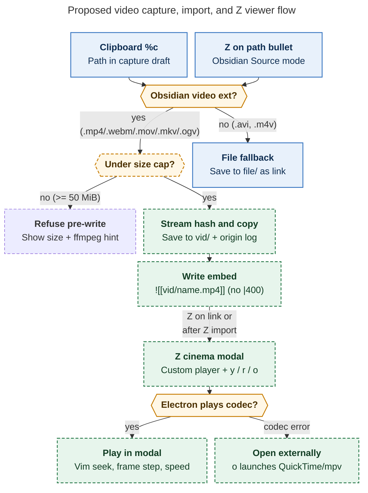

# Video Embedding in Task Captures and Obsidian `Z` Cinema Viewer

**Date:** 2026-11-16
**Scope:** `bob-cli`, `bob-plugins` (`bob-navigation-hotkeys`, `bob-ledger-tools`), `bob-mac-capture`, and Obsidian vault configuration
**Status:** Design research & recommendation

---

## Executive Summary & Verdict

**Verdict: Yes — this feature is a strong fit for Bob, provided we adapt six specific assumptions rather than blindly cloning the image pipeline.**

Today, putting `~/tmp/screencasts/20261116_155943.mp4` on the clipboard and running a `%c` capture already copies the file into the vault, inserts a sub-bullet, and journals its host-local origin path. However, it treats `.mp4` as a generic binary document (`file/20261116_155943.mp4`, non-embedded `[[...]]` link), buffers entire files in RAM multiple times even during `--dry-run`, leaves `file/` excluded from vault sync, and is rejected outright by the `Z` keymap in Obsidian.

Making video capture and `Z` viewing feel **intuitive, reliable, and genuinely pleasant** requires more than adding `.mp4` to `IMAGE_EXTENSIONS`. Unbounded video bytes break Git-backed vault sync, synchronous whole-file `fs::read` calls freeze `bob-mac-capture`'s live dry-run preview, Obsidian ignores `|400` resize syntax on videos, Chromium's native `<video controls>` hijacks Vim keystrokes, and macOS `.mov` / Linux codec mismatches will crash playback unless handled gracefully.

### Six Recommended Adjustments to the Initial Idea

1. **Enforce a hard capture size cap (50 MiB default) and route videos to `vid/`** rather than sharing `img/` or silently drifting toward `vault-sync`'s 95 MiB GitHub hard failure.
2. **Replace whole-file `fs::read` / `Vec<u8>` cloning with streaming SHA-256 + lazy commit-time copy** across `capture_clip` and `attachments/origin.rs` so `--dry-run` live previews stay instantaneous on 30–50 MiB clips.
3. **Emit `![[vid/<name>.<ext>]]` without `|400`** (Obsidian ignores width modifiers on video embeds) and pair it with restrained inline embed CSS plus support for both `![[...]]` and `[[...]]` in `Z`.
4. **Build a dedicated cinema modal inside `ZoomImageModal` (`zoom-image-on-line`) instead of reusing pan/zoom physics or `<video controls>`**, preserving the frosted dark glass aesthetic, Vim/mpv transport controls, and an inline codec-error card with `[o]` external-player fallback.
5. **Match Obsidian's exact five video formats (`mp4`, `webm`, `ogv`, `mov`, `mkv`)** rather than treating arbitrary containers (`avi`, `m4v`) as embeddable videos, while keeping command ID `zoom-image-on-line` stable so `obsidian_vimrc.md` keeps working seamlessly.
6. **Flag the OS clipboard gap clearly:** `pbpaste` and `wl-paste` currently only read text file paths (like `~/tmp/screencasts/...mp4`), not Finder `Cmd+C` file promises (`public.file-url` / `text/uri-list`). Fixing that should be explicitly scoped or tracked alongside this work.

---

## Baseline Audit: What Happens Today

Tracing `~/tmp/screencasts/20261116_155943.mp4` across all four repositories reveals how close the infrastructure already is — and where it breaks down:

| Layer | File / Symbol | Current Behavior for `.mp4` | Gap vs. Goal |
| :--- | :--- | :--- | :--- |
| **Clipboard read** | `bob-cli/src/native/capture_clip/clipboard.rs` (L733–777) | Reads plain text via `pbpaste` (macOS), `wl-paste --no-newline --type text` / `xclip` / `xsel` (Linux), or `tmux show-buffer`; 5s timeout, 16 MiB cap. | Works for copied path strings; ignores Finder `Cmd+C` (`public.file-url`) and Wayland `text/uri-list`. |
| **Classification & syntax** | `bob-cli/src/native/capture_clip/files.rs` (L17–22, L125–188) | Checks `IMAGE_EXTENSIONS` (12 formats). `.mp4` falls into `AttachmentKind::File`, routes to `file/`, and formats as `[[file/20261116_155943.mp4]]`. | Creates a link instead of an embed; places media in generic `file/`. |
| **Hashing & dry-run I/O** | `capture_clip/files.rs` (L125–160, L219–228, L274), `capture_clip/plan.rs` (L119), `capture/plan.rs` (L3043–3051) | `plan_attachments` runs `fs::read(source)` and hashes in memory, then clones bytes into `PlannedFile.contents: Vec<u8>` up to 3 times — **even on `--dry-run`**. | A 40 MiB video causes ~120–160 MiB of allocations per live dry-run preview keystroke in Bob Mac Capture. |
| **Origin journal** | `bob-cli/src/native/attachments/origin.rs` (L85, L157) | Logs source host + original path in `.bob/attachments/<host>.jsonl`; later verifies integrity with `fs::read(vault.join(saved))` and `fs::read(&event.source)`. | Excellent UX pattern (`y`/`r` recovery), but whole-file `fs::read` again loads full videos into RAM. |
| **Vault git sync** | `bob-cli/src/native/vault_sync.rs` (L32–33, L1274–1290) & `~/bob/.gitignore` | `vault-sync` warns at `LARGE_FILE_WARNING_BYTES` (50 MiB) and fails hard at `LARGE_FILE_LIMIT_BYTES` (95 MiB). `~/bob/.gitignore` uses a strict `*` allowlist. | `file/` is untracked unless allowlisted; unguarded videos risk either silent single-machine isolation or a 95 MiB Git failure. |
| **Mac Capture preview** | `bob-mac-capture/.../CaptureClipPresentation.swift` (L21–31, L160–170, L323) & `ClipCardView.swift` (L69–78) | Splits attachments into binary `images` vs `files` (`isImage = kind == "image"`). Only `row.isImage` gets a thumbnail (`NSImage`, 200×120 max). | Videos collapse into generic file summary rows with no frame preview or duration hint. |
| **Obsidian `Z` keymap** | `bob-plugins/.../490-plugin-lifecycle.js` (L115–120), `679-plugin-image-zoom.js` (L5–7), `679a-image-zoom-path.js` (L59–61, L120, L185) | `Z` invokes `zoom-image-on-line`. Path parser and vault/disk resolvers whitelist `IMAGE_ZOOM_EXTENSIONS` (8 formats) and require `attachment.kind === "image"`. | Pressing `Z` on a video embed or raw `.mp4` path bullet fails with an image-only Notice. |
| **Obsidian modal chrome** | `bob-plugins/.../207-image-zoom-modal.js`, `207a-image-zoom-origin.js`, `styles.css` (L3538–3766) | 100vw × 100vh `rgba(0,0,0,0.9)` backdrop, 1-tick `defer` open arming, translucent header/origin/footer chips, `flags.inBobCard = true`, toast feedback, `y`/`r` actions. | Visual language and origin plumbing are ideal, but pan/zoom handlers and close-on-error behavior (`L467`) do not suit video. |

---

## Critique of the Plan & Justified Requirement Adjustments

### Is embedding videos in task captures a good idea?

**Yes, with clear boundaries.** Short bug-reproduction screencasts, UI glitch recordings, hardware observations, and quick voice/screen walk-throughs attached directly to a task capture solve a real friction point: screenshots cannot show timing, hover glitches, animation jank, or audio context. Reusing `%c` sub-bullet capture plus `.bob/attachments/<host>.jsonl` origin tracking gives videos the exact same muscle memory, deduplication, and `y`/`r` recovery story that make images feel effortless.

Where naive image-copying fails is treating a Markdown Git repository as a general media bin. Every adjustment below preserves the exact workflow ergonomics requested while preventing vault bloat, UI freezes, broken Vim bindings, and silent codec failures.

---

### Adjustment 1: Isolate videos in `vid/`, enforce a 50 MiB default capture cap, and explicitly choose sync policy

* **Problem:** Images in `img/` are typically 50 KiB–2 MiB. Screencasts easily span 5–200 MiB depending on resolution, frame rate, and length. Because `bob-cli` enforces `LARGE_FILE_WARNING_BYTES` (50 MiB) and refuses staging at `LARGE_FILE_LIMIT_BYTES` (95 MiB, just under GitHub's 100 MiB file rejection), allowing multi-hundred-megabyte captures into tracked vault folders creates a delayed time bomb during background sync. Conversely, placing them in an untracked folder without signaling the user makes a task captured on Mac show a broken embed on Linux.
* **Requirement Adjustment:**
  1. Store embedded videos in **`vid/`** (sibling to `img/` and `file/`), keeping capture assets cleanly separated by media class.
  2. Enforce a configurable pre-commit video size limit in `bob-cli` (`capture.max_video_bytes`, defaulting to **50 MiB**, matching `LARGE_FILE_WARNING_BYTES`). Above the cap, `bob capture` and `bob attachments import` refuse early with an actionable message showing actual size, cap, and a copyable `ffmpeg` re-encode command (e.g., H.264/AAC `-crf 28` + `-movflags +faststart`).
  3. **Allowlist `vid/` in `~/bob/.gitignore`** *because* the 50 MiB cap guarantees every committed clip stays below GitHub's limit. If multi-machine video sync via Git is *not* desired, `vid/` can remain un-allowlisted alongside `file/` while `origin` metadata still offers `[r]` re-copy / broken-link diagnosis — see [Alternatives Considered](#alternatives-considered) for the trade-off matrix.

### Adjustment 2: Stream SHA-256 and defer file copying out of `--dry-run`

* **Problem:** Currently `plan_attachments` calls `fs::read(source)` into a `Vec<u8>`, clones that buffer inside `choose_attachment_destination`, and clones a slice again inside `plan_with_reservations` — **even when `request.dry_run` is `true`**. `bob-mac-capture` runs `bob capture --dry-run` on live draft edits and debounced clipboard checks. Simultaneously, `attachments/origin.rs` loads full source and destination files with `fs::read` to recompute SHA-256.
* **Requirement Adjustment:** Refactor `capture_clip` and `attachments/origin.rs` before enabling video capture:
  * **Streaming SHA-256 (`BufReader` + incremental `Sha256::update`)** over fixed 64 KiB chunks.
  * **Metadata size short-circuit** in `file_matches`: check `fs::metadata(candidate)?.len() == source_len` before hashing existing vault files.
  * **Path-backed `PlannedFile`:** Instead of cloning `Vec<u8>` bytes during planning, store either in-memory bytes (for small generated buffers) or a verified `CopySource { path, size, sha256 }` descriptor and stream-copy atomically (`temp + rename`) *only* when `!request.dry_run`. On `--dry-run`, hashing once (or caching `(canonical_path, size, mtime) -> sha256` if needed) checks dedup cleanly with zero 40 MiB memory spikes.

### Adjustment 3: Drop `|400` from video embeds; support both `![[...]]` and `[[...]]` in `Z`

* **Problem:** `files::attachment_reference` writes `![[img/foo.png|400]]` for images because Obsidian honors `|WIDTH` on images. Obsidian ignores width modifiers on video embeds (`![[vid/foo.mp4|400]]` simply renders at native container width, or worse, breaks naive stem expectations). Furthermore, leaving multiple uncompressed/inline `<video>` elements embedded in an active daily note increases Chromium GPU/decoder memory even when scrolled off-screen.
* **Requirement Adjustment:**
  1. Emit clean **`![[vid/<name>.<ext>]]`** (no `|400`) when `AttachmentKind::Video` commits.
  2. Ship restrained default embed styling inside `bob-plugins` (`max-height: 260px`, subtle dark card frame, pill corner radius, hover hint `"Z: cinema"`), preventing 4K vertical/ultrawide screen recordings from dominating the daily note.
  3. Allow **`Z` (`zoom-image-on-line`) to open both `![[vid/...]]` embeds and `[[vid/...]]` links**. Users who want ultra-fast, lightweight daily notes can strip `!` without losing one-key `Z` playback.

### Adjustment 4: Dedicated Cinema Modal instead of pan/zoom or `<video controls>`

* **Problem:** Attempting to literally port `ImageZoomModal` fails in three places:
  1. `Zoom`/`+`/`-` and `hjkl` pan physics make no sense when inspecting time-based media.
  2. Rendering native browser `<video controls>` in Electron causes Chromium's shadow-DOM scrubber to capture keyboard focus, swallowing `Space`, `←`/`→`, and even `Escape`.
  3. `handleImageZoomError` (`207-image-zoom-modal.js` L467) closes the modal immediately on `onerror` with a transient `Notice`. Video files routinely succeed on macOS (QuickTime/AVFoundation supports HEVC and ProRes `.mov`) yet fail `<video>` decode on Linux Electron without proprietary codecs. Closing immediately leaves the user stranded.
* **Requirement Adjustment:** Keep the `Z` modal shell, 1-tick `defer` arming (`this.armed = true`), `flags.inBobCard = true` integration, frosted glass header/origin/footer bar, and `y`/`r` origin workflow — **and swap the interior stage & input router by media type**:
  * Render `<video controls={false}>` wrapped in a clean cinema viewport frame with a **custom translucent HUD scrubber + transport bar** matching `.bob-image-zoom-*` tokens.
  * Bind **mpv/Vim cinema controls** (`Space`/`p`, `h`/`l`/`←`/`→`, `H`/`L`, `,`/`.`, `0`, `j`/`k`/`↑`/`↓`, `m`, `[`/`]`, `=`, `o`, `y`, `r`, `Esc`/`q`/`Z`).
  * On media decode error (or missing vault file), **keep the modal open** and present a calm recovery card displaying container/resolution/origin status plus big keyboard-driven actions: **`[o]` Open in external player** (via Electron `shell.openPath`), **`[r]` Restore from origin**, and **`[y]` Copy origin path**.

### Adjustment 5: Align extensions strictly with Obsidian and keep command ID stability

* **Problem:** `bob-cli` currently tracks 12 image extensions (`IMAGE_EXTENSIONS` includes `heic`, `ico`, `tif`, `tiff`), whereas `bob-navigation-hotkeys` only recognizes 8 (`IMAGE_ZOOM_EXTENSIONS`). Meanwhile, video formats vary widely (`m4v`, `avi`, `wmv`, `ts`), and Obsidian officially embeds only five video extensions: **`mp4`, `webm`, `ogv`, `mov`, `mkv`**.
* **Requirement Adjustment:**
  * Classify only **`mp4`, `webm`, `ogv`, `mov`, `mkv`** as `AttachmentKind::Video`. Keep `.m4v`, `.avi`, etc. as `AttachmentKind::File` (`[[file/...]]`) rather than emitting broken `![[...]]` embeds that Obsidian renders as plain text/unplayable links.
  * Preserve command ID **`zoom-image-on-line`** in `bob-navigation-hotkeys` so vault `obsidian_vimrc.md` mappings to `Z` continue working untouched, updating only the display name (`"Open media on cursor line"`) and user-facing notices.
  * *(Adjacent cleanup note)* Align `IMAGE_ZOOM_EXTENSIONS` / error messaging or clearly treat `heic`/`tif`/`tiff` consistently across `bob-cli` and `bob-plugins`.

### Adjustment 6: Call out the OS clipboard file-URI gap cleanly

* **Problem:** The prompt example uses a copied path string (`~/tmp/screencasts/20261116_155943.mp4`), which works today via `pbpaste` / `wl-paste --type text`. However, pressing `Cmd+C` on a video in macOS Finder or `Ctrl+C` in a Linux file manager populates `public.file-url` / `NSFilenamesPboardType` or `text/uri-list`, **not** plain text (or puts just the bare filename `"20261116_155943.mp4"` on `pbpaste`). Users expecting Finder-copy -> `%c` to "just work" for screencasts will hit invisible misses unless warned or fixed.
* **Requirement Adjustment:** Keep path-string clipboard working identically on day one (zero risk), clearly document this Finder/`text/uri-list` limitation, and track reading file-URL pasteboard entries in `clipboard.rs` (e.g., via Swift helper / `osascript` or `bob-mac-capture` NSPasteboard bridging + `wl-paste --type text/uri-list`) as an explicit near-term follow-up.

---

## Alternatives Considered

### A. Storage & Sync Strategy

| Option | Vault Path & `.gitignore` | Reliability & Multi-Machine UX | Repo / Sync Risk | Verdict |
| :--- | :--- | :--- | :--- | :--- |
| **1. `vid/` tracked + 50 MiB hard capture cap (Recommended)** | `vid/<stem>.<ext>`, allowlisted in `~/bob/.gitignore` | Same-note embeds work seamlessly across Mac & Linux; dedup via SHA-256; origin repair (`r`) stays intact. | Bounded below `vault-sync` 50 MiB warning and 95 MiB fail cliff; requires re-encoding huge 100+ MiB raw screen recordings first. | **Best fit** for short task screencasts (5–30s recordings are usually 2–20 MiB). |
| **2. `vid/` untracked (like `file/`)** | `vid/<stem>.<ext>`, kept out of Git allowlist | Zero Git repo size growth; instant capture without cap anxiety. | Videos captured on Mac show dead embeds on Linux (`file/` problem repeated); `r` cannot restore from a remote host's path. | **Weak default;** breaks cross-machine expectation. Good optional escape hatch (`#local_vid` or config). |
| **3. External media directory (`~/Media/bob/`) or Git LFS** | Symlink or custom `bob://` / `file://` URL | Handles multi-gigabyte recordings natively. | Breaks standard Obsidian `![[...]]` vault portability, mobile/Obsidian Sync, and adds LFS credential/tooling fragility. | **Overkill** for task captures; breaks Bob's self-contained vault invariant. |

### B. Obsidian Viewing Experience (`Z` Keymap)

| Option | UX & Visual Feel | Reliability (Codecs & Vim Keys) | Verdict |
| :--- | :--- | :--- | :--- |
| **1. Custom Cinema Modal inside `ZoomImageModal` + `[o]` external fallback (Recommended)** | Matches `ZoomImageModal` dark `rgba(0,0,0,0.9)` glass aesthetic; crisp custom scrub/speed/volume HUD; instant `Z` open/close without leaving Obsidian. | `<video controls={false}>` stops Chromium focus theft; explicit error card recovers cleanly on ProRes/HEVC/Linux codec gaps via `[o]`. | **Winner:** cohesive, fast, keyboard-first, and graceful under failure. |
| **2. Reuse `ZoomImageModal` with native `<video controls>`** | Inconsistent browser-default white/grey bar on dark obsidian canvas; awkward pan/zoom interference. | Native controls trap `Space`, `←`/`→`, and `Esc` once clicked; `onerror` auto-closes modal immediately. | **Reject:** fights keyboard workflow and breaks on unsupported codecs. |
| **3. Always shell out (`Z` -> `open` / `mpv`)** | Leaves Obsidian, spawns separate OS window, steals window focus, loses `y`/`r` origin overlay & chips. | 100% codec compatibility, zero Electron video decoding load. | **Good fallback (`o`), poor primary:** breaks in-vault flow and origin inspection. |

---

## Recommended End-to-End Architecture & UX Design


*Figure 1: Unified entry from `%c` capture or Obsidian `Z` path import through extension validation, 50 MiB size gating, streaming SHA-256 copy into `vid/`, clean embed generation, and resilient cinema-modal playback.*

---

### 1. `bob-cli`: Data Model, Streaming Pipeline, and Contracts

#### Attachment Model & Syntax (`capture_clip`)
* Extend `AttachmentKind` (`src/native/capture_clip/model.rs`) cleanly:
  ```rust
  #[serde(rename_all = "lowercase")]
  pub(crate) enum AttachmentKind {
      Image,
      Video,
      File,
  }
  ```
* **Contract compatibility check (`decisions:bob-cli-releases-ride-a-daily-train`):** Adding `"video"` to the JSON `kind` enum is a **semantic contract change** for downstream JSON consumers (`bob-mac-capture`, `bob-plugins`). Audit every consumer (`bob capture --json`, `bob attachments import --json`, `bob attachments origin --json`) first and **mark the release commit with `!`** if any strict consumer could choke on `kind == "video"`, or ship `bob-cli` only after/alongside consumer compatibility updates.
* Add `VIDEO_EXTENSIONS: &[&str] = &["mkv", "mov", "mp4", "ogv", "webm"];` in `src/native/capture_clip/files.rs`:
  * Route `AttachmentKind::Video => "vid"` directory inside the vault.
  * Format `attachment_reference` as `format!("![[{}]]", attachment.saved)` (no `|400` suffix).
  * Continue applying `MAX_ATTACHMENT_COUNT` (`10`) across all attachments combined.

#### Size Guardrail & Actionable Refusal
* Add a pre-hash metadata check in `plan_attachments` when `kind == AttachmentKind::Video`:
  * Default cap: **`50 * 1024 * 1024` bytes (50 MiB)**, configurable via vault/CLI config (e.g., `capture.max_video_bytes`, or an explicit flag such as `--allow-large-video` / `off` for local-only workflows).
  * Reject `0`-byte video files gracefully as empty/corrupted sources, and refuse files `>= cap` **before** hashing or touching the vault, formatting an immediate user-friendly hint:
    ```text
    video exceeds 50 MiB vault cap (74.2 MiB): ~/tmp/screencasts/20261116_155943.mp4
    Compress first: ffmpeg -i input.mp4 -c:v libx264 -crf 28 -c:a aac -movflags +faststart out.mp4
    ```
  * Keep non-embedded generic files (`AttachmentKind::File`) under existing rules, though moving `attachments` off whole-file `fs::read` benefits them too.

#### Streaming SHA-256 & Lazy `PlannedFile` Refactor
* Replace `fs::read(source)?` + `Vec<u8>` clones in `capture_clip/files.rs`, `capture_clip/plan.rs`, and `attachments/origin.rs`:
  * Implement `sha256_file_hex(path: &Path) -> io::Result<(u64, String)>` using `BufReader` (64 KiB chunks).
  * Update `file_matches(candidate: &Path, expected_len: u64, expected_sha256: &str)`: verify `fs::metadata(candidate)?.len() == expected_len` first; compute streaming SHA-256 only on size matches.
  * Change `PlannedFile` from unconditionally holding `contents: Vec<u8>` to an enum (`Bytes(Vec<u8>)` for markdown/journal updates vs `CopyFile { source: PathBuf }` for large attachments), writing attachments atomically (`NamedTempFile` / `.tmp` + rename in destination dir) only on real commit (`!dry_run`).
  * Ensure `capture --dry-run` reports exact `vid/<name>.<ext>`, `reused`, `kind: "video"`, and byte size (optional additive field in JSON output is safe) without copying tens of megabytes in memory.

#### Origin Journal (`bob attachments`)
* Keep `.bob/attachments/<host>.jsonl` schema untouched — it already stores host, vault-relative `saved` path, `source` path, and `sha256`.
* Extend `bob attachments import <path> --json` and `bob attachments origin <vault_path> --json` (which share `capture_clip::plan_attachments` / `attachment_reference` in `src/native/attachments/cli.rs`) so Obsidian's `Z` bullet-import flow automatically returns `kind: "video"`, `embed: "![[vid/...]]"`, and `saved: "vid/..."`.

---

### 2. `bob-mac-capture`: Fast, Informative Clip Cards

* In `Sources/CaptureCore/CaptureClipPresentation.swift`:
  * Update `AttachmentRow` with `isVideo: Bool` (`attachment.kind == "video"`), alongside existing `isImage`.
  * Update the summary pill counts so clips show `"1 video"` / `"2 images, 1 video"` rather than folding videos into generic `files`.
  * Wait to update Mac Capture's `BOB_SPAWN_TIMEOUT` / JSON decoder before flipping `"video"` on `bob-cli`, ensuring smooth decoding (`AttachmentKind` / string `kind` already decodes as `String`, avoiding strict enum crash).
* In `Sources/BobMacCapture/ClipCardView.swift`:
  * Replace raw blank text rows for `row.isVideo` with a crisp **200×120 poster thumbnail** generated asynchronously via `AVAssetImageGenerator` (extracting a single middle/early frame scaled to `maxPixelSize` — never buffering full video frames in RAM), overlaid with a translucent bottom-right **duration + extension badge** (e.g., `▶ 0:18 · MP4`) and subtle play glyph centered over the thumbnail.
  * For corrupted/unreadable video metadata, render a neat monospaced filmstrip placeholder icon + filename + human file size (`14.2 MiB`) rather than blank space.
* In `CaptureAgendaRefreshFilter.swift`: no changes needed (`relative.hasSuffix(".md")` already ignores binary `.mp4`/`.mov`/etc. writes so vault writes never trigger spurious agenda reloads).

---

### 3. `bob-plugins`: Beautiful, Reliable `Z` Cinema Viewer

#### Integration Architecture (`bob-ledger-tools` & `bob-navigation-hotkeys`)
* `173-plugin-attachments-api.js` (`ATTACHMENTS_API_VERSION = 1`) already forwards arbitrary `kind` strings from `bob attachments origin` and `bob attachments import`! Bump timeout slightly only if needed (`BOB_SPAWN_TIMEOUT_MS` = `20000` easily hashes 50 MiB in ~100–250ms once streaming SHA-256 lands).
* Preserve command ID **`zoom-image-on-line`** (`490-plugin-lifecycle.js`) so vault `obsidian_vimrc.md` (`Z`) works immediately across machines with zero manual remapping. Update UI strings in `679-plugin-image-zoom.js` / notices to refer cleanly to `"image or video"` / `"media"`.
* Broaden `679a-image-zoom-path.js` to accept `VIDEO_ZOOM_EXTENSIONS = new Set(["mp4", "webm", "ogv", "mov", "mkv"])`, classifying matches as `{ kind: "video", ... }` vs `{ kind: "image", ... }`, and allowing **both `![[...]]` and `[[...]]`** on cursor lines:
  * **Link/Embed under `Z`:** Resolves `vid/...` (or any vault attachment matching video extension) -> opens `CinemaModal` (or parameterized `MediaZoomModal`) directly via `app.vault.adapter.getResourcePath(tfile)`.
  * **Raw path bullet under `Z`** (e.g., `- ~/tmp/screencasts/20261116_155943.mp4` in Source mode): Calls `api.attachments.import(rawPath)` -> updates the line cleanly via `180-editor-transactions.js` to `- ![[vid/20261116_155943.mp4]]` -> immediately opens the Cinema Viewer on that newly imported video, mirroring the existing image bullet import flow cleanly!

#### Visual Aesthetic ("Beautiful")
Matching the exact dark obsidian frosted-glass identity of `.bob-image-zoom-*` (`styles.css` L3538–3766):
* **Backdrop:** `100vw × 100vh`, `rgba(0, 0, 0, 0.92)` with subtle backdrop blur so underlying workspace text vanishes cleanly.
* **Top Header Bar (auto-hiding / hover-revealed pill or slim bar):**
  * Filename + extension pill (`20261116_155943.mp4`), live dimensions & file size (`1920×1080 · 11.4 MiB`), and speed indicator badge when `playbackRate !== 1` (`1.5×`).
  * Below title: monospace origin provenance line (`.bob-image-zoom-origin`), identical to images (`from mbp:~/tmp/screencasts/20261116_155943.mp4` or status `vault-only`), reusing `207a-image-zoom-origin.js`.
* **Center Cinema Stage:**
  * Clean centered `<video controls={false} playsInline preload="metadata">` framed with subtle `1px solid rgba(255,255,255,0.10)` hairline border, `10px` corner radius, and soft drop shadow (`max-width: min(92vw, 1440px)`, `max-height: calc(100vh - 140px)`).
  * **Transient Center HUD Bezel:** Fades cleanly for 650ms on key actions (e.g. `▶ Play`, `⏸ Pause`, `⏩ +5s`, `⏪ -5s`, `1.5× Speed`, `🔇 Muted`, `🔊 80%`) so keyboard navigation feels crisp and responsive without cluttering the picture.
* **Bottom Glass Control Strip + Keymap Footer:**
  * Sleek clickable/hoverable progress rail above the footer hints: buffered track, crisp accent-colored scrub bar, hover timestamp tooltip, current / total monospace tabular time (`00:14 / 00:42`), mute/volume micro-gauge, and **`[o]` External** icon button.
  * Reuse `.bob-image-zoom-footer` / `.bob-image-zoom-kbd` chips (`108–127` in `207a-image-zoom-origin.js`) so visual muscle memory across image and video viewers feels designed by one hand.

#### Complete, Conflict-Free Cinema Keymap
Respect existing close & origin conventions (`flags.inBobCard = true` + 1-tick `defer` open arming so `Z` never instantly closes itself):

| Key(s) | Action | Details / Notes |
| :--- | :--- | :--- |
| **`Esc` / `q` / `Q` / `Ctrl+[` / `Z`** | Close modal | Exact match with `imageZoomKeyAction`; restores editor focus cleanly. |
| **`Space` / `p`** | Play / Pause | `e.preventDefault()` guarantees no button-focus double-toggle or page scroll. |
| **`h` / `←` and `l` / `→`** | Seek `-5s` / `+5s` | Clamped to `[0, duration]`; reveals brief HUD feedback (`⏪ -5s`). |
| **`H` / `L`** (`Shift+h/l`) | Seek `-15s` / `+15s` | Fast coarse scrubbing through longer walkthroughs. |
| **`,` / `.`** | Step `-1` / `+1` frame | Auto-pauses if playing, then steps `± (1 / 30)` s (or detected FPS / 30fps default) for bug inspection. |
| **`0`** | Jump to start (`0:00`) | Matches Vim line-start / `ImageZoomModal` `0` reset intuition. |
| **`j` / `↓` and `k` / `↑`** | Volume `-10%` / `+10%` | Unmutes automatically when raising volume from mute; persists session volume in plugin state. |
| **`m`** | Mute / Unmute | Toggles `video.muted` cleanly. |
| **`[` / `]` and `=`** | Speed `-0.25×` / `+0.25×` / `1.0×` | Clamped to `[0.25×, 4.0×]`; updates speed pill immediately. |
| **`o`** | Open externally | Calls Electron `shell.openPath(absVaultPath)` to launch QuickTime / `mpv` / default player; leaves modal intact or closes cleanly on user choice (keep open on external open or close with brief notice — recommend keeping open & pausing playback cleanly). |
| **`y`** | Copy source origin path | Identical to `ImageZoomModal` (`207a-image-zoom-origin.js`). |
| **`r`** | Restore / recover source | Identical to `ImageZoomModal` origin recovery action (`re-imports/restores` if local or notifies origin host). |

*(Notice zero key collisions: `hjkl`, `y`, `r`, `0`, `q`, `Z`, `Esc`, `Ctrl+[` behave predictably alongside dedicated `Space`/`[ ]`/`=`/`, .`/`m`/`o` transport controls.)*

#### Codec Resilience & Inline Daily-Note Polish
* **Codec Error Card:** Listen for `<video>` `error` (and empty `videoWidth === 0 && audio` check if video track fails while audio plays!). Never auto-close! Replace the blank video surface with a styled card inside the same glass frame explaining what failed (e.g., *"Electron could not decode this `.mov` stream — likely HEVC/ProRes hardware codec mismatch"*), paired with a prominent **`[o] Open in system player`**, `[y] Copy origin`, and `[r] Restore from origin` footer.
* **Autoplay policy:** Start playing muted only? **No — start playing with sound at persisted plugin volume** (since `Z` is an explicit synchronous user gesture inside desktop Electron, Chromium permits unmuted playback cleanly; fall back silently to paused + center `▶ Press Space` prompt if play promise ever rejects).
* **Inline Embed Polish (`styles.css`):** Restrain raw Obsidian embeds (`markdown-preview-view video`, `.cm-editor video`) with `max-height: 260px; border-radius: 8px; border: 1px solid var(--background-modifier-border);` plus a subtle hover hint so inline videos look tidy in task sub-bullets without overtaking the daily ledger.

---

### 4. Vault Config (`~/bob`)

* Add `!vid/` and `!vid/**` to `~/bob/.gitignore` allowlist (since `bob-cli` guards `vid/` at `<= 50 MiB` pre-commit, cross-machine sync via `vault-sync` remains fast and safe below `LARGE_FILE_LIMIT_BYTES`).
* *(Optional)* No changes needed to `obsidian_vimrc.md` because `Z` remains bound to command ID `zoom-image-on-line`.

---

## Phased Implementation & Verification Plan

| Phase | Repository | Key Changes | Verification |
| :--- | :--- | :--- | :--- |
| **1. Core Capture & Streaming Hash** | `bob-cli` | `AttachmentKind::Video`, `VIDEO_EXTENSIONS`, `vid/` routing, `![[vid/...]]` format (no pipe), 50 MiB cap + `ffmpeg` hint, streaming SHA-256 + lazy `PlannedFile` copy in `capture_clip` and `attachments/origin.rs`. Audit JSON contract impact (`!` commit marker if breaking). | Unit + integration tests in `capture_clip::tests` & `attachments::tests` covering all 5 video extensions, `.m4v`/`.avi` -> `file/` fallback, 50 MiB refusal without vault side effects, `--dry-run` zero-copy check, and origin recovery. Run `cargo test`. |
| **2. Mac Capture Thumbnails** | `bob-mac-capture` | Add `isVideo` & `videos` count in `CaptureClipPresentation`; add async `AVAssetImageGenerator` thumbnail + duration/type badge in `ClipCardView`. | Update `CaptureClipPresentationTests.swift` and `CaptureClipPreviewHostedTests.swift` with `"video"` fixture JSON; run `scripts/dev/macos-ci-check` / GitHub Actions macOS CI to green. |
| **3. Obsidian Cinema Modal** | `bob-plugins` | Broaden `679-plugin-image-zoom.js` + `679a-image-zoom-path.js` for `VIDEO_ZOOM_EXTENSIONS` and both `![[...]]`/`[[...]]`; implement cinema player stage, custom transport bar, transient HUD, Vim/mpv keymap, inline CSS restraint, and `[o]` external error fallback in `207-*` + `styles.css`. Deploy via `bob plugins sync`. | Extend Node/CJS tests (`test-navigation-image-zoom-target.cjs`, `path`, `viewer`, `origin`, `command`) for video extensions, link-without-`!`, path-bullet import, all cinema key bindings, and codec error non-dismissal; manual Obsidian desktop test on `.mp4`, `.mov`, and a deliberate bad-codec fixture. |
| **4. Vault Allowlist & Docs** | `~/bob` & `bob-cli/docs/` | Allowlist `!vid/` in `~/bob/.gitignore`; update `docs/attachments.md`, `docs/capture.md`, and `bob-plugins/docs/image-zoom.md` (reading `sase/memory/docs.md` first). | Verify `bob vault-sync` preflight cleanly stages a `< 50 MiB` `.mp4` and refuses `>= 50 MiB` at capture time. |
| **5. Follow-up (Scoped Separately)** | `bob-cli` / `bob-mac-capture` | Read Finder `public.file-url` / `NSFilenamesPboardType` and Wayland `text/uri-list` inside `clipboard.rs` so copying a video file directly in Finder works identically to copying its path string. | Test Finder `Cmd+C` on `.png` and `.mp4` followed by `%c` capture. |
