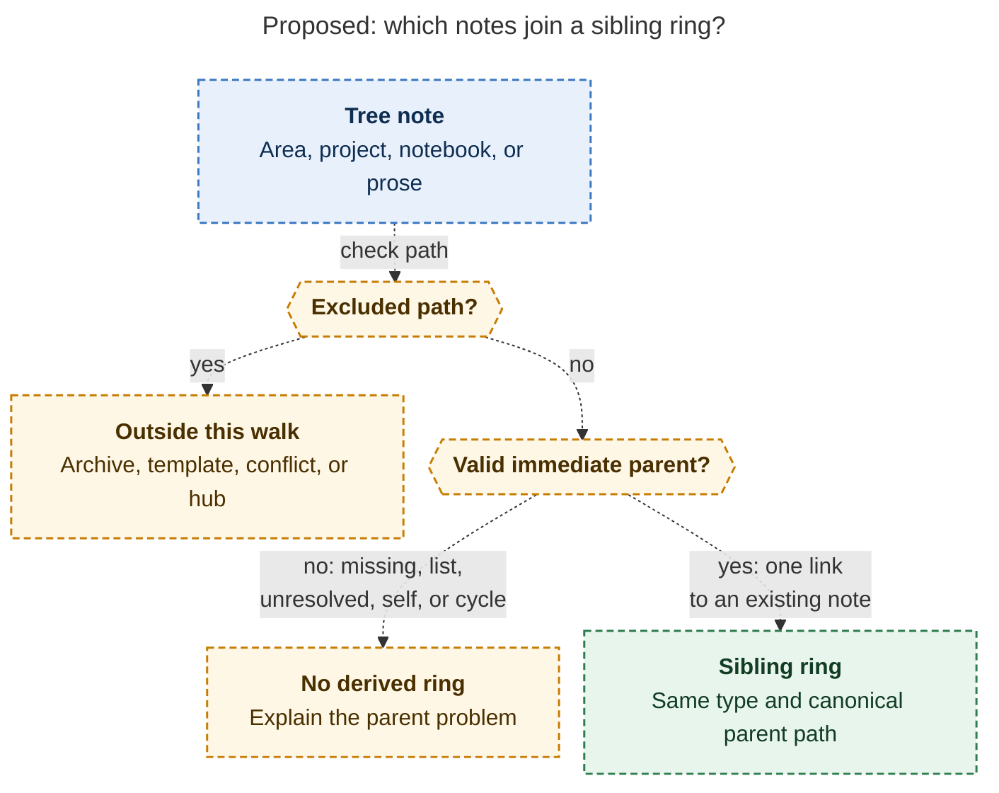
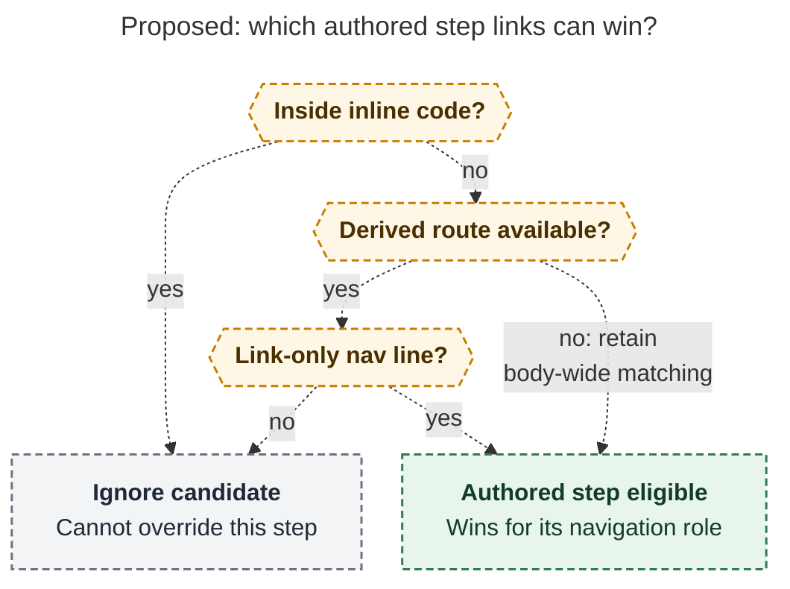

# Diagram proposals: Tree-note link walks

Proposals for the swarm linker, not a report. Each diagram restates only what the source
report says. Placement remains the linker's decision.

```yaml
source: research:202611/tree_note_link_walks/tree_note_link_walks__final.md
producer: research.6o.image
check: "mmdc 12.0.0 with the PDF-mirroring config rendered 2 of 2 Mermaid diagrams; pinned CLI with Puppeteer --no-sandbox"
```

## sibling-eligibility

```yaml
anchor: |-
  A note joins the walk when its `propertyCardNoteSpecies` is `area`, `project`,
question: |-
  Which notes may join a derived sibling ring?
illustrates: |-
  Supported tree notes form same-type sibling rings by canonical parent path, while excluded paths stay outside the walk and invalid parents produce explicit none reasons.
caption: Supported notes with valid immediate parents form rings by type and parent path; project rings also separate open and closed lanes.
review: "739.398x810 px, fit 88.3%; reader question answered from the PNG; labels, arrowheads, reading order, and source trace passed; 0 revisions"
```



## authored-step-eligibility

```yaml
anchor: |-
  Authored links keep winning per role, which lets a prose series
question: |-
  Which authored step links remain eligible to override the derived walk?
illustrates: |-
  Authored step links win per role outside inline code, but derived routes additionally require link-only nav lines while notes without derived routes keep anywhere-in-body matching.
caption: Either eligible path lets authored steps win their role; derived routes require link-only nav lines, and inline code never qualifies.
review: "557.455x784 px, fit 100.0%; reader question answered from the PNG; labels, arrowheads, crossings, and source trace passed; 0 revisions"
```


