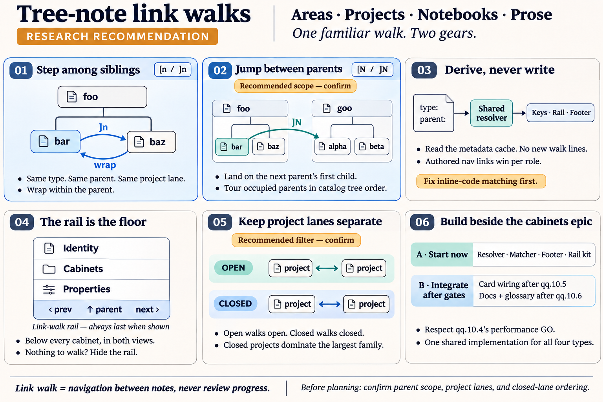
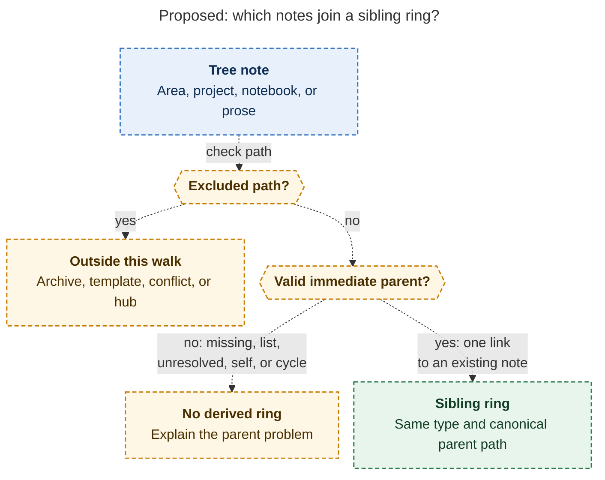
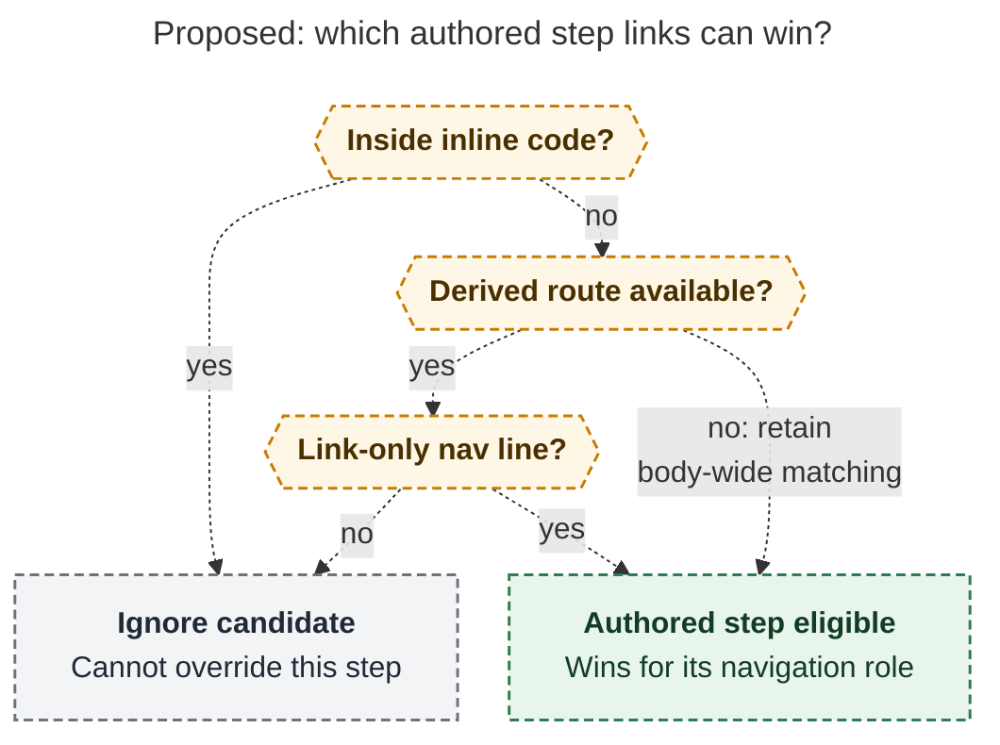
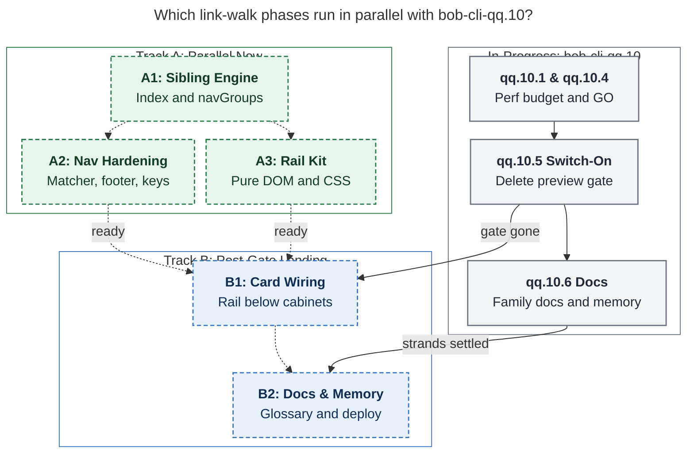

# Tree-note link walks: `]n` / `]N` on area, project, notebook, and prose notes

> **Research query:** How should `]n` link walks be added to area notes, project notes,
> notebooks, and prose notes, with each walk limited to same-type notes that share the
> same parent and grouped by parent, the link-walk widget always at the very bottom of
> the property card below all cabinets, a new "link walk" glossary term, and `]N`
> support if an intuitive grouping exists, built in parallel with the in-progress
> `bob-cli-qq` epic and designed to be intuitive, reliable, and beautiful? Is the plan a
> good idea, which requirement adjustments are justified, and what solution is
> recommended?



## Bottom line

**Build it.** All five researchers independently concluded this is a high-value,
architecturally natural feature: the parent hierarchy is Bryan's primary organization
for these four note types, days/periods/records already walk, and the whole pipeline —
resolver, keymaps, repeats, footer, rail kit — exists. The consolidated recommendation:

1. **Derive everything at read time in bob-plugins; write nothing.** A new sibling
   route in Bob Ledger Tools' `api.navGroups` answers from Obsidian's metadata cache
   (`type:` + `parent:`). No bob-cli code, no release-train coupling,
   [no Markdown walk lines](#r1-derived-read-time-stops-vs-bob-cli-written-walk-lines)
   in these notes. All eight keys (`[n` `]n` `[N` `]N` `[[` `]]` `[{` `]}`) light
   up with essentially no keymap-code changes.
2. **Two-gear walk.** `]n` / `[n` step through same-type siblings of one parent,
   wrapping (`↺`) and never crossing parents. `]N` / `[N` jump to the first member of
   the next / previous occupied parent group of the same type, with **all** occupied
   parents of that type forming one ring in
   [catalog tree pre-order](#r3-group-jump-scope).
3. **Projects walk in
   [lifecycle lanes](#r4-project-lifecycle-lanes-vs-no-status-filter)** (open with
   open, closed with closed): 57–59 of 102 live projects are closed, so an unfiltered
   `]n` would mostly tour dead work.
4. **One kit-level card invariant:** the link-walk rail is the card's **last** element,
   [below the whole cabinet stack](#the-rail-as-the-card-floor) including Properties,
   on every rail-bearing card — which also fixes a verified, pre-existing Record Card
   inconsistency (rail above cabinets in Live Preview, below them in Reading).
5. **Two-track landing beside `bob-cli-qq`.** The resolver, nav hardening, footer copy,
   and pure rail kit have
   [zero file overlap with qq's four open finishing phases](#parallel-work-with-bob-cli-qq)
   and start now; card wiring and the rail migration land right after `qq.10.5`
   deletes the cabinets gate; glossary and docs land after `qq.10.6`.
6. **Harden the authored-link matcher first.** The current scanner matches links inside
   inline code — `` `[[<person>]]` `` in `bob.md` already answers `[n` / `]n` today and
   [would silently shadow the new derived walk](#authored-precedence-and-the-matcher-hazard).

The one-sentence teaching rule: **`]n` walks your siblings under one parent; `]N` walks
the catalog's parents, landing on each one's first child.**

## Requirement adjustments

Each adjustment below is explicit and individually vetoable.

- **A1.** "Same parent" and "grouped by parent" cannot both describe one flat list:
  `]n` is the sibling ring (one parent, wrapping); the **groups are the parents**, so
  `]N` jumps between parents' rings. This reconciles the two bullets and gives `]N` a
  job (all five reports made some version of this adjustment).
- **A2.** `]N`'s group universe is **every occupied parent of the species, in catalog
  pre-order**, not just cousins under one grandparent — chosen for family consistency
  and reachability ([R3](#r3-group-jump-scope); the contested call, confirm first).
- **A3.** Projects walk in **open/closed lanes**
  ([R4](#r4-project-lifecycle-lanes-vs-no-status-filter)).
- **A4.** "Alphabetically" means **the parent cabinet's order** per species (stem for
  areas/projects, display title for notebooks/prose); the closed lane is alphabetical
  rather than the cabinet's newest-closed-first ([R5](#r5-ordering-and-labels)).
- **A5.** "Always shown at the very bottom" becomes "always **last** when shown": no
  rail when there is nothing to walk; group-row-only when only `]N` has work
  ([R6](#r6-rail-visibility)).
- **A6.** The bottom slot is a **family-wide invariant**: record and day/period rails
  migrate below the cabinet stack too, reversing two documented "foot follows the
  rail" contracts and fixing the Record view mismatch.
- **A7.** Added required scope:
  **[matcher hardening](#authored-precedence-and-the-matcher-hazard)** (inline code
  never matches; authored steps are nav-line-only on derived routes) before the derived
  walk ships.
- **A8.** "In parallel with bob-cli-qq" is honored at file level via
  [two tracks](#parallel-work-with-bob-cli-qq) with bead dependency edges (Track B1
  after `qq.10.4` GO + `qq.10.5`; B2 after `qq.10.6`), not by racing the epic in its
  own files.
- **A9.** All four types ship together (a 3-of-4 matrix is worse than one more
  instantiation of a shared helper), but prose expectations stay modest: one live note
  today; its near-term value is authored series nav lines, which already work.

## Verified consensus ground truth

These facts were independently established by multiple reports; the lead re-verified
the load-bearing ones in the current checkouts.

| Fact | Status |
| --- | --- |
| `[n`/`]n` open authored labeled body links via `resolveNavLinks`, which falls back per role (`prev`, `next`, `prevGroup`, `nextGroup`) to Ledger Tools' synchronous, read-only `api.navGroups.resolve` (`483-nav-group-links.js`). | 4 reports + prior research |
| `[N`/`]N` and `open-prev/next-group-link` already exist, open the **first member** of the adjacent group, and `]}`/`[{`/`]]`/`[[` repeat them per family. | Lead-verified in `490-plugin-lifecycle.js:182-189`, `546-plugin-bracket-repeat.js:53-54`, `docs/bob-navigation-hotkeys.md:531-549` |
| `navGroupsResolve` dispatches records → calendar and nothing else; area/project/notebook/prose fall through. Adding a sibling route between those branches is the whole keymap implementation. | Lead-verified in `296f-plugin-nav-groups-api.js:129-145` |
| The rail kit (`propertyCardBuildRail` `240g`, `propertyCardBuildGroupRow` `240l`) already supplies the step row, group arms with `↺` wrap glyphs, tick track (bar + thumb above 21 members), narrow layouts, forced-colors and reduced-motion support. | cdx, cld, gem (tests pass: 48 + 12 + 15 across the three existing nav/group-row suites, per cdx) |
| Record cards append rail **then** foot in Live Preview (`242k:666-681`, "The foot follows the nav rail"), but the Reading path can append the rail **after** the foot and cabinet stack (`242v recordWalkPaintReading` → `sheet.appendChild(rail)`), and `240wl:309` unconditionally `card.appendChild(stack)`. The requested "rail always last" is therefore a real family-wide fix, not just new-species paint. | gem's finding; lead-verified mechanism in both files |
| `bob-cli-qq` status (lead re-read 2026-11-27): `qq.1`–`.7`, `.10.2`, `.10.3` closed; `qq.8`, `qq.9`, `qq.10.1` (Reading perf budget), `qq.10.4` (acceptance GO), `qq.10.5` (gate deletion + deploy), `qq.10.6` (docs/memory) all IN_PROGRESS. | Lead bead read |
| Zero of the ~160 live tree notes have authored `prev`/`next`/`«`/`»` nav links — no migration burden. | cld and gem, independent censuses |
| All four types carry a resolvable single `parent:` (top-level areas point at the untyped `area.md` sentinel; legacy `[[article]]` counts as prose). | all reports; glossary strands |

**Vault census** (two independent scans agree):

| Type | Notes | Parent groups | Singleton groups | Largest |
| --- | ---: | ---: | ---: | --- |
| Area | 18 | 5 | 1 | root sentinel 6, `love` 5, `inbox` 4 |
| Project | 102 (~43–45 open / 57–59 closed) | 21 | 11 | `sase` 61 (23–24 open / 37–38 closed), `bob` 7 |
| Notebook | 39 (12 nested under other notebooks) | 20 | 12 | `dev` 9, `lang` 5 |
| Prose | 1 | 1 | 1 | `sase_blog` 1 |

Two consequences drive the design: **singleton groups are common** (`]N` is the only
useful key on roughly a third of notebooks and half of project parents), and **closed
projects dominate the biggest family** (`sase`: ~62% closed).

## Where the reports disagreed and how the lead resolved them

### R1 Derived read-time stops vs bob-cli-written walk lines

*Positions:* derived read-time stops (cdx, cld, grk, gem) vs bob-cli-written walk lines
(mus).

**Resolution: derive; write nothing.** mus proposed record-style Bob-owned walk lines
written by per-type `sync` commands (including a new `bob prose sync`). Rejected, for
reasons three other reports state and the lead confirms:

- `decisions:prose-notes-are-owned-prose` forbids bob-owned bytes in prose bodies, and
  writing lines into areas/projects/notebooks churns ~160 notes on every create,
  rename, or retitle (vault-sync merge noise; records accept this cost only because
  albums are bob-curated folders with no frontmatter graph).
- The prior `bracket_n_group_jumps` work already settled "derive group stops on Bob's
  own species and never write them"; mus's premise that the `n` family "has no
  uppercase plan today" is stale — the lead verified `]N`/`[N` shipped.
- Derivation is instantly fresh (a reparent or `^prj` close updates the walk on the
  next metadata event), avoids stale/damaged walk-line states entirely, and keeps the
  feature off the daily release train (`decisions:bob-cli-releases-ride-a-daily-train`)
  with zero Bob Mac Capture impact (`decisions:mac-capture-is-a-thin-client`).

Salvaged from mus regardless: the **navigation-never-creates** posture (every derived
stop is exists-or-explain; no ghost `+` creation styling), and the note that `bob walks`
is a taken name that deliberately excludes the `n` family.

### R2 Wrap within the parent vs cross into the next group

*Positions:* `]n` wraps within the parent (cdx, cld, mus, gem) vs crosses into the next
group (grk).

**Resolution: wrap, never cross.** The request's letter — "the walk should only include
notes of the same type that share the same parent" — is a sibling ring, and four of
five reports read it that way. grk's parity argument (days and `walk_by` records let
`]n` enter the next group) is real, but a family is a set, not a line: records' `]n`
also never leaves the album; its `walk_by` groups are facets of one ring. gem notes the
alternative is a ~5-line policy switch inside the resolver if Bryan later prefers
crossing, so this choice is cheap to revisit.

### R3 Group-jump scope

*Positions:* `]N` scope: grandparent-bounded cousins (cdx, cld) vs all parents in
catalog pre-order (gem) vs hybrid (grk) vs flat alphabetical parents (mus).

This is the genuinely contested call the request asked us to think hard about.

- **Cousins** (occupied sibling parents under the same grandparent): local,
  deterministic, with cdx's nice stability property (repeated `]N` cycles a fixed
  ring). But gem traced it on the real vault: `]N` is **dead on 10 of 18 areas** (the
  six top-level areas have no grandparent; the four `*_inbox` areas' only
  cousin-candidate `gtd_daily` has no area children) and strands sparse branches —
  precisely the singleton notes for which `]N` is the only useful key.
- **Flat alphabetical parents** (mus): reaches everything but scatters subtrees
  (`love`'s children between `linux`'s and `dev`'s) — breaks the mental map.
- **Hybrid** (grk: cousins when the parent is same-type, Open/Closed lanes as groups
  when it is not): makes `]N` mean different things in different places; the compass
  becomes untrustworthy.
- **All occupied parent groups of the species, in catalog tree pre-order (DFS),
  wrapping** (gem's Model 5): works on 100% of multi-group species, keeps subtrees
  adjacent, and mirrors the printed order of `bob areas` / `bob projects` /
  `bob notebooks` and the cabinets — an order Bryan already reads daily.

**Resolution: catalog pre-order over all occupied parents (gem's Model 5).** Two
arguments the swarm did not combine clinch it:

1. **Family consistency.** In every other bracket family, uppercase tours *all* of the
   walk's groups: `]S` cycles every occupied review group, `]W` every lane, `]B` every
   bank day, and calendar `]N` steps weeks forever, across quarter and year boundaries.
   A grandparent-bounded `]N` would be the only scoped group jump in Bob.
2. **Reachability.** Every one of the 160 tree notes gets a working `]N` the moment a
   second occupied parent of its species exists anywhere, which rescues all 24 singleton
   groups instead of explaining a dead end.

The honest cost: `]N` can tour the whole species (from the last `job` project parent
into `love`'s), and both cdx and cld explicitly preferred bounded locality. The tour is
predictable — it is the catalog's own printed order, wrapping — and `<C-o>` returns.
If Bryan prefers the bounded cousin ring anyway, only the provider's group-universe
function changes; rail, footer, keys, and everything else are identical. This is the
single most important question to confirm before planning
([open question 1](#open-questions-for-bryan)).

Concrete semantics: order parents by pre-order traversal of the note tree (children
sorted at each level by that level's catalog order), keeping parents with ≥1 child of
the active species (and lane, for projects). `]N` opens the next parent's first child;
`[N` the previous parent's first child; both wrap with `↺`.

### R4 Project lifecycle lanes vs no status filter

*Positions:* project lifecycle lanes (cld, gem, grk-variant) vs no status filter (cdx).

**Resolution: lanes, explicitly vetoable.** cdx's purity argument ("a closed project is
still a project note; design filters separately") loses to the census: mixing makes
`]n` land on dead projects roughly two presses out of three under `sase`. An open
project walks open siblings; a closed project walks closed siblings; `]N` visits parent
groups with ≥1 same-lane member; the rail and footer name the lane (`3 of 23 open`,
`sase · closed`). Lane comes from the `^prj` checkbox state in the metadata cache
(`[x]`/`[-]` closed; everything else, including a missing `^prj`, open). Notes archived
under `done/` stay excluded as today.

### R5 Ordering and labels

**Resolution: each species' own catalog order, so the walk never disagrees with the
cabinet listing the same members** (cld, grk, gem; cdx preferred display-title
everywhere and flagged it as a one-comparator choice):

| Type | Order within a group | Rail label |
| --- | --- | --- |
| Area | stem, case-folded, path tie-break | stem |
| Project (open lane) | stem, case-folded, path tie-break | stem |
| Project (closed lane) | stem, case-folded (see note) | stem |
| Notebook | display title (H1 → alias → humanized stem), case-folded, path tie-break | title |
| Prose | display title (`title:` → alias → stem), case-folded, path tie-break | title |

Comparators are mirrored in JS from the Rust catalog code (`areas/graph.rs:464`,
`projects/catalog.rs:801`, `notebooks/catalog.rs:237`) with parity test vectors — never
read from a cached `bob` report, which can be absent or stale. One known divergence,
flagged: the Projects cabinet sorts its Closed fold newest-closure-first, but close
dates live in line text the metadata cache does not carry; the closed lane walks
alphabetically ([open question 3](#open-questions-for-bryan)).

### R6 Rail visibility

*Positions:* progressive disclosure (cld, gem) vs always-rendered `1 / 1` state (cdx).

**Resolution: progressive disclosure.** "Always shown at the very bottom" is adjusted
to "always **last** when shown" ([adjustment A5](#requirement-adjustments)): a note with
siblings or other occupied parent groups gets the rail; a singleton with other groups
collapses to the compact group-only row (`240g:303` already omits an empty step row); a
lone singleton with nothing to walk — today's sole prose note — gets **no rail**,
because the kicker crumb already shows the parent and an inert `1 / 1` row is clutter.
Keys still answer with a useful notice.

## The design

### Membership

A note joins the walk when its `propertyCardNoteSpecies` is `area`, `project`,
`notebook`, or `prose` (legacy `[[article]]` unified into prose), its path is not
excluded (`done/`, `_templates/`, `_conflicts/`, `area.md`, `project.md`, and `bank.md`
per `decisions:bank-hub-is-path-canonical-never-area`), and its `parent:` is a single
link resolving via `metadataCache.getFirstLinkpathDest` to one existing note. Identity
is the canonical vault path — never a label, alias, basename, heading part, or rendered
breadcrumb. Top-level areas group under the `area.md` sentinel (a valid group with a
non-navigable "Top-level" label; the sentinel itself never walks). Missing, list-valued,
unresolved, self, or cyclic parents produce explicit `none` reasons (`No parent —
Ctrl+Shift+- sets one`), never a phantom group, a guessed first match, or a suppressed
sibling ring merely because an ancestor farther up is malformed. Mixed types under one
parent never share a ring; notebook parents may be areas, projects, or notebooks (keep
the immediate parent; do not flatten to the nearest area/project owner). Prose gains no
new owner requirement.
[The sibling-eligibility diagram](#figure-sibling-eligibility) traces the proposed path
and parent checks a tree note passes: excluded paths leave the walk, invalid parents get
explicit reasons, and the rest form same-type, same-parent rings.

<div id="figure-sibling-eligibility">



_Supported notes with valid immediate parents form rings by type and parent path; project rings also separate open and closed lanes._

</div>

### Worked examples

The request's own tree, extended (titles = stems):

```text
pig (area)
├── foo (project)
│   ├── bar (project)   ← start here
│   └── baz (project)
├── goo (project)
│   ├── alpha (project)
│   └── beta (project)
└── zoo (project; no project children)
```

| From | Key | Lands on | Why |
| --- | --- | --- | --- |
| `bar` | `]n` | `baz` | next sibling under `foo` (the user's example) |
| `baz` | `]n` | `bar` ↺ | wraps within `foo`, never crosses |
| `bar` | `]N` | `alpha` | next occupied parent in pre-order after `foo` is `goo`; first child (`zoo` is unoccupied and skipped) |
| `bar` | `[N` | `foo` | previous occupied parent is `pig` itself; its first project child is `foo` |
| `foo` | `]n` | `goo` | different ring: pig's project children |
| `foo` | `]N` | `bar` | next parent heading after `pig` is `foo`; `]N` descends into the subtree, exactly as the catalog prints it |

Real-vault spot checks (computed independently by cld and gem, consistent under the
consolidated rules): `bob_git` `]n` wraps among `bob`'s 3 open projects and `]N` enters
`sase`'s open children; `recur` (cash's only sub-area) has no `]n` but `]N` reaches
`gtd_daily`; `mac_inbox` walks `inbox`'s 4 areas and `]N` continues to `love`'s;
`java` (notebook under notebook `lang`) walks lang's 5 and `]N` reaches `linux`'s
`athena`. `root: true` affects reporting roots only — never walk membership
(glossary: Root Parent).

### Authored precedence and the matcher hazard

Authored links keep winning per role, which lets a prose series or curated reading
order override the alphabetical walk.
[The authored-step eligibility diagram](#figure-authored-step-eligibility) traces the
proposed checks an authored step link must pass to keep its role: no inline code, and a
link-only nav line wherever a derived route exists.

<div id="figure-authored-step-eligibility">



_Either eligible path lets authored steps win their role; derived routes require link-only nav lines, and inline code never qualifies._

</div>

Two hardening fixes land **first** (cld's verified finding):

1. **Inline code never matches.** The scanner currently matches rendered link text in
   backtick spans: `` `[[<person>]]` `` in `bob.md` satisfies both the `prev` (`^<`)
   and `next` (`>$`) label rules today and would shadow the derived walk.
2. **On a derived route, authored *step* links count only on link-only nav lines** (the
   rule group links already follow), so a `Read more ›` in prose or a `> X` task label
   cannot hijack `]n`. Notes with no derived route keep today's anywhere-in-body
   behavior, so nothing regresses.

The rail must also stay honest when an authored link overrides the derived route: arms
always render the *resolved* answer (never "next sibling Baz" while `]n` actually
follows an authored link), with an "authored navigation" cue when derived position
cannot honestly describe the effective route (cdx).

Derived stops are existing notes only: every activation re-validates the stop before
opening (`The stop changed — try again`), navigation never creates or rewrites a note,
and calendar creation rules are untouched.

### The rail as the card floor

Reuse the kit rail unchanged — no new widget species:

```text
  ▸ Projects     2 open · 1 closed                              _2
  ▸ Notebooks    1                                              _1
  ▸ Properties   6                             created Jun 2     -
  ────────────────────────────────────────────────────────────────
  ‹ vacation ↺            ↑ love · 1 of 5                 family ›
  ⏮ gtd                     ■ ▮ ▮ ▮ ▮                     cash ⏭
```

- **Step row:** `‹ prev · ↑ parent · n of m · next ›`; the center names the species and
  lane (`PROJECT · sase · 3 of 23 open`); `↺` marks wrapping arms; `↑` opens the
  parent — welcome at the bottom of a tall open cabinet.
- **Group row** (only with ≥2 occupied groups): arms name the neighboring **parents**;
  each arm's tooltip and accessible name spell the landing
  (`]N · next: cash's areas → recur`); the center track ticks the current ring with the
  current note lit (bar + thumb above 21 members).
- Clicks re-validate and run the same nav commands as the keys, so jump history, `]]`,
  and `<C-o>` agree; mod-click opens a tab. Narrow panes compact to `‹ 3/23 ›` with
  full accessible names. The rail inherits the card's root hue, keeps the kit's focus
  rings and ≥24 px targets, adds no new palette values, never pulses or reflows on
  metadata refresh, and renders regardless of which status-bar walk family is selected.
- **Placement invariant (kit-owned):** `card identity → cabinet stack (content →
  config → Properties) → link-walk rail, last`. A small kit helper appends the rail as
  the card's last direct child and `propertyCardCabinetsAssemble` /
  `propertyCardFootAdapterAppend` learn to `insertBefore(rail)`, so the order is
  structural, not call-order luck, and survives lazy cabinet mounts, Reading
  finalization, and repaints. Existing **record and day/period rails migrate to the
  same slot**, reversing the two documented "foot follows the rail" sentences and
  fixing the verified Record Live-Preview/Reading mismatch. One test invariant per
  species fixture, both views: whenever a rail exists, it is the card's last element.
- The rail is compass chrome, not a cabinet: no `_` number, never inside collapsible
  bodies, never sticky-floated, and it must not touch qq.2's walker-footer overlay
  (the armed-`_` cabinet pick crib) or cabinet pick state.
- **Walker footer (`n` panel):** copy-only changes — context `love 1/5`, lane words for
  projects, destination-parent hints (`]} under cash`), wrap and singleton notices
  (`recur is cash's only area — ]N visits gtd's`), plus gem's two small fixes: guard
  `createEligible` so derived non-creatable stops never show dashed `+` styling, and
  set `group.noun = "parent"`.

### Performance and reliability

One lazily built, generation-stamped index inside the new provider fragment:
`{path → {species, lane, parentPath, title}}` plus `parent → children` lists, built in
one pass over `getMarkdownFiles()` + `getFileCache()` (memory only; ~7.5k files is
cheap), invalidated by vault `create`/`delete`/`rename` and relevant `metadataCache`
`changed` events (bump a generation, rebuild lazily on next query), warmed off the
paint path (`onLayoutReady`/idle; until warm the provider answers an `indexing` none
and the card repaints once). This matters because `qq.10.1` is actively tuning a 2×
Reading paint budget — the rail must add no long task and no per-paint vault scan. The
provider is synchronous, never throws, never writes, never spawns bob; on any failure
it answers `unavailable` and keys fall back to authored links. Keys, repeats, footer,
and rail all consume the same `resolveNavLinks` answer, with activation re-validation.

## Parallel work with bob-cli-qq

All four `qq.10` finishing phases are IN_PROGRESS as of 2026-11-27 (lead-verified), so
"parallel" is file-level, not epic-level. Do **not** depend on the whole epic, and do
not add a second preview gate in files `qq.10.5` is about to rewrite.

**Figure:** *Track A phases have zero file overlap with `bob-cli-qq.10` and ship now;
Track B card wiring waits for `qq.10.5`'s gate removal, and docs and memory wait for
`qq.10.6`'s strand edits to settle.*



*(Figure carried over from the gem report, adapted; re-rendered by the lead with
`@mermaid-js/mermaid-cli@12.0.0` under the PDF-mirroring config: 855.2 × 892 px, fit
76.3%.)*

| Slice | Files | Gate |
| --- | --- | --- |
| **A1** sibling `navGroups` route + index + tests | new `296h`/`296i`-style fragments, a few dispatch lines in `296f`, new test script | none — zero qq overlap |
| **A2** nav hardening + footer + notices | nav `680`, `483`, `670`; ledger `124-links-walker-footer.js` | none (different plugin / untouched file) |
| **A3** rail-kit polish (wrap glyph + tooltip on step items, singleton center) + pure rail builder | `240g`, `240l`, one new builder fragment, CSS region | none (`240g`/`240l` are not qq.10 files) |
| **B1** card wiring + rail migration + bottom invariant | `240r`, `240wl`, `242k`/`242kc`/`242v`, `296b`/`296da`, species foot hooks (`249e`/`249j`/`249o`…), e2e | after `qq.10.4` GO (perf) and `qq.10.5` (these exact files are gate-deletion sites) |
| **B2** plugin docs + glossary + deploy | docs family pages, `glossary:*` strands | after `qq.10.6` (it rewrites the same strands and docs under the word cap) |

Coordination rules (consensus, condensed): encode the gates as **bead dependency
edges**, not meetings; one owner lands the small integration hunk in `240r`/`240wl`/
`242kc` (rebase it over `qq.10.5` rather than racing it); generated `main.js`/
`styles.css` conflicts are resolved by rebuilding from reconciled fragments, never by
hand-merging bundles; serialize only the **deploy** (`bob plugins sync` already refuses
to overwrite an unlanded peer build — follow the repo's guard protocol, never `-F`);
and do not split implementation one-worker-per-note-type — four copies of the sibling
algorithm is exactly the logic that must agree (model+keys, rail+slot, and
fixtures/docs is the right split). Wave A ships the feature's entire keyboard value —
all eight keys plus the footer — before any card changes. Adjacent work checked: `bob-cli-r5`
stays parked behind qq and touches different fragments; `bob-cli-ms.8` and
`bob-cli-qj.5.1.7` do not collide. Nothing here touches bob-cli or Bob Mac Capture.

## Link walk glossary term

New strand `glossary:link-walk`, written through `/sase_memory_write` with Bryan's
approval at Track B2 (after `qq.10.6` lands, so qq's approved strand edits settle
first). Merged draft:

> # Link Walk
>
> aka n walk, links walk, sibling walk
>
> The `n` bracket-walk family's walk between neighboring notes. `[n` / `]n` step to
> the previous / next note stop, `[N` / `]N` jump to the first note of the previous /
> next group, and `]]` / `[[` and `]}` / `[{` repeat them once the family is selected.
> One resolver answers every surface: an authored link on a nav line — a body line
> holding only links — wins per role (`‹`/`›` or `prev`/`next` steps, `«`/`»` groups);
> otherwise Bob Ledger Tools derives the stop from the note's identity and writes
> nothing. Daily and [[period-note]]s walk the calendar line and group by the parent
> period; [[record-note]]s walk their album's ring, grouped by `walk_by`;
> [[area-note]]s, [[project-note]]s, [[notebook]]s, and [[prose-note]]s walk their
> **siblings** — same type, same resolved `parent`, in the parent catalog's order,
> wrapping — with open and closed projects in separate lanes, and their groups are the
> species' occupied **parents** in catalog tree order. The walk paints as the rail on
> the floor of the note's [[property-card]], below every cabinet, and as the links
> panel of the [[walker-footer]]. Positions are places in a ring, never progress or
> review state, and nothing about a derived stop is stored; derived stops open only
> existing notes, while missing dailies and periods follow their own create rules. Not
> the `]s` review walk, the `]w` lane walk, the `]b` bank walk, a [[task-link]], or a
> [[task-relation]]. See `docs/bob-navigation-hotkeys.md`.

Same approved batch (Track B2 only): one-sentence rail updates to `walker-footer`,
`property-card`, `area-card`, `project-card`, `notebook-card`, `prose-card`,
`day-and-period-card`, and a `[[link-walk]]` cross-link in `record-note`. Also
recommended (cld and grk independently proposed it; default yes): a decision record,
e.g. `decisions:sibling-walks-are-derived-and-wrap` — *tree notes walk derived siblings
that wrap within the parent; groups are occupied parents in catalog order; no walk
bytes are written; authored nav lines override* — rejected alternatives: written walk
lines, up/down `]N`, grandparent-bounded groups; reopened by a need for walk order
visible in Source mode or git.

## Open questions for Bryan

1. **`]N` scope (the real decision):** all occupied parents in catalog pre-order
   (recommended) — or bounded to sibling parents under the grandparent, accepting dead
   ends on ~10 of 18 areas and sparse branches?
2. **Project lanes:** open-with-open / closed-with-closed (recommended), or one ring
   with open before closed?
3. **Closed-lane order:** alphabetical (recommended, metadata-only) or newest-closed
   first to match the cabinet fold (requires line-text dates or a report dependency)?
4. **Lone child with cousins:** `]n` shows a notice pointing at `]N` (recommended), or
   falls through to `]N`'s target? (A step key that sometimes leaps is a surprise.)
5. **Area/project rail labels:** stem (recommended: visibly matches sort order and
   catalogs) or display title?

## Condensed acceptance criteria

- The exact `pig → foo → bar/baz` example, both directions, wrap, group jumps to first
  member; singleton, empty-parent, and sentinel cases; nested notebooks; subprojects;
  legacy `article`; `[[x.md|y]]` parent forms, duplicate basenames, missing/list/
  self/cyclic parents; lane membership on `^prj` flips.
- Invariants: every lowercase target shares type, parent, and lane; every uppercase
  target is a first member of an occupied parent group of the same type and lane;
  repeated `]N` keeps a stable, wrapping group universe; comparator parity vectors
  copied from the Rust catalog tests.
- Matcher vectors: inline code, task-line `>` labels, nav-line-only steps on derived
  routes, authored override honesty (`bob.md` walks its siblings after the fix).
- Dock invariant on every species fixture in Live Preview and Reading, gate open and
  closed until `qq.10.5`: whenever a rail exists it is the card's last element, through
  cabinet open/close, lazy mounts, and repaints.
- Real-Obsidian scratch-vault run: all eight keys on all four types, rail/footer/key
  agreement, narrow + light/dark + forced colors, rename/reparent/delete between
  preview and click, passivity spies (zero vault writes, zero bob spawns), failing on
  any `console.error` (the qq lesson — exception-only collection missed a CodeMirror
  failure), and a rail-paint perf check against the integrated cabinets budget.
- Screenshot review in the real app: "beautiful" cannot be proven by code inspection.

## Recommended solution

Ship **tree-note link walks** as one bob-plugins epic in two tracks (no bob-cli code,
nothing on the release train):

1. **Track A, start now:** sibling route in `api.navGroups` behind a lazy
   generation-stamped index (same-type + same-resolved-parent membership, catalog-order
   comparators, project lanes, parent groups in catalog pre-order, exists-or-explain
   stops); matcher hardening (inline code, nav-line-only authored steps on derived
   routes); footer copy, `createEligible` guard, `group.noun`, and useful singleton
   notices; rail-kit polish and the pure rail builder with unit tests. All eight keys
   and the `n` footer work on all four note types at the end of Track A.
2. **Track B, after `qq.10.4` GO / `qq.10.5` / `qq.10.6` via bead edges:** mount the
   rail as the card's floor on area, project, notebook, and prose cards; migrate record
   and day/period rails to the same slot and make the ordering structural
   (`insertBefore` + last-child invariant); then docs, the approved
   `glossary:link-walk` strand batch, the optional decision record, real-Obsidian
   acceptance with screenshots, and one coordinated deploy.

The result is one rule Bryan's hands already know, stated in two clauses: **`]n` walks
your siblings under one parent, wrapping; `]N` walks the catalog's parents, landing on
each one's first child** — derived from frontmatter that already exists, written
nowhere, painted as the same calm two-row compass records and weeks already use, on the
floor of every card, below every cabinet.

## Request and evidence base

> **Research request:** Add `]n` link-walk support to area notes, project notes,
> notebooks, and prose notes, in parallel with the in-progress `bob-cli-qq` cabinets
> epic. Render the link-walk widget at the very bottom of the property card, below all
> cabinets. Each walk includes only same-type notes sharing the same parent, grouped by
> parent. Add a glossary term for "link walk". Support `]N` if an intuitive grouping
> exists. Critique the plan and end with a recommended solution.

Consolidated by the lead researcher from five independent swarm reports —
`tree_note_link_walks__cdx.md`, `__cld.md`, `__grk.md`, `__mus.md`, `__gem.md` in this
directory — plus the lead's own verification. Evidence: bob-plugins `master` (reports at
`4dd95d52`; lead re-checked after a fast-forward on 2026-11-27), bob-cli `master`
(`eff5d986`), live `bob-cli-qq` beads re-read by the lead on 2026-11-27, two independent
read-only vault censuses (cld, gem), the decisions roster, and the prior
`bracket_n_group_jumps`, `record_nav_ring`, and `property_card_cabinets` research.

---

## Sources

- **The five swarm reports in this directory** (moved from their original paths,
  suffixes preserved): `tree_note_link_walks__cdx.md` (resolver/card-assembly audit,
  authored-override honesty, existing-only open policy, coordination boundary),
  `__cld.md` (vault census, inline-code matcher hazard, rail "card's floor" mechanism,
  four-wave bead gating, footer copy), `__grk.md` (catalog-order principle, qq
  overlay warning, no-walk-lines argument, epic shape), `__mus.md` (record walk-line
  contract detail, navigation-never-creates posture, `bob walks` naming check; its
  stored-lines approach is rejected in
  [R1](#r1-derived-read-time-stops-vs-bob-cli-written-walk-lines)), `__gem.md`
  (five-model `]N` analysis and vault walkthroughs, record-card view-mismatch bug,
  two-track seam split, performance pattern, footer fixes).
- **Lead verification (2026-11-27):** bob-plugins (fast-forwarded past `4dd95d52`):
  `296f-plugin-nav-groups-api.js:129-145`, `242k-plugin-record-sheet.js:666-681`,
  `242v-plugin-record-walk-rail.js:117-140`, `240wl-plugin-cabinet-stack.js:309`,
  `490-plugin-lifecycle.js:182-189`, `546-plugin-bracket-repeat.js:53-54`,
  `docs/bob-navigation-hotkeys.md:525-549`; live beads `bob-cli-qq.8/.9/.10.*`.
- **Prior research:** `research:202611/bracket_n_group_jumps` (derive-don't-write,
  first-member rule), `record_nav_ring`, `property_card_cabinets` and
  `finish_property_card_cabinets` plans.
- **Memory:** decisions roster plus `decisions:prose-notes-are-owned-prose`,
  `bank-hub-is-path-canonical-never-area`, `notebook-routes-write-notes`,
  `bob-cli-releases-ride-a-daily-train`, `mac-capture-is-a-thin-client`,
  `decision-rules-are-read-at-planning-time`; glossary strands for the four note
  types, Property Card, Walker Footer, Record Note, Root Parent, Leaf Project,
  Top-Level Project.
