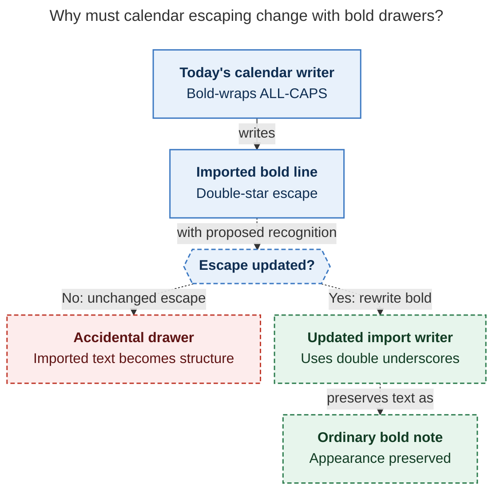
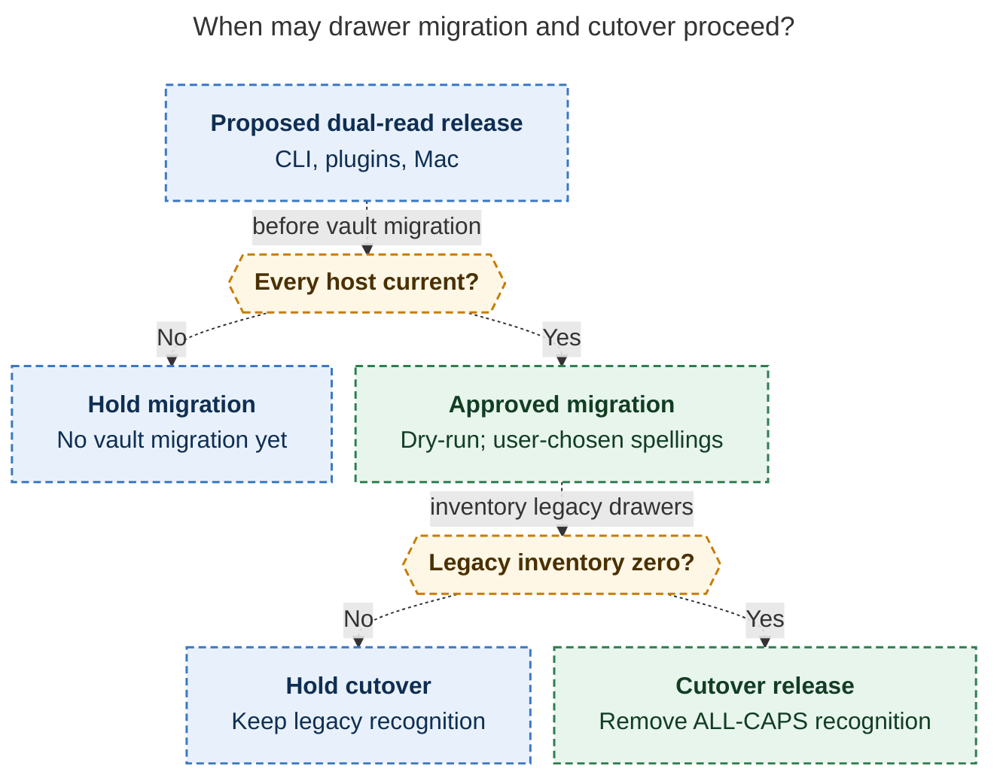

# Diagram proposals: True-case task drawers: bold headers, one place resolver, a gated cutover

Proposals for the swarm linker, not a report. Each diagram restates only what the source
report says.

```yaml
source: research:202611/true_case_drawers/true_case_drawers__final.md
producer: research.5x.image
check: "mmdc 12.0.0 with --no-sandbox and the PDF-mirroring config rendered 2 of 2 Mermaid diagrams"
```

## import-escape

```yaml
anchor: |-
  wrapping them in `**…**` — under the bold marker, that exact branch would
question: |-
  Why must calendar escaping change with bold drawers?
illustrates: |-
  The calendar defuser's double-star wrapper would manufacture drawers under the bold marker; the proposed double-underscore escape keeps imported bold text a note.
caption: The proposed double-underscore import escape preserves bold appearance without turning imported text into a drawer.
review: "582.484×916 px, fit 97.5%; question answered from PNG; labels, arrowheads, source trace and visual checks passed; 1 visual revision"
```



## rollout-gates

```yaml
anchor: |-
  so no vault migration until every host is current.
question: |-
  When may drawer migration and cutover proceed?
illustrates: |-
  In the proposed rollout, every host must run a drawer-aware release before vault migration, and ALL-CAPS recognition is removed only once the legacy inventory reads zero.
caption: Command-line, Obsidian and Mac readers must be current before migration; legacy recognition ends only when the inventory reaches zero.
review: "686.672×914 px, fit 95.1%; question answered from PNG; labels, arrowheads, source trace and visual checks passed; 1 visual revision"
```


