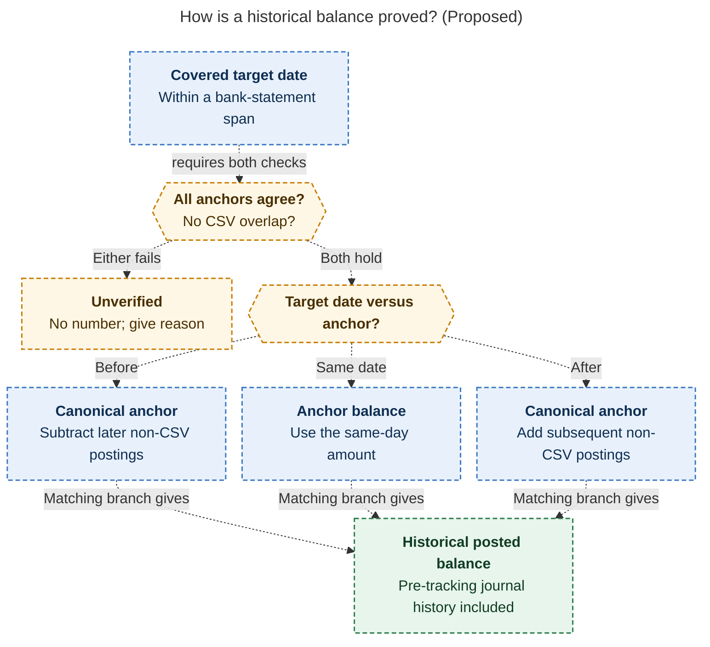

# Diagram proposals: WF Checking closing balance on period notes

Proposals for the swarm linker, not a report. Each diagram restates only what the source
report says.

```yaml
source: research:202611/wf_checking_period_close/wf_checking_period_close__final.md
producer: research.50.image
check: "mmdc 12.0.0 with --no-sandbox and the PDF-mirroring config rendered 1 of 1 Mermaid diagrams; the deliberately broken probe exited nonzero"
```

## historical-balance-proof

```yaml
anchor: |-
  Every other anchor in the span must reproduce from the canonical
question: |-
  How does a covered span support a trustworthy historical balance?
illustrates: |-
  The proposed resolver requires agreement among the span's bank anchors and no overlapping CSV window, then reconstructs the historical posted balance from the canonical anchor and journal cents using the matching target-date branch.
caption: With matching bank anchors and no overlapping comma-separated values (CSV) imports, use the matching date branch to reconstruct a historical balance.
review: "748.857x1078 px, fit 82.8%; question, visual, claim-trace, and unique-anchor checks passed; 0 visual revisions; matching-branch convergence means any one branch"
```


