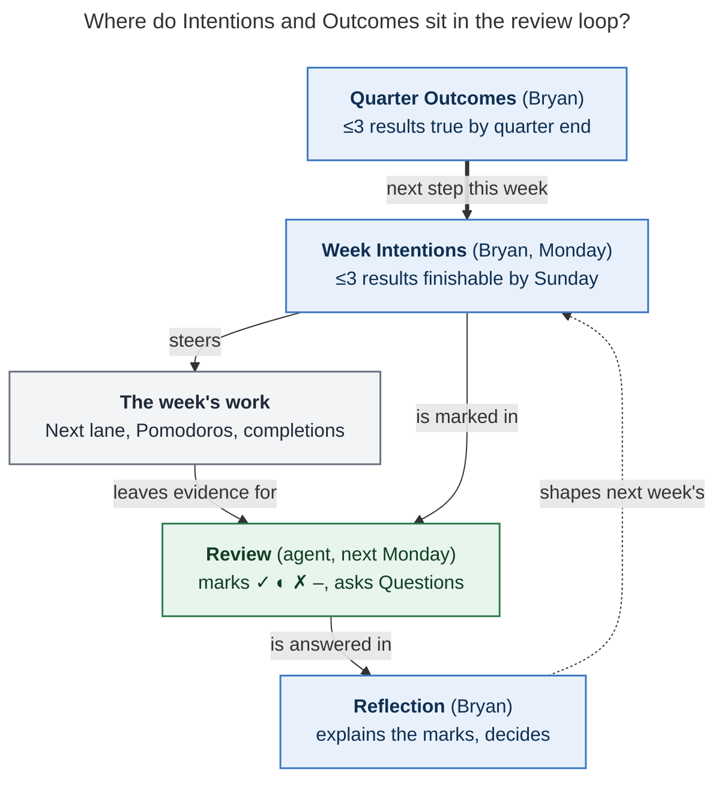

# What to write in your period notes: Intentions, Outcomes, Theme, and Reflection

*Consolidated report · 2026-11-10 (Tuesday of 2026-W46). Merges five independent
reports (`__cdx`, `__cld`, `__grk`, `__mus`, `__gem`, in this directory) with a fresh
check of the bob-cli source, the live vault (read-only), and the literature where the
reports were weak or disagreed. Nothing in the vault or in bob-cli was changed.*

> **The request.** "I am supposed to be manually setting intentions and outcomes in
> period notes I think, but I haven't been, mostly because I'm not sure what I'm
> supposed to write. Can you do some research with the goal of helping me get better
> at this?"

## Bottom line

- **You're right: these sections are yours, and only yours.** Bob never writes
  `## Intentions` (week), `## Outcomes` (quarter, year), `## Theme` (year), or
  `## Reflection` (all three). An agent writes only `## Review`. None of them have ever
  been filled. A scan of every period note today found 0 of 47 week Intentions, 0 of 5
  quarter and year Outcomes, 0 of 1 Theme, and 0 of 52 Reflections with any text.
- **Each section answers one question.**
  - **Week Intentions:** *what result will I have finished by Sunday?*
  - **Quarter Outcomes:** *what will be true at quarter end that isn't true now?*
  - **Year Theme:** *which way do I lean when two good options compete?*
  - **Reflection:** *what did it mean, and what changes?*
- **Write each line so next Monday's Review can mark it.** The agent marks every
  Intention ✓ done · ◐ partial · ✗ not done · – no evidence, and it can see only what the
  vault records. A good line names a **finished state**, not an activity, and carries
  **one link** to where the evidence will show up.
- **Three is a ceiling, not a quota.** Your own Weekly review row already says "set ≤3
  Intentions". Start with one or two. One honest line beats three vague ones, and either
  beats a blank heading.
- **Start today, mid-week and mid-quarter.** Q4 still has 8 ISO weeks (W46–W53, through
  2027-01-03). Write Q4 Outcomes once (about 15–20 minutes), then W46 Intentions for the
  five days left. Leave the 2026 Theme and Outcomes alone; set 2027's at the
  2027-01-11 yearly review, after rewriting the stale `h3_goal` and `h4_vision`.
- **About ten minutes every Monday**, in the order your checklist row already gives:
  read last week's Review, write its Reflection, look up at the quarter's Outcomes,
  then write this week's Intentions (see [§5](#5-the-monday-routine-about-10-minutes)).
- **Run it for 2–4 weeks before building anything.** The test isn't whether the
  sections get filled. It's whether they changed at least one real choice.

### The one-card version

> **Intention (week):** `N. <finished state, by Sunday> → [[evidence link]] · O#`
> Tests: finishable this week · markable from the vault · mostly in my control · serves
> an Outcome (or I know why not) · all three fit in about 10–15 focused hours.
>
> **Outcome (quarter):** `N. (committed|stretch) <state true at quarter end> → [[^prj]]`
> Tests: a stranger could check it · I can name next week's step toward it · if only
> these came true, the quarter was still a success.
>
> **Theme (year):** one phrase plus the tie-break it implies ("…so when X competes with
> Y, X wins"). It gets marked too, so give it visible consequences.
>
> **Reflection:** first sentence is the verdict and must stand alone. Then explain each
> ✗ and ◐, answer the Review's numbered Questions, and say what changes.

---

## 1. What Bob asks for, and what it does with your words

The contract is in `docs/periods.md` (§Note anatomy and ownership, §Review state and
Headline, §Agent instruction callouts v2). The agent text is in
`src/native/periods/instructions.rs`, and what reaches the agent is in
`src/native/periods/brief.rs`. I checked each row below against that code, not only
against the reports:

| Slot | Note | Who writes it | What reads it, and how |
| --- | --- | --- | --- |
| `## Intentions` | week | you | The week brief copies it word for word. The weekly Review marks each line `**Intentions:**` ✓ ◐ ✗ – with one evidence link. |
| `## Outcomes` | quarter | you | Every week brief in the quarter shows it as *Parent Outcomes*. The quarter Review marks each line the same way. |
| `## Theme` + `## Outcomes` | year | you | The quarter briefs show both. The year Review marks `**Theme and Outcomes:**` one line each, the same way. It also reads `h3_goal` and `h4_vision` (≤400 words each) and ties its Questions to them. |
| `## Reflection` | all three | you | Any text at all sets the note to `reflected`. Its first sentence, up to 40 words, becomes the **Reflection lead** that the parent note shows. The next Review of the same kind reads it (≤300 words). |
| `## Review` | all three | an agent, only through `bob periods draft` | Headline, Intentions/Outcomes marks, Shipped, Carried forward (≤3), and Questions (0–2 weekly). Each Question "could change next week's Intentions". |

Five facts from the code change *how* you should write:

1. **The marks are status, not grades.** The callout forbids "scores, grades, praise,
   blame, advice, predictions, and inferred causes". ✗ means "not done". It is not a
   judgment of you, and "a reason Bryan recorded is reported as his".
2. **A week Intention is marked as one line.** Keep each one to one line, and put the
   finished state first.
3. **No task rows.** A `- [ ] … #task` line in a period note is a `task_rows` problem in
   `bob periods list -p`. Write plain list items that *point at* tasks. Don't add
   `## ` subheadings inside a section either, because the section body ends at the next
   `## ` heading.
4. **Don't put placeholders in Reflection.** Even "TODO" marks the note `reflected`, and
   the agent then refuses to redraft unless you say "redo". Correct the Review first,
   then reflect. Writing Intentions or Outcomes never changes review state.
5. **The brief copies your text word for word.** Anything you type under the heading,
   including template prompts, reaches the agent as your words. That's why the scaffold
   leaves the headings bare, and why it should stay that way (§9).

Your checklist already places the writing:

- **Weekly review** (`gtd_daily.md` line 21, Mondays `#post`): "write the Reflection ·
  open this week's note, re-read the quarter's Outcomes (↑), and set ≤3 Intentions ·
  prune…"
- **Quarterly review** (next 2027-01-04): "…set ≤3 Outcomes in the new quarter's note."
- **Yearly review** (next 2027-01-11): "revisit [[h3_goal]] and [[h4_vision]] · set the
  new year's Theme and ≤3 Outcomes."



*Figure 1. You write the blue boxes. The week's work leaves evidence, the agent marks
your Intentions against it, and your Reflection, answering the Review's Questions,
shapes next week's Intentions. With the blue boxes empty, the loop has a sensor and no
setpoint, so the Review can only describe what happened. (Adapted from the `__cld`
report. Rendered with Mermaid CLI 12.0.0 in the PDF configuration: 623 × 626 px, 100%
fit.)*

You can see the empty setpoint in the vault. Every Q4 week Headline (W40–W45) is a
list of what shipped, because nothing says what the week was *for*. The W45 Review saw
the gap itself. Its first Question was: *"This week's Intentions and Q4's Outcomes are
both empty; which outcomes, if any, should W46's Intentions name?"* The Q3 Review asked
the same thing at quarter scale: *"Q4 holds the period-tree rollout — which 3
Outcomes should it carry, given Q3 closed zero reviews?"*

---

## 2. Why "I'm not sure what to write" is a reasonable reaction

All five reports agree this isn't a willpower problem. Their explanations combine into
five causes, plus one historical warning.

1. **The heading gives you no prompt.** The scaffold writes bare headings, on purpose:
   any prompt text would be copied into the brief and marked. So every Monday you'd have
   to invent the format. Fix: a fixed formula you can type without thinking (§3).
2. **The task system already looks like a weekly plan.** When `#now` was retired, the
   Next lane became "this week's commitments" (`decisions:task-lanes-are-sticky`). If you
   copy Next into Intentions, it feels redundant because it *is* redundant. The two
   layers do different jobs. **Next holds tasks. Intentions hold the 1–3 results those
   tasks should add up to.** Intentions are also the only thing the Review marks. `#now`
   was "a promise, not a footprint"; Intentions keep that promise role, at the level of
   results instead of a tag on up to 15 tasks.
3. **There's nothing above the week to plan from.**
   - Q4 Outcomes and the 2026 Theme and Outcomes are empty.
   - `h3_goal` still holds the Google-era "Submit ≥100 CLs" goal, last logged
     2025-12-22.
   - `h4_vision` holds one 2024 line, "Promoted to L5 at [[goog]]".
   - `h5_life` has no content.

   Working top-down gives you nothing. Your own GTD notes (`lit/gtd.md`) give the way
   out: *"Trying to create goals before you have confidence that you can keep your
   everyday world under control will often undermine your motivation."* Your everyday
   world is under control (Review closed 33 of 42 days in Q4), so this is the moment to
   move up one horizon, working bottom-up from projects you already have.
4. **The ritual can finish without the writing.** The Monday POST Weekly review was
   checked off on 2026-11-09 with W45's Reflection and W46's Intentions still blank.
   "Set ≤3 Intentions" is one clause in a long row. It sits between reflecting and
   pruning, so it gets whatever attention is left. The `gtd` root is already 24% of Q4's
   Worked time, so the fix is a protected few minutes, not more process.
5. **Being marked feels like being judged.** See fact 1 in §1: the marks are status.
   Expect some ✗ and ◐ (§6). If every line gets ✓, the lines were too safe.

**The historical warning (my addition):** hand-kept planning layers have died in this
vault before. The vault had zorg-era `now_*`/`soon_*`/`maybe_*` notes and
`sase_blog_blockers.md`. The single bulk `#now` tagging covered 73 tasks and was
stripped the same day (`decisions:now-tag-is-user-owned`,
`decisions:task-lanes-are-sticky`). Intentions will go the same way unless they stay
tiny and pay off quickly. That is the main reason this report says start with one or
two lines, keep it to about ten minutes, and judge the practice by whether it changes a
choice.

You've done the quarter-goal pattern before. "Submit ≥100 CLs in 25Q3", with a weekly
LOG line in `h3_goal`, was a quarterly Outcome with a weekly check. Next to it you
noted *Uptime*'s "Score by the quarter, not the day". The period notes give that
pattern a fixed home, and the agent now does the logging.

---

## 3. How to write each section

### 3.1 Week `## Intentions`

**Definition.** Up to three results that, if they're true on Sunday night, made this a
good week. Each one is finishable within the week and moves a quarter Outcome, or you
know why it matters anyway.

**Formula** (one physical line each; numbered so you can rank them; no checkbox):

```markdown
## Intentions

1. <finished state> → [[note#^block]] · O1
2. <finished state> → [[note#^prj]] · O2
3. <finished state> (partial = <the part that counts>) → [[note#^block]]
```

**Five tests.** Check each line against them in about a minute:

1. **Finishable.** It names an end state ("S0 spike finished", "memory design decided
   and written in [[sase_memory_plan]]"), not an activity ("work on", "look into",
   "make progress on"). An activity can't get a ✓.
2. **Markable from the vault.** Someone holding only the week's brief could mark it.
   The brief shows completed tasks (including Event Tasks and daily-note tasks), linked
   minutes, Work Log entries, and your Pomodoro notes. Off-clock time shows up only as
   totals per area. If the evidence will be a completed task, link that task. If it
   will be a decision or a document, say where it will be written.
3. **Mostly in your control.** "Recruiter call prepped" passes. "Get an offer" belongs
   at quarter level (this is the *Controllable* in the NICE goals from your
   *Feel-Good Productivity* notes).
4. **Serves an Outcome.** Add `· O#` when it does. One line a week that serves no
   Outcome (a fix, an errand, family) is fine. If none of the three serve an Outcome,
   either the Outcomes or the week needs a second look.
5. **Fits.** Together the lines should take about 10–15 focused hours, roughly two or
   three "power hours" a day (*Uptime*, in your `lit/` notes). Your typical week is
   28h 13m Worked, and about a quarter of it goes to `gtd`. Three lines that each need
   12 hours guarantee ◐.

**Formatting conventions** (from the reports, checked against the code):

- **Lead with the finished state.** The agent quotes and marks from the start of the
  line.
- **Link the most specific target.** Use the task's `^block` if there is one, otherwise
  the project's `^prj`. A link in a period note is safe: it creates no task row and no
  mention.
- **Rank.** Number 1 is the line you protect when the week goes sideways. On a bad day,
  the morning highlight should usually be Intention 1's next step (*Make Time*'s
  "medium-sized highlights" fits this exactly).
- **Say in advance what counts as partial,** for the risky line: `(partial = draft
  sent, numbers TBD)`. The ◐ mark has to name the part, and this names it for the agent.
- **If the week changes, add to the line; don't rewrite it.** For example:
  `— (changed Wed: recruiter moved the call; spent the time on applications)`. The Review
  reports a reason you recorded as yours. Quietly rewriting a line on Friday makes the
  mark meaningless.
- **Optional if-then plan for the line most at risk,** as an indented sub-bullet so it
  stays off the marked line. You could also put it in the day's plan or calendar
  instead. See §7 for when it's worth it.
- **No invented numbers, and no targets on counts the strip already measures.** Done and
  Worked are reported for you. Done also mostly reflects how finely tasks are cut: W46
  logged 54 completions in two days, 21 of them routine rows. Write the *thing* the
  hours should buy.

**Weak lines and stronger rewrites** (taken from your vault):

| Weak | Why it fails | Stronger |
| --- | --- | --- |
| "Work on the sase blog post" | An activity, so the only possible mark is "–" | "S0 spike finished, unblocking the four zero-draft sections → [[sase_blog#^s0-spike]] · O1" |
| "Clean up sase memory" (carried in W44 and W45, kept 3×) | No end state, and it's been carried for weeks | "One memory design chosen and written as a decision in [[sase_memory_plan]], or the project explicitly paused" |
| "Job search" | Not finishable, and the result isn't in your control | "Thursday's recruiter call prepped: questions and two stories written beforehand → [[job_2026#^prj]] · O2" |
| "Close 30 tasks" / "Work 30h" | The strip already counts these, and a target invites gaming | Leave counts to the strip. Write what the hours should buy. |
| "Improve bob" | Too broad to finish | "Notebooks used for one real notebook → [[bob#^notebooks]]" |
| "Be more focused" | A trait, not an end state | An experiment: "Mornings until 10:00 go to Intention 1, Mon–Fri", or a year Theme |
| Five Next-lane tasks | Copies Next, which already holds tasks | Pick the one or two whose completion *changes something*, and write down that change |

**Personal Intentions are welcome.** The `__cld` report said the agent will always mark
them "–". That's only half right. A personal Intention that ends as a completed task or
Event Task *is* visible: the W46 brief lists the haircut and the daily "Swings" rows
under Finished. What the agent can't see is off-clock time, beyond per-area totals. If
a personal line won't leave a completed task behind, mark it yourself in the
Reflection.

### 3.2 Quarter `## Outcomes`

**Definition.** Up to three states of the world on the quarter's last day that aren't
true now. If only these came true, the quarter was still a success.

**Formula:**

```markdown
## Outcomes

1. (committed) <state at quarter end that a stranger could check> → [[project#^prj]]
2. (stretch) <state> → [[project#^prj]]
3. (committed) <state> → [[project#^prj]]
```

**Tests:**

- **A state, not a task list:** "X is live", "Y is decided and written", "Z happens
  every week". Your `^prj` lines are often already written this way (*"My SASE post, in
  my own voice, is live on sase.sh!"*). Often the Outcome is "this `^prj` is done by
  quarter end", or a named milestone inside one.
- **Labelled committed or stretch.** Committed Outcomes should get ✓. Stretch Outcomes
  should land ◐ fairly often; if every stretch gets ✓, they weren't stretches. This
  follows Google's OKR convention: committed objectives are expected to be fully met,
  and about 0.7 is a healthy score on aspirational ones.
- **Steppable each week:** you can name next week's Intention for it right now. If you
  can't, it's too vague or it's blocked, so find the block.
- **Linked:** one `^prj` link each, so the quarter Review can find Finished, Started, and
  Stalled for it.
- **Few, and chosen:** about 40 open `^prj` lines exist. The Outcomes say which ≤3
  matter *this quarter*. Everything else can still happen; it just isn't the plan.

**An Outcome doesn't have to be something shipped.** For new, complex work (most of
sase and bob), a specific *learning* or *decision* goal can beat a performance target
(Seijts & Latham 2001; Locke & Latham 2006). Four kinds all count:

- **Result:** "The SASE post has a complete v1 draft."
- **Decision:** "Decided and written: whether the post ships before or after the job
  search."
- **Practice:** "The period-note loop ran every week, W46–W52."
- **Behavior:** "Two people outside me ran sase on a real project and told me what
  broke" (Seiden's *Outcomes over Output*).

**Questions that help you choose** (each comes from something you've read):

- **Regret:** on 2027-01-03, what would I most regret *not* having finished?
- **Leverage** (*The One Thing*): what result would make other things easier or
  unnecessary?
- **Wild success** (GTD outcome visioning, in `lit/gtd.md`): picture the quarter going
  extremely well. What's visibly different?
- **Allocation:** Q4 Worked so far is bob 34% · gtd 24% · sase 22% · sase_blog 6% ·
  job_2026 4% · job 3% · job_update_cv 1% (Q3 was sase 69%). Would you choose that
  split on purpose? The Review is designed never to judge where time went. The Outcomes
  are the only place that says where it *should* go, which lets the Review show you the
  gap.

### 3.3 Year `## Theme` and `## Outcomes`

- **The Theme is marked, so write one with visible consequences.** Two reports called a
  Theme something that "can't be failed" (CGP Grey's framing). Bob's yearly callout
  disagrees: it marks `**Theme and Outcomes:**` one line each, the same way as
  everything else. A mood ("Balance") will come back "– no evidence". Write a phrase
  plus the tie-break it implies. For example: *"Finish before starting: when a new tool
  idea competes with shipping bob or the blog, shipping wins."* (That's an illustration,
  not a proposed value for you.) The year Review can check that against root shares and
  finished `^prj` lines. Note that this "theme" has nothing to do with the old name for
  Bob task types.
- **Year Outcomes:** ≤3, the same form as quarter Outcomes, drawn from `h3_goal`. Each
  quarter's Outcomes should usually be the next step toward one of them.
- **2026: leave both empty.** The year ends 2027-01-03, the same Sunday as Q4. A Theme
  written now would be marked against 44 weeks that happened before it existed, and year
  Outcomes would just repeat Q4's. Put the year's meaning in the 2026 Reflection
  instead.
- **2027: at the 2027-01-11 yearly review, rewrite `h3_goal` and `h4_vision` first.**
  The year brief includes both word for word, and its Questions are tied to them. As
  they stand, those Questions would be about an L5 promotion and a CL count.

### 3.4 `## Reflection`: what makes the marks useful

The Review describes. The Reflection decides. It's the most valuable thing you write
for the *next* Review, because the brief carries it forward. Keep it short:

1. **The first sentence is your verdict, and it must stand alone.** It becomes the
   Reflection lead shown beside this week's Headline in the quarter note. For example:
   *"Good week for the blog, bad week for focus: S0 finally closed, but bob fixes ate
   Thursday."*
2. **Explain each ✗ and ◐.** The agent isn't allowed to guess why, and these reasons
   are the most useful record the quarter Review will have.
3. **Answer the Review's Questions by number** ("Q1: …"). They exist to change next
   week's Intentions. A Reflection that just repeats Shipped is wasted; the Review
   already did that.
4. **Optional: one confidence number per quarter Outcome** (Wodtke's Four Square):
   "O1 7/10 · O2 4/10". If one drops two weeks in a row, next week's Intention 1
   probably belongs there.
5. **Say what changes,** including deliberate changes of priority. A miss isn't
   evidence about your character. Choose explicitly between retrying, narrowing,
   changing the approach, deferring, or dropping.

---

## 4. Starting today (Tuesday of W46)

Don't backfill past weeks or quarters. Empty history isn't a debt. Do this, in order:

1. **Write Q4 `## Outcomes`** in `2026/2026-Q4.md` (once, about 15–20 minutes).
2. **Write W46 `## Intentions`** in `2026/2026-W46.md` for the five days left. Size
   them for five days, not seven. Keep every line in the section an Intention, because
   the Review marks each one.
3. **Optional: write a two-sentence W45 `## Reflection`** that answers its two
   Questions. Its Question 1 is answered by step 1. W45 is already `drafted`, so
   reflecting on it now is safe.
4. **Leave the 2026 Theme and Outcomes empty** (§3.3).

Writing these sections also closes the task that started this research:
`gtd#^intentions-and-outcomes` ("Write good week 'intentions' and quarter 'outcomes'!").

**Example lines, checked against the vault today.** These illustrate the form. **The
priorities are yours to set**, and the contract says no agent writes these sections.
Edit them, rewrite them, or throw them out.

Facts behind them:

- **`sase_blog#^s0-spike`** ("Spike S0 … (2 🍅, hard stop)") has been in progress since
  2026-10-23. It blocks the four zero-draft sections, which block the Wave 1 review,
  then `^v1-draft`, then the 17-task `sase_pre_blog` chain.
- **`Release [[sase_blog]] post!`** depends on `job_2026_apply_29#^prj` ("Apply to 29
  job openings!").
- **There is a recruiter event on Thursday 2026-11-12** (`bob#^recruiter-private-event-note`
  is in Next).
- **`bob#^notebooks`** is this week's largest open item (43m). bob-cli just landed
  marker-free notebook catalogs (`891fa3e4`).

```markdown
## Outcomes

1. (committed) The SASE post has a complete v1 draft, Wave 1 reviewed → [[sase_blog#^v1-draft]]
2. (stretch) I'm in at least one final-round loop with an AI-first company, or holding an offer → [[job_2026#^prj]]
3. (committed) The period-note loop runs every week through W52: Intentions by Tuesday, Reflection by the next Monday → [[gtd#^intentions-and-outcomes]]
```

Other Outcomes you could swap in, of different kinds:

- *"(committed) bob is feature-frozen from Dec 14: fixes only, no new commands or note
  types → [[bob#^prj]]"*. This moves toward the bob `^prj`'s own definition of done
  ("no new commits for 30d").
- *"(committed) Decided and written: whether the post ships before or after the
  applications (today the Release task depends on them) → [[sase_blog#^sase-blog]]"*
- *"(committed) sase memory: one design chosen and recorded as a decision, or the
  project explicitly paused → [[sase_memory_plan#^prj]]"*

```markdown
## Intentions

1. S0 spike finished, unblocking the four zero-draft sections → [[sase_blog#^s0-spike]] · O1
   - If it's still open after Wednesday's morning review, then Wednesday's first two 🍅 are the spike, before any bob work.
2. Thursday's recruiter call prepped: questions and two stories written beforehand → [[job_2026#^prj]] · O2
3. Q4 Outcomes written, and W45's Reflection answers its two Questions → [[gtd#^intentions-and-outcomes]] · O3
```

How these hold up against §3.1:

- **Line 1** is finishable, markable (the task closes), in your control, and the step
  that unblocks the rest of the blog chain. It has an if-then plan because it has been
  open for 18 days on a "2 🍅" budget. That's a sign of trouble *starting*, not of
  size, and starting trouble is exactly what if-then plans target.
- **Line 2** will only be markable if the prep leaves evidence. Create a small prep task
  and link it, or the agent will correctly mark it "–".
- **Line 3** is mostly meta, which is fine in the first week. You could swap it for
  *"Notebooks used for one real notebook → [[bob#^notebooks]]"* (no `O#`, which is fine
  for one line out of three).

**Don't copy drafts from the `__gem` report.** Its Q4 drafts rest on stale data. Its
"ship the gate and monitor finalizer migration" Outcome was already finished this week
(`sase_completion#^e2e-gate-finalizers` appears in W46's Finished). Its "L5/Staff"
Outcomes come from the 2024 `h4_vision` line, and its running mileage is invented. The
`__mus` examples (a garden shed, "Stripe prep" for "Dana") are invented as well; that
report deliberately didn't read the vault. Their *formats* are fine.

---

## 5. The Monday routine (about 10 minutes)

The Weekly review row already contains every step. What it needs is this order, with
the formula ready to type.

1. **Close last week (2 minutes).** Open last week's note. Read the Headline, the
   Intentions marks, Carried forward, and the numbered Questions. If the draft is
   wrong, correct it *before* you reflect.
2. **Reflect (3 minutes).** Verdict sentence, a reason for each ✗ and ◐, answers to the
   Questions, and optionally Outcome confidence numbers (§3.4).
3. **Look up (30 seconds).** Press ↑ to the quarter note and read the Outcomes. If there
   are none, write them first (§3.2).
4. **Draft (3 minutes).** For each Outcome, ask *"what can I **finish** by Sunday that
   makes this truer?"* Check the calendar for fixed commitments and last week's Carried
   forward (at most one carried item should become an Intention, and only if it serves
   an Outcome). Write ≤3 ranked lines.
5. **Test (1 minute).** Run the five tests. For Intention 1, ask the obstacle question:
   *"what's most likely to stop this?"* If the answer is real, add a one-line if-then
   under it.
6. **Connect (30 seconds).** Make sure each Intention has a Next or WIP task behind it,
   or create one. *Then* prune Next to ≤15 so it serves the bets: write the bets first,
   prune second.

**Quarter start (first Monday, next 2027-01-04, about 30 minutes):** close the last week
as above, read the quarter Review, write the quarter Reflection, prune projects (already
on your row), write ≤3 labelled Outcomes, then write week 1's Intentions from them. Unless you ask
otherwise, the quarter Review won't draft until every week in it has been reviewed.

**Year start (2027-01-11):** rewrite `h3_goal` and `h4_vision` from where your life is
now, choose the Theme and its tie-break, write ≤3 year Outcomes, and make sure Q1's
Outcomes are their first steps.

---

## 6. Failure modes and fixes

| Failure | What it looks like | Fix |
| --- | --- | --- |
| Activity Intentions | Marks come back "–" | Rewrite as a finished state plus a link (test 1). |
| Too big | The same line gets ◐ every week | Cut it down to the next milestone you can finish. "Post live" became "S0 spike finished". |
| Copying Next | Five task links | Pick the one or two whose completion *changes something*. |
| Targeting counts the strip already measures | "Close 40 tasks" | Name what the hours should buy. |
| Rewriting to pass | Friday edits | Add "(changed Wed: reason)" instead of rewriting. |
| Skipping chaotic weeks | Empty heading | Write one line: "1. Survive the week: only Intention-1 work before 10:00" is still a bet you can mark. |
| Only safe lines | Every line gets ✓ | Label stretch lines. A new Monday is a fresh start (Dai et al. 2014): last week's ✗ only carries over if you choose to carry it. |
| Waiting for January | "I'll do goals properly at the new year" | Write Q4 now. Anticipating a fresh start can license coasting on goals you already have (Koo et al. 2020). |
| Handing it to an agent | You approve an agent's menu without thinking | Write the lines yourself. If you want help, ask an agent to *check* your draft against §3's tests. The contract keeps these sections human-only on purpose, and over-trusting AI drafts reduces critical thinking (Lee et al., CHI 2025, cited by the earlier review-instructions research). |
| Overgrowing the practice | More sections, longer rituals | Keep it to about ten minutes. Hand-kept planning layers have died in this vault before (§2). |

---

## 7. What the evidence supports, and what it doesn't

The evidence supports the *ingredients*: a chosen and endorsed goal, specificity, a cue
for getting started, and feedback you actually look at. **No study validates Bob's
exact hierarchy, the ≤3 cap, or the ten-minute routine.** Those are practitioner
consensus and design choices. In the table, "confidence" describes the evidence, not
how much I like the idea.

| Finding | Source | Confidence | What it means here |
| --- | --- | --- | --- |
| Specific, hard goals beat "do your best". Commitment, feedback, and ability moderate the effect. | Locke & Latham 2002 (35-year research program) | High | "Work on sase" doesn't help much. "S0 spike finished" does. This doesn't mean picking the hardest possible goal or turning every value into a metric. |
| On new, complex work, a specific *learning* goal can beat a performance target | Seijts & Latham 2001; Locke & Latham 2006 | Medium | "Memory design decided and written" is a legitimate Outcome. |
| Prompting people to monitor progress improves goal attainment (d = 0.40, 138 studies); recording progress helps more | Harkin et al. 2016 | High | Going back to the written line every Monday is the active ingredient. A dashboard isn't required. |
| If-then plans help people act on goals they already hold | Gollwitzer & Sheeran 2006 (d ≈ .65, 94 tests); Sheeran, Listrom & Gollwitzer 2024 (642 tests, d ≈ .27–.66 by outcome type; secondary sources report smaller bias-adjusted estimates) | High that the effect exists; it's modest | Use one optional if-then for the line most at risk, especially when *starting* is the problem. The heading itself holds goal intentions, not if-then plans. |
| Picture the outcome, name the obstacle, then plan (WOOP, also called MCII) | Wang, Wang & Gai 2021 meta-analysis (g ≈ .34; ≈ .24 after bias adjustment) | Medium | The one obstacle question in step 5 of the Monday routine. |
| Structured debriefs improve later performance (d = .67, about 20–25%, similar for individuals and teams) | Tannenbaum & Cerasoli 2013 (46 samples) | Medium–high | Review plus Reflection *is* a structured debrief. Intentions give it something to measure against. |
| Temporal landmarks such as a new week or quarter make people more likely to start goals | Dai, Milkman & Riis 2014 (archival); Dai et al. 2015 (experiments) | Medium–high | Monday Intentions and the 2027-01-04 quarter start work in your favour. |
| Anticipating an upcoming landmark can license slacking on a goal already in progress ("intrapersonal loafing") | Koo, Dai, Mai & Song 2020 (archival study plus 4 experiments) | Medium | Don't let "I'll set goals in January" stall Q4. |
| Narrow numeric goals can cause neglect of what isn't measured, gaming, and less learning | Ordóñez et al. 2009; disputed by Locke & Latham 2009, with a reply from Ordóñez et al. | Medium–low (argument and cases; contested) | Don't set targets on Done or Worked. Name results. |
| Goals that fit your own values get sustained effort | Sheldon & Elliot 1999 (longitudinal) | Medium | Ask "do I actually endorse this, and why now?" before committing. |
| Making a plan for an unfinished goal reduces intrusive thoughts about it | Masicampo & Baumeister 2011 (lab studies; I found no direct replication) | Low–medium | A possible side benefit of writing lines down. Don't rely on it. |

**Practitioner systems agree on the shape:** quarters hold results, weeks hold steps
you can finish, and years hold direction. Your scaffold already has that split. Ideas
worth borrowing:

- **Meier, Monday Vision and Friday Reflection:** "If this were Friday, what three
  outcomes would I want?" This is the question that produces Intentions.
- **The 12 Week Year, Rule of 3, and OKRs:** at most three goals per cycle; label
  goals committed or aspirational.
- **Shape Up:** "bets, not backlogs". Last week's Carried forward is a waiting room, not
  an automatic Intention.
- **GTD Weekly Review** (Get Clear, Get Current, Get Creative): the agent draft and lane
  pruning are Get Current; Intentions and Reflection are Get Creative. Today the POST
  row is completing after Get Current alone.
- **Le Cunff, tiny experiments:** when you don't know yet what works (job channels,
  posting about sase), make the Intention an experiment.

---

## 8. Where the five reports disagreed, and how this report resolves it

| Question | Positions | Resolution |
| --- | --- | --- |
| How many lines? | `__mus`: 2–5 a week, 3–7 a quarter. All others: ≤3. `__cdx`: start with 1. | **≤3, starting with 1–2.** Your own review rows say ≤3, and the practitioner sources agree. "Fewer than two wastes the marking" (`__mus`) isn't a real cost. |
| Is the year Theme marked? | `__cld`/`__mus`: a theme "can't be failed". `__grk`: it's marked. | **It's marked.** `instructions.rs` marks "Theme and Outcomes" one line each. Write it as a tie-break with visible consequences. |
| Changing an Intention mid-week | `__mus`: never edit; explain in Reflection. `__grk`: edit any time. `__cdx`/`__cld`: add a dated amendment. | **Add a dated amendment; never silently rewrite.** The Review reports a reason you recorded as yours. Narrowing a line ("notebooks" → "`@@` works") is fine if you record it. |
| Where the if-then plan goes | `__cld`: a sub-bullet. `__grk`: the day's plan or calendar. `__cdx`: optional. | **Optional, and off the marked line:** an indented sub-bullet or a calendar block. |
| How long the routine takes | `__gem`: 2 minutes. `__grk`: 5. `__cdx`/`__cld`: about 10. | **About 10 minutes a week including the Reflection**, plus 15–20 minutes once for Q4 Outcomes. Two minutes isn't enough to read a Review and reflect on it. |
| Can personal lines be marked? | `__cld`: no, event titles never reach the agent. | **Partly wrong.** Completed Event Tasks and daily-note tasks appear in Finished. Only off-clock minutes are reduced to area totals. |
| Set a 2026 Theme now? | `__gem`/`__grk`/`__mus`: optionally, yes. `__cdx`/`__cld`: wait. | **Wait until 2027-01-11.** A Theme written now would be marked against a year it didn't steer. |
| How big is one Intention? | `__gem`: 4–12 Pomodoros each. `__cld`: three together ≈ 10–15 focused hours. | **Budget the whole week** (`__cld`). Both are heuristics. |
| Example drafts | `__gem`/`__mus`: stale or invented. `__cld`/`__grk`: taken from the vault. | **Use only drafts checked against today's vault** (§4), and treat them as material, not a ready-made answer. |
| Should agents draft the lines? | `__gem`/`__grk`: here are lines to paste. `__cld`: write them yourself; an agent can check. | **The contract is that no tool or agent writes them.** Drafts show the form; the choice of what matters is yours. |

Also not carried over: the `__gem` report's Mermaid figures (they put `title:` inside
the flowchart body, which doesn't parse) and its "carousel" block (which doesn't render
in Obsidian or GitHub).

---

## 9. Optional support in bob and the vault (smallest first, and only after a trial)

The cheapest fix is a habit, not a feature. I'd run the routine for 3–4 weeks before
building anything, because bob plus gtd already take 58% of Q4's Worked time.

1. **No code (vault, your edit):** put the one-card version on the Weekly review row, or
   in a short how-to note linked from it.
2. **Docs:** bob-cli has an agent contract for period notes (`docs/periods.md`) but no
   user guide for writing Intentions, Outcomes, Theme, or Reflection. This report could
   be the research input for one (`__mus`).
3. **Small, bob-cli:** info-level problems in `bob periods list -p`:
   `missing_intentions` for the current week after Tuesday, and `missing_outcomes` for
   the current quarter after its first week (`__cld`).
4. **Small, callout v3:** tell the review agent that `· O#` maps an Intention to an
   Outcome, and that dated "(changed …)" suffixes are your recorded reasons. Bump
   `INSTRUCTIONS_VERSION` and run `ensure -R`, as `docs/periods.md` requires.
5. **Don't** put prompt text under the scaffold headings. The brief copies it word for
   word, so the agent would read and mark the prompt.

---

## 10. How to tell it's working

By **Monday 2026-11-16** (W47's review):

- Q4 `## Outcomes` has 1–3 linked lines, and W46 `## Intentions` has 1–3 linked lines.
- The W46 Review's `**Intentions:**` part has a mark on every line, not a note that the
  section is empty.
- W45 or W46 has a Reflection that answers at least one Question.

After **four weeks (W46–W49):**

- What share of weeks had Intentions, and what share had a Reflection?
- Can you name **at least two concrete choices** the Intentions changed (something you
  did, dropped, or deferred because of a line)? Filled notes alone don't show the
  practice helped (`__cdx`).
- Was the writing cost acceptable?

If the answer is no, change the sentence pattern or shrink the practice; don't add more
ritual. A week with a ✗ is the loop working. A month of blank headings with the POST row
checked off is the current failure mode.

---

## Open questions for you

1. **Scope:** are Intentions work-only, or whole-life? Either works. Personal lines need
   to end as a completed task or event, or you mark them yourself in the Reflection.
2. **Blog vs. job:** `Release [[sase_blog]] post!` depends on `job_2026_apply_29#^prj`.
   Is "applications before the post goes live" deliberate? Your Q4 Outcomes will have to
   take a position on it.
3. **Allocation:** would you choose Q4's split (bob 34%, gtd 24%, sase 22%, blog 6%, job
   work about 8%) on purpose?
4. **Help level:** do you want a Monday agent to *check* your draft Intentions (never
   write them), and the callout v3 conventions in §9?

---

## Sources

**Bob contract and code (bob-cli at `8e2b93c7`):**

- `docs/periods.md`: Note anatomy and ownership; Review state and Headline; Agent
  instruction callouts (v2); Agent briefs; Problems.
- `src/native/periods/instructions.rs`: weekly `**Intentions:**`, quarterly
  `**Outcomes:**`, and yearly `**Theme and Outcomes:**` lines, all marked "one line
  each".
- `src/native/periods/brief.rs`: `own_sections`, previous Reflection ≤300 words,
  parent and horizon text ≤400 words.
- `src/native/periods/problems.rs`: `task_rows`.

**Vault (read-only, apollo, 2026-11-10):**

- A section scan of all period notes: 47 week, 5 quarter and year, and 52 Reflection
  sections, all empty.
- `bob periods list`; `bob periods show 2026-Q4` and `2026-Q3`; `bob periods brief
  2026-W46 -f md`.
- `2026/2026-W45.md` (Review and Questions).
- `gtd_daily.md` lines 21, 24, 25; `gtd.md` `^intentions-and-outcomes`.
- `h3_goal.md`, `h4_vision.md`, `h5_life.md`, `h2_role.md`, `horizon.md`.
- `sase_blog.md` (`^s0-spike`, `^v1-draft`, `^sase-blog`); `job_2026.md`;
  `job_2026_apply_29.md`; `bob.md` (`^prj`, `^notebooks`, `^successor-deps`,
  `^recruiter-private-event-note`); `sase_memory_plan.md`; `sase_completion.md`.
- `lit/gtd.md`, `lit/uptime.md`, `lit/make_time.md`, `lit/feel_good_productivity.md`.

**Memory:** `glossary:period-note`, `glossary:stats-strip`,
`decisions:now-tag-is-user-owned` (superseded), `decisions:task-lanes-are-sticky`,
`obsidian.md`.

**Swarm inputs:** `what_to_write_in_period_notes__{cdx,cld,grk,mus,gem}.md` in this
directory (the `__grk` figures `fig-cascade.*` and `fig-score.*` sit beside it). The
reports also drew on earlier research:
`research:202611/period_note_tree_and_stats_strips/period_note_tree_and_stats_strips__final.md`
and
`research:202611/period_review_instructions_v2/period_review_instructions_v2__final.md`.

**Literature:**

- Locke & Latham (2002), *American Psychologist* 57(9), 705–717.
  [doi](https://doi.org/10.1037/0003-066X.57.9.705)
- Locke & Latham (2006), "New directions in goal-setting theory".
  [PDF](https://home.ubalt.edu/tmitch/642/Articles%20syllabus/locke%20latham%20new%20dir%20GS%20curr%20dir%20psy%20sci%202006.pdf)
- Seijts & Latham (2001), "The effect of distal learning, outcome, and proximal goals on
  a moderately complex task", *Journal of Organizational Behavior*.
  [record](https://zendy.io/title/10.1002/job.70)
- Harkin et al. (2016), "Does monitoring goal progress promote goal attainment?",
  *Psychological Bulletin*.
  [PDF](https://www.apa.org/pubs/journals/releases/bul-bul0000025.pdf)
- Gollwitzer & Sheeran (2006), *Advances in Experimental Social Psychology* 38, 69–119.
- Sheeran, Listrom & Gollwitzer (2024), "The when and how of planning", *European Review
  of Social Psychology*. [doi](https://doi.org/10.1080/10463283.2024.2334563)
- Wang, Wang & Gai (2021), *Frontiers in Psychology*.
  [full text](https://www.frontiersin.org/journals/psychology/articles/10.3389/fpsyg.2021.565202/full)
- Tannenbaum & Cerasoli (2013), "Do team and individual debriefs enhance performance?",
  *Human Factors*. [PubMed](https://pubmed.ncbi.nlm.nih.gov/23516804/)
- Dai, Milkman & Riis (2014), "The fresh start effect", *Management Science*.
  [PDF](https://faculty.wharton.upenn.edu/wp-content/uploads/2014/06/Dai_Fresh_Start_2014_Mgmt_Sci.pdf)
- Koo, Dai, Mai & Song (2020), "Anticipated temporal landmarks undermine motivation for
  continued goal pursuit", *OBHDP*.
  [manuscript](https://anderson-review.ucla.edu/wp-content/uploads/2021/03/Koo-Dai-Mai0Song_TemporalLandmark2020_SSRN-id3621221.pdf)
- Ordóñez, Schweitzer, Galinsky & Bazerman (2009), "Goals gone wild".
  [HKS](https://www.hks.harvard.edu/publications/goals-gone-wild-systematic-side-effects-overprescribing-goal-setting)
  The exchange continued in "On good scholarship, goal setting, and scholars gone wild".
  [Penn](https://repository.upenn.edu/mgmt_papers/318)
- Sheldon & Elliot (1999), self-concordance.
  [PDF](https://selfdeterminationtheory.org/SDT/documents/1999_SheldonElliot.pdf)
- Masicampo & Baumeister (2011), "Consider it done!", *JPSP* 101, 667–683.

**Practitioner sources:**

- J.D. Meier, ["Monday Vision, Daily Outcomes, Friday Reflection"](https://learn.microsoft.com/en-us/archive/blogs/jmeier/monday-vision-daily-outcomes-friday-reflection)
- R. Singer, *Shape Up*, [ch. 7 "Bets, Not Backlogs"](https://basecamp.com/shapeup/2.1-chapter-07)
- David Allen Company, [The GTD Weekly Review](https://gettingthingsdone.com/2009/05/the-gtd-weekly-review/)
- Google's OKR guidance on committed vs. aspirational objectives,
  [What Matters](https://www.whatmatters.com/faqs/committed-aspirational-okrs-examples-difference)
- Wodtke's Four Square,
  [summary](https://davidcummings.org/2016/05/09/the-4-quadrant-weekly-alignment-doc-from-radical-focus/)
- Moran & Lennington, *The 12 Week Year*
- J. Seiden, ["User outcomes and business outcomes"](https://medium.com/@jseiden/whats-the-difference-between-user-outcomes-and-business-outcomes-588952071552)

**If you want to read further** (none is needed to start). Two short pieces before next
Monday, and one paper if you want the evidence behind returning to a written goal:

```bash
bob ref create https://learn.microsoft.com/en-us/archive/blogs/jmeier/monday-vision-daily-outcomes-friday-reflection
bob ref create https://basecamp.com/shapeup/2.1-chapter-07
bob ref create https://www.apa.org/pubs/journals/releases/bul-bul0000025.pdf
```

Your zorg-era `lit/` notes show you've already read GTD, *Uptime*, *Make Time*, *The
Productivity Project*, *Feel-Good Productivity*, *The One Thing*, and *7 Habits*. They
live outside `ref/`, so the library check below can't see them.

Library check: 0 of 8 candidates already in your library (0 finished).
