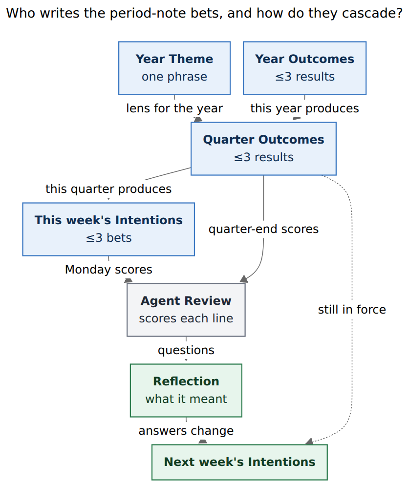
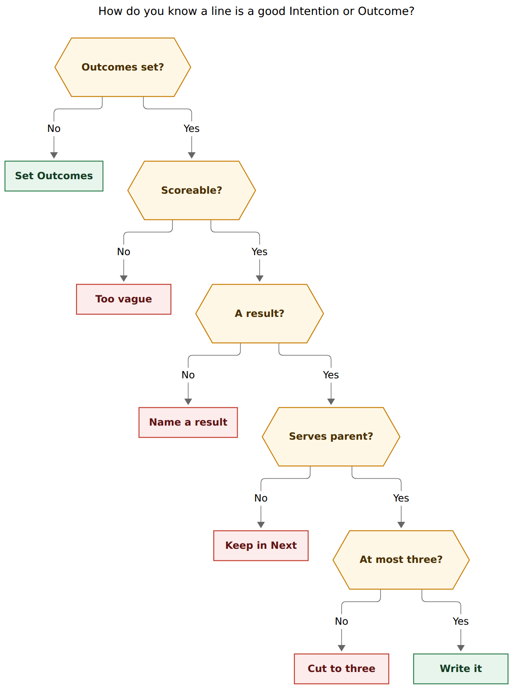

# What to write in period-note Intentions, Outcomes, and Theme

> **Research request (paraphrased).** Bryan is supposed to be manually setting
> intentions and outcomes in period notes, and has not been, mostly because he is
> not sure what to write. Help him get better at this.

**Researcher:** grk (independent swarm report).
**Date:** 2026-11-10 (Tuesday, ISO 2026-W46).
**Inputs:** live vault period notes, `gtd_daily.md` Weekly/Quarterly/Yearly rows,
`gtd.md` `^intentions-and-outcomes` (In Progress today), `h3_goal.md` / `h4_vision.md`,
`docs/periods.md`, `src/native/periods/{scaffold,instructions,brief,note}.rs`,
`bob periods list` / `show 2026-W46` / `show last-week`, prior research
`research:202611/period_note_tree_and_stats_strips` and
`research:202611/period_review_instructions_v2`. External: Locke & Latham 2002;
Gollwitzer & Sheeran 2006 / Sheeran, Listrom & Gollwitzer 2024; Moran & Lennington
*The 12 Week Year*; Singer *Shape Up* ch. 7–8; David Allen Company weekly-review
checklist. Nothing in bob-cli or the vault was changed except this report.

Renderer: `@mermaid-js/mermaid-cli` 12.0.0 with the Highlights PDF-mirroring config
(`--no-sandbox` on this host). fig-cascade 557.859 × 664 px, fit 100.0%. fig-score
825.987 × 1108 px, fit 79.0%.

---

## 0. Bottom line

Write **one to three scoreable results**, as bullets, under the heading the scaffold
already gave you. The Next lane already holds this week's work. These sections hold
what the period should **produce**.

| Heading | Where | Cap | When you write it |
| --- | --- | --- | --- |
| `## Intentions` | week note | ≤3 bets | Monday POST, looking at ↑ Outcomes |
| `## Outcomes` | quarter note | ≤3 results | first Monday of the quarter (or today, mid-Q4) |
| `## Theme` | year note | one phrase | second Monday of January (or a phrase now) |
| `## Outcomes` | year note | ≤3 results | same yearly review |
| `## Reflection` | week / quarter / year | a few sentences | after the agent Review, answering its Questions |

The live vault still has **none of these filled**. `bob periods list` on 2026-11-10:
55 period notes, 20 `drafted`, 35 `empty`, **0 `reflected`**. W46 Intentions, Q4
Outcomes, 2026 Theme, and every Reflection are blank. Yesterday's Weekly review POST
was completed (`[completion:: 2026-11-09]`) with those blanks still blank. The
blocker is the blank page, not a missing ritual.

Do this in order, today, in about five minutes:

1. Fill `## Outcomes` on `2026/2026-Q4.md` (≤3). Q4 still has eight ISO weeks
   including this one (W46–W53, through 2027-01-03).
2. Fill `## Intentions` on `2026/2026-W46.md` (≤3) so each line would make one of
   those Outcomes truer by Sunday.
3. Leave 2026 Theme optional: a single phrase if one is obvious. Year Outcomes can
   wait for the 2027-01-11 yearly review; Q4 and the ISO year end the same Sunday.

Paste-ready candidates are in [§7](#7-candidates-for-this-week-research-material).
They are research material. Agents are forbidden to write these sections; you paste
or rewrite them.

---

## 1. What the machine actually asks for

Bob creates each period note from a deterministic scaffold and **never edits**
Intentions, Outcomes, Theme, or Reflection (`docs/periods.md` §Note anatomy;
`scaffold.rs`). Agents write only `## Review`, through `bob periods draft`.

The original period-note research set the caps and the living order: *set
intentions, live it, read the draft, reflect*
(`research:202611/period_note_tree_and_stats_strips`, §6). The Monday POST row
already names the human half:

> close last week … write the Reflection · open this week's note, re-read the
> quarter's Outcomes (↑), and set ≤3 Intentions · prune …

(`gtd_daily.md` line 21, next due 2026-11-16). Quarterly review (2027-01-04):
"set ≤3 Outcomes in the new quarter's note." Yearly review (2027-01-11):
"revisit `h3_goal` and `h4_vision` · set the new year's Theme and ≤3 Outcomes."

v2 agent callouts score those lines after the period:

- week: `**Intentions:**` one line each, ✓ done · ◐ partial (name the part) ·
  ✗ not done · – no evidence, with one evidence link;
- quarter: the same marks on `**Outcomes:**`;
- year: the same marks on `**Theme and Outcomes:**`.

The brief copies your section **verbatim** into the agent's bundle
(`brief.rs` `own_sections`: week → Intentions; quarter → Outcomes; year → Theme
and Outcomes) and copies the parent's Outcomes/Theme so a week draft can see Q4.
The agent is also told to reply whether "this week's Intentions" (or this
quarter's Outcomes) is empty. Empty is currently the honest answer every Monday.

Period notes hold **no task rows**. A checkbox here would enter the `]s` walk
(`glossary:period-note`; `freshness` excludes only canonical dailies). These
headings are prose bets sitting above the task system.



*Figure 1. Bryan writes Theme and Outcomes down the tree, then the week's
Intentions. The agent scores those lines in Review. Bryan writes meaning in
Reflection. Last week's answers change next week's Intentions; the quarter's
Outcomes stay in force. (Source: `fig-cascade.mmd`; Mermaid CLI 12.0.0,
557.859 × 664 px, 100.0% PDF fit.)*

---

## 2. Why the heading feels unwriteable

Four local facts, plus one retired design, explain the stall.

**The task system already looks like a weekly plan.** Next is sticky and is
explicitly "this week's commitments" (`decisions:task-lanes-are-sticky`,
superseding `#now`). `#now` used to be "one of this week's bets," a tag Bryan
owned (`decisions:now-tag-is-user-owned`). When it retired, the *narrative* bet
moved to period notes, and the *work* bet stayed in Next. Writing Intentions
that copy Next feels redundant because it is. Intentions name **results**; Next
names **tasks**.

**There is no filled example in the vault.** W27–W45 have Reviews. Q3 has a
Review. Every human section is still an empty heading. The first live Monday
(W45, drafted 2026-11-09) asked the question this report answers:

> 1. This week's Intentions and [[2026/2026-Q4|Q4]]'s Outcomes are both empty;
>    which outcomes, if any, should W46's Intentions name?

Q3's Review, drafted 2026-11-03, asked the same at quarter scale:

> Q4 holds the period-tree rollout — which 3 Outcomes should it carry, given Q3
> closed zero reviews?

**The ritual can complete without the writing.** POST Weekly review was marked
done on 2026-11-09. W45 Reflection stayed empty. W46 Intentions stayed empty.
The original research budgeted "weekly ≤ 15 min after the draft" and "≤3
intentions." The minutes went to launching and reading the agent. Get Creative
never happened.

**The horizon notes the year Review will ask about are stale.** `h3_goal.md` is
still the 2025 Google CL-submission goal (`^z-251006-0u`, last log 2025-12-22).
`h4_vision.md` is one 2024 bullet about L5 at Google. Yearly Questions tied to
those notes will be weak until the 2027-01-11 revisit. That is a January
problem. It is not a reason to wait on Q4 Outcomes.

---

## 3. The writing test

A line earns its place if next Monday's agent can score it from vault evidence.



*Figure 2. Set parent Outcomes first. Keep a line only if it is scoreable, names
a result, would make a parent Outcome truer, and is one of at most three.
(Source: `fig-score.mmd`; Mermaid CLI 12.0.0, 825.987 × 1108 px, 79.0% PDF fit.)*

Unpacking the four keep-tests:

| Test | Pass | Fail |
| --- | --- | --- |
| **Scoreable Monday?** | An agent can mark ✓, ◐ (naming the part), ✗, or – from a completion, a shipped surface, or a linked note. | "Make progress on Bob." "Have a good week." "Focus." |
| **A result?** | Something that exists in the vault or in the world at period end. | "Work on notebooks." "Keep shipping." "Read more." |
| **Serves a parent Outcome?** | Finishing it would make a Q4 (or year) Outcome truer. | A Next-lane chore that does not move a quarterly result. Leave it in Next. |
| **At most three?** | One or two is enough. Three is the ceiling from the original research and the POST row. | A fourth bullet. Cut. Locke & Latham need specificity; Ordóñez et al. show piles of goals tunnel vision. |

Add a wiki-link (`[[bob#^notebooks]]`, `[[2026/2026-Q4]]`) so the agent has its
one evidence link. One physical line per bullet: the callout scores "one line
each," and the brief copies the body verbatim.

◐ partial is a designed mark. Write a stretch you might only finish in part.
A week of three guaranteed ✓ lines is a task dump.

---

## 4. What each heading is for

### Week · `## Intentions`

A **bet** on what this Monday–Sunday will produce. Shape Up's language is the
right one here: you are betting a cycle, with a payout, a time cap, and a clean
slate next Monday (Singer, *Shape Up*, ch. 7–8). You are not grooming Next.

Gollwitzer's split is useful and easy to mix up. A **goal intention** is "I
intend to achieve X." An **implementation intention** is "If situation Y, then
I will Z" (Gollwitzer 1999; Gollwitzer & Sheeran 2006, *d* = 0.65 across 94
tests; Sheeran, Listrom & Gollwitzer 2024, 642 tests, larger effects for
if-then format). Put the **goal intention** in `## Intentions`. Put the if-then
in the day's Pomodoros and calendar ("When the morning review closes, start a
BUILD on `^notebooks`"). The period heading has to stay scoreable as a result.

From *The 12 Week Year*: the week holds **tactics** toward the cycle's 1–3
goals (Moran & Lennington). Bob's ISO quarter is 13 weeks (14 in 2026-Q4),
close enough that week Intentions should read as this week's tactics toward
Q4 Outcomes.

Write:

```markdown
## Intentions

- Land a working `@@` notebook capture path on [[bob#^notebooks]].
- Fill [[2026/2026-Q4]] Outcomes and keep this week's Intentions current.
```

Fails the test:

```markdown
## Intentions

- Work on Bob.
- Stay on top of GTD.
- Agent work.
- Successor-offer dependencies, notebooks, gmail, and memory cleanup.
```

The first three are activities. The fourth is four bets. Next can hold all of
those tasks; this heading cannot.

A week Intention can point at a single `^id` that is already Next or WIP. That
is the whole point of the link. The difference is the **verb of completion**:
"Land X" / "Ship X" / "Decide Y" / "Write Z," which an agent can mark.

### Quarter · `## Outcomes`

A **result the quarter should be able to show**. Moran & Lennington's rule is
"no more than three 12-week goals." Bob's POST row copied that cap. Q3's
Review already asked you for three Q4 Outcomes and then you shipped the
period-note tree itself — the home those Outcomes were supposed to occupy.

An Outcome is closer to an OKR Key Result than to a GTD project. "Notebooks
exist as a note type" is an Outcome. "`^notebooks` is In Progress" is a
project state. The agent will score the Outcome against Finished, Shipped,
and linked minutes, so write the result you want the quarter Review to be
able to tick.

Write:

```markdown
## Outcomes

- Remaining weeks of Q4 have Intentions, and this note's Outcomes stay filled.
- [[bob#^notebooks]] is a daily capture path: `@@` works, and useful notes live in notebooks.
- Gmail is in the morning loop beyond the PRE sync chore (a real label, watch, or `bob sync` wrapper).
```

Fails the test:

```markdown
## Outcomes

- Keep building Bob.
- Clean up SASE.
- Have a quieter GTD week.
```

Those cannot be marked ✓. "Keep building Bob" is Q3's actual time share
(bob 10% of Q3 after sase 69%) dressed as a goal. Locke & Latham 2002: specific,
difficult goals outperform "do your best" (meta-analytic *d* = 0.42–0.80)
because do-your-best has no external referent.

Q4 is already at W46 of W40–W53. Mid-cycle Outcomes are still worth writing.
Shape Up bets one cycle at a time and keeps the slate clean; here the cycle is
already running, so the bet is on the **remaining** eight weeks. Write results
that can still happen by 2027-01-03.

### Year · `## Theme` and `## Outcomes`

**Theme** is one phrase, a lens, the thing a later reader should remember the
ISO year by. The year callout scores it with the same ✓ ◐ ✗ – marks, so a
pure mood ("Balance") will come back as – no evidence. A lens that predicts
where time went can be scored ("Ship Bob's daily GTD loop" can be checked
against root-parent shares and shipped `^prj` lines).

**Year Outcomes** are the three results of the ISO week-year (this year:
2025-12-29 – 2027-01-03). With eight weeks left, year Outcomes and Q4 Outcomes
cover the same remaining days. Filling both with different lists splits
attention. Fill Q4 now. At the 2027-01-11 yearly review, either promote the
Q4 Outcomes that landed, or write 2027's.

A Theme you could set today, if a phrase is ready:

```markdown
## Theme

Ship Bob's weekly loop: period notes, capture, and the morning walk agree.
```

`h3_goal` / `h4_vision` are the yearly Review's other inputs. Revisit them in
January. They do not gate Q4.

### After the period · `## Reflection`

This is the other Bryan-owned heading, and it is also empty everywhere.
Di Stefano, Gino, Pisano, and Staats found the performance gain from
reflection came from people stating **their own** lessons. Tannenbaum &
Cerasoli's debrief meta-analysis is the same split the period notes already
encode: the agent gathers; you decide.

Write two or three sentences that answer last week's Questions. W45's two
questions are sitting unanswered:

1. Which Q4 Outcomes should W46's Intentions name?
2. What keeps successor-deps, the `/sase_plan` critique, and the gate/monitor
   finalizer open after three keeps with no reason?

A Reflection that recaps Shipped is wasted: the Review already did. A
Reflection that answers those two questions **is** next week's Intentions.

GTD's weekly review has three phases (David Allen Company one-page checklist,
also the 2009 GTD Times write-up): Get Clear, Get Current, Get Creative. The
agent draft is Get Current for last week. Lane pruning is Get Current for
this week. Intentions plus Reflection are Get Creative. POST currently
completes after Get Current.

---

## 5. How this sits on top of Next, not inside it

| Surface | Job | Owner | Cadence |
| --- | --- | --- | --- |
| Next / WIP | this week's committed **tasks** | you, via capture and Alt+N | daily walk |
| Week Intentions | this week's **results** | you | Monday, ≤3 lines |
| Quarter Outcomes | this quarter's **results** | you | quarter turn, ≤3 lines |
| Year Theme | the year's **lens** | you | January, one phrase |
| Agent Review | what the period **produced**, scored against your lines | agent via `bob periods draft` | Monday PRE launch |
| Reflection | what it **meant**, and what changes | you | Monday POST, after the draft |

A task can be Next without being an Intention. An Intention should usually
have at least one Next or WIP task behind it, or it is a wish. The Monday
prune (NEXT ≤15, PENDING ≤10) is how you make the task layer fit the bets.
Do the bets first, then prune so Next serves them.

---

## 6. A five-minute Monday (and a five-minute Tuesday)

The POST row's order is already the right one. Spell the writing:

1. **Last week.** Open it from today's week link, then ‹. Read the Review.
   Write Reflection as answers to its Questions (two or three sentences).
2. **Parent Outcomes.** Follow ↑. If `## Outcomes` is empty, write ≤3 for the
   **remaining** quarter, using Figure 2. Stop here if this is a quarter-turn
   Monday.
3. **This week's Intentions.** Back on this week's note. For each Outcome,
   ask "what would make this truer by Sunday?" Keep at most three lines.
   Link each to a `[[note#^id]]`.
4. **Prune.** Release Next/Pending that do not serve those lines. Promote
   from Ready only what would.

Today is Tuesday of W46. Steps 2 and 3 still pay: five days remain, and Q4
has eight weeks including this one. Step 1 (W45 Reflection) still pays: those
Questions are the prompt for step 3.

If you stall on a line, steal from last week's **Carried forward** and rewrite
it as a result. W45 carried:

- [[sase_memory_plan#^ref-docs-backed-memory-and-agent-maintained|Docs as Memory]]
  · kept 3×, also in W44, reason "I still really need to clean up sase's memory."
- [[sase#^agent-hijack-turns|Agent hijack turns]]
- [[sase#^ref-the-ai-native-sdlc-playbook|The AI-native SDLC playbook]]

At most **one** of those becomes a week Intention, and only if it serves a Q4
Outcome. The other two stay as Next/Ready/keep-or-drop questions.

---

## 7. Candidates for this week (research material)

These are checked against Figure 2 and against live vault state on 2026-11-10.
They are **not** a vault edit. Agents must not write them. Paste, rewrite, or
throw them out.

W46 so far: 5h 35m Worked, bob 54% · gtd 33% · sase 11% (`bob periods show
2026-W46`). WIP already on the board: `gtd#^intentions-and-outcomes` (this
question), `bob#^notebooks` (WIP, keep 1× today), `bob#^fix-record-type-previews`.
`bob#^period-agent-instructions` completed 2026-11-10, which unblocked
`^intentions-and-outcomes`.

### Q4 Outcomes — write these on `2026/2026-Q4.md`

```markdown
## Outcomes

- Period notes are in use: remaining weeks have Intentions, and this note's Outcomes stay filled.
- [[bob#^notebooks]] is a daily capture path (`@@` works; useful notes live in notebooks).
- Gmail is in the morning loop beyond PRE sync (a real label, a watch, or the `bob sync` wrapper).
```

Why these three:

1. Q3 already asked for them. W45 shipped the templates. Use is the remaining
   result. Scoreable: count of non-empty Intentions in W46–W53, and this
   heading non-empty at quarter-end.
2. `^notebooks` is today's WIP with a keep reason ("still in progress and has
   some bugs"). Eight weeks is enough to land a capture path. Scoreable: a
   completion, or a working `@@` in capture plus notes living in notebook
   files.
3. `^gmail-sync` completed 2026-11-09; `^bob-sync` and `^auto-label-kelly-emails`
   still depend on that work. PRE already runs `gmail sync`. The Outcome is
   the **loop**, one level above the chore. Scoreable: a shipped label/watch
   path or `bob sync` wrapping the morning commands.

Docs as Memory has been carried two weeks. It is a real need and a bad Q4
Outcome: it has no done-shape yet, and it would crowd out notebooks. Leave it
as a keep/drop on the task, or make it a 2027 Outcome after a shaped pitch.

### W46 Intentions — write these on `2026/2026-W46.md` after Q4 Outcomes exist

```markdown
## Intentions

- Write Q4 Outcomes and this week's Intentions ([[gtd#^intentions-and-outcomes]]).
- Move [[bob#^notebooks]] to a working `@@` capture path, or name the part that shipped.
- Give [[bob#^successor-deps]] a keep reason or release it from Next.
```

Why these three:

1. This is the task already linked on today's ledger. Closing it **is** filling
   the headings. Scoreable this Sunday: the two sections are non-empty.
2. Matches Q4 Outcome 2 and the current WIP. ◐ is allowed: "capture works,
   migration does not."
3. Answers W45 Question 2 for the one of those three-keep rows that lives in
   bob and is still Next. "A keep reason or a release" is scoreable from the
   Rotten Log or an Alt+N. The other two 3× keeps (`/sase_plan` critique,
   e2e-gate-finalizers) stay out so the list stays at three.

Two lines is enough if successor-deps does not belong in this week's bets.

### Optional 2026 Theme — `2026.md`

```markdown
## Theme

Ship Bob's weekly loop.
```

Skip year Outcomes until January, when Q4's three can be promoted or replaced.

---

## 8. Format that the brief and the scorer can read

- **Bullets under the exact `##` heading.** Bodies are parsed as the text until
  the next `## `, the `[!agent]` callout, `## Archive`, or EOF, blank lines
  trimmed (`note.rs`).
- **One physical line per bet.** The callout scores "one line each."
- **A wiki-link on every line** so the agent's "one evidence link" is already
  there.
- **No checkboxes, no `#task`.** Period notes must not grow walk rows.
- **No numbers you would have to invent.** The agent copies counts from the
  brief. Your job is the bet, not the metric.
- **Empty is worse than short.** v2 still has to score the heading. One good
  line beats three vague ones, and both beat a blank.

You may edit these sections any time. They are yours. Mid-week tightening of
an Intention (narrowing "notebooks" to "`@@` works") is a better bet, not a
broken ritual.

---

## 9. What the literature is doing in this design

Bob already picked the structure. The writing rules above are those sources
applied to **your** headings:

| Source | Claim used here | Where it lands |
| --- | --- | --- |
| Locke & Latham 2002 | Specific, difficult goals beat "do your best" (*d* = 0.42–0.80). Feedback is part of the effect. | Scoreable result language; the agent Review is the feedback. |
| Gollwitzer & Sheeran 2006; Sheeran et al. 2024 | Goal intention ≠ implementation intention. If-then helps (*d* ≈ 0.65 / 0.27–0.66), especially when rehearsed. | Results in the heading; if-then in the day's plan. |
| Moran & Lennington, *The 12 Week Year* | 1–3 goals per ~12-week cycle; weekly tactics; weekly score. | Quarter Outcomes; week Intentions; Monday scoring. |
| Singer, *Shape Up* ch. 7–8 | Bets, not backlogs. A bet has a payout, a time cap, and a clean slate. Important ideas come back. | ≤3 lines; unused Next items can wait; Carried forward is a lobby, not an automatic Intention. |
| David Allen Company weekly review | Get Clear / Get Current / Get Creative. Get Creative looks at someday and at larger outcomes. | Reflection + Intentions = Get Creative; the agent + lane prune = Get Current. |
| Ordóñez, Schweitzer, Galinsky, Bazerman, *Goals Gone Wild* (2009) | Too many goals cause tunnel vision and hiding. | The hard cap of three. |
| Tannenbaum & Cerasoli 2013; Di Stefano et al. | Debriefs help; the gain is from *your* lessons. | Agent describes; you reflect. |

Library check: 0 of 24 candidates already in your `ref/` library (0 finished).
Coverage is `ref/` only; zorg-era reading outside `ref/` is not indexed.
`horizon.md` still cites `[@gtd]`, so GTD is in the vault's older layer even
though `bob ref find` returned `not_found` for the book title.

Propose, if you want them in the library:

```
bob ref create https://basecamp.com/shapeup
bob ref create https://gettingthingsdone.com/2009/05/the-gtd-weekly-review/
bob ref create https://doi.org/10.1037/0003-066X.57.9.705
```

---

## 10. How to tell it is working

From the vault, starting this Sunday (W46 close, 2026-11-16):

- Q4 `## Outcomes` has 1–3 bullets with links.
- W46 `## Intentions` has 1–3 bullets with links.
- The W46 Review's `**Intentions:**` lines are ✓ / ◐ / ✗ / –, not omitted.
- W45 `## Reflection` answers at least one of its two Questions.
- Over the next four Mondays (W47–W50): share of weeks with non-empty
  Intentions, and share of weeks with a Reflection. The v2 period-review
  research already named these as the human-half measures.

A week with ✗ on an Intention is a working loop. A month of blank headings
and completed POST rows is the current failure mode.

---

## Sources

**Vault and CLI (2026-11-10, apollo, read-only):**

- `docs/periods.md` §Note anatomy, §Agent instruction callouts (v2), §Agent briefs.
- `src/native/periods/scaffold.rs`, `instructions.rs` (v2), `brief.rs`
  (`own_sections`, `parent_outcomes` / `parent_theme`), `note.rs` (section parse).
- `bob periods list -f json`: 55 notes, 20 drafted, 35 empty, 0 reflected.
- `bob periods show 2026-W46`: current, 5h 35m so far, bob 54% / gtd 33% / sase 11%.
- `bob periods show last-week`: 2026-W45 closed, 24h 45m, bob 45% / gtd 28% / sase 12%.
- `~/bob/2026/2026-W45.md` Review (drafted 2026-11-09), empty Intentions and Reflection.
- `~/bob/2026/2026-W46.md`, `2026/2026-Q4.md`, `2026.md`: human sections empty.
- `~/bob/2026/2026-Q3.md` Review (drafted 2026-11-03), empty Outcomes and Reflection.
- `~/bob/gtd_daily.md` lines 21–27 (Weekly / Quarterly / Yearly / launch rows).
- `~/bob/gtd.md` `^intentions-and-outcomes` (WIP, depends on completed
  `bob#^period-agent-instructions`).
- `~/bob/bob.md` Next/WIP (`^notebooks`, `^successor-deps`, `^bob-sync`,
  `^gmail-sync` done 2026-11-09).
- `~/bob/h3_goal.md`, `h4_vision.md`, `horizon.md`.

**Prior research (audited `sase artifact read`):**

- `research:202611/period_note_tree_and_stats_strips/period_note_tree_and_stats_strips__final.md`
  — ≤3 intentions, living order, Monday ritual text.
- `research:202611/period_review_instructions_v2/period_review_instructions_v2__final.md`
  — empty Intentions confirmed 2026-11-09; v2 scoring; W45 Questions.
- `research:202611/gtd_checklist_stages_and_period_prep/gtd_checklist_stages_and_period_prep__final.md`
  — PRE launch / POST Weekly review split.

**Memory:** `glossary:period-note`, `glossary:stats-strip`;
`decisions:now-tag-is-user-owned` (weekly bet, superseded);
`decisions:task-lanes-are-sticky`; `decisions:today-is-read-from-the-ledger`.

**External:**

- Locke, E. A., & Latham, G. P. (2002). Building a practically useful theory of
  goal setting and task motivation. *American Psychologist, 57*(9), 705–717.
  https://doi.org/10.1037/0003-066X.57.9.705
- Gollwitzer, P. M., & Sheeran, P. (2006). Implementation intentions and goal
  achievement: A meta-analysis. *Advances in Experimental Social Psychology, 38*,
  69–119.
- Sheeran, P., Listrom, O., & Gollwitzer, P. M. (2024). The when and how of
  planning: Meta-analysis of implementation intentions in 642 tests.
- Moran, B. P., & Lennington, M. *The 12 Week Year*.
- Singer, R. *Shape Up*, ch. 7 "Bets, Not Backlogs" and ch. 8 "The Betting Table."
  https://basecamp.com/shapeup/2.1-chapter-07
  https://basecamp.com/shapeup/2.2-chapter-08
- David Allen Company. The GTD Weekly Review (Get Clear / Get Current / Get
  Creative). https://gettingthingsdone.com/2009/05/the-gtd-weekly-review/
- Ordóñez, L. D., Schweitzer, M. E., Galinsky, A. D., & Bazerman, M. H. (2009).
  Goals gone wild. *Academy of Management Perspectives.*
- Tannenbaum, S. I., & Cerasoli, C. P. (2013). Do team and individual debriefs
  enhance performance? *Human Factors.*
- Di Stefano, G., Gino, F., Pisano, G., & Staats, B. *Learning by Thinking*
  (SSRN).
